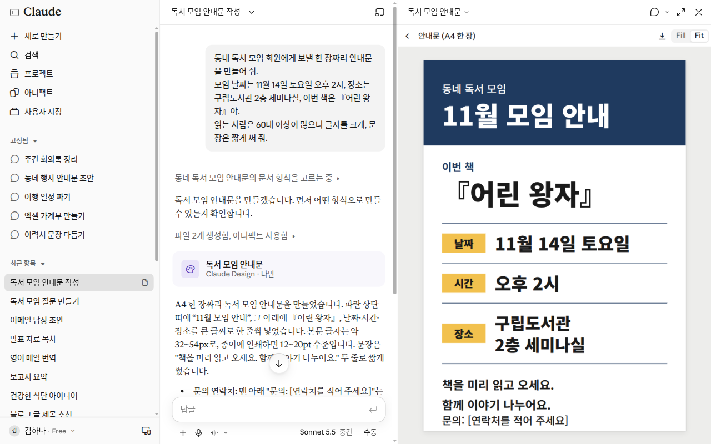

# Chapter 4. Files and Artifacts — Show Files and Get Files Made

> **One-line summary**: For materials that are hard to explain in words, **upload them as files** to show Claude, and when you need documents, spreadsheets, or presentations, **ask Claude to make them as files**.
> Results worth showing to others open beside your chat as **artifacts**, where you can edit and share them. However, Claude does not generate photos or illustrations.

The screens shown here are based on the web version as of October 2026. Because the new Claude layout and the new Settings layout are rolling out gradually, your screen may look different. The mobile app supports slightly different features.

## Uploading Files

Click the "+" button in the lower-left corner of the message box and choose ① "Upload or add files (파일 업로드 또는 추가)". The keyboard shortcut is Ctrl+U.[^screen] You can also drag and drop files into the message box. For images, you can copy and paste them directly.[^upload]


This is the free plan screen. **When uploading a file, you only need ①.**[^screen][^upload-name] We cover ⑥ "Memory (메모리)" in [Chapter 3](03-chats.md) and [Chapter 5](05-memory.md).

Here is what you can upload.[^upload]

| Type | Formats |
|---|---|
| Images | JPEG, PNG, GIF, WebP |
| Documents | PDF, Word (DOCX), Text (TXT), RTF, ODT, EPUB, HTML |
| Spreadsheets | Excel (XLSX), CSV |
| Other | JSON |

To upload Excel files (XLSX), "Code execution and file creation (코드 실행 및 파일 생성)" must be turned on in Settings. We look at this setting in the next section.[^upload]

Rather than just uploading a file and saying "take a look," write down what you want along with it. You will get a much more useful answer ([Stage 1, Chapter 4](../00-common/04-prompt-basics.md#the-5-elements-of-a-good-prompt)).

```
The attached PDF is my apartment maintenance fee bill.
Find the three items that went up the most compared to last month, show them in a table, and write one line for each on why it might have gone up.
Mark anything uncertain as "Guess".
```

::: details What the answer looks like (Example — click to expand)
This is an example created for this guide. Actual answers vary by service and each time you ask.

> Here are the three items that went up the most compared to last month.
>
> | Item | Last Month | This Month | Reason for Increase |
> |---|---|---|---|
> | Heating | ○○ won | ○○ won | You may have used more heating as the weather got colder (Guess) |
> | Electricity | ○○ won | ○○ won | Shared electricity usage may have gone up (Guess) |
> | Repair & Maintenance | ○○ won | ○○ won | (Reason stated in the bill's notice) |

**Check if you got a good answer**: Did the three items that increased the most come back in a table? Do the amounts in the table match your bill? Is there a one-line reason for each, with "Guess" attached to any reason not backed by the bill?

:::

Things to keep in mind.[^upload]

- **You can upload up to 20 files per chat.**
- **PDFs can be up to 1,000 pages.** Up to 100 pages, Claude reads images and charts too. From page 101 onward, it reads text only. If images in a PDF are important, split out and upload only the pages you need.
- **For non-PDF documents, Claude reads text only.** It cannot read images placed inside a Word file. If the images matter, convert the file to PDF before uploading.
- **Images work best when they are at least 1,000 pixels wide and tall.**
- **Refer to PDF pages by the page number shown on screen.** Use the number shown in your PDF viewer, not the page number printed on the document itself.

If a large file won't upload, try splitting it into smaller parts.

::: details How large can a single file be? (Click to expand)
Different help pages state different size limits for a single file. The file upload help page states 500MB per file.[^upload] The file creation help page states 30MB per file for both uploads and downloads.[^create]
:::

> Before uploading files that contain personal information—such as ID cards, contracts, or medical records—cover or remove those details first. We covered this principle in [Stage 1, Chapter 9](../00-common/09-safety.md#_2-personal-info-and-secrets-—-think-once-before-putting-them-in).

<Quiz id="ch204-upload" />

## Getting Files Made — Excel, Word, PowerPoint, and PDF

Claude doesn't just reply in text—it can also **create files** for you. You can download them or save them directly to Google Drive.[^create]

| File Created | Examples |
|---|---|
| Excel (.xlsx) | Household budget, schedule |
| Word (.docx) | Notice, report |
| PowerPoint (.pptx) | Presentation slides |
| PDF | Printable document |
| PNG image | Chart drawn from numbers |

This works on all plans, including the free plan. It works on the web, desktop, and mobile apps.[^create] Claude can also create spreadsheets with working formulas and presentations you can open in PowerPoint.[^new]

**First, check that the setting is turned on.** On individual plans (Free, Pro, Max), it is turned on by default.[^create] If it is off, go to "Settings > Capabilities (설정 > 기능)" and turn on ④ "Code execution and file creation (코드 실행 및 파일 생성)".[^create][^create-name]


This is the free plan screen. **The red numbers match the numbers in the table below.**[^screen]

| Number | Name | What It Does |
|---|---|---|
| ① | "Switch model when message is flagged" | Continues with another model if a safety filter is triggered |
| ② | "Artifacts (아티팩트)" | Creates deliverables in a panel beside your chat |
| ③ | "In-chat visualizations (채팅 내 시각화)" | Draws charts and diagrams right inside your chat |
| ④ | "Code execution and file creation" | Creates documents, spreadsheets, presentations, and PDFs |

Under ② "Artifacts," it says "Required for code execution and file creation." Under ④, it says "Required to use Skills."[^screen] To get files made for you, just make sure ④ is turned on.

When you make a request, be specific about the structure, content, and formatting you want.[^create]

```
Create an Excel spreadsheet to track monthly living expenses.
Use Food, Transportation, Phone/Internet, and Other as the categories, and make the bottom rows automatically calculate totals by category and by month.
```

You can also upload an existing file and ask Claude to edit it.

```
The attached Word file is a flyer for our neighborhood book club.
Change the date to Saturday, November 14 at 2:00 PM, add a list of things to bring at the bottom, and give it back to me as a Word file.
```

Things to keep in mind.

- **Creating files uses more of your usage limit than normal chats.**[^create] We looked at usage limits in [Chapter 1](01-getting-started.md). Get short answers as text, and ask for files only when you really need a file.
- **Double-check the numbers you get.** Claude can do math, but you should verify complex or important calculations with another spreadsheet program or by hand.[^math] Add up at least a few totals yourself.
- **Uploaded files or websites may contain hidden instructions.** Keep an eye on Claude while using this feature, and stop it if it starts using unexpected data.[^create] We covered hidden instructions in [Stage 1, Chapter 9](../00-common/09-safety.md#_4-hidden-instructions-—-prompt-injection).

<Quiz id="ch204-create" />

## Artifacts — Results That Open Beside Your Chat

An **artifact** is a finished result worth showing to others. It could be a document, presentation slides, a design, or a small tool. It opens in a panel beside your chat, and you can edit it, open it again later, or share it with others.[^artifacts]
Artifacts work on all plans, including the free plan. "Code execution and file creation" from the previous section must be turned on.[^artifacts]

It is easy to confuse artifacts with file creation from the previous section. The difference is how you receive the result.[^academy-artifacts]

| | Artifact | File Creation |
|---|---|---|
| Where it opens | Inside Claude, in a panel beside your chat | Downloaded and opened in another app |
| How you share it | Share via link | Send the file |

If you want to keep editing the result inside Claude or share it with a link, ask for an artifact. If you need an actual Word or Excel file right away, use file creation. You can also export an artifact later as a file like Word or PDF (see "Exporting as a file" below).[^artifacts]



*This screen was created using the flyer prompt below. At the top of the right panel, there is a download button along with "Fill" and "Fit" (zoom size) buttons. "Only you (나만)" on the card means only you can see it right now. The chat and artifact were deleted after taking the screenshot.*[^screen-design]

There are three ways to create an artifact.[^artifacts]

- Just ask for one in your chat.
- Click "Output (출력)" in the message box and choose a template (a starting layout such as a document or presentation).
- Choose a template from the "Artifacts (아티팩트)" tab in the left sidebar.


This is the free plan screen. Even on a free account, you can see "Document (문서)", "Slides (슬라이드)", and "Design (디자인)" under ② "Create something new (새로운 무언가 만들기)". All three have a "New (신규)" badge.[^screen] These cards are the templates for the third method. Use the ① tabs to switch between what you made and what others have shared with you.[^screen]

```
Create a one-page flyer to send to members of our neighborhood book club.
The meeting is on Saturday, November 14 at 2:00 PM in Seminar Room on the 2nd floor of the district library, and this month's book is "The Little Prince".
Many readers are in their 60s or older, so make the text large and keep sentences short.
```

If you want an artifact, **ask for the deliverable, not just the content.**[^academy-artifacts]

- Weak example: "Summarize our Q3 results."
- Better example: "Create a one-page document of our Q3 results for team leads to read."

There is one difference. The better example names what to build. If you want to make sure you get an artifact, add "Create this as an artifact."[^academy-artifacts]

**Tell Claude who will use it.** In the flyer example above, writing "Many readers are in their 60s or older" does exactly that. "A flowchart for new hires" and "a flowchart for the engineering team" will come out very differently.[^academy-artifacts]

**It helps to build the artifact after talking things through.** You get the best results when Claude already understands the problem.[^academy-artifacts] Try finishing your analysis together first, then asking for presentation slides.

Everything you make is saved in the "Artifacts" tab in the sidebar. You can find it again from any chat.[^artifacts]

**Highlight and edit just the part you want.** In a document artifact, highlight the text you want to change with your mouse and click "Edit with Claude (Claude로 편집)". Then type what you want.[^artifacts] You don't have to explain in words which part you mean.

**Try a different direction.** If you edit an earlier message and send it again, your chat branches into a new version. That branch gets its own artifact, so you don't lose what you made before.[^artifacts]

**Exporting as a file.** Click "Export (내보내기)" to download a file you can open in another program.[^artifacts]

| What You Made | Formats You Can Export To |
|---|---|
| Document | Word, PDF, Markdown, Google Docs |
| Presentation | PowerPoint, PDF, Google Slides |
| Animation (Team & Enterprise beta only) | MP4 video |

Things to keep in mind.[^artifacts]

- **If an error occurs, try clicking "Try fixing with Claude (Claude로 수정 시도)".** However, there is no guarantee it will fix the issue.
- **On the mobile app, you can request, view, and edit artifacts.** To change sharing settings, use the web or desktop app.
- **Anything made before September 16, 2026 is a "Legacy artifact (레거시 아티팩트)".** You can still use it, but you cannot create new ones the old way.

<Quiz id="ch204-artifacts" />

## Sharing Artifacts

Artifacts **start out visible only to you.** Nothing is shown to anyone else until you share it.[^share]

1. Open the artifact and click "Share (공유)".
2. Choose who can see it. On Pro and Max plans, choose between "Only you (본인만)" and "Anyone with the link (링크가 있는 누구나)".
3. Copy the link and send it.

<!-- 스크린샷 필요: 아티팩트 「공유」 창 — 「본인만」「링크가 있는 누구나」와 권한 선택 (웹) -->

There are three permission levels. Depending on the type of artifact, only some options may be available.[^share]

| Permission | What They Can Do |
|---|---|
| "Can view (볼 수 있음)" | Open and view, read comments |
| "Commenter (댓글 작성자)" | Everything above, plus leave comments and download files |
| "Can edit (편집 가능)" | Everything above, plus make changes |

Things to keep in mind.[^share]

- **The person opening it also needs a Claude account.** Without an account, they cannot open it even with the link. This is different from public chat links (Chapter 3).
- **To stop sharing,** go to "Share" and change it back to "Only you" (Pro and Max).
- **Treat an artifact sent by someone else the same way you would treat a file from a stranger.**

::: details If you are on the free plan (Click to expand)
Different help pages say different things about whether the free plan can share with "Anyone with the link." Follow the options you see in the "Share" window on your screen.
:::

<Quiz id="ch204-share" />

## Visual Answers — Cards, Prompts, and Diagrams

Depending on your question, Claude sometimes replies with a **visual layout** instead of plain text. There is nothing special you need to turn on. Claude decides on its own, so just ask naturally.[^visual]

**Weather and recipe cards.** When you ask about the weather or a recipe, Claude can reply with a card. Web search must be enabled.[^visual] On the new layout, there is no web search toggle—Claude searches the web on its own when needed.[^new][^old-search] On a recipe card, you can change the number of servings and the units of measurement.[^visual] Weather cards appear only on the web and desktop; on mobile phones, weather comes back as text.[^visual]

**Click to answer.** When Claude asks a follow-up question, it may show interactive choices you can click—such as multiple choice, multi-select, or ranking options. You can click your answer or just reply in text.[^visual]

**Diagrams and charts.** If you want to see an explanation as a diagram, just ask for one. Claude draws flowcharts, charts, and interactive visuals right inside your chat. This feature is called **Custom visuals** (맞춤 시각화). It is in beta (a preview before official release) and works on the web and desktop apps.[^custom] In "Settings > Capabilities," there is also switch ③ "In-chat visualizations (채팅 내 시각화)". Its description reads: "Allow Claude to generate interactive visualizations, charts, and diagrams directly during conversations."[^screen]

```
Draw a step-by-step flowchart for making kimchi, from salting the cabbages to packing them into containers.
```


*This screen shows the prompt above sent in an incognito chat. Hovering the mouse over the diagram did not bring up the "Copy as image" or "Save as artifact" menus.*[^screen-design]

Like a sketch on a whiteboard, a custom visual is a **temporary drawing that is not saved separately**. The help docs list the three menu options below for keeping one. Because these menus did not appear on the screen above, check your own screen first to see if they are there.[^custom][^screen-design]

- "Copy as image (이미지로 복사)": Copy it as a picture to paste into notes or slides.
- "Download (다운로드)": Save it as an .svg or .html file.
- "Save as artifact (아티팩트로 저장)": Turn it into an artifact so you can keep editing it.

Custom visuals do not appear on the mobile app (iPhone and Android).[^custom]

<Quiz id="ch204-visuals" />

## Claude Does Not Generate Photos or Illustrations

Claude **does not generate photos or illustrations** the way image-drawing AI tools do.[^images] Even if you ask for "a picture of a dog smiling on the beach," you shouldn't expect an illustration like the ones made by image-generating AI.

Here is what it can do instead.

- **It makes diagrams and charts.** Those are the custom visuals from the previous section.[^images] You can also get number charts as PNG image files.[^create]
- **It can look at photos you upload and explain them.** For example, it can organize a photo of a receipt into a table.[^images]

Compare a weak request with a better one.

- **Weak example**: "Draw a cute cat illustration to promote our shop."
- **Better example**: "Draw a bar chart of our shop's sales over the past 6 months."

There is one difference. The first is an illustration meant for an image-generating AI, while the second is a chart Claude can make. If you really need a photo or illustration, use another service that generates images. For example, ChatGPT can create images ([ChatGPT Chapter 4](../11-chatgpt/04-files-images.md)).

<Quiz id="ch204-images" />

## Claude Docs — Documents You Write Together

**Claude Docs** are documents you edit together with Claude and with other people. Claude drafts the document right in front of you. Before writing, it asks clarifying questions first, and it leaves comments explaining why it wrote things a certain way.[^docs]
It works on all plans, including the free plan, and is turned on by default.[^docs] Documents you create are saved in the "Artifacts" tab.

Here is how to start.[^docs]

- Ask Claude to create a document in your chat.
- Type `/docs` at the very beginning of your message.
- Choose "Output (출력)" → "Docs (문서)" in the message box.

A good request includes **what the document is for, who will read it, and what it should cover**.[^docs]

- **Weak example**: "Write a family trip plan document."
- **Better example**: Include the purpose, readers, and contents like below.

```
/docs Create a family trip plan document for Jeju Island in December.
Purpose: I want to post it in our family group chat to gather everyone's opinions.
Readers: Parents and sibling families, 8 people in total.
What to cover: A 3-day, 2-night itinerary, two lodging options, estimated budget, and what each person needs to pack.
```

There are three differences. The better example includes what it is for, who will read it, and what to put inside. Those are the three ingredients of a good request.[^docs]

Things to keep in mind.[^docs]

- **To ask for an edit, mention `@Claude` in a comment.** After making the change, Claude explains why.
- **Click "Export (내보내기)" to get it as Word, PDF, Markdown, or Google Docs.**
- **Charts inside a document do not update automatically.** If the numbers change, ask Claude to refresh the chart.
- **Deleting a document cannot be undone.** There is no trash bin. Export a copy before you delete it.

<Quiz id="ch204-docs" />

## Using Claude Inside Google Docs, Sheets, and Slides

If you already work in Google Docs or Sheets, you can also bring Claude right inside those files. It is an extension called **Claude for Google Workspace**. It adds a Claude panel (sidebar) to Google Docs, Sheets, and Slides. It is in beta and works on paid plans (Pro and above).[^gws]

1. Install Claude from the Google Workspace Marketplace. Installing it once covers Docs, Sheets, and Slides.
2. Open a file and click "Extensions > Claude > Open Claude (확장 프로그램 > Claude > Claude 열기)".

<!-- 스크린샷 필요: Google 시트 오른쪽에 Claude 사이드바가 열린 화면 (예시 시트) -->

```
Add up all the amounts in column B of this sheet and put the total in the bottom cell. Don't touch any other cells.
```

Things to keep in mind.[^gws]

- **Claude reads only the file you currently have open.**
- **At first, it asks before making changes.** The default mode is "Ask before edits (편집 전에 묻기)". You can switch it to "Accept all edits (모든 편집 수락)", but try checking edits one by one at first.
- **Edits are recorded under your name in version history.** If you don't like a change, go to "File > Version history (파일 > 버전 기록)" to restore an earlier version.
- **Claude cannot share files or change permissions.** It won't do that even if you ask.
- **It does not work on Word, Excel, or PowerPoint files.** Convert them to Google format first.
- **Do not close the Claude panel while it is working.** Closing it stops what it is doing. A single task can run for up to 6 minutes, so break large jobs into smaller pieces.
- **It works in Chrome, Edge, and Safari.** Firefox is not supported.

<Quiz id="ch204-google" />

## Watch a Video to Learn More

This is an official intro video made by the company. The screens and feature names may differ from the explanations in this chapter.

> The video below is in **English**. If you need subtitles, click the settings (gear icon) on the YouTube video → Subtitles/CC and choose your language. The video plays right on this page.

**[Meet Claude Slides, Claude Design and Claude Docs](https://www.youtube.com/watch?v=To5nrYqvR44)** · Claude · For anyone who wants to see presentation slides, promotional graphics, and one-page documents being made right inside a chat (September 2026, 2 min)

<YouTube id="To5nrYqvR44" title="Meet Claude Slides, Claude Design and Claude Docs" />

## Try It Yourself

1. Take a photo of a receipt at home, upload it via "+" → "Upload or add files," and ask: "Organize what's written here into a table" (cover your name and card number first).
2. Ask Claude to make the monthly living expenses Excel spreadsheet from earlier and download it. Type in a few numbers and check if the totals update properly.
3. Create the book club flyer as an artifact, then ask Claude to change the date. If it opened as a document artifact, highlight the date with your mouse and click "Edit with Claude."
4. Send "Draw a flowchart of the steps for making kimchi" and see if a flowchart is drawn inside your chat. If you see the "Save as artifact" menu on the diagram, try clicking it.

**Continuing Exercise** ([Preparing for the Book Club](../00-common/practice-kit.md)): Upload the sample file minutes-last-meeting.txt and send: "Split this into a table of Decided, To-Do, and Not Decided Yet. For each To-Do, include the person in charge and the due date, and if there is no due date, write 'TBD'." For step 3 above, try making the flyer using the contents of memo-next-month.txt.

## Summary

- Upload photos, documents, and spreadsheets via "+" → "Upload or add files." You can upload up to 20 files per chat, and PDFs up to 1,000 pages.
- For PDFs, Claude reads images too up to page 100, and text only after that. For non-PDF documents, it reads text only.
- You can ask Claude to create Excel, Word, PowerPoint, and PDF files. "Code execution and file creation" must be turned on, and it uses more of your usage limit.
- Artifacts are results that open beside your chat. They are saved in the "Artifacts" tab, edited with "Edit with Claude," and downloaded as files via "Export."
- Artifacts start out visible only to you. Anyone you share them with also needs a Claude account to open them.
- Custom visuals are temporary drawings that aren't saved automatically. Copy, download, or save them as artifacts to keep them.
- Claude does not generate photos or illustrations. It does make diagrams and charts.
- When requesting a Claude Doc, include its purpose, readers, and what to cover. Deleting one cannot be undone.
- You can also use Claude inside Google Docs (beta for Pro and above). Restore earlier versions through version history if needed.

## Key Terms

| Term | One-line meaning |
|---|---|
| Upload | Sending a file from your device to a service |
| Artifact | A result worth showing others that opens beside your chat |
| Template | A starting layout for a document or presentation |
| Export | Downloading your work as a file you can open in another app |
| Custom visuals | Diagrams and charts drawn right inside your chat |
| Beta | A feature being tested before its official release |
| Claude Docs | Documents you edit together with Claude and other people |
| Extension | A small add-on program that adds features to another app |
| Version history | A saved log of how a file has changed over time |

<ChapterDone :chapter="204" />

Next chapter: [Chapter 5. Memory and Custom Instructions](05-memory.md)

[^screen]: Verified directly on the Claude web screen (Free plan, Korean UI). "파일 업로드 또는 추가" / "코드 실행 및 파일 생성" / "코드 실행 및 파일 생성에 필요" / "Skills 사용에 필요합니다" / "채팅 내 시각화" / "새로운 무언가 만들기" (checked on 2026-10-26)
[^upload]: Anthropic Help Center, "Upload files to Claude". "Claude can work with the following document types:" / "Note: You must enable code execution and file creation in your account to upload XLSX files." / "Claude supports the following image formats:" / "Click the "+" button in the lower left corner of the chat box" / "You can also copy images and paste them from your clipboard into Claude." / "File size: 500MB per file" / "Number of files: Up to 20 files per chat" / "You can't upload PDFs over 1000 pages." / "For PDFs from 101 to 1000 pages, Claude processes text only and doesn't analyze visual elements." / "Claude extracts text only from these files. If they contain embedded images, Claude won't be able to read or interpret them." / "For images: Use images that are 1000x1000 pixels or larger." / "use the PDF page numbers as shown in your PDF viewer, not the page numbers printed on the document itself." https://support.claude.com/en/articles/8241126 (checked on 2026-10-26)
[^create]: Anthropic Help Center, "Create and edit files with Claude". "Code execution and file creation is available to all Claude users (Free, Pro, Max, Team, and Enterprise) on the web, Claude Desktop, and Claude Mobile." / "Code execution and file creation is enabled by default" / "Be specific in your requests—describe the structure, content, and formatting you want." / "Enable file creation from Settings > Capabilities by toggling Code execution and file creation (called Create and edit files in the updated Settings layout) on." / "You can download the files Claude creates or save them directly to Google Drive." / "Claude can create data visualizations in image files like PNG." / "The maximum file size is 30MB per file for both uploads and downloads." / "Note that creating files will use more of your limit compared to normal chats with Claude." / "we recommend you monitor Claude while using the feature and stop it if you see it using or accessing data unexpectedly." https://support.claude.com/en/articles/12111783 (checked on 2026-10-26)
[^new]: Anthropic Help Center, "Claude Cowork and chat are one Claude". "Claude can create documents, spreadsheets with working formulas, and presentations you can open in PowerPoint." / "Web search: There's no web search toggle. Claude searches the web when it helps." https://support.claude.com/en/articles/16761823 (checked on 2026-10-26)
[^math]: Anthropic Help Center, "How does Claude handle mathematical equations and calculations?". "complex or mission-critical calculations should be verified using specialized mathematical software or manual methods." https://support.claude.com/en/articles/10366421 (checked on 2026-10-26)
[^artifacts]: Anthropic Help Center, "What are artifacts and how do I use them?". "It opens beside your conversation, and you can edit it, come back to it, and share it with others." / "Artifacts are available on Free, Pro, Max, Team, and Enterprise plans" / "Important: Artifacts require Cloud code execution and file creation (called Create and edit files in the updated Settings layout) to be turned on in Settings > Capabilities (Free, Pro, Max)" / "Ask for one in any chat, select "Output" in the message box and choose a template, or pick one in the Artifacts tab." / "Everything you make is saved to the Artifacts tab in your Claude sidebar, so you can find it again from any conversation." / "highlight the text you want changed, click "Edit with Claude," and type your request." / "Edit an earlier message to create a different version of the chat, with its own artifacts" / "Docs export to Word, PDF, Markdown, and Google Docs." / "Export the result as an MP4 video. Available on Team and Enterprise plans." / "Claude will attempt to fix the error, but success isn't guaranteed." / "To change sharing settings, use Claude on the web or Claude Desktop." / "Note: Legacy artifacts are artifacts made in a chat before September 16, 2026." https://support.claude.com/en/articles/17153992 (checked on 2026-10-26)
[^share]: Anthropic Help Center, "Share artifacts". "Artifacts start private to you. Nothing is shared until you share it." / "Open the artifact and click "Share."" / "Pro and Max plans: "Only you" or "Anyone with the link."" / "Everything in Commenter, plus make changes." / "Everyone needs a Claude account. People without one can't open a shared artifact, even with the link." / "choose "Only you" (Pro and Max) or "Only people invited" (Team and Enterprise)." / "Treat someone else's artifact the way you'd treat a file from an unknown sender." https://support.claude.com/en/articles/9547008 (checked on 2026-10-26)
[^visual]: Anthropic Help Center, "Visual and interactive content". "Data display widgets (weather and recipes) require web search to be enabled." / "On mobile (iOS and Android), Claude provides weather information as text in the conversation." / "change the number of servings or the units of measurement, or click “Get cooking” to launch a step-by-step interface" / "Claude may present interactive options you can click or tap — like multiple choice questions, multi-select options, or a ranking interface." / "Claude decides when a visual response is appropriate based on your question. Just ask naturally." https://support.claude.com/en/articles/13641943 (checked on 2026-10-26)
[^custom]: Anthropic Help Center, "Custom visuals in chat and Cowork". "Note: Custom visuals are currently in beta and available to all Claude users on web and desktop, in both chat and Cowork." / "Custom visuals are ephemeral by default." / "Download — save the visual as an .svg or .html file." / "They don’t render on Claude for iOS or Claude for Android." https://support.claude.com/en/articles/13979539 (checked on 2026-10-26)
[^images]: Anthropic Help Center, "Can Claude produce images?". "Claude doesn’t generate photos or illustrations the way image-generation tools do." / "These are generated using HTML and SVG—so you can interact with them, ask follow-up questions, and have Claude adjust them as you go." / "Claude can also view and analyze images you upload." https://support.claude.com/en/articles/9002504 (checked on 2026-10-26)
[^docs]: Anthropic Help Center, "Get started with Claude Docs". "Claude drafts it in front of you, asks clarifying questions up front, and leaves comments explaining its choices." / "Claude Docs is available on Free, Pro, Max, Team, and Enterprise plans, and it's on by default." / "You can also start your request with /docs, or by selecting “Output” then “Docs” from the message box." / "A good request says what the doc is for, who will read it, and what it should cover." / "To ask Claude for an edit, mention @Claude in a comment." / "To export a doc, click "Export" and choose a format:" / "Charts and diagrams don't update on their own" / "Deleting a doc is permanent. There's no trash" https://support.claude.com/en/articles/16923645 (checked on 2026-10-26)
[^gws]: Anthropic Help Center, "Use Claude in Google Docs, Sheets, and Slides". "Claude for Google Workspace is available in beta for Pro, Max, Team, and Enterprise plans." / "One install covers Docs, Sheets, and Slides." / "Open a Google Docs, Sheets, or Slides file and go to Extensions > Claude > “Open Claude"" / "Claude reads the file you have open, and only that file" / "Ask before edits (default)" / "Google records them under your name, so they appear in File, Version history like any edit you make yourself." / "Claude cannot share the file, give anyone access, or change who owns it." / "Google doesn’t support extensions in Word, Excel, or PowerPoint files" / "Keep the sidebar open while Claude is working. Closing it stops the current task." / "A single long operation can run for up to six minutes before Google stops it." / "Use Chrome, Edge, or Safari. Firefox is not supported in this beta" https://support.claude.com/en/articles/16951679 (checked on 2026-10-26)
[^academy-artifacts]: Claude Academy "Claude 101" course, "Creating with artifacts". "The practical difference: an artifact opens and updates right in Claude and is shared by link, while file creation hands you a file to download and open in other apps." / "If you want to ensure Claude creates an artifact, just say so: "Create this as an artifact."" / "Ask for the deliverable, not just the content." / "Describe the end user." / "The best artifacts come at the end of a conversation, when Claude already understands the problem." https://academy.claude.com/courses/claude-101/creating-with-artifacts (checked on 2026-10-26)
[^upload-name]: In the help docs, menu item ① is listed as "Add files or photos (파일 또는 사진 추가)". It may vary depending on your screen.
[^create-name]: The help docs state that in the updated Settings layout, this is called "Create and edit files (파일 생성 및 편집)". It may vary depending on your screen.
[^old-search]: If you are on the older layout, turn on the web search toggle ([Chapter 6](06-search.md)).
[^screen-design]: Verified directly by sending the flyer prompt and kimchi flowchart prompt from this section. In an incognito chat, Claude wrote the flyer as text in the conversation, explaining "Claude Docs는 시크릿 모드 대화에서는 만들 수 없어서(문서가 계정에 남기 때문입니다)" ("Claude Docs cannot be created in incognito chats because documents remain on your account"); in a regular chat, a "Claude Design · 나만" artifact opened in the right panel. When Claude pointed out that "Saturday, November 15" in the initial prompt was actually a Sunday, the example date in this guide was updated to Saturday, November 14. The flowchart was drawn in the incognito chat as well (checked on 2026-10-28, web, Free plan)
