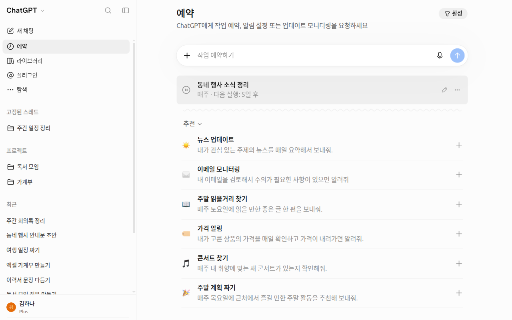
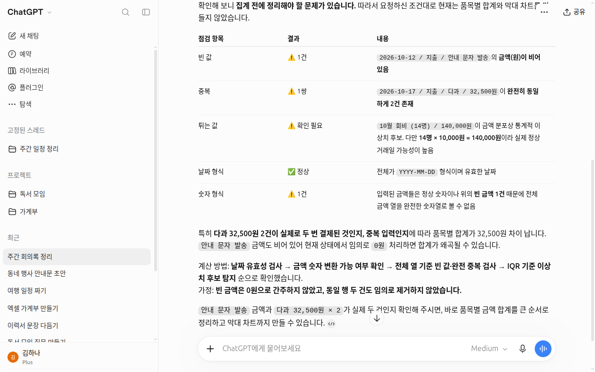
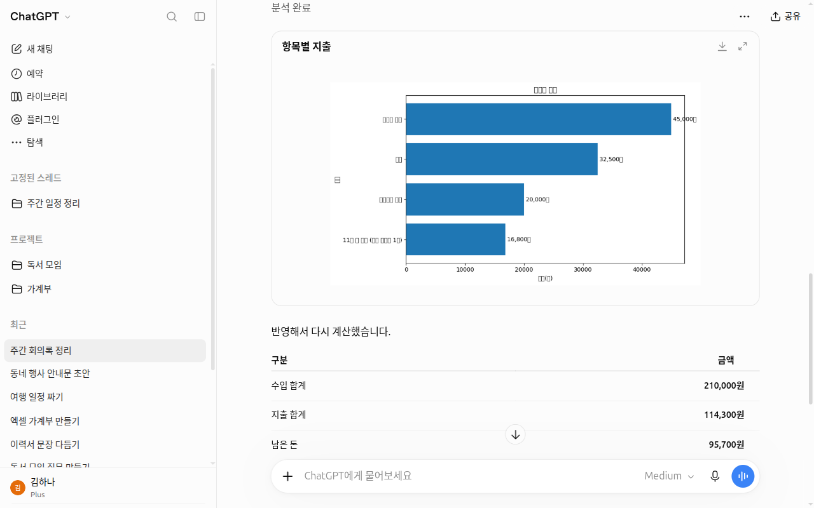
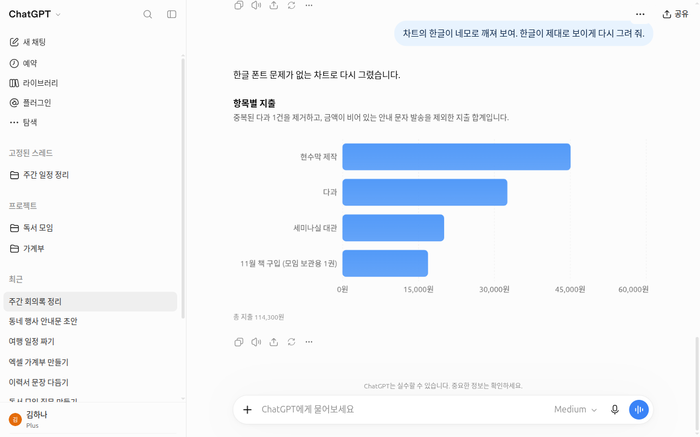
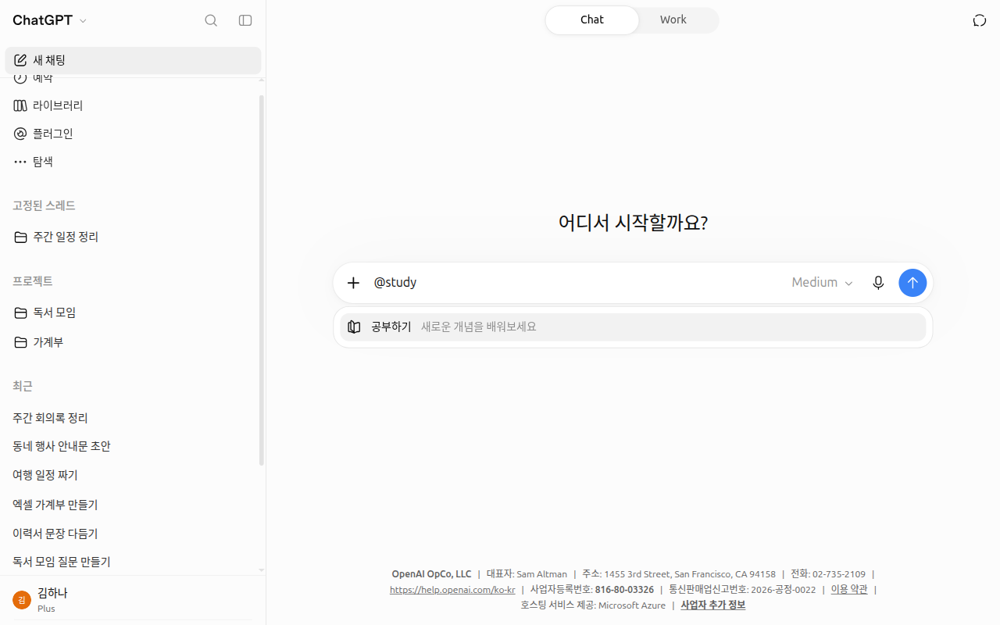
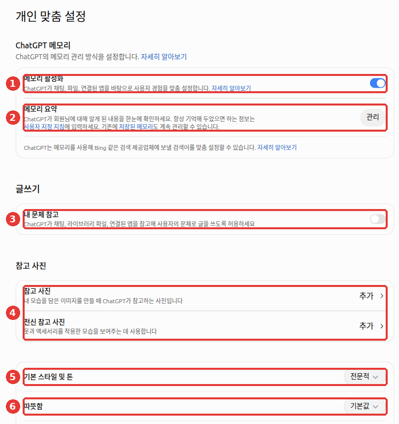

# Chapter 11. Using It Like an Expert — Moving Beyond the Basics to Fit Your Work

> **In One Line**: An expert is not someone who knows more new features. An expert **speaks as if handing off a task, picks the right tool for the job, turns repeated work into a template, and checks the result before using it**.
> This chapter shows you **how to combine** the features from Chapters 1–10, and introduces scheduled tasks, data analysis, and study mode.

The screenshots are based on the web version (Plus plan) as of October 2026. The menu layout may look slightly different on the free plan or the mobile app.

## What Makes an Expert Different

In [Stage 1, Chapter 3, "Same Tool, Different Results"](../00-common/03-why-learn.md#same-tool-different-results), you learned that the same AI gives different results depending on how you use it. A report by OpenAI looking at how people use ChatGPT at work shows a similar pattern. Even where they could make a big difference, **advanced features like reasoning, deep research, projects, and custom instructions are used less often**.[^adopt]

Ways of working that **apply to any AI**—like deciding what to hand off, testing before handing off, and checking in proportion to the weight of the task—are covered in [Stage 1, Chapter 11, "Using It Like an Expert"](../00-common/11-expert.md). This chapter translates those methods into ChatGPT features. First, take a quick look at what we cover in this chapter.

| Element | One-Line Description | Learn More |
|---|---|---|
| Speak like handing off work | State the task, audience, purpose, and format, then refine after seeing the first answer | [Stage 1, Chapter 4 "The 5 Elements of a Good Prompt"](../00-common/04-prompt-basics.md#the-5-elements-of-a-good-prompt), [Stage 1, Chapter 6 "How to Ask for Revisions Well"](../00-common/06-conversation.md#how-to-ask-for-revisions-well) |
| Pick the right tool | Choose among search, deep research, Work, and reasoning levels to match the task | [Chapter 6 "Deep Research — Handing Off a Report"](06-search.md#deep-research-—-handing-off-a-report), [Chapter 7 "Difference Between Chat and Work"](07-projects-plugins.md#the-difference-between-chat-and-work) |
| Build up reference materials | Gather files, instructions, and good answers for the same job in one place | [Chapter 7 "Projects — Chats, Files, and Instructions in One Folder"](07-projects-plugins.md#projects-—-conversations-files-and-instructions-in-one-folder) |
| Make a reusable frame | Save repeated requests as instructions, templates, or skills | [Stage 1, Chapter 8 "4. Turning It into a Reusable Template"](../00-common/08-meta-prompting.md#_4-turn-it-into-a-reusable-template) |
| Scheduled tasks | Have ChatGPT do a job on its own at a set time | [This chapter, "On Its Own at a Set Time"](#on-its-own-at-a-set-time-—-scheduled-tasks) |
| Data analysis | Calculate tables and numbers and get charts | [This chapter, "Handing Off Tables and Numbers"](#handing-off-tables-and-numbers-—-data-analysis) |
| Study mode | Have it help you understand with questions instead of giving the answer | [This chapter, "Using It to Learn"](#using-it-to-learn-—-study-mode) |
| Shape of the answer | Adjust the tone, tables, and visuals to fit your work | [Chapter 5 "Setting the Tone"](05-memory.md#choosing-a-tone-—-default-style-and-tone-warmth-reference-my-writing-style) |
| Verify | Decide what to check for each type of output and verify it | [Stage 1, Chapter 9 "Four Habits for Checking"](../00-common/09-safety.md#four-habits-for-checking) |

<Quiz id="ch111-difference" />

## Five Lines for Handing Off Work — Outcome, Sources, Keep Unchanged, Review Criteria, Shape

When you hand off a whole document or table task instead of a single question, add two things to [Stage 1, Chapter 4, "The 5 Elements of a Good Prompt"](../00-common/04-prompt-basics.md#the-5-elements-of-a-good-prompt). One is **what must stay unchanged**—such as formulas, order, or table structure.[^docs] The other is **review criteria**, the standard for judging whether the result turned out well.[^work] Stating these two up front reduces the chance that a working form gets altered or wrong numbers slip through.

Try writing your request in five lines like this ([Stage 1, Chapter 7, "1. Organizing with Markdown"](../00-common/07-structured-prompts.md#_1-organizing-with-markdown)).
- **Outcome**: What you are making, who it is for, and why
- **Sources**: Files to refer to
- **Keep unchanged**: What must not be changed
- **Review criteria**: What to check against at the end
- **Shape**: Format and length
```
Outcome: Make a summary of this month's expenses to give to my team lead. We will use it at next week's budget meeting.
Sources: Use the attached expense report file.
Keep unchanged: Do not change the item names or their order.
Review criteria: At the end, check whether the total matches the original file and tell me.
Shape: One table by item and a three-line summary.
```

::: details The answer you get will look roughly like this (example — click to expand)
This is an example created for this guide. Actual answers vary by service and each time you ask.

> | Item | Amount This Month |
> |---|---|
> | (First item in file) | ○○ KRW |
> | (Second item in file) | ○○ KRW |
> | … | … |
> | Total | ○○ KRW |
>
> **Three-Line Summary**
> 1. Total spending this month is ○○ KRW.
> 2. The largest expense item is (item name), at ○○ KRW.
> 3. At next week's budget meeting, it is worth discussing how to reduce spending on (item name).
>
> **Total Check**: The table total of ○○ KRW matches the total in the original file.

**Check whether you got what you asked for**: Are the item names and order the same as the original? Did it come as one table and a three-line summary? Is the total check result included at the end? Do not just trust the word "matches"—check the total in the original file yourself once.

:::

**Split it up or bundle it together?** OpenAI Help recommends breaking complex tasks into smaller requests ([Stage 1, Chapter 5, "3. Breaking into Steps"](../00-common/05-prompt-patterns.md#_3-break-into-steps-—-prompt-chaining)).[^prompt] Academy materials explain that you can bundle related context and instructions into a single request. However, they add that giving too much information at once can make the answer less focused.[^aprompt]

If you need to see an intermediate result before deciding the next direction, split the task up. If you have one clear goal, bundle the five lines into a single request. Either way, attach only the materials that are truly needed.

**For multi-step tasks, set a place to pause.** Do not ask for the final version right away. Decide first where you will choose or review. When steps are small, you can catch misunderstandings early. You do not have to redo everything after the whole thing is already built.[^academy-content]
```
Help me plan a family outing this week.
1. Based on the date, budget, and departure area, organize three candidate spots in a table.
2. Compare travel time and cost. Stop here and I will pick a place.
3. Make a one-day itinerary for the place I pick.
```

**If you have several files, ask for a summary before a draft.** Having it say "what it sees right now" first lets you check whether it read all the needed files before writing a draft. Academy courses also have you take this step before handing off a document to Work.[^academy-content]
```
Do not write a draft yet. First read the attached files, and briefly summarize what is decided, what is not decided yet, and what is missing or unclear.
```

<Quiz id="ch111-five-lines" />

## Picking the Right Tool for the Job

Even the same question gives different results depending on which feature you use. Use search for quick facts. Use deep research when you need depth and thoroughness.[^deep] For other tasks, pick from the table below.

| What You Want to Do | Feature to Use | Learn More |
|---|---|---|
| Quick facts like today's weather or business hours | Web search | [Chapter 6 "Web Search"](06-search.md#web-search-—-having-chatgpt-search-the-internet) |
| A long report comparing several sources | Deep research | [Chapter 6 "Deep Research"](06-search.md#deep-research-—-handing-off-a-report) |
| Finished files like documents, spreadsheets, or presentations | Work (paid plans) | [Chapter 7 "Difference Between Chat and Work"](07-projects-plugins.md#the-difference-between-chat-and-work) |
| Editing an existing Word or PowerPoint file | Microsoft add-in "ChatGPT" (including Free) | [Below in this chapter](#using-it-inside-word-and-powerpoint) |
| Hard calculations or plans with many tangled conditions | Raise reasoning level | [Chapter 2 "Reasoning Level and Thinking"](02-screen-tour.md#reasoning-effort-and-thinking-—-how-deeply-should-it-think) |
| Analyzing tables and numbers and making charts | Upload a file for data analysis | [Below in this chapter](#handing-off-tables-and-numbers-—-data-analysis) |
| Learning something new | Study mode | [Below in this chapter](#using-it-to-learn-—-study-mode) |

**If you wonder whether a feature works, just ask it to do the job.** That is better than asking, "Can you do this?" ChatGPT cannot see how its own system is currently set up. So if you ask whether it can, it may give you the wrong answer.[^ask]
```
Pull the date, store name, and amount from the five attached receipt photos and put them into a table.
```

### Using It Inside Word and PowerPoint

Word, Excel, and PowerPoint share a single **ChatGPT add-in** (a small tool you attach inside a program). Install "ChatGPT" from the Microsoft marketplace. You can edit right from a pane next to your document.[^word][^ppt]

- ChatGPT for Word is available on **all plans, including Free**. ChatGPT for PowerPoint has limited access on Free and Go. On a work account, an administrator must allow it before it appears.[^word][^ppt]
- Chats inside the add-in are separate from your ChatGPT chat history. Memory and skills do not carry over either.[^word]
- **Save a copy before making big changes.** For large edits, ask it to show you a plan first. Having a copy lets you go back to the original if needed.[^word][^ppt]

```
I want to combine slides 3 to 5 of this presentation into one slide. Do not edit it right away—show me a plan for how to merge them first.
Keep the numbers and tables as they are, and keep the title under 15 words.
```

<Quiz id="ch111-tools" />

## Building Up Reference Materials

In [Chapter 7, "Projects"](07-projects-plugins.md#projects-—-conversations-files-and-instructions-in-one-folder), you learned how to bundle chats, files, and instructions into one folder. Reuse projects for **repeating work** like weekly research or article drafts.[^projects] Going one step further, you can also save good answers as reference material for next time.
- **Save good answers as sources.** In a project chat, open the message menu below an answer and choose "Save to project (프로젝트에 저장)" or "Add to project sources (프로젝트 소스에 추가)". That answer goes into the project's "Sources (소스)". The exact menu label may vary by screen.[^projects]
- **You can also connect materials from other services.** In the sources area of a personal project, click "Add sources" and paste a Slack channel or a Google Drive file or folder link.[^projects] For files you uploaded earlier, you can pull them back from [Chapter 4, "Library"](04-files-images.md#library-—-where-your-uploaded-files-are-kept).

<!-- 스크린샷 필요: 프로젝트 대화에서 답의 메시지 메뉴를 펼쳐 「프로젝트 소스에 추가」가 보이는 화면 -->

It helps to write "check the saved sources first" in your project instructions.
```
This project is where I research local cultural events every week. Before doing new research, look at the past research results saved in "Sources" first,
leave out events that overlap with last week, and organize only the new ones in a table.
```

<Quiz id="ch111-sources" />

## Turn Repeated Work into a Frame — Instructions, Templates, and Skills

To decide which task to turn into a frame first, see [Stage 1, Chapter 11, "Picking Your First Task to Practice On"](../00-common/11-expert.md#picking-your-first-task-to-practice).

If you do the same job often, make a reusable frame. The first step is taking a frame from [Stage 1, Chapter 8, "4. Turning It into a Reusable Template"](../00-common/08-meta-prompting.md#_4-turn-it-into-a-reusable-template) and [putting it into your project instructions as in Chapter 7](07-projects-plugins.md#putting-reusable-templates-into-a-project). The next steps are templates and skills.[^docs][^skills]

| Name | What It Is | Where You Can Use It |
|---|---|---|
| Reference file | A sample file you show just for this one time | All chats |
| Template | Sample file + reusable instructions. Used only by the person who made it | Work on the web (paid plans) |
| Skill | A reusable, shareable way of working that holds instructions and examples | Work and school plans like Business, Enterprise, and Edu, according to Help |
| Plugin | A bundle combining skills and app connections | [Chapter 7 "Plugins"](07-projects-plugins.md#plugins-—-adding-other-services-and-workflows) |

**You create templates in Work on the web.** Type `@Template-Creator` in the message box. Attach one reference file (a Word, Excel, or PowerPoint file, or a Google Docs link). Then explain what must stay unchanged, what should change, and what information you will provide each time. Once it is created, click "Install (설치)".[^docs]
```
@Template-Creator Create a template from the attached weekly report file.
Keep unchanged: The title line, the three columns in the table (Done / In Progress / Next Week's Plan), and the font and colors.
Change: The contents inside the table and the date.
Information provided each time: My work notes for that week.
```

To use a template you made, type `@Documents`, `@Spreadsheets`, or `@Presentations` in the message box. When the template gallery opens, choose "Use template". Just choosing it does not start the job. You need to type this week's content and send it.[^docs]

When writing project instructions, keep the tips below in mind. Originally, OpenAI recommends these tips for custom GPT instructions.[^gpt-make] Applying them to project instructions is this guide's recommendation.

| Tip | Example |
|---|---|
| Give specific "do this" instructions rather than a long list of "don't do that" | Instead of "Don't write long answers," say "Write in three lines" |
| Put reference files in **Sources**, and rules or tone in **Instructions** | Put company forms as files; put "Tables have three columns" in instructions |
| If the result falls short, tighten the instructions and add one good example before adding more features | One pair showing "When a note like this comes in → organize it like this" |

**Skills** are created from the side menu under "Plugins (플러그인)" → "Skills (스킬)" tab → "Create (만들기)". You can choose options like "Create with chat (채팅으로 만들기)".[^skills] However, Help states that skills are available on **Business, Enterprise, Healthcare, and Edu plans**. You may still see the "Skills" tab on a personal plan screen. Check your own screen to see whether you can use it.

Before uploading a skill file made by someone else, check whether you trust the source. Automated checks do not replace your own review.[^skills]

**When should you make a skill?** If you keep repeating the same request with the same standards, it is worth making one. Cases where it is still too early are covered in [Stage 1, Chapter 11, "Saving Repeated Work"](../00-common/11-expert.md#save-what-you-repeat).[^academy-content]

<Quiz id="ch111-templates" />

## On Its Own at a Set Time — Scheduled Tasks

**Scheduled tasks** let ChatGPT run a job on its own at a time you set. You can run a task once or have it repeat. You can also have it watch for changes and let you know.[^tasks] Making one is simple. Just ask in a chat.
```
Every Monday at 8 a.m., summarize this week's Seoul weather forecast in one line per day and let me know.
```

You can view, edit, pause, or delete tasks you made from "Scheduled (예약)" in the side menu.[^tasks][^scheduled-name] You can also open them via Settings → "Notifications (알림)" → "Manage tasks (작업 관리)", or from a chat's ••• (More) menu → "View scheduled tasks (예약 작업 보기)".[^tasks]

Choose how to get alerts—push notification or email—under Settings → "Notifications". To get mobile push notifications, create the task in the mobile app.[^tasks]



*The task name in the screenshot was changed to an example. There is a pause button on the left of the task row, and edit and ••• buttons on the right.*[^screen-scheduled] You can also create a task by typing your request right into the "Schedule a task (작업 예약하기)" box at the top.

The number of active tasks you can have at once depends on your plan. It is 3 on Free and Go, 5 on Plus, 10 on Business and Edu, and 15 on Pro and Enterprise, and these numbers may change (checked on 2026-10-24). On Free, tasks run at most once a day. You can only pick broad time windows like morning, afternoon, or night. Setting an exact time like the example above or running a task every hour requires a paid plan.[^tasks] **App event tasks**—like reacting when a new email arrives—are created in Work. They are not available on Free or Go.[^tasks]

There are also a few things to watch out for.[^tasks]
- **A task created inside a project cannot read that project's files.** If it needs file contents, write them directly into the task instructions.
- You cannot create scheduled tasks in voice chats, custom GPTs, or [locked chats](03-chats.md#keeping-others-out-—-locked-chat).
- If you share a task via a share link, the recipient can see the exact instructions. So do not put health or financial information or passwords in them. Sharing a task does not transfer your connected app accounts (such as Slack) or permissions.[^slack]
- A task that sends emails or changes files through a connected app **may pause until you approve it**. If a result does not arrive, check "Scheduled" in the side menu to see whether it is waiting for your approval.[^apps-trouble]

**What kind of work should you schedule?** Use it for tasks where you look at the result and make the call. Have it check, monitor, and summarize things on a regular schedule. Be careful with tasks that go out to others or are hard to undo—like sending, posting, deleting, or approving.[^academy-content]

**Run it by hand a few times before scheduling.** Send the same request yourself a few times to refine the prompt and sources, and schedule it once the results are reliable. Include these points in your instructions:[^academy-content]
- Which sources to look at
- What to produce
- What to do if information is missing
- What you will verify yourself

Here is an example created for this guide.
```
Every Friday at 5 p.m., find new events and registration schedules posted this week on our district office website's notice board and organize them in a table.
If a date is unclear, do not make it up—write "Needs check" and attach the source link. Do not submit applications or post anything.
```

<Quiz id="ch111-scheduled" />

## Handing Off Tables and Numbers — Data Analysis

**Data analysis** does not have a separate toggle to turn on. Just upload an Excel or CSV file like in [Chapter 4, "Uploading Photos and Files"](04-files-images.md#uploading-photos-and-files), and ask your question. ChatGPT creates summaries, tables, and charts, and when needed, calculates directly using Python (a programming language used for calculations).[^data]

To get accurate results, **clean up your file before uploading it.**[^data]
- Put clear column names in the first row, like "Date / Item / Quantity / Amount".
- Put only one record per row.
- Do not put multiple tables on one sheet or leave blank rows in the middle.

Once you upload the file, do not ask for totals right away. Have it **check whether there are issues in the data first**. OpenAI also recommends starting your analysis with this question. Next, **specify the calculation method yourself.** Its first-try calculation method or chart type might not match what you had in mind.[^data]
```
First check this data for common issues (missing values, outliers, duplicates, or date and number format errors).
If there are no issues, sum the "Amount" column by item, make a table sorted from largest to smallest, and show it as a bar chart.
Also write one line each for the calculation method and assumptions you used.
```

- Help explains that you can interact with bar, line, pie, and scatter charts using "Switch to interactive chart (대화형 차트로 전환)". On the 2026-10-28 screen, only "Download chart (차트 다운로드)" and "Expand chart (차트 펼치기)" appeared instead of that button.[^screen-data] You can expand the result table to select specific cells and ask follow-up questions, and download the table as a CSV (a comma-separated file that opens in Excel; see also [Stage 1, Chapter 7, "3. Ask for a Table When Moving to Excel"](../00-common/07-structured-prompts.md#_3-asking-for-a-table-when-moving-to-excel)).[^data]
- **Limits**: Python used for data analysis cannot access the internet. Numbers inside scanned PDFs or photos of tables may not be read accurately, and for large files it may only read part of the file, so specify the sheet or range.[^data]

We uploaded the fake club dues ledger (fees.csv) from the [Ongoing Project](../00-common/practice-kit.md) and sent the exact prompt above. ChatGPT found a row with a missing amount and a row written twice. Following the condition "if there are no issues," it stopped before drawing the chart and asked us to confirm.



When we told it, "Refreshments were written twice by mistake," it drew a bar chart of spending by item. Below that, it organized the income of 210,000 KRW, expenses of 114,300 KRW, and remaining balance of 95,700 KRW in a table. The numbers matched what we added up by hand.

**If Korean text on a chart breaks into empty boxes (□)**, tell it so and ask it to redraw the chart. In the first chart we got, the item names were broken into boxes. When we said, "Redraw it so the Korean text shows up properly," it redrew the chart with readable text.[^screen-data]





*We deleted the chat and uploaded file after taking the screenshots. Deleting a chat leaves the uploaded file in the Library, so we deleted it there separately ([Chapter 4](04-files-images.md#library-—-where-your-uploaded-files-are-kept)).*

<Quiz id="ch111-data" />

## Using It to Learn — Study Mode

**Study mode** teaches you instead of handing you the answer right away. It asks questions, explains step by step, and checks whether you understand as you go. It is available on the web, iOS, and Android on **all plans**.[^study]

To turn it on on the web, type `@study` in the message box and pick "Study (공부하기)" from the suggestion list. You can also click the + button, search for `study`, and pick it. Or go straight to `chatgpt.com/studymode`.[^study] Turn on study mode in a regular chat. You cannot turn it on in [Temporary Chat](03-chats.md#leaving-no-record-—-temporary-chat), custom GPTs, or projects.[^study]



*In the suggestion list, it appears as "Study (공부하기)". Because the message has not been sent yet, nothing has started on the screen.*[^screen-study]

Try including the details below in your first message. That helps study mode guide you better.[^study]
- Your level
- The subject and exact topic
- What you want to do
- What you already know
- Exam date and format
- Study materials

```
I want to review this topic for 20 minutes. The topic is "Electric Circuits" from 8th-grade science.
I have heard of Ohm's law, but I get confused between series and parallel circuits. I have a multiple-choice test next Tuesday.
Briefly explain the most important concepts first, then quiz me one question at a time and check my answers.
```

Study mode can make mistakes too. Sometimes it gives away the answer right away. When that happens, ask again: "Just give me a hint," or "Ask me one question at a time." Always double-check important topics like homework, exams, health, law, or money on your own.[^study]

You can also ask study mode to make review materials. Try asking for quizzes or flashcards (study cards with a question on the front and the answer on the back).[^study] Cards made with the flashcards feature are automatically saved in your Library. Check the card contents against your original notes.[^study]

For explanation prompts you can use without study mode, see [Prompt Library, "Studying and Getting Explanations"](../00-common/prompt-library.md#studying-and-learning).

<Quiz id="ch111-study" />

## Shaping Answers to Fit Your Work

In [Chapter 5, "Setting the Tone"](05-memory.md#choosing-a-tone-—-default-style-and-tone-warmth-reference-my-writing-style), we looked at base style and "Warm (따뜻함)". Here we look at four more ways to shape answers to fit your work. For editing generated images, see [Chapter 4, "Creating Images"](04-files-images.md#creating-images).



- **Characteristics** are settings that nudge warmth, enthusiasm, headings and lists, and emoji toward "More (+)" or "Less (–)". You can change them under Settings → "Personalization (개인 맞춤 설정)". Changes apply to the current chat and new chats going forward.[^char] On the 2026-10-23 screen, we only confirmed "Warm (따뜻함)" (⑥ in the image above). Look for the other items on your own screen.
- **If there are too many tables or visuals, you can tone them down.** Newer models sometimes mix tables, buttons, and charts into their answers. In Personalization under web settings, try changing "Layout and Visuals" to "Simple". This is the English name in Help; we could not confirm the Korean screen label. Even after changing it, some visuals may still appear.[^ui]
- **Lock in formats you always want using instructions.** Put things like "Keep answers short" or "Use a table when comparing options" in [Chapter 5, "Custom Instructions"](05-memory.md#custom-instructions-—-rules-you-want-always-followed).[^ui]
- **You can also edit right inside the answer.** Drafts like emails or text messages sometimes appear in a writing block (a text box you can edit directly inside the answer). Edit it right there, or highlight just a part and ask ChatGPT to revise it. Your edits are saved in the chat and used for your next follow-up.[^blocks]
```
In the email draft you just wrote, make only the second paragraph shorter and more polite. Leave the rest as it is.
```

<Quiz id="ch111-shape" />

## Checking Before Trusting

How thoroughly to check and at which stage is covered in [Stage 1, Chapter 11, "Checking in Proportion to the Weight of the Work"](../00-common/11-expert.md#check-in-proportion-to-the-weight-of-the-work). Here we look at what to check for each type of ChatGPT output.

What you need to check depends on the output.

| Output | What to Check |
|---|---|
| Data analysis | The calculation method, code, and assumptions used. If the method matters, ask it to show you or change it[^data] |
| Deep research report | Click and open the citations and source links yourself ([Chapter 6 "The Habit of Checking Sources"](06-search.md#the-habit-of-checking-sources))[^deep] |
| Files created by Work | Check the content, layout, formulas, and charts before sharing[^docs] |
| Actions Work took on a website | Check the result and its sources, and click important actions yourself on the approval screen[^work] |
| Files found in a connected app | Finding a file **name** does not mean it read the **contents**. For important files, paste the link directly and have it read them[^drive] |
| Emails or messages sent via a connected app | If a task pauses or the result is unclear, check your Sent folder and the recipient's side before asking again. The same email could go out twice[^apps-trouble] |

**Be careful with links too.** Links generated by ChatGPT may contain false information or hidden instructions slipped in by a third party.[^links] How hidden instructions work is covered in [Stage 1, Chapter 9, "4. Hidden Instructions"](../00-common/09-safety.md#_4-hidden-instructions-—-prompt-injection). The less familiar you are with a topic, the more helpful it is to add this line at the end:
```
In the answer you just gave, mark the parts I should verify separately and tell me where to check them (official organizations or original texts).
```

<Quiz id="ch111-verify" />

## To Learn More — OpenAI Academy

**OpenAI Academy** is a set of **free online courses** made by OpenAI. Anyone with a ChatGPT account can take them at their own pace.[^academy] Click "Enroll now" on a course page to open the lessons. Your progress is saved automatically, so you do not have to finish in one sitting. Thethree courses below are in **English** (checked on 2026-10-26).[^academy-courses]

There are three courses on using AI at work. The later two courses recommend taking the earlier ones first. The times listed are from the course pages and may change.[^academy-courses]

| Course | Time & Level | What It Covers | What You Need |
|---|---|---|---|
| **AI Foundations** | ~70 min, Introduction | What AI and LLMs are, clear instructions, giving context, reviewing outputs, using AI responsibly | A ChatGPT account and one real task to practice on. No technical background required |
| **Applied AI Foundations** | ~80 min, Intermediate | Turning a one-off question into a **reusable sequence of steps** (workflow), picking reasoning models (models that think longer before answering), checkpoints, skills | A ChatGPT account and one real task to practice on. Completing AI Foundations first is recommended |
| **Agents and Workflows** | ~90 min, Intermediate | Handing off tasks to [Work](07-projects-plugins.md#the-difference-between-chat-and-work), reviewing results, and reusing them as skills or scheduled tasks | A ChatGPT account, one real task to practice on, and an account with access to "agent capabilities" (called Work in the course). Completing the first two courses first is recommended |

For each course, if you finish the lessons and score **80% or higher on the Assessment**, you receive a **badge** by email.[^academy-courses] Help notes that these are not formal certifications.[^academy] The [certification exam](../00-common/certificate.md) in this guide is a learning badge of the same kind.

### Frameworks Taught in the Courses — Compared with This Guide

The three courses teach the same ideas as this guide under different names. Knowing the connections below makes it easy to guess what new terms mean when you meet them in the courses. The course terms are kept in their original English.[^academy-content]

- **Task·Context·Expectation** (AI Foundations): State the task, the background (who it is for and why you need it), and the expected shape of the answer (format, length, tone). This is the same idea as [Stage 1, Chapter 4, "The 5 Elements of a Good Prompt"](../00-common/04-prompt-basics.md#the-5-elements-of-a-good-prompt).
- **CLEAR** (AI Foundations): When you get an answer, ask yourself five questions. Is it **C**omplete? Is it **L**ogical? Is there **E**vidence? Does it fit the **A**udience? Is it **R**elevant to the topic? See also [Stage 1, Chapter 9, "Four Habits for Checking"](../00-common/09-safety.md#four-habits-for-checking) and [Stage 1, Chapter 11, "Checking in Proportion to the Weight of the Work"](../00-common/11-expert.md#check-in-proportion-to-the-weight-of-the-work).
- **"Use ChatGPT as the workspace, not the source of truth."** (AI Foundations): Use ChatGPT as a place to work, and do not judge facts based solely on ChatGPT's answer. When you need up-to-date facts, policies, prices, or dates, bring them in first from a reliable source or search, and have ChatGPT organize those materials. This connects to [Chapter 6, "Web Search"](06-search.md#web-search-—-having-chatgpt-search-the-internet).
- **Five parts of a workflow** (Applied AI Foundations): Set the Goal, Context, Steps, Checkpoints, and Output. Do not ask for everything at once—check at each step as you go. See ["Five Lines for Handing Off Work"](#five-lines-for-handing-off-work-—-outcome-sources-keep-unchanged-review-criteria-shape) in this chapter and [Stage 1, Chapter 5, "3. Breaking into Steps"](../00-common/05-prompt-patterns.md#_3-break-into-steps-—-prompt-chaining).
- **Workflow note** (Applied AI Foundations): During a long task, ChatGPT may lose track of your original goal or conditions. So you keep the goal, decisions made, conditions to follow, and checkpoints in one short note. Showing this note again in the next step carries your earlier decisions forward. Keeping this note as a file in a [Chapter 7 "Project"](07-projects-plugins.md#projects-—-conversations-files-and-instructions-in-one-folder) and updating it whenever things change is this guide's suggestion.
- **Delegating work to an agent** (Agents and Workflows): Write down in advance what to make, which sources to use, what not to do (do not send, do not invent dates or owners, etc.), the shape of the output, and what you will verify yourself. This is nearly identical to ["Five Lines for Handing Off Work"](#five-lines-for-handing-off-work-—-outcome-sources-keep-unchanged-review-criteria-shape) in this chapter.
- **Rules for choosing features** (Agents and Workflows): Often, a single clear prompt is enough. Use a plugin if you need data from another service, a skill if the same workflow keeps repeating, and a scheduled task if the same check should run at a set time. See ["Turn Repeated Work into a Frame"](#turn-repeated-work-into-a-frame-—-instructions-templates-and-skills) and ["On Its Own at a Set Time"](#on-its-own-at-a-set-time-—-scheduled-tasks).

The courses include many hands-on activities. Keeping ChatGPT open in a tab next to the course lets you follow along right away. The courses recommend using a computer rather than a phone.[^academy-content]

### Free Public Resources

Academy courses require signing in with a ChatGPT account, but the resources below are **free** and their intro pages open without signing in. Some sites do require creating an account to actually take the lessons (Boostcourse requires course enrollment). We opened and checked every official page below on 2026-10-25.

| Resource | Creator | Language & Length | Good For |
|---|---|---|---|
| [Introduction to Prompt Engineering](https://academy.openai.com/public/videos/introduction-to-prompt-engineering-2025-02-13) (video) | OpenAI Academy | English | Anyone who wants to review the prompting skills from Stage 1 of this guide with a video made by OpenAI. The follow-up is [Advanced Prompt Engineering](https://academy.openai.com/public/videos/advanced-prompt-engineering-2025-02-13)[^academy-public] |
| [ChatGPT fundamentals](https://academy.openai.com/public/clubs/work-users-ynjqu/resources/chatgpt-basics) (article) | OpenAI Academy | English | Anyone who wants to review ChatGPT basics in a written guide put together directly by OpenAI[^academy-public] |
| [ChatGPT Prompt Engineering for Developers](https://www.deeplearning.ai/short-courses/chatgpt-prompt-engineering-for-developers/) | DeepLearning.AI. Taught by Isa Fulford (OpenAI) and Andrew Ng | English, 1 hr 40 min | Anyone curious about a prompting course for developers. Basic **Python** (a programming language) is required. Free access is noted as "for a limited time during the DeepLearning.AI learning platform beta," so check the page to see if it is still free[^dlai] |
| [Generative AI for Beginners](https://github.com/microsoft/generative-ai-for-beginners) (GitHub — a site for hosting project files) | Microsoft | 21 lessons, **Korean translation available** ([Korean version](https://github.com/microsoft/generative-ai-for-beginners/tree/main/translations/ko)) | Anyone interested in building generative AI apps. Start with the "Learn" lessons that explain concepts (the "Build" lessons include code examples)[^msgenai] |
| [Step-by-Step Proposal Writing Learned with AI (AI로 배우는 단계별 기획서 작성법)](https://www.boostcourse.org/aix210) | Boostcourse | **Korean**, 3 lessons and a hands-on assignment | Anyone who wants a Korean course on using AI at work. It covers writing project proposals with AI, and requires signing up (creating an account)[^boost] |

You can read Materials in other languages using your browser's built-in translation feature (for example, in Chrome, right-click on the page → "Translate to English").

Famous videos by Andrej Karpathy explaining how ChatGPT is built and how to use it are collected in [Stage 1, Chapter 1, "Watch More in Videos"](../00-common/01-what-is-llm.md#watch-and-learn) and [Stage 1, Chapter 3, "Watch More in Videos"](../00-common/03-why-learn.md#watch-and-learn-more).

> Well-known Coursera courses like "Prompt Engineering for ChatGPT" and "Generative AI for Everyone" state on their course pages that you must purchase the Certificate experience to view course materials and assignments, so we left them off this free list (checked on 2026-10-25).[^coursera]

<Quiz id="ch111-academy" />

## Try It Yourself

1. Make up about 10 rows of a Date / Item / Quantity / Amount table in Notepad, save it as a CSV, upload it to ChatGPT, and send: "First check if there are common issues." Then ask for a bar chart of totals by item, ask it to show its calculation method and assumptions, and check whether the total matches what you added up yourself.
2. Ask ChatGPT to organize your to-do list for this week using the "five lines" frame. Send it once without the review criteria line and once with it, then compare the difference.
3. Create one scheduled task ("Remind me tomorrow morning to drink water"). Check that it shows up under "Scheduled" in the side menu, and delete it once you have seen it.
4. Turn on study mode with `@study` and spend 20 minutes learning a topic you have been curious about lately using the review prompt.

**Ongoing Project** ([Preparing a Book Club](../00-common/practice-kit.md)): Upload the sample file fees.csv and send "First check if there are common issues," just like in step 1. See whether it catches the refreshments written twice and the row with a missing amount. Next, send "Show the total income, total expenses, and remaining balance in a table, and show spending by item as a bar chart," and check the numbers in the table against what you add up by hand. Finally, check off each item on the [Project Checklist](../00-common/practice-kit.md#what-you-will-have-at-the-end).

## Summary

- Experts speak as if handing off a task. Write the five lines—Outcome, Sources, Keep unchanged, Review criteria, and Shape—and check the key spots for each type of output before using it.
- Use search for quick facts, deep research for thorough investigation, Work for finished files, and reasoning levels for hard thinking. Do not ask whether a feature works—just tell it to do the job.
- Save good answers with "Add to project sources," and turn repeated work into a reusable frame: instructions → templates (Work) → skills (work and school plans according to Help).
- The ChatGPT add-in for Word and PowerPoint is available even on the free plan. Save a copy before big edits and ask for a plan first.
- Create scheduled tasks by asking in a chat and manage them under "Scheduled" in the side menu. Tasks inside a project cannot read project files, and tasks that make changes through apps may pause while waiting for approval.
- For data analysis, upload a clean file, check for data issues first, and specify the calculation method. Turn on study mode with `@study` on any plan (except in projects and Temporary Chat).
- To learn more, check out OpenAI Academy (sign-in required, three courses of about 70–90 minutes each) or free public resources (OpenAI Academy public videos, DeepLearning.AI, Microsoft, Boostcourse).

## Glossary

| Term | One-line meaning |
|---|---|
| Review criteria | The standard for judging whether an output turned out well |
| Scheduled tasks | Tasks ChatGPT runs on its own at a set time |
| Data analysis | A feature that calculates tables and numbers from an uploaded file and shows summaries and charts |
| Template | A reusable frame combining a sample file and instructions |
| Study mode | A mode that teaches through questions and step-by-step explanations instead of giving the answer right away |
| Characteristics | Settings that nudge the feel of answers—like warmth or emoji—more or less |
| Writing block | A draft text box you can edit directly inside an answer |
| OpenAI Academy | Free online AI courses made by OpenAI |
| Add-in | A small tool you attach inside programs like Word or PowerPoint |

<ChapterDone :chapter="111" />

Next chapter: You have finished Stage 2. Test your skills with the [AI Knowledge Level Test](../00-common/level-test.md).

[^adopt]: OpenAI, "ChatGPT Usage and Adoption Patterns at Work". "Advanced features remain underused, even where they could deliver broad impact." https://openai.com/business/guides-and-resources/chatgpt-usage-and-adoption-patterns-at-work (checked on 2026-10-24)
[^work]: OpenAI Help, "ChatGPT Work and Codex" "Describe the outcome you want. Add any files, constraints, and review criteria ChatGPT should use." https://help.openai.com/en/articles/20001275 · "Using cloud browser in ChatGPT" "Check the result and its sources before relying on it." https://help.openai.com/en/articles/20001280 (checked on 2026-10-24)
[^docs]: OpenAI Help, "Creating and editing documents, spreadsheets, and presentations with ChatGPT Work". Templates and `@Template-Creator`, "Say what must stay unchanged…" https://help.openai.com/en/articles/20001278 (checked on 2026-10-24)
[^prompt]: OpenAI Help, "How do I create a good prompt for an AI model?". https://help.openai.com/en/articles/4936848 (checked on 2026-10-24)
[^aprompt]: OpenAI Academy, "Prompting". https://academy.openai.com/public/clubs/work-users-ynjqu/resources/prompting (checked on 2026-10-24)
[^deep]: OpenAI Help, "Deep research in ChatGPT". "Use search for quick facts, and use deep research for depth and thoroughness." https://help.openai.com/en/articles/10500283 (checked on 2026-10-24)
[^ask]: OpenAI Help, "How to Ask ChatGPT About Its Features". https://help.openai.com/en/articles/12548278 (checked on 2026-10-24)
[^projects]: OpenAI Help, "Projects in ChatGPT". https://help.openai.com/en/articles/10169521 (checked on 2026-10-24)
[^skills]: OpenAI Help, "Skills in ChatGPT". "Skills are available to eligible ChatGPT Business, Enterprise, Healthcare, and Edu users" https://help.openai.com/en/articles/20001066 (checked on 2026-10-24)
[^tasks]: OpenAI Help, "Scheduled tasks in ChatGPT". Task limits by plan, file access limits for tasks inside projects, and sharing cautions. https://help.openai.com/en/articles/10291617 (checked on 2026-10-24)
[^data]: OpenAI Help, "Data analysis with ChatGPT" https://help.openai.com/en/articles/8437071 · "Extracting Insights with ChatGPT Data Analysis" "Check this data for common issues." https://help.openai.com/en/articles/9213685 (checked on 2026-10-24)
[^study]: OpenAI Help, "Using study mode in ChatGPT" https://help.openai.com/en/articles/11780217 · "Flashcards in ChatGPT" "Flashcards are automatically saved in your library." https://help.openai.com/en/articles/20001533 (checked on 2026-10-24)
[^char]: OpenAI Help, "Characteristics in ChatGPT". https://help.openai.com/en/articles/20001038 (checked on 2026-10-24)
[^ui]: OpenAI Help, "Intelligent UI in ChatGPT". "Select Personalization → Layout and Visuals → Simple." https://help.openai.com/en/articles/20001598 (checked on 2026-10-24)
[^blocks]: OpenAI Help, "Working with writing blocks and code blocks in ChatGPT". https://help.openai.com/en/articles/20001246 (checked on 2026-10-24)
[^links]: OpenAI Help, "ChatGPT generated links". https://help.openai.com/en/articles/10984597 (checked on 2026-10-24)
[^academy-courses]: OpenAI Academy course pages (after sign-in). AI Foundations "Duration: ~70 minutes", "Level: Introduction", "No technical background is required." · Applied AI Foundations "Duration: ~80 minutes", "Level: Intermediate", "We recommend completing AI Foundations first." · Agents and Workflows "Duration: ~90 minutes", "Level: Intermediate", "We recommend completing AI Foundations and Applied AI Foundations first.", "Access to agent capabilities". Common to all three pages: "The pathway includes two required steps: completing the course and passing the assessment with a score of at least 80%." / "Your progress is automatically saved." https://academy.openai.com/home/courses/ai-foundations-dnq5w · https://academy.openai.com/home/courses/applied-ai-foundations-szsmv · https://academy.openai.com/home/courses/agents-and-workflows-y0qoc (checked on 2026-10-26)
[^academy-content]: OpenAI Academy course content (sign-in and enrollment required). AI Foundations: "Reviewing outputs with the CLEAR structure (Complete, Logical, Evidence, Audience, Relevant)" / "Use ChatGPT as the workspace, not the source of truth." / "we recommend that you:" "Use a desktop computer or laptop". Applied AI Foundations: "A workflow has five parts" (Goal, Context, Steps, Checkpoints, Output) / "Do not ask ChatGPT to do the whole job at once." / "A workflow note keeps the goal, context, decisions, sources, capabilities, and review points in one place." Applied AI Foundations additional: "It's the one that is useful, realistic for you, low-risk while you are learning, and easy to practice and iterate on as you go." / "Avoid workflows that are:" "Too broad" / "Too infrequent" / "Too high stakes" / "Difficult to review or verify" / "If ChatGPT misunderstands something, you can catch it early instead of fixing the whole output later." / "It should happen throughout the workflow, not only at the end." / "Do the “because” and “therefore” statements make sense? If the reasoning does not hold, ask ChatGPT to explain its logic". AI Foundations additional: "Review intensity depends on the task" / "Drafting something that affects a person’s rights, job, health, finances, or access to services" → "Strong human review or approved process". Agents and Workflows: "Before you direct the agent to create the project brief document, have the agent review what's in the folder." / "Keep the update internal, do not send or publish it, do not invent owners or dates" / "If Work needs another approved source, start with a plugin. If the same workflow keeps repeating, consider a skill. If the same stable review should run later or recur, consider a scheduled task." / "Often, a clear prompt is enough." / "Use scheduled tasks for workflows that check, monitor, summarize, or report. Be cautious with anything that sends, posts, publishes, deletes, approves, changes records, or creates external commitments." / "Start manually. Run the workflow yourself a few times, refine the prompt, confirm the sources, and only then schedule it." / "A skill probably isn't the right fit yet if: The workflow changes every week. ... The output format is still being negotiated. The task requires judgment that should stay with a person" (checked on 2026-10-26)
[^academy]: OpenAI Help, "OpenAI Academy courses". "These badges and certificates of completion are not certifications" https://help.openai.com/en/articles/20001270 (checked on 2026-10-24)
[^word]: OpenAI Help, "ChatGPT for Word". "ChatGPT for Word is available on all ChatGPT plans, including Free." / "Word, Excel, and PowerPoint use the same ChatGPT Microsoft add-in." / "ChatGPT memory and skills do not carry over to the add-in." / "Save a copy of important work before making substantial changes." https://help.openai.com/en/articles/20001526 (checked on 2026-10-24)
[^ppt]: OpenAI Help, "ChatGPT for PowerPoint". "Free and Go include limited usage access." / "Ask for a plan first when you are making larger edits." / "For important work, duplicate the file first so you can revert if needed." https://help.openai.com/en/articles/20001242 (checked on 2026-10-24)
[^gpt-make]: OpenAI Help, "Creating and editing GPTs". "Prefer positive, concrete instructions (“Do X”) over long lists of prohibitions (“Don’t do Y”) when possible." / "Use knowledge for reference material, not rules or behavior." / "Before adding more tools, tighten instructions and add examples." https://help.openai.com/en/articles/8554397 (checked on 2026-10-24)
[^slack]: OpenAI Help, "Using Slack in ChatGPT". "A shared task link does not transfer your Slack connection, credentials, channel access, or message history." https://help.openai.com/en/articles/12525822 (checked on 2026-10-24)
[^apps-trouble]: OpenAI Help, "Troubleshooting plugins and apps in ChatGPT". "If approval is required, the task pauses until you review it." / "Before resending an email or message, check the intended account’s sent messages and the destination." https://help.openai.com/en/articles/20001497 (checked on 2026-10-24)
[^drive]: OpenAI Help, "Google Drive app and setup in ChatGPT". "Finding a filename or file details does not confirm that ChatGPT retrieved the file’s contents." https://help.openai.com/en/articles/10929079 (checked on 2026-10-24)
[^academy-public]: OpenAI Academy public pages. "Introduction to Prompt Engineering" (Posted Mar 08, 2025), "Advanced Prompt Engineering", "ChatGPT fundamentals" (Last updated on May 30, 2026). Confirmed all three open in a browser without signing in. https://academy.openai.com/public/videos/introduction-to-prompt-engineering-2025-02-13 · https://academy.openai.com/public/videos/advanced-prompt-engineering-2025-02-13 · https://academy.openai.com/public/clubs/work-users-ynjqu/resources/chatgpt-basics (checked on 2026-10-25)
[^dlai]: DeepLearning.AI, "ChatGPT Prompt Engineering for Developers". Instructors Isa Fulford "Member of Technical Staff, OpenAI" and Andrew Ng, "1h40m", "Beginner", "Only a basic understanding of Python is needed.", "Course access is free for a limited time during the DeepLearning.AI learning platform beta!" https://www.deeplearning.ai/short-courses/chatgpt-prompt-engineering-for-developers/ (checked on 2026-10-25)
[^msgenai]: Microsoft, "Generative AI for Beginners" GitHub repository README. "This course has 21 lessons." / "Lessons are labeled either 'Learn' lessons explaining a Generative AI concept or 'Build' lessons that explain a concept and code examples". Korean translation is in the `translations/ko` folder. https://github.com/microsoft/generative-ai-for-beginners (checked on 2026-10-25)
[^boost]: Boostcourse, "Step-by-Step Proposal Writing Learned with AI (AI로 배우는 단계별 기획서 작성법)" course introduction. "Free course (무료강의)", level "Introductory (입문)", "Always open (상시 수강)", syllabus #1–#3 and "[Assignment] Self-guided practice ([과제] 자율 실습 해보기)", instructor Seungpil Lee. https://www.boostcourse.org/aix210 (checked on 2026-10-25)
[^coursera]: Coursera course page FAQ. "To access course materials, assignments, and earn a Certificate, you'll need to purchase the Certificate experience when you enroll in a course." https://www.coursera.org/learn/prompt-engineering · https://www.coursera.org/learn/generative-ai-for-everyone (checked on 2026-10-25)
[^scheduled-name]: Help calls this menu "Scheduled (예약됨)", but the actual label on the Korean screen is "Scheduled (예약)".
[^screen-scheduled]: Checked the "Scheduled (예약)" screen in the side menu directly. Prompt text "Ask ChatGPT to schedule tasks, set reminders, or monitor updates (ChatGPT에게 작업 예약, 알림 설정 또는 업데이트 모니터링을 요청하세요)", input box "Schedule a task (작업 예약하기)", "Pause (일시 중지)" and "Edit (편집)" buttons on the task row, and "Suggested (추천)" list (news updates, email monitoring, finding weekend reading, etc.). The panel that opens when clicking a task was omitted because it showed real task results (checked on 2026-10-28, Plus account web screen)
[^screen-data]: Checked directly by uploading the fake club dues ledger fees.csv and sending the prompt in this section. The first answer found missing values and duplicates and paused before totaling; the image chart in the second answer had Korean text broken into empty boxes; when asked to redraw, it switched to an in-screen chart. The buttons next to the chart were "Download chart (차트 다운로드)" and "Expand chart (차트 펼치기)". Even after deleting the chat, fees.csv remained in the Library, and deleting it from the Library showed the notice "Moved to trash and will be permanently deleted after 30 days (휴지통으로 이동되며 30일 후 영구 삭제됩니다)" (checked on 2026-10-28, Plus account web screen)
[^screen-study]: Checked the suggestion list directly by typing `@study` in the message box (without sending). Suggestion name "Study (공부하기)", description "Learn a new concept (새로운 개념을 배워보세요)" (checked on 2026-10-28, Plus account web screen)
