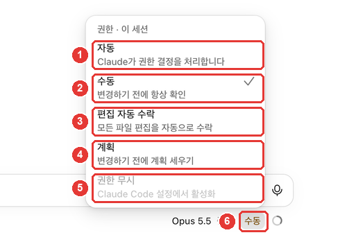
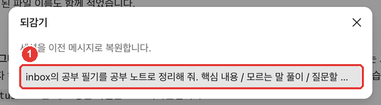
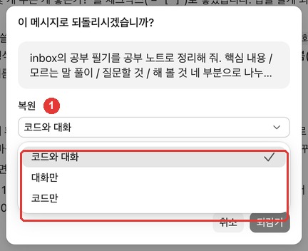
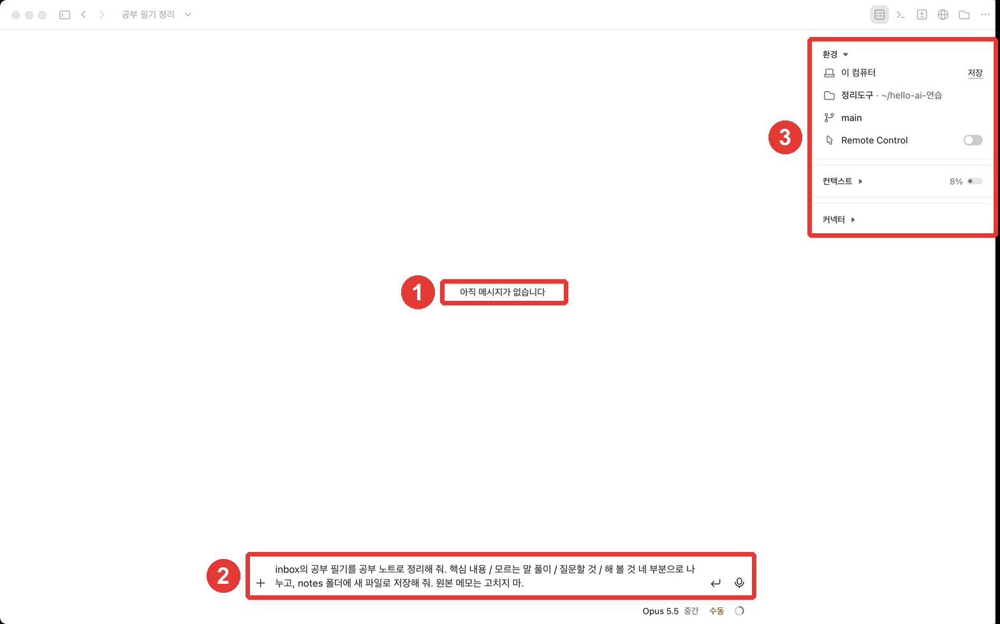

# Chapter 4. Approving and Undoing — Permission Modes, Rewind, and Git History

> **One-line summary**: **Permission modes** set the range of things Claude can do without asking. If you don't like the result, **Rewind** (`/rewind`) takes you back one request.
> Some things cannot be undone by Rewind. So save important states once more in **Git history (as a commit)**.

This chapter is based on the Claude Code official docs and the macOS desktop app (Korean UI, paid account) checked on October 31, 2026. You will keep using the **organizer** (`정리도구`) folder from Chapter 3 (with Git turned on).

## Choosing a Permission Mode

Click the mode name on the right side below the input box ("Manual (수동)" on the screen in this guide) to open the permission mode menu. The keyboard shortcut is **Cmd+Shift+M**.[^keys]



| No. | Screen label (Korean UI) | Official docs name | What Claude does without asking |
|---|---|---|---|
| ② | 수동 | Manual | Nothing (asks every time before editing or running commands) |
| ③ | 편집 자동 수락 | Accept edits | Creating and editing files inside the folder, plus basic file commands |
| ④ | 계획 | Plan | Reading and exploring only (proposes a plan without editing files) |
| ① | 자동 | Auto | Most things (a background checker verifies that actions match your request) |
| ⑤ | 권한 무시 | Bypass permissions | Almost everything (must be turned on in Settings to use) |

Source: Screen labels checked in this guide (2026-10-31); behavior from official docs[^modes]

Each mode **trades off convenience against how closely you watch.**[^tradeoff]

**Start with "Manual" at first.** It feels safer to get used to Claude by seeing what it wants to do one step at a time. Once you trust how it works, you can move to "Accept edits". For a big task, it is best to start in "Plan" and see the approach first (Chapter 5).[^plan-tip]

- The mode you pick from the menu is **remembered for each folder.** However, "Plan" applies to the current session only.[^remember]
- In earlier versions of the screen, these modes were named Ask permissions, Auto accept edits, and Plan mode.[^old-names]

<Quiz id="ch404-modes" />

## Why to Be Careful with "Accept edits", "Auto", and "Bypass permissions"

**Accept edits** does not just edit files. It also runs **file deletion commands** (`rm`) without asking. However, this only applies inside your working folder.[^accept] That is why Chapter 2 told you to pick a small practice folder. When the folder is small, any mistake stays small. Still, commands that wipe out critical paths (for example, `rm -rf ~`, which deletes your entire home folder) are never auto-approved in any mode.[^critical]

**Auto** cuts down on prompts a lot, but the official docs state this clearly: Auto mode only reduces permission prompts and **does not guarantee safety.**[^auto] Use it for tasks where you trust the general direction, not as a substitute for your own review on sensitive work.[^auto]

**Bypass permissions** appears grayed out in the menu and must be turned on separately in Settings.[^modes] The official docs say to use this mode **only inside isolated containers or virtual machines.**[^modes] Everyday users have no reason to turn it on.

::: details If permission prompts don't appear in "Manual" mode
As we saw in Chapter 2, if you already set allow rules in the terminal version of Claude Code, the desktop app uses those same settings.[^same-settings] The screenshots in this guide were taken on a computer like that, so permission prompts did not pop up. On a screen where permission prompts do appear, Claude shows what will change and lets you approve or reject each change.[^modes]
:::

<Quiz id="ch404-auto" />

## Rewind — Going Back One Request

**Every time you send a request, Claude Code automatically saves the state right before it.** This is called a **checkpoint**.[^checkpoint] Like a save point in a game, you can go back to that point if you don't like the result.

Let's try it out. In a new session, we asked Claude to organize study notes.

```
Organize the study notes in inbox into a clean study guide. Split it into four parts: Key Points / Unfamiliar Terms / Questions to Ask / Things to Try, and save it as a new file in the notes folder. Do not change the original memo.
```

The study guide was created (result: [4장-공부노트-2026-10-28.txt](/practice/notes/results/4장-공부노트-2026-10-28.txt)). Let's undo this note as if it never happened.

1. Type `/rewind` in the input box. When the suggestion "Rewind session to a previous message (세션을 이전 메시지로 되돌리기)" appears, press **Enter**, then press **Enter** once more to run it.
2. The **Rewind (되감기)** window lists the requests you sent. Click the request you want to go back to.



3. In the confirmation window, choose **what to restore** and click **Rewind (되감기)**.


In ②, `+0 −35` means **35 lines will disappear** when you rewind. In this exercise, those are the 35 lines of the new study guide. Check these numbers before you click so you know what will change.

In ①, the restore menu has three choices.



| Screen label | What it does |
|---|---|
| Code and conversation (코드와 대화) | Reverts both files and conversation to that point |
| Conversation only (대화만) | Rewinds only the conversation to that point, keeping current files as they are |
| Code only (코드만) | Reverts only the files to that point, keeping the conversation as it is |

Source: Screen labels checked in this guide (2026-10-31); behavior from official docs[^restore]

After rewinding with "Code and conversation", the study guide file disappeared and the conversation became empty. The rewound request is **put back into the input box**, so you can edit it and send it again.[^restore-prompt]



Here is when each option is useful:

- When you don't like the format and want to **edit your request and try again** → "Code and conversation"
- When the files are good, but **the conversation got long and went off track** → "Conversation only"
- When you want to keep the explanation in the chat, but **put the files back the way they were** → "Code only"

<Quiz id="ch404-rewind" />

## What Rewind Cannot Undo

Rewind is not magic. Item ③ in the confirmation window tells you its limits:

- **Files changed by shell commands**: If Claude changed a file only by running a command instead of using its file-editing tool, that file is not tracked.[^limits-bash]
- **Files you edited yourself, or files edited in another session**: These are normally not tracked. Only files edited in the current session are tracked.[^limits-external]
- **Commits**: Your Git history stays as it is (as stated in the confirmation window).
- **Old checkpoints**: Checkpoints are kept for up to the 100 most recent ones per session, and by default they are cleaned up after about 30 days.[^retention]

For cases like these, the official docs tell you to **revert using version control such as Git.**[^limits-bash] That is why Git history in the next section is your second safety net.

<Quiz id="ch404-limits" />

## Git History — Your Second Safety Net

In Chapter 3, you turned on Git for your folder. Whenever you like the result, save that state as a **commit** (a single saved record). Then you can return to that record even when Rewind cannot take you back.

In the session info pane, the Changes card has a **Commit changes (변경 사항 커밋)** button (Chapter 3). When we clicked it for this guide, the app sent a request to Claude saying "Please commit the current changes" on our behalf, and Claude created the commit. You can also just ask in your own words:

```
Commit the changes we just made. Write the commit message in plain language so I can tell what changed.
```

If you want to go back to that record later, ask like this:

```
First show me which files changed since the last commit. Once I confirm, restore the folder to that commit state.
```

**Before restoring, always ask Claude to show you what will disappear first.** Any work done after the commit can be lost when you revert with Git. Adding one confirmation step helps prevent accidental deletion.

| | Rewind (Checkpoint) | Git history (Commit) |
|---|---|---|
| When it is saved | Automatically every time you send a request | Whenever you (or Claude) create one |
| What it restores | Files edited by Claude in this session, plus the conversation | The files you committed |
| How long it lasts | Latest 100 checkpoints, about 30 days | Until you delete the history |

Source: Official docs[^checkpoint][^retention]; the Git column is summarized by this guide

<Quiz id="ch404-git" />

## Try It Yourself

1. Click the mode button below the input box to open the permission mode menu, and read the descriptions of all five modes. Leave it on "Manual" for now.
2. Send the request to organize the study notes, and compare the new study guide with the original notes (5 tips, unfamiliar terms, 1 question, 1 thing to try). In this guide, Claude also read the retrospective memo and filled in "Things to Try: Done (10/30)". Whenever Claude uses a file you didn't mention as evidence, double-check that the evidence is actually right.
3. Use `/rewind` to go back before that request. Check the `+0 −N` numbers in the confirmation window first.
4. Change one formatting rule in the request that came back into the input box (for example, "Put the unfamiliar terms in a table") and send it again.
5. Once you get a result you like, save the record with "Commit changes (변경 사항 커밋)".

**Follow-up exercise**: Put the meeting notes from Chapter 2 and the study guide from Chapter 4 side by side. Write down three lines of common rules you want to use in both documents (how to write dates, how the to-do table should look, and so on). In Chapter 6, you will save these rules in `CLAUDE.md`.

## Summary

- The permission modes are Manual, Accept edits, Plan, Auto, and Bypass permissions. Start with Manual at first.
- Accept edits also runs file deletion commands inside the folder without asking. Auto does not guarantee safety. Bypass permissions is only for isolated environments.
- A checkpoint is saved for every request. Use `/rewind` to rewind Code and conversation, Conversation only, or Code only.
- Rewind normally does not undo files changed only by commands, files you edited yourself, or commits.
- Save good states as commits to build a second safety net. Before reverting, check what will disappear first.

## Glossary

| Term | One-line meaning |
|---|---|
| Permission mode | The range of things Claude is allowed to do without asking |
| Accept edits | A mode that edits files and runs basic file commands in the folder without asking |
| Plan mode | A mode that explores without editing and only proposes a plan |
| Checkpoint | A save point created automatically every time you send a request |
| Rewind | The feature that takes you back to a checkpoint |
| Commit | Saving the current state as a record in Git |

<ChapterDone :chapter="404" />

Next chapter: [Chapter 5. How to Delegate Well](05-delegate-well.md)

[^keys]: Claude Code official docs, "Desktop application" keyboard shortcuts table. "Open permission mode menu" https://code.claude.com/docs/en/desktop (checked on 2026-10-31)
[^modes]: Claude Code official docs, "Desktop application". "Claude asks before editing files or running commands. You see a diff and can accept or reject each change." / "Claude auto-accepts file edits and common filesystem commands like mkdir, touch, and mv, but still asks before running other terminal commands." / "Claude reads files and runs commands to explore, then proposes a plan without editing your source code." / "Claude runs without routine prompts; before actions such as shell commands and network requests run, a background classifier checks that they align with your request." / "On Pro, Max, and Ultra plans, enable "Allow bypass permissions mode" in Settings > Code or Settings > Claude Code." / "Only use this in sandboxed containers or VMs." https://code.claude.com/docs/en/desktop (checked on 2026-10-31)
[^tradeoff]: Claude Code official docs, "Choose a permission mode". "Each mode makes a different tradeoff between convenience and oversight." https://code.claude.com/docs/en/permission-modes (checked on 2026-10-31)
[^plan-tip]: Claude Code official docs, "Desktop application". "Start complex tasks in Plan so Claude maps out an approach before making changes." https://code.claude.com/docs/en/desktop (checked on 2026-10-31)
[^remember]: Claude Code official docs, "Desktop application". "A mode you pick in the selector is remembered per folder and takes precedence over defaultMode for that folder, except Plan, which applies to the current session only." https://code.claude.com/docs/en/desktop (checked on 2026-10-31)
[^old-names]: Claude Code official docs, "Desktop application". "Earlier versions of the Code tab labeled these modes Ask permissions, Auto accept edits, and Plan mode." https://code.claude.com/docs/en/desktop (checked on 2026-10-31)
[^accept]: Claude Code official docs, "Choose a permission mode". "acceptEdits mode auto-approves common filesystem Bash commands: mkdir, touch, rm, rmdir, mv, cp, and sed." / "Like file edits, auto-approval applies only to paths inside your working directory or additionalDirectories." https://code.claude.com/docs/en/permission-modes (checked on 2026-10-31)
[^auto]: Claude Code official docs, "Choose a permission mode". "Auto mode reduces permission prompts but does not guarantee safety. Use it for tasks where you trust the general direction, not as a replacement for review on sensitive operations." https://code.claude.com/docs/en/permission-modes (checked on 2026-10-31)
[^same-settings]: Claude Code official docs, "Desktop application". "The desktop app reads the same settings files as the CLI." https://code.claude.com/docs/en/desktop (checked on 2026-10-31)
[^checkpoint]: Claude Code official docs, "Checkpointing". "Claude Code automatically tracks Claude's file edits as you work, allowing you to quickly undo changes and rewind to previous states if anything gets off track." / "Every prompt you send that starts a turn creates a new checkpoint" https://code.claude.com/docs/en/checkpointing (checked on 2026-10-31)
[^restore]: Claude Code official docs, "Checkpointing". "Restore code and conversation: revert both code and conversation to that point" / "Restore conversation: rewind to that message while keeping current code" / "Restore code: revert file changes while keeping the conversation" https://code.claude.com/docs/en/checkpointing (checked on 2026-10-31)
[^restore-prompt]: Claude Code official docs, "Checkpointing". "After restoring the conversation or choosing Summarize from here, the original prompt from the selected message is restored into the input field so you can re-send or edit it." https://code.claude.com/docs/en/checkpointing (checked on 2026-10-31)
[^limits-bash]: Claude Code official docs, "Checkpointing". "A file that only Bash commands changed isn't tracked and stays as it is. To revert it, use version control, such as Git." https://code.claude.com/docs/en/checkpointing (checked on 2026-10-31)
[^limits-external]: Claude Code official docs, "Checkpointing". "Checkpointing only tracks files that have been edited within the current session. Manual changes you make to files outside of Claude Code and edits from other concurrent sessions are normally not captured" https://code.claude.com/docs/en/checkpointing (checked on 2026-10-31)
[^retention]: Claude Code official docs, "Checkpointing". "Claude Code keeps file snapshots for the 100 most recent checkpoints in a session." / "by default about 30 days after the session last saved one" https://code.claude.com/docs/en/checkpointing (checked on 2026-10-31)
[^critical]: Claude Code official docs, "Choose a permission mode". "Claude Code doesn't auto-approve the following in any mode, including bypassPermissions" / "Recognized rm and rmdir critical-path removals, which no allow rule or PreToolUse hook "allow" approves" https://code.claude.com/docs/en/permission-modes (checked on 2026-10-31)
