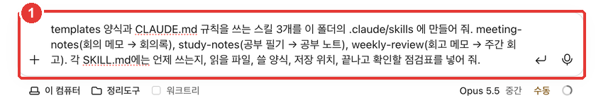
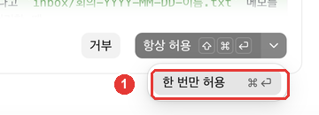
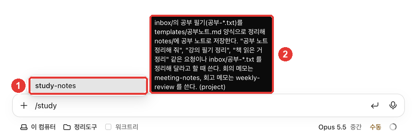
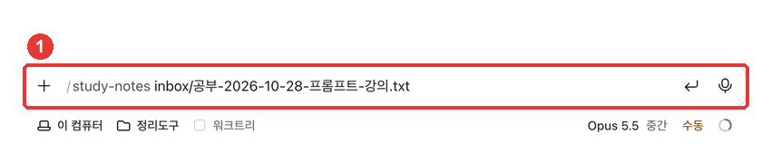

# Chapter 7. Skills, Plugins, and External Tools — Your Organizing Tool in One Line

> **In One Sentence**: Turn instructions, checklists, and multi-step procedures you keep pasting into a **skill** and call it in one line with `/name`. This chapter completes your Organizing Tool (정리 도구).
> You can also attach **plugins** made by others and external service **connectors**, but they run code with your permissions, so install only ones you trust.

This chapter is based on the Claude Code official docs checked on October 31, 2026, and the macOS desktop app (Korean UI, paid account). It uses the templates from Chapter 5 and the CLAUDE.md from Chapter 6 as they are.

## What Is a Skill?

A **skill** is a set of instructions written in a `SKILL.md` file. Claude uses a skill on its own when a relevant request comes in, and you can also call it directly with `/skill-name`.[^what]

Create a skill in these cases:[^when]

- When you **keep pasting** the same instructions or checklist
- When a part of CLAUDE.md has grown from a "fact" into a **multi-step procedure**

How it differs from CLAUDE.md is **when it gets read**. CLAUDE.md is read in every session, while a skill's body is read **only when it is used**. So even if you write it long and detailed, it costs almost nothing in normal use.[^when]

| | CLAUDE.md (Chapter 6) | Skill (Chapter 7) |
|---|---|---|
| What it holds | Rules to always follow | Procedure for one task |
| When it is read | Every session | Only when used |
| How to call it | No special command | `/name` or a relevant request |

<Quiz id="ch407-what" />

## Hands-On — Creating Three Organizing Skills

You will turn the three tasks of your organizing tool into skills.



```
Create 3 skills in .claude/skills in this folder that use the templates folder and the CLAUDE.md rules. meeting-notes (meeting memo → meeting minutes), study-notes (study notes → study summary), weekly-review (review memos → weekly review). In each SKILL.md, include when to use it, which files to read, which template to use, where to save it, and a checklist to verify at the end.
```

If you put a skill folder `.claude/skills/<name>/SKILL.md` inside a folder, it becomes a project skill used **only in sessions for that folder**.[^where] The folder name becomes the command name (`/meeting-notes`).[^name] Since the official docs did not confirm whether Korean command names work, this guide used English names.

### This Time, a Permission Prompt Appeared

The moment Claude tried to write the skill file, a **permission prompt** appeared.


In Chapters 2–4, no permission prompt appeared because of personal allow rules on this computer. It appeared this time because the `.claude` folder is a **protected path**. Even in "Auto-accept edits (편집 자동 수락)" mode, writing to protected paths still asks for permission.[^protected] Files that change how Claude behaves—like skills and settings—live in this folder, so it makes a human check before changing them.

In ②, **you can read what it is about to write first.** If you click ▾, "Allow once (한 번만 허용)" appears.



| Button | What it does |
|---|---|
| Deny (거부) | Blocks this write |
| Allow once (한 번만 허용) (⌘↩) | Allows it just this one time |
| Always allow (항상 허용) (⇧⌘↩) | Allows the same action without asking in the future |

Source: Checked on screen in this guide (2026-10-31)

At first, we recommend **"Allow once"**. "Always allow" is convenient, but it stops asking for the same action again (check the on-screen description for how long). In this exercise, there were three skills, so the permission prompt appeared three times, and we chose "Allow once" all three times.

Created skills (results from this guide): [meeting-notes](/practice/notes/results/7장-스킬-meeting-notes.txt) · [study-notes](/practice/notes/results/7장-스킬-study-notes.txt) · [weekly-review](/practice/notes/results/7장-스킬-weekly-review.txt)

At the top of each SKILL.md, there is a `name` and a `description` (when to use it). Claude reads the description to decide when to use the skill.[^desc] For example, the description for weekly-review says to use it for requests like "write my weekly review" or "organize this week's review."

<Quiz id="ch407-make" />

## Calling It in One Line

If you type `/` in the prompt box of a new session, a list of available commands and skills appears. Keep typing part of the name to filter the list.[^slash]



In ②, **(project)** shows that this is a project skill for this folder. Press Enter to select it, then type the file you want to organize and send it.



```
/study-notes inbox/공부-2026-10-28-프롬프트-강의.txt
```

With this single line, the study notes were created following the template (result: [7장-공부노트-스킬로.txt](/practice/notes/results/7장-공부노트-스킬로.txt)). The one-line summary, 5 key points, 4 new terms, things to watch out for, and questions to ask all went in following the template order. The same note you created with a long request and rewound in Chapter 4 was now made **with a single command line**.

**Now your organizing tool is complete.**

| Memo | Command |
|---|---|
| Meeting memo | `/meeting-notes inbox/회의-….txt` |
| Study notes | `/study-notes inbox/공부-….txt` |
| Several daily reviews | `/weekly-review` |

It is fine if you do not remember the exact name. If you say something like "organize this week's review," Claude checks the description, picks the matching skill, and uses it.[^what]

<Quiz id="ch407-run" />

## Plugins and Connectors

A **plugin** installs a bundle of skills, commands, and tools made by others, and a **connector** links external services like Gmail or Calendar to Claude. In the desktop app, you add connectors and plugins from the **+** button next to the prompt box.[^plus] Connectors give you an easy on-screen setup for MCP servers (a standard way for AI to connect to external tools).[^connectors]

They are convenient, but there is **something you must think about before installing**. A plugin **can run code on your computer with your permissions**.[^plugin-risk] And that code can run outside the protection of the permission modes from Chapter 4. Permission rules apply to tool calls Claude makes, not to code that a plugin runs by itself.[^plugin-scope]

- Install only plugins whose creator you know and trust.
- Remove plugins you no longer need.
- Content from services linked via connectors (emails, calendar events) also becomes material that Claude reads. Read "Hidden Instructions" in Chapter 9 alongside this.

For the organizing tool in this guide, **the skills you made yourself** are enough. Add plugins and connectors one by one only when you truly need them.

<Quiz id="ch407-plugins" />

## Try It Yourself

1. Ask Claude to create the three organizing skills, and when the permission prompt appears, read the preview in ② and choose "Allow once".
2. In a new session, type `/` and part of a skill name to see if it appears in the list.
3. Organize your study notes with `/study-notes` and check that the output follows the template order from Chapter 5.
4. Send just "Organize this week's review" without a skill name, and see if Claude picks and uses the weekly-review skill.

**Up Next**: Right now, you call `/weekly-review` yourself every Friday. In Chapter 8, you will see how to **schedule** this task and how to run several organizing tasks at the same time.

## Summary

- A skill is a procedure written in SKILL.md. It is read only when used, and you use it with `/name` or a relevant request.
- `.claude/skills/<name>/SKILL.md` in a folder is a skill just for that folder. Its description decides "when to use it."
- The `.claude` folder is a protected path, so Claude asks permission before writing to it. Start with "Allow once".
- Organizing tool complete: `/meeting-notes`, `/study-notes`, `/weekly-review`.
- Plugins can run code with your permissions. Install only ones you trust, and only when needed.

## Glossary

| Term | One-line meaning |
|---|---|
| Skill | A procedure written in SKILL.md and called with `/name` |
| description | A note explaining when to use a skill. Claude reads this to pick the skill |
| Protected path | A location that always asks permission before writing, such as the `.claude` folder |
| Plugin | An extension that installs a bundle of skills, commands, and tools |
| Connector | A link from external services to Claude (based on MCP servers) |
| MCP | A standard way for AI to connect to external tools and data |

<ChapterDone :chapter="407" />

Next chapter: [Chapter 8. Parallel Tasks, Cloud, and Scheduling](08-parallel-cloud-schedule.md)

[^what]: Claude Code official docs, "Extend Claude with skills". "Create a SKILL.md file with instructions, and Claude adds it to its toolkit. Claude uses skills when relevant, or you can invoke one directly with /skill-name." https://code.claude.com/docs/en/skills (checked on 2026-10-31)
[^when]: Claude Code official docs, "Extend Claude with skills". "Create a skill when you keep pasting the same instructions, checklist, or multi-step procedure into chat, or when a section of CLAUDE.md has grown into a procedure rather than a fact. Unlike CLAUDE.md content, a skill's body loads only when it's used, so long reference material costs almost nothing until you need it." https://code.claude.com/docs/en/skills (checked on 2026-10-31)
[^where]: Claude Code official docs, "Extend Claude with skills". Project row in the locations table: "`.claude/skills/<skill-name>/SKILL.md`" https://code.claude.com/docs/en/skills (checked on 2026-10-31)
[^name]: Claude Code official docs, "Extend Claude with skills". "The directory name, or the frontmatter name when you set one, becomes the command you type, and the description helps Claude decide when to load the skill automatically." https://code.claude.com/docs/en/skills (checked on 2026-10-31)
[^desc]: Claude Code official docs, "Extend Claude with skills". "Only description is recommended so Claude knows when to use the skill." https://code.claude.com/docs/en/skills (checked on 2026-10-31)
[^slash]: Claude Code official docs, "Desktop application". "type / in the prompt box or click the + button and select Slash commands to browse what's available." https://code.claude.com/docs/en/desktop (checked on 2026-10-31)
[^protected]: Claude Code official docs, "Choose a permission mode". Under "These still prompt:" in the acceptEdits section: "Writes to protected paths" https://code.claude.com/docs/en/permission-modes (checked on 2026-10-31)
[^plus]: Claude Code official docs, "Desktop application". "Click the + button next to the prompt box for file attachments, skills, connectors, and plugins." https://code.claude.com/docs/en/desktop (checked on 2026-10-31)
[^connectors]: Claude Code official docs, "Desktop application". "Connectors are MCP servers with a graphical setup flow." https://code.claude.com/docs/en/desktop (checked on 2026-10-31)
[^plugin-risk]: Claude Code official docs, "Plugin security and trust". "A plugin can carry content that runs code on your machine with your user privileges and content that enters Claude's context as instructions, so review a plugin before you install it." https://code.claude.com/docs/en/plugins/security (checked on 2026-10-31)
[^plugin-scope]: Claude Code official docs, "Plugin security and trust". "Claude Code's permission rules and sandbox cover the tool calls Claude makes, not the code a plugin runs by itself" https://code.claude.com/docs/en/plugins/security (checked on 2026-10-31)
