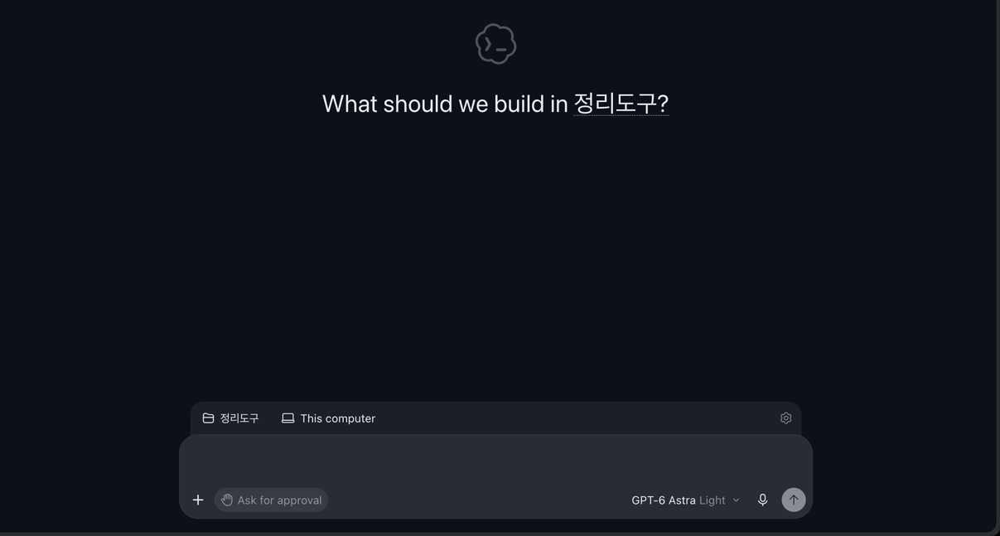

# Chapter 2. Starting Codex in the ChatGPT App — Opening a Folder and Handing Off Your First Task

> **One-line summary**: Install the ChatGPT desktop app, pick **Codex** at the top left, and open your organizer folder with **Choose project** above the input box.
> Then ask it to organize meeting notes with the same request from Claude Code Chapter 2, and check the result against the original.

This chapter is based on the Codex official docs and the ChatGPT desktop app for macOS, checked on November 1, 2026. The screenshots in this guide are in **English**. If your screen is in another language, look for the button in the same spot.

## Installing and Signing In

1. Download and install the ChatGPT app for your computer at [chatgpt.com/download](https://chatgpt.com/download/). For Linux, follow the separate guide in the official docs.[^install]
2. Open the app and sign in with your ChatGPT account.[^signin]

If you tried ChatGPT in Stage 2, you can sign in with the same account. We covered accounts and plans in [Stage 2 ChatGPT Chapter 1](../11-chatgpt/01-getting-started.md).

<Quiz id="ch502-install" />

## Picking Codex and Opening a Folder

Click the **label at the top left** of the app to choose between ChatGPT and Codex. To switch between Chat and Work, select ChatGPT first and use the toggle above the input box.[^toggle] The official docs also say to select **Codex** from this menu when you need developer tools.[^select] When you select Codex, you will see "What should we build?" in the center.

Right above the input box, there are two choices.

| Screen label | What it does |
|---|---|
| Choose project | Pick the folder (project) to work in |
| This computer | Pick where to work: your computer or Cloud |

Source: Screen check for this guide (2026-11-01)



The screen above shows the organizer folder (`정리도구`) opened as a project. You can see the chosen folder (`정리도구`) and where you are working (This computer) above the input box, and the permission setting (Ask for approval) and model name below it. We cropped out the chat list and usage notice on the left.

Click **Choose project** and pick the `정리도구` folder (or `~/hello-ai-연습/정리도구` if you followed the Claude Code guide). Codex can read and edit files in the folder you choose.[^folder] You can also open it from the menu bar with "File → Open Folder…".

Leave the work location set to **This computer**. Cloud is for people who connected a GitHub repository, and files on your computer are not sent to the cloud.[^cloud-files]

Also check whether your folder is a **Git repository** (a tool that keeps a record of changes). The pane that shows changes in Codex only opens inside a Git repository. If it is not a Git repository, the app asks if you want to create one.[^review-git] If you followed Claude Code Chapter 3, it is already a Git repository. If you started fresh with the practice files, just follow along **when the app asks to create a repository**.[^review-git] You can also ask Codex in chat, but because the `.git` folder that holds Git history is a protected folder ([Chapter 4](04-permissions-undo.md)), it may ask for permission or be blocked.

<Quiz id="ch502-open" />

## Handing Off Your First Task

Send a request similar to the one in Claude Code Chapter 2. This time, you do not need to explain the format. That is because the folder already has templates (`templates/`).

```
Organize the notes in inbox/회의-2026-10-27-주간회의.txt into meeting minutes and save them as a new file in the notes/ folder.
```

When we ran this for the guide, here is how Codex worked. We ran this same Codex in the terminal ([Chapter 7](07-terminal.md)). The official docs explain that the app also automatically finds `AGENTS.md` and skills in the folder you choose.[^discovery] However, this guide did not directly verify that exact same result inside the app screen.

1. It looked for a rules file (`AGENTS.md`) and templates in the folder. There was no rules file yet, so it read **only the template**.
2. Following the order of sections in the template, it filled in 2 decisions, 5 action items, topics for next time, and the next meeting.
3. For due dates missing from the notes, it wrote `(메모에 없음)` (not in notes). That rule was written in the template instructions.
4. After saving, it checked the section order, date, and day of the week on its own.

Result: [Chapter 2 Meeting Minutes](/practice/notes/results/codex/2장-회의록-2026-10-27-주간회의.txt)

**Check the result against the original.** Check these questions one by one.

- Were all 5 action items copied over? Do the owners match the notes?
- Did it avoid making up due dates that were not in the notes?
- Is the date right?

In this result, the date stands out. The original notes say `10/27(월)` (Mon), but the meeting minutes changed it to `10/27(화)` (Tue). The day of the week in the practice notes was made up for the story, so it does not match the real 2026 calendar. Codex fixed it to match the calendar and **openly noted on its own** in both its reply and a note inside the file that it made this change. If you do not like this call, just ask again: "Write the day of the week exactly as written in the notes."

Even with the same request, the result looks a little different every time you run it. The official docs also warn that a polished response can still have missing or wrong parts, so you should check the details that matter before using it.[^review]

<Quiz id="ch502-first" />

## Try It Yourself

1. Install the ChatGPT app and sign in.
2. Select **Codex** at the top left, and open the organizer folder (`정리도구`) with **Choose project**.
3. Ask it to organize the meeting notes using the request above.
4. Check the number of action items, owners, due dates, and date against the original notes.

**Up next**: In Chapter 3, you will move the `CLAUDE.md` rules file from Claude Code into `AGENTS.md`, which Codex reads.

## Summary

- Select Codex at the top left of the app, and open a folder with Choose project above the input box.
- Leave the work location set to This computer. Your local files are not sent to Cloud.
- Viewing changes only works in a Git repository. Make your folder a Git repository first.
- Check the result against the original. Pay special attention to parts Codex changed on its own (this time, the day of the week).

## Glossary

| Term | One-line meaning |
|---|---|
| Project | The folder where Codex works |
| This computer | Working on your own computer |
| Cloud | Working in a workspace over the internet |
| Git | A tool that keeps a record of file changes |

<ChapterDone :chapter="502" />

Next chapter: [Chapter 3. The AGENTS.md Rules File](03-agents-md.md)

[^install]: Codex official docs, "ChatGPT desktop app". "**Install the ChatGPT desktop app.** [Download ChatGPT](https://chatgpt.com/download/) for macOS or Windows, or follow the [Linux installation guide](https://learn.chatgpt.com/docs/linux/linux-app)." https://learn.chatgpt.com/docs/app (checked on 2026-11-01)
[^signin]: Codex official docs, "Quickstart". "Open the app, then sign in with your ChatGPT account." https://learn.chatgpt.com/docs/quickstart (checked on 2026-11-01)
[^select]: Codex official docs, "Quickstart". "For software development with codebase context and developer tools, select **Codex** from the ChatGPT dropdown." https://learn.chatgpt.com/docs/quickstart (checked on 2026-11-01)
[^folder]: Codex official docs, "Quickstart". "Start a chat, create a project, or open a folder. ChatGPT can read and modify files in the folder you choose." https://learn.chatgpt.com/docs/quickstart (checked on 2026-11-01)
[^cloud-files]: Codex official docs, "Codex environments". "Use **Work in** to choose **This computer** or **Cloud**." / "Your computer's local files, running processes, browser sign-ins, and VPN access aren't automatically transferred to it." https://learn.chatgpt.com/docs/environments/modes (checked on 2026-11-01)
[^review-git]: Codex official docs, "Code review". "The review pane requires a project inside a Git repository. If your project isn't a Git repository yet, the app prompts you to create one." https://learn.chatgpt.com/docs/code-review (checked on 2026-11-01)
[^review]: Codex official docs, "Use ChatGPT". "A polished response can still be incomplete or wrong, so review the details that matter before you use or share it." https://learn.chatgpt.com/docs/use-chatgpt (checked on 2026-11-01)
[^discovery]: Codex official docs, "Projects and chats". "New chats start in the primary folder. Codex also uses that folder as the default for Git operations and automatic discovery of `AGENTS.md`, skills, and `config.toml`." https://learn.chatgpt.com/docs/projects (checked on 2026-11-01)
[^toggle]: Codex official docs, "ChatGPT desktop app". "Choose ChatGPT or Codex. In ChatGPT, use the toggle above the composer to select Chat or Work. In Codex, start with New chat." https://learn.chatgpt.com/docs/app (checked on 2026-11-01)
