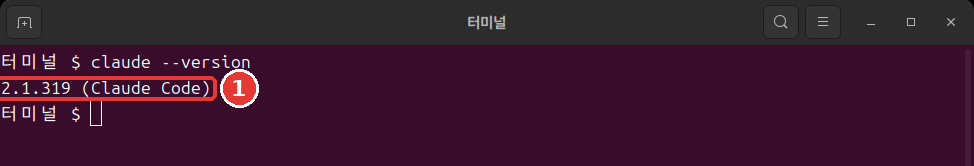

# Chapter 3. Installing and Logging In

<Badge type="tip" text="Required" /> Read this to follow this stage.

> **One-line summary**: Paste the install command from the official documentation, then check it with `claude --version` in a **new terminal window**. Then run `claude` in your practice folder and log in through your browser, and you are ready.

You only need to install it once. The command is just one line.

## Before You Paste — Check the Source First

The install command is in the very next section. Before you paste it, check just one thing.

An install command runs a program downloaded from the internet on your computer right away. It is convenient, but if you paste a command from the wrong site, a harmful program could run with your permissions.

So **do not paste an install command from an unfamiliar site as is.** The same goes for the commands in this course. Open the official "[Quickstart](https://code.claude.com/docs/en/quickstart)" documentation and check with your own eyes that it is the same command.

- **Weak example**: You paste an install command you found on a blog straight into the terminal.
- **Better example**: You open the official documentation, check that it is the same command, and then paste it.

For any command you paste into the terminal, look at the source first. The same habit will protect you when you install other programs too.

<Quiz id="ch803-safe" />

## Install Commands by Operating System

Open the terminal, paste **only one** command that matches your computer, and press Enter. These are the commands from the official documentation.[^install]

On Mac, Linux, and WSL (a feature for using Linux inside Windows), type this.

```bash
curl -fsSL https://claude.ai/install.sh | bash
```

In Windows PowerShell, type this.

```powershell
irm https://claude.ai/install.ps1 | iex
```

The two commands do the same thing. The first part downloads the install file, and the part after `|` (vertical bar) runs what was downloaded. You can install it even if you do not understand every piece.

::: details More details (click to expand)
- `|` is a symbol that passes the result of the command before it to the command after it.
- On Mac and Linux, `curl` downloads and `bash` runs.
- In PowerShell, `irm` downloads and `iex` runs.[^irm]
- `-fsSL` is four options written together that set how the download works. Their meanings are in the [Command Reference](command-reference.md).
:::

There is no progress indicator while it downloads. Even if nothing seems to be happening, do not close the window. Wait. When it finishes, you will see the message `Claude Code successfully installed!`.[^progress]

If you put the command in the wrong window, you get an error. Nothing is broken. You just picked the wrong window.[^wrong-shell]

- You see `'irm' is not recognized`: You are in CMD, not PowerShell. Open PowerShell and try again.
- You get an error because of `-fsSL`: You put the Mac and Linux command into PowerShell. Use the PowerShell command.

Depending on your screen language, errors may appear in Korean. The meaning is the same.

On Windows, you do not need to run it as an administrator.[^no-admin] In most cases, the single line above is enough.

::: details More details (click to expand)
- **Windows and Git**: You can follow along as is even without Git (a tool that keeps a record of changes to files). Without it, Claude Code uses PowerShell instead.[^git-win] You will install Git in Chapter 12.
- **Other ways to install**: You can also install it with a program manager such as Homebrew on Mac or WinGet on Windows.[^brew] If you do not already use one of those, use the single line above.
:::

<Quiz id="ch803-install" />

## Checking the Installation

When the installation finishes, **open a new terminal window** and type this command.[^check]

```bash
claude --version
```

If a number appears like this, it worked. Your number may be different. Check that `(Claude Code)` comes after it.



```text
2.1.318 (Claude Code)
```

Why a new window? A window that was already open keeps using its old settings.[^old-path] So it may not work in the window where you finished installing, yet work in a new one.

<Quiz id="ch803-check" />

## When You See command not found

Even in a new window, you may see a message like this. On Windows, you see the words `not recognized`. Depending on your screen language, it may appear in Korean. The meaning is the same.

```text
zsh: command not found: claude
bash: claude: command not found
```

It means the installation worked, but the terminal cannot find the program.[^path-cause]

The terminal looks for programs in a list of folders called **PATH**. Think of it as a phone book. Even if the program is there, the terminal cannot find it if it is not written in the list. The installer only tells you how to fix this. It does not change PATH itself.[^path-what]

The program is at `~/.local/bin/claude` on Mac and Linux, and at `%USERPROFILE%\.local\bin\claude.exe` on Windows.[^path-where] You just need to add this folder to the list. Below are the commands from the official documentation. **Use only the one that matches your computer.**

For Zsh, the default shell (the program in the terminal that takes your commands) on a Mac, use this.

```bash
echo 'export PATH="$HOME/.local/bin:$PATH"' >> ~/.zshrc
source ~/.zshrc
```

For most Linux systems (Bash), use this.

```bash
echo 'export PATH="$HOME/.local/bin:$PATH"' >> ~/.bashrc
source ~/.bashrc
```

For Windows PowerShell, use this.

```powershell
$currentPath = [Environment]::GetEnvironmentVariable('PATH', 'User')
[Environment]::SetEnvironmentVariable('PATH', "$currentPath;$env:USERPROFILE\.local\bin", 'User')
```

Here is what each piece of the command means.

- **The `echo` line**: Saves the setting to a file. `>>` is a symbol that adds to the end of a file. So the existing contents of the settings file are not erased.
- **The `source` line**: Applies the saved setting to the window you are in now.
- **Type it only once**: If you type it twice, the same line goes in twice.
- **Windows**: After typing the two lines, you need to restart the terminal.[^path-apply]

Then type `claude --version` again. If a number appears, it is fixed.

If it still does not work, see the official "[Troubleshoot installation and login](https://code.claude.com/docs/en/troubleshoot-install)" documentation. If `claude` runs at all, you can check the installation status with `claude doctor`. It shows only a diagnosis without opening a session.[^doctor]

<Quiz id="ch803-path" />

## Logging In

In a new window, move to the practice folder from Chapter 2 and type `claude`. On Mac and Linux, type this.

```bash
cd ~/hello-ai-practice/terminal
claude
```

In Windows PowerShell, type this.

```powershell
cd $HOME\hello-ai-practice\terminal
claude
```

The first time you run it, you are asked to log in. Individual subscribers log in with their claude.ai account.[^login] Here are the steps.[^login-steps]

1. When the browser opens, log in.
2. If the browser does not open, press `c` in the terminal. The login address is copied, so paste it into your browser.
3. If the browser shows a code, paste it into the terminal where it says `Paste code here if prompted`.
4. When `Login successful` appears, press Enter.

You only need to log in once. Your information is saved, so it will not ask again. If you want to switch accounts, type `/login` while it is running.[^login-once]

More first-time setup screens may appear before or after logging in. A window asking whether you trust the folder may also appear. You will look at this window together in Chapter 4. For now, you can leave with `Esc`.

<Quiz id="ch803-login" />

## Updating and Removing

**Updating.** If you installed it with the single line above, there is nothing extra to do. It downloads updates automatically in the background and applies them the next time you start Claude Code.[^auto-update] If you want to update right away, type `claude update` in the terminal. If it is already up to date, it tells you `Claude Code is up to date`.[^update]

If you installed it with Homebrew or WinGet, it does not update automatically. You need to update it yourself with that tool from time to time.[^manual-update]

**Removing.** You do not need to know how to remove it right now, so it is folded away. Expand it later when you need it.

::: details More details (click to expand)
If you installed it on Mac or Linux with the single line above, remove it with these two lines.[^uninstall]

```bash
rm -f ~/.local/bin/claude
rm -rf ~/.local/share/claude
```

`rm` is a command that deletes right away without going through the trash. `-r` is an option to delete everything inside the folder, and `-f` is an option to delete without asking. Be sure to check the text before you type it. For Windows and other install methods, follow the Uninstall section of the official "[Advanced setup](https://code.claude.com/docs/en/setup)" documentation.
:::

<Quiz id="ch803-update" />

## Try It Yourself

1. Open the official documentation and check that the install command is the same as in this chapter.
2. Paste the command for your operating system and wait until it finishes.
3. Open a new window and type `claude --version`. If you see `command not found`, follow the section above.
4. Run `claude` in the practice folder and log in. If the trust window appears, leave with `Esc`. If you got as far as the input box, type `/exit`.

Ask yourself: Does `claude --version` show a number? If so, you can give it its first task in the next chapter.

## Summary

- Check that the install command matches the official documentation before you paste it.
- On Mac and Linux, use the `curl` line. On Windows, use the `irm` line in PowerShell. Wait even if there is no progress indicator.
- Check it with `claude --version` in a new window.
- If you see `command not found`, first open a new window. If it still does not work, add the PATH line.
- Log in only once, by running `claude` in the practice folder and signing in through your browser.
- The default installation updates automatically.

## Glossary

| Term | One-line meaning |
|---|---|
| PATH | The list of folders where the terminal looks for programs |
| WSL | A feature for using Linux inside Windows |
| `curl` | A command that fetches content from the internet |
| `irm` | A command that fetches internet content in PowerShell |
| `rm` | A command that deletes files |

<ChapterDone :chapter="803" />

Next chapter: [Chapter 4. Your First Session](04-first-session.md)

[^install]: This guide was run on a computer that was already installed and logged in, so the installation and login steps were not actually tried. The installation and login steps in this chapter come from the official documentation. Claude Code official docs, "Quickstart." "curl -fsSL https://claude.ai/install.sh | bash" / "irm https://claude.ai/install.ps1 | iex" https://code.claude.com/docs/en/quickstart (checked on 2026-11-06)
[^progress]: Claude Code official docs, "Quickstart." "The install command shows no progress while it downloads Claude Code." https://code.claude.com/docs/en/quickstart · "Terminal guide for new users." "When the installer finishes, you'll see "Claude Code successfully installed!"" https://code.claude.com/docs/en/terminal-guide (checked on 2026-11-06)
[^wrong-shell]: Claude Code official docs, "Quickstart." "If you see `'irm' is not recognized as an internal or external command`, you're in CMD, not PowerShell." https://code.claude.com/docs/en/quickstart · "Troubleshoot installation and login." "you ran the macOS/Linux `curl -fsSL ... | bash` installer in Windows PowerShell, where `curl` is an alias for `Invoke-WebRequest` and rejects the `-fsSL` flags" https://code.claude.com/docs/en/troubleshoot-install (checked on 2026-11-06)
[^no-admin]: Claude Code official docs, "Advanced setup." "You do not need to run as Administrator." https://code.claude.com/docs/en/setup (checked on 2026-11-06)
[^git-win]: Claude Code official docs, "Quickstart." "Git for Windows is recommended on native Windows so Claude Code can use the Bash tool." / "If Git for Windows is not installed, Claude Code uses PowerShell as the shell tool instead." https://code.claude.com/docs/en/quickstart (checked on 2026-11-06)
[^brew]: Claude Code official docs, "Quickstart." "brew install --cask claude-code" / "winget install Anthropic.ClaudeCode" https://code.claude.com/docs/en/quickstart (checked on 2026-11-06)
[^check]: Claude Code official docs, "Quickstart." "When the installer finishes, open a new terminal window and run `claude --version`." / "The command prints a version number followed by `(Claude Code)`." https://code.claude.com/docs/en/quickstart (checked on 2026-11-06)
[^old-path]: Claude Code official docs, "Troubleshoot installation and login." "a window that was already open keeps its old PATH, and a terminal inside an editor takes its PATH from the editor." https://code.claude.com/docs/en/troubleshoot-install (checked on 2026-11-06)
[^path-cause]: Claude Code official docs, "Troubleshoot installation and login." "If installation succeeded but you get a `command not found` or `not recognized` error when running `claude`, the install directory isn't in your PATH." https://code.claude.com/docs/en/troubleshoot-install (checked on 2026-11-06)
[^path-what]: Claude Code official docs, "Troubleshoot installation and login." "Your shell searches for programs in directories listed in PATH" / "It prints the fix with that note but doesn't change PATH itself." https://code.claude.com/docs/en/troubleshoot-install (checked on 2026-11-06)
[^path-where]: Claude Code official docs, "Troubleshoot installation and login." "the installer places `claude` at `~/.local/bin/claude` on macOS/Linux or `%USERPROFILE%\.local\bin\claude.exe` on Windows" https://code.claude.com/docs/en/troubleshoot-install (checked on 2026-11-06)
[^path-apply]: Claude Code official docs, "Troubleshoot installation and login." "The `echo` command saves the setting for every new terminal, and `source` applies it to the window you're in." / "Restart your terminal for the change to take effect." https://code.claude.com/docs/en/troubleshoot-install (checked on 2026-11-06)
[^doctor]: Claude Code official docs, "Advanced setup." "prints read-only installation and settings diagnostics without starting a session" https://code.claude.com/docs/en/setup (checked on 2026-11-06)
[^login]: Claude Code official docs, "Quickstart." "Claude Code prompts you to log in on first use." https://code.claude.com/docs/en/quickstart · "Authentication." "Claude Pro, Max, or Ultra subscription: log in with your claude.ai account." https://code.claude.com/docs/en/authentication (checked on 2026-11-06)
[^login-steps]: Claude Code official docs, "Authentication." "If the browser doesn't open automatically, press `c` to copy the login URL to your clipboard, then paste it into your browser." / "If your browser shows a login code instead of redirecting back after you sign in, paste it into the terminal at the `Paste code here if prompted` prompt." / "When login completes, the terminal shows `Login successful` and prompts you to press `Enter` to continue." https://code.claude.com/docs/en/authentication (checked on 2026-11-06)
[^login-once]: Claude Code official docs, "Quickstart." "Once logged in, your credentials are stored and you won't need to log in again." / "To switch accounts later or re-authenticate, type `/login` inside the running session." https://code.claude.com/docs/en/quickstart (checked on 2026-11-06)
[^auto-update]: Claude Code official docs, "Quickstart." "Native installations automatically update in the background to keep you on the latest version." https://code.claude.com/docs/en/quickstart · "Advanced setup." "Updates download and install in the background, then take effect the next time you start Claude Code." https://code.claude.com/docs/en/setup (checked on 2026-11-06)
[^update]: Claude Code official docs, "CLI reference." "Update to latest version" https://code.claude.com/docs/en/cli-reference · "Advanced setup." "If you're already on the newest version, it reports `Claude Code is up to date (<version>)`." https://code.claude.com/docs/en/setup (checked on 2026-11-06)
[^manual-update]: Claude Code official docs, "Quickstart." "Homebrew installations do not auto-update." / "Run `winget upgrade Anthropic.ClaudeCode` periodically to get the latest features and security fixes." https://code.claude.com/docs/en/quickstart (checked on 2026-11-06)
[^uninstall]: Claude Code official docs, "Advanced setup." "rm -f ~/.local/bin/claude" https://code.claude.com/docs/en/setup (checked on 2026-11-06)
[^irm]: Claude Code official docs, "Terminal guide for new users." "`irm` fetches the file and `iex` runs it." https://code.claude.com/docs/en/terminal-guide (checked on 2026-11-06)
