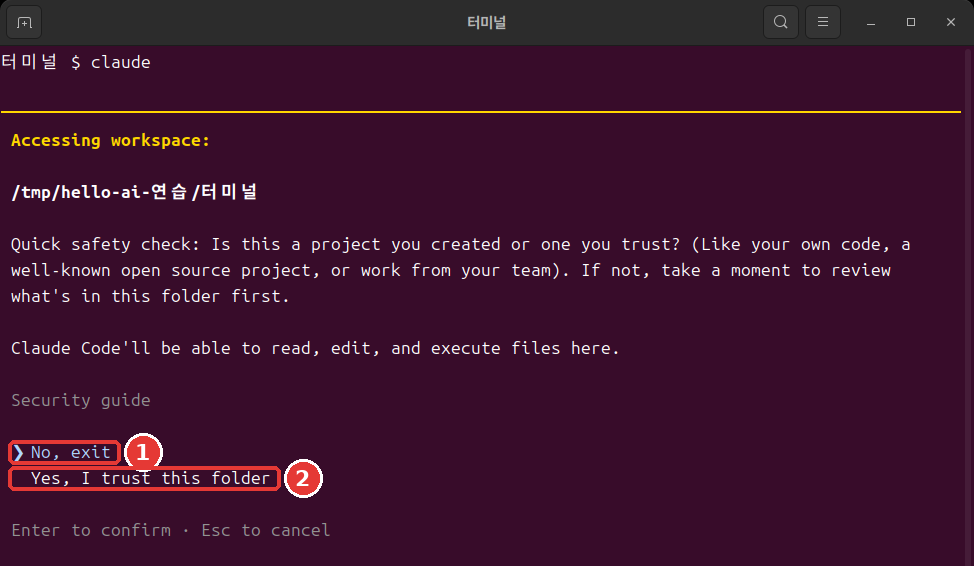
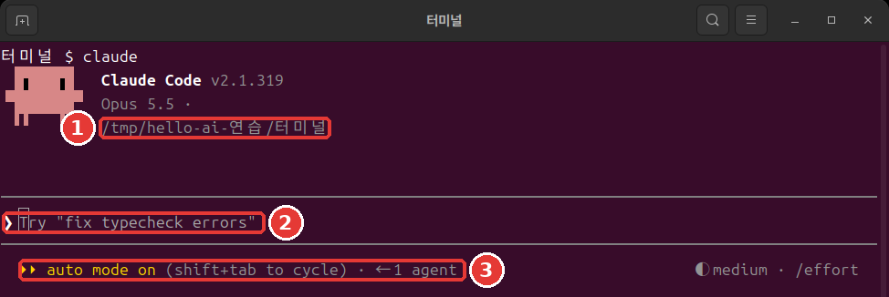
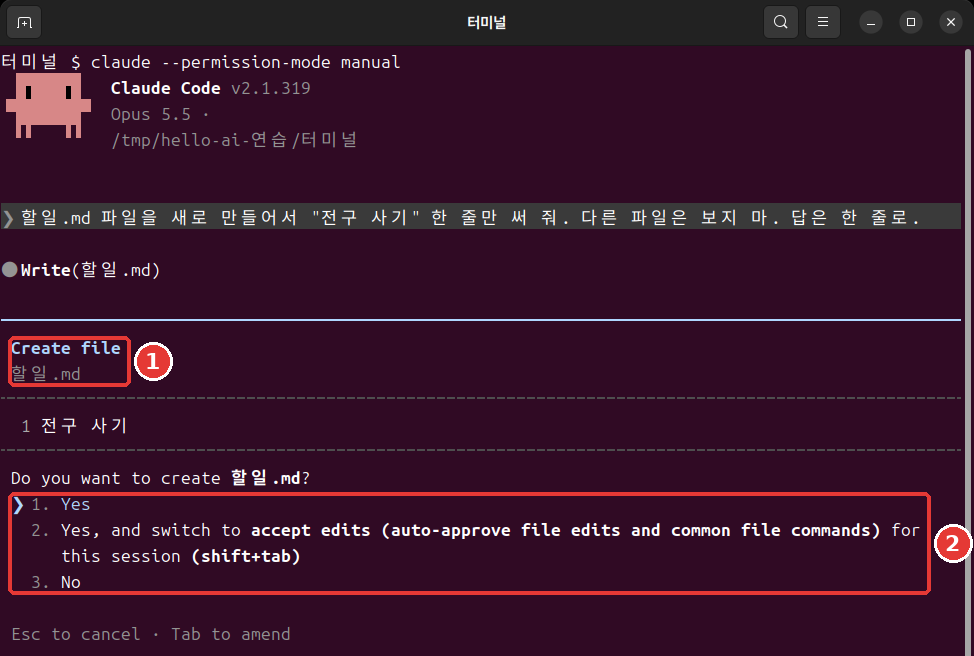

# Chapter 4. Your First Session

<Badge type="tip" text="Required" /> Be sure to read this to follow this step.

> **One-line summary**: Go to the folder you want to work in and type `claude`. Choose `Yes` in the trust check window, then tell it what to do in words. To stop, press `Esc`. To finish, type `/exit`.

A **session** is one bundle of conversation, from when you start Claude Code until you end it. Let's open your first session in the folder you made in Chapter 2.

## Starting in a Folder

First, move to the folder you want to work in. Then type `claude`.[^start]

On Mac and Linux, type this.

```bash
cd ~/hello-ai-연습/터미널
claude
```

In Windows PowerShell, type this.

```powershell
cd $HOME\hello-ai-연습\터미널
claude
```

**The order matters.** `claude` starts with the folder you are in now as its working folder. The start screen also shows that folder.[^header] If you start it in a folder that has nothing to do with your task, it works with that folder's files in front of it.

- **Weak example**: You type `claude` as soon as you open the terminal.
- **Better example**: You go into the folder with `cd`, check it with `pwd`, and then type `claude`.

<Quiz id="ch804-start" />

## The Trust Check Window

In a folder you open for the first time, a window like this appears first.



This is a picture of a real terminal window. Colors and fonts depend on your terminal settings. The text box below shows the same screen as text.[^screens]

```text
 Accessing workspace:

 ~/hello-ai-연습/터미널

 Quick safety check: Is this a project you created or one you trust? (Like your own code, a
 well-known open source project, or work from your team). If not, take a moment to review what's in
 this folder first.

 Claude Code'll be able to read, edit, and execute files here.

 Security guide

 ❯ No, exit
   Yes, I trust this folder

 Enter to confirm · Esc to cancel
```

It means: "Is this a folder you made or one you can trust? If not, look at what is inside it first. Claude Code will be able to read, edit, and run the files here."

**If you just press Enter here, the program closes.** That is because the `❯` mark is on `No, exit`. Press the down arrow once to move to `Yes, I trust this folder`, then press Enter. In the terminal, you cannot click a menu to pick something.[^arrows]

You just made this folder yourself, so you can trust it. If someone else gave you the folder, look inside it first.

<Quiz id="ch804-trust" />

## Reading the Start Screen

When you choose `Yes`, a screen like this appears.



```text
 ▐▛███▛█   Claude Code v2.1.318
▝▜██████▀  Opus 5.5 · Claude plan name
 ▝▝   ▝▝   ~/hello-ai-연습/터미널

▎ Auto mode is now Claude Code's default permission mode.
▎ Auto mode lets Claude handle permission prompts automatically. Claude checks each tool call for
▎ risky actions and prompt injection before executing, runs the ones it assesses as lower-risk, and
▎ blocks the rest.
▎ https://code.claude.com/docs/en/permission-modes

────────────────────────────────────────────────────────────
❯ Try "create a util logging.py that..."
────────────────────────────────────────────────────────────
  ⏵⏵ auto mode on (shift+tab to cycle)                ◐ medium · /effort
```

Read it from the top.

- **The top three lines**: The version, the current model, and the working folder.[^header] Be sure to check that the folder is the one you expected.
- **The Auto mode notice**: A notice in English that appears the first time you run it. You can skip it for now without reading it. The important parts are explained in plain words just below.
- **The `❯` line**: This is the input box. The text starting with `Try` is an example. It disappears when you type your own text.
- **The bottom line**: On the left is the current **permission mode**. The permission mode is the range of things Claude can do without asking.[^mode] The `medium` on the right is covered in Chapter 13.

`claude` in the terminal starts in **auto mode**. A separate AI that checks actions in advance blocks anything that looks risky. But auto mode only reduces permission prompts. It does not guarantee safety.[^auto]

At first, it is better to see with your own eyes what Claude is about to do. Press `Shift + Tab` once to switch to manual mode.[^shift-tab] The bottom line changes like this.

```text
  ⏸ manual mode on · ? for shortcuts                  ◐ medium · /effort
```

In manual mode, it asks first before most file edits or commands.[^manual] Modes are covered in detail in Chapter 7.

::: details More details (click to expand)
- A session that cannot use auto mode starts in manual.[^auto] To see which mode you are in now, go by the bottom line.
- You can also start with `claude --permission-mode manual` from the beginning.[^manual]
:::

<Quiz id="ch804-screen" />

## Your First Request — Making Meeting Minutes

Now let's give it a task. Just write the way you would talk to a coworker.[^colleague] Put this sentence in the input box and press Enter.

```text
Read the meeting notes in inbox and save them as 회의록.md. Answer in one line.
```

`.md` is a Markdown file. It is a plain text file you can open even in Notepad.

The more specific your request, the better.

- **Weak example**: `Make meeting minutes` — Claude has to guess what to read and where to put it.
- **Better example**: The sentence above — it has what to read, where to save, and how long the answer should be.

In manual mode, Claude reads the notes, shows the file contents, and then asks like this.



```text
 Do you want to create 회의록.md?
 ❯ 1. Yes
   2. Yes, and switch to accept edits (auto-approve file edits and common file commands) for this
      session (shift+tab)
   3. No

 Esc to cancel · Tab to amend
```

Skim the contents and press Enter on `1. Yes`.[^yes] Option 2 changes things so it stops asking about file edits for this session, and option 3 is a refusal. If you left it in auto mode, it may save without this window. The screen records in this guide are in manual mode.

When it finishes, it answers something like this.

```text
● I organized it into 회의록.md. The notes say 10/27 (Mon) and 11/3 (Mon), but on the 2026 calendar
  those are Tuesdays, so I marked them in the file as needing a check.
```

Do not be surprised if it mentions the days of the week. The days in the practice notes are made up, so they do not match the calendar. Claude noticed that. The wording of the answer can differ each time you run it. A suggestion for your next request may also appear faintly in the input box. You do not have to use it.

The result made from the same notes is in [4장-회의록.txt](/practice/cli/results/4장-회의록.txt). Compare it with your result. They do not have to be identical.

<Quiz id="ch804-first" />

## Giving Tasks and Stopping

A session is a conversation. You can give the next task building on the previous one. This time, let's edit the file.

```text
Add one line that says "Draft" at the very top of 회의록.md. Answer in one line.
```

This time, it shows the lines that will change and asks. Lines with `+` are the new lines that will go in.

```text
 1 +Draft
 2  # Corner Cafe Weekly Meeting Minutes
 3
 4  - **Date:** 10/27 (Mon)
```

Below that, it asks `Do you want to make this edit to 회의록.md?`. What the changed lines look like depends on your meeting minutes.

Read the permission prompt before you choose. It is your chance to check that it matches what you asked for.

If Claude heads in the wrong direction, press **`Esc`**. The task that was running is canceled, and Claude waits for your next instruction. You can step in at any time and change direction.[^esc]

Remember one thing. Even if you stop it, **the work done so far stays.**[^esc-keep] Files that were already saved do not go back on their own. You will learn how to undo things in Chapter 7.

<Quiz id="ch804-stop" />

## Finishing

Type this in the input box and press Enter.[^exit]

```text
/exit
```

You return to the terminal prompt. Now you are outside Claude Code. Check whether the file was created.

```bash
ls
cat 회의록.md
```

If Korean text looks garbled in PowerShell, view it with `Get-Content -Encoding UTF8 회의록.md`.

Pressing `Ctrl + D` twice in an empty input box also ends it.[^ctrl-d] At first, typing `/exit` in text is the least confusing. How to continue a finished conversation is covered in Chapter 6.

Now let's tell the two places apart. From now on, this is how you decide where to type a command.

- **The terminal**: The symbol before the cursor is `%`, `$`, or `>`. You type `cd`, `ls`, and `claude` here.
- **The Claude input box**: It starts with `❯` and has lines above and below. You type requests in words and commands starting with `/` here.

If you type `/exit` in the terminal, you get an error. On the other hand, if you type a terminal command like `ls` or `cd` in the input box, it does not run as a command. It becomes a message sent to Claude. When a later chapter tells you to type a command "in the terminal," and you see the input box, leave with `/exit` first and then type it.

<Quiz id="ch804-exit" />

## Try It Yourself

1. Go into the practice folder with `cd` and check it with `pwd`.
2. Start `claude` and choose `Yes, I trust this folder` in the trust check window.
3. Read the folder and the permission mode on the start screen. Switch to manual mode with `Shift + Tab`.
4. Send the meeting minutes request, read the permission prompt, and choose `1. Yes`.
5. Ask it to add the "Draft" line.
6. Leave with `/exit` and look at the file with `cat`.

Ask yourself: Was the file created? Are all the decisions and to-dos from the notes in it? Did anything sneak in that was not in the notes? The habit of checking AI results against the notes starts here.

## Summary

- Go into the folder with `cd`, then start `claude`.
- The default choice in the trust check window is `No, exit`. Choose `Yes` with the down arrow.
- Read the folder and the permission mode on the start screen. The terminal starts in auto mode, and you switch with `Shift + Tab`.
- In your request, write what to read and where to save. Read the permission prompt before you choose.
- `Esc` stops. The work done so far stays.
- Finish with `/exit`, and check the results against the notes.
- If the symbol is `%`, `$`, or `>`, it is the terminal. If it is `❯`, it is the Claude input box.

## Glossary

| Term | One-line meaning |
|---|---|
| Session | One bundle of conversation, from when you start Claude Code until you end it |
| Permission mode | The range of things it can do without asking |
| Auto mode | A mode where a separate AI checks in advance and reduces permission prompts |
| Manual mode | A mode that asks first in most cases |
| Markdown | A plain text file format that marks headings and lists with symbols |

<ChapterDone :chapter="804" />

Next chapter: [Chapter 5. Input Tips and Commands](05-input-commands.md)

[^screens]: The pictures in this chapter and later ones were taken in a Linux terminal with Claude Code 2.1.319. The folder path is a temporary practice folder, so it differs from your screen, and the plan name was hidden. The folder path and plan name on the screen were rewritten to fit this course. The text boxes were copied out separately so they are easy to copy and use. Some parts were taken from other runs, so paths or file names may differ from the pictures.
[^start]: Claude Code official docs, "Quickstart." "Open your terminal in any project directory and start Claude Code:" https://code.claude.com/docs/en/quickstart (checked on 2026-11-06)
[^header]: Claude Code official docs, "Quickstart." "The Claude Code prompt appears with the version, current model, and working directory shown above it." https://code.claude.com/docs/en/quickstart (checked on 2026-11-06)
[^arrows]: Claude Code official docs, "Terminal guide for new users." "You can't click on things in the terminal. Use the arrow keys to move around." https://code.claude.com/docs/en/terminal-guide (checked on 2026-11-06)
[^mode]: Claude Code official docs, "Choose a permission mode." "A permission mode sets which actions Claude can take in a session without asking you first." https://code.claude.com/docs/en/permission-modes (checked on 2026-11-06)
[^auto]: Claude Code official docs, "Choose a permission mode." "With Claude Code v2.1.283 or later, auto mode is the built-in starting permission mode for interactive terminal and VS Code sessions." / "A separate classifier model reviews actions before they run, blocking anything that escalates beyond your request, targets unrecognized infrastructure, or appears driven by hostile content Claude read." / "Auto mode reduces permission prompts but does not guarantee safety." / "When the flag, a settings file, or the built-in default selects `auto` but auto mode isn't available to the session, Claude Code starts the session in Manual instead." https://code.claude.com/docs/en/permission-modes (checked on 2026-11-06)
[^shift-tab]: Claude Code official docs, "Choose a permission mode." "From `auto`, the first press switches to `default`, and the cycle then runs `default` → `acceptEdits` → `plan`." https://code.claude.com/docs/en/permission-modes (checked on 2026-11-06)
[^manual]: Claude Code official docs, "Choose a permission mode." "In Manual mode, Claude Code stops and asks you before most actions that edit files, run shell commands, or reach the network." https://code.claude.com/docs/en/permission-modes · "Best practices for Claude Code." "`Shift+Tab` in the session cycles through the permission modes, Manual included, or start with `claude --permission-mode manual` from your shell." https://code.claude.com/docs/en/best-practices (checked on 2026-11-06)
[^colleague]: Claude Code official docs, "Quickstart." "Talk to Claude like you would a helpful colleague." https://code.claude.com/docs/en/quickstart (checked on 2026-11-06)
[^yes]: Claude Code official docs, "Quickstart." "If it asks before making the change, select Yes to approve." https://code.claude.com/docs/en/quickstart (checked on 2026-11-06)
[^esc]: Claude Code official docs, "How Claude Code works." "The running tool call is canceled and Claude waits for your next instruction." / "You can interrupt at any point to steer Claude in a different direction, provide additional context, or ask it to try a different approach." https://code.claude.com/docs/en/how-claude-code-works (checked on 2026-11-06)
[^esc-keep]: Claude Code official docs, "Interactive mode." "Stop the current response or tool call mid-turn so you can redirect. Claude keeps the work done so far." https://code.claude.com/docs/en/interactive-mode (checked on 2026-11-06)
[^exit]: Claude Code official docs, "Commands." "Exit the CLI." https://code.claude.com/docs/en/commands (checked on 2026-11-06)
[^ctrl-d]: Claude Code official docs, "Terminal guide for new users." "Type `exit` or press `Ctrl + D` twice on an empty prompt to leave Claude Code." https://code.claude.com/docs/en/terminal-guide (checked on 2026-11-06)
