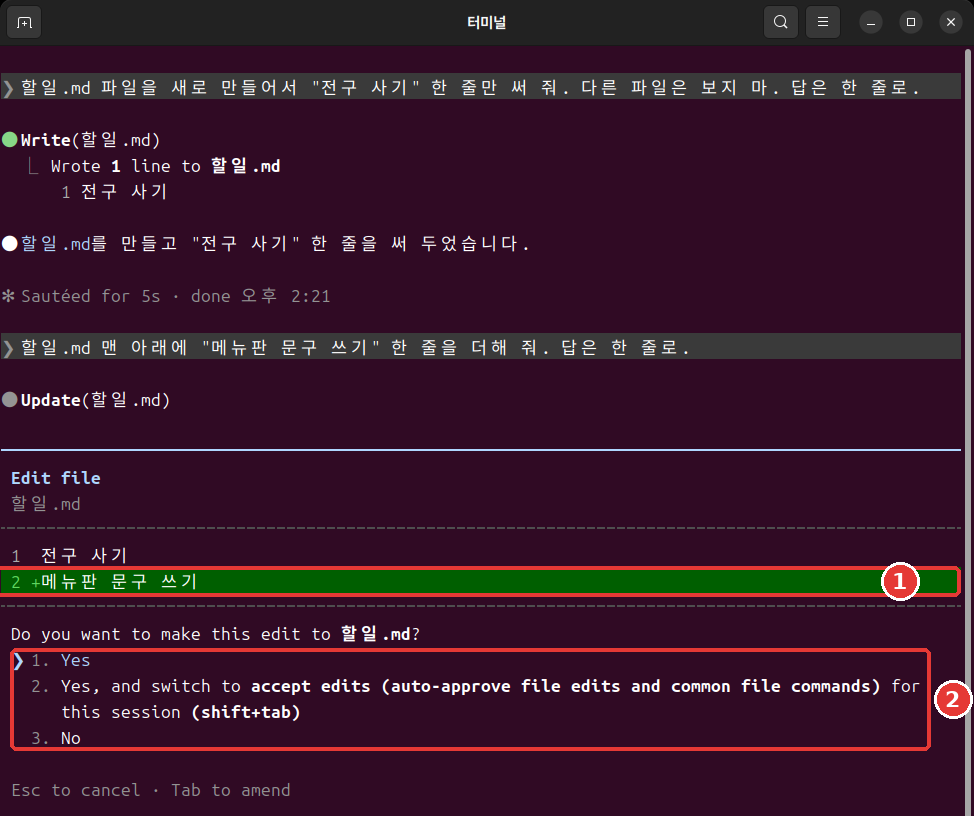
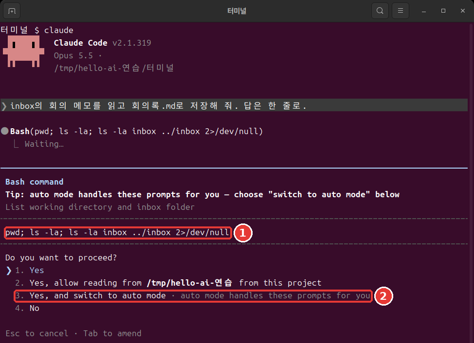
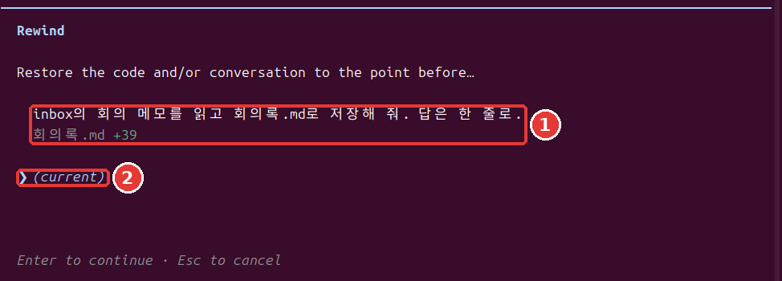
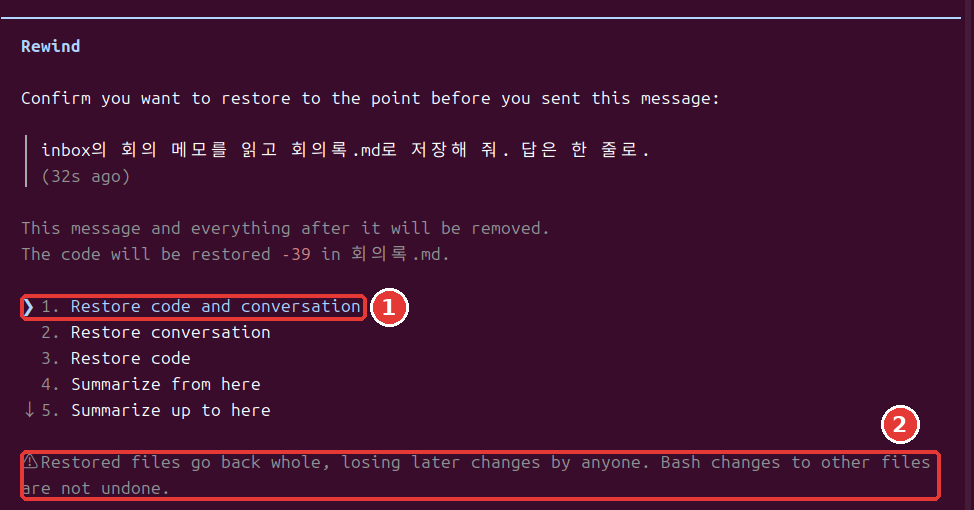

# Chapter 7. Permissions and Undo

<Badge type="tip" text="Required" /> Be sure to read this to follow this stage.

> **One-line summary**: Permission modes and rules decide what Claude can do without asking. If something goes wrong, you can rewind with Esc twice, but some things don't come back.

You don't need to memorize all of it.[^run] Start by learning how to read the permission prompt.

## Four Permission Modes

A **permission mode** is the range of things Claude may do without asking.[^modes] The current mode appears on the bottom line of the screen. Each time you press Shift+Tab, it changes in the order of the table, and after the last one it goes back to the top.

| Plain name | Text on the bottom line | What it does |
|---|---|---|
| Auto | `⏵⏵ auto mode on` | A separate AI checks, then proceeds |
| Manual | `⏸ manual mode on` | Asks first for most things |
| Accept edits | `⏵⏵ accept edits on` | Doesn't ask about file work |
| Plan | `⏸ plan mode on` | Only researches and proposes |

- **Auto**: When you start `claude` in the terminal, it starts in this mode. A separate AI that checks actions beforehand blocks anything that looks dangerous.[^auto] It's not a person checking for you. Auto mode only cuts down on permission prompts; it doesn't guarantee safety.[^auto]
- **Manual**: It asks first before most file edits, shell commands, and network access.[^modes] It's safe, but after about the tenth prompt it's easy to start approving without reading.[^practice]
- **Accept edits**: It doesn't ask before creating and editing files inside the working folder.[^modes] It also approves common file commands without asking.
- **Plan**: It only researches and proposes; it doesn't make changes.[^modes] It's good when you want to see how it would go about a big job before handing it over.

::: details More (click to expand)
In auto mode, if it gets blocked three times in a row, it pauses and goes back to asking you.[^practice]
:::

When you first practice, try starting in manual mode. You'll get used to seeing what Claude does. Type this in the terminal.[^practice]

```bash
claude --permission-mode manual
```

<Quiz id="ch807-modes" />

## Reading the Permission Prompt

In manual mode, if you ask "Read the meeting memo in inbox and save it as 회의록2.md. Answer in one line.", a prompt like this appears. The permission prompt first shows what Claude is about to do and then gives you options.[^prompt]

```text
 Do you want to create 회의록2.md?
 ❯ 1. Yes
   2. Yes, and switch to accept edits (auto-approve file edits and common file commands) for this
      session (shift+tab)
   3. No

 Esc to cancel · Tab to amend
```

Choose with the up and down arrows and press Enter. Option 1 allows it just this once. Option 2 switches this session to accept edits mode. Option 3 doesn't do it. Esc cancels.

When editing an existing file, it asks `Do you want to make this edit to 회의록2.md?` and also shows the lines that change. Lines starting with `+` are the new lines being added.



When running a shell command, a slightly different prompt appears. It shows the exact command to be run, so read it first. If auto mode is available, there's also an option to switch to auto mode.[^switch-auto]



An option starting with `Yes, allow reading from` asks whether it may read a folder. Read the folder name before choosing.[^symbols]

When a prompt appears, ask yourself these questions.

- Is this the file I mentioned?
- Is the change what I asked for?
- Is anything I didn't ask for mixed in?

A weak habit is pressing Enter as soon as the prompt appears. A better habit is reading the file name and the changed lines before choosing. Those few seconds catch a wrong edit before it happens.

A shell command permission prompt may show `Yes, and don't ask again`. If you choose this, the rule is saved to a settings file and carries over to future sessions.[^local-file] A file-edit approval lasts only until the session ends.[^prompt] What gets saved lasts a long time, so choose it only when you understand what it means.

<Quiz id="ch807-prompt" />

## Don't Use the Option That Skips Checks

You may come across `--dangerously-skip-permissions` in articles online. It's an option that skips permission checks.[^skip] Don't use it.

This option protects you from neither mistakes nor prompt injection (the attack you saw in Chapter 5, where instructions hidden in text steer the AI).[^bypass] So it's used only in practice environments kept separate from your computer. The official docs give the example of a container or a virtual machine (an isolated computer created separately inside your computer) with no internet access.[^bypass]

If permission prompts feel like a hassle, there's another way. Just open up only the things you do often, using the allow rules in the next section.

<Quiz id="ch807-skip" />

## Permission Rules: allow, ask, deny

If modes are the big picture, rules are the details. Rules are set per **tool**. A tool is a feature Claude uses. For example, `Read` is reading files and `Bash` is shell commands.

There are three kinds of rules.[^rules]

- **allow**: Allows it without asking.
- **ask**: Checks with you every time it's used.
- **deny**: Blocks it from being used.

Rules are written in a settings file. In the next section, you'll make one yourself.

Rules are checked in the order deny, ask, allow, and the first match wins. So you can't punch a hole in a broad deny with an allow.[^rules] Deny rules block in every mode.[^bypass]

Here's what they look like. You write the target in parentheses after the tool name. `Bash(ls *)` matches only the `ls` command. If you write `Bash(*)`, it matches every shell command.[^rules] The asterisk matches broadly, so use only as much as you need.

Type `/permissions` inside a session to view and manage rules.[^rules] Move between the tabs at the top with the left and right arrows.

```text
  Permissions  Recently blocked   Allow   Ask   Deny   Auto mode   Workspace
```

<Quiz id="ch807-rules" />

## Trying a Deny Rule

Let's block Claude from reading a secret file. It's a good idea to block files containing login information, like passwords or authentication keys, with a permission rule.[^creds] **Don't use a real password.** Practice with a fake file.

There are three things to do. Make a fake secret file, make a settings file that blocks it, and ask Claude to read it.

Leave with `/exit` and move to the practice folder in the terminal. On Mac and Linux, paste the whole block below. On Windows PowerShell, follow the method in "If you use Windows PowerShell" just below.

```bash
mkdir 비밀
echo 'Fake password: cafe-1234' > 비밀/암호.txt
mkdir -p .claude
cat > .claude/settings.json <<'EOF'
{
  "permissions": {
    "deny": ["Read(./비밀/**)"]
  }
}
EOF
```

Let's read this box line by line.

- `mkdir 비밀`: Creates the `비밀` (secret) folder.
- `echo '…' > 비밀/암호.txt`: Saves the text inside the quotes to a file. `>` is the symbol that saves output to a file.
- `mkdir -p .claude`: Creates the `.claude` folder. No error appears even if it already exists.
- `cat > .claude/settings.json <<'EOF'`: Saves everything from the next line up to `EOF` into this file. Later chapters use this same pattern to make files.
- From `{` to `}`: The content that goes into the settings file. The target to block is written in the `"deny"` field.

After pasting, if it hasn't run yet, press Enter once more. If nothing appears, it worked. Use `ls` to check that the `비밀` folder was created.

**If you use Windows PowerShell**: Create the folders with `mkdir 비밀` and `mkdir .claude`. Open Notepad with `notepad 비밀\암호.txt` and enter `Fake password: cafe-1234`. In `notepad .claude\settings.json`, enter only what's between the line starting with `cat` and the `EOF` line in the box above, leaving those two lines out. If it asks whether to create a new file, click `Yes`, then save with `Ctrl + S` and close. We did not test this method.

`Read(./비밀/**)` means "don't read anything inside the 비밀 folder." Start `claude` in the terminal and ask, "Read the file 비밀/암호.txt and tell me what it says."

When we sent the same request as a one-shot run (the method you'll learn in [Chapter 10](10-headless-automation.md)), Claude replied that it couldn't read the file and didn't show the contents. The wording may differ each run. There's only one thing to check: Did `cafe-1234` appear in the answer?

What this exercise shows is just one fact: Claude's read request was blocked. Don't stretch it to mean the file can never be read by any method. This rule doesn't apply to commands that read files without naming them.[^deny-limit] The safest choice is not to keep real passwords in your working folder at all.

<Quiz id="ch807-deny" />

## Rewinding

Files Claude edits are tracked automatically. Each time you send a request, one point you can go back to is created.[^checkpoint] This point is called a **checkpoint**.

Press Esc twice while the input box is empty, and the `Rewind` menu opens. You can also type `/rewind`. **The input box must be empty.** If there's text, the text is cleared instead of opening the menu.[^checkpoint] You can bring cleared text back with the up arrow.[^esc-up]

The menu shows the messages you sent and the files that changed. Choose a message with the up arrow and press Enter, and the options appear.[^checkpoint]





| Option | Meaning |
|---|---|
| Restore code and conversation | Restores both files and conversation |
| Restore conversation | Restores only the conversation |
| Restore code | Restores only the files |
| Summarize from here | Summarizes the conversation from here on |
| Summarize up to here | Summarizes the conversation before here |

If it's your first time, choose the top one. To back out, press Esc. A warning like this appears below the menu.

```text
  ⚠ Restored files go back whole, losing later changes by anyone. Bash changes to other files are
  not undone.
```

This means files go back as a whole, so any changes made after that point are lost too, no matter who made them.

In our exercise, we had Claude add one more line to a file and then restored it with the top option. The file went back to its earlier contents, and the message we had sent was back in the input box. You can edit it and send it again, or delete it.

When you want Claude to stop what it's doing, press Esc only **once**. The work done up to that point stays.[^practice]

<Quiz id="ch807-rewind" />

## What You Can't Undo

Thinking "Esc twice brings everything back" will get you in trouble. Rewind only handles **files changed by Claude's editing tools**. The following don't come back.[^limits]

- Files changed only by shell commands
- Other files changed by a subagent (a helper that Claude hands part of the work to, [Chapter 9](09-skills-extensions.md))
- Files you edited yourself, or edits from other sessions (usually)
- Things done outside the computer, like sending email or changing an outside database[^remote]

To undo changes like these, use version control such as **Git**.[^limits] Git is a tool that records the state of your files. It's similar to a save file in a game. You'll make your first record in [Chapter 12](12-parallel-remote.md). Rewind is a handy safety net, but don't make it your only one.

<Quiz id="ch807-limits" />

## Try It Yourself

1. In the practice folder, start with `claude --permission-mode manual` and press Shift+Tab four times to watch the modes go all the way around.
2. Ask it to create 회의록2.md. Then say, "Add one line saying "Draft" at the very top of 회의록2.md. Answer in one line." Read the permission prompt and choose option 1.
3. With the input box empty, press Esc twice. Choose the last request and choose `Restore code and conversation`. Did the "Draft" line disappear?
4. Clear the text that came back into the input box with Esc twice, then leave with `/exit`. Make the deny rule in the terminal, start `claude`, and ask it to read `비밀/암호.txt`.

Ask yourself: Can I say what my Claude can do without permission? Can I name three things that rewind doesn't bring back?

## Summary

- There are four permission modes, and you switch with Shift+Tab. Interactive sessions start in auto, and auto doesn't guarantee safety.
- Read the file name and the changed lines in a permission prompt before choosing. Don't use `--dangerously-skip-permissions`.
- Rules are checked in the order deny, ask, allow. Deny rules block in every mode.
- Press Esc twice with the input box empty to open the rewind menu.
- Rewind restores only files changed by Claude's editing tools. For everything else, you need Git.

## Glossary

| Term | One-line meaning |
|---|---|
| Permission mode | The range of things it may do without asking |
| allow / ask / deny | Allow / confirm / block rules |
| Checkpoint | A point you can go back to |
| Git | A tool that records the state of your files |

<ChapterDone :chapter="807" />

Next chapter: [Chapter 8. Project Memory and Settings](08-memory-settings.md)

[^run]: The screens in this chapter are the results of running Claude Code 2.1.318 on Linux on November 6, 2026.
[^symbols]: The meanings of `;` and `2>/dev/null` in the command in the picture are in the [command reference](command-reference.md).
[^local-file]: The file it's saved to is `.claude/settings.local.json`. Settings files are covered in [Chapter 8](08-memory-settings.md).
[^modes]: Claude Code official docs, "Choose a permission mode". "A permission mode sets which actions Claude can take in a session without asking you first." / "In Manual mode, Claude Code stops and asks you before most actions that edit files, run shell commands, or reach the network." / "lets Claude create and edit files in your working directory without prompting" / "Plan mode tells Claude to research and propose changes without making them." https://code.claude.com/docs/en/permission-modes (checked on 2026-11-06)
[^auto]: Claude Code official docs, "Choose a permission mode". "With Claude Code v2.1.283 or later, auto mode is the built-in starting permission mode for interactive terminal and VS Code sessions." / "A separate classifier model reviews actions before they run, blocking anything that escalates beyond your request, targets unrecognized infrastructure, or appears driven by hostile content Claude read." / "Auto mode reduces permission prompts but does not guarantee safety." https://code.claude.com/docs/en/permission-modes (checked on 2026-11-06)
[^practice]: Claude Code official docs, "Best practices for Claude Code". "After three blocks in a row (or twenty in total), auto mode pauses and goes back to asking you." / "Safe, but after the tenth prompt you start approving without reading, and nothing moves while you're away from the keyboard." / "`Shift+Tab` in the session cycles through the permission modes, Manual included, or start with `claude --permission-mode manual` from your shell." / "`Esc` stops Claude mid-action and keeps everything up to that point, so you can redirect without losing work." https://code.claude.com/docs/en/best-practices (checked on 2026-11-06)
[^prompt]: Claude Code official docs, "Configure permissions". "A permission prompt shows what Claude is about to do, followed by your options." / "Claude Code saves the rule to `.claude/settings.local.json` at the root of the git repository" / "A file-modification approval isn't saved to the file: as the table shows, it lasts until the session ends." https://code.claude.com/docs/en/permissions (checked on 2026-11-06)
[^skip]: Claude Code official docs, "CLI reference". "Skip permission prompts." https://code.claude.com/docs/en/cli-reference (checked on 2026-11-06)
[^bypass]: Claude Code official docs, "Choose a permission mode". "Only use this mode in isolated environments like containers, VMs, or dev containers without internet access, where Claude Code cannot damage your host system." / "`bypassPermissions` offers no protection against prompt injection or unintended actions." / "Deny rules block in every mode, including `bypassPermissions`." https://code.claude.com/docs/en/permission-modes (checked on 2026-11-06)
[^rules]: Claude Code official docs, "Configure permissions". "Allow rules let Claude Code use the specified tool without manual approval." / "Ask rules prompt for confirmation whenever Claude Code tries to use the specified tool." / "Deny rules prevent Claude Code from using the specified tool." / "Rules are evaluated in order: deny, then ask, then allow." / "An allow rule can't carve an exception out of a deny rule." / "`Bash(ls *)` matches `ls`" / "`Bash(*)` is equivalent to `Bash` and matches all Bash commands." / "You can view and manage Claude Code's tool permissions with `/permissions`." https://code.claude.com/docs/en/permissions (checked on 2026-11-06)
[^creds]: Claude Code official docs, "Explore the .claude directory". "Use permission rules to deny reads of credential files" https://code.claude.com/docs/en/claude-directory (checked on 2026-11-06)
[^checkpoint]: Claude Code official docs, "Checkpointing". "Claude Code automatically tracks Claude's file edits as you work, allowing you to quickly undo changes and rewind to previous states if anything gets off track." / "Every prompt you send that starts a turn creates a new checkpoint" / "Run `/rewind`, or press `Esc` twice when the prompt input is empty, to open the rewind menu." / "If the prompt input contains text, double `Esc` clears it instead of opening the menu." / "Restore code and conversation: revert both code and conversation to that point" / "Restore conversation: rewind to that message while keeping current code" / "Restore code: revert file changes while keeping the conversation" / "Summarize from here: compress the conversation from this point forward into a summary, freeing context window space" / "Summarize up to here: compress the conversation before this point into a summary, keeping later messages intact" https://code.claude.com/docs/en/checkpointing (checked on 2026-11-06)
[^esc-up]: Claude Code official docs, "Interactive mode". "When the prompt input contains text, double `Esc` clears it and saves the draft to history so `Up` recalls it." https://code.claude.com/docs/en/interactive-mode (checked on 2026-11-06)
[^limits]: Claude Code official docs, "Checkpointing". "A file that only Bash commands changed isn't tracked and stays as it is." / "To revert it, use version control, such as Git." / "The subagent's edits to other files stay, so use version control, such as Git, to revert them." / "Manual changes you make to files outside of Claude Code and edits from other concurrent sessions are normally not captured, unless they happen to modify the same files as the current session." https://code.claude.com/docs/en/checkpointing (checked on 2026-11-06)
[^remote]: Claude Code official docs, "How Claude Code works". "Actions that affect remote systems (databases, APIs, deployments) can't be checkpointed." https://code.claude.com/docs/en/how-claude-code-works (checked on 2026-11-06)
[^deny-limit]: Claude Code official docs, "Configure permissions". "They don't apply to a command that reads files without naming them" https://code.claude.com/docs/en/permissions (checked on 2026-11-06)
[^switch-auto]: Claude Code official docs, "Choose a permission mode". "Claude Code adds **Yes, and switch to auto mode** to a Bash command's permission prompt." https://code.claude.com/docs/en/permission-modes (checked on 2026-11-06)
