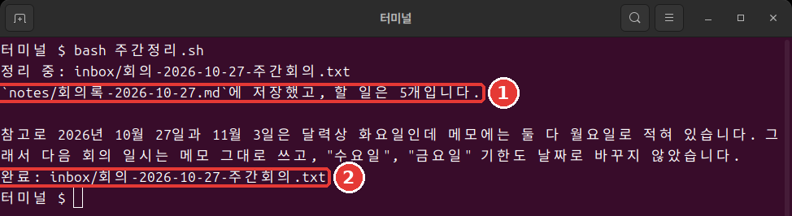

# Chapter 10. One-Line Runs and Automation

<Badge type="tip" text="Required" /> Read this to follow this stage.

> **One-line summary**: `claude -p` answers once and exits. You allow writing in advance, and you judge success by the exit code. Put these three together and you get a weekly cleanup that runs with a single command.

The output in this chapter comes from running Claude Code 2.1.318 on Linux on November 6, 2026. It is fine if this feels hard. Looked at piece by piece, it is just joining together the things you made in earlier chapters.

## claude -p vs. Interactive Mode

Add `-p` (or `--print`) and it answers once without a conversation, then exits.[^headless] Leave with `/exit`, move to the practice folder in the terminal, and type:

```bash
claude -p "Answer in one line only: how many files are in the inbox folder?"
```

It answered `There is 1 file in the inbox folder.` and went straight back to the shell.

Interactive `claude` keeps going until you leave, and it starts in auto mode. `claude -p` ends once it gives an answer, and it starts in Manual mode.[^headless] You only need `-p` when you run the same task without a person. For everything else, interactive mode is enough.

<Quiz id="ch810-print" />

## Why Writing Gets Blocked

This time, ask it to create a file. So it does not overwrite the file from Chapter 4, name it `회의록-한줄.md`.

```bash
claude -p "Read the meeting note in inbox, organize it, and save it as the file 회의록-한줄.md."
```

No file is created. The answer tells you that `file write permission was not approved`. It is not broken. `-p` starts in Manual mode, but there is nobody to ask. So calls that need approval are denied.[^headless] You just need to allow the tools it needs in advance.[^headless]

```bash
claude -p "Read the meeting note in inbox, organize it, and save it as the file 회의록-한줄.md. Answer in one line." --allowedTools "Read,Write"
```

`--allowedTools` is an option that sets in advance which tools it may use without asking. `Read` is reading files, and `Write` is writing files. Join them with a comma and wrap them in quotes.

This time the file was created. If it is not in `ls`, also check `ls notes`. Because of the rules from Chapter 8, it may be saved there.

Rather than allowing a lot because you are not sure what it needs, it is better to allow only `Read,Write`, which this task needs. When you allow narrowly, there is less it can do even if Claude makes a wrong call.

<Quiz id="ch810-allow" />

## Passing Content with a Pipe

A **pipe** (Pipe, `|`) is a symbol that passes the output of the command before it as the input of the command after it. Picture water flowing through a pipe. `claude -p` also takes content through a pipe.[^headless]

```bash
cat inbox/회의-2026-10-27-주간회의.txt | claude -p "Pull out only the to-dos from this note, in three lines."
```

```text
- Seoyeon: buy a restroom light bulb today (10/27)
- Seoyeon: draft the set-menu board text by Wednesday
- Junho: find out the cost of vin chaud by Friday
```

**On Windows**, Korean text passed through a pipe can get garbled. If the answer is off, pass the file by putting `@` in front of its name instead of using a pipe. Replace `filename` with the actual name of the note. We ran and checked this command on Linux but did not try it on Windows.

```bash
claude -p "Pull out only the to-dos from @inbox/filename in three lines."
```

**Do not pipe untrusted content straight in.**[^security] That includes text from the web or email from people you do not know. The text may hide the prompt injection you saw in [Chapter 7](07-permissions-undo.md).[^security] Prompt injection is a trick that secretly mixes instructions for the AI into text to make it do something unexpected.

The practice note [회의-2026-10-29-임시회의.txt](/practice/notes/inbox/회의-2026-10-29-임시회의.txt) has an example of such a sentence. For now, just click the link and read it in your browser. Do not put it in the `inbox` folder yet. That is because the script we make later processes every note in `inbox`. You will put this note in when you learn how to handle it safely in [Chapter 13](13-cost-safety-trouble.md).

<Quiz id="ch810-pipe" />

## Saving the Output and Changing Its Format

If you want the answer in a file, add `> 할일.txt` at the very end.[^headless] It does not appear on the screen; it goes into the file. If a file with the same name exists, it is overwritten, so be careful.

The hands-on in this chapter does not need the JSON output below. Just know that it exists.

If another program needs to read the answer, get it in the JSON format you saw in [Chapter 8](08-memory-settings.md).[^headless] Write it like `claude -p "What is 1+1? Number only." --output-format json`. It comes out as one long line. The answer is in the `result` field.

The `total_cost_usd` field holds a dollar amount. There is no need to be alarmed. It is an estimate calculated by the program, so it can differ from what you are actually charged.[^headless] For subscribers, the session cost figure means nothing for billing.[^costs]

<Quiz id="ch810-output" />

## Turn Limits and Exit Codes

If Claude runs too long while nobody is around, that is a problem. Use `--max-turns` to set a cap on the number of turns (one round of Claude continuing its work). The default is no limit.[^max-turns] Let's deliberately cut it to 1.

```bash
claude -p "Read all the notes in the inbox folder and summarize them in three lines." --allowedTools "Read" --max-turns 1
echo $?
```

```text
Error: Reached max turns (1)
1
```

The `1` at the very bottom is the **exit code** (Exit code). It is 0 on success and a non-zero value on failure.[^headless] People read the text, and scripts read this number. `echo $?` shows the exit code of the command just before it. In PowerShell, type `$LASTEXITCODE`.

<Quiz id="ch810-exit" />

## Making 주간정리.sh

Now put the pieces together. A **script** (Script) is a set of commands written in a file and run all at once. You need the `CLAUDE.md` and `notes` folder from [Chapter 8](08-memory-settings.md) and the skill from [Chapter 9](09-skills-extensions.md). Leave with `/exit` and move to the practice folder in the terminal. On Mac and Linux, paste the whole block below (view as a file: [10장-주간정리.sh.txt](/practice/cli/results/10장-주간정리.sh.txt)).

```bash
cat > 주간정리.sh <<'EOF'
#!/bin/bash
# Turn each meeting note in inbox into meeting minutes, one by one.
for memo in inbox/회의-*.txt; do
  echo "Organizing: $memo"
  if claude -p "/meeting-notes $memo" --allowedTools "Read,Write" --max-turns 10; then
    echo "Done: $memo"
  else
    echo "Failed: $memo"
  fi
done
EOF
```

If it has not run yet after pasting, press Enter once more. If nothing appears, it worked. Check with `ls` that `주간정리.sh` was created.

The top line `#!/bin/bash` marks that this file should be read by bash (a kind of shell). The next line starting with `#` is an explanation for people to read. The `for` line puts each note whose name starts with `회의-` into `memo`, one at a time. Here `memo` is a **variable** (Variable). Think of it as a name tag that holds a value for a while. Put `$` in front of the name, as in `$memo`, and you take out the value inside it. On the first round, `$memo` becomes `inbox/회의-2026-10-27-주간회의.txt`.

The `if` line calls the skill from Chapter 9 and prints `Done` if the exit code is 0, or `Failed` if not.

Write variable names in English, like `memo`. bash does not accept Korean variable names. File names can be in Korean.

Running it takes one line.

```bash
bash 주간정리.sh
```



```text
Organizing: inbox/회의-2026-10-27-주간회의.txt
Saved to `notes/회의록-2026-10-27.md`, with 5 to-dos.

For reference, the note lists 10/27 and 11/3 as Mondays, but on the 2026 calendar both are Tuesdays, so I left the days and dates as they are in the note.
Done: inbox/회의-2026-10-27-주간회의.txt
```

Meeting minutes were created without anyone pressing anything ([see the result](/practice/cli/results/10장-회의록-스크립트로.txt)). Your result and wording may differ; it is fine as long as it has the three sections and the table.

**On Windows**, this script does not run as is in PowerShell. That is because it is written for bash. Use the PowerShell version below. On Mac and Linux, you can skip this part.

Here is the same task written for PowerShell. Paste this box into the window each time you run it. It is an example we have not run. If you use WSL, run the script above inside the WSL terminal.[^wsl]

```powershell
foreach ($file in Get-ChildItem inbox/회의-*.txt) {
  $memo = "inbox/$($file.Name)"
  Write-Output "Organizing: $memo"
  claude -p "/meeting-notes $memo" --allowedTools "Read,Write" --max-turns 10
  if ($LASTEXITCODE -eq 0) { Write-Output "Done: $memo" } else { Write-Output "Failed: $memo" }
}
```

<Quiz id="ch810-script" />

## What to Know on a Subscription Account

If you have a subscription account, remember just two things.

- Check your usage once before and once after running the script. Type `/usage` inside a session to see the usage bars.[^costs]
- Even if other articles recommend an option called `--bare`, do not add it.

The official docs this guide checked do not say how `-p` runs are counted against subscription limits. So instead of guessing, it is more reliable to check directly with `/usage`.

Here is why you should not add `--bare`. The official docs recommend `--bare` for scripts, but `--bare` does not read your subscription login information. It also does not load `CLAUDE.md` or skills.[^bare] Our script needs all three.

On the other hand, using `-p` without `--bare` loads that folder's settings. That includes hooks and MCP servers in a folder you have never trusted.[^bare] So run it only in your own folders whose contents you know.

<Quiz id="ch810-subscription" />

## Checks Before You Step Away

Before you leave it running and step away, check three things.[^unattended] Here is how our script measures up:

- What does done look like? It is done when one meeting-minutes file per note appears in `notes`.
- Can it check its own work? The exit code separates `Done` from `Failed`.
- Does it touch only what it should? We allowed only `Read,Write`, but that does not limit the folder. So run it only in the practice folder. The number of turns is capped with `--max-turns 10`.

The script processes every meeting note in `inbox`. So put in new notes and then run it. Do not put in notes you have not read. Also, exit code 0 only means it finished normally. It does not mean the content of the minutes is correct. For the first few weeks, read the results yourself.

<Quiz id="ch810-unattended" />

## Try It Yourself

1. In the terminal, send a reading question with `claude -p`, then send a writing request without permission. Use `ls` to see that no file was created.
2. Send it again with `--allowedTools "Read,Write"` added.
3. Pull out the to-dos with a pipe and save them. On Windows, if the answer is off, use the `@` method from earlier.

   ```bash
   cat inbox/회의-2026-10-27-주간회의.txt | claude -p "Pull out only the to-dos from this note, in three lines." > 할일.txt
   ```

4. Make it fail with `--max-turns 1` and look at the exit code.
5. Make `주간정리.sh` and run it with `bash 주간정리.sh`. On Windows, paste the PowerShell code box above.

Ask yourself: Did it run without a person? Does the result match the note? Next week, when there are more notes, will the same command still work?

## Summary

- `claude -p` starts in Manual mode, and there is nobody to ask. Allow writing in advance with `--allowedTools`.
- Do not pipe in untrusted content. The cost in the JSON is an estimate.
- Cap the turns with `--max-turns` and judge success by the exit code.
- Write bash variable names in English. A bash script does not run as is in PowerShell.
- On a subscription account, do not use `--bare`, and check usage directly with `/usage`.

## Glossary

| Term | One-line meaning |
|---|---|
| Pipe | A symbol that passes a command's output to the next one |
| Exit code | A number left when a program ends (0 means success) |
| Script | A file of commands run all at once |

<ChapterDone :chapter="810" />

Next chapter: [Chapter 11. Hooks and Screen Customization](11-hooks-statusline.md)

[^headless]: Claude Code official docs, "Run Claude Code programmatically". "Add the `-p` (or `--print`) flag to any `claude` command to run it non-interactively." / "With Claude Code v2.1.302 or later, `claude -p` runs start in Manual mode when nothing sets a permission mode." / "In a Manual mode `claude -p` run, a call that needs approval is denied unless something approves it" / "Use `--allowedTools` to let Claude use certain tools without prompting." / "Non-interactive mode reads stdin, so you can pipe data in and redirect the response out like any other command-line tool." / "`json`: structured JSON with result, session ID, and metadata" / "Both figures are client-side estimates and can differ from your actual bill." / "Claude Code exits with code 0 on success and a non-zero code when the run fails, so your scripts can branch on the exit status." https://code.claude.com/docs/en/headless (checked on 2026-11-06)
[^security]: Claude Code official docs, "Security". "Avoid piping untrusted content directly to Claude" / "Prompt injection is a technique where an attacker attempts to override or manipulate an AI assistant's instructions by inserting malicious text." https://code.claude.com/docs/en/security (checked on 2026-11-06)
[^costs]: Claude Code official docs, "Manage costs effectively". "Claude Pro, Max, and Ultra subscribers have usage included in their subscription, so the session cost figure isn't relevant for billing purposes." / "Subscribers see plan usage bars, activity stats, and a usage breakdown on the same screen." https://code.claude.com/docs/en/costs (checked on 2026-11-06)
[^max-turns]: Claude Code official docs, "CLI reference". "Limit the number of agentic turns (print mode only). No limit by default." https://code.claude.com/docs/en/cli-reference (checked on 2026-11-06)
[^wsl]: Claude Code official docs, "Advanced setup". "You install and launch `claude` inside the WSL terminal, not from PowerShell or CMD." https://code.claude.com/docs/en/setup (checked on 2026-11-06)
[^bare]: Claude Code official docs, "Run Claude Code programmatically". "`--bare` is the recommended mode for scripted and SDK calls, and will become the default for `-p` in a future release." / "In bare mode, Claude Code never reads OAuth credentials or the system keychain." / "Add `--bare` to reduce startup time by skipping auto-discovery of hooks, skills, custom commands, subagents, installed plugins, MCP servers, auto memory, and CLAUDE.md." / "Without `--bare`, a `-p` session runs the hooks in a project's `.claude/settings.json` and connects the servers in its `.mcp.json`, even in a folder you've never trusted." https://code.claude.com/docs/en/headless (checked on 2026-11-06)
[^unattended]: Claude Code official docs, "Best practices for Claude Code". "Before a run goes unattended, make sure it knows what done looks like, can check its own work, and can only touch what it should." https://code.claude.com/docs/en/best-practices (checked on 2026-11-06)
