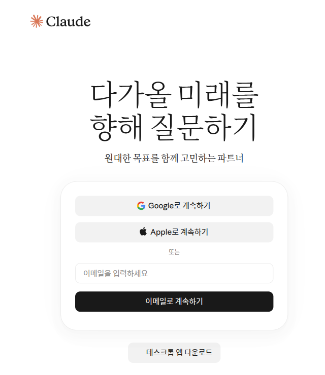

# Capítulo 1. Primeros pasos: dónde se usa, registro, planes y límites de uso

> **En una línea**: Claude se usa con la misma cuenta en la web, en la aplicación de ordenador y en la del móvil. Para registrarte necesitas un correo (o una cuenta de Google o Apple)
> y una verificación por SMS en el móvil. Empieza gratis y piensa en un plan de pago solo cuando el límite se te quede corto con frecuencia.

Las pantallas son de la versión web de octubre de 2026, y las imágenes corresponden al plan gratuito. En la aplicación del móvil o del ordenador, la posición de los menús puede ser un poco distinta.

## Qué es Claude y dónde se usa

Claude es un **LLM** (modelo de lenguaje de gran tamaño, [capítulo 1 de la etapa 1](../00-common/01-what-is-llm.md)) creado por la empresa Anthropic.[^start]
Lo que aprendiste en la etapa 1 sobre cómo preguntar bien también vale para Claude. En este capítulo solo veremos cómo entrar al servicio Claude.

Hay tres sitios donde usarlo. Estés donde estés, la cuenta es una sola.

| Dónde se usa | Cómo se abre | Qué necesitas |
|---|---|---|
| Web | claude.ai en el navegador | Un navegador de internet |
| Aplicación de ordenador | Descargarla de la página de descargas | macOS 13 o superior, Windows 10 o superior |
| Aplicación del móvil | Descargarla de la tienda de aplicaciones | iOS 18 o superior, Android 8.0 o superior |

Fuente: ayuda de Anthropic[^start][^desktop][^ios][^android]

La aplicación de ordenador también se puede usar en Linux (uno de los sistemas operativos de los ordenadores) en versión **beta** (una fase de pruebas antes del lanzamiento oficial).[^desktop]
Si es tu primera vez, empieza por la web. No hay que instalar nada, así que es lo más fácil.

Para usarlo hay dos condiciones.[^start]

- Tienes que estar en una **región compatible** (un país donde el servicio se ofrece oficialmente). Corea está en la lista de regiones compatibles.[^where]
- Tienes que tener **18 años o más**.

Para descargar la aplicación del móvil, busca «Claude by Anthropic» en la tienda de aplicaciones.[^ios][^android]
En la App Store del iPhone también hay una versión para empresas, «Claude for Intune». Si tu empresa no te ha pedido usarla, descarga «Claude by Anthropic».[^ios]
Si la aplicación no aparece en la búsqueda, puede que tu región, tu dispositivo o la versión de tu sistema operativo no sean compatibles.[^android]
Si una función nueva solo te falta a ti, actualiza la aplicación a mano desde la tienda.[^update]

La primera vez que entres, pregúntale esto.

```
¿En qué tareas me puedes ayudar? Dame solo cinco ejemplos que una persona con trabajo de oficina pueda aprovechar de inmediato.
```

<Quiz id="ch201-where" />

## Registrarte e iniciar sesión

Entra en claude.ai y escribe tu dirección de correo. Después pulsa «Continuar con el correo» (이메일로 계속하기). Si tienes una cuenta de Google o de Apple, también puedes pulsar «Continuar con Google» (Google로 계속하기) o «Continuar con Apple» (Apple로 계속하기).[^signup][^screen-login]



**Claude no tiene contraseña.** No se puede crear una contraseña propia para la cuenta de Claude.[^login]
Si entras con el correo, te llega un mensaje con el asunto «Secure link to log in to Claude.ai» (enlace seguro para iniciar sesión en Claude.ai). Al pulsar el enlace de ese mensaje, entras.[^login]
Es cómodo, porque no tienes que memorizar ninguna contraseña. A cambio, **tienes que poder entrar a esa cuenta de correo**.

Hay tres cosas que conviene saber.[^login]

1. **Si pulsas el enlace en otro dispositivo, aparece un código.** Por ejemplo, imagina que pides iniciar sesión en el ordenador y abres el correo en el móvil. Entonces el móvil muestra un código de verificación. Escribe ese código en el ordenador donde pediste iniciar sesión.
2. **Si el correo no llega, mira la carpeta de spam.** Busca un mensaje de @mail.anthropic.com.
3. **Entra con el mismo correo en todos los dispositivos.** Solo si inicias sesión con el correo de siempre se abre la misma cuenta.

<Quiz id="ch201-login" />

## Verificación por SMS en el móvil

Al registrarte por primera vez te piden **verificar tu número de móvil**. Escribes un número de móvil de una región compatible y te llega por SMS un código de **6 cifras**.[^phone]
Este paso **no se puede saltar**. Lo hacen todos los usuarios nuevos.[^phone]

<!-- Falta captura de pantalla: pantalla para escribir el número de móvil y pantalla «Confirmar código» (web) -->

Antes de escribirlo, comprueba lo siguiente.[^phone]

- **Solo sirven números de móvil normales.** No valen los números de telefonía por internet (VoIP), Google Voice, números creados con una aplicación ni teléfonos fijos.
- **Si pasan 5 minutos y no llega el SMS**, pulsa «Reintentar» (다시 시도).
- **Con un mismo número se pueden verificar hasta 3 cuentas.**
- **Un número que ya has verificado no se puede cambiar después.** Por eso verifica con un número tuyo que vayas a usar mucho tiempo. Si verificas con un número prestado un rato, luego no hay manera de cambiarlo.

<Quiz id="ch201-phone" />

## Los planes de un vistazo

Claude también tiene varios **planes** (formas de uso en las que las funciones y la cantidad que puedes usar dependen de cuánto pagas), desde el gratuito hasta los de empresa.[^pricing]

| Plan | Para quién | Precio (al mes, en dólares de EE. UU.) |
|---|---|---|
| Free (gratuito) | Quien lo prueba por primera vez | $0 |
| Pro | Quien lo usa a diario | $20 (con pago anual, unos $17 al mes) |
| Max | Quien lo usa muchísimo | 5x $100 · 20x $200 |
| Team · Enterprise | Quien lo usa a nivel de empresa | Aparte |

Fuente: página de precios y ayuda de Anthropic[^pricing][^pro][^max]

Estos precios son **en dólares de EE. UU.** y **no incluyen impuestos**.[^pricing] En el país donde vives pueden mostrarse en la moneda local, y los impuestos también cambian según el país.[^pro]
Si pagas desde la aplicación del móvil, el precio puede ser distinto del de la web.[^max] En esta guía no hemos podido comprobar el precio en wones que se ve en Corea. Antes de pagar, compruébalo tú en la [página de precios](https://claude.com/pricing).

### En qué se diferencia cada plan

Es más fácil elegir si te fijas en **qué cambia**, más que en las cifras.

| Qué cambia | Gratuito (Free) | De pago (Pro y Max) |
|---|---|---|
| **Cantidad de uso** | Básica | Pro: 5 veces o más que el gratuito[^pricing] |
| **Búsqueda web y creación de archivos** | Sí[^pricing] | Sí |
| **Investigación** (informes largos) | No | Sí ([capítulo 6](06-search.md))[^pricing] |
| **Modelo grande** (Opus) | No se puede elegir | Se puede elegir ([capítulo 2](02-screen-tour.md))[^pricing] |
| **Cowork** (encargarle un trabajo entero) | No | Sí ([capítulo 8](08-cowork.md))[^desktop] |

Lo que incluye el plan gratuito lo puedes ver tú mismo en «Configuración» (설정) → «Facturación» (결제).


Es la pantalla web del plan gratuito. **Los números rojos son los mismos de la lista de abajo.**

- ① El plan actual: «Plan gratuito» (무료 플랜)
- ② Lo que incluye el plan gratuito: chat en la web, iOS, Android y escritorio, generación de código y visualización de datos, escribir y corregir textos, función de búsqueda web, memoria entre conversaciones, creación de archivos y ejecución de código, extensiones de escritorio, conexión con Slack y Google Workspace, conectores (funciones que enlazan con otros servicios, [capítulo 7](07-projects-tools.md)) y pensamiento extendido para tareas complejas[^screen]
- ③ «Mejorar el plan» (플랜 업그레이드): el botón para pasarte a un plan de pago (ver más abajo «Lo que debes saber antes de pasarte a un plan de pago»)

Piensa en un plan de pago cuando necesites una función que no esté en la lista. Así no pagas por funciones que no vas a usar.

Max tiene 5 veces (5x) o 20 veces (20x) más uso que Pro. Puedes recibir respuestas más largas y probar antes las funciones nuevas.[^pricing]

El ciclo de pago también es distinto. En Pro eliges entre mensual y anual. **Max solo se paga mensualmente.**[^max]
Aparte del descuento por pago anual, Pro y Max no tienen un precio con descuento que se aplique siempre. Solo hay a veces promociones por tiempo limitado.[^pro]

<Quiz id="ch201-plans" />

## Límites de uso: 5 horas, semanal y de longitud

En Claude **no hay un número fijo de mensajes**, del tipo «tantos al día». Lo que puedes usar depende de la longitud y la complejidad de la conversación, del modelo que elijas y de las funciones que uses.[^pricing]
En su lugar hay tres límites.

| Límite | Qué significa | Para quién |
|---|---|---|
| **Límite de sesión** | Cantidad de uso que se repone cada 5 horas | Todos los planes |
| **Límite semanal** | Cantidad de uso que se repone cada semana | Planes de pago |
| **Límite de longitud** | Cuánto cabe en una sola conversación | Todos los planes |

Fuente: ayuda de Anthropic[^start][^limits]

El **límite de sesión y el límite semanal** son como depósitos que miden lo que has usado. El límite semanal se repone el día y a la hora que tiene asignados cada cuenta.[^pro]
Lo que usas en la web, en la aplicación de ordenador y en la del móvil se cuenta **en un solo depósito**. Pasarte al móvil no te da un límite nuevo.[^limits][^pricing]

Cuando te acercas al límite aparece un aviso: «Te acercas al límite de la sesión» (세션 제한에 접근 중) o «Te acercas al límite semanal» (주간 제한에 접근 중).[^errors] Cuando llegas al límite, te dice a qué hora podrás volver a usarlo.[^errors]
Entonces puedes esperar hasta esa hora o subir de plan.[^limits] En los planes de pago, en «Uso» (Usage) dentro de la configuración, ves con barras cuánto has gastado.[^best][^usage-name]

El **límite de longitud** es la cantidad que Claude puede manejar en una sola conversación. Es lo mismo que la [ventana de contexto](../00-common/01-what-is-llm.md#_3-hay-un-limite-de-lo-que-puede-ver-de-una-vez-—-«ventana-de-contexto») que viste en la etapa 1.[^limits]
Si aparece un aviso que empieza por «El mensaje supera el límite de longitud de este chat» (메시지가 이 채팅의 길이 제한을 초과합니다), reduce los archivos o empieza una conversación nueva.[^errors]
Cuando una conversación se hace muy larga, a veces Claude resume solo la parte inicial y sigue adelante. En ese momento verás el indicador «Ordenando ideas» (생각을 정리 중).[^limits]
Una conversación tan larga gasta más uso. Si cambias de tema, es mejor abrir una [conversación nueva](../00-common/06-conversation.md#cuando-empezar-una-conversacion-nueva).[^limits]

También hay trucos para ahorrar límite.[^best]

- **Junta las preguntas relacionadas en un solo mensaje.** Preguntar de una vez gasta menos que dividirlo en tres veces.
- **Relee antes de enviar.** Así tendrás que repetir menos veces la pregunta.
- **Guarda en un proyecto los materiales que usas mucho** ([capítulo 7](07-projects-tools.md)). Los materiales de un proyecto gastan menos límite cuando se reutilizan.

Por ejemplo, en vez de mandar tres preguntas por separado, júntalas así.

```
Responde a estas tres cosas de una vez.
1. Resume esta acta de reunión en cinco líneas.
2. Ordena en una tabla las tareas acordadas y quién se encarga de cada una.
3. Escribe un borrador de un correo corto de aviso para los asistentes.
(pega aquí el acta)
```

::: details Más o menos así será la respuesta (ejemplo; pulsa para desplegar)
Este ejemplo lo ha preparado esta guía. La respuesta real depende del servicio y cambia cada vez.

> **1. Resumen en cinco líneas**
> - Se fijó la fecha del evento del mes que viene para el ○ de ○.
> - Se acordó que el lugar del evento será (el lugar del acta).
> - Se acordó mantener el mismo presupuesto que la vez anterior.
> - Se asignaron los responsables de reservar el lugar y de redactar el aviso.
> - Se acordó celebrar la próxima reunión el ○ de ○.
>
> **2. Tareas acordadas y responsables**
>
> | Tarea | Responsable |
> |---|---|
> | Reservar el lugar | (el nombre del acta) |
> | Preparar el aviso | (el nombre del acta) |
>
> **3. Borrador del correo de aviso**
> Asunto: Resultado de la reunión del ○ de ○
> Hola. Te envío un resumen de lo que se decidió hoy en la reunión sobre el evento y de las tareas asignadas. Por favor, deja lista tu parte antes de la próxima reunión.

**Comprueba que la has recibido bien**: ¿han llegado las tres respuestas en orden? ¿El resumen tiene de verdad cinco líneas? ¿Las tareas y los responsables de la tabla coinciden con el acta? ¿Ha inventado algo que no está en el acta? ¿Has recibido un borrador de correo corto que puedas enviar tal cual a los asistentes?

:::

<Quiz id="ch201-limits" />

## Lo que debes saber antes de pasarte a un plan de pago

No hace falta empezar con un plan de pago. Lo más sensato es **empezar gratis y subir de plan cuando el límite te alcance a menudo**.

**Así te suscribes desde la web**.[^signup]

1. Pulsa tu nombre (o la inicial de tu nombre) abajo a la izquierda y elige «Configuración» (설정).
2. Ve a «Facturación» (결제) y pulsa «Mejorar el plan» (플랜 업그레이드) (③ de la imagen de facturación de arriba).[^screen][^billing-name]
3. Elige el ciclo de pago, mensual o anual, escribe los datos de pago y pulsa «Suscribirse» (구독).


El nombre y el correo son de ejemplo en esta pantalla (plan gratuito). En el menú de la cuenta, además de ① «Configuración», se ve directamente ④ «Mejorar el plan».[^screen] Entres por donde entres, vuelve a leer el precio y las condiciones antes de pagar.

En la aplicación del móvil, pulsa la inicial de tu nombre arriba a la derecha y elige «Mejorar a Pro» (Pro로 업그레이드). Se hace con el pago de la tienda de aplicaciones (compra dentro de la aplicación).[^ios-pro][^android-pro]

Antes de pagar, ten presente lo siguiente.

- **La suscripción se renueva sola.** Por defecto se renueva automáticamente al final de cada periodo de pago.[^signup]
- **Se cancela en el sitio donde te suscribiste.** Si te suscribiste en la web o en la aplicación de ordenador, pulsa «Cancelar» (취소) en «Configuración» → «Facturación».[^billing-name] Si te suscribiste en la aplicación del móvil, ve a la inicial de tu nombre en la aplicación → «Facturación» (청구) → «Administrar suscripción» (구독 관리). En ese caso el pago lo gestiona Apple o Google.[^cancel]
- **Cancela como mínimo 24 horas antes del día de pago.** Así no se cobra el siguiente importe. La cancelación se aplica cuando termina el periodo de pago actual.[^cancel]
- **Si borras la aplicación, la suscripción sigue.** Aunque desinstales la aplicación del móvil, la suscripción no se cancela sola.[^ios]
- **Si cancelas, tus conversaciones se quedan.** Los chats, los proyectos y los archivos siguen ahí, y cuando termina el periodo pasas al plan gratuito.[^pricing]
- **En principio no hay reembolsos.** Las únicas excepciones son los casos que fijan las condiciones del servicio o la ley de tu país.[^pricing]
- **En la web, el pago solo se acepta con tarjeta de crédito o débito.**[^billing]
- **La fecha de pago no se puede cambiar directamente.** Si quieres cambiarla, tienes que cancelar y volver a suscribirte el día que quieras.[^billing]
- **Si has pagado y te sale como gratuito, no vuelvas a pagar.** Primero mira si has iniciado sesión con otro correo. Comprueba también que el pago no haya fallado.[^billing]

El recibo lo ves en «Configuración» → «Facturación» y también te llega por correo. Busca "Your receipt from Anthropic" en tu bandeja de entrada.[^billing]

Si no sabes qué plan te conviene, cuéntale tus hábitos de uso a Claude y pregúntale. Eso sí, los precios y las condiciones no los tomes de la respuesta de la IA: compruébalos en la página de precios ([capítulo 9 de la etapa 1](../00-common/09-safety.md)).

```
Uso Claude 3 o 4 veces al día, sobre todo para pulir correos del trabajo y resumir actas de reuniones.
A veces subo un archivo PDF para que me lo resuma. Voy a probarlo gratis. Dime tres criterios
con los que yo mismo pueda juzgar en qué momento necesitaré un plan de pago.
```

<Quiz id="ch201-billing" />

## Qué probar primero si algo falla

Puede que no llegue la respuesta, que aparezca un mensaje de error o que no puedas iniciar sesión. En esos casos, prueba por este orden.

1. **El mensaje «Debido a una restricción de capacidad inesperada…» (예상치 못한 용량 제약으로 인해…) no es una avería.** Significa que hay mucha gente conectada y está saturado. Inténtalo de nuevo unos minutos después. Estas saturaciones no se publican en la página de estado del servicio.[^errors]
2. **Para saber si es una avería de verdad, mira status.claude.com** (la página de estado del servicio de Anthropic).[^errors]
3. **Si te da error al iniciar sesión**, desactiva la VPN (un programa que cambia tu dirección de internet) y las extensiones del navegador. También ayuda borrar la caché y las cookies del navegador (registros temporales que dejan los sitios que has visitado).[^errors]
4. **Si no llega el correo de inicio de sesión**, busca @mail.anthropic.com en la carpeta de spam.[^login]

Si aun así no se arregla, pregunta al servicio de atención al cliente. **No hay atención telefónica: solo se comunica por escrito.**[^support]

- **Si tienes la sesión iniciada**, pulsa tu nombre (o la inicial) abajo a la izquierda → «Obtener ayuda» (도움 받기) (③ de la imagen del menú de la cuenta de arriba).[^screen] Empieza una conversación con **Fin** (el bot de atención de IA de Anthropic). Hablar con Fin no reduce tu límite de uso.[^support]
- **Si no puedes ni iniciar sesión**, pulsa el icono de mensaje abajo a la derecha del centro de ayuda (support.claude.com) y elige «No puedo iniciar sesión» (로그인할 수 없습니다).[^support]
- **Si tienes un plan de pago (Pro o Max)**, el equipo de soporte humano continúa con los problemas que Fin no ha resuelto. En el plan gratuito, el soporte suele llegar solo hasta los documentos de ayuda y Fin.[^support]
- **No abras otra consulta por el mismo problema.** Basta con responder en la conversación original. La respuesta llega al mensajero y al correo de tu cuenta, así que puedes cerrar la ventana.[^support]

Cuando mandes una captura de pantalla, procura que no se vean otros datos personales.

<Quiz id="ch201-trouble" />

## Pruébalo tú mismo

1. Entra en claude.ai, regístrate con tu correo y entra pulsando el enlace del correo de inicio de sesión. Si el correo no llega, mira la carpeta de spam.
2. Completa la verificación por SMS en el móvil. Comprueba una vez más que es un número tuyo que vas a usar mucho tiempo.
3. Pregunta: «¿En qué tareas me puedes ayudar?».
4. Instala la aplicación «Claude by Anthropic» en el móvil, inicia sesión con el mismo correo y comprueba si se ven las conversaciones que tuviste en el ordenador.

**Proyecto continuo** ([Preparar un club de lectura](../00-common/practice-kit.md)): pregunta «Soy el tesorero de un club de lectura de mi barrio. Hazme una lista de lo que tengo que preparar para la reunión del mes que viene». Cuando termines el ejercicio, compara la lista que recibiste con lo que hiciste de verdad.

## Resumen

- Claude se usa con la misma cuenta en la web (claude.ai), en la aplicación de ordenador y en la del móvil. Se puede usar desde los 18 años y en las regiones compatibles (incluida Corea).
- El registro y el inicio de sesión se hacen con el correo o con una cuenta de Google o Apple. En lugar de contraseña, recibes un correo con un enlace de inicio de sesión.
- Al registrarte por primera vez haces la verificación por SMS en el móvil. Un número que ya has verificado no se puede cambiar.
- Los planes para uso personal son Free, Pro y Max. Los precios son en dólares de EE. UU. y sin impuestos, así que compruébalos en la página de precios.
- Los límites son tres: el límite de sesión de 5 horas, el límite semanal (en los planes de pago) y el límite de longitud de una conversación. No hay un número fijo de mensajes.
- La suscripción se renueva sola. Cancélala en el sitio donde te suscribiste, como mínimo 24 horas antes del día de pago. Aunque borres la aplicación, la suscripción sigue.
- El mensaje de «restricción de capacidad» indica saturación. Las averías de verdad se miran en status.claude.com. El soporte empieza con Fin, en «Obtener ayuda» del menú de la cuenta.

## Glosario

| Término | En español | En una línea |
|---|---|---|
| Supported Location | Región compatible | País o región donde el servicio se ofrece oficialmente |
| Beta | Beta | Fase de pruebas antes del lanzamiento oficial |
| Plan | Plan | Forma de uso en la que las funciones y la cantidad de uso dependen de cuánto pagas |
| Subscription | Suscripción | Contrato de uso que se cobra automáticamente cada mes o cada año |
| Session Limit | Límite de sesión | Cantidad de uso que se repone cada 5 horas |
| Weekly Limit | Límite semanal | Cantidad de uso que se repone cada semana en los planes de pago |
| Length Limit | Límite de longitud | Cuánto cabe en una sola conversación. Está relacionado con la ventana de contexto |
| VoIP | VoIP | Llamadas telefónicas por internet. No sirven para la verificación por SMS |
| Fin | Fin | El bot de IA del servicio de atención al cliente de Anthropic |

<ChapterDone :chapter="201" />

Siguiente capítulo: [Capítulo 2. Un recorrido por la pantalla](02-screen-tour.md)

[^usage-name]: En la ayuda en coreano, en algunos sitios aparece escrito «사용» (uso).
[^billing-name]: El nombre en la pantalla es «결제» (Facturación), pero en la ayuda aparece escrito como «Billing».
[^screen]: Comprobado directamente en la pantalla web de Claude (plan gratuito, en coreano). «Configuración» → «Facturación», la lista «Plan gratuito · Prueba Claude» (무료 플랜 · Claude 사용해 보기) y «Mejorar el plan» (플랜 업그레이드); en el menú de la cuenta, «Configuración», «Idioma», «Obtener ayuda» y «Mejorar el plan». (consultado el 2026-10-26)
[^start]: Ayuda de Anthropic, «Get started with Claude». "Claude is a large language model (LLM) built by Anthropic." / "Web: Visit claude.ai to chat with Claude in a web browser." / "You must be in one of our supported locations to access Claude." / "You must be at least 18 years old to use our services." / "there is a session-based usage limit that will reset every five hours." https://support.claude.com/en/articles/8114491 (consultado el 2026-10-26)
[^where]: Ayuda de Anthropic, «Where can I access Claude?». La lista de regiones compatibles incluye "South Korea". https://support.claude.com/en/articles/8461763 (consultado el 2026-10-26)
[^desktop]: Ayuda de Anthropic, «Install Claude Desktop». "Claude Desktop is available on macOS, Windows, and Linux (beta)." / "macOS: macOS 13 (Ventura) or higher" / "Claude Cowork is available for all paid plans (Pro, Max, Team, Enterprise)" https://support.claude.com/en/articles/10065433 (consultado el 2026-10-26)
[^ios]: Ayuda de Anthropic, «Install Claude for iOS». "You can install the Claude app onto your iOS device by navigating to the App Store and searching for “Claude by Anthropic”" / "If your organization hasn't asked you to use Claude for Intune, install Claude by Anthropic." / "We currently support iOS version 18.0 and above, and iPadOS 18.0 and above." / "your subscription will not be automatically canceled." https://support.claude.com/en/articles/9266462 (consultado el 2026-10-26)
[^android]: Ayuda de Anthropic, «Install Claude for Android». "We currently support Android 8.0 Oreo and above." / "you may be located in an unsupported region, using an unsupported device, or using an unsupported version of Android." https://support.claude.com/en/articles/9612887 (consultado el 2026-10-26)
[^update]: Ayuda de Anthropic, «How to update Claude for iOS». "you may need to update your mobile app manually" https://support.claude.com/en/articles/11825384 (consultado el 2026-10-26)
[^signup]: Ayuda de Anthropic, «How do I sign up for the Pro plan?». "Enter your email address and click “Continue with email” or click “Continue with Google” if applicable." / "Navigate to Settings > Billing and click the “Upgrade plan” button." / "Choose between monthly and annual billing periods." / "your subscription will be set to automatically renew at the end of each billing period (monthly or annual) by default." https://support.claude.com/en/articles/8325609 (consultado el 2026-10-26)
[^login]: Ayuda de Anthropic, «Log in to your Claude account». "you will see two different options for logging in to your Claude account." / "This will send you an email with the subject line “Secure link to log in to Claude.ai” and a login link." / "You should enter this code on the original device where you requested the login email to authenticate." / "It’s not possible to create a dedicated password for your Claude account at this time." / "enter the same email address you use to log in on your usual device." / "Check your spam and junk folders for emails from @mail.anthropic.com." https://support.claude.com/en/articles/13189465 (consultado el 2026-10-26)
[^phone]: Ayuda de Anthropic, «Verify your phone number». "you’ll be asked to enter your phone number from a supported location to receive a verification code via text message." / "We’ll send a six-digit verification code to your phone number via text message." / "you cannot use VoIP numbers, Google Voice, phone numbers created using apps, landlines" / "We require phone verification for all new users, and there isn’t a way to skip this step." / "if it has been more than five minutes, click "Try again" to reset the modal" / "We only allow a maximum of three Claude accounts to be verified with the same phone number." / "There isn’t a way to change your phone number associated with your Claude account once it has been verified." https://support.claude.com/en/articles/8287232 (consultado el 2026-10-26)
[^pricing]: Página de precios de Anthropic. "Per month with annual subscription discount ( $200 billed up front). $20 if billed monthly." / "Prices shown don’t include applicable tax." / "Search the web, create files, and run code" / "Pro gives you at least 5x more usage per 5-hour session than Free." / "Higher output limits for all tasks" / "How much you can do depends on the length and complexity of your conversations, the model you choose, and the features you use, so there's no fixed message count." / "Your activity across Claude on web, desktop, mobile, and Claude Code all draws from the same pool." / "Canceling doesn't delete your data. Your chats, projects, and files stay with your account" / "For Pro and Max, your account moves to the Free plan once the period ends." / "Payments are generally non-refundable, except where our Consumer Terms of Service say otherwise or where local law requires it." En la tabla comparativa, las filas Research y Opus no están en Free y empiezan en Pro. https://claude.com/pricing (consultado el 2026-10-26)
[^pro]: Ayuda de Anthropic, «What is the Pro plan?». "The Pro plan is available for $20 per month (US), with pricing in your local currency where supported." / "Annual subscriptions are billed once yearly at a discounted rate." / "We don’t offer standard discounted pricing for individual plans (Pro and Max)." / "Weekly limits reset at a fixed time each week that is assigned to your account." https://support.claude.com/en/articles/8325606 (consultado el 2026-10-26)
[^max]: Ayuda de Anthropic, «What is the Max plan?». "Max 5x: $100 per month" / "These prices are for web subscriptions only. Mobile pricing may vary depending on your app platform." / "The Max plan is currently available as a monthly subscription only." https://support.claude.com/en/articles/11049741 (consultado el 2026-10-26)
[^limits]: Ayuda de Anthropic, «How do usage and length limits work?». "Paid plans have two types of usage limits: a session limit that resets every five hours, and weekly limits that reset once every week." / "your usage of all different Claude product surfaces (claude.ai, Claude Code, Claude Desktop) counts towards the same usage limit." / "If you hit your session limit or weekly limit, you can wait for it to reset or upgrade your plan." / "Length limits relate to Claude's context window—the amount of information Claude can work with in a single chat." / "Claude summarizes earlier messages to continue the conversation seamlessly." / "Longer conversations that trigger automatic context management consume more of your usage limit." https://support.claude.com/en/articles/11647753 (consultado el 2026-10-26)
[^best]: Ayuda de Anthropic, «Usage limit best practices». "you can navigate to Settings > Usage to view progress bars showing how much of your five-hour session and weekly usage limits you’ve consumed." / "If you have multiple related tasks or questions, group them in a single message." / "Content in projects is cached and counts less against your limits when reused." https://support.claude.com/en/articles/9797557 (consultado el 2026-10-26)
[^errors]: Ayuda de Anthropic, «Troubleshoot Claude error messages». "“Approaching session limit” or "Approaching weekly limit."" / "you’ll see an error message letting you know when you can use Claude again" / "Try attaching fewer or smaller files or starting a new conversation." / "Ensure you’re not using a VPN when accessing Claude." / "The system is functioning normally but managing high demand across all users." / "Capacity issues will not appear on our status page" / "To check for confirmed incidents, visit status.claude.com" https://support.claude.com/en/articles/12466728 (consultado el 2026-10-26)
[^ios-pro]: Ayuda de Anthropic, «How do I sign up for Claude Pro on the Claude app for iOS?». "click on your initials in the upper right corner" / "From your settings page, click on “Upgrade to Pro” and follow the payment instructions to complete your in-app purchase." https://support.claude.com/en/articles/9266495 (consultado el 2026-10-26)
[^android-pro]: Ayuda de Anthropic, «How do I sign up for Claude Pro on Claude for Android?». "To sign up for Claude Pro using the Claude app for Android, open the app on your device and click on your initials in the upper right corner." https://support.claude.com/en/articles/9612892 (consultado el 2026-10-26)
[^cancel]: Ayuda de Anthropic, «Cancel your Pro or Max subscription». "Your cancellation will take effect at the end of your current billing period" / "cancel your subscription at least 24 hours before your next billing date." / "Navigate to Settings > Billing and click the “Cancel” button." / "Select “Manage subscription” and follow the prompts for cancellation." https://support.claude.com/en/articles/8325617 (consultado el 2026-10-26)
[^billing]: Ayuda de Anthropic, «Paid plan billing FAQs». "For subscriptions purchased on the web, we only accept credit or debit cards." / "search by the subject line "Your receipt from Anthropic."" / "there isn't a direct way to change your subscription billing date." / "You've logged in with a different email." https://support.claude.com/en/articles/8325618 (consultado el 2026-10-26)
[^support]: Ayuda de Anthropic, «How to get support». "Support is provided in writing through the support messenger and email. We don't offer phone support." / "Click your initials or name in the lower left corner and select “Get help” from the menu." / "Chatting with Fin will not impact Claude usage or spend limits." / "Further assistance from our Product Support team" / "Select "I can't login."" / "Opening a second request for the same problem creates a duplicate that has to be re-triaged" / "Replies are delivered to the messenger and to your account email, so you won't miss one." https://support.claude.com/en/articles/9015913 (consultado el 2026-10-26)
[^screen-login]: Comprobado directamente en claude.ai/login en una ventana nueva del navegador, sin haber iniciado sesión. Los botones son «Continuar con Google» (Google로 계속하기), «Continuar con Apple» (Apple로 계속하기) y «Continuar con el correo» (이메일로 계속하기). En la ayuda hay una frase que dice que los métodos de inicio de sesión son solo dos, correo y Google, pero en esta pantalla había también un botón de Apple (consultado el 2026-10-28, pantalla web antes de iniciar sesión)
