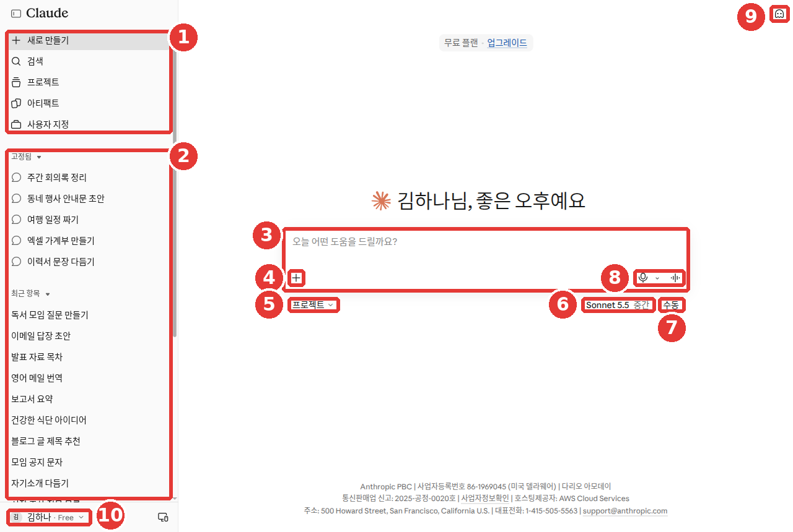

# Capítulo 10. Voz y móvil — pregunta hablando y ve más rápido desde el móvil

> **En una línea**: el **micrófono** del cuadro de entrada escribe lo que dices (dictado), y el **símbolo de onda de sonido** te permite hablar con Claude y escuchar sus respuestas (modo de voz).
> En el móvil puedes abrirlo más rápido con widgets, atajos y la pantalla de bloqueo, y pasar a la aplicación los borradores de mensajes y correos.

Las pantallas corresponden a la versión web de octubre de 2026. En la aplicación del móvil y en la del ordenador la posición de los botones puede ser un poco distinta, y el nombre de los menús de configuración también puede variar según la pantalla.

## Dictado y modo de voz

Hay dos funciones para usar la voz. Los nombres se parecen, pero hacen cosas distintas.[^dictation][^voice]

| | Dictado (Dictation) | Modo de voz (Voice mode) |
|---|---|---|
| Botón | **Micrófono** a la derecha del cuadro de entrada | **Símbolo de onda de sonido** junto al micrófono |
| Qué hace | Convierte lo que dices en texto y lo envía | Preguntas hablando y escuchas la respuesta |
| La respuesta de Claude | Llega como texto | Llega con voz |
| Cuándo va bien | Cuando da pereza escribir una pregunta larga | Cuando tienes las manos ocupadas, o para ordenar tus ideas hablando |

Si te importa que la frase sea exacta, usa el **dictado**. Tu pregunta y la respuesta quedan en texto y puedes releerlas. Si necesitas una conversación de ida y vuelta, usa el **modo de voz**.

Las dos funciones se pueden usar también con el plan gratuito.[^dictation][^voice]

<Quiz id="ch210-difference" />

## Prueba el dictado

Este apartado explica el dictado de la aplicación del móvil (iPhone y Android).[^dictation] En Cowork de la aplicación del ordenador también se puede usar el dictado.[^voice]

1. Abre un chat nuevo en la aplicación de Claude.
2. Pulsa el **micrófono** a la derecha del cuadro de entrada.
3. La primera vez, elige el idioma en que vas a hablar.
4. Habla como siempre.
5. Pulsa la flecha para enviar. Si no quieres enviarlo, pulsa «X».

Prueba a decir esto.

```
Dime tres experimentos de ciencias que pueda hacer este fin de semana en casa con un niño de primaria.
Que el material sea solo lo que hay en la cocina.
```

El dictado admite 12 idiomas, incluido el coreano. Los idiomas distintos del inglés todavía están en versión de prueba (beta). Para cambiar el idioma, pulsa tus iniciales arriba a la derecha y elige «Idioma de entrada de voz» (음성 입력 언어).[^dictation]

Los nombres de personas y de lugares pueden transcribirse mal. Después de enviar, lee una vez tu pregunta tal como quedó en la ventana del chat.[^dictation]

### En un ordenador Mac — entrada rápida

Si usas la aplicación de escritorio de Claude en un Mac, prueba a pulsar **dos veces la tecla Option**. Se abre enseguida el cuadro de entrada de Claude, estés en la aplicación que estés.[^quick] Puedes preguntar sin interrumpir lo que estabas haciendo.

- Puedes arrastrar una parte de la pantalla para pegarla como captura, o pulsar una ventana de una aplicación para enviar su contenido.[^quick]
- Si activas el atajo de dictado, puedes pulsar Caps Lock para escribir hablando. Al principio está desactivado.[^quick]
- Funciona en todos los planes, incluido el gratuito, pero solo en la aplicación de escritorio de Mac. La aplicación tiene que estar abierta, aunque sea en segundo plano.[^quick]
- Hacen falta permisos del Mac, como el de grabación de pantalla. Compruébalo en «Ajustes del Sistema > Privacidad y seguridad» (시스템 설정 > 개인정보 보호 및 보안).[^quick]

Es cómodo cuando ves una tabla desconocida o una ventana de error y quieres preguntar al momento.

```
Explícame de forma sencilla qué significa cada uno de los números de la pantalla que acabo de pegar. Y dime también cuáles son los que debería vigilar.
```

<Quiz id="ch210-dictation" />

## Prueba el modo de voz

El modo de voz todavía está en **versión de prueba**. Se puede usar en la web, en la aplicación del ordenador y en la del móvil, pero está hecho para funcionar mejor en el móvil.[^voice]

**En la web y en la aplicación del ordenador**

Primero fíjate en dónde están los botones. En ⑧, abajo a la derecha del cuadro de entrada, están juntos el micrófono (dictado) y el símbolo de onda de sonido (modo de voz).[^screen]



Es una pantalla con los nombres y los títulos de las conversaciones cambiados por ejemplos (plan gratuito). En este capítulo solo se usa el número ⑧. Los demás números se explican en el [capítulo 2](02-screen-tour.md).

1. Abre un chat nuevo.
2. Pulsa el **símbolo de onda de sonido** abajo a la derecha de la ventana del chat.
3. Al hablar, lo que dices se escribe solo en el cuadro de entrada. Cuando terminas de hablar, Claude responde.
4. Para terminar, pulsa «Detener» (Stop; 중지) abajo a la derecha.

**En la aplicación del móvil**

1. Pulsa el **símbolo de onda de sonido** junto al micrófono del cuadro de entrada.
2. Elige la voz que más te guste.
3. Empieza a hablar.[^voice]

<!-- Captura de pantalla necesaria: la pantalla con el modo de voz activado y el botón «Detener» (중지) abajo a la derecha -->

### Dos formas de escuchar

- **Modo manos libres** (hands-free): es la forma que está activada desde el principio. Claude escucha todo el rato y responde cuando dejas de hablar. Funciona mejor en un lugar tranquilo.
- **Modo pulsar para hablar** (push-to-talk): mantienes el botón pulsado mientras hablas y lo sueltas cuando terminas. Es más preciso en sitios ruidosos o cuando hay otra persona hablando al lado.[^voice]

Si Claude va en una dirección equivocada, simplemente empieza a hablar. Claude se detiene y te escucha. Si tienes varias preguntas, no las digas todas a la vez: pregunta de una en una.[^voice] Si preguntas de una en una, las respuestas también son más cortas y resultan más cómodas de escuchar.

Una petición que va bien hablando.

```
La semana que viene tengo una entrevista de trabajo. Haz de entrevistador y hazme las preguntas de una en una.
Cuando yo responda, dime brevemente solo una cosa que estuvo bien y solo una que mejorar, y pasa a la siguiente pregunta.
```

::: details La respuesta que recibes será más o menos así (ejemplo — pulsa para desplegar)
Es un ejemplo hecho para esta guía. La respuesta real varía según el servicio y el momento.

> Muy bien, empiezo la entrevista. Primera pregunta: ¿podrías presentarte brevemente?

Cuando yo respondo, sigue así.

> Lo que estuvo bien es que dijiste con claridad desde el principio por qué te presentas. Lo que mejorar es que la historia de tu experiencia fue un poco larga. Elige solo un ejemplo y cuéntalo en breve. Ahora la segunda pregunta: ¿cuál fue el momento más gratificante mientras trabajabas?

**Comprueba si lo recibiste bien**: ¿hace las preguntas de una en una? ¿Después de mi respuesta dice brevemente solo una cosa buena y solo una que mejorar? ¿No suelta de golpe una lista de preguntas?

:::

### Lo que conviene saber

- Las conversaciones de voz también **cuentan para el límite de uso del plan** ([capítulo 1](01-getting-started.md)).
- Si en la misma conversación pasas de escribir a hablar y al revés, **lo anterior continúa.** Lo que hay que escribir con exactitud, como una dirección de internet, puedes introducirlo por escrito en mitad de la conversación.
- Empieza con el último modelo que usaste en el chat de texto, y puedes cambiarlo durante la conversación. Pero Claude Fable todavía no se puede usar en el modo de voz (comprobado el 2026-10-26).
- Las herramientas que conectaste (Gmail, Google Calendar, etc.) también se pueden usar en el modo de voz. La ayuda del modo de voz dice que en el plan gratuito se puede conectar una herramienta. La conexión de herramientas se trata en el [capítulo 7](07-projects-tools.md).
- En la pantalla nueva, el modo de voz se puede usar en cualquier conversación, incluidas aquellas en las que Claude está haciendo un trabajo.[^voice][^cowork-voice-old]

<Quiz id="ch210-voice" />

## Cambiar la voz y el idioma

La voz de Claude se elige solo entre unas pocas ya fijadas. Es para impedir que se imite o se copie la voz de alguien.[^voice]

- **Web y aplicación del ordenador**: está en «Configuración» (설정) → «General» (일반), en «Voz» (음성). Bajo «Idioma» (언어) también están «Estilo» (스타일) y «Velocidad» (속도).[^screen][^voice-settings-name] Si pulsas una voz, puedes escucharla antes.
- **Aplicación del móvil**: durante el modo de voz, pulsa el botón de ajustes de abajo a la izquierda y elige la voz y la velocidad al hablar.[^voice]

**El idioma en que hablas hay que fijarlo por separado.** Aunque cambies la pantalla de la aplicación al coreano, el idioma de la voz no cambia.[^voice] En esta pantalla se elige en «Configuración» → «General» → «Voz» → ③ «Idioma».[^screen] Los idiomas distintos del inglés están en versión de prueba. También puedes pedirlo durante la conversación con «Háblame en coreano».[^voice]


Es la pantalla del plan gratuito. **Los números rojos señalan los mismos sitios que los números de la lista de abajo.**

- ① Está elegido «General» en el menú de la izquierda.
- ② «Tema» (테마): cambia la pantalla a clara u oscura. No tiene que ver con la voz.
- ③ «Idioma»: es el idioma en que hablas con la voz. Debajo siguen «Estilo» y «Velocidad».[^screen]

<Quiz id="ch210-settings" />

## Grabaciones de voz y privacidad

**Las conversaciones de voz también quedan por escrito.** Las conversaciones del modo de voz se convierten en un registro de texto y se guardan en el historial de chats como una conversación normal.[^voice]

**La grabación del dictado no se conserva.** Después de convertir la voz en texto, la grabación se borra y tampoco se usa para el entrenamiento.[^dictation] Pero **el texto resultante** es igual que el de una conversación normal. Sigue el periodo de conservación de las conversaciones y, si permitiste el entrenamiento, puede usarse para entrenar.[^dictation-privacy] La configuración del entrenamiento la viste en el [capítulo 9](09-privacy.md).

Una conversación hablada **también la oye quien está a tu lado.** Se oye tu pregunta y se oye la respuesta de Claude.

- En el metro, en una cafetería o en la oficina, usa auriculares o escribe en silencio con el dictado.
- **La información que no debes introducir** y que viste en el [capítulo 9 de la etapa 1](../00-common/09-safety.md#lo-que-no-debes-escribir) **tampoco la digas en voz alta.** Hablando es más fácil soltarla sin darte cuenta que escribiendo.

<Quiz id="ch210-privacy" />

## Más rápido desde el móvil — widgets, atajos y pantalla de bloqueo

Puedes llamar a Claude sin buscar la aplicación y abrirla. Todo esto **cuenta para el límite de uso.**[^ios][^android]

### iPhone (iOS 18 o superior)

- **«Preguntar a Claude»** (Ask Claude; Claude에 물어보기): haces una pregunta sin abrir la aplicación. Se puede usar desde la búsqueda de Spotlight, con Siri y desde el menú de compartir. Por ejemplo, puedes seleccionar un texto y enviarlo directamente a Claude con el menú de compartir.
- **Widget**: si pones el widget de Claude en la pantalla de inicio o en la vista Hoy, abre con un solo botón un chat nuevo, el dictado o el envío de una foto recién hecha.
- **«Analizar foto con Claude»** (Analyze Photo with Claude; Claude로 사진 분석): si lo pones en el Centro de control o en la pantalla de bloqueo, puedes hacer una foto y enviarla sin desbloquear el teléfono.
- **«Open Claude»**: lo pones en la pantalla de bloqueo, en el Centro de control o en el botón de acción (Action button) para abrir Claude directamente.[^ios][^lock]

«Preguntar a Claude» y los atajos usan el modelo predeterminado que ves al abrir la aplicación.[^ios]

### Crear un «botón de resumen» con un atajo

Con la aplicación Atajos del iPhone puedes crear tu propio botón. Sigue el ejemplo de la ayuda.[^ios]

1. En la aplicación Atajos, pulsa «+» para crear un atajo nuevo.
2. Añade la acción Compartir (Share) y elige el tipo de contenido que va a recibir.
3. Añade la acción «Preguntar a Claude».
4. Dentro, escribe el prompt. Ejemplo: `Resume en tres líneas el siguiente texto: [Entrada del atajo]`
5. Ponle un nombre (por ejemplo, «Resumir con Claude») y colócalo en la hoja de compartir.

A partir de ahora, en cualquier aplicación, basta con seleccionar un texto, pulsar el botón de compartir y elegir «Resumir con Claude».

<!-- Captura de pantalla necesaria: la pantalla de la aplicación Atajos del iPhone con la acción «Preguntar a Claude» añadida -->

### Android (Android 8.0 o superior)

Mantén pulsado un hueco de la pantalla de inicio, busca Claude en «Widgets» (위젯) y colócalo. Tiene tres botones.[^android]

- **Botón de chat**: abre directamente una conversación nueva.
- **Botón de cámara**: hace una foto y la envía a Claude.
- **Botón de micrófono**: abre una conversación nueva y empieza el dictado.

<Quiz id="ch210-shortcuts" />

## Conectar con las aplicaciones del móvil — mensajes, correo, calendario y mapas

Claude de la aplicación del móvil puede conectarse con otras aplicaciones del teléfono para ayudarte. Funciona en todos los planes.[^ios-apps][^android-apps]

| | iPhone | Android |
|---|---|---|
| Mensajes, correo y calendario | Sí | Sí |
| Ubicación y mapas | Sí | Sí |
| Recordatorios | Sí | No |
| Alarmas y temporizadores | — | Sí |

**En los mensajes y el correo, Claude solo prepara el borrador.** Claude te muestra una tarjeta con el contenido rellenado y, al pulsarla, se abre la aplicación de mensajes o la de correo. Lees el contenido, lo corriges y **el envío lo pulsas tú.** Claude no lee los mensajes o correos que ya has recibido ni entra directamente en tus contactos.[^ios-apps]

Prueba a pedirlo así.

```
Escribe un borrador de correo para mi jefe de equipo diciendo que mañana por la mañana llegaré 30 minutos tarde a la reunión por una cita en el hospital.
Corto y cortés.
```

Cuando el borrador pasa a la aplicación de correo, comprueba el destinatario y el contenido y envíalo. A diferencia del falso «ya lo envié» que viste en el [capítulo 9](09-privacy.md), aquí el mensaje solo sale de verdad cuando pulsas tú el botón de enviar.

### Los permisos los decides tú

Cuando Claude va a usar por primera vez la ubicación o el calendario, pide permiso. Eliges entre permitir una vez (Allow once), permitir siempre (Always allow) y no permitir (Don't allow).[^ios-apps] Para cambiarlo más tarde, búscalo en los ajustes del teléfono.

- **iPhone**: «Ajustes» → «Claude»
- **Android**: «Ajustes» → «Aplicaciones» → «Claude» → «Permisos»[^ios-apps][^android-apps]

También hay una función que lee datos de salud, pero está en versión de prueba y solo funciona en los planes Pro y Max y solo en Estados Unidos.[^ios-apps]

<Quiz id="ch210-apps" />

## Pruébalo tú

**1. La misma pregunta, de dos maneras**

Haz la pregunta de abajo una vez con el **micrófono (dictado)** y otra vez, en un chat nuevo, con el **símbolo de onda de sonido (modo de voz)**.

```
En la nevera tengo huevos, tofu y cebolleta. Dime dos platos que se puedan hacer en 15 minutos.
```

Y pregúntate: ¿el texto que escribió el dictado es igual a lo que dije? ¿Qué es más cómodo, escuchar la respuesta o leerla?

**2. Interrumpir**

En el modo de voz, pide una explicación larga y, mientras Claude habla, di «Espera, más corto». Comprueba si Claude se detiene y lo repite más corto.

**3. Poner un acceso directo en el móvil**

En un iPhone, pon el widget de Claude en la pantalla de inicio; en un Android, pon el widget de Claude. Pulsa el botón del micrófono y comprueba que se abre enseguida el dictado.

**Proyecto continuo** ([preparar el club de lectura](../00-common/practice-kit.md)): en el modo de voz, di «Practica conmigo un saludo de bienvenida de unos 30 segundos para el club de lectura». Después pídele que señale una cosa que mejorar del saludo que dijiste.

## Resumen

- El micrófono es el **dictado**: convierte lo que dices en texto para enviarlo, y la respuesta llega como texto. Este capítulo lo explicó tomando como base la aplicación del móvil.
- El símbolo de onda de sonido es el **modo de voz**: preguntas hablando y escuchas la respuesta. Está en versión de prueba y funciona mejor en el móvil.
- El modo de voz usa por defecto el modo manos libres y, si hay ruido, se cambia a pulsar para hablar. Cuenta para el límite de uso.
- El idioma en que hablas se fija aparte del idioma de la pantalla de la aplicación. En esta pantalla es «Configuración» → «General» → «Voz» → «Idioma».
- Las conversaciones de voz quedan como registro de texto. La grabación del dictado se borra, pero el texto resultante sigue la configuración del entrenamiento.
- En el iPhone se abre rápido con «Preguntar a Claude», atajos, widgets y pantalla de bloqueo; en Android, con widgets.
- En los mensajes y el correo, Claude prepara el borrador y el envío lo haces tú. Los permisos se cambian en los ajustes del teléfono.

## Glosario

| Término | En español | En una línea |
|---|---|---|
| Dictation | Dictado | Función que convierte lo que dices en texto para introducirlo |
| Voice mode | Modo de voz | Función para hablar con Claude y escuchar sus respuestas |
| Hands-free | Manos libres | Modo en que responde cuando dejas de hablar, sin pulsar botones |
| Push-to-talk | Pulsar para hablar | Modo en que solo escucha mientras mantienes el botón pulsado |
| Beta | Beta (versión de prueba) | Función que se ofrece como prueba antes del lanzamiento oficial |
| Transcript | Transcripción (registro de texto) | Registro por escrito de lo que se dijo |
| Widget | Widget | Pequeño acceso directo que se coloca en la pantalla de inicio |
| Shortcut | Atajo | Función del iPhone que junta varias acciones y las ejecuta con un solo botón |
| Permission | Permiso | Autorización para que una aplicación use la ubicación, el calendario, etc. |

<ChapterDone :chapter="210" />

Siguiente capítulo: [Capítulo 11. Tareas prácticas](11-practice.md)

---

[^screen]: Comprobado directamente en la pantalla web de Claude (plan gratuito, en coreano). «Configuración» (설정) → «General» (일반) → «Voz» (음성), con «Idioma» (언어), «Estilo» (스타일) y «Velocidad» (속도). (consultado el 2026-10-26)
[^dictation]: Ayuda de Anthropic, «Use dictation on Claude Mobile». "Dictation is available to all Claude users (Free, Pro, Max, Team, and Enterprise plans). Support for languages other than English is in beta." / "Dictation allows you to speak your prompts instead of typing them when using Claude for iOS or Android." / "Tap the microphone icon on the right side of the chat input field." / "Your prompt will automatically appear as text in the chat window." / "We will not retain a copy of your speech input or use it for training our generative models." https://support.claude.com/en/articles/10065434 (consultado el 2026-10-26)
[^voice]: Ayuda de Anthropic, «Use voice mode». "but is built to work best from your phone." / "Tap the sound wave symbol in the lower right corner of the chat window to activate voice mode:" / "Tap the voice mode icon (sound wave symbol next to the microphone icon) in the text input field:" / "Note: Voice conversations count toward your regular usage limits based on your subscription plan." / "In hands-free mode, Claude listens continuously and responds to natural pauses in your speech." / "On the web and desktop: Go to Settings > Capabilities and scroll down to Voice settings." / "When you turn on voice mode, it starts with the model you last used in text chat" / "Note: Claude Fable is not currently available in voice mode." / "Your previous context carries over, so you don't lose anything when you switch." / "On the Free plan you can connect one tool, and paid plans can connect more." / "This prevents voice cloning or impersonation." / "Changing your app's display language doesn't change your voice language, so set it here." / "Textual transcripts of your audio conversations are saved in your chat history just like text conversations." / "In the new Claude experience, voice mode works in any conversation, including ones where Claude is working on a task." / "In Claude Cowork and Claude Code, dictation is available but voice mode isn't." https://support.claude.com/en/articles/11101966 (consultado el 2026-10-26)
[^dictation-privacy]: Centro de privacidad de Anthropic, «What personal data is collected when using dictation on the Claude mobile apps?». "If you have allowed us to use your chats or coding sessions to improve Claude, the transcribed text may be used in accordance with your privacy settings." https://privacy.claude.com/en/articles/10067979 (consultado el 2026-10-26)
[^ios]: Ayuda de Anthropic, «Use Claude app intents, shortcuts, and widgets on iOS». "The features described in this guide are available on iOS 18 and above." / "You can use this intent on its own to quickly ask Claude questions or give it tasks without opening the Claude app." / "The Claude widget provides quick access to chat and voice features directly from your Home Screen or Today View." https://support.claude.com/en/articles/10263469 (consultado el 2026-10-26)
[^lock]: Ayuda de Anthropic, «Access Claude for iOS on your Lock Screen, Control Center, and Action button». "Quickly access Claude for iOS functionality from your Lock Screen, Control Center, or Action button on iOS." https://support.claude.com/en/articles/10302511 (consultado el 2026-10-26)
[^android]: Ayuda de Anthropic, «Use the Claude widget on Android». "The Claude Android widget is available on Android 8.0 Oreo and above." / "Note: All interactions started through the widget will count toward your usage limit." https://support.claude.com/en/articles/10534883 (consultado el 2026-10-26)
[^ios-apps]: Ayuda de Anthropic, «Use Claude with iOS apps». "This feature is supported on all Claude plans and works with iOS system apps (Messages, Mail, Calendar, Maps, Reminders, and Location Services), as well as compatible third-party apps." / "Review the pre-filled content and make any changes if needed." / "Messages/Email: Claude does not read existing messages or emails, only creates new content." / "Contacts: Claude does not have direct access to your contacts." / "You’ll be prompted to approve the action with three options: Allow once, Always allow, or Don't allow." / "These permissions can be managed at any time in your device settings by going to Settings > Claude." / "Health features are currently in beta, require a Pro or Max plan, and are available in the US only." https://support.claude.com/en/articles/11869619 (consultado el 2026-10-26)
[^android-apps]: Ayuda de Anthropic, «Use Claude with Android apps». "This feature is supported on all Claude plans and works with your device's native and third-party apps" / "Reminders: These are exclusively available on Claude for iOS, so Claude can’t create and manage reminders on Android." / "These permissions can be managed at any time in your device settings by going to Settings > Apps > Claude > Permissions." https://support.claude.com/en/articles/11869629 (consultado el 2026-10-26)
[^quick]: Ayuda de Anthropic, «Use quick entry with Claude Desktop on Mac». "Quick entry is available to all Claude users (free, Pro, Max, Team, and Enterprise plans) using Claude Desktop on macOS." / "Instant access: Double-tap the Option key to open Claude from any app." / "Visual context: Capture screenshots or click application windows to share what you're working on." / "The voice dictation shortcut is disabled by default because it takes over your Caps Lock key." / "Claude Desktop needs to be running on your Mac, but it can run in the background." / "Screen recording: Required to capture screenshots and share application windows." / "You can review or change these permissions in System Settings > Privacy & Security." https://support.claude.com/en/articles/12626668 (consultado el 2026-10-26)
[^cowork-voice-old]: La misma ayuda también tiene una frase que dice que en Cowork ([capítulo 8](08-cowork.md)) solo funciona el dictado y no el modo de voz.
[^voice-settings-name]: La ayuda indica «Configuración» → «Funciones» (기능). Puede variar según la pantalla.
