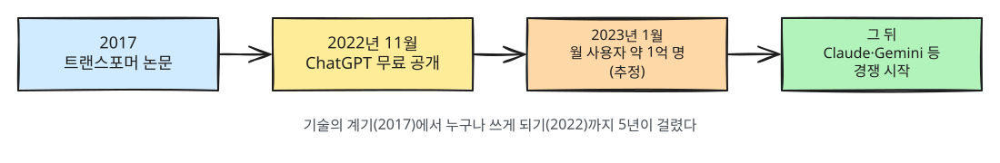

# 2장. 왜 이렇게 화제인가

> **한 줄 요약**: 전문가만 다루던 AI를, 누구나 평소 쓰는 말로 부릴 수 있게 되었기 때문입니다.

## 갑자기 나타난 것처럼 보이지만

AI 연구는 수십 년 동안 이어져 왔습니다. 지금의 LLM으로 이어지는 결정적인 계기는
2017년 구글 연구진이 발표한 논문 「Attention Is All You Need」입니다.[^1]
여기서 소개된 **트랜스포머(Transformer)** 라는 구조 덕분에, 아주 많은 글을 효율적으로 학습시킬 수 있게 되었습니다.
예전 방식은 문장을 앞에서부터 한 단어씩 차례로 읽어야 했지만, 트랜스포머는 문장 속 단어들이 서로 어떤 관계인지 **한꺼번에** 살핍니다. 그래서 컴퓨터 여러 대로 나눠 빠르게 학습시킬 수 있게 됐습니다.
지금 쓰이는 LLM 대부분이 이 구조를 바탕으로 합니다.

하지만 일반인이 AI를 직접 체감하기 시작한 것은 그로부터 5년 뒤입니다.

## 2022년 11월, ChatGPT

OpenAI는 2022년 11월 30일 ChatGPT를 무료로 공개했습니다.[^2]
특별한 설치나 교육 없이, 웹사이트에 들어가 메신저처럼 말을 걸면 되었습니다.

반응은 폭발적이었습니다. 투자은행 UBS의 분석에 따르면 ChatGPT는 공개 약 두 달 만인
2023년 1월에 월간 사용자 약 1억 명에 도달한 것으로 추정되었고, 당시 기준으로
역사상 가장 빠르게 성장한 소비자용 앱으로 꼽혔습니다.[^3]

그 뒤 Anthropic의 Claude, Google의 Gemini 등 여러 회사가 비슷한 서비스를 내놓으며 경쟁이 시작되었습니다.



## 무엇이 그렇게 달라졌나

### 1. 컴퓨터에게 "평소 말"로 일을 시킬 수 있다

예전에는 컴퓨터에 일을 시키려면 프로그래밍 언어를 배우거나, 정해진 메뉴와 버튼을 익혀야 했습니다.
LLM은 그냥 이렇게 말하면 됩니다.

```
이 회의록에서 누가 무엇을 언제까지 하기로 했는지 표로 정리해 줘.
```

### 2. 한 가지가 아니라 거의 모든 글 작업을 한다

번역기는 번역만, 맞춤법 검사기는 맞춤법만 했습니다.
LLM 하나로 번역, 요약, 글쓰기, 질의응답, 아이디어 회의, 코드 작성까지 할 수 있습니다.

### 3. 비용과 접근성

대부분의 서비스가 무료로 시작할 수 있고, 스마트폰 앱으로도 쓸 수 있습니다.
비서나 과외 선생님을 두는 것과 비슷한 일을 누구나 해 볼 수 있게 되었습니다.

## 그래서 생긴 논란들

화제가 된 이유에는 기대뿐 아니라 걱정도 있습니다. 균형 있게 알아 두면 좋습니다.

| 논란 | 내용 |
|---|---|
| 일자리 | 글쓰기·번역·상담 같은 일이 AI로 대체되거나 크게 바뀔 수 있다는 우려 |
| 정확성 | 1장에서 본 환각 때문에 잘못된 정보가 퍼질 수 있다는 문제 |
| 저작권 | AI가 학습한 글·그림의 권리, AI가 만든 결과물의 권리 문제 |
| 개인정보 | 대화에 입력한 내용이 어떻게 저장되고 쓰이는지에 대한 걱정 |
| 교육 | 학생이 과제를 AI에게 맡겨 버리는 문제 |

이 가이드는 이런 걱정을 없는 척하지 않습니다. [9장 「안전하게 쓰기」](09-safety.md)에서 실제로 어떻게 조심하면 되는지 다룹니다.

## 직접 해 보기

LLM에게 이 기술 자체에 대해 물어보세요. 그리고 답을 그대로 믿지 말고, 날짜나 숫자가 맞는지 확인해 보세요.

```
ChatGPT가 처음 공개된 날짜와, 그 뒤로 비슷한 서비스를 내놓은 회사 세 곳을 알려 줘.
각각 출처도 같이 알려 줘.
```

LLM이 답한 날짜를 이 장의 각주와 비교해 보세요. 맞을 수도, 틀릴 수도 있습니다.
**"확인하는 습관"이 이 가이드 전체에서 가장 중요한 습관입니다.**

## 정리

- 2017년 트랜스포머 논문이 기술적 계기, 2022년 ChatGPT 공개가 대중화의 계기다.
- 핵심 변화는 "평소 말로 컴퓨터에게 거의 모든 글 작업을 시킬 수 있다"는 것이다.
- 일자리·정확성·저작권·개인정보 같은 논란도 함께 알아 둔다.

다음 장: [3장. 왜 배워야 하나](03-why-learn.md)

---

[^1]: Vaswani 외, 「Attention Is All You Need」, 2017년 6월 arXiv(아카이브, 논문을 심사 전에 먼저 올려 두는 공개 사이트) 공개. https://arxiv.org/abs/1706.03762 (확인일 2026-10-20)
[^2]: OpenAI, 「Introducing ChatGPT」, 2022-11-30. https://openai.com/index/chatgpt/ (확인일 2026-10-20)
[^3]: Reuters, 「ChatGPT sets record for fastest-growing user base - analyst note」, 2023-02-01. https://www.reuters.com/technology/chatgpt-sets-record-fastest-growing-user-base-analyst-note-2023-02-01/ (확인일 2026-10-20)
