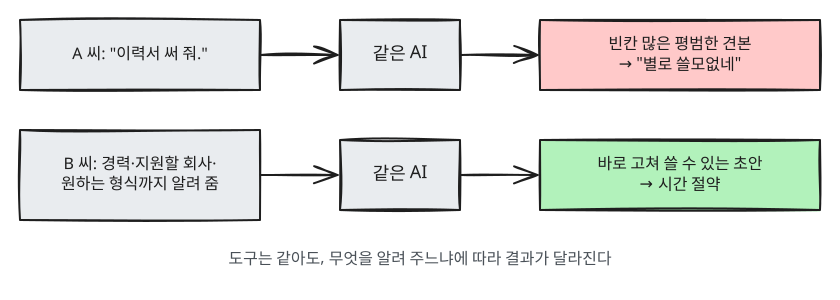

# 3장. 왜 배워야 하나

> **한 줄 요약**: 같은 AI를 써도 "어떻게 묻느냐"에 따라 결과가 크게 달라지고,
> 그 차이는 배우면 누구나 줄일 수 있습니다.

## 같은 도구, 다른 결과

두 사람이 똑같은 AI에게 이력서 도움을 받는다고 해 봅시다.

**A 씨의 요청**

```
이력서 써 줘.
```

AI는 A 씨가 누구인지 모릅니다. 그래서 이름과 경력 칸이 비어 있는 평범한 견본을 줍니다.
A 씨는 "별로 쓸모없네" 하고 창을 닫습니다.

**B 씨의 요청**

```
나는 물류회사에서 5년 동안 재고 관리를 했고, 이번에 온라인 쇼핑몰(이커머스) 회사 운영팀에 지원하려고 해.
아래 내 경력 메모를 바탕으로, 이커머스 운영에 도움이 되는 경험이 돋보이게
이력서의 "경력 요약" 부분을 세 줄로 써 줘.

[경력 메모]
- 창고 3곳 재고 데이터 엑셀로 주간 관리
- 반품 처리 절차 개선해서 처리 기간 단축
- 신입 4명 교육 담당
```

B 씨는 바로 쓸 수 있는 문장을 받습니다. 그리고 마음에 안 드는 부분을 고쳐 달라고 이어서 요청합니다.

**두 사람의 차이는 AI가 아니라 요청에 있었습니다.** A 씨는 아무것도 알려 주지 않았고, B 씨는 경력과 지원할 곳, 원하는 형식을 알려 줬습니다.
이 요청 글을 **프롬프트(prompt)** 라고 부릅니다. 프롬프트를 잘 쓰는 법은 [4장](04-prompt-basics.md)부터 배웁니다.



<Quiz id="ch3-same-tool" />

## 일상에서 이렇게 씁니다

개발자나 전문가만을 위한 도구가 아닙니다. 아래는 모두 일반인이 바로 쓸 수 있는 예입니다.

| 상황 | 이렇게 요청해 보세요 |
|---|---|
| 직장 | "이 메일을 정중하지만 단호하게, 일정 연기는 어렵다는 내용으로 고쳐 줘" |
| 계약·서류 | "이 전·월세 계약서(임대차 계약서)에서 세입자에게 불리할 수 있는 조항을 찾아 쉬운 말로 설명해 줘" |
| 공부 | "이차방정식 근의 공식이 왜 그렇게 나오는지 중학생 눈높이로 한 단계씩 설명해 줘" |
| 생활 | "냉장고에 계란, 두부, 대파, 김치가 있어. 20분 안에 만들 수 있는 저녁 메뉴 3개" |
| 여행 | "부모님 모시고 가는 2박 3일 부산 여행, 많이 걷지 않는 일정으로 짜 줘" |
| 육아 | "7살 아이가 '비는 왜 와?'라고 물었는데, 아이 눈높이로 설명하는 법 알려 줘" |

<Quiz id="ch3-daily" />

## 배우면 무엇이 달라지나

1. **시간이 줄어듭니다.** 초안 쓰기, 정리하기처럼 오래 걸리던 일의 첫 단계를 몇 분으로 줄일 수 있습니다.
2. **결과가 좋아집니다.** 내 상황에 맞는 답을 받으니 고칠 일이 줄어듭니다.
3. **덜 속습니다.** AI가 틀리는 방식을 알면, 어디를 확인해야 하는지 압니다.
4. **다음 단계로 갈 수 있습니다.** 이 가이드의 끝에는 AI와 함께 직접 무언가를 만드는 단계까지 있습니다.
   그 출발점이 지금 배우는 "잘 묻는 법"입니다.

<Quiz id="ch3-benefits" />

## 오해 바로잡기

- **"AI는 알아서 다 해 준다"** — 그렇지 않습니다. 내 상황과 목표를 알려 줘야 제대로 합니다.
- **"어려운 명령어를 외워야 한다"** — 특별한 주문은 없습니다. 상대에게 일을 부탁할 때 하는 말을 잘 정리하면 됩니다.
- **"한 번 물어서 별로면 쓸모없다"** — 처음부터 완벽할 필요는 없습니다. 대화를 이어 가며 고쳐 달라고 하는 것이 정상적인 사용법입니다.
- **"AI 답은 정확하다"** — [1장](01-what-is-llm.md)에서 본 것처럼 틀릴 수 있습니다. 중요한 내용은 확인하세요.

<Quiz id="ch3-myths" />

## 영상으로 더 보기

> 아래 영상은 모두 **영어**입니다. YouTube 영상의 설정(톱니바퀴) → 자막 → **자동 번역 → 한국어**를 고르면 한국어 자막으로 볼 수 있습니다. 링크는 YouTube로 이동합니다.

| 영상 | 채널 | 이런 분께 |
|---|---|---|
| [How I use LLMs](https://www.youtube.com/watch?v=EWvNQjAaOHw) | Andrej Karpathy | 전문가가 실제로 ChatGPT 같은 AI를 일상과 일에 어떻게 쓰는지 보고 싶은 분 (긴 영상) |

## 직접 해 보기

위의 A 씨와 B 씨 요청을 실제로 둘 다 입력해 보세요.
B 씨 요청의 경력 메모는 여러분의 실제 경험으로 바꿔도 좋습니다.
두 답을 나란히 놓고 비교해 보세요. 어느 쪽을 고치지 않고 바로 쓸 수 있나? 내 경력이 들어간 쪽은 어느 쪽인가?

## 정리

- 결과의 차이는 대부분 AI가 아니라 요청(프롬프트)에서 나온다.
- 직장·서류·공부·생활 어디서든 바로 쓸 수 있다.
- 한 번에 완벽한 답을 기대하기보다, 대화를 이어 가며 다듬는다.

<ChapterDone :chapter="3" />

다음 장: [4장. 프롬프트 기초](04-prompt-basics.md)
