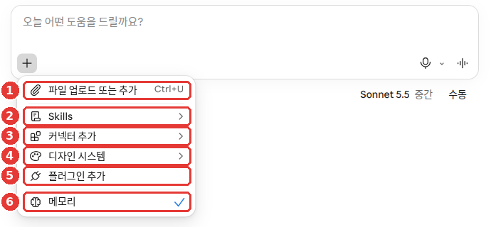
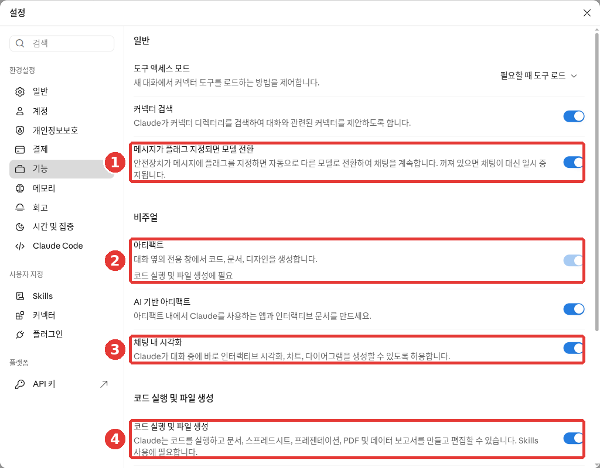
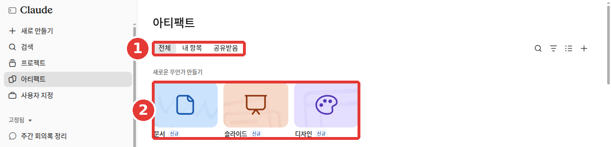

# 4장. 파일과 아티팩트 — 보여 주고, 만들어 받기

> **한 줄 요약**: 말로 설명하기 어려운 자료는 **파일로 올려** 보여 주고, 필요한 문서·표·발표 자료는 **파일로 만들어 달라고** 하면 됩니다.
> 남에게 보여 줄 만한 결과물은 대화 옆에 **아티팩트**로 열려, 고치고 공유할 수 있습니다. 단, Claude는 사진이나 일러스트는 만들지 않습니다.

화면은 2026년 10월 웹 기준입니다. 새 Claude 화면과 새 설정 화면이 차례로 배포되는 중이라, 화면에 따라 다를 수 있습니다. 휴대폰 앱은 되는 기능이 조금 다릅니다.

## 파일 올리기

입력창 왼쪽 아래 「+」 버튼을 누르고 ① 「파일 업로드 또는 추가」를 고르세요. 키보드로는 Ctrl+U입니다.[^screen] 파일을 입력창에 끌어다 놓아도 됩니다. 사진은 복사해서 바로 붙여 넣을 수도 있습니다.[^upload]



무료 요금제 화면입니다. **파일을 올릴 때는 ①만 쓰면 됩니다.**[^screen] ⑥ 「메모리」는 [3장](03-chats.md)과 [5장](05-memory.md)에서 봅니다. 도움말에는 메뉴 이름이 「파일 또는 사진 추가」(Add files or photos)로 적혀 있습니다. 화면에 따라 다를 수 있습니다.

올릴 수 있는 것은 이렇습니다.[^upload]

| 종류 | 형식 |
|---|---|
| 사진 | JPEG, PNG, GIF, WebP |
| 문서 | PDF, Word(DOCX), 텍스트(TXT), RTF, ODT, EPUB, HTML |
| 표 | Excel(XLSX), CSV |
| 그 밖에 | JSON |

Excel 파일(XLSX)은 설정에서 「코드 실행 및 파일 생성」이 켜져 있어야 올릴 수 있습니다. 이 설정은 다음 절에서 봅니다.[^upload]

파일만 올리고 "봐 줘"라고 하기보다, 무엇을 원하는지 함께 써 보세요. 그러면 훨씬 쓸모 있는 답이 나옵니다([1단계 4장](../00-common/04-prompt-basics.md#좋은-프롬프트의-5요소)).

```
첨부한 PDF는 우리 아파트 관리비 고지서야.
지난달보다 많이 오른 항목 세 개를 찾아 표로 보여 주고, 왜 올랐을 수 있는지 한 줄씩 적어 줘.
확실하지 않은 내용은 "추측"이라고 표시해 줘.
```

알아 둘 점입니다.[^upload]

- **한 대화에 20개까지 올릴 수 있습니다.**
- **PDF는 1,000쪽까지입니다.** 100쪽 이하면 그림과 차트까지 읽습니다. 101쪽부터는 글자만 읽습니다. 그림이 중요한 PDF라면 필요한 쪽만 잘라서 올려 보세요.
- **PDF가 아닌 문서는 글자만 읽습니다.** Word 파일 안에 넣은 그림은 읽지 못합니다. 그림이 중요하면 PDF로 바꿔 올리세요.
- **사진은 가로세로 1,000픽셀 이상이 좋습니다.**
- **PDF 쪽수는 화면의 쪽 번호로 말하세요.** 문서에 인쇄된 번호가 아니라, PDF 보기 프로그램에 나오는 번호입니다.

파일 하나의 크기 한도는 문서마다 다르게 적혀 있습니다. 파일 올리기 도움말은 파일당 500MB라고 적습니다.[^upload] 파일 만들기 기능 도움말은 올리기·내려받기 모두 파일당 30MB라고 적습니다.[^create] 큰 파일이 안 올라가면 나눠서 올려 보세요.

> 신분증, 계약서, 진료 기록처럼 개인정보가 담긴 파일은 올리기 전에 가리거나 빼세요. 원칙은 [1단계 9장](../00-common/09-safety.md#_2-개인정보와-비밀-—-넣기-전에-한-번-생각하기)에서 다뤘습니다.

<Quiz id="ch204-upload" />

## 파일 만들어 받기 — Excel·Word·PowerPoint·PDF

Claude는 답을 글로만 주지 않고 **파일로 만들어** 줄 수도 있습니다. 내려받거나 Google Drive에 바로 저장할 수 있습니다.[^create]

| 만드는 파일 | 예 |
|---|---|
| Excel(.xlsx) | 가계부, 일정표 |
| Word(.docx) | 안내문, 보고서 |
| PowerPoint(.pptx) | 발표 자료 |
| PDF | 인쇄용 문서 |
| PNG 그림 | 숫자로 그린 차트 |

무료 요금제를 포함해 모든 요금제에서 됩니다. 웹·데스크톱·휴대폰 앱 모두 됩니다.[^create] 새 Claude 화면에서는 수식이 살아 있는 Excel 표와 PowerPoint로 여는 발표 자료를 만들 수 있다고 소개합니다.[^new]

**먼저 설정이 켜져 있는지 보세요.** 개인 요금제(Free·Pro·Max)는 처음부터 켜져 있습니다.[^create] 꺼져 있다면 「설정 > 기능」(Capabilities)에서 ④ 「코드 실행 및 파일 생성」을 켜세요. 도움말은 새 설정 화면에서는 이름이 「파일 생성 및 편집」(Create and edit files)이라고 적습니다.[^create] 화면에 따라 다를 수 있습니다.



무료 요금제 화면입니다. **빨간 번호는 아래 표의 번호와 같은 곳입니다.**[^screen]

| 번호 | 이름 | 하는 일 |
|---|---|---|
| ① | 「메시지가 플래그 지정되면 모델 전환」 | 안전장치가 걸리면 다른 모델로 이어 간다 |
| ② | 「아티팩트」 | 대화 옆 창에 결과물을 만든다 |
| ③ | 「채팅 내 시각화」 | 대화 안에 차트·도표를 그린다 |
| ④ | 「코드 실행 및 파일 생성」 | 문서·표·발표 자료·PDF를 만든다 |

② 「아티팩트」 아래에는 "코드 실행 및 파일 생성에 필요"라고 적혀 있습니다. ④ 아래에는 "Skills 사용에 필요합니다"라고 적혀 있습니다.[^screen] 파일을 만들어 받으려면 ④가 켜져 있는지만 확인하세요.

요청할 때는 원하는 구조와 내용, 서식을 구체적으로 쓰세요.[^create]

```
월별 생활비를 기록하는 Excel 표를 만들어 줘.
항목은 식비, 교통비, 통신비, 기타로 하고, 맨 아래에 항목별 합계와 월 합계가 자동으로 계산되게 해 줘.
```

이미 있는 파일을 올리고 고쳐 달라고 해도 됩니다.

```
첨부한 Word 파일은 동네 독서 모임 안내문이야.
날짜를 11월 15일 토요일 오후 2시로 바꾸고, 준비물 목록을 맨 아래에 추가해서 Word 파일로 다시 만들어 줘.
```

알아 둘 점입니다.

- **파일 만들기는 보통 대화보다 사용량을 더 씁니다.**[^create] 사용 한도는 [1장](01-getting-started.md)에서 봤습니다. 짧은 질문은 글로 받고, 꼭 파일이 필요할 때 파일로 받으세요.
- **받은 숫자는 확인하세요.** Claude는 계산을 하지만, 복잡하거나 중요한 계산은 다른 계산 프로그램이나 손으로 다시 확인하라고 도움말이 권합니다.[^math] 합계 몇 개만이라도 직접 더해 보세요.
- **올린 파일이나 웹사이트에 숨은 지시가 있을 수 있습니다.** 도움말은 이 기능을 쓰는 동안 Claude를 지켜보다가, 엉뚱한 자료를 쓰면 멈추라고 권합니다.[^create] 숨은 지시는 [1단계 9장](../00-common/09-safety.md#_4-숨은-지시-—-프롬프트-인젝션)에서 다뤘습니다.

<Quiz id="ch204-create" />

## 아티팩트 — 대화 옆에 열리는 결과물

**아티팩트**(artifact, 만들어 낸 결과물)는 남에게 보여 줄 만한 결과물입니다. 문서, 발표 자료, 디자인, 작은 도구 같은 것입니다. 대화 옆 칸에 열리고, 고치거나 나중에 다시 열거나 다른 사람과 나눌 수 있습니다.[^artifacts]
무료 요금제를 포함해 모든 요금제에서 됩니다. 앞 절의 「코드 실행 및 파일 생성」이 켜져 있어야 합니다.[^artifacts]

앞 절의 파일 만들기와 헷갈리기 쉽습니다. 차이는 받는 방식입니다.[^academy-artifacts]

| | 아티팩트 | 파일 만들기 |
|---|---|---|
| 열리는 곳 | Claude 안, 대화 옆 칸 | 내려받아 다른 프로그램에서 |
| 나누는 법 | 링크로 공유 | 파일을 보내서 |

Claude 안에서 계속 고치거나 링크로 나눌 결과물이면 아티팩트로 받으세요. Word·Excel 파일 그대로 필요하면 파일 만들기를 쓰세요. 아티팩트도 나중에 Word·PDF 같은 파일로 내보낼 수 있습니다(아래 「파일로 내보내기」).[^artifacts]

<!-- 스크린샷 필요: 대화 오른쪽에 아티팩트(예: 안내문 문서)가 열린 화면 (웹) -->

만드는 방법은 세 가지입니다.[^artifacts]

- 대화에서 그냥 부탁합니다.
- 입력창의 「출력」(Output)을 누르고 템플릿(문서·발표 자료 같은 틀)을 고릅니다.
- 옆 메뉴 「아티팩트」 탭에서 템플릿을 고릅니다.



무료 요금제 화면입니다. 무료 계정에서도 ② 「새로운 무언가 만들기」에 「문서」·「슬라이드」·「디자인」이 보입니다. 셋 다 「신규」 표시가 붙어 있습니다.[^screen] 이 카드가 세 번째 방법의 템플릿입니다. ① 탭으로는 내가 만든 것과 남이 공유해 준 것을 나눠 봅니다.[^screen]

```
동네 독서 모임 회원에게 보낼 한 장짜리 안내문을 만들어 줘.
모임 날짜는 11월 15일 토요일 오후 2시, 장소는 구립도서관 2층 세미나실, 이번 책은 『어린 왕자』야.
읽는 사람은 60대 이상이 많으니 글자를 크게, 문장은 짧게 써 줘.
```

아티팩트로 받고 싶으면 **내용이 아니라 결과물을** 부탁하세요.[^academy-artifacts]

- 아쉬운 예: "3분기 실적 정리해 줘."
- 나은 예: "3분기 실적을 팀장님들이 볼 한 쪽짜리 문서로 만들어 줘."

차이는 하나입니다. 나은 예는 무엇을 만들지 이름을 말합니다. 꼭 아티팩트로 받고 싶으면 "아티팩트로 만들어 줘"라고 덧붙이세요.[^academy-artifacts]

**누가 쓸지도 말해 주세요.** 위 안내문 예시에서 "읽는 사람은 60대 이상"이라고 적은 것이 그것입니다. "신입 직원이 볼 흐름도"와 "기술팀이 볼 흐름도"는 다르게 나옵니다.[^academy-artifacts]

**대화를 충분히 나눈 뒤에 만들면 좋습니다.** Claude가 문제를 이미 이해했을 때 결과물이 가장 잘 나옵니다.[^academy-artifacts] 함께 분석을 마친 뒤 발표 자료를 부탁해 보세요.

만든 아티팩트는 모두 옆 메뉴 「아티팩트」 탭에 저장됩니다. 어느 대화에서든 다시 찾을 수 있습니다.[^artifacts]

**고칠 곳만 짚어서 고치기.** 문서 아티팩트에서 바꿀 글자를 마우스로 칠하고 「Claude로 편집」(Edit with Claude)을 누르세요. 그다음 원하는 것을 쓰면 됩니다.[^artifacts] 어느 부분인지 말로 설명하지 않아도 됩니다.

**다른 방향으로 다시 해 보기.** 앞에서 보낸 메시지를 고쳐 다시 보내면 대화의 다른 갈래가 생깁니다. 그 갈래에도 따로 아티팩트가 생겨서 전에 만든 것을 잃지 않습니다.[^artifacts]

**파일로 내보내기.** 「내보내기」(Export)를 누르면 다른 프로그램에서 열 수 있는 파일로 받습니다.[^artifacts]

| 만든 것 | 내보낼 수 있는 형식 |
|---|---|
| 문서 | Word, PDF, Markdown, Google 문서 |
| 발표 자료 | PowerPoint, PDF, Google 프레젠테이션 |
| 애니메이션(Team·Enterprise 전용 베타) | MP4 동영상 |

알아 둘 점입니다.[^artifacts]

- **오류가 나면 「Claude로 수정 시도」를 눌러 보세요.** 다만 꼭 고쳐진다는 보장은 없습니다.
- **휴대폰 앱에서는 요청하고, 보고, 고칠 수 있습니다.** 공유 설정은 웹이나 데스크톱 앱에서 바꿉니다.
- **2026년 9월 16일 전에 만든 것은 「레거시 아티팩트」입니다.** 계속 쓸 수는 있지만, 그 방식으로 새로 만들 수는 없습니다.

<Quiz id="ch204-artifacts" />

## 아티팩트 공유하기

아티팩트는 **처음엔 나만 봅니다.** 내가 공유하기 전에는 아무에게도 보이지 않습니다.[^share]

1. 아티팩트를 열고 「공유」를 누릅니다.
2. 누가 볼지 고릅니다. Pro·Max 요금제는 「본인만」과 「링크가 있는 누구나」 중에서 고릅니다.
3. 링크를 복사해 보냅니다.

<!-- 스크린샷 필요: 아티팩트 「공유」 창 — 「본인만」「링크가 있는 누구나」와 권한 선택 (웹) -->

권한은 세 단계입니다. 아티팩트 종류에 따라 일부만 고를 수 있습니다.[^share]

| 권한 | 할 수 있는 일 |
|---|---|
| 「볼 수 있음」 | 열어 보기, 댓글 읽기 |
| 「댓글 작성자」 | 위에 더해 댓글 달기, 파일 받기 |
| 「편집 가능」 | 위에 더해 고치기 |

알아 둘 점입니다.[^share]

- **여는 사람도 Claude 계정이 있어야 합니다.** 계정이 없으면 링크가 있어도 못 엽니다. 대화 공개 링크(3장)와 다른 점입니다.
- **그만 보여 주려면** 「공유」에서 「본인만」으로 바꾸세요(Pro·Max).
- **남이 보낸 아티팩트는 모르는 사람이 보낸 파일처럼 다루세요.** 도움말이 직접 하는 당부입니다.

무료 요금제에서 「링크가 있는 누구나」로 공유할 수 있는지는 문서마다 다르게 적혀 있습니다. 내 화면의 「공유」 창에 보이는 선택지를 따르세요.

<Quiz id="ch204-share" />

## 눈으로 보는 답 — 카드·되묻기·도표

Claude는 질문에 따라 답을 글 대신 **눈으로 보는 모양**으로 주기도 합니다. 따로 켤 것은 없습니다. Claude가 알아서 판단하니, 평소처럼 물어보면 됩니다.[^visual]

**날씨·요리 카드.** 날씨나 요리법을 물으면 카드 모양으로 답할 수 있습니다. 웹 검색이 켜져 있어야 합니다.[^visual] 옛 화면이라면 웹 검색 스위치를 켜 두세요([6장](06-search.md)). 새 화면에는 스위치가 없고, Claude가 필요할 때 알아서 검색합니다.[^new] 요리 카드에서는 몇 인분인지와 단위를 바꿀 수 있습니다.[^visual] 날씨 카드는 웹·데스크톱에서만 보이고, 휴대폰에서는 글로 나옵니다.[^visual]

**골라서 답하기.** Claude가 되물을 때 객관식, 여러 개 고르기, 순위 매기기 같은 선택지를 띄울 수 있습니다. 눌러서 답해도 되고, 그냥 글로 답해도 됩니다.[^visual]

**도표와 차트.** 설명을 그림으로 보고 싶으면 그렇게 부탁하세요. 흐름도, 차트, 눌러 볼 수 있는 그림을 대화 안에 그려 줍니다. 이 기능을 **맞춤 시각화**(Custom visuals)라고 합니다. 베타(정식 전 시험판)이고, 웹과 데스크톱 앱에서 됩니다.[^custom] 「설정 > 기능」에는 ③ 「채팅 내 시각화」 스위치도 있습니다. 설명은 "Claude가 대화 중에 바로 인터랙티브 시각화, 차트, 다이어그램을 생성할 수 있도록 허용합니다"입니다.[^screen]

```
김장하는 순서를 배추 절이기부터 김치통에 담기까지 단계별 흐름도로 그려 줘.
```

<!-- 스크린샷 필요: 대화 안에 그려진 흐름도(맞춤 시각화)와 그 옆 「이미지로 복사」「아티팩트로 저장」 메뉴 (웹) -->

맞춤 시각화는 화이트보드에 그린 그림처럼 **따로 저장되지 않는 임시 그림**입니다. 남겨 두려면 셋 중 하나를 고르세요.[^custom]

- 「이미지로 복사」: 그림으로 복사해 메모나 발표 자료에 붙입니다.
- 「다운로드」: .svg나 .html 파일로 받습니다.
- 「아티팩트로 저장」: 아티팩트로 바꿔 계속 고칩니다.

맞춤 시각화는 휴대폰 앱(iPhone·Android)에서는 보이지 않습니다.[^custom]

<Quiz id="ch204-visuals" />

## 사진·일러스트는 만들지 않는다

Claude는 그림 그리는 AI(이미지 생성 도구)처럼 **사진이나 일러스트를 만들지 않습니다.**[^images] "바닷가에서 웃는 강아지 그림"을 부탁해도 그런 그림은 나오지 않습니다.

대신 할 수 있는 일이 있습니다.

- **도표와 차트**는 만듭니다. 앞 절의 맞춤 시각화입니다.[^images] 숫자 차트는 PNG 그림 파일로도 받을 수 있습니다.[^create]
- **올린 사진을 보고 설명하는 것**은 됩니다. 영수증 사진을 표로 정리하는 일 같은 것입니다.[^images]

아쉬운 예와 나은 예를 비교해 보세요.

- **아쉬운 예**: "우리 가게 홍보용 귀여운 고양이 그림 그려 줘."
- **나은 예**: "우리 가게 지난 6개월 매출을 막대그래프로 그려 줘."

차이는 하나입니다. 앞의 것은 일러스트라 만들 수 없고, 뒤의 것은 차트라 만들 수 있습니다. 사진이나 일러스트가 꼭 필요하면 그림을 만드는 다른 서비스를 쓰세요. 예를 들어 ChatGPT는 그림을 만듭니다([ChatGPT 4장](../11-chatgpt/04-files-images.md)).

<Quiz id="ch204-images" />

## Claude Docs — 함께 쓰는 문서

**Claude Docs**는 Claude와 함께, 그리고 다른 사람과 함께 고쳐 가는 문서입니다. Claude가 내 눈앞에서 초안을 씁니다. 쓰기 전에 궁금한 점을 먼저 묻고, 왜 그렇게 썼는지 댓글로 남깁니다.[^docs]
무료 요금제를 포함해 모든 요금제에서 되고, 처음부터 켜져 있습니다.[^docs] 만든 문서는 「아티팩트」 탭에 저장됩니다.

시작하는 방법은 이렇습니다.[^docs]

- 대화에서 문서를 만들어 달라고 합니다.
- 메시지 맨 앞에 `/docs`를 씁니다.
- 입력창 「출력」 → 「문서」를 고릅니다.

좋은 요청에는 **무엇에 쓸 문서인지, 누가 읽는지, 무엇을 다룰지**가 들어갑니다.[^docs]

- **아쉬운 예**: "가족 여행 계획 문서 써 줘."
- **나은 예**: 아래처럼 용도·독자·내용을 넣습니다.

```
/docs 12월 가족 제주 여행 계획 문서를 만들어 줘.
용도: 가족 단체방에 올려서 의견을 모으려고 해.
읽는 사람: 부모님과 형제 가족, 모두 8명.
다룰 내용: 2박 3일 일정, 숙소 후보 두 곳, 예상 경비, 각자 준비할 것.
```

차이는 셋입니다. 나은 예에는 무엇에 쓸지, 누가 읽을지, 무엇을 넣을지가 들어 있습니다. 도움말이 좋은 요청으로 꼽는 세 가지입니다.

알아 둘 점입니다.[^docs]

- **고쳐 달라고 할 때는 댓글에 `@Claude`를 부르세요.** 고친 뒤 이유를 설명해 줍니다.
- **「내보내기」로 Word, PDF, Markdown, Google 문서로 받을 수 있습니다.**
- **문서 속 차트는 저절로 바뀌지 않습니다.** 숫자가 바뀌면 다시 불러 달라고 하세요.
- **삭제하면 되돌릴 수 없습니다.** 휴지통이 없습니다. 지우기 전에 내보내기로 받아 두세요.

<Quiz id="ch204-docs" />

## Google 문서·시트·슬라이드 안에서 쓰기

이미 Google 문서나 시트로 일하고 있다면, 그 파일 안에 Claude를 불러 쓸 수도 있습니다. **Claude for Google Workspace**라는 확장 프로그램입니다. Google 문서·시트·슬라이드에 Claude 칸(사이드바)이 붙습니다. 베타이고, Pro 이상 유료 요금제에서 됩니다.[^gws]

1. Google Workspace Marketplace(구글 앱 장터)에서 Claude를 설치합니다. 한 번 설치하면 문서·시트·슬라이드에서 모두 씁니다.
2. 파일을 열고 「확장 프로그램 > Claude > Claude 열기」를 누릅니다.

<!-- 스크린샷 필요: Google 시트 오른쪽에 Claude 사이드바가 열린 화면 (예시 시트) -->

```
이 시트 B열의 금액을 모두 더해서 맨 아래 칸에 합계를 넣어 줘. 다른 칸은 건드리지 마.
```

알아 둘 점입니다.[^gws]

- **지금 열린 그 파일만 읽습니다.**
- **처음에는 고치기 전에 묻습니다.** 기본 모드가 「편집 전에 묻기」입니다. 「모든 편집 수락」으로 바꿀 수도 있지만, 처음에는 하나씩 확인해 보세요.
- **고친 내용은 내 이름으로 버전 기록에 남습니다.** 마음에 안 들면 「파일 > 버전 기록」에서 이전 버전으로 되돌리면 됩니다.
- **파일 공유나 권한 바꾸기는 못 합니다.** 부탁해도 하지 않습니다.
- **Word·Excel·PowerPoint 파일에서는 안 됩니다.** 먼저 Google 형식으로 바꾸세요.
- **작업 중에는 Claude 칸을 닫지 마세요.** 닫으면 하던 일이 멈춥니다. 한 작업은 6분까지라 큰 일은 나눠서 맡기세요.
- **Chrome, Edge, Safari에서 됩니다.** Firefox는 안 됩니다.

<Quiz id="ch204-google" />

## 직접 해 보기

1. 집에 있는 영수증을 찍어 「+」 → 「파일 업로드 또는 추가」로 올리고 "적힌 내용을 표로 정리해 줘"라고 요청한다(이름·카드번호는 가린다).
2. 위의 생활비 Excel 표를 만들어 달라고 해서 내려받는다. 표에 숫자 몇 개를 넣고 합계가 맞게 바뀌는지 확인한다.
3. 독서 모임 안내문을 아티팩트로 만들고, 날짜 부분을 칠해 「Claude로 편집」으로 바꿔 본다.
4. "김장 순서를 흐름도로 그려 줘"라고 해서 나온 그림을 「아티팩트로 저장」해 본다.

## 정리

- 「+」 → 「파일 업로드 또는 추가」로 사진·문서·표를 올린다. 한 대화에 20개, PDF는 1,000쪽까지다.
- PDF는 100쪽까지 그림도 읽고, 그 뒤는 글자만 읽는다. PDF가 아닌 문서는 글자만 읽는다.
- Excel·Word·PowerPoint·PDF 파일을 만들어 받을 수 있다. 「코드 실행 및 파일 생성」이 켜져 있어야 하고, 사용량을 더 쓴다.
- 아티팩트는 대화 옆에 열리는 결과물이다. 「아티팩트」 탭에 모이고, 「Claude로 편집」으로 고치고, 「내보내기」로 파일로 받는다.
- 아티팩트는 처음엔 나만 본다. 공유받은 사람도 Claude 계정이 있어야 연다.
- 맞춤 시각화는 저장되지 않는 임시 그림이다. 남기려면 복사·다운로드·아티팩트로 저장한다.
- Claude는 사진·일러스트는 만들지 않는다. 도표와 차트는 만든다.
- Claude Docs는 용도·독자·내용을 넣어 요청한다. 삭제하면 되돌릴 수 없다.
- Google 문서 안에서도 쓸 수 있다(Pro 이상 베타). 고친 내용은 버전 기록으로 되돌린다.

## 용어 정리

| 용어 | 읽는 법 | 한 줄 뜻 |
|---|---|---|
| Upload | 업로드 | 내 기기의 파일을 서비스로 올리는 것 |
| Artifact | 아티팩트 | 대화 옆에 열리는, 남에게 보여 줄 만한 결과물 |
| Template | 템플릿 | 문서·발표 자료를 시작하는 틀 |
| Export | 익스포트 (내보내기) | 다른 프로그램에서 열 수 있는 파일로 받는 것 |
| Custom visuals | 커스텀 비주얼 (맞춤 시각화) | 대화 안에 그려 주는 도표·차트 |
| Beta | 베타 | 정식으로 내놓기 전 시험 중인 기능 |
| Claude Docs | 클로드 독스 | Claude·다른 사람과 함께 고치는 문서 |
| Extension | 익스텐션 (확장 프로그램) | 다른 프로그램에 기능을 덧붙이는 작은 프로그램 |
| Version history | 버전 히스토리 (버전 기록) | 파일이 바뀐 과정을 남겨 둔 기록 |

<ChapterDone :chapter="204" />

다음 장: [5장. 기억과 맞춤 설정](05-memory.md)

[^screen]: Claude 웹 화면(무료 요금제, 한국어)에서 직접 확인. "파일 업로드 또는 추가" / "코드 실행 및 파일 생성" / "코드 실행 및 파일 생성에 필요" / "Skills 사용에 필요합니다" / "채팅 내 시각화" / "새로운 무언가 만들기" (확인일 2026-10-26)
[^upload]: Anthropic 도움말, 「Upload files to Claude」. "Claude can work with the following document types:" / "Note: You must enable code execution and file creation in your account to upload XLSX files." / "Claude supports the following image formats:" / "Click the "+" button in the lower left corner of the chat box" / "You can also copy images and paste them from your clipboard into Claude." / "File size: 500MB per file" / "Number of files: Up to 20 files per chat" / "You can't upload PDFs over 1000 pages." / "For PDFs from 101 to 1000 pages, Claude processes text only and doesn't analyze visual elements." / "Claude extracts text only from these files. If they contain embedded images, Claude won't be able to read or interpret them." / "For images: Use images that are 1000x1000 pixels or larger." / "use the PDF page numbers as shown in your PDF viewer, not the page numbers printed on the document itself." https://support.claude.com/en/articles/8241126 (확인일 2026-10-26)
[^create]: Anthropic 도움말, 「Create and edit files with Claude」. "Code execution and file creation is available to all Claude users (Free, Pro, Max, Team, and Enterprise) on the web, Claude Desktop, and Claude Mobile." / "Code execution and file creation is enabled by default" / "Be specific in your requests—describe the structure, content, and formatting you want." / "Enable file creation from Settings > Capabilities by toggling Code execution and file creation (called Create and edit files in the updated Settings layout) on." / "You can download the files Claude creates or save them directly to Google Drive." / "Claude can create data visualizations in image files like PNG." / "The maximum file size is 30MB per file for both uploads and downloads." / "Note that creating files will use more of your limit compared to normal chats with Claude." / "we recommend you monitor Claude while using the feature and stop it if you see it using or accessing data unexpectedly." https://support.claude.com/en/articles/12111783 (확인일 2026-10-26)
[^new]: Anthropic 도움말, 「Claude Cowork and chat are one Claude」. "Claude can create documents, spreadsheets with working formulas, and presentations you can open in PowerPoint." / "Web search: There's no web search toggle. Claude searches the web when it helps." https://support.claude.com/en/articles/16761823 (확인일 2026-10-26)
[^math]: Anthropic 도움말, 「How does Claude handle mathematical equations and calculations?」. "complex or mission-critical calculations should be verified using specialized mathematical software or manual methods." https://support.claude.com/en/articles/10366421 (확인일 2026-10-26)
[^artifacts]: Anthropic 도움말, 「What are artifacts and how do I use them?」. "It opens beside your conversation, and you can edit it, come back to it, and share it with others." / "Artifacts are available on Free, Pro, Max, Team, and Enterprise plans" / "Important: Artifacts require Cloud code execution and file creation (called Create and edit files in the updated Settings layout) to be turned on in Settings > Capabilities (Free, Pro, Max)" / "Ask for one in any chat, select "Output" in the message box and choose a template, or pick one in the Artifacts tab." / "Everything you make is saved to the Artifacts tab in your Claude sidebar, so you can find it again from any conversation." / "highlight the text you want changed, click "Edit with Claude," and type your request." / "Edit an earlier message to create a different version of the chat, with its own artifacts" / "Docs export to Word, PDF, Markdown, and Google Docs." / "Export the result as an MP4 video. Available on Team and Enterprise plans." / "Claude will attempt to fix the error, but success isn't guaranteed." / "To change sharing settings, use Claude on the web or Claude Desktop." / "Note: Legacy artifacts are artifacts made in a chat before September 16, 2026." https://support.claude.com/en/articles/17153992 (확인일 2026-10-26)
[^share]: Anthropic 도움말, 「Share artifacts」. "Artifacts start private to you. Nothing is shared until you share it." / "Open the artifact and click "Share."" / "Pro and Max plans: "Only you" or "Anyone with the link."" / "Everything in Commenter, plus make changes." / "Everyone needs a Claude account. People without one can't open a shared artifact, even with the link." / "choose "Only you" (Pro and Max) or "Only people invited" (Team and Enterprise)." / "Treat someone else's artifact the way you'd treat a file from an unknown sender." https://support.claude.com/en/articles/9547008 (확인일 2026-10-26)
[^visual]: Anthropic 도움말, 「Visual and interactive content」. "Data display widgets (weather and recipes) require web search to be enabled." / "On mobile (iOS and Android), Claude provides weather information as text in the conversation." / "change the number of servings or the units of measurement, or click “Get cooking” to launch a step-by-step interface" / "Claude may present interactive options you can click or tap — like multiple choice questions, multi-select options, or a ranking interface." / "Claude decides when a visual response is appropriate based on your question. Just ask naturally." https://support.claude.com/en/articles/13641943 (확인일 2026-10-26)
[^custom]: Anthropic 도움말, 「Custom visuals in chat and Cowork」. "Note: Custom visuals are currently in beta and available to all Claude users on web and desktop, in both chat and Cowork." / "Custom visuals are ephemeral by default." / "Download — save the visual as an .svg or .html file." / "They don’t render on Claude for iOS or Claude for Android." https://support.claude.com/en/articles/13979539 (확인일 2026-10-26)
[^images]: Anthropic 도움말, 「Can Claude produce images?」. "Claude doesn’t generate photos or illustrations the way image-generation tools do." / "These are generated using HTML and SVG—so you can interact with them, ask follow-up questions, and have Claude adjust them as you go." / "Claude can also view and analyze images you upload." https://support.claude.com/en/articles/9002504 (확인일 2026-10-26)
[^docs]: Anthropic 도움말, 「Get started with Claude Docs」. "Claude drafts it in front of you, asks clarifying questions up front, and leaves comments explaining its choices." / "Claude Docs is available on Free, Pro, Max, Team, and Enterprise plans, and it's on by default." / "You can also start your request with /docs, or by selecting “Output” then “Docs” from the message box." / "A good request says what the doc is for, who will read it, and what it should cover." / "To ask Claude for an edit, mention @Claude in a comment." / "To export a doc, click "Export" and choose a format:" / "Charts and diagrams don't update on their own" / "Deleting a doc is permanent. There's no trash" https://support.claude.com/en/articles/16923645 (확인일 2026-10-26)
[^gws]: Anthropic 도움말, 「Use Claude in Google Docs, Sheets, and Slides」. "Claude for Google Workspace is available in beta for Pro, Max, Team, and Enterprise plans." / "One install covers Docs, Sheets, and Slides." / "Open a Google Docs, Sheets, or Slides file and go to Extensions > Claude > “Open Claude"" / "Claude reads the file you have open, and only that file" / "Ask before edits (default)" / "Google records them under your name, so they appear in File, Version history like any edit you make yourself." / "Claude cannot share the file, give anyone access, or change who owns it." / "Google doesn’t support extensions in Word, Excel, or PowerPoint files" / "Keep the sidebar open while Claude is working. Closing it stops the current task." / "A single long operation can run for up to six minutes before Google stops it." / "Use Chrome, Edge, or Safari. Firefox is not supported in this beta" https://support.claude.com/en/articles/16951679 (확인일 2026-10-26)
[^academy-artifacts]: Claude Academy 「Claude 101」 강의 「Creating with artifacts」. "The practical difference: an artifact opens and updates right in Claude and is shared by link, while file creation hands you a file to download and open in other apps." / "If you want to ensure Claude creates an artifact, just say so: "Create this as an artifact."" / "Ask for the deliverable, not just the content." / "Describe the end user." / "The best artifacts come at the end of a conversation, when Claude already understands the problem." https://academy.claude.com/courses/claude-101/creating-with-artifacts (확인일 2026-10-26)
