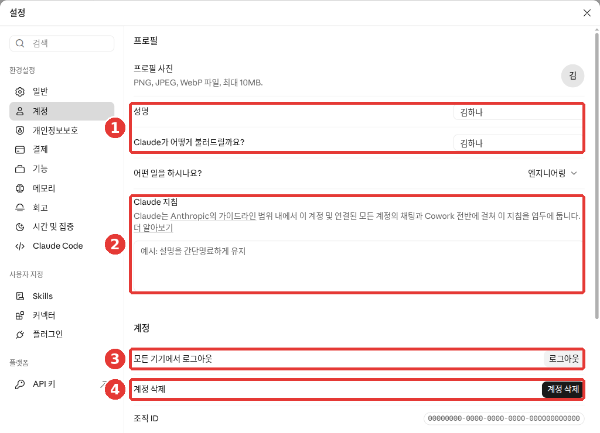
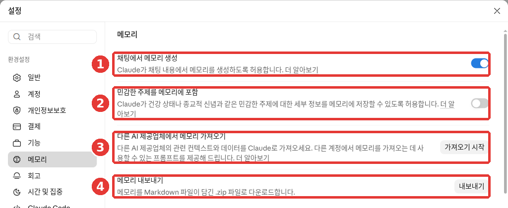
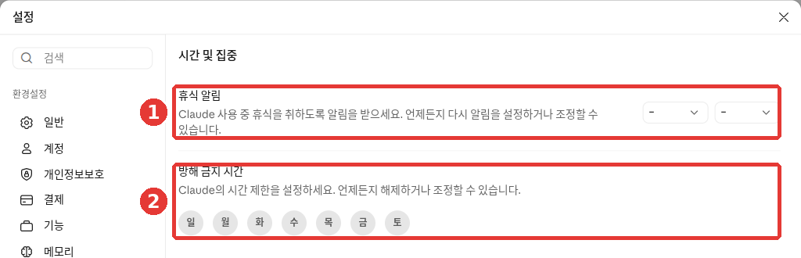

# 5장. 기억과 맞춤 설정 — 매번 나를 소개하지 않아도 되게

> **한 줄 요약**: 늘 지켜 줬으면 하는 것은 **지침**에 적고, 대화하며 알게 된 나에 대한 내용은 **메모리**가 기억합니다.
> 무엇이 기억되는지 보고, 고치고, 끄는 법까지 익힙니다. 오래 쓸 때 쉬어 가게 해 주는 휴식 알림도 함께 봅니다.

화면은 2026년 10월 웹 기준입니다. 지금은 새 Claude 화면과 새 설정 화면이 차례로 배포되고 있어서, 메뉴 이름과 위치가 화면에 따라 다를 수 있습니다.
이 장의 그림은 무료 요금제 웹 화면입니다. 메뉴 이름은 그림에 보이는 이름으로 씁니다. 도움말에 나오는 다른 이름은 각주와 접기 상자에 모았습니다.

## 나를 알려 주는 세 가지 방법

[1단계 4장](../00-common/04-prompt-basics.md#좋은-프롬프트의-5요소)에서 좋은 프롬프트에는 **맥락**이 들어간다고 배웠습니다.
그런데 "나는 동네 반찬가게 사장이야" 같은 말을 새 채팅마다 다시 쓰기는 번거롭습니다.
[1단계 6장](../00-common/06-conversation.md#새-대화에서는-기본적으로-모른다)에서 본 것처럼, 새 대화는 원래 나를 모르고 시작하기 때문입니다.

Claude에는 이 수고를 덜어 주는 기능이 세 가지 있습니다.

| 기능 | 누가 정하나 | 비유 |
|---|---|---|
| **지침**(instructions) | 내가 직접 적는다 | 가게 벽에 붙인 주문 메모 |
| **메모리**(memory, 기억) | Claude가 대화하며 저장한다 | 단골 취향을 기억하는 주인 |
| **지난 대화 참고** | 내가 물으면 Claude가 찾아본다 | 지난 장부를 뒤져 보는 것 |

셋 다 처음부터 완벽하게 설정할 필요는 없습니다. 쓰면서 하나씩 손보면 됩니다.

<Quiz id="ch205-three-ways" />

## 지침 — 모든 대화에 적용할 규칙

**지침**은 내가 직접 적어 두는 "늘 지켜 줄 것"입니다. 여기에 적은 내용은 Claude와의 **모든 대화**에 적용됩니다.[^personal]

여는 곳은 이렇습니다.[^personal]

1. 왼쪽 아래 내 이름을 누릅니다.
2. 「설정」 → 「계정」을 고릅니다.[^screen]
3. ② 「Claude 지침」 칸에 적습니다.[^screen]



이름·이메일은 예시로 바꾼 화면입니다(무료 요금제). **빨간 번호는 아래 목록의 번호와 같은 곳입니다.**

- ① 「성명」·「Claude가 어떻게 불러드릴까요?」 — Claude가 나를 부를 이름
- ② 「Claude 지침」 — 모든 대화에 적용할 규칙을 적는 칸
- ③ 「모든 기기에서 로그아웃」
- ④ 「계정 삭제」

② 칸 위에는 이 지침을 채팅과 Cowork 전반에 걸쳐 염두에 둔다는 안내가 있습니다.[^screen] 빈칸에는 「예시: 설명을 간단명료하게 유지」라고 흐리게 적혀 있습니다.[^screen]

::: details 설정에 「계정」 대신 「Your Claude」가 보이면 (눌러서 펼치기)
도움말에는 이 칸이 「설정」 → 「Your Claude」의 「지침」으로 나옵니다.[^personal] 새 설정 화면을 받은 계정은 그렇게 보일 수 있습니다. 화면에 보이는 이름을 따르세요.
:::

무엇을 적을지 막막하면, [1단계 4장](../00-common/04-prompt-basics.md#좋은-프롬프트의-5요소)의 다섯 요소 가운데 **매번 같은 것**만 골라 넣어 보세요.

```
나는 동네 반찬가게를 운영하는 50대 사장이야. 컴퓨터 용어는 잘 몰라.
- 답은 존댓말로, 어려운 말은 괄호로 풀어서 써 줘.
- 처음에 결론을 한 줄로 말하고, 그다음에 설명해 줘.
- 확실하지 않은 내용은 지어내지 말고 모른다고 말해 줘.
```

아쉬운 예와 나은 예를 비교해 보세요.

- 아쉬운 예: "친절하게 답해 줘."
- 나은 예: "어려운 말은 괄호로 풀어 줘. 결론을 먼저 한 줄로 말해 줘."

나은 예는 무엇을 해야 하는지가 구체적입니다.

지침을 적었다면 새 채팅을 열고 짧은 질문을 하나 보내 보세요. "말투가 맞나? 결론이 먼저 나오나?"를 스스로 물어보면 됩니다.

지침은 첫날 다 채우지 않아도 됩니다. 쓰다 보면 **같은 말을 자꾸 고쳐 달라고** 하게 됩니다. "결론부터 말해 줘", "표는 세 칸까지만" 같은 것입니다. 그 말이 바로 지침에 옮겨 적을 문장입니다.[^academy-context] 한 번 적어 두면 다음 대화부터는 다시 말하지 않아도 됩니다.

특정 일에만 쓸 규칙은 계정 전체 지침보다 **프로젝트 지침**에 두는 편이 낫습니다. 프로젝트 지침은 그 프로젝트 안의 채팅에만 적용됩니다.[^personal] 프로젝트는 [7장](07-projects-tools.md)에서 다룹니다.

<Quiz id="ch205-instructions" />

## 메모리 — Claude가 대화하며 기억하는 것

**메모리**는 Claude가 대화에서 알게 된 나에 대한 내용을 기억해 두는 기능입니다.
Free·Pro·Max 요금제에서는 웹·데스크톱·휴대폰 앱 모두 **처음부터 켜져 있습니다.**[^memory]
회사용 요금제(Team·Enterprise)는 관리자가 허용해야 쓸 수 있고, 각자 켜기 전까지는 꺼져 있습니다.[^memory]

Claude는 대화가 끝난 뒤 요약하지 않습니다. **대화하는 동안** 주제별로 나눠 저장합니다.[^memory]
그래서 "마감일이 바뀌었어"라고 말하면, 다음 대화가 이미 그 사실을 압니다.

[1단계 6장](../00-common/06-conversation.md#새-대화에서는-기본적으로-모른다)이나 다른 AI 강좌에서는 "새 대화는 처음부터 시작한다"고 배웁니다.[^academy-memory] Claude에서는 메모리가 켜져 있으면 새 대화도 내가 알려 준 내용을 알고 시작할 수 있습니다.
정말 백지에서 시작하는 모습을 보고 싶다면, 새 채팅에서 첫 메시지를 보내기 전에 「+」 → 「메모리」를 끄세요. 그 채팅에서는 기억한 내용을 쓰지 않습니다.[^off] 방법은 아래 「한 채팅만 메모리 끄기」에 있습니다.

### 무엇을 기억하나

Claude는 함께 일하는 데 도움이 되는 일상적인 맥락을 기억합니다.[^memory]

- 내 역할, 하고 있는 일
- 일과 생활에 나오는 사람과 장소
- 좋아하는 소통 방식과 일하는 방식
- 진행 중인 일의 세부 내용

Claude가 알아서 저장하기도 합니다. 꼭 남기고 싶은 것은 직접 "기억해 줘"라고 말하면 됩니다.[^memory]

```
기억해 줘: 나는 서울에서 반찬가게를 하고 있고, 손님은 주로 40~60대야.
홍보 문구를 부탁하면 이 손님층에 맞춰서 써 줘.
```

### 기억하지 않는 것

건강·인종·종교·정치·성 정체성 같은 **민감한 주제**는 기본적으로 저장하지 않습니다.[^sensitive]
매번 다시 설명하기 싫다면 「설정」 → 「메모리」에서 「민감한 주제를 메모리에 포함」을 켤 수 있습니다.[^screen][^sensitive][^your-claude] 처음에는 꺼져 있습니다.[^screen]

신분증 번호·범죄 기록·금융 계좌 번호·체류 신분은 **부탁해도 저장하지 않습니다.**[^sensitive]
그렇다고 이런 정보를 채팅에 적어도 된다는 뜻은 아닙니다. 넣기 전에 [1단계 9장](../00-common/09-safety.md#넣지-말아야-할-것)을 한 번 떠올려 보세요.

> 프로젝트 안에서는 그 프로젝트만의 메모리가 따로 쌓입니다. 다른 프로젝트의 메모리는 쓰지 않습니다.[^memory] 자세한 것은 [7장](07-projects-tools.md)에서 봅니다.

<Quiz id="ch205-memory" />

## 기억한 내용 보고 고치기

Claude가 나에 대해 무엇을 기억하는지 직접 볼 수 있습니다.
메모리에 관한 설정은 「설정」 → 「메모리」 한 화면에 모여 있습니다.[^screen]



무료 요금제 화면입니다. **빨간 번호는 아래 목록의 번호와 같은 곳입니다.**

- ① 「채팅에서 메모리 생성」 — 메모리를 켜고 끄는 스위치
- ② 「민감한 주제를 메모리에 포함」 — 건강·종교 같은 주제도 기억하게 하는 스위치
- ③ 「다른 AI 제공업체에서 메모리 가져오기」 — 다른 AI의 기억을 옮겨 온다
- ④ 「메모리 내보내기」 — 기억을 파일로 내려받는다

이 화면 아래쪽에 저장된 메모리 목록이 있습니다.[^screen] 주제를 눌러 읽고, 연필 모양으로 고치거나 「삭제」로 지우면 됩니다.[^manage][^your-claude]

<!-- 스크린샷 필요: 저장된 메모리가 있는 계정에서 주제 목록과 편집·「삭제」 버튼 -->

목록 맨 아래에는 「Claude에게 변경할 내용을 알려 주세요」라는 입력칸도 있습니다.[^screen]
설정 화면까지 가지 않아도 됩니다. 채팅에서 말로 고쳐도 다음 대화부터 반영됩니다.[^manage]

```
내가 반찬가게를 한다는 건 이제 잊어 줘. 지난달에 가게를 정리했어.
```

목록을 열었다면 스스로 물어보세요. "틀린 내용은 없나? 남기기 싫은 내용은 없나?"

### 채팅을 지워도 기억은 남는다

헷갈리기 쉬운 점이 하나 있습니다. **대화를 지워도, 그 대화에서 생긴 메모리는 지워지지 않습니다.**[^manage]
지우고 싶은 내용이 있으면 「설정」 → 「메모리」의 목록에서 그 메모리를 따로 지우세요.

> 이 설명은 지금의 새 메모리 기준입니다. 일부 회사용 요금제에는 옛 방식의 메모리가 남아 있습니다.[^manage] 내 화면과 다르면 화면을 따르세요.

<Quiz id="ch205-manage" />

## 메모리 끄기 — 일시 중지와 재설정

메모리 스위치는 「설정」 → 「메모리」의 ① 「채팅에서 메모리 생성」(Memory from chats)입니다.[^screen][^off][^your-claude]
스위치를 끄려고 누르면 두 가지 중 하나를 고르게 됩니다.[^off]

- **「메모리 일시 중지」**(Pause memory) — 기억은 그대로 둡니다. 다만 쓰지도, 새로 만들지도 않습니다.
- **「메모리 재설정」**(Reset memory) — 프로젝트 메모리까지 **모두 영구 삭제**합니다. 되돌릴 수 없습니다.

잠깐 쉬고 싶은 것이라면 일시 중지를 고르세요. 재설정은 다시 켜도 처음부터 시작합니다.[^off]

### 한 채팅만 메모리 끄기

메모리는 켜 둔 채 **이번 채팅에서만** 끌 수도 있습니다.[^off]

1. 새 채팅을 엽니다.
2. 입력창의 「+」를 누릅니다.
3. 메뉴 맨 아래 ⑥ 「메모리」(Memory)를 눌러 끕니다. 오른쪽에 체크 표시가 있으면 켜진 상태입니다.[^screen]
4. 첫 메시지를 보냅니다.


무료 요금제 화면입니다. 이 장에서 쓰는 것은 ⑥ 「메모리」입니다. 나머지는 [4장](04-files-artifacts.md)과 [7장](07-projects-tools.md)에서 다룹니다.

**첫 메시지를 보내기 전에만** 끌 수 있습니다. 대화가 시작되면 바꿀 수 없습니다.[^off]

이렇게 시작한 채팅은 [3장](03-chats.md)의 **시크릿 채팅**과 다릅니다. 메모리만 끈 채팅은 대화 기록에 그대로 남습니다.[^off] 기록까지 남기기 싫다면 시크릿 채팅을 쓰세요.

| 고르는 것 | 메모리 | 대화 기록 |
|---|---|---|
| 「+」 → 「메모리」 끄기 | 안 쓰고 안 만든다 | 남는다 |
| 시크릿 채팅 | 저장 안 함 | 안 남는다 |

<Quiz id="ch205-off" />

## 지난 대화 참고하기

"지난번에 얘기한 그거 있잖아" 하고 물을 수도 있습니다.
유료 요금제(Pro·Max·Team·Enterprise)에서는 Claude가 **지난 대화를 찾아보고** 그 내용을 이어서 씁니다.[^past]

그냥 자연스럽게 물어보세요.

```
지난번에 같이 만든 가게 홍보 문구 기억나? 거기서 이어서 다듬어 줘.
```

Claude가 지난 대화를 찾으면, 지금 채팅에 **도구를 쓴 표시**가 나타납니다.[^past]
찾아 쓴 대화에는 원래 대화로 가는 링크가 붙습니다.[^past] 링크를 눌러 Claude가 제대로 된 대화를 찾았는지 확인해 보세요.

알아 둘 점입니다.

- **프로젝트 안의 대화**는 그 프로젝트 안에서만 찾습니다.[^past]
- **끄고 싶다면** 「설정」 → 「메모리」에서 「채팅 검색 및 참조」를 끄세요.[^past][^past-where] 유료 요금제 기능이라 이 장의 무료 요금제 화면에서는 이 스위치를 볼 수 없었습니다.[^screen]
- 옆 메뉴에서 내가 직접 지난 대화를 찾는 방법은 [3장](03-chats.md)에서 다룹니다.

<Quiz id="ch205-past-chats" />

## 다른 AI의 기억 옮겨 오기·내보내기

다른 AI 서비스를 쓰다가 Claude로 옮겨 왔다면, 그쪽에 쌓인 기억을 가져올 수 있습니다.
**모든 요금제**에서 웹과 데스크톱 앱으로 할 수 있습니다.[^import]

1. **원래 쓰던 AI에서 기억을 뽑습니다.** 도움말에 추천 프롬프트가 있습니다. "I'm moving to another service and need to export my data."로 시작하는 영어 프롬프트입니다. 각주의 도움말 링크에서 전문을 복사해 쓰세요.[^import]
2. **Claude에서 가져오기를 엽니다.** 「설정」 → 「메모리」의 ③ 「다른 AI 제공업체에서 메모리 가져오기」 옆 「가져오기 시작」을 누릅니다.[^screen][^your-claude]
3. **붙여 넣습니다.** 뽑아 온 글을 칸에 붙여 넣고 「메모리에 추가」를 누릅니다.[^import]
4. **확인합니다.** 끝나면 「Claude가 나에 대해 학습한 내용 보기」를 눌러 무엇이 들어갔는지 봅니다.[^import]

가져오기 전에 프롬프트를 고쳐서 **민감한 정보는 빼도 됩니다.**[^import] 남기고 싶지 않은 내용은 처음부터 넣지 않는 편이 안전합니다.

알아 둘 점이 두 가지 있습니다.

- **실험 기능입니다.** 가져온 기억이 항상 제대로 들어가지는 않습니다.[^import]
- **일과 상관없는 개인 정보는 남지 않을 수 있습니다.**[^import]

반대로 Claude의 기억을 **내보내고** 싶으면 「설정」 → 「메모리」의 ④ 「메모리 내보내기」 옆 「내보내기」를 누르세요. Markdown(글자만 담는 간단한 문서 형식) 파일이 든 .zip 파일로 내려받습니다.[^screen]
채팅에서 이렇게 부탁해도 됩니다.[^import]

```
메모리에 들어 있는 그대로, 나에 대한 기억을 한 글자도 바꾸지 말고 모두 적어 줘.
```

받은 글은 내 컴퓨터에 파일로 저장해 두면 백업이 됩니다.

<Quiz id="ch205-import" />

## 휴식 알림과 방해 금지 시간

AI와 이야기하다 보면 시간 가는 줄 모를 때가 있습니다. 이럴 때 쓸 수 있는 기능이 두 가지 있습니다.
Free·Pro·Max 요금제에서 **베타**(정식 출시 전 시험 기능)로 제공됩니다.[^wellbeing]

여는 곳은 「설정」 → 「시간 및 집중」(Time and focus)입니다.[^screen][^wellbeing-name]



무료 요금제 화면입니다. **빨간 번호는 아래 목록의 번호와 같은 곳입니다.**

- ① **휴식 알림** — 시간과 분을 골라 둡니다.[^screen] 그만큼 쓰면 알림이 뜹니다. 멈추거나, 나중에 다시 알리게 하거나, 닫고 계속할 수 있습니다.[^wellbeing]
- ② **방해 금지 시간**(quiet hours)[^quiet-name] — 다른 일을 하려고 비워 둘 요일을 고릅니다.[^screen]

웹이나 데스크톱에서 한 번 정하면 휴대폰 앱에도 적용됩니다.[^wellbeing]

둘 다 **강제로 막는 잠금이 아닙니다.** 언제든 「계속」을 눌러 이어 쓸 수 있습니다.[^wellbeing]
또 요금제의 사용 한도와는 **별개**입니다.[^wellbeing] 사용 한도는 [1장](01-getting-started.md)에서 다룹니다.

<Quiz id="ch205-wellbeing" />

## 직접 해 보기

1. 「설정」 → 「메모리」의 목록을 열어, Claude가 나에 대해 무엇을 기억하는지 읽어 본다. 틀린 내용이 있으면 고치거나 지운다.
2. 「설정」 → 「계정」의 「Claude 지침」에 위 예시처럼 나에 대한 맥락 한 줄과 규칙 세 줄을 적는다.
3. 새 채팅에서 "주말에 할 만한 일 세 가지 추천해 줘"라고만 보낸다. 말투와 형식이 지침대로인지 본다.
4. 다시 새 채팅을 열고, 첫 메시지 전에 「+」 → 「메모리」를 끈 뒤 같은 질문을 보낸다. 두 답이 어떻게 다른지 비교해 본다.

## 정리

- 지침은 내가 적는 규칙이고, 모든 대화에 적용된다. 「설정」 → 「계정」 → 「Claude 지침」에 적는다. 특정 일에만 쓸 규칙은 프로젝트 지침에 둔다.
- 메모리는 Claude가 대화하는 동안 주제별로 저장한다. Free·Pro·Max는 처음부터 켜져 있다.
- 민감한 주제는 기본적으로 저장하지 않고, 신분증 번호·계좌 번호 같은 것은 부탁해도 저장하지 않는다.
- 「설정」 → 「메모리」에서 보고 고친다. 대화를 지워도 메모리는 남으니 따로 지운다.
- 메모리를 끌 때 일시 중지는 기억을 남기고, 재설정은 모두 지운다. 한 채팅만 끄려면 첫 메시지 전에 「+」 → 「메모리」.
- 유료 요금제에서는 지난 대화를 찾아 이어서 쓸 수 있다.
- 다른 AI의 기억은 「가져오기 시작」으로 옮겨 온다. 실험 기능이다. 내 기억은 「내보내기」로 내려받는다.
- 휴식 알림과 방해 금지 시간은 「설정」 → 「시간 및 집중」에서 정한다. 잠금이 아니라 알림이다.

## 용어 정리

| 용어 | 읽는 법 | 한 줄 뜻 |
|---|---|---|
| Instructions | 인스트럭션스 (지침) | 모든 대화에 적용되도록 내가 적어 두는 규칙 |
| Memory | 메모리 | Claude가 대화에서 알게 된 나에 대한 내용을 기억하는 기능 |
| Pause memory | 포즈 메모리 (메모리 일시 중지) | 기억은 두고 쓰지도 만들지도 않게 하는 것 |
| Reset memory | 리셋 메모리 (메모리 재설정) | 모든 기억을 영구히 지우는 것 |
| Search and reference chats | 서치 앤 레퍼런스 챗스 (채팅 검색 및 참조) | 지난 대화를 찾아 지금 답에 쓰는 기능 |
| Memory import | 메모리 임포트 (메모리 가져오기) | 다른 AI에 쌓인 기억을 Claude로 옮기는 기능 |
| Time and focus | 타임 앤 포커스 (시간 및 집중) | 휴식 알림과 방해 금지 시간을 정하는 설정(도움말의 새 이름 Wellbeing) |
| Quiet hours | 콰이엇 아워스 (방해 금지 시간) | 다른 일을 하려고 비워 둔 요일을 정해 두는 기능 |

<ChapterDone :chapter="205" />

다음 장: [6장. 검색과 리서치](06-search.md)

[^screen]: Claude 웹 화면(무료 요금제, 한국어)에서 직접 확인. 「설정」 → 「계정」의 「Claude 지침」: "Claude는 Anthropic의 가이드라인 범위 내에서 이 계정 및 연결된 모든 계정의 채팅과 Cowork 전반에 걸쳐 이 지침을 염두에 둡니다." / 「설정」 → 「메모리」: 「채팅에서 메모리 생성」, 「민감한 주제를 메모리에 포함」, 「다른 AI 제공업체에서 메모리 가져오기」, 「메모리 내보내기」("메모리를 Markdown 파일이 담긴 .zip 파일로 다운로드합니다.") / 「+」 메뉴의 「메모리」 / 「설정」 → 「시간 및 집중」: 「휴식 알림」, 「방해 금지 시간」 (확인일 2026-10-26)
[^personal]: Anthropic 도움말, 「Understanding Claude's personalization features」. "Any instructions you add here will be applied to all of your conversations with Claude." / "Select "Settings," then "Your Claude" (or "Account" in the older Settings layout)." / "These instructions only apply to chats within that project." https://support.claude.com/en/articles/10185728 (확인일 2026-10-26)
[^memory]: Anthropic 도움말, 「Use Claude’s chat search and memory to build on previous context」. "Memory is on by default for Free, Pro, and Max plans on the web, Claude Desktop, and Claude Mobile" / "On Team and Enterprise plans, owners control whether memory is available, and it's off for each member until they turn it on." / "Claude saves memory as a set of individual topics as you chat, rather than summarizing conversations after they end." / "Your role, projects, and professional context" / "Claude uses the project's memory alongside your memory from chats outside of projects, but not memory from other projects." https://support.claude.com/en/articles/11817273 (확인일 2026-10-26)
[^sensitive]: Anthropic 도움말, 「Use Claude’s chat search and memory to build on previous context」. "By default, Claude does not store topics related to personal or sensitive subject matter" / "Turn on Include sensitive topics in memory in Settings > Your Claude" / "This includes government ID numbers, criminal history, financial account numbers, and immigration status." https://support.claude.com/en/articles/11817273 (확인일 2026-10-26)
[^manage]: Anthropic 도움말, 「Use Claude’s chat search and memory to build on previous context」. "Select any topic to read it, then use the edit icon to change it or select "Delete" to remove it." / "Tell Claude what you'd like it to remember, change, or forget, and the update applies to your next conversation." / "When a conversation is deleted, including under a retention period, memory entries generated from it aren’t removed" / "A small number of Team and Enterprise organizations still use the legacy memory from chats experience." https://support.claude.com/en/articles/11817273 (확인일 2026-10-26)
[^off]: Anthropic 도움말, 「Use Claude’s chat search and memory to build on previous context」. "navigating to Settings > Your Claude and turning on Memory from chats" / "Reset memory: Permanently deletes all memories including project memories." / "You need to turn memory off before you send the first message." / "Unlike incognito chats, they stay in your chat history." / "Claude won't use what it remembers about you in that chat, and nothing from the chat is saved to memory." https://support.claude.com/en/articles/11817273 (확인일 2026-10-26)
[^past]: Anthropic 도움말, 「Use Claude’s chat search and memory to build on previous context」. "Searching past chats is available to users on paid plans (Pro, Max, Team, and Enterprise plans) on the web, Claude Desktop, and Claude Mobile apps." / "When Claude searches your previous chats, you will see this reflected in your current chat as a tool call." / "When Claude references previous conversations through search, you'll see citations linking back to the original chats, along with the option to delete specific conversations." / "Individual project conversations (searches are limited to within each specific project)." / "navigate to Settings > Your Claude (or Settings > Memory in the older Settings layout) and switch the toggle next to Search and reference chats off." https://support.claude.com/en/articles/11817273 (확인일 2026-10-26)
[^import]: Anthropic 도움말, 「Import and export your memory from Claude」. "Memory imports are available for Free, Pro, Max, Team, and Enterprise plans on the web and Claude Desktop." / "I'm moving to another service and need to export my data." / "Paste the exported text from your previous AI provider into the text box and click the "Add to memory" button to submit it." / "Click the "See what Claude learned about you" button to start a new conversation" / "You can customize this prompt to exclude any sensitive information before importing into Claude." / "Claude may not retain imported personal details unrelated to work." / "Important: Memory imports are experimental and still in active development" / "Write out your memories of me verbatim, exactly as they appear in your memory." https://support.claude.com/en/articles/12123587 (확인일 2026-10-26)
[^wellbeing]: Anthropic 도움말, 「Set break reminders and quiet hours」. "Break reminders and quiet hours are in beta on Free, Pro, and Max plans." / "Go to Settings > Wellbeing (or Settings > Time and focus in the older Settings layout)." / "When you reach the amount you set, Claude shows a reminder. You can stop, snooze it, or dismiss it and keep going." / "Neither is a hard lock, so you can always continue past them." / "They’re separate from your plan’s usage limits." https://support.claude.com/en/articles/15672868 (확인일 2026-10-26)
[^academy-context]: Claude Academy 「Introduction to Claude Cowork」 강의 「Standing context: Global instructions and projects」. "Your global instructions don't need to be complete on day one." / "those are global-instruction candidates." https://academy.claude.com/courses/introduction-to-claude-cowork/giving-cowork-context (확인일 2026-10-26)
[^academy-memory]: Claude Academy 「AI capabilities and limitations」 강의 「Working Memory」. "Then open a brand-new conversation and ask a question that assumes it remembers what you taught it. Watch it start from zero." https://academy.claude.com/courses/ai-capabilities-and-limitations/working-memory (확인일 2026-10-26)
[^your-claude]: 도움말에는 이 메뉴가 새 설정 화면 이름인 「설정」 → 「Your Claude」 아래에 나옵니다(예: 메모리 목록은 「Your memory」 옆 「관리」). 새 설정 화면을 받은 계정은 그렇게 보일 수 있습니다. 화면에 보이는 이름을 따르세요.
[^past-where]: 도움말은 이 스위치가 「설정」 → 「Your Claude」에 있고, 옛 화면에서는 「설정」 → 「메모리」에 있다고 안내합니다.
[^wellbeing-name]: 도움말에는 새 설정 화면 이름인 「Wellbeing」으로도 나옵니다. 화면에 따라 다를 수 있습니다.
[^quiet-name]: 도움말 번역은 「조용한 시간」입니다.
