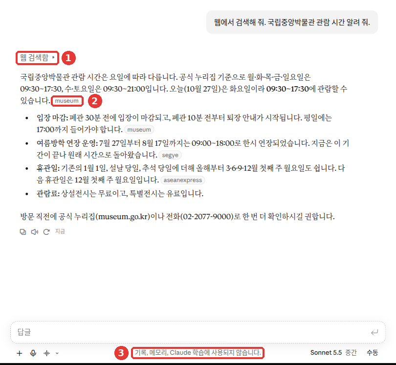
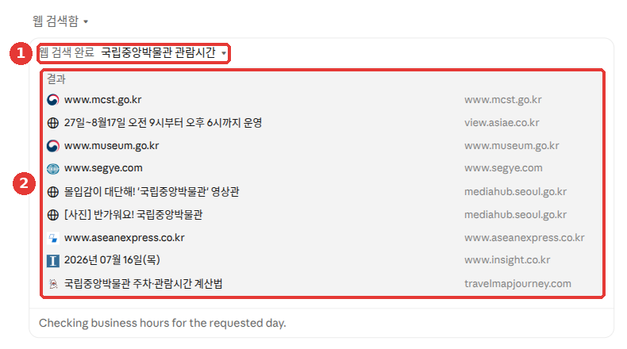
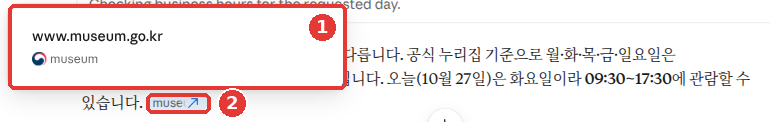
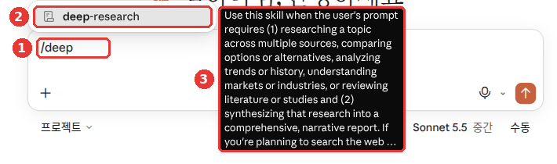

# 6장. 검색과 리서치 — 최신 정보를 출처와 함께 받기

> **한 줄 요약**: 오늘 일어난 일이나 자주 바뀌는 정보는 **웹 검색**으로, 여러 자료를 모아 비교해야 하는 큰 질문은
> **리서치**로 맡깁니다. 어느 쪽이든 붙어 온 출처를 직접 열어 보는 것까지가 한 세트입니다.

화면은 2026년 10월 웹 기준입니다. 지금은 새 Claude 화면이 차례로 배포되고 있어서, 메뉴 이름과 위치가 화면에 따라 다를 수 있습니다.

## 웹 검색 — Claude가 인터넷을 찾아보게 하기

AI는 배운 시점까지의 내용만 알고 있습니다([1단계 1장](../00-common/01-what-is-llm.md)의 "지식 컷오프").
그래서 "이번 주 날씨", "어제 발표된 정책"처럼 최근 일은 그냥 물으면 틀리기 쉽습니다.
**웹 검색**(web search)은 Claude가 인터넷에서 최신 정보를 찾아 답하게 하는 기능입니다.[^search]
무료 요금제에서도 쓸 수 있습니다.[^pricing]

따로 켤 것은 없습니다. 새 화면에는 웹 검색 스위치가 없고, 도움이 될 때 Claude가 알아서 검색합니다.[^search][^new] 무료 계정의 「+」 메뉴에도 「웹 검색」은 없었습니다.[^screen]

::: details 옛 화면을 쓰고 있다면 (눌러서 펼치기)
옛 화면에서는 입력창 왼쪽 아래 「+」를 누르고 「웹 검색」을 고릅니다. 켜지면 옆에 체크 표시가 생깁니다. 다시 누르면 꺼집니다.[^search]

<!-- 스크린샷 필요: 옛 화면 입력창 「+」 메뉴에서 「웹 검색」에 체크 표시가 된 모습 -->
:::

검색을 꼭 하게 하고 싶다면 프롬프트에 "웹에서 검색해 줘"라고 적어 보세요.[^search]

```
웹에서 검색해 줘. 이번 주말 서울 날씨를 토요일과 일요일로 나눠서 알려 주고,
참고한 사이트도 함께 보여 줘.
```

사진이 필요한 질문에는 검색으로 찾은 **이미지**를 답 옆에 보여 주기도 합니다. 따로 켤 설정은 없습니다.[^search]

> 여기서 말하는 검색은 **인터넷 검색**입니다. 내 지난 대화를 찾는 것은 다른 기능입니다. [3장](03-chats.md)과 [5장](05-memory.md#지난-대화-참고하기)을 보세요.

<Quiz id="ch206-web-search" />

## 링크를 주고 읽게 하기

읽어 줬으면 하는 웹 페이지가 있다면 **주소**(URL, 웹 페이지마다 붙은 인터넷 주소)를 붙여 넣으세요.
웹 검색이 켜져 있으면 Claude가 그 페이지 내용을 직접 읽어 옵니다. 이것을 **웹 가져오기**(web fetch)라고 부릅니다.[^fetch]

```
아래 기사를 읽고, 우리 가게 같은 작은 식당에 해당하는 내용만 세 줄로 정리해 줘.
https://www.example.com/news/12345
```

긴 글을 통째로 요약시키면 **사용량을 많이 씁니다.**[^fetch]
무료 요금제는 사용 한도가 5시간마다 다시 채워지는데, 검색과 가져오기도 이 한도에 포함됩니다.[^fetch]
그러니 전체 분석이 필요한지, 핵심만 알면 되는지 먼저 생각해 보세요. 사용 한도는 [1장](01-getting-started.md)에서 다룹니다.

<Quiz id="ch206-fetch" />

## 출처 확인하는 습관

웹 검색으로 받은 답에는 **인용**(citation, 어디서 가져왔는지 붙인 표시)이 붙습니다.
모든 검색 답에 인용이 있어서, 출처를 내가 직접 확인할 수 있습니다.[^search]



시크릿 모드에서 찍은 화면입니다(무료 요금제). **빨간 번호는 아래 목록의 번호와 같은 곳입니다.**

- ① **「웹 검색함」** — Claude가 인터넷을 찾아봤다는 표시입니다. 누르면 무엇을 찾았는지 펼쳐집니다.
- ② **출처 표시** — 문장 끝의 작은 이름표(「museum」, 「segye」 등)가 그 문장을 가져온 사이트입니다.
- ③ 시크릿 모드라서 이 대화가 기록·메모리·학습에 쓰이지 않는다는 안내입니다.[^screen]

①을 누르고 한 번 더 펼치면, Claude가 쓴 검색어와 검색 결과로 나온 사이트 목록이 보입니다.



- ① Claude가 실제로 쓴 검색어입니다. 내 질문을 짧게 줄여 검색했습니다.
- ② 검색 결과로 나온 사이트 9곳의 목록입니다. 정부 사이트(mcst.go.kr, museum.go.kr)와 뉴스 기사, 개인 사이트가 섞여 있습니다.[^screen]

답을 읽기 전에 이 목록을 훑어보세요. 공식 사이트가 들어 있는지 먼저 가늠할 수 있습니다.

② 출처 표시에 마우스를 올리면 화살표가 붙고, ① 사이트 주소가 적힌 작은 창이 뜹니다. 표시를 누르면 원래 페이지가 새 탭으로 열립니다.[^screen]



그런데 링크가 붙어 있다는 것만으로 맞는 답이 되지는 않습니다.
[1단계 9장](../00-common/09-safety.md#확인하는-네-가지-습관)에서 배운 대로, 숫자·날짜·이름은 링크를 열어 원문과 맞춰 보세요.
링크를 열었다면 스스로 물어보세요.

- **링크가 열리나?** 출처를 눌러 실제 페이지가 나오는지 본다.
- **원문에 그 말이 있나?** 답의 숫자와 문장이 페이지에 그대로 있는지 찾는다.
- **언제 쓴 글인가?** 오래된 정보가 아닌지 작성일을 본다.
- **누가 쓴 글인가?** 공식 기관·회사 페이지인지, 개인 블로그인지 본다.

출처가 마음에 들지 않으면 이렇게 다시 부탁해 보세요.

```
방금 답에서 개인 블로그 출처는 빼고, 정부나 공공기관 사이트만 참고해서 다시 알려 줘.
내용마다 어느 페이지에서 가져왔는지 붙여 줘.
```

"근처 맛집"처럼 지역이 중요한 질문에는 **IP 주소**(인터넷에 연결된 기기마다 붙는 번호)로 짐작한 위치를 쓸 수 있습니다.[^search] 엉뚱한 지역 결과가 나오면 동네 이름을 직접 적어 주세요.

<Quiz id="ch206-citations" />

## 리서치 — 보고서를 맡기기

**리서치**(Research)는 질문 하나를 깊이 파고드는 기능입니다.
검색을 여러 번 이어서 하고, 찾은 내용을 보고 다음에 무엇을 볼지 스스로 정합니다.[^research]
유료 요금제(Pro·Max·Team·Enterprise)에서 웹·데스크톱·휴대폰 앱으로 쓸 수 있습니다.[^research]

### 시작하는 법

입력창에 `/deep-research` 라고 치거나, 입력창 아래 「+」 → 「Research」를 고릅니다.[^new]

::: details 옛 화면을 쓰고 있다면 (눌러서 펼치기)
옛 화면에서는 입력창 왼쪽 아래 「+」 → 「Research」를 누릅니다. 입력창 아래에 파란 표시가 생기면 켜진 것입니다.[^research] 리서치는 **웹 검색이 켜져 있어야** 동작합니다.[^research]

<!-- 스크린샷 필요: 「+」 → 「Research」를 켠 뒤 입력창 아래에 생긴 파란 표시 -->
:::

한국어 화면에서도 「Research」가 영어 그대로 보일 수 있습니다.



무료 요금제 화면입니다. ① 입력창에 `/deep` 까지만 쳐도 ② 「deep-research」가 목록에 뜹니다. ③ 옆에는 언제 쓰는 기능인지 영어 설명이 나옵니다.[^screen]
무료 계정의 「+」 메뉴에는 「Research」가 없었습니다. 목록에 이름은 보였지만, 도움말은 리서치를 유료 요금제 기능이라고 합니다.[^research] 이 가이드는 무료 계정에서 리서치를 보내 보지 않았습니다.

질문은 자세할수록 좋습니다. [1단계 4장](../00-common/04-prompt-basics.md#좋은-프롬프트의-5요소)의 다섯 요소를 그대로 넣어 보세요.

```
동네 반찬가게가 쓸 수 있는 배달 앱 수수료를 비교하는 보고서를 써 줘.
- 대상: 가게 1곳을 운영하는 사장
- 비교할 것: 중개 수수료, 결제 수수료, 광고비
- 형식: 맨 앞에 한 줄 결론, 그다음 비교 표, 마지막에 출처 목록
- 2026년 자료를 우선하고, 날짜를 모르는 자료는 따로 표시해 줘
```

::: details 받는 답은 대략 이렇게 (예시 — 눌러서 펼치기)
이 가이드가 만든 예시입니다. 실제 답은 서비스와 그때그때에 따라 다릅니다.

> **한 줄 결론**: 가게 1곳을 운영하는 사장이라면, 세 가지 비용을 더했을 때 가장 적은 앱 ○가 유리합니다.
>
> | 앱 | 중개 수수료 | 결제 수수료 | 광고비 | 자료 날짜 |
> |---|---|---|---|---|
> | 앱 A | ○% | ○% | 월 ○○원부터 | 2026년 ○월 |
> | 앱 B | ○% | ○% | ○○ | 날짜 모름 |
>
> **출처**
> 1. (출처 링크) — 2026년 ○월 ○일
> 2. (출처 링크) — 날짜를 알 수 없음

**잘 받았는지 확인해 보세요**: 한 줄 결론 → 비교 표 → 출처 목록 순서로 왔나? 중개 수수료·결제 수수료·광고비가 표에 다 들어갔나? 2026년 자료를 우선했고, 날짜를 모르는 자료는 따로 표시됐나? 수수료처럼 중요한 숫자는 출처 링크를 눌러 직접 확인해 보세요.

:::

리서치는 몇 분씩 걸릴 수 있습니다.[^academy-research] 그래서 보내기 전에 질문을 다듬는 시간이 아깝지 않습니다. 무엇을 물어야 할지 막막하면, 리서치를 켜기 전에 먼저 일반 대화에서 이렇게 물어보세요.[^academy-research]

```
우리 동네에 작은 반찬가게를 열까 고민 중이야. 이걸 리서치로 조사하려는데, 어떤 질문으로 맡기면 좋을지 같이 다듬어 줘. 예산·지역·기간처럼 내가 정해 줘야 할 조건도 물어봐 줘.
```

예산, 지역, 기간 같은 조건을 넣어 보세요.[^academy-research] 조건이 있으면 리서치가 내 상황에 맞는 자료를 찾기 쉬워집니다.

### 알아 둘 점

- **사용량이 빨리 닳을 수 있습니다.** 한도는 일반 대화와 같습니다. 다만 여러 출처를 모아 긴 답을 만들어서 더 빨리 쓰게 됩니다.[^research]
- **리서치를 안 하는 것 같으면** "리서치 도구를 써서 ~해 줘"라고 직접 말하세요.[^research]
- **연결한 앱도 씁니다.** 커넥터(Claude에 연결한 다른 앱, [7장](07-projects-tools.md))를 켜 두었다면 리서치 중에는 매번 묻지 않고 그 도구를 씁니다.[^research]
- **휴대폰에서 시작하면 웹만 찾습니다.** 커넥터를 건너뛰어도 따로 알려 주지 않습니다. 연결한 앱의 자료까지 필요하면 웹이나 데스크톱에서 시작하세요.[^research]
- **모델은 정해져 있습니다.** 내가 고른 모델과 상관없이 리서치용으로 정해진 모델이 돌아갑니다.[^research]

보고서가 길고 그럴듯할수록 확인을 건너뛰기 쉽습니다. 결론에 쓰인 숫자부터 출처를 열어 맞춰 보세요.

<Quiz id="ch206-research" />

## 언제 무엇을 쓸까

어느 기능을 쓸지 헷갈리면, 질문을 보내기 전에 스스로 물어보세요. "답이 한두 번 찾아보면 나오나? 여러 자료를 모아야 하나? 최신 정보가 필요하긴 한가?"

**확장 사고**(extended thinking)는 답하기 전에 더 오래 생각하게 하는 기능입니다. 켜는 곳은 [2장](02-screen-tour.md)에서 다룹니다.

이렇게 나눠 고르면 됩니다.[^when]

| 이럴 때 | 고를 것 | 예 |
|---|---|---|
| 검색 한두 번이면 답이 나온다 | 웹 검색 | 날씨, 뉴스, 어젯밤 경기 결과 |
| 최신 정보 없이 깊이 따져야 한다 | 확장 사고 | 수학 문제, 여러 관점의 분석 |
| 여러 자료를 모아 보고서가 필요하다 | 리서치 | 경쟁 가게 비교 |

리서치는 1~3분 동안 도구를 다섯 번 이상 쓰는 폭넓은 조사에 맞습니다.[^when]

확장 사고와 리서치를 **함께** 켜면, Claude가 계획을 세운 뒤 폭넓게 모아서 더 긴 보고서를 냅니다.[^when]

<Quiz id="ch206-when" />

## 직접 해 보기

1. 새 채팅에서 "웹에서 검색해 줘. 우리 동네 이번 달 문화 행사 알려 줘"라고 묻는다. 동네 이름은 직접 적는다.
2. 답에 붙은 출처 두 개를 직접 열어, 행사 날짜가 원문과 같은지 확인한다.
3. 최근에 읽은 기사 주소를 붙여 넣고 세 줄 요약을 부탁한다.
4. 유료 요금제라면 위의 배달 앱 수수료 예시를 내 일에 맞게 바꿔 리서치로 보낸다. 받은 보고서의 결론에 쓰인 숫자 하나를 골라 출처에서 찾아본다.

**이어지는 과제** ([독서 모임 준비하기](../00-common/practice-kit.md)): "웹에서 검색해 줘. 우리 동네 구립도서관 세미나실 대관 방법 알려 줘"라고 묻는다. 동네 이름은 직접 넣는다. 운영 시간과 신청 방법은 출처를 열어 직접 확인한다.

## 정리

- 최신 정보는 웹 검색으로 묻는다. 무료 요금제도 된다.
- 새 화면에서는 Claude가 알아서 검색한다(옛 화면은 「+」 → 「웹 검색」). 꼭 검색시키려면 "웹에서 검색해 줘"라고 쓴다.
- 주소를 붙여 넣으면 그 페이지를 읽어 온다. 긴 글은 사용량을 많이 쓴다.
- 인용이 붙어도 틀릴 수 있다. 링크를 열어 원문과 맞춰 본다.
- 큰 질문은 리서치(유료)로 맡긴다. `/deep-research` 나 「+」 → 「Research」로 시작한다.
- 간단한 사실은 웹 검색, 깊이 따질 일은 확장 사고, 여러 자료를 모을 일은 리서치.

## 용어 정리

| 용어 | 읽는 법 | 한 줄 뜻 |
|---|---|---|
| Web Search | 웹 서치 (웹 검색) | Claude가 인터넷에서 최신 정보를 찾아 답하는 기능 |
| Web Fetch | 웹 페치 (웹 가져오기) | 붙여 넣은 주소의 페이지 내용을 읽어 오는 기능 |
| Citation | 사이테이션 (인용) | 답의 내용을 어디서 가져왔는지 붙인 표시 |
| URL | 유알엘 (주소) | 웹 페이지마다 붙은 인터넷 주소 |
| IP Address | 아이피 주소 | 인터넷에 연결된 기기마다 붙는 번호. 대략적인 위치를 알 수 있다 |
| Research | 리서치 | 검색을 여러 번 이어 하며 보고서로 정리하는 기능 |
| Extended Thinking | 익스텐디드 싱킹 (확장 사고) | 답하기 전에 더 오래 생각하게 하는 기능 |

<ChapterDone :chapter="206" />

다음 장: [7장. 프로젝트·커넥터·스킬](07-projects-tools.md)

[^search]: Anthropic 도움말, 「Enable and use web search」. "You can have Claude search the internet to provide you with up-to-date information and insights when using the following models:" / "A checkmark will appear next to “Web search” when it’s enabled." / "Note: If you have the new Claude experience, there's no web search toggle. Claude searches the web when it helps." / "If you want to ensure that Claude uses web search, include "Search the web" or "Use web search" in your prompt to Claude." / "Claude selects images from web search results, powered by Bing, and displays them alongside its text response." / "Every response includes citations, so you can easily verify sources yourself." / "Claude may use your location (inferred from your IP address) when responding to a request for localized results." https://support.claude.com/en/articles/10684626 (확인일 2026-10-26)
[^fetch]: Anthropic 도움말, 「Enable and use web search」. "When “Web search” is toggled on, Claude can also retrieve content directly from web pages when provided with specific URLs." / "This can consume a significant portion of your usage limit, especially for lengthy content." / "As a free user, you have usage limits that reset every five hours." https://support.claude.com/en/articles/10684626 (확인일 2026-10-26)
[^pricing]: Anthropic 요금 페이지, Free 요금제 설명. "Search the web, create files, and run code" https://claude.com/pricing (확인일 2026-10-26)
[^new]: Anthropic 도움말, 「Claude Cowork and chat are one Claude」. "Web search: There's no web search toggle. Claude searches the web when it helps." / "Research: Type /deep-research, or click the “+” button below the chat input, then choose “Research.”" https://support.claude.com/en/articles/16761823 (확인일 2026-10-26)
[^screen]: Claude 웹 화면(무료 요금제, 한국어)에서 직접 확인. 입력창 「+」 메뉴(「웹 검색」·「Research」 없음), 시크릿 모드에서 물은 답의 "웹 검색함" 표시와 출처 표시, 출처를 눌렀을 때 새 탭으로 열린 www.museum.go.kr, 입력창의 `/deep` 목록에 뜬 "deep-research". (확인일 2026-10-27)
[^research]: Anthropic 도움말, 「Use research on Claude」. "It runs multiple searches that build on each other and decides what to look into next based on what it finds." / "Research is available for users with paid Claude plans (Pro, Max, Team, or Enterprise) using Claude on the web, Claude Desktop, or Claude Mobile." / "Important: You must have web search turned on for research to function." / "Click the “+” button on the bottom left of your chat interface, then "Research." A blue indicator will appear on the bottom of the chat window." / "However, research sessions can use up your limits faster due to Claude retrieving multiple sources and providing comprehensive responses." / "In this case, you can steer and prompt Claude to use Research by saying “Claude, please use the research tool to…”" / "During research, Claude can use tools from your connectors automatically, without asking for approval each time." / "When you start research in Claude Mobile, Claude only searches the web and doesn’t use your connectors." / "Research runs on Claude Opus 5.5 and falls back to Claude Opus 4.8 when needed." https://support.claude.com/en/articles/11088861 (확인일 2026-10-26)
[^when]: Anthropic 도움말, 「When should I use web search, extended thinking, and research?」. "Web search is best for straightforward, factual queries that can be answered with one or two tool calls" / "Extended thinking shines when tackling complex reasoning tasks that don't require recent info from the web" / "Research is optimal for comprehensive information gathering requiring five or more tool calls over 1-3 minutes" / "Combining extended thinking with research allows Claude to both plan its approach thoughtfully and execute comprehensive information gathering" / "The research feature can synthesize information across multiple sources with proper citations and produces a longer final report." https://support.claude.com/en/articles/11095361 (확인일 2026-10-26)
[^academy-research]: Claude Academy 「Claude 101」 강의 「Research for deep dives」. "Include relevant constraints." / "a few minutes or more, depending on the question." / "If you're not sure how to frame your research question, you can even ask Claude to help you write a better Research prompt before enabling the feature." https://academy.claude.com/courses/claude-101/research-mode-for-deep-dives (확인일 2026-10-26)
