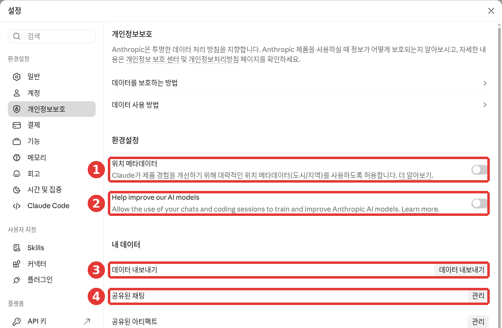
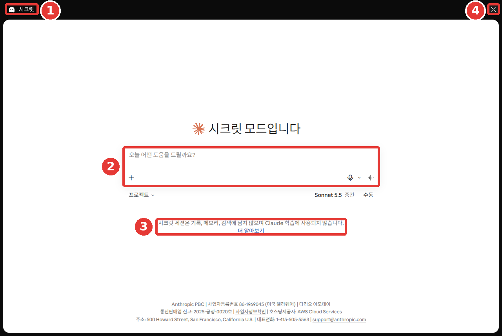

# 9장. 개인정보와 안전 — 내 대화가 어디까지 가는지 알기

> **한 줄 요약**: Claude에 보낸 대화가 AI 학습에 쓰일지는 「Help improve our AI models」 스위치 하나로 정합니다.
> 지운 대화는 30일 안에 서버에서도 지워집니다. 내보내기·계정 삭제·신고·위기 지원이 어디 있는지도 이 장에서 함께 봅니다.

화면은 2026년 10월 웹 기준입니다. 설정 화면이 새 화면과 옛 화면 두 가지로 쓰이고 있어서, 메뉴 이름과 위치는 화면에 따라 다를 수 있습니다.

**무엇을 넣지 말아야 하는지**는 어느 AI에나 똑같습니다. [1단계 9장 「넣지 말아야 할 것」](../00-common/09-safety.md#넣지-말아야-할-것)에서 이미 다뤘습니다. 이 장에서는 **이미 넣은 대화를 Claude에서 어떻게 다루는지**만 봅니다.

## 학습에 쓰일지 정하기 — 「Help improve our AI models」

**모델 학습**(model training)은 AI 회사가 사람들의 대화를 모아 다음 AI를 더 좋게 가르치는 일입니다. Claude에서는 내 대화가 학습에 쓰이는 경우가 크게 세 가지입니다.[^training-use]

- 내가 학습에 쓰도록 **허용했을 때**
- 대화가 **안전 검토** 대상으로 표시됐을 때
- 답 아래 **좋아요/싫어요** 같은 피드백을 보냈을 때[^training-personal]

첫 번째는 내가 직접 정할 수 있습니다. 이 스위치가 처음에 켜져 있는지 꺼져 있는지는 문서에서 확인하지 못했습니다. 그러니 직접 열어서 확인해 보세요.

### 스위치 찾는 법

1. 왼쪽 아래 내 이름을 누르고 「설정」을 엽니다.
2. 왼쪽 메뉴에서 「개인정보보호」를 누릅니다.[^screen]
3. ② 「Help improve our AI models」 스위치를 켜거나 끕니다. 한국어 화면인데도 이 줄은 영어로 나옵니다.[^screen][^improve-name]



무료 요금제 화면입니다. **빨간 번호는 아래 목록의 번호와 같은 곳입니다.**

- ① **「위치 메타데이터」**: 대략적인 위치(도시·지역)를 쓰게 할지 정합니다. 아래 「위치는 어떻게 쓰나」에서 봅니다.[^screen]
- ② **「Help improve our AI models」**: 내 대화를 학습에 쓰게 할지 정합니다.[^screen]
- ③ **「데이터 내보내기」**: 내 기록을 파일로 받습니다. 아래 「내 데이터 내려받기」에서 봅니다.[^screen]
- ④ **「공유된 채팅」 → 「관리」**: 내가 링크로 공유한 대화를 봅니다([3장](03-chats.md)).[^screen]

그 아래에도 「공유된 아티팩트」, 「업로드한 파일」, 「내 피드백」, 「메모리 설정」이 있고, 각각 「관리」 버튼이 있습니다.[^screen]

휴대폰 앱도 순서가 같습니다. 이름 → 「설정」 → 개인정보 보호 → 같은 스위치입니다. 앱의 메뉴 이름은 웹과 조금 다를 수 있습니다.[^toggle]

### 끄면 무엇이 달라지나

- **새 대화**는 앞으로 학습에 쓰이지 않습니다.
- **예전에 저장된 대화**도 앞으로의 학습에서 빠집니다.
- 다만 **이미 시작된 학습과 이미 만들어진 모델**에는 그대로 남습니다.
- 안전 장치에 걸린 대화는 스위치를 꺼도 안전 관련 개선에 쓰일 수 있습니다.[^toggle]

### 켜 두면 무엇이 쓰이나

학습에 쓰일 수 있는 것은 대화 전체입니다. 대화에 올린 파일과 대화 설정도 함께 들어갑니다. 반면 커넥터([7장](07-projects-tools.md))로 연결한 Google Drive 같은 곳의 **원본 자료는 들어가지 않습니다.** 하지만 그 내용을 대화창에 직접 붙여 넣었다면 들어갈 수 있습니다.[^training-use]

학습에 쓰기 전에는 이메일 같은 내 계정 정보와 대화를 자동으로 떼어 놓습니다.[^training-personal] Anthropic은 데이터를 팔지 않고, Claude에는 광고가 없다고 밝힙니다.[^policy]

### 처음부터 남기기 싫은 대화라면

**시크릿 채팅**(Incognito)을 쓰세요. 첫 화면 오른쪽 위 유령 모양 버튼으로 엽니다. 시작하는 법은 [3장](03-chats.md)에 있습니다.



무료 요금제 화면입니다. ③ 안내 문구는 "시크릿 세션은 기록, 메모리, 검색에 남지 않으며 Claude 학습에 사용되지 않습니다."입니다.[^screen] 스위치를 켜 두었더라도 시크릿 채팅은 학습에 쓰이지 않습니다.[^training-use] 다만 기록에는 안 남아도 기본 30일 동안은 보관됩니다.[^incognito] 끝내려면 ④ ✕를 누르세요.

**좋아요/싫어요는 가볍게 누르지 마세요.** 피드백을 보내면 그 대화 전체가 최대 5년 동안 저장됩니다. 학습에 쓰일 수도 있습니다.[^feedback] 민감한 이야기를 나눈 대화라면 피드백 대신 다른 방법을 고르는 편이 낫습니다.

<Quiz id="ch209-training" />

## 얼마나 오래 남나 — 보관 기간

대화가 남는 기간은 상황마다 다릅니다.[^retention]

| 상황 | 남는 기간 |
|---|---|
| 내가 지운 대화 | 기록에서는 바로, 서버에서는 30일 안에 지워짐 |
| 학습을 허용한 대화 | 이름표를 뗀 형태로 최대 5년 |
| 좋아요/싫어요를 보낸 대화 | 최대 5년 |
| 이용 규칙 위반으로 표시된 대화 | 대화 내용 최대 2년, 안전 점수 최대 7년 |

표를 읽을 때 알아 둘 점이 세 가지 있습니다.

- 5년 보관은 스위치를 **켠 뒤에** 새로 시작했거나 다시 이어 간 대화에만 해당합니다.
- 지운 대화는 앞으로의 학습에 쓰이지 않습니다.
- 법으로 정해진 경우나 분쟁 해결이 필요할 때는 더 오래 남을 수 있습니다.[^retention]

남기고 싶지 않은 대화는 지우세요. 지운 대화는 앞으로의 학습에 쓰이지 않습니다. 다만 그 대화에서 생긴 메모리는 남으니 [5장](05-memory.md)에서 따로 지우세요.[^memory] 대화를 지우는 법은 [3장](03-chats.md)에서 봤습니다.

<Quiz id="ch209-retention" />

## 누가 내 대화를 보나

기본적으로 **Anthropic 직원은 내 대화를 볼 수 없습니다.** 예외는 두 가지입니다. 내가 피드백으로 대화를 보냈을 때, 그리고 이용 규칙을 지키는지 검토해야 할 때입니다. 검토할 때도 지정된 안전팀 일부만 필요한 만큼 봅니다. 데이터는 오가는 중에도, 저장된 뒤에도 자동으로 암호화(남이 읽지 못하게 바꿔 두는 것)됩니다.[^protect]

학습을 허용한 대화도 학습 일을 맡은 소수만 볼 수 있습니다. 그래도 주민등록번호·카드 번호·건강 기록·비밀번호 같은 아주 민감한 정보는 신중하게 넣으세요.[^sensitive]

### 위치는 어떻게 쓰나

"근처 맛집"처럼 웹 검색으로 가까운 결과를 찾을 때, Claude는 인터넷 접속 주소(IP 주소)로 도시·지역 정도의 대략적인 위치를 쓸 수 있습니다. 이 화면에서는 「개인정보보호」의 ① 「위치 메타데이터」 스위치가 이 일을 정합니다.[^screen] 휴대폰 앱에서는 휴대폰 설정에서 위치 권한을 관리합니다. 다만 보안과 악용을 막기 위해 나라·지역 정도를 짐작하는 것은 끌 수 없습니다.[^location]

### 모르는 기기가 보이면

「설정」 → 「계정」의 「활성 세션」(화면에 따라 「로그인된 위치」)에서 내 계정에 로그인한 기기를 볼 수 있습니다. 표에 기기·위치·생성됨·업데이트됨이 나옵니다.[^screen] 모르는 기기가 보이면 옆의 「⋮」 → 「종료」로 바로 끊으세요.[^sessions]


무료 요금제 화면입니다. 「활성 세션」 표는 그림 아래쪽에 있어 그림에는 나오지 않습니다.[^screen] 어느 기기인지 모르겠다면 ③ **「모든 기기에서 로그아웃」**으로 한꺼번에 끊을 수도 있습니다.[^screen] ① 이름과 ② 지침은 [5장](05-memory.md)에서 봅니다. Claude에는 전용 비밀번호가 없으니([1장](01-getting-started.md)), 로그인에 쓰는 이메일이나 Google 계정의 보안을 점검하세요. 자세한 방법은 [3장](03-chats.md)에 있습니다.

<Quiz id="ch209-access" />

## 내 데이터 내려받기

**데이터 내보내기**(export)는 지금까지의 대화 기록과 계정 정보를 파일로 받는 기능입니다. 계정을 지우기 전에 백업용으로 씁니다. Free·Pro·Max 개인 사용자 모두 쓸 수 있습니다.[^export]

1. 웹이나 컴퓨터 앱에서 「설정」 → 「개인정보보호」를 엽니다.[^screen]
2. 위 그림의 ③ 「데이터 내보내기」 버튼을 누릅니다.
3. 준비가 끝나면 계정 이메일로 내려받기 링크가 옵니다.
4. 로그인한 상태에서 링크를 눌러 받습니다.

알아 둘 점이 있습니다.

- **휴대폰 앱에서는 내보내기를 할 수 없습니다.** 웹이나 컴퓨터 앱을 쓰세요.
- 링크는 받은 뒤 **24시간이 지나면 만료**됩니다. 놓쳤다면 다시 신청하면 됩니다.
- 내보낸 데이터를 **다른 개인 계정으로 가져올 수는 없습니다.**[^export]

> 내려받은 파일에는 내 대화가 모두 들어 있습니다. 공용 컴퓨터에 받지 말고, 남과 같이 쓰는 폴더에 올리지 마세요.

회사 요금제(Team·Enterprise)는 관리자가 허용해야 본인 데이터를 내보낼 수 있습니다.[^export]

<Quiz id="ch209-export" />

## 계정 삭제

계정 삭제는 **영구적**입니다. 대화·프로젝트·저장한 자료에 다시 들어갈 수 없고, 계정을 되살릴 수도 없습니다. 남기고 싶은 대화가 있다면 먼저 내보내기를 해 두세요.[^delete]

**Pro·Max를 쓰고 있다면 구독 취소가 먼저입니다.** 구독을 취소하고, 지금 결제한 기간이 끝날 때까지 기다린 뒤 지웁니다.[^delete] 구독 취소는 [1장](01-getting-started.md)에서 봤습니다.

기기별로 지우는 순서는 이렇습니다.[^delete]

- **웹**: 왼쪽 아래 이름 → 「설정」 → 「계정」 → 위 그림의 ④ 「계정 삭제」[^screen]
- **아이폰**: 「설정」 → 계정 항목의 「프로필」 → 「계정 삭제」 → 「삭제」
- **안드로이드**: 왼쪽 위 메뉴 → 왼쪽 아래 이니셜 → 「프로필」 → 「계정 작업」의 「계정 삭제」 → 「동의합니다」(I Understand)

같은 이메일로 만든 계정이 여러 개라면, 지원팀에 연락할 때 어느 계정을 지울지 정확히 알려야 합니다.[^delete] Claude를 Slack 같은 다른 서비스 안에서 써 왔다면, 그 서비스에 삭제를 요청해야 합니다.[^third-party]

<Quiz id="ch209-delete" />

## AI가 틀릴 때 — 틀린 답과 가짜 "보냈어요"

Claude도 그럴듯하지만 틀린 답을 할 수 있습니다. 이것을 **환각**(hallucination)이라고 부릅니다. 확인하는 습관은 [1단계 9장](../00-common/09-safety.md#_1-그럴듯한-거짓말-—-환각-확인하기)에서 배웠습니다. Claude에서 특히 알아 둘 점은 세 가지입니다.[^wrong]

- 권위 있어 보이는 인용문도 **근거 없이 지어낸 것**일 수 있습니다.
- Claude를 **하나뿐인 정답 출처로 믿지 마세요.** 중요한 조언일수록 꼼꼼히 확인합니다.
- 웹 검색으로 받은 답은 **Claude가 단 출처를 직접 열어** 보세요([6장](06-search.md)).

### "이메일 보냈어요"라는 말

Claude가 "이메일을 보냈어요", "파일을 전송했어요"라고 말해도 실제로는 하지 않았을 수 있습니다. 연결하지 않은 도구는 Claude가 쓸 수 없습니다. 그런데도 했다고 말할 때가 있습니다.[^fake]

그래서 이렇게 스스로 물어보세요. 이 일을 할 도구를 내가 연결했나? 내 보낸편지함에 정말 있나? 확인할 수 없다면 처음부터 초안만 부탁하는 편이 안전합니다.

```
내일 회의가 오후 3시로 바뀌었다고 팀원들에게 알리는 이메일을 써 줘.
보내지는 말고, 내가 복사해서 보낼 수 있게 제목과 본문만 보여 줘.
```

이렇게 하면 무엇을 보낼지 내가 마지막에 확인할 수 있습니다.

<Quiz id="ch209-mistakes" />

## 안전 장치·신고·이의 제기

Claude에는 해로운 내용을 걸러 내는 장치가 있습니다. 해로운 내용을 찾아내는 모델, 답을 막을 수 있는 필터가 있고, 규칙을 거듭 어긴 사람에게는 잠시 더 강한 필터를 겁니다. 도움말은 이 장치가 **완벽하지 않다**고 스스로 밝힙니다. 멀쩡한 질문을 막거나, 막아야 할 것을 놓칠 수 있다는 뜻입니다.[^safety]

### 경고를 받거나 계정이 정지됐을 때

입력이 이용 규칙을 어긴다고 보이면 경고가 옵니다. 규칙을 거듭 어기거나, 지원하지 않는 지역에서 가입하면 계정이 정지될 수 있습니다.[^appeal]

잘못 정지됐다고 생각하면 이의를 제기할 수 있습니다.

1. 정지된 계정 그대로 claude.ai 에 로그인합니다. **로그인해야 양식이 보입니다.**
2. 도움말 문서에서 양식을 여는 「이의 제기 제출」(Submit an appeal) 링크를 눌러 이의 제기 양식을 씁니다.

정지된 Free·Pro·Max 계정도 로그인해서 데이터를 내보내거나 계정을 지울 수 있습니다. 다만 내보낼 수 있는 범위는 줄어들 수 있습니다.[^appeal]

### 문제 있는 내용을 봤을 때

남이 공유한 대화에서 문제 있는 내용을 봤다면, 그 화면의 「신고」 버튼을 누르세요. 따로 마련된 신고 양식도 있습니다. 저작권·상표 문제는 별도 절차를 씁니다. 근거 없는 신고를 자꾸 내면 신고 처리가 중단될 수 있습니다. 그 전에 경고가 먼저 옵니다.[^report]

<Quiz id="ch209-safeguards" />

## 힘들 때 도움 받기

**지금 몸이 다쳤거나 위험한 상황이라면, Claude가 아니라 응급 서비스에 바로 연락하세요.** 가까운 응급실로 가도 됩니다. 도움말은 미국·캐나다의 911, 유럽 많은 나라의 112를 예로 듭니다.[^crisis]

대화가 마음의 고통이나 자해 같은 주제에 닿으면, 화면에 **상담 전화와 안전 계획을 알려 주는 배너**가 뜰 수 있습니다. 이 배너는 Claude가 아니라 별도의 감지 장치가 띄웁니다.[^crisis]

- 배너를 쓸지는 내가 정합니다. 쓰든 안 쓰든 **계정에 불이익은 없습니다.**
- 배너는 한 번 뜨면 약 2시간 동안 다시 뜨지 않습니다.
- 상담 기관은 언제든 **claude.findahelpline.com** 에서 찾을 수 있습니다. 내 위치에 맞는 곳을 골라 보여 줍니다.
- Anthropic은 내 대화를 상담 기관에 **보내지 않습니다.**[^crisis]

배너에는 Koko라는 비영리 단체의 **안전 계획** 도구가 함께 나올 수 있습니다. 힘들 때 꺼내 볼 짧은 계획을 함께 만드는 도구입니다. 약 5분이 걸리고, 무료이며, 이름을 밝히지 않아도 됩니다.[^crisis]

혼자 감당하기 어렵다면 누군가에게 말하는 것부터 시작해도 괜찮습니다.

<Quiz id="ch209-crisis" />

## 직접 해 보기

**1. 내 학습 설정 확인하기**

「설정」 → 「개인정보보호」를 열고 ② 「Help improve our AI models」가 켜져 있는지 봅니다. 원하는 쪽으로 바꾼 뒤, 휴대폰 앱이 있다면 앱에서도 같은 값인지 확인합니다.

**2. 로그인한 기기 둘러보기**

「설정」 → 「계정」을 아래로 내려 「활성 세션」(또는 「로그인된 위치」)을 봅니다. 모두 내가 아는 기기인가? 모르는 곳이 있다면 바로 종료합니다.

**3. Claude에게 내 점검표 받기**

```
나는 Claude를 개인 계정으로 쓰고 있어.
내 대화가 학습에 쓰이는지 확인하고, 필요 없는 대화를 정리하고 싶어.
설정 화면에서 내가 직접 확인해야 할 항목을 점검표(☐)로 만들어 줘.
확실히 모르는 메뉴 이름은 지어내지 말고 "화면에서 확인"이라고 적어 줘.
```

받은 점검표를 이 장과 비교해 보세요. 메뉴 이름이 다르다면 내 화면에 보이는 이름이 맞습니다.

**이어지는 과제** ([독서 모임 준비하기](../00-common/practice-kit.md)): 예시 파일 members.csv를 열어 이름·연락처 같은 개인정보가 들어 있지 않은지 본다. 실제 모임 명단이었다면 무엇을 빼거나 바꿔야 할지 적어 본다.

## 정리

- 학습 사용 여부는 「설정」 → 「개인정보보호」 → 「Help improve our AI models」에서 정한다. 처음 값은 직접 열어 확인한다.
- 꺼도 이미 만들어진 모델에는 남고, 안전 장치에 걸린 대화는 쓰일 수 있다.
- 시크릿 채팅은 학습에 쓰이지 않는다. 좋아요/싫어요를 보내면 그 대화가 최대 5년 남는다.
- 지운 대화는 30일 안에 서버에서도 지워진다. 학습을 허용한 대화는 최대 5년 남을 수 있다.
- 직원은 기본적으로 대화를 못 본다. 모르는 기기는 「활성 세션」에서 끊는다.
- 내보내기는 웹·컴퓨터 앱에서만 되고, 링크는 24시간 뒤 만료된다. 계정 삭제는 되돌릴 수 없고, 유료 구독은 먼저 취소한다.
- "보냈어요"라는 말은 직접 확인한다. 잘못된 정지는 로그인해서 이의를 제기한다.
- 위험한 상황이면 응급 서비스에 먼저 연락한다. 상담 기관은 claude.findahelpline.com 에서 찾는다.

## 용어 정리

| 용어 | 읽는 법 | 한 줄 뜻 |
|---|---|---|
| Model training | 모델 트레이닝 (모델 학습) | 모은 대화로 다음 AI를 가르치는 것 |
| Model improvement | 모델 임프루브먼트 (모델 개선) | 내 대화를 학습에 쓰게 할지 정하는 설정 |
| Incognito | 인코그니토 (시크릿 채팅) | 기록에 남지 않고 학습에도 안 쓰이는 대화 |
| Feedback | 피드백 | 답이 좋았는지 좋아요/싫어요로 알리는 것 |
| Retention | 리텐션 (보관) | 데이터를 지우지 않고 남겨 두는 기간 |
| Encryption | 인크립션 (암호화) | 남이 읽지 못하게 데이터를 바꿔 두는 것 |
| IP address | 아이피 주소 | 인터넷에 접속한 기기의 주소. 대략적인 지역을 알 수 있다 |
| Export | 익스포트 (내보내기) | 내 기록 전체를 파일로 받는 것 |
| Session | 세션 | 한 기기에서 로그인해 있는 상태 |
| Hallucination | 할루시네이션 (환각) | AI가 그럴듯하지만 틀린 말을 지어내는 것 |
| Appeal | 어필 (이의 제기) | 잘못된 정지를 다시 봐 달라고 요청하는 것 |
| Helpline | 헬프라인 (상담 전화) | 힘들 때 훈련받은 사람과 이야기할 수 있는 곳 |

<ChapterDone :chapter="209" />

다음 장: [10장. 음성과 휴대폰](10-voice-mobile.md)

---

[^screen]: Claude 웹 화면(무료 요금제, 한국어)에서 직접 확인. "Help improve our AI models — Allow the use of your chats and coding sessions to train and improve Anthropic AI models." / "시크릿 세션은 기록, 메모리, 검색에 남지 않으며 Claude 학습에 사용되지 않습니다." (확인일 2026-10-26)
[^training-use]: Anthropic 개인정보 센터, 「Is my data used for model training?」. "You choose to allow us to use your chats and coding sessions to improve Claude, learn more here" / "It does not include raw content from connectors (e.g. Google Drive), including remote and local MCP servers, though data may be included if it’s directly copied into your conversation with Claude." / "Your Incognito chats are not used to improve Claude, even if you have enabled Model Improvement in your Privacy Settings." https://privacy.claude.com/en/articles/10023580 (확인일 2026-10-26)
[^training-personal]: Anthropic 개인정보 센터, 「How Do You Use Personal Data in Model Training?」. "You’ve explicitly provided materials to us (e.g.via our thumbs up/down feedback button), or" / "we will automatically de-link them from your user ID (e.g. email address) before it’s used by Anthropic." https://privacy.claude.com/en/articles/10023555 (확인일 2026-10-26)
[^toggle]: Anthropic 개인정보 센터, 「How do I change my model improvement privacy settings?」. "Under Help Improve our AI models, click the button to toggle it off/on" / "we will stop using your previously stored chats and coding sessions in future model training runs." / "Your data will still be included in model training that has already started and in models that have already been trained" / "If our safety classifiers flag your conversations, they may still be used to improve our internal trust and safety models" https://privacy.claude.com/en/articles/12109829 (확인일 2026-10-26)
[^policy]: Anthropic 개인정보 센터, 「Updates to our Privacy Policy」. "We don’t sell your data, Claude remains ad-free, and you can control whether your conversations are used to improve Anthropic’s AI models." https://privacy.claude.com/en/articles/10301952 (확인일 2026-10-26)
[^feedback]: Anthropic 개인정보 센터, 「Is my data used for model training?」. "we will store the entire related conversation, including any content, custom styles or conversation preferences, in our secured back-end for up to 5 years." https://privacy.claude.com/en/articles/10023580 (확인일 2026-10-26)
[^incognito]: Anthropic 도움말, 「Use incognito chats」. "While incognito chats aren't saved to your chat history, they are retained for either 30 days (default), or longer in accordance with your organization's custom data retention setting (available for Enterprise plans)." https://support.claude.com/en/articles/12260368 (확인일 2026-10-26)
[^memory]: Anthropic 도움말, 「Use Claude’s chat search and memory to build on previous context」. "When a conversation is deleted, including under a retention period, memory entries generated from it aren’t removed, but you can delete individual memories while memory is on." https://support.claude.com/en/articles/11817273 (확인일 2026-10-26)
[^retention]: Anthropic 개인정보 센터, 「How long do you store my data?」. "Deleted from our back-end storage systems within 30 days" / "we may retain your data in a de-identified format for up to 5 years in our model training pipelines." / "This retention period only applies to new or resumed chats after the model training setting has been enabled." / "Additionally, if you delete a chat from your chat history, it will not be used to train future models." / "We retain inputs and outputs for up to 2 years and trust and safety classification scores for up to 7 years" / "In all cases, we may retain chats and coding sessions as required by law, to resolve disputes, or as necessary to combat violations of our Usage Policy." https://privacy.claude.com/en/articles/10023548 (확인일 2026-10-26)
[^protect]: Anthropic 개인정보 센터, 「How does Anthropic protect the personal data of Claude users?」. "Limited Access: By default, Anthropic employees cannot access your conversations unless:" / "Encryption: Your data is automatically encrypted both while in transit, and stored (at rest)." https://privacy.claude.com/en/articles/10458704 (확인일 2026-10-26)
[^sensitive]: Anthropic 도움말, 「I would like to input sensitive data into my chats with Claude. Who can view my conversations?」. "Access is limited to a small number of personnel involved in model training." / "we also recommend being thoughtful about sharing highly sensitive personal details such as:" https://support.claude.com/en/articles/8325621 (확인일 2026-10-26)
[^location]: Anthropic 개인정보 센터, 「Does Claude use my location?」. "Claude may use your IP address to determine coarse-grained location (city/region level)." / "Claude's access to location data for non-web surfaces (e.g. the mobile app and browser extension) are managed at the device level." / "This use is necessary to protect our users and business and cannot be toggled off." https://privacy.claude.com/en/articles/11186740 (확인일 2026-10-26)
[^sessions]: Anthropic 도움말, 「Managing your active sessions」. "Scroll to the Active sessions section (called Where you're logged in in the updated Settings layout)." / "terminate it right away and consider changing your password." https://support.claude.com/en/articles/13124001 (확인일 2026-10-26)
[^export]: Anthropic 도움말, 「Export your Claude data」. "Data exports are available to individual Claude users on Free, Pro, and Max plans." / "It's not possible to run an export from Claude for iOS or Android." / "You must be signed in to your account to download your data using this link." / "The download link will expire 24 hours after delivery." / "Exported data can't be imported into another personal Claude account, and we don't support migrating data between personal accounts." / "you can export your own data once an organization Owner or Primary Owner turn this on." https://support.claude.com/en/articles/9450526 (확인일 2026-10-26)
[^delete]: Anthropic 도움말, 「Delete your Claude account」. "You'll lose access to your conversations, projects, and other saved data, and you can't recover the account afterward." / "Wait until the end of your current subscription period." / "If you have multiple accounts associated with the same email address, you'll need to specify which accounts you want to delete when you contact us." https://support.claude.com/en/articles/9028421 (확인일 2026-10-26)
[^third-party]: Anthropic 개인정보 센터, 「Deleting Claude accounts」. "you will need to request account deletion through that third party service provider." https://privacy.claude.com/en/articles/10023660 (확인일 2026-10-26)
[^wrong]: Anthropic 도움말, 「Claude is providing incorrect or misleading responses. What’s going on?」. "Claude can display quotes that may look authoritative or sound convincing, but are not grounded in fact." / "Users should not rely on Claude as a singular source of truth and should carefully scrutinize any high-stakes advice given by Claude." / "When working with web search results, users should review Claude's cited sources." https://support.claude.com/en/articles/8525154 (확인일 2026-10-26)
[^fake]: Anthropic 도움말, 「Claude is producing links that don’t work and falsely claiming that it has sent emails or produced external documents. What’s going on?」. "Even if it claims otherwise, Claude does not have access to other tools or software that are not explicitly integrated, including email, word processors, or file transfers." https://support.claude.com/en/articles/8241188 (확인일 2026-10-26)
[^safety]: Anthropic 도움말, 「Our Approach to User Safety」. "We may temporarily apply enhanced safety filters to users who repeatedly violate our policies" / "These features are not failsafe, and we may make mistakes through false positives or false negatives." https://support.claude.com/en/articles/8106465 (확인일 2026-10-26)
[^appeal]: Anthropic 도움말, 「Safeguards warnings and appeals」. "we warn users if we believe their prompts are violating our Usage Policy." / "Account creation from an unsupported location" / "If you feel your account has been wrongly suspended or terminated, please go to claude.ai, log in with your banned account, and fill out the appeal form linked below." / "Important: You must be logged in to access the appeal form." / "you can still log in at claude.ai to export your data or delete your account." https://support.claude.com/en/articles/8241253 (확인일 2026-10-26)
[^report]: Anthropic 도움말, 「Report, block, and remove content from Claude」. "Use the “report” button on the shared content." / "If you believe content violates Anthropic’s usage policies or local laws and should be removed or restricted, you can report it through this form." / "We will provide a warning before suspension." https://support.claude.com/en/articles/10684638 (확인일 2026-10-26)
[^crisis]: Anthropic 도움말, 「Crisis Helpline Support in Claude」. "please contact emergency services (such as 911 in the US and Canada, or 112 in much of Europe) or go to your nearest emergency room." / "This banner is surfaced by a separate detection system, not from Claude directly." / "there are no consequences for your account based on your decision to access resources." / "After you see the banner, it won’t appear again for about two hours" / "The resources shown are selected based on your location to provide relevant, local support options." / "Anthropic doesn’t send your conversations to helplines or to Koko." / "It takes about five minutes. You’re guided one step at a time, and you decide what goes in it." https://support.claude.com/en/articles/13171706 (확인일 2026-10-26)
[^improve-name]: 한국어 도움말에서는 「AI 모델 개선 지원」이라고 부릅니다.
