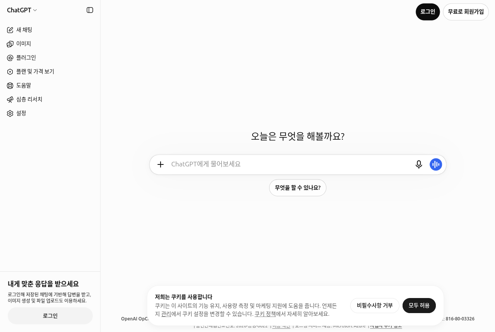

# 1장. 시작하기 — 써 보고, 가입하고, 요금제 고르기

> **한 줄 요약**: ChatGPT는 가입하지 않아도 바로 써 볼 수 있습니다. 대화를 남기고 파일을 올리려면 무료로 가입하고,
> 무료로 부족할 때만 유료 요금제를 생각하면 됩니다.

화면은 2026년 10월 웹(Plus 요금제) 기준입니다. 무료 요금제나 휴대폰 앱은 메뉴 위치가 조금 다를 수 있습니다.

## 로그인 없이 먼저 써 보기

ChatGPT 주소(chatgpt.com)에 들어가면 가입하지 않아도 가운데 입력창 「ChatGPT에게 물어보세요」에 바로 질문할 수 있습니다.
한국은 ChatGPT를 쓸 수 있는 **지원 국가**(서비스를 공식으로 제공하는 나라)에 들어 있습니다.[^countries]



로그인하지 않고 쓸 때는 두 가지 제한이 있습니다.[^home]

- **대화는 한 번에 1개만** 할 수 있습니다.
- **기록이 저장되지 않습니다.** 창을 닫으면 나눈 대화를 다시 찾을 수 없습니다.

그러니 "어떤 느낌인지" 맛보기용으로 쓰고, 계속 쓸 생각이면 가입하는 편이 낫습니다. 처음이라면 이렇게 물어보세요.

```
너는 어떤 일을 도와줄 수 있어? 직장인이 바로 써먹을 수 있는 예를 다섯 가지만 들어 줘.
```

<Quiz id="ch101-logged-out" />

## 가입하고 로그인하기

오른쪽 위 「무료로 회원가입」을 누르면 가입, 「로그인」을 누르면 이미 만든 계정으로 들어갑니다.
들어가는 방법은 두 가지입니다.[^login]

| 방법 | 설명 |
|---|---|
| 이메일과 비밀번호 | 내 이메일 주소로 계정을 만든다 |
| **소셜 로그인**(다른 회사 계정으로 대신 로그인) | Google·Microsoft·Apple 계정으로 들어간다 |

<!-- 스크린샷 필요: 「무료로 회원가입」을 누른 뒤 나오는 가입 방법 선택 화면 (웹) -->

알아 둘 점이 세 가지 있습니다.

1. **이메일이 같으면 한 계정입니다.** 처음에 이메일로 가입했더라도, 같은 주소의 Google 계정으로 로그인하면 같은 계정으로 들어갑니다.[^login]
2. **Apple의 「이메일 가리기」를 조심하세요.** Apple로 가입할 때 진짜 주소를 숨기는 가짜 주소를 골랐다면, 나중에 같은 Apple ID로만 원래 계정에 들어갈 수 있습니다. 진짜 이메일로 로그인하면 **다른 새 계정**이 열립니다.[^login]
3. **개인용은 개인 이메일로 만드세요.** 회사 이메일로 만들면 퇴사할 때 계정에 못 들어갈 수 있습니다.[^home]

<Quiz id="ch101-login" />

## 요금제 한눈에 보기

ChatGPT에는 무료부터 회사용까지 여러 **요금제**(플랜, 돈을 내는 정도에 따라 쓸 수 있는 기능과 양이 다른 이용 방식)가 있습니다.[^pricing]

| 요금제 | 누구에게 | 한국 요금(월) |
|---|---|---|
| Free(무료) | 처음 써 보는 사람, 가끔 쓰는 사람 | ₩0 |
| Go | 무료로는 한도가 자주 부족한 사람 | ₩13,000 |
| Plus | 매일 쓰고, 깊게 생각하는 답이 필요한 사람 | ₩29,000 |
| Pro | 아주 많이 쓰는 사람 (3단계로 나뉨) | ₩159,000부터 |
| Business · Enterprise · Edu | 회사·기관·학교 단위로 쓰는 곳 | 별도 |

가격은 OpenAI 요금 페이지를 한국에서 열었을 때 나온 값이고, **자주 바뀝니다.** 결제하기 전에 [요금 페이지](https://openai.com/chatgpt/pricing)에서 직접 확인하세요.[^pricing]
Business는 예전에 「Team」이라고 부르던 회사용 요금제가 2025년 8월 29일에 이름을 바꾼 것입니다.[^business]

### 요금제마다 무엇이 다른가

숫자보다 **"무엇이 달라지는지"** 를 알아 두면 고르기 쉽습니다.

| 달라지는 것 | 무료(Free) | 유료 |
|---|---|---|
| **광고** | Free·Go에서는 답변 아래에 광고가 나올 수 있다 | Plus 이상은 광고가 없다 |
| **생각 깊이 고르기** | 「생각하기」를 켜서 더 깊이 생각하게 한다 | Plus 이상은 「추론 수준」을 고른다 ([2장](02-screen-tour.md)) |
| **파일 올리기** | 하루 3개까지 ([4장](04-files-images.md)) | 훨씬 많이 올릴 수 있다 |
| **Work**(긴 작업을 맡기는 모드) | 웹·휴대폰에서는 못 쓴다 | 쓸 수 있다 ([7장](07-projects-plugins.md)) |

광고에 대해 공식 안내는 이렇게 말합니다.[^ads] 광고는 **ChatGPT의 답 내용에 영향을 주지 않고**, 광고주는 내 대화를 보지 못합니다.
**임시 채팅**(기록에 남지 않는 대화, [3장](03-chats.md))에는 광고가 나오지 않습니다. 광고는 2026년 2월 미국에서 시험을 시작해 일부 나라로 넓혀 가는 중이고,
한국에서도 나오는지는 공식 안내에서 확인하지 못했습니다.

<Quiz id="ch101-plans" />

## 유료로 바꾸기 전에 알아 둘 것

**무료로 시작해서 한도에 자주 걸릴 때 올리는 것**이 가장 무난합니다. 결제 전에 아래 세 가지는 꼭 알아 두세요.

- **월 결제만 됩니다.** Go·Plus·Pro는 1년치를 한 번에 내는 연간 결제가 없습니다.[^go]
- **앱을 지워도 구독은 계속됩니다.** 휴대폰에서 ChatGPT 앱을 삭제해도 결제는 멈추지 않습니다. 그만 쓰려면 구독을 직접 취소해야 합니다.[^pro]
- **Go는 레거시 모델을 못 씁니다.** 레거시 모델(예전 세대 AI 모델)은 Go에 포함되지 않고, 음성 대화도 무료와 같은 한도입니다.[^go]

어느 요금제가 맞는지 모르겠다면 ChatGPT에게 내 사용 습관을 알려 주고 물어보는 것도 방법입니다. 단, 요금과 조건은 AI 답이 아니라 요금 페이지에서 확인하세요([1단계 9장](../00-common/09-safety.md)).

```
나는 하루에 ChatGPT를 3~4번, 주로 회사 메일 다듬기와 회의록 요약에 써.
가끔 PDF 파일을 올려서 요약도 해. 무료로 써 보다가 어떤 순간에 유료가 필요해지는지,
내가 스스로 판단할 수 있는 기준을 세 가지로 알려 줘.
```

<Quiz id="ch101-subscribe" />

## 휴대폰·PC 앱

ChatGPT는 웹 브라우저 말고도 휴대폰 앱과 컴퓨터 앱으로 쓸 수 있습니다. 기기마다 계정을 새로 만들 필요 없이 **같은 계정으로 로그인**해서 씁니다. 다른 기기에서 나눈 대화가 보이는지는 아래 「직접 해 보기」 4번에서 확인해 보세요.

| 어디서 | 특징 |
|---|---|
| **휴대폰 앱** | 위쪽 드롭다운(눌러서 펼치는 목록)에서 Chat 또는 Work를 고른다[^work] |
| **컴퓨터 앱** | 새 앱 하나에서 Chat·Work·Codex를 함께 쓴다. 예전 앱은 「ChatGPT Classic」이라는 이름으로 남아 있을 수 있다[^desktop] |
| **카카오** | 한국에서는 카카오에서도 ChatGPT를 쓸 수 있다[^kakao] |

휴대폰 앱은 2026년 3월에 옆 메뉴가 단순해져, 이미지 같은 기능이 채팅 목록 위의 가로 막대로 옮겨졌습니다.
이후에 또 바뀌었을 수 있으니, 이 가이드의 웹 화면과 위치가 다르면 비슷한 이름의 버튼을 찾아보세요.[^rn]

앱을 내려받을 때는 앱 스토어에서 "ChatGPT"를 검색한 뒤 **개발사가 OpenAI인지** 확인하세요. 이름이 비슷한 다른 앱이 많습니다.

<!-- 스크린샷 필요: 휴대폰 앱 첫 화면(Chat/Work 드롭다운과 가로 막대), 안드로이드 또는 iOS -->

<Quiz id="ch101-apps" />

## 직접 해 보기

1. 로그인하지 않은 상태로 chatgpt.com에 들어가 "너는 어떤 일을 도와줄 수 있어?"라고 물어본다.
2. 브라우저를 완전히 닫았다가 다시 열어 방금 대화가 남아 있는지 확인한다(로그인 전 대화는 같은 브라우저에서 지금 접속해 있는 동안만 볼 수 있습니다).[^home]
3. 개인 이메일로 가입하고 같은 질문을 다시 한 뒤, 왼쪽 옆 메뉴 「최근」에 대화가 생겼는지 본다.
4. 휴대폰에 앱을 설치해 같은 계정으로 로그인하고, 컴퓨터에서 나눈 대화가 보이는지 확인한다.

## 정리

- 로그인 없이도 쓸 수 있지만 대화는 한 번에 하나, 기록은 남지 않는다.
- 가입은 이메일 또는 Google·Microsoft·Apple 계정으로 한다. 이메일이 같으면 같은 계정이다.
- 요금제는 광고 유무, 생각 깊이 고르기, 파일 한도, Work 사용 여부가 다르다. 가격은 요금 페이지에서 확인한다.
- 앱을 지워도 구독은 계속된다. 그만 쓰려면 구독을 직접 취소한다.

## 용어 정리

| 용어 | 읽는 법 | 한 줄 뜻 |
|---|---|---|
| Supported Country | 서포티드 컨트리 (지원 국가) | 서비스를 공식으로 제공하는 나라 |
| Social Login | 소셜 로그인 | Google·Apple 같은 다른 회사 계정으로 대신 로그인하는 방법 |
| Plan | 플랜 (요금제) | 돈을 내는 정도에 따라 기능과 사용량이 다른 이용 방식 |
| Subscription | 서브스크립션 (구독) | 매달 자동으로 결제되는 이용 계약 |
| Legacy Model | 레거시 모델 | 새 모델이 나온 뒤에도 남겨 둔 예전 세대 AI 모델 |
| Temporary Chat | 템퍼러리 챗 (임시 채팅) | 기록에 남지 않는 대화 ([3장](03-chats.md)) |

<ChapterDone :chapter="101" />

다음 장: [2장. 화면 둘러보기](02-screen-tour.md)

[^countries]: OpenAI 도움말, 「ChatGPT Supported Countries」. 목록에 "South Korea" 포함. https://help.openai.com/en/articles/7947663 (확인일 2026-10-23)
[^home]: OpenAI 도움말, 「The ChatGPT home page」. "ChatGPT can be used without an account in supported countries" / "only have one conversation at a time" / "Chats will remain accessible only for the current session on the same browser." / "For personal use, we recommend an account with an email address you personally own". https://help.openai.com/en/articles/9125172 (확인일 2026-10-23)
[^login]: OpenAI 도움말, 「Changing your account sign-in method」. "log in using a social login method (Google, Microsoft, or Apple) as long as the email address matches" / "using your personal email… will open a different account". https://help.openai.com/en/articles/4936824 (확인일 2026-10-23)
[^pricing]: OpenAI, 「플랜 및 가격」(한국에서 열람). "₩13,000 /월", "₩29,000 /월", "From ₩159,000 /월". 접속한 나라에 따라 표시 통화가 바뀐다. https://openai.com/chatgpt/pricing (확인일 2026-10-23)
[^business]: OpenAI 도움말, 「ChatGPT Business overview」. "ChatGPT Team was renamed to ChatGPT Business on August 29, 2025." https://help.openai.com/en/articles/8792828 (확인일 2026-10-23)
[^ads]: OpenAI 도움말, 「Ads in ChatGPT」. "Ads may appear for users on the Free and Go plans." / "Ads do not influence ChatGPT's answers." / "Temporary Chats will not show ads." / "Ad testing started in the United States on February 9, 2026." https://help.openai.com/en/articles/20001047 (확인일 2026-10-23)
[^go]: OpenAI 도움말, 「What is ChatGPT Go?」. "we do not support annual billing… for ChatGPT Go, Plus, or Pro" / "Access to legacy models is not included" / "Voice mode is included with the same usage limits as the Free tier." https://help.openai.com/en/articles/11989085 (확인일 2026-10-23)
[^pro]: OpenAI 도움말, 「About ChatGPT Pro tiers」. "Uninstalling the ChatGPT app does not cancel your subscription." https://help.openai.com/en/articles/9793128 (확인일 2026-10-23)
[^work]: OpenAI 도움말, 「ChatGPT Work and Codex」. "On mobile: Select Chat or Work from the dropdown." https://help.openai.com/en/articles/20001275 (확인일 2026-10-23)
[^desktop]: OpenAI 도움말, 「Moving to the new ChatGPT desktop app」. "ChatGPT Classic: The previous ChatGPT desktop app." https://help.openai.com/en/articles/20001276 (확인일 2026-10-23)
[^kakao]: OpenAI 도움말, 「ChatGPT release notes」 2026-07-13 항목. "ChatGPT is also available on Kakao in South Korea". https://help.openai.com/en/articles/6825453 (확인일 2026-10-23)
[^rn]: OpenAI 도움말, 「ChatGPT release notes」 2026-03-26 항목. "now appear in a horizontal bar above your chats and projects". https://help.openai.com/en/articles/6825453 (확인일 2026-10-23)
