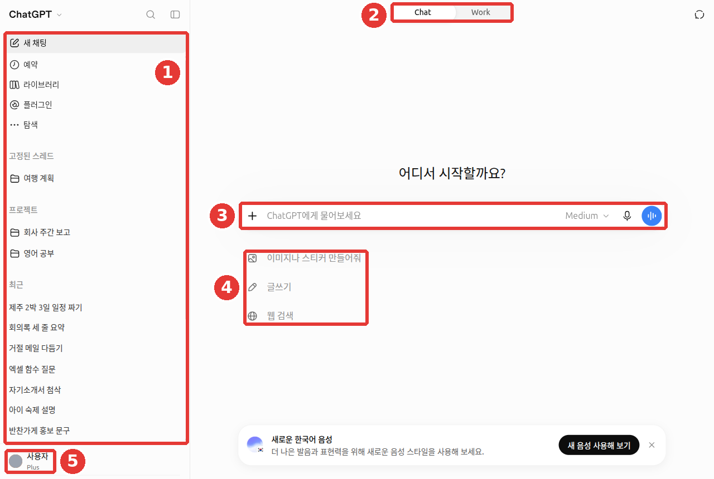
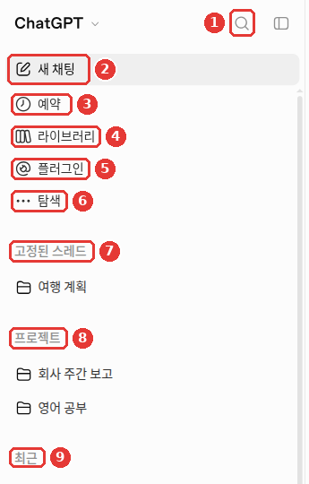
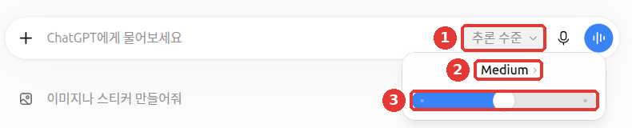
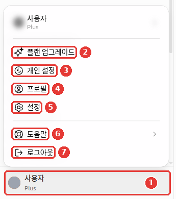
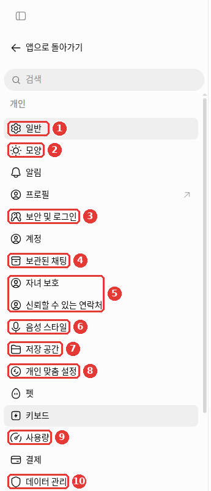

# 2장. 화면 둘러보기 — 어디에 무엇이 있나

> **한 줄 요약**: ChatGPT 화면은 **왼쪽 옆 메뉴**(지난 대화와 기능), **가운데 입력창**(질문하는 곳), **위쪽 Chat/Work 전환**,
> **왼쪽 아래 계정 메뉴**(설정) 네 곳만 알면 됩니다. 처음에는 입력창과 「새 채팅」만 써도 충분합니다.

화면은 2026년 10월 웹(Plus 요금제) 기준입니다. 무료 요금제나 휴대폰 앱은 메뉴 위치가 조금 다를 수 있습니다.

## 첫 화면 한눈에 보기

로그인하면 가운데에 「어디서 시작할까요?」라는 문구와 입력창이 보입니다.



대화 제목과 계정 이름은 예시로 바꾼 화면입니다. **빨간 번호는 아래 표의 번호와 같은 곳입니다.**

| 번호 | 위치 | 이름 | 하는 일 |
|---|---|---|---|
| ① | 왼쪽 | 옆 메뉴(사이드바) | 새 대화 시작, 지난 대화 목록, 여러 기능으로 가는 길 |
| ② | 위쪽 가운데 | 「Chat」/「Work」 | 보통 대화와 긴 작업 모드를 바꾼다 |
| ③ | 가운데 | 입력창 「ChatGPT에게 물어보세요」 | 질문을 쓰는 곳 |
| ④ | 입력창 아래 | 추천 | 「이미지나 스티커 만들어줘」「글쓰기」「웹 검색」 |
| ⑤ | 왼쪽 아래 | 계정(이름과 요금제) | 설정, 요금제 바꾸기, 로그아웃 |

무엇을 물어야 할지 모르겠다면 입력창 아래 **추천**부터 눌러 보세요. 예를 들어 「글쓰기」를 누르고 이렇게 이어서 써 보세요.

```
동네 반찬가게 개업 소식을 단골손님에게 알리는 문자를 써 줘. 세 문장, 따뜻한 말투로.
```

::: details 받는 답은 대략 이렇게 (예시 — 눌러서 펼치기)
이 가이드가 만든 예시입니다. 실제 답은 서비스와 그때그때에 따라 다릅니다.

> 안녕하세요, ○○반찬입니다. ○월 ○일, 드디어 가게 문을 엽니다. 정성껏 만든 반찬으로 따뜻하게 맞이할게요.

**잘 받았는지 확인해 보세요**: 단골손님께 개업 소식을 알리는 딱 세 문장인가? 말투가 따뜻한가? 가게 이름과 날짜는 내가 알려 주지 않았으니 비어 있어도 괜찮습니다. 지어낸 날짜가 들어가 있으면 고쳐 쓰세요.

:::

<Quiz id="ch102-layout" />

## 옆 메뉴 — 지난 대화와 기능으로 가는 길

옆 메뉴 위쪽에는 기능 버튼이, 아래쪽에는 대화 목록이 있습니다. 그림의 빨간 번호가 아래 표의 번호입니다.



| 번호 | 항목 | 하는 일 | 자세히 |
|---|---|---|---|
| ① | 돋보기 (「검색」) | 지난 대화를 찾는다 | [3장](03-chats.md) |
| ② | 「새 채팅」 | 빈 대화를 새로 시작한다 | [3장](03-chats.md) |
| ③ | 「예약」 | 정해 둔 때에 실행되는 예약 작업을 모아 본다 | [11장](11-expert.md#정해진-때에-알아서-—-예약-작업) |
| ④ | 「라이브러리」 | 올리거나 만든 파일을 모아 둔 곳(「Space」로 바뀌는 중) | [4장](04-files-images.md#라이브러리-—-올린-파일을-모아-두는-곳) |
| ⑤ | 「플러그인」 | ChatGPT에 기능을 더하는 확장을 찾는다 | [7장](07-projects-plugins.md) |
| ⑥ | 「탐색」 | 그 밖의 기능을 둘러본다 | — |
| ⑦ | 「고정된 스레드」 | 자주 여는 대화를 맨 위에 붙여 둔 목록 | [3장](03-chats.md) |
| ⑧ | 「프로젝트」 | 주제별로 대화와 파일을 묶어 둔 폴더 | [7장](07-projects-plugins.md) |
| ⑨ | 「최근」 | 최근 대화 목록 | [3장](03-chats.md) |

**스레드**(thread)는 대화 하나를 부르는 다른 말입니다. 「고정된 스레드」는 "고정해 둔 대화"라는 뜻입니다.

<Quiz id="ch102-sidebar" />

## Chat과 Work — 대화할까, 일을 맡길까

위쪽 가운데의 「Chat」/「Work」는 2026년 7월에 생긴 전환 버튼입니다.[^rn-work]

- **Chat**: 지금까지 알던 ChatGPT입니다. 묻고 답하며 대화합니다. 이 가이드 대부분은 Chat 기준입니다.
- **Work**: 여러 단계를 거치는 긴 작업을 맡기고, 문서·표·발표 자료·보고서 같은 **완성된 결과물**을 받는 모드입니다.

Work는 웹과 휴대폰에서는 **유료 요금제(Free·Go 제외)** 에서만 쓸 수 있습니다. Free·Go는 컴퓨터 앱에서만 제한적으로 쓸 수 있습니다.[^rn-work] 쓰는 법은 [7장](07-projects-plugins.md)에서 다룹니다.

<Quiz id="ch102-chat-work" />

## 입력창과 + 메뉴

입력창 왼쪽의 **+ 버튼**(그림 ①, 이름 「파일 등 추가」)을 누르면 질문에 무엇을 붙일지 고르는 메뉴가 펼쳐집니다.


대화 제목과 계정 이름은 예시로 바꾼 화면입니다. **빨간 번호는 아래 표의 번호와 같은 곳입니다.**

| 번호 | 항목 | 하는 일 | 자세히 |
|---|---|---|---|
| ② | 「사진 및 파일 추가」 | 내 컴퓨터의 사진·문서를 올린다 | [4장](04-files-images.md) |
| ③ | 「라이브러리에서 가져오기」 | 전에 올린 파일을 다시 쓴다 | [4장](04-files-images.md) |
| ④ | 「이미지 생성」 | 그림을 만들어 달라고 한다 | [4장](04-files-images.md) |
| ⑤ | 「웹 검색」 | 인터넷에서 최신 정보를 찾아 답하게 한다 | [6장](06-search.md) |
| ⑥ | 「프로젝트에서 Work 시작」 | 프로젝트 안에서 Work로 일을 맡긴다 | [7장](07-projects-plugins.md) |
| ⑦ | 「심층 리서치」 | 오래 조사해 보고서를 받는다 | [6장](06-search.md) |
| ⑧ | 「스케치」 | 직접 그린 그림을 이미지로 붙인다 | [4장](04-files-images.md) |

그 아래(⑨)에는 **플러그인** 항목이 이어집니다. 영어 이름 그대로 보일 수 있습니다([7장](07-projects-plugins.md)).

입력창 오른쪽에는 **마이크 버튼**(말로 입력)과 **음성 버튼**(목소리로 대화, [9장](09-voice.md))이 있습니다.

> **긴 글을 붙여 넣으면 첨부 파일로 바뀝니다.** 1만 자가 넘는 글을 붙여 넣으면 자동으로 첨부 파일이 됩니다.
> 입력창 안에 글로 두고 싶으면 「Show in text field」를 누르면 됩니다.[^paste]

<Quiz id="ch102-plus" />

## 추론 수준과 생각하기 — 얼마나 깊이 생각할까

유료 요금제에서는 입력창 오른쪽의 「Medium」 같은 글자(버튼 이름 「ChatGPT 모델 선택」)를 누르면 **「추론 수준」** 슬라이더가 나옵니다.
**추론**(reasoning)은 답하기 전에 단계를 밟아 생각하는 것입니다. 슬라이더는 그 생각을 얼마나 오래 할지 정합니다.



대화 제목과 계정 이름은 예시로 바꾼 화면입니다. ① 「추론 수준」 버튼을 누르면 ② 지금 수준(「Medium」)과 ③ 슬라이더가 나옵니다.

| 수준 | 성격 | 쓸 수 있는 요금제 |
|---|---|---|
| Instant(즉시) | 바로 답한다. 가벼운 질문용 | 유료 |
| Medium(중간) · High | 더 오래 생각한다. 계획·비교·계산용 | Plus 이상 |
| Extra High · Pro | 가장 깊이 생각한다 | Pro·Business·Enterprise |

출처: OpenAI 도움말[^levels]

알아 둘 점이 두 가지 있습니다.

- **말로 "더 깊이 생각해"라고 해도 수준이 바뀌지 않습니다.** Instant로 둔 채 그렇게 써도 자동으로 올라가지 않습니다. 슬라이더를 직접 옮기세요.[^levels]
- **무료(Free)·Go 요금제는 슬라이더 대신 「생각하기」를 켭니다.** Go 요금제의 휴대폰 앱에서는 + 메뉴의 「Think harder」를 고릅니다.[^go-think]

<!-- 스크린샷 필요: Free 요금제 웹 화면에서 「생각하기」를 켜는 위치 -->

**언제 올릴까요?** 계산만이 아닙니다. 짧은 문장 다듬기처럼 단순하거나 부담이 작은 일에는 빠른 수준으로 충분할 수 있습니다. 조건이 여러 개이거나, 선택지를 기준에 맞춰 비교하거나, 내가 쓴 계획에서 빠진 가정을 찾을 때는 수준을 올려 보세요.[^academy-content]
```
행사 장소 후보 세 곳을 예산·대중교통·비 올 때 대안, 이 세 기준으로 비교해 줘.
한 곳을 추천하고, 그곳의 단점을 어떻게 줄일 수 있는지도 알려 줘.
```

같은 질문을 수준만 바꿔 물어보세요. 빠른 답과 깊은 답의 차이를 바로 느낄 수 있습니다.

```
월급 300만 원인 직장인이 3년 안에 2,000만 원을 모으려면 매달 얼마씩 모아야 하는지,
적금 이자를 생각한 경우와 생각하지 않은 경우로 나눠 계산 과정을 보여 줘.
```

<Quiz id="ch102-reasoning" />

## 계정 메뉴와 설정 화면

왼쪽 아래 내 이름을 누르면 **계정 메뉴**가 열립니다.



대화 제목과 계정 이름은 예시로 바꾼 화면입니다. ① 내 이름을 누르면 ② 「플랜 업그레이드」 ③ 「개인 설정」 ④ 「프로필」 ⑤ 「설정」 ⑥ 「도움말」 ⑦ 「로그아웃」이 나옵니다.

여기서 「설정」을 누르면 **설정이 전체 화면으로** 열립니다. 왼쪽에 메뉴 목록, 오른쪽에 내용이 나옵니다. 「앱으로 돌아가기」를 누르면 대화 화면으로 돌아옵니다.



설정 메뉴는 「개인」「통합」「코딩」 세 묶음입니다. 처음에는 아래 몇 개만 알면 됩니다. 그림의 빨간 번호가 아래 표의 번호입니다.

| 번호 | 설정 메뉴 | 여기서 하는 일 | 자세히 |
|---|---|---|---|
| ① | 「일반」 | 화면 언어 (「자동 감지」) | — |
| ② | 「모양」 | 밝은 화면·어두운 화면, 글자 대비, 강조 색 | — |
| ③ | 「보안 및 로그인」 | 다중 인증, 로그인된 기기 확인, 계정 PIN(잠긴 대화를 여는 4자리 번호), 락다운 모드 | [8장](08-privacy.md#계정-지키기), [3장](03-chats.md) |
| ④ | 「보관된 채팅」 | 보관해 둔 대화 보기 | [3장](03-chats.md) |
| ⑤ | 「자녀 보호」 · 「신뢰할 수 있는 연락처」 | 청소년 자녀 계정 연결, 위기 때 알림을 받을 사람 지정 | [8장](08-privacy.md#가족과-안전을-위한-기능) |
| ⑥ | 「음성 스타일」 | 음성 대화의 목소리 | [9장](09-voice.md) |
| ⑦ | 「저장 공간」 | 올린 파일이 차지한 용량 | [4장](04-files-images.md) |
| ⑧ | 「개인 맞춤 설정」 | 메모리, 사용자 지정 지침, 말투 | [5장](05-memory.md) |
| ⑨ | 「사용량」 | 남은 사용 한도, 크레딧 | [1장](01-getting-started.md#유료로-바꾸기-전에-알아-둘-것) |
| — | 「플러그인」(그림 아래쪽 「통합」 묶음) | 연결한 앱과 기본 권한 | [7장](07-projects-plugins.md#연결한-앱의-권한-정하기) |
| ⑩ | 「데이터 관리」[^data-name] | 학습 허용, 공유 링크, 데이터 내보내기 | [8장](08-privacy.md) |

화면이 영어로 나오면 「Settings」 → 「General」 → 「Language」에서 한국어를 고르면 됩니다. 언어는 **로그인한 상태에서만** 바꿀 수 있습니다.[^lang]
「모양」에서 고른 어두운 화면은 **기기마다 따로** 정합니다. 웹에서 바꿔도 휴대폰 앱은 그대로입니다. 앱에서도 한 번 더 고르세요.[^appearance]

<Quiz id="ch102-settings" />

## 직접 해 보기

1. 첫 화면에서 추천 「글쓰기」를 누르고, 위의 반찬가게 문자 예시를 붙여 보낸다.
2. 입력창 + 버튼을 눌러 메뉴 항목을 하나씩 읽어 보고(누르지 않아도 됩니다) 닫는다.
3. 유료라면 「추론 수준」을 가장 낮게 한 번, Medium으로 한 번 바꿔 위의 저축 계산 질문을 보내고 답을 비교한다. 무료라면 「생각하기」를 끈 채로 한 번, 켠 채로 한 번 비교한다.
4. 계정 메뉴 → 「설정」을 열어 「데이터 관리」가 어디 있는지 찾아 두고 「앱으로 돌아가기」로 나온다.

## 정리

- 화면은 옆 메뉴, 입력창, Chat/Work 전환, 계정 메뉴 네 곳으로 나뉜다.
- + 버튼에서 파일·이미지·웹 검색·심층 리서치·스케치를 고른다.
- 유료는 「추론 수준」 슬라이더, 무료는 「생각하기」로 생각 깊이를 정한다. 말로 부탁해서는 바뀌지 않는다.
- 설정은 전체 화면으로 열린다. 개인정보 관련 설정은 「데이터 관리」에 있다.

## 용어 정리

| 용어 | 읽는 법 | 한 줄 뜻 |
|---|---|---|
| Sidebar | 사이드바 (옆 메뉴) | 화면 왼쪽에 세로로 붙은 메뉴 |
| Thread | 스레드 | 대화 하나를 부르는 다른 말 |
| Reasoning | 리즈닝 (추론) | 답하기 전에 단계를 밟아 생각하는 것 |
| Instant | 인스턴트 | 생각을 거의 하지 않고 바로 답하는 수준 |
| Plugin | 플러그인 | ChatGPT에 기능을 더하는 확장 ([7장](07-projects-plugins.md)) |
| Work | 워크 | 긴 작업을 맡기고 완성된 결과물을 받는 모드 ([7장](07-projects-plugins.md)) |

<ChapterDone :chapter="102" />

다음 장: [3장. 대화 관리](03-chats.md)

[^rn-work]: OpenAI 도움말, 「ChatGPT release notes」 2026-07-09 항목. "ChatGPT Work is an agent for longer, more involved tasks." / "rolling out to paid plans except Free and Go". https://help.openai.com/en/articles/6825453 (확인일 2026-10-23). Free·Go의 데스크톱 제한 이용은 OpenAI, 「플랜 및 가격」 https://openai.com/chatgpt/pricing 의 "데스크톱에서 ChatGPT Work의 제한적 이용" (확인일 2026-10-23)
[^paste]: OpenAI 도움말, 「ChatGPT release notes」 2026-08-04 항목. "If you paste more than 10k characters…". https://help.openai.com/en/articles/6825453 (확인일 2026-10-23)
[^levels]: OpenAI 도움말, 모델 메뉴와 생각 수준 안내 문서(문서 제목에 현재 모델 이름이 들어 있어 이 가이드에는 적지 않음). 표 "Plus — Included / Not included / Not included" / "Asking ChatGPT to "think harder"… won't automatically switch". https://help.openai.com/en/articles/20001354 (확인일 2026-10-23)
[^go-think]: OpenAI 도움말, 「What is ChatGPT Go?」. "On mobile, select Think harder from the + menu." https://help.openai.com/en/articles/11989085 (확인일 2026-10-23)
[^lang]: OpenAI 도움말, 「How to change your language setting in ChatGPT」. "you can only update the ChatGPT language setting if you are logged in." https://help.openai.com/en/articles/8357869 (확인일 2026-10-24)
[^appearance]: OpenAI 도움말, 「Updating your visual experience」. "changing the appearance on the web doesn't automatically change the appearance in the mobile app." 설정 메뉴 이름은 2026-10-24 웹 설정 화면에서 확인. https://help.openai.com/en/articles/11958281 (확인일 2026-10-24)
[^academy-content]: OpenAI Academy 「Applied AI Foundations」 강좌 본문(로그인·등록 필요). "Use a faster model when the task is simple and/or low-stakes." / "Use a reasoning model when the task has:" "Several constraints" / "A need to compare options" / "Compare options against criteria instead of giving a generic list of pros and cons" / "Review your draft recommendation for missing assumptions" (확인일 2026-10-26)
[^data-name]: 도움말 문서에는 「데이터 제어」라고 적힌 곳이 있지만, 실제 화면 이름은 「데이터 관리」입니다.
