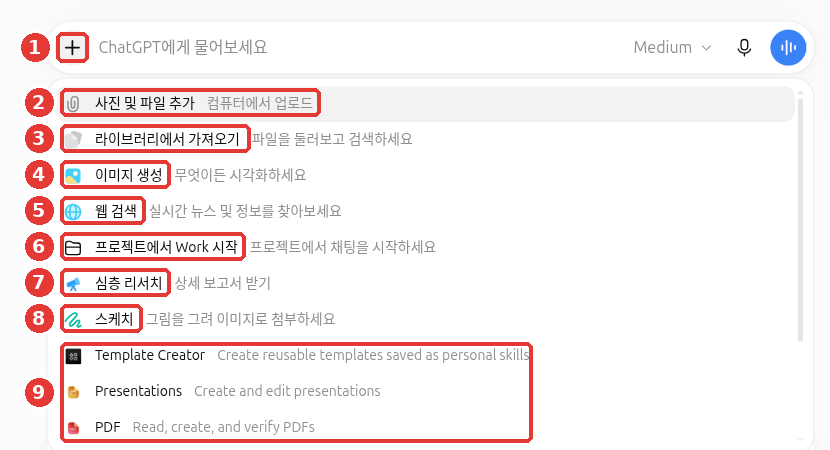
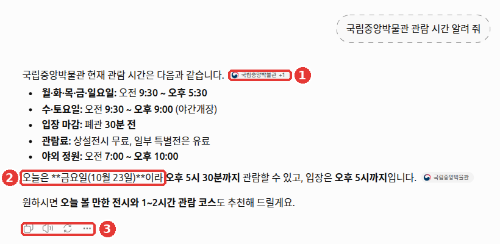

# 6장. 검색과 심층 리서치 — 최신 정보를 출처와 함께 받기

> **한 줄 요약**: 오늘 일어난 일이나 자주 바뀌는 정보는 **웹 검색**으로, 여러 자료를 비교해야 하는 큰 질문은
> **심층 리서치**로 묻습니다. 어느 쪽이든 붙어 온 출처를 직접 열어 보는 것까지가 한 세트입니다.

화면은 2026년 10월 웹(Plus 요금제) 기준입니다. 무료 요금제나 휴대폰 앱은 메뉴 위치가 조금 다를 수 있습니다.

## 웹 검색 — ChatGPT가 인터넷을 찾아보게 하기

AI는 배운 시점까지의 내용만 알고 있습니다. 그래서 "이번 주 날씨", "어제 발표된 정책"처럼 최근 일은 그냥 물으면 틀리기 쉽습니다.
**웹 검색**(web search)은 ChatGPT가 인터넷에서 최신 자료를 찾아 읽은 뒤 답하게 하는 기능입니다.

웹 검색은 Free를 포함한 모든 요금제에서 쓸 수 있습니다. 로그인하지 않은 상태에서도 쓸 수 있습니다.
필요하다고 판단하면 ChatGPT가 **알아서** 검색하기도 합니다.[^search]
꼭 검색하게 하고 싶으면 입력창 왼쪽 **+ 버튼 → 「웹 검색」**을 고른 뒤 질문하세요.[^screen]



대화 제목과 계정 이름은 예시로 바꾼 화면입니다. 이 장에서 쓰는 것은 ① + 버튼, ⑤ 「웹 검색」, ⑦ 「심층 리서치」입니다.

```
이번 주말 서울 날씨를 알려 줘. 토요일과 일요일로 나눠서,
참고한 사이트를 함께 보여 줘.
```

### 옆 메뉴의 「검색」과는 다르다

옆 메뉴 맨 위 돋보기 「검색」은 **내 채팅·프로젝트·파일**만 찾습니다. 인터넷은 찾지 않습니다.[^find]
"지난달에 쓴 이력서 대화가 어디 갔지?" 같은 것은 옆 메뉴 「검색」으로 찾으세요. "올해 최저임금이 얼마지?" 같은 것은 웹 검색으로 물으면 됩니다. 옆 메뉴 검색은 [3장](03-chats.md)에서 다룹니다.

<Quiz id="ch106-web-search" />

## 출처 확인하는 습관

웹 검색으로 받은 답에는 문장 끝에 **인용**(citation, 어디서 가져왔는지 표시)이 작은 이름표처럼 붙습니다. 예를 들어 「국립중앙박물관 +1」은 그 사이트와 다른 출처 1곳을 참고했다는 뜻입니다. 참고한 사이트 목록은 「출처」에서 볼 수 있습니다.[^search]



*대화 제목과 계정 이름은 예시로 바꾼 화면입니다.* ① 문장 끝의 작은 이름표가 출처 표시입니다. ③ 답 아래에는 복사·소리 내어 읽기·다시 생성·더보기 버튼이 있습니다. 2026년 10월 23일 웹 화면에서는 이 출처 표시를 누르니 **원래 웹페이지가 새 탭으로 열렸습니다.** ② 둘째 문단의 `**금요일(10월 23일)**`처럼 굵은 글씨 기호가 그대로 보이는 것은 [1단계 7장](../00-common/07-structured-prompts.md)에서 본 마크다운 기호가 드러난 경우입니다.

그런데 OpenAI도 검색 결과와 인용이 **불완전하거나, 오래됐거나, 틀릴 수 있다**고 밝힙니다.[^search]
링크가 붙어 있다는 것만으로 확인된 것은 아닙니다. [1단계 9장](../00-common/09-safety.md)에서 배운 대로, 숫자·날짜·이름은 링크를 직접 열어 원문과 맞춰 보세요.
링크를 열었다면 아래 네 가지를 스스로 물어보세요.

| 확인할 것 | 이렇게 본다 |
|---|---|
| 링크가 열리나? | 출처를 눌러 실제 페이지가 나오는지 본다 |
| 원문에 그 말이 있나? | 답의 숫자·문장이 페이지에 그대로 있는지 찾는다 |
| 언제 쓴 글인가? | 페이지의 작성일을 보고 오래된 정보인지 확인한다 |
| 누가 쓴 글인가? | 공식 기관·회사 페이지인지, 개인 블로그인지 본다 |

출처가 마음에 들지 않으면 이렇게 다시 부탁할 수 있습니다.

```
방금 답에서 개인 블로그 출처는 빼고, 정부나 공공기관 사이트만 참고해서 다시 알려 줘.
각 내용마다 어느 페이지에서 가져왔는지 붙여 줘.
```

<Quiz id="ch106-citations" />

## 검색할 때 ChatGPT가 알게 되는 것

맛집이나 병원처럼 "내 근처"가 중요한 질문을 하면 위치가 쓰입니다.
ChatGPT는 인터넷 주소(IP 주소, 인터넷에 연결된 기기마다 붙는 번호)로 **대략적인 위치**를 짐작합니다.
기기의 정확한 위치를 알려 주는 기능은 따로 켜야 합니다. 처음에는 꺼져 있습니다(「설정」 → 「데이터 관리」 → 「위치」).[^search][^screen]

또 ChatGPT는 내 질문을 검색어로 다시 써서 바깥 검색 회사에 보냅니다. 이때 내 IP 주소나 계정 정보는 함께 보내지 않습니다.[^search]
다만 메모리가 켜져 있으면 그 검색어를 나에게 맞춰 바꿀 수 있습니다. 「개인 맞춤 설정」 화면에 그렇게 적혀 있습니다([5장](05-memory.md)).[^screen]

<Quiz id="ch106-location" />

## 쇼핑할 때 — 비교는 맡기고 가격은 직접 확인

물건을 사려고 물으면 답에 **상품 카드**(product card, 사진·가격·판매처가 붙은 상품 목록)가 나올 수 있습니다. 상품을 하나 이상 고르고 「Research」를 누르면 **쇼핑 리서치**(shopping research)가 시작됩니다.
ChatGPT가 좋아하는 브랜드, 크기, 무엇을 더 중요하게 보는지 되묻습니다. 그리고 몇 분 뒤 고를 때 볼 점·추천 상품·비교 표가 담긴 **구매 가이드**(buyer’s guide)를 줍니다.[^shop-research]
이 기능이 한국 화면에서도 나오는지는 도움말에 적혀 있지 않습니다. 이 가이드를 쓸 때도 확인하지 못했습니다.

```
출퇴근용 백팩을 찾고 있어. 예산은 10만 원, 15인치 노트북이 들어가야 하고 비 오는 날에도 쓸 거야.
세 개만 골라 비교표로 보여 주고, 각 판매처 가격은 내가 직접 확인할 수 있게 링크를 붙여 줘.
```

알아 둘 점입니다.

- **광고인가?** 아닙니다. 상품 결과는 ChatGPT가 따로 고른 것입니다. 광고는 따로 표시됩니다.[^shop]
- **내 대화가 가게로 가나?** 쇼핑 리서치에서 나눈 대화는 판매처에 공유되지 않습니다.[^shop-research]
- **처음 보이는 가격** — 맨 처음 나온 판매처의 가격입니다. 가장 싼 값이 아닐 수 있습니다.[^shop]
- **「가성비」 같은 표시, 리뷰 요약** — ChatGPT가 만든 것이라 보증이 아닙니다. 리뷰도 OpenAI가 검증하지 않습니다.[^shop]
- **「Try on」(입어 보기)** — 옷·액세서리를 내 사진에 입혀 보는 기능입니다. 실제 크기나 핏을 보장하지 않습니다. 올린 사진은 다음에 쓰려고 저장되니, 지우려면 설정에서 지우세요.[^shop]

**결제하기 전에는 판매처 사이트에서 최종 가격·세금·배송비, 재고와 크기, 반품 규정을 직접 확인하세요.**[^shop-research] 가격과 재고는 자주 바뀌어서 ChatGPT가 보여 준 것과 다를 수 있습니다.

<Quiz id="ch106-shopping" />

## 심층 리서치 — 보고서를 맡기기

**심층 리서치**(deep research)는 ChatGPT가 여러 자료를 오래 찾아 읽고, 인용이 붙은 **보고서**로 정리해 주는 기능입니다.
빠른 사실은 검색으로 물어보세요. 깊이와 꼼꼼함이 필요하면 심층 리서치를 쓰면 됩니다.[^dr]

| 이럴 때 | 고를 것 | 예 |
|---|---|---|
| 답이 한두 줄로 끝난다 | 웹 검색 | "오늘 환율 알려 줘" |
| 여러 자료를 비교·정리해야 한다 | 심층 리서치 | "1인 가게용 카드 단말기 3종 비교 보고서" |

### 시작하는 법

다음 중 하나로 시작하세요.[^dr][^screen]

- 입력창 **+ 버튼 → 「심층 리서치」**
- 입력창에 `/Deepresearch` 라고 입력

### 진행 흐름

1. **질문을 보낸다** — 무엇을, 누구를 위해, 어떤 형태로 받고 싶은지 자세히 적을수록 좋습니다.
2. **조사 계획을 먼저 본다** — ChatGPT가 "이런 순서로 조사하겠다"는 계획을 보여 줍니다. 이 계획은 내가 고칠 수 있습니다.
3. **조사하는 동안 끼어들 수 있다** — 진행 중에 방향을 바꾸거나 더할 내용을 말할 수 있습니다.
4. **인용이 붙은 보고서를 받는다** — Markdown·Word·PDF 형식으로 내려받을 수 있습니다.[^dr]

> **임시 채팅에서는 심층 리서치를 쓸 수 없습니다.** 2026년 10월 웹 화면에서 임시 채팅의 + 메뉴에는 「심층 리서치」가 없었습니다. 「이미지 생성」도 흐리게 꺼져 있었습니다. 심층 리서치는 일반 채팅에서 시작하세요.

<!-- 스크린샷 필요: 심층 리서치를 시작한 뒤 조사 계획이 나오고 「수정」할 수 있는 화면 -->

특정 사이트만 조사하게 하거나 먼저 보게 할 수도 있습니다. 입력창의 Sites → Manage sites에서 정합니다. 다만 이 이름은 도움말에 나온 것이고, 한국어 화면 이름은 아직 확인하지 못했습니다.[^dr]

```
동네 반찬가게가 쓸 수 있는 배달 앱 수수료를 비교하는 보고서를 써 줘.
- 대상: 가게 1곳을 운영하는 사장
- 비교할 것: 중개 수수료, 결제 수수료, 광고비
- 형식: 맨 앞에 한 줄 결론, 그다음 비교 표, 마지막에 출처 목록
- 2026년 자료를 우선하고, 날짜를 모르는 자료는 따로 표시해 줘
```

보고서도 검색 결과와 마찬가지로 출처를 열어 확인하세요. 보고서가 길고 그럴듯할수록 확인을 건너뛰기 쉽습니다. 특히 결론에 쓰인 숫자부터 확인해 보세요.

<Quiz id="ch106-deep-research" />

## 한도는 화면에서 확인

심층 리서치는 쓸 수 있는 횟수가 요금제마다 다릅니다. 남은 횟수는 **앱 안의 표시**로 확인하세요.
한 달 한도는 처음 쓴 날부터 30일마다 다시 채워집니다.[^dr]
구체적인 횟수는 도움말에 나와 있지 않고 자주 바뀝니다. 그래서 이 가이드에는 적지 않았습니다. 쓰기 전에 화면에서 확인하세요.

<Quiz id="ch106-limits" />

## 직접 해 보기

1. 일반 채팅에서 + 버튼 → 「웹 검색」을 고르고 "우리 동네 이번 달 문화 행사 알려 줘"라고 묻는다.
2. 답에 붙은 출처 두 개를 직접 열어, 행사 날짜가 원문과 같은지 확인한다.
3. 위의 배달 앱 수수료 예시를 내 일에 맞게 바꿔 심층 리서치로 보낸다. 조사 계획이 나오면 한 가지를 고쳐 달라고 해 본다.
4. 받은 보고서의 결론에 쓰인 숫자 하나를 골라 출처에서 찾아본다.

## 정리

- 최신 정보는 웹 검색으로 묻는다. ChatGPT가 알아서 검색하기도 하고, + 버튼 → 「웹 검색」으로 직접 켤 수도 있다.
- 옆 메뉴 「검색」은 내 대화를 찾는 것이고, 인터넷 검색이 아니다.
- 인용과 출처도 틀릴 수 있다. 링크를 열어 원문과 맞춰 본다.
- 쇼핑 결과는 광고가 아니지만 첫 가격이 최저가는 아닐 수 있다. 결제 전에 판매처에서 가격·배송비·반품 규정을 확인한다.
- 큰 질문은 심층 리서치로 맡긴다. 계획을 먼저 보고 고칠 수 있고, 보고서는 Markdown·Word·PDF로 받는다.
- 심층 리서치 횟수는 요금제마다 다르니 화면에서 확인한다.

## 용어 정리

| 용어 | 읽는 법 | 한 줄 뜻 |
|---|---|---|
| Web Search | 웹 서치 (웹 검색) | ChatGPT가 인터넷에서 최신 자료를 찾아 답하는 기능 |
| Citation | 사이테이션 (인용) | 답의 내용을 어디서 가져왔는지 붙인 표시 |
| Source | 소스 (출처) | 답이 참고한 웹 페이지 |
| IP Address | 아이피 주소 | 인터넷에 연결된 기기마다 붙는 번호. 대략적인 위치를 알 수 있다 |
| Deep Research | 딥 리서치 (심층 리서치) | 여러 자료를 오래 조사해 인용이 붙은 보고서로 정리하는 기능 |
| Buyer’s Guide | 바이어스 가이드 (구매 가이드) | 고를 때 볼 점·추천 상품·비교 표를 묶은 정리 글 |
| Shopping Research | 쇼핑 리서치 | 고른 상품을 되묻고 비교해 구매 가이드로 정리하는 기능 |

<ChapterDone :chapter="106" />

다음 장: [7장. 프로젝트·플러그인·Work](07-projects-plugins.md)

[^search]: OpenAI 도움말, 「Searching the web with ChatGPT」. https://help.openai.com/en/articles/9237897 (확인일 2026-10-23)
[^find]: OpenAI 도움말, 「Finding your chats, projects, and files in ChatGPT」. https://help.openai.com/en/articles/10056348 (확인일 2026-10-23)
[^dr]: OpenAI 도움말, 「Deep research in ChatGPT」. https://help.openai.com/en/articles/10500283 (확인일 2026-10-23)
[^shop]: OpenAI 도움말, 「Shopping with ChatGPT Search」. "Product results are selected independently by ChatGPT and are not ads" / "may not be the lowest available price" / "They’re not guarantees or verified statements" / "Reviews and ratings are not verified by OpenAI." / "Your reference photos are saved for future try-ons" / "do not guarantee fit or size". https://help.openai.com/en/articles/11128490 (확인일 2026-10-24)
[^shop-research]: OpenAI 도움말, 「Using shopping research in ChatGPT」. "Select one or more products and choose “Research”" / "After a few minutes, shopping research returns a buyer’s guide." / "Your chats are never shared with retailers." / "Confirm the final price, taxes, fees, and shipping costs on the retailer’s website." https://help.openai.com/en/articles/12911370 (확인일 2026-10-24)
[^screen]: ChatGPT 웹 화면(Plus 요금제, 한국어)에서 직접 확인. 입력창 + 메뉴, 「데이터 관리」, 「개인 맞춤 설정」 화면 (확인일 2026-10-23)
