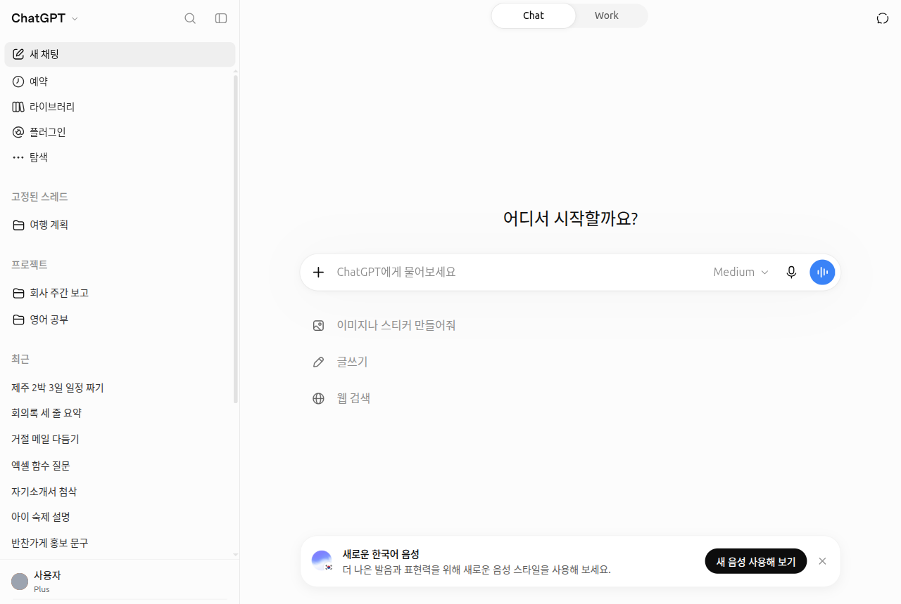
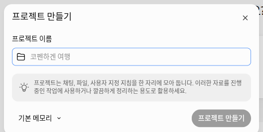
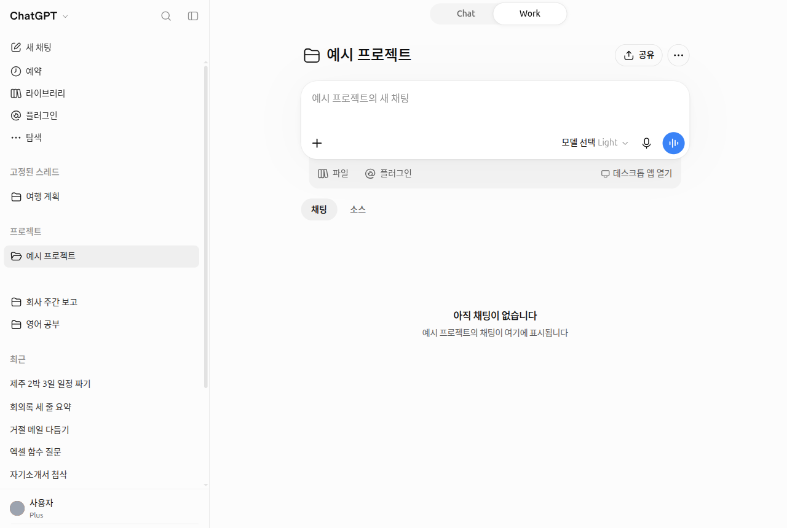
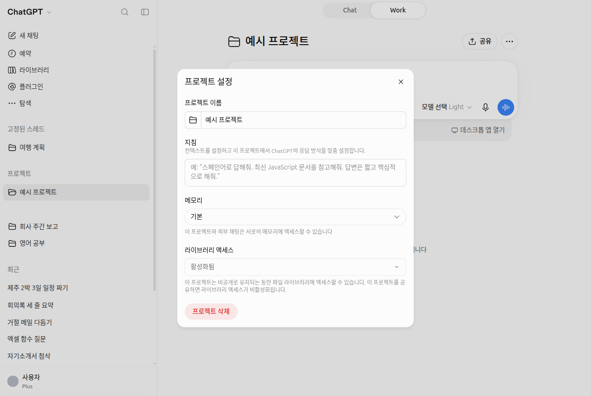
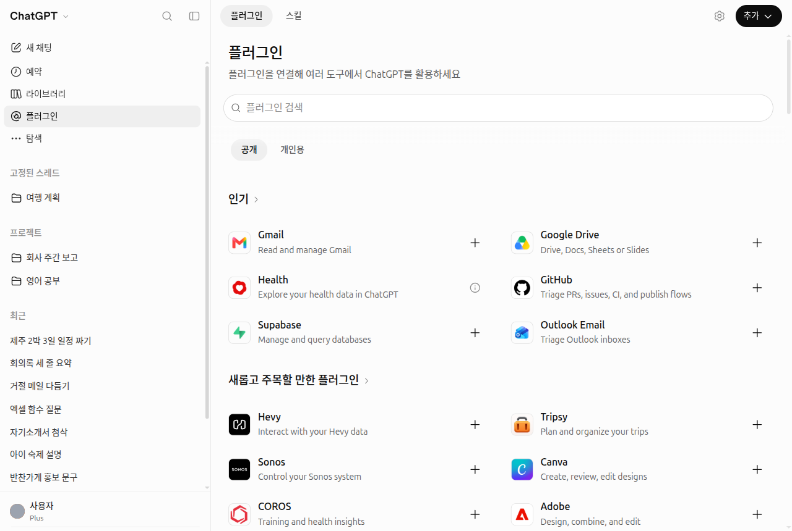
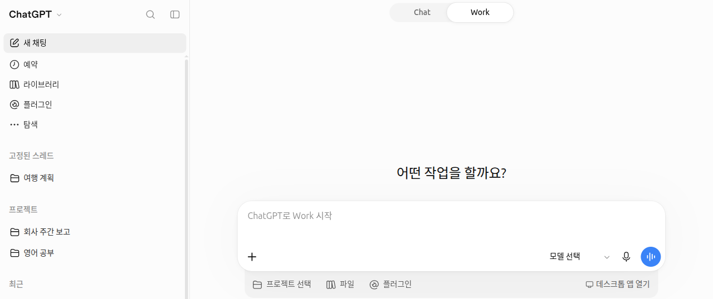

# 7장. 프로젝트·플러그인·Work — 자주 하는 일을 묶어 두기

> **한 줄 요약**: 같은 일에 쓰는 대화·파일·지침은 **프로젝트**로 묶고, 다른 서비스와 연결하거나 정해진 작업 방식을 더하려면
> **플러그인**을 씁니다. 긴 작업을 맡겨 완성된 결과물을 받고 싶으면 위쪽 **Work**로 바꿉니다.

화면은 2026년 10월 웹(Plus 요금제) 기준입니다. 무료 요금제나 휴대폰 앱은 메뉴 위치가 조금 다를 수 있습니다.



대화 제목과 계정 이름은 예시로 바꾼 화면입니다.

## 프로젝트 — 대화·파일·지침을 한 폴더에

**프로젝트**(project)는 한 가지 일에 관련된 대화, 참고 파일, 지침을 한곳에 모아 두는 폴더입니다.
예를 들어 「회사 주간 보고」 프로젝트에 보고 양식 파일과 "표는 세 칸으로" 같은 지침을 넣어 두면, 그 안에서 여는 대화는 매번 그 파일과 지침을 알고 시작합니다.

### 만들고 채우는 법

1. 옆 메뉴 「프로젝트」 구역 제목에 마우스를 올리면 나오는 **+ 버튼(「새 프로젝트 추가」)**을 누르고, 「프로젝트 만들기」 창에서 이름을 정합니다.[^projects]
2. 프로젝트 화면 오른쪽 위 •••(「프로젝트 액션」) → 「프로젝트 설정」에서 이 프로젝트에서만 지킬 **지침**을 적고, 「파일」로 참고 파일을 올립니다.
3. 이미 있는 대화는 「프로젝트로 이동」으로 넣고, 「프로젝트에서 제거」로 뺍니다.[^projects]



만들고 나면 프로젝트 화면이 열립니다. 입력창(「예시 프로젝트의 새 채팅」) 아래에 「파일」「플러그인」 버튼이 있고, 그 아래 「채팅」「소스」 탭에 이 프로젝트의 대화와 자료가 모입니다.





*대화 제목과 계정 이름은 예시로 바꾼 화면이고, 모델 이름 자리는 지웠습니다. 「예시 프로젝트」는 캡처 뒤 삭제했습니다.*

> **프로젝트를 지우면** 확인 창에 "이 프로젝트와 프로젝트에 포함된 모든 채팅이 Chat과 Work에서 영구적으로 삭제됩니다"라고 나옵니다. 라이브러리에 저장된 파일은 지워지지 않습니다. 남겨 둘 대화는 삭제 전에 다른 곳으로 옮기세요(2026-10-23 웹 화면 확인).

### 프로젝트 지침이 먼저다

[5장](05-memory.md)의 사용자 지정 지침은 모든 대화에 적용되지만, **프로젝트 지침은 그 프로젝트 안에서만** 적용되고 사용자 지정 지침보다 **우선**합니다.[^projects]
평소에는 존댓말로 답하게 해 두고, 「영어 공부」 프로젝트에서만 "영어로만 답해 줘"라고 정해 둘 수 있습니다.

### 요금제별 한도

프로젝트는 개수 제한 없이 만들 수 있습니다. 넣을 수 있는 파일 수는 요금제마다 다르고, 한 번에 올릴 수 있는 파일은 10개까지입니다.[^projects]

| 요금제 | 프로젝트당 파일 | 공유할 때 함께 쓸 사람 |
|---|---|---|
| Free | 5개 | 5명 |
| Go · Plus | 25개 | 10명 |
| Pro | 40개 | 100명 |

Business·Enterprise·Edu도 프로젝트당 파일 40개입니다.[^projects]
프로젝트를 다른 사람과 **공유**하면 메모리가 자동으로 「프로젝트 전용 메모리」로 바뀌고, 「기본 메모리」로 되돌릴 수 없습니다.[^projects]
또 프로젝트에 넣은 PDF는 그림·도표가 빠진 채 읽힐 수 있습니다. 그림이 중요한 PDF는 채팅에 직접 첨부하세요([4장](04-files-images.md)).[^files]

<Quiz id="ch107-projects" />

## 다시 쓸 틀을 프로젝트에 넣기

[1단계 8장](../00-common/08-meta-prompting.md)에서 잘 된 요청을 빈칸만 바꿔 다시 쓰는 **틀**로 만드는 법을 배웠습니다.
프로젝트는 그 틀을 넣어 두기 좋은 곳입니다. 틀을 프로젝트 지침에 넣어 두면 대화마다 붙여 넣지 않아도 됩니다.

```
이 프로젝트의 대화에서는 내가 보내는 업무 메모를 주간 보고로 정리해 줘.
- "완료 / 진행 중 / 다음 주 계획" 세 칸 표로 만들 것
- 항목마다 한 줄로 쓸 것
- 메모에 없는 내용은 지어내지 말고 [확인 필요]라고 표시할 것
```

이렇게 해 두면 프로젝트 안 새 대화에는 이번 주 메모만 붙여 넣으면 됩니다.

<Quiz id="ch107-template" />

## 플러그인 — 다른 서비스와 작업 방식을 더하기

**플러그인**(plugin)은 ChatGPT에 기능을 더하는 꾸러미입니다. 도움말은 플러그인이 **스킬**(skill, 정해진 작업 방식을 적은 지침), 연결된 앱, 앱 템플릿, 확장으로 이루어진다고 설명합니다.[^plugins]
2026-07-09에 예전 「앱 디렉터리」가 **플러그인 디렉터리**로 바뀌었고, 전에 연결해 둔 앱은 그대로 유지됩니다.[^rn]

- **찾아보기**: 옆 메뉴 「플러그인」에서 플러그인 디렉터리를 엽니다. 디렉터리는 모든 요금제에서 볼 수 있습니다.[^plugins]
- **설치**: 마음에 드는 플러그인에서 「플러그인 설치」, 다른 서비스 계정이 필요하면 「연결」을 누릅니다.[^plugins]



*대화 제목과 계정 이름은 예시로 바꾼 화면입니다.*

쓰는 방법은 네 가지입니다.[^plugins]

| 방법 | 예 |
|---|---|
| 그냥 질문한다 | 관련이 있으면 ChatGPT가 알아서 플러그인을 쓴다 |
| `@` 뒤에 이름을 쓴다 | `@PDF 이 계약서에서 날짜만 뽑아 줘` |
| + 버튼에서 이름을 입력한다 | + 메뉴 아래쪽의 플러그인 목록에서 고른다 |
| 입력창의 「Plugins」를 누른다 | 설치한 플러그인 중에서 고른다 |

다른 서비스(메일·저장 공간 등)를 연결하면 ChatGPT가 그 안의 내용을 읽을 수 있게 됩니다. 연결하기 전에 어떤 정보를 주고받는지 확인하세요([8장](08-privacy.md)).

<Quiz id="ch107-plugins" />

## Chat과 Work의 차이

2026-07-09 **ChatGPT Work**가 나오면서 화면 위쪽이 「Chat」/「Work」로 나뉘었습니다.[^rn][^work]

| | Chat | Work |
|---|---|---|
| 하는 일 | 묻고 답하며 대화한다 | 여러 단계를 거치는 긴 작업을 맡아 끝까지 해 준다 |
| 결과물 | 답변 글 | 문서·표·발표 자료·보고서·Sites(간단한 웹사이트) 같은 완성품 |
| 예 | "회의록을 세 줄로 요약해 줘" | "이번 분기 매출 파일로 발표 자료 10장을 만들어 줘" |

- 웹·휴대폰의 Work는 **Free·Go를 뺀 유료 요금제**에서 씁니다. Free·Go는 데스크톱 앱에서만 제한적으로 쓸 수 있습니다.[^rn][^pricing]
- Work는 작업을 한 번, 반복 일정으로, 또는 어떤 조건이 생겼을 때 실행하도록 **예약**할 수 있습니다. 옆 메뉴 「예약」에서 관리합니다.[^work][^screen]
- 프로젝트 안에서 Work를 쓰려면 + 버튼 → 「프로젝트에서 Work 시작」을 고릅니다.[^screen]
- Sites는 2026-07-09 공개 베타로 나왔고 Free·Go에서는 쓸 수 없습니다.[^rn]



*대화 제목과 계정 이름은 예시로 바꾼 화면이고, 모델 이름 자리는 지웠습니다. 실제 화면에는 이 아래에 「Work가 할 수 있는 일을 살펴보세요」 추천 카드가 나오는데, 계정마다 내용이 달라 잘라 냈습니다.*

<Quiz id="ch107-work" />

## 끝나는 기능 — 맞춤형 GPT와 에이전트 모드

예전 안내서나 영상에서 보던 기능 중 두 가지가 끝났거나 끝날 예정입니다.

**맞춤형 GPT**(custom GPTs, 지침과 파일을 넣어 만든 나만의 ChatGPT)는 **2026-12-11 종료 예정**이고 플러그인으로 옮겨 갑니다. 승인받은 Enterprise는 2027-02-11까지 유예됩니다. 종료되어도 GPT와 나눈 대화 기록은 남습니다.[^gpts]

직접 만든 GPT가 있다면 종료 전에 이렇게 준비하세요.

1. GPT를 만들 때 적은 **지침 글을 복사**해 메모장에 저장하고, 넣어 둔 **참고 파일**도 내 컴퓨터에 따로 챙겨 둡니다.
2. 공식 옮기는 방법은 도움말 「Custom GPT retirement and migration FAQ」[^gpts]에서 확인합니다.
3. 나 혼자 쓰던 GPT라면, 저장한 지침과 파일로 **프로젝트**를 하나 만들어도 비슷하게 쓸 수 있습니다(이 가이드의 제안).

<!-- 스크린샷 필요: 맞춤형 GPT 편집 화면에서 지침과 파일이 보이는 부분 -->

**에이전트 모드**(agent mode, ChatGPT가 여러 단계의 일을 스스로 처리하던 예전 기능)는 **이제 쓸 수 없고**, 그 자리를 Work가 대신합니다.[^agent]
도움말 아래쪽에 옛 사용법이 남아 있어도 따라 하지 마세요.

<Quiz id="ch107-retired" />

## 직접 해 보기

1. 「새 프로젝트」로 「주간 보고」 프로젝트를 만들고, 위의 틀을 프로젝트 지침에 넣는다.
2. 프로젝트 안에서 새 대화를 열고, 이번 주에 한 일을 아무렇게나 다섯 줄 적어 보낸다. 표가 지침대로 나오는지 본다.
3. 옆 메뉴 「플러그인」을 열어 어떤 플러그인이 있는지 둘러보고, 하나를 골라 `@` 뒤에 이름을 써서 불러 본다.
4. 유료 요금제라면 위쪽을 「Work」로 바꿔, 2번의 보고를 한 장짜리 문서로 만들어 달라고 해 본다.

## 정리

- 프로젝트는 대화·파일·지침을 묶는 폴더다. 프로젝트 지침은 그 안에서 사용자 지정 지침보다 우선한다.
- 프로젝트당 파일은 Free 5개, Go·Plus 25개, Pro 40개. 공유하면 메모리가 「프로젝트 전용 메모리」로 고정된다.
- 다시 쓸 틀은 프로젝트 지침에 넣어 두면 편하다.
- 플러그인은 옆 메뉴 「플러그인」에서 찾고, 질문·`@`·+ 버튼·「Plugins」로 쓴다.
- Chat은 대화, Work는 긴 작업과 완성된 결과물. 웹·휴대폰의 Work는 Free·Go를 뺀 유료 요금제에서 쓴다.
- 맞춤형 GPT는 2026-12-11 종료 예정이니 지침과 파일을 미리 저장한다. 에이전트 모드는 이미 끝났다.

## 용어 정리

| 용어 | 읽는 법 | 한 줄 뜻 |
|---|---|---|
| Project | 프로젝트 | 한 가지 일의 대화·파일·지침을 모아 두는 폴더 |
| Plugin | 플러그인 | ChatGPT에 기능이나 다른 서비스 연결을 더하는 꾸러미 |
| Skill | 스킬 | 정해진 작업 방식을 적어 둔 지침. 플러그인의 한 부분 |
| Plugin Directory | 플러그인 디렉터리 | 플러그인을 찾아보고 설치하는 목록 화면 |
| ChatGPT Work | 챗지피티 워크 | 여러 단계의 긴 작업을 맡아 완성된 결과물을 만드는 기능 |
| Custom GPTs | 커스텀 지피티 (맞춤형 GPT) | 지침과 파일로 만든 나만의 ChatGPT. 2026-12-11 종료 예정 |
| Agent Mode | 에이전트 모드 | 여러 단계의 일을 스스로 처리하던 옛 기능. 지금은 Work가 대신한다 |

<ChapterDone :chapter="107" />

다음 장: [8장. 개인정보와 데이터 관리](08-privacy.md)

[^projects]: OpenAI 도움말, 「Projects in ChatGPT」. https://help.openai.com/en/articles/10169521 (확인일 2026-10-23)
[^files]: OpenAI 도움말, 「Uploading files and audio to ChatGPT」. https://help.openai.com/en/articles/8555545 (확인일 2026-10-23)
[^plugins]: OpenAI 도움말, 「Plugins in ChatGPT」. https://help.openai.com/en/articles/20001256 (확인일 2026-10-23)
[^work]: OpenAI 도움말, 「ChatGPT Work and Codex」. https://help.openai.com/en/articles/20001275 (확인일 2026-10-23)
[^rn]: OpenAI 도움말, 「ChatGPT release notes」 2026-07-09 항목. https://help.openai.com/en/articles/6825453 (확인일 2026-10-23)
[^pricing]: OpenAI, 「플랜 및 가격」. https://openai.com/chatgpt/pricing (확인일 2026-10-23)
[^gpts]: OpenAI 도움말, 「Custom GPT retirement and migration FAQ」. https://help.openai.com/en/articles/20001519 (확인일 2026-10-23)
[^agent]: OpenAI 도움말, 「ChatGPT agent」. "ChatGPT agent is no longer available. Use ChatGPT Work" https://help.openai.com/en/articles/11752874 (확인일 2026-10-23)
[^screen]: ChatGPT 웹 화면(Plus 요금제, 한국어)에서 직접 확인. 옆 메뉴와 입력창 + 메뉴 (확인일 2026-10-23)
