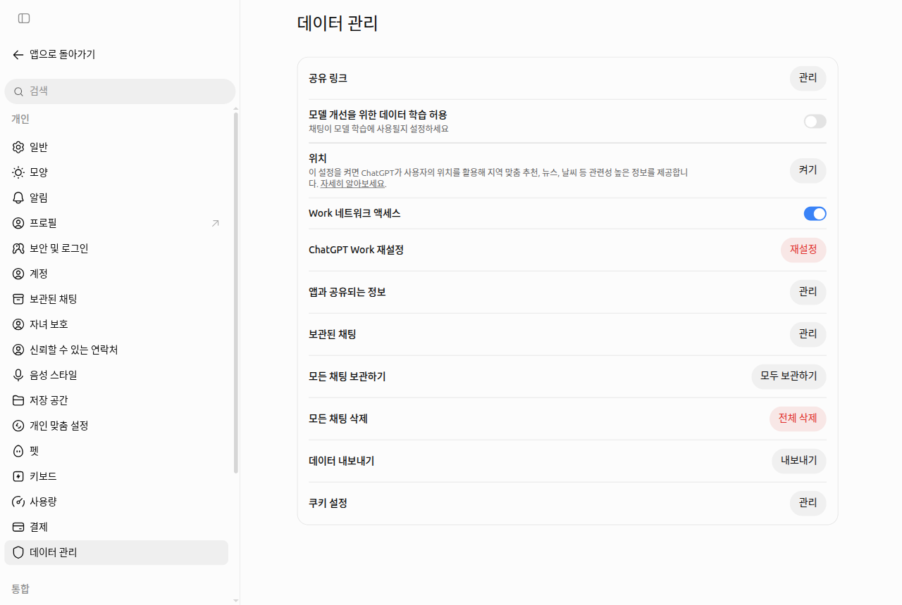
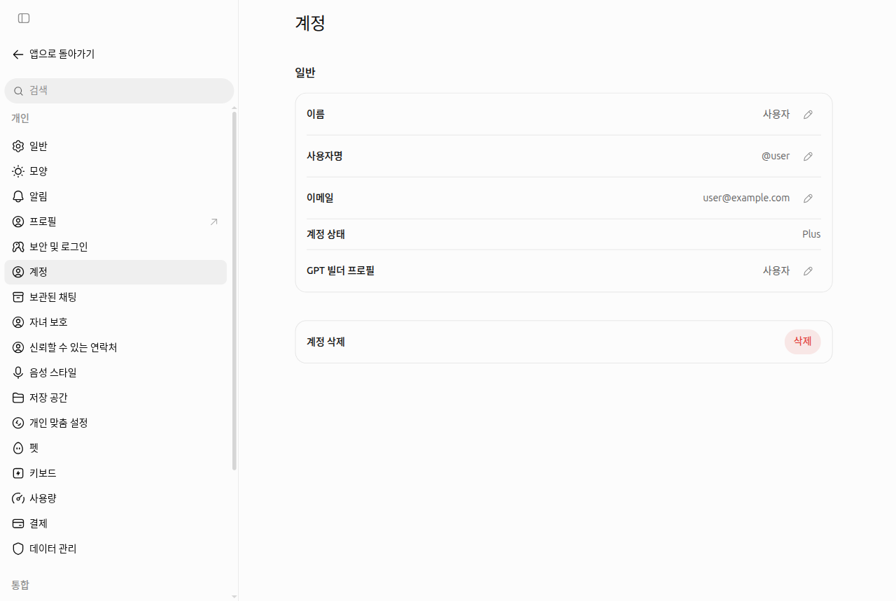

# 8장. 개인정보와 데이터 관리 — 내 대화가 어디에 쓰이는지 정하기

> **한 줄 요약**: ChatGPT에 보낸 대화는 OpenAI의 컴퓨터(서버)에 저장되고, 설정에 따라 AI를 더 좋게 만드는 학습에 쓰일 수 있습니다.
> 「설정 > 데이터 관리」 한 화면에서 학습 허용 여부, 공유 링크, 보관·삭제, 내보내기를 모두 정할 수 있습니다.

화면은 2026년 10월 웹(Plus 요금제) 기준입니다. 무료 요금제나 휴대폰 앱은 메뉴 위치가 조금 다를 수 있습니다.

**무엇을 넣지 말아야 하는지**는 어느 AI에나 똑같아서 [1단계 9장 「넣지 말아야 할 것」](../00-common/09-safety.md#넣지-말아야-할-것)에서 이미 다뤘습니다. 이 장에서는 **이미 넣은 대화를 ChatGPT에서 어떻게 관리하는지**만 봅니다.

## 데이터 관리 화면 둘러보기

왼쪽 아래 계정 이름을 누르고 「설정」을 연 뒤, 설정 화면 왼쪽 목록 맨 아래쪽의 「데이터 관리」를 누릅니다.
공식 도움말에는 이 메뉴가 「데이터 제어」(Data controls)라고 적혀 있지만, 실제 화면 이름은 「데이터 관리」입니다.



| 항목 | 하는 일 | 이 장에서 |
|---|---|---|
| 「공유 링크」 「관리」 | 내가 만든 대화 공유 링크를 모아 보고 지운다 | 3절 |
| 「모델 개선을 위한 데이터 학습 허용」 | 내 채팅을 학습에 쓰게 할지 정하는 스위치 | 2절 |
| 「위치」 「켜기」 | 기기 위치를 지역 맞춤 추천·날씨 같은 답에 쓰게 한다 | 아래 설명 |
| 「Work 네트워크 액세스」·「ChatGPT Work 재설정」 | Work 기능에 관한 설정 | [7장](07-projects-plugins.md) |
| 「앱과 공유되는 정보」 「관리」 | 연결한 앱(플러그인)과 나누는 정보를 관리 | [7장](07-projects-plugins.md) |
| 「보관된 채팅」·「모든 채팅 보관하기」·「모든 채팅 삭제」 | 대화를 숨기거나 한꺼번에 지운다 | 4절 |
| 「데이터 내보내기」 「내보내기」 | 내 대화 기록 전체를 파일로 받는다 | 5절 |
| 「쿠키 설정」 「관리」 | 웹사이트가 내 브라우저에 남기는 작은 기록(쿠키) 설정 | — |

**위치**: 기기 위치 공유는 처음에 꺼져 있습니다.[^search] 켜지 않아도 ChatGPT는 인터넷 접속 주소(IP 주소)로 대략적인 지역은 압니다. "우리 동네 날씨"처럼 동네 단위 답이 꼭 필요할 때만 켜도 충분합니다.

<Quiz id="ch108-screen" />

## 학습에 쓰이지 않게 하기

**모델 학습**(model training)은 AI 회사가 사람들의 대화를 모아 다음 AI를 더 똑똑하게 가르치는 데 쓰는 것입니다. 「모델 개선을 위한 데이터 학습 허용」이 이것을 정하는 스위치입니다. 도움말의 영어 이름은 Improve the model for everyone(모두를 위한 모델 개선)입니다.

### 처음에 켜져 있을 수 있습니다

이 스위치가 처음에 켜져 있는지 꺼져 있는지는 **요금제와 지역에 따라 다를 수 있습니다.** OpenAI 도움말 한 곳은 개인 계정의 Free·Plus·Pro 요금제에서 기본으로 켜져 있다고 적고, 다른 곳은 지역과 설정에 따라 다르다고 적습니다.[^controls][^home]
그러니 "나는 꺼져 있겠지" 하고 넘어가지 말고 **직접 열어서 확인**하세요. 위 그림은 스위치를 끈(회색) 상태입니다.

### 끄는 법

1. 계정 이름 → 「설정」 → 「데이터 관리」를 엽니다.
2. 「모델 개선을 위한 데이터 학습 허용」 오른쪽 스위치를 눌러 회색으로 만듭니다. 확인 창이 뜨면 「완료」를 누릅니다.

로그인한 상태에서 바꾸면 **같은 계정으로 로그인한 모든 기기**(휴대폰 앱 포함)에 적용됩니다. 로그인하지 않은 상태에서 바꾸면 **그 브라우저에만** 저장됩니다.[^controls]

### 꺼도 달라지지 않는 것

| 오해 | 실제 |
|---|---|
| 끄면 대화 기록이 사라진다 | 아니다. 기록은 옆 메뉴에 그대로 남는다 |
| 끄면 어떤 대화도 학습에 안 쓰인다 | 답변 아래 좋아요·싫어요 버튼 같은 피드백(feedback, 답이 좋았는지 알려 주는 평가)을 보내면 **그 대화 전체가 학습에 쓰일 수 있다** |
| 끄면 저장도 안 된다 | 학습에 안 쓰일 뿐, 대화는 서버에 저장된다. 지우고 싶으면 4절의 삭제를 쓴다 |
| 켜 두면 연결한 Google 앱 자료도 학습에 쓰인다 | 아니다. 연결한 Google 앱(Gmail·Drive 등)에서 **직접 읽어 온 자료**는 스위치가 켜져 있어도 학습에 쓰지 않는다고 도움말은 밝힌다. 다만 피드백(좋아요·싫어요)을 보낸 대화, 직접 복사·붙여 넣기·업로드한 내용, ChatGPT 답에 들어간 내용은 예외다[^google] |

> 학습 허용과 별개로, 사용자 지정 지침([5장](05-memory.md))에 적은 내용도 이 스위치를 따릅니다.[^ci] 스위치 하나로 함께 막을 수 있습니다.

<Quiz id="ch108-training" />

## 공유 링크 관리하기

대화를 남에게 보여 주려고 만든 **공유 링크**(share link)는 링크 주소를 가진 사람이면 **누구나** 볼 수 있습니다. 사람별로 막을 수 없고, 저절로 없어지는 만료일도 없습니다.[^share]
링크 만드는 법은 [3장](03-chats.md)에서 봤습니다. 여기서는 **예전에 만든 링크를 정리하는 법**입니다.

1. 「데이터 관리」에서 「공유 링크」 오른쪽 「관리」를 누릅니다.
2. 목록에서 필요 없는 링크를 하나씩 지우거나, 「모든 공유 링크 삭제」로 한꺼번에 지웁니다.

<!-- 스크린샷 필요: 「데이터 관리 > 공유 링크 > 관리」를 눌렀을 때 뜨는 공유 링크 목록 창 -->

단체 대화방에 한 번 올린 링크는 내가 어디까지 퍼졌는지 알 수 없습니다. 링크를 지우는 것이 가장 확실한 회수 방법입니다.

<Quiz id="ch108-share" />

## 보관과 전체 삭제

대화를 정리하는 방법은 두 가지이고, 결과가 완전히 다릅니다.[^delete]

| | 보관 (Archive) | 삭제 (Delete) |
|---|---|---|
| 옆 메뉴에서 | 사라진다 | 사라진다 |
| 대화 내용 | **그대로 남는다.** 채팅 검색에도 나온다 | 30일 안에 OpenAI 시스템에서 영구 삭제되도록 예약된다 |
| 되돌리기 | 「보관된 채팅」에서 보관 취소 | **불가능.** 고객 지원팀도 되살리지 못한다 |

「데이터 관리」에서는 이것을 한꺼번에 할 수 있습니다.

- 「보관된 채팅」 「관리」: 보관해 둔 대화 목록을 보고 보관을 취소합니다.
- 「모든 채팅 보관하기」 「모두 보관하기」: 옆 메뉴를 한 번에 비웁니다. 내용은 남습니다.
- 「모든 채팅 삭제」 「전체 삭제」: 모든 대화를 지웁니다. **되돌릴 수 없습니다.** 누르기 전에 5절의 내보내기로 백업을 받아 두세요.

**채팅을 지워도 남는 것이 있습니다.**

- 대화에 올린 파일 가운데 **라이브러리**([4장](04-files-images.md))에 따로 저장된 파일은 남습니다.[^delete] 라이브러리에서 따로 지웁니다.
- 그 대화에서 생긴 **저장된 메모리**([5장](05-memory.md))도 남습니다.[^memory] 「개인 맞춤 설정」에서 따로 지웁니다([5장](05-memory.md)).

처음부터 기록을 남기고 싶지 않은 대화라면 **임시 채팅**이 더 간단합니다. 오른쪽 위 「임시 채팅」 버튼으로 시작하면 대화 기록에 남지 않고 모델 학습에도 쓰이지 않습니다. 다만 안전을 위해 사본이 최대 30일 보관될 수 있습니다.[^temp] 자세한 사용법은 [3장](03-chats.md)에 있습니다.

<Quiz id="ch108-delete" />

## 데이터 내보내기

**데이터 내보내기**(export)는 지금까지의 대화 기록과 계정 정보를 압축 파일(ZIP, 여러 파일을 하나로 묶은 파일) 하나로 받는 기능입니다. 전체 삭제나 계정 삭제 전에 백업용으로 씁니다.[^export]

1. 「데이터 관리」에서 「데이터 내보내기」 오른쪽 「내보내기」를 누릅니다.
2. 확인 창에서 「내보내기 확인」을 누릅니다.
3. 가입한 이메일(또는 문자)로 내려받기 링크가 옵니다. **최대 7일**이 걸릴 수 있습니다.
4. 링크는 **받은 뒤 24시간이 지나면 만료**됩니다. 메일이 오면 바로 내려받으세요. 놓쳤다면 다시 신청합니다.

Free·Go·Plus·Pro 개인 계정에서 쓸 수 있고, 로그인하지 않은 상태에서는 쓸 수 없습니다.[^export]

> 내려받은 파일에는 **내 모든 대화가 들어 있습니다.** 공용 컴퓨터에 받지 말고, 다른 사람과 같이 쓰는 클라우드 폴더에 올리지 마세요.

**다른 계정으로 대화를 옮기는 기능은 없습니다.** 두 계정을 합치거나 대화 목록을 통째로 옮길 수는 없고, 내려받은 압축 파일 안의 `conversations.json` 파일을 새 계정의 대화에 올려 **참고 자료로** 쓰는 정도만 됩니다. 옆 메뉴에 예전 대화가 생기지는 않습니다.[^transfer]

<Quiz id="ch108-export" />

## 계정 삭제

ChatGPT를 더는 쓰지 않을 때는 계정을 지울 수 있습니다.[^account]

1. 「설정」 → 「계정」을 엽니다.
2. 「계정 삭제」 옆 「삭제」를 누릅니다.
3. 안내에 따라 이메일 주소와 `DELETE` 를 입력하고 「내 계정을 영구 삭제하기」를 누릅니다.



*이름·사용자명·이메일은 예시로 바꾼 화면입니다. 「삭제」는 누르지 않았습니다.*

<!-- 스크린샷 필요: 「삭제」를 눌렀을 때 뜨는 확인 창 -->

| 지운 뒤에는 | 내용 |
|---|---|
| 데이터 | 30일 안에 삭제됩니다(법으로 보관해야 하는 경우는 예외) |
| 되살리기 | 불가능합니다 |
| 다시 가입 | 같은 이메일로는 **30일이 지난 뒤**에 새로 가입할 수 있습니다 |

**구독은 따로 해지하세요.** 아이폰 앱스토어(Apple)로 결제한 구독은 계정을 지워도 취소되지 않습니다.[^account] 휴대폰에서 앱을 지워도 구독은 계속됩니다.[^pro] 계정을 지우기 전에 결제한 곳에서 먼저 구독을 해지합니다.

<Quiz id="ch108-account" />

## 계정 지키기

계정에는 내 모든 대화가 들어 있으니 비밀번호 하나로만 지키면 위험합니다. 설정 → 「보안 및 로그인」에서 아래를 확인합니다.[^screen-security]

| 화면 항목 | 하는 일 |
|---|---|
| 「다중 인증(MFA)」 | 비밀번호 말고 **인증 앱의 일회용 코드나 문자 메시지의 6자리 코드**로 한 번 더 확인한다. 켜 두기를 권한다(이 가이드의 제안) |
| 「패스키 및 보안 키」 | 비밀번호 대신 휴대폰 지문·얼굴 인식 같은 피싱(가짜 사이트로 비밀번호를 훔치는 수법)에 강한 방법으로 로그인한다 |
| 「활성 세션」 | 내 계정에 접속한 기기를 모두 보고, 기기를 제거하거나 모든 기기에서 로그아웃한다 |
| 「로그인 연동」 → 「ChatGPT로 로그인」 | ChatGPT 계정으로 로그인한 다른 앱·사이트를 보고 접근을 끊는다 |
| 「락다운 모드」 | 아래 설명 |

**모르는 대화나 기기가 보이면** 바로 비밀번호를 바꿉니다. 바꾸면 **30분 안에 모든 기기에서 로그아웃**됩니다. Google·Microsoft 계정으로 로그인해 왔다면 그 회사 계정의 비밀번호를 바꿔야 합니다.[^unrecognized] 계정을 여러 사람이 나눠 쓰면 이상한 활동으로 잡히기 쉬우니 나눠 쓰지 않습니다.[^errors]

**「ChatGPT로 로그인」** 을 누르면 그 앱이나 사이트는 **이름·이메일·프로필 사진만** 받습니다.[^signin] 대화 내용이 넘어가는 것은 아니지만, 로그인한 곳이 어디인지는 위 「로그인 연동」에서 가끔 정리하세요.

**락다운 모드**(Lockdown Mode)는 웹 검색을 미리 저장된 내용으로만 하게 하고 심층 리서치 같은 바깥 연결 기능을 막아서, 웹페이지나 파일에 숨겨진 나쁜 지시(**프롬프트 인젝션**, prompt injection)로 정보가 새는 위험을 줄이는 설정입니다.[^lockdown] 도움말은 이 기능이 **모든 사람을 위한 것은 아니고**, 숨겨진 지시 자체를 막지는 못한다고 밝힙니다. 도움말은 **민감한 데이터를 다루는 사람과 조직**을 위한 기능이라고 설명하고, 요금제·계정에 따라 없을 수도 있습니다. 그런 경우가 아니라면 보통은 켜지 않아도 된다는 것이 이 가이드의 판단입니다. 숨겨진 지시가 무엇인지는 [1단계 9장](../00-common/09-safety.md)을 보세요.

<Quiz id="ch108-security" />

## 가족과 안전을 위한 기능

설정에는 「자녀 보호」와 「신뢰할 수 있는 연락처」 메뉴가 있습니다.[^screen-security] 둘 다 켜지 않아도 ChatGPT를 쓰는 데 문제는 없지만, 무엇을 하고 **무엇을 하지 않는지** 알아 두면 오해가 줄어듭니다.

**자녀 보호**(parental controls)는 보호자와 청소년(만 18세 미만)의 계정을 연결해, 보호자가 일부 기능을 조정하고 쓰는 시간을 정하고 드물게 안전 알림을 받는 기능입니다.[^parental]

- **보호자는 자녀의 대화를 볼 수 없습니다.** 계정을 연결해도 대화 내용, 기록, 지금 하는 활동에 접근하지 못합니다.[^parental]
- ChatGPT가 사용 신호로 만 18세 미만이라고 판단하면 청소년 보호가 자동으로 켜질 수 있습니다. 성인인데 잘못 판단됐다면, 내 계정에서 나이 확인을 쓸 수 있는 경우 확인을 거쳐 풀 수 있습니다(계정마다 다릅니다). 확인은 **Persona**라는 외부 회사가 맡고, **OpenAI는 신분증이나 셀카를 받지 않으며**, 주민등록번호 같은 신분증 번호는 보여 줄 필요가 없습니다.[^age]

**신뢰할 수 있는 연락처**(trusted contact)는 성인이 미리 정해 둔 한 사람에게, 자살과 관련해 안전이 크게 걱정되는 대화가 있을 때 안부를 확인해 달라는 알림이 가게 하는 기능입니다. 자동 감지 뒤 훈련받은 사람이 검토합니다.[^trusted]

- **개인 계정에서만** 쓸 수 있고 Business·Enterprise·Edu 같은 회사·학교 공간에서는 켜지지 않습니다.[^trusted]
- **한국에서는 본인과 연락처로 정한 사람 모두 만 19세 이상**이어야 합니다(다른 나라는 만 18세 이상).[^trusted-ko]
- 알림에 **대화 내용은 들어가지 않습니다.** 지정받은 사람이 초대를 **1주 안에** 받아들여야 켜집니다. ChatGPT 계정이 없는 사람도 지정할 수 있습니다.[^trusted][^trusted-add]
- **응급 서비스가 아닙니다.** 음성 대화에서는 작동하지 않습니다. 지금 위험하다면 이 기능을 기다리지 말고 응급 서비스나 위기 상담 전화에 바로 연락하세요.[^trusted]

힘든 마음을 털어놓는 대화에서는 ChatGPT가 사는 지역의 **위기 상담 기관**을 안내할 수 있습니다. OpenAI는 위기 상담 연결 전문 단체(ThroughLine)와 함께 지역별 상담 기관을 보여 준다고 밝힙니다.[^helpline]

<Quiz id="ch108-family" />

## 회사 계정은 무엇이 다른가

회사가 단체로 계약한 **Business**(예전 이름 Team)·**Enterprise**, 학교용 **Edu** 요금제는 기본적으로 대화 내용을 학습에 쓰지 않습니다.[^controls]
회사 계정으로 쓰고 있다면 위의 학습 스위치보다 **회사의 AI 사용 규정**이 먼저입니다. 무엇을 넣어도 되는지는 회사 담당 부서에 확인하세요.

반대로, 회사 일을 **개인 계정**으로 하면 이 보호를 받지 못합니다. 회사 자료는 회사가 허락한 계정에서만 다룹니다.

회사 계정에서 알아 둘 점이 더 있습니다.

- **관리자가 내 대화를 다룰 수 있습니다.** 회사 관리자는 설정에 따라 그 계정의 데이터를 열람·내보내기·감사·보관·삭제할 수 **있을 수 있고**, 모델 개선을 위해 OpenAI와 공유하는 데 동의할 수도 있습니다.[^managed] 회사 계정의 대화는 회사 기록이라고 생각하세요.
- **개인 계정과 회사 계정은 따로입니다.** 계정을 바꿔 들어가도 대화·파일·설정은 옮겨지지 않습니다.[^managed]
- **개인 공간을 회사 공간으로 합치라는 안내**가 뜰 수 있습니다. 합치면 되돌릴 수 없고, 퇴사하면 옮긴 대화도 볼 수 없게 될 수 있으며, 회사 공간에서는 직접 내보내기도 안 됩니다. 합치기 전에 개인 기록을 먼저 내보내 두세요.[^migrate]
- 회사가 메모리 기능을 끄면 그 회사 공간의 내 저장된 메모리는 지워집니다.[^bizmemory]

<Quiz id="ch108-business" />

## 직접 해 보기

**1. 내 학습 설정 확인하기**

「설정」 → 「데이터 관리」를 열고 「모델 개선을 위한 데이터 학습 허용」이 켜져 있는지 봅니다. 원하는 쪽으로 바꾼 뒤, 휴대폰 앱이 있다면 앱에서도 같은 값으로 바뀌었는지 확인합니다.

**2. 공유 링크 대청소**

「공유 링크」 「관리」를 열어 지금 살아 있는 링크가 몇 개인지 세어 봅니다. 더 이상 보여 줄 필요가 없는 링크는 지웁니다.

**3. ChatGPT에게 내 설정 점검표 받기**

```
나는 ChatGPT를 개인 계정으로 쓰고 있어.
내 대화가 학습에 쓰이지 않게 하고, 예전 공유 링크를 정리하고 싶어.
설정 화면에서 내가 직접 확인해야 할 항목을 점검표(☐)로 만들어 줘.
네가 확실히 모르는 메뉴 이름은 지어내지 말고 "화면에서 확인"이라고 적어 줘.
```

받은 점검표의 메뉴 이름을 이 장의 표와 비교해 보세요. 다르다면 화면에 보이는 이름이 맞습니다.

## 정리

- 「설정 > 데이터 관리」 한 화면에서 학습 허용, 공유 링크, 보관·삭제, 내보내기를 정한다.
- 「모델 개선을 위한 데이터 학습 허용」은 요금제·지역에 따라 처음에 켜져 있을 수 있다. 직접 열어 확인한다. 꺼도 피드백을 보낸 대화는 학습에 쓰일 수 있다.
- 공유 링크는 누구나 볼 수 있고 만료되지 않는다. 필요 없으면 「관리」에서 지운다.
- 보관은 숨기기, 삭제는 30일 안에 영구 삭제이고 되돌릴 수 없다. 라이브러리 파일과 저장된 메모리는 따로 지운다.
- 내보내기 링크는 받은 뒤 24시간 안에 내려받는다. 계정을 지우기 전에는 구독을 먼저 해지한다.
- 「보안 및 로그인」에서 다중 인증을 켜고, 모르는 기기는 로그아웃시킨다. 비밀번호를 바꾸면 30분 안에 모든 기기에서 로그아웃된다.
- 자녀 보호를 연결해도 보호자는 대화를 못 본다. 신뢰할 수 있는 연락처는 한국에서 만 19세 이상이고 응급 서비스가 아니다.
- 회사 계정(Business·Enterprise·Edu)은 기본적으로 학습에 쓰이지 않지만, 회사 규정이 먼저이고 관리자가 대화를 다룰 수 있다.

## 용어 정리

| 용어 | 읽는 법 | 한 줄 뜻 |
|---|---|---|
| Data controls | 데이터 컨트롤 (데이터 관리) | 내 대화의 학습·보관·삭제를 정하는 설정 화면 |
| Model training | 모델 트레이닝 (모델 학습) | 모은 대화로 다음 AI를 가르치는 것 |
| Share link | 셰어 링크 (공유 링크) | 대화를 남에게 보여 주는 주소. 가진 사람 누구나 볼 수 있다 |
| Archive | 아카이브 (보관) | 대화를 지우지 않고 옆 메뉴에서만 숨기는 것 |
| Export | 익스포트 (내보내기) | 내 기록 전체를 파일로 받는 것 |
| ZIP | 집 | 여러 파일을 하나로 묶어 크기를 줄인 압축 파일 |
| Cookie | 쿠키 | 웹사이트가 내 브라우저에 남기는 작은 기록 |
| Subscription | 서브스크립션 (구독) | 매달 돈을 내고 쓰는 요금제 |
| MFA (Multi-Factor Authentication) | 엠에프에이 (다중 인증) | 비밀번호 말고 다른 방법으로 한 번 더 본인을 확인하는 로그인 |
| Passkey | 패스키 | 비밀번호 대신 기기의 지문·얼굴 인식으로 로그인하는 방법 |
| Lockdown Mode | 락다운 모드 | 바깥 연결 기능을 막아 숨겨진 지시로 정보가 새는 위험을 줄이는 설정 |
| Prompt Injection | 프롬프트 인젝션 | 웹페이지·파일 속에 숨겨 둔 지시로 AI를 엉뚱하게 움직이게 하는 공격 |
| Parental Controls | 페어런털 컨트롤 (자녀 보호) | 보호자와 청소년 계정을 연결해 일부 기능과 시간을 정하는 기능 |
| Trusted Contact | 트러스티드 컨택트 (신뢰할 수 있는 연락처) | 위기 때 안부 확인 알림을 받도록 미리 정해 둔 사람 |

<ChapterDone :chapter="108" />

다음 장: [9장. 음성으로 대화하기](09-voice.md)

---

[^controls]: OpenAI 도움말, 「Data controls in ChatGPT」. 개인 워크스페이스의 Free·Plus·Pro 는 기본 켜짐, 로그인 시 모든 기기 적용, 로그아웃 상태는 그 브라우저에만 저장, 피드백 시 대화 전체가 학습에 쓰일 수 있음, Business·Enterprise·Edu 는 기본적으로 학습에 쓰지 않음. https://help.openai.com/en/articles/7730893 (확인일 2026-10-23)
[^home]: OpenAI 도움말, 「The ChatGPT home page」. 학습 사용 여부는 "depends on your location and settings". https://help.openai.com/en/articles/9125172 (확인일 2026-10-23)
[^ci]: OpenAI 도움말, 「ChatGPT Custom Instructions」. 맞춤 지침 사용 정보도 모델 개선에 쓰일 수 있으며 학습 설정으로 거부 가능. https://help.openai.com/en/articles/8096356 (확인일 2026-10-23)
[^search]: OpenAI 도움말, 「Searching the web with ChatGPT」. "Device location sharing is optional and off by default." IP 로 대략적 위치 사용. https://help.openai.com/en/articles/9237897 (확인일 2026-10-23)
[^share]: OpenAI 도움말, 「Sharing conversations and scheduled tasks in ChatGPT」. 링크를 가진 누구나 열람, 만료일 설정 없음, 「공유 링크 > 관리」에서 개별 삭제·모든 공유 링크 삭제. https://help.openai.com/en/articles/7925741 (확인일 2026-10-23)
[^delete]: OpenAI 도움말, 「Deleting and archiving chats in ChatGPT」. 삭제는 30일 안에 영구 삭제 예약·복원 불가, 보관은 사이드바에서만 빠지고 검색에 나옴, 모든 채팅 삭제는 되돌릴 수 없음, 채팅 삭제로 라이브러리 파일은 지워지지 않음. https://help.openai.com/en/articles/8809935 (확인일 2026-10-23)
[^memory]: OpenAI 도움말, 「Memory in ChatGPT」. "Deleting the original chat does not automatically delete a separate saved memory." https://help.openai.com/en/articles/8590148 (확인일 2026-10-23)
[^temp]: OpenAI 도움말, 「Temporary chat in ChatGPT」. 기록에 남지 않고 학습에 쓰이지 않으며 안전 목적으로 최대 30일 보관될 수 있음. https://help.openai.com/en/articles/8914046 (확인일 2026-10-23)
[^export]: OpenAI 도움말, 「Exporting your ChatGPT history and data」. 이메일·SMS 로 링크 발송, 최대 7일 소요, "The download link expires 24 hours after you receive it.", ZIP 파일, Free·Go·Plus·Pro, 로그아웃 상태 불가. https://help.openai.com/en/articles/7260999 (확인일 2026-10-23)
[^account]: OpenAI 도움말, 「Deleting your ChatGPT account」. 30일 안에 데이터 삭제(법적 예외), 재활성화 불가, 같은 이메일은 30일 후 재가입 가능, "Deleting your account does not cancel an Apple subscription." https://help.openai.com/en/articles/6378407 (확인일 2026-10-23)
[^google]: OpenAI 도움말, 「Google app data controls FAQ」. "Even if this setting is enabled, we do not train our generalized models on data accessed directly from connected Google apps." https://help.openai.com/en/articles/10408842 (확인일 2026-10-24)
[^transfer]: OpenAI 도움말, 「Transfer exported conversations between ChatGPT accounts」. "This is not a full account migration." / "Find conversations.json." https://help.openai.com/en/articles/9106926 (확인일 2026-10-24)
[^screen-security]: ChatGPT 웹 설정 화면(Plus 요금제, 한국어)에서 직접 확인. 「보안 및 로그인」의 「다중 인증(MFA)」「패스키 및 보안 키」「활성 세션」「로그인 연동 — ChatGPT로 로그인」「락다운 모드」와 각 항목의 화면 설명("인증 앱의 일회용 코드 사용", "6자리 인증 코드를 받습니다", "신뢰하는 기기를 제거하거나, 모든 기기에서 로그아웃"), 설정 목록의 「자녀 보호」「신뢰할 수 있는 연락처」 (확인일 2026-10-24)
[^unrecognized]: OpenAI 도움말, 「I'm seeing unrecognized activity on my OpenAI account.」. "Once you change your password, all current sessions will be logged out within 30 minutes." / "If you have logged in with Microsoft or Google authentication, you'll need to reset your Microsoft or Google account password." https://help.openai.com/en/articles/8485685 (확인일 2026-10-24)
[^errors]: OpenAI 도움말, 「Troubleshooting ChatGPT Error Messages」. "Ensure you are not sharing your ChatGPT account with other people". https://help.openai.com/en/articles/7996703 (확인일 2026-10-24)
[^signin]: OpenAI 도움말, 「Sign in with ChatGPT」. "the external application receives only your name, email address, and profile picture, if you have one." https://help.openai.com/en/articles/20001410 (확인일 2026-10-24)
[^lockdown]: OpenAI 도움말, 「Lockdown Mode」. "Web browsing is limited to cached content." / "Deep research is disabled." / "It is designed for people and organizations that handle sensitive data" / "Lockdown Mode is not intended for everyone." / "Lockdown Mode does not prevent prompt injections from appearing in the content ChatGPT processes." https://help.openai.com/en/articles/20001061 (확인일 2026-10-24)
[^parental]: OpenAI 도움말, 「Managing parental controls in ChatGPT」. "Parental controls let a parent or guardian link their ChatGPT account to a teen’s account, manage selected settings, set schedules, and receive safety notifications in limited situations." / "Linking accounts does not give a parent or guardian access to a teen’s conversations, chat history, or real-time activity." https://help.openai.com/en/articles/12315553 (확인일 2026-10-24)
[^age]: OpenAI 도움말, 「Age prediction in ChatGPT」. "OpenAI uses Persona, a third-party service, to verify your age." / "OpenAI does not receive your ID or selfie." / "You do not need to show ID numbers, such as a national ID number or Social Security number." https://help.openai.com/en/articles/12652064 (확인일 2026-10-24)
[^trusted]: OpenAI 도움말, 「Trusted contacts in ChatGPT」. "if automated systems and trained reviewers detect you may be talking about suicide in a way that signals a serious safety concern, ChatGPT may notify your trusted contact" / "Your chat details or transcripts are not shared." / "Trusted contact is not an emergency service, a crisis response system, or a substitute for mental health care." / "Trusted contact is not currently available in ChatGPT Voice." / "It is available for personal ChatGPT accounts, and is not enabled in shared workspaces such as ChatGPT Business, Enterprise, or Edu." https://help.openai.com/en/articles/20001105 (확인일 2026-10-24)
[^trusted-ko]: OpenAI 도움말, 「Managing parental controls in ChatGPT」. "Trusted Contact is a separate, optional feature for adults 18 or older, or 19 or older in Korea." 한국어 설정 화면에도 "사용자 본인과 해당 연락처로 지정된 사람 모두 만 19세 이상이어야 합니다"라고 나온다(확인일 2026-10-24). https://help.openai.com/en/articles/12315553 (확인일 2026-10-24)
[^trusted-add]: OpenAI 도움말, 「Adding and managing a trusted contact」. "If the person accepts the invitation within 1 week, the feature becomes active." https://help.openai.com/en/articles/20001194 (확인일 2026-10-24). ChatGPT 계정이 없어도 된다는 것은 「Being someone’s trusted contact」 "You do not need a ChatGPT account to be someone’s trusted contact." https://help.openai.com/en/articles/20001195 (확인일 2026-10-24)
[^helpline]: OpenAI 도움말, 「Crisis helpline support in ChatGPT」. "As part of our partnership with ThroughLine, we have introduced localized helplines in ChatGPT". https://help.openai.com/en/articles/12677603 (확인일 2026-10-24)
[^managed]: OpenAI 도움말, 「Data access for your managed ChatGPT account」. "your administrator may be able to access, export, audit, retain, delete, and opt-in to share data tied to this account with OpenAI to improve OpenAI’s models." / "Switching accounts does not move chats, files, or settings between accounts." https://help.openai.com/en/articles/20001067 (확인일 2026-10-24)
[^migrate]: OpenAI 도움말, 「Migrating your personal workspace to ChatGPT Business or Enterprise」. "Migration does not provide an undo option" / "If you leave, are removed, or lose access to the destination workspace, you may also lose access to that content." / "Self-service data export is not available in ChatGPT Business or Enterprise workspaces." https://help.openai.com/en/articles/8801890 (확인일 2026-10-24)
[^bizmemory]: OpenAI 도움말, 「Memory FAQ (Business Version)」. "If a workspace owner turns off Memory for the workspace, existing saved memories for members in that workspace are deleted." https://help.openai.com/en/articles/9295112 (확인일 2026-10-24)
[^pro]: OpenAI 도움말, 「About ChatGPT Pro tiers」. "Uninstalling the ChatGPT app does not cancel your subscription." https://help.openai.com/en/articles/9793128 (확인일 2026-10-23)
