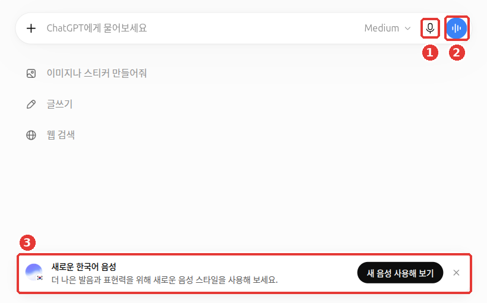
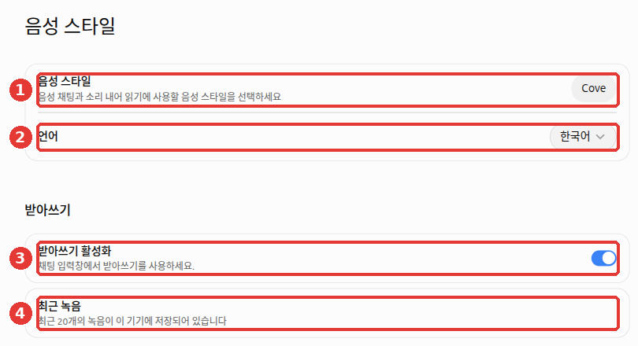

# 9장. 음성으로 대화하기 — 받아쓰기와 음성 대화

> **한 줄 요약**: 입력창 오른쪽에는 말로 쓰는 버튼이 두 개 있습니다. **마이크**는 내 말을 글자로 받아 적어 주고(받아쓰기),
> **파란 물결 버튼**은 ChatGPT와 전화하듯 말로 주고받게 해 줍니다(음성 대화). 목소리도 대화 기록처럼 저장될 수 있으니 장소와 내용을 가려서 씁니다.

화면은 2026년 10월 웹(Plus 요금제) 기준입니다. 무료 요금제나 휴대폰 앱은 메뉴 위치가 조금 다를 수 있습니다.

## 두 버튼의 차이 — 받아쓰기와 음성 대화



대화 제목과 계정 이름은 예시로 바꾼 화면입니다. ① 마이크가 받아쓰기, ② 파란 물결 버튼이 음성 대화이고, ③ 아래쪽은 새 한국어 음성 안내입니다.

| | ① 마이크 — 받아쓰기 (Dictation) | ② 파란 물결 버튼 — 음성 대화 (Voice) |
|---|---|---|
| 하는 일 | 내 말을 **글자로 바꿔 입력창에 넣는다** | ChatGPT와 **말로 주고받는다**. 답도 목소리로 온다 |
| 보내기 전에 | 받아 적은 글을 **읽고 고친 뒤** 내가 보낸다 | 고칠 틈 없이 바로 대화가 이어진다 |
| 어울리는 때 | 긴 질문을 손으로 치기 귀찮을 때, 정확한 문장이 중요할 때 | 생각을 말하며 정리할 때, 손이 바쁠 때, 말하기 연습 |

고르는 기준은 간단합니다. 주고받는 대화가 필요하거나 아이디어를 말로 풀어 볼 때는 **음성 대화**를 쓰세요. 녹음한 말을 글로 확인하고 고쳐서 보내고 싶을 때는 **받아쓰기**를 쓰세요.[^voice]

받아쓰기는 이렇게 해 보세요. 마이크를 누르고 아래처럼 말합니다. 그다음 입력창에 적힌 글을 확인하고, 틀린 글자를 고쳐 보냅니다.

```
다음 주 토요일에 부모님 모시고 갈 만한 서울 근교 당일치기 장소 세 곳 추천해 줘.
걷는 거리가 짧은 곳으로.
```

사람 이름이나 지명은 잘못 받아 적히기 쉽습니다. 그래서 보내기 전에 한 번 읽어 보는 것이 받아쓰기의 장점입니다.

<Quiz id="ch109-buttons" />

## 음성 대화 해 보기

1. 입력창 오른쪽의 **파란 물결 버튼**을 누릅니다. 휴대폰 앱에서는 메시지 입력줄의 음성 아이콘입니다.[^voice]
2. 처음 쓸 때 브라우저가 마이크를 써도 되는지 물으면 허락합니다. 허락해야 내 목소리가 들어갑니다.
3. 평소 말하듯 이야기합니다. 끝나면 화면의 종료 버튼으로 대화를 마칩니다.

<!-- 스크린샷 필요: 웹에서 파란 물결 버튼을 눌러 음성 대화가 진행 중인 화면(종료 버튼 위치 포함) -->

음성 대화는 **한 번에 하나만** 할 수 있습니다.[^voice] 말로 할 때도 1단계에서 배운 요령이 그대로 통합니다. 누구를 위한 것인지, 어떤 모양으로 받고 싶은지를 말해 주세요([1단계 4장](../00-common/04-prompt-basics.md)).

말로 해 보기 좋은 요청을 두 가지 들어 보겠습니다.

```
나 다음 주에 회사 면접이 있어. 네가 면접관이 돼서 질문을 하나씩 해 줘.
내가 대답하면 좋았던 점 하나, 고칠 점 하나만 짧게 말해 주고 다음 질문으로 넘어가 줘.
```

```
영어 회화 연습하고 싶어. 카페에서 주문하는 상황으로 짧게 대화해 줘.
내 발음이나 문장이 어색하면 한국어로 짧게 알려 줘.
```

답이 너무 길면 말로 바로 "더 짧게 말해 줘"라고 하면 됩니다. 글로 대화할 때 고쳐 달라고 하던 방식([1단계 6장](../00-common/06-conversation.md))과 같습니다.

운전 중에는 **CarPlay**(카플레이, 아이폰을 차 화면에 연결하는 Apple 기능)로도 ChatGPT와 음성으로 대화할 수 있습니다. 모든 요금제에서, 전 세계에서 됩니다. iOS 26.4 이상의 아이폰이 필요합니다. 다만 **지도·차량 정보·현재 위치는 보지 못합니다.** 그래서 길 안내 앱 대신 쓸 수는 없습니다.[^carplay]

<Quiz id="ch109-start" />

## 음성 방식과 음성 스타일

### 세 가지 방식

음성 대화 방식은 세 가지입니다.[^voice]

- **라이브 (Live)**: 듣는 것과 말하는 것을 동시에 합니다. 그래서 ChatGPT가 말하는 중에 끼어들 수 있습니다. 영상·화면 공유는 안 됩니다.
- **고급 (Advanced)**: 예전부터 있던 실시간 방식입니다. 휴대폰 앱에서 카메라 영상이나 화면을 보여 주며 대화할 수 있습니다.
- **표준 (Standard)**: 내 말을 먼저 글로 받아 적은 뒤 답합니다. 한 번씩 차례로 주고받습니다.

영상·화면 공유가 필요하면 휴대폰 앱의 고급 방식을 쓰세요. 예를 들어 고장 난 가전제품을 카메라로 비추며 "이 불빛이 무슨 뜻이야?"라고 물을 수 있습니다.

### 방식과 목소리 고르기

웹에서는 계정 이름 → 「설정」 → **「음성 스타일」**에서 목소리와 언어를 고릅니다. 2026년 10월 23일 웹(Plus) 화면에서 열어 보니 「음성 스타일」에는 다음 항목이 있었습니다.



그림의 빨간 번호가 아래 표의 번호입니다.

| 번호 | 항목 | 화면의 설명 |
|---|---|---|
| ① | 음성 스타일 | 음성 채팅과 소리 내어 읽기에 사용할 목소리 고르기 |
| ② | 언어 | 음성으로 대화할 언어(예: 한국어) |
| ③ | 받아쓰기 활성화 | 채팅 입력창에서 받아쓰기(마이크 버튼)를 쓸지 정하기 |
| ④ | 최근 녹음 | 최근 녹음 20개가 **이 기기에** 저장되어 있다는 안내 |

라이브 방식에는 한국어 목소리 **햇살**(Haetsal)과 **한울**(Hanul)이 추가됐습니다.[^voice] 첫 화면 아래에 「새로운 한국어 음성」 안내가 보이면 「새 음성 사용해 보기」를 눌러 보세요. 어떤 방식과 목소리를 고를 수 있는지는 요금제에 따라 다를 수 있습니다. 위 캡처의 「Cove」처럼 목소리 이름은 영어로 보이기도 합니다. 다른 목소리를 쓰려면 「음성 스타일」 칸(①)을 눌러 목록에서 고르면 됩니다.

::: details 라이브·고급·표준 방식은 어디서 고르나요? (눌러서 펼치기)
도움말은 설정의 음성 항목에서 라이브·고급·표준 가운데 고른다고 안내합니다.[^voice] 그런데 2026년 10월 웹 화면의 설정 왼쪽 목록에는 「음성」이 아니라 「음성 스타일」이라는 항목이 보였고, 라이브·고급·표준을 고르는 칸은 이 화면에 **보이지 않았습니다.** 휴대폰 앱이나 요금제에 따라 다를 수 있습니다.
:::

<Quiz id="ch109-modes" />

## 얼마나 쓸 수 있나

음성 대화의 라이브 방식은 **최근 24시간 동안 쓴 시간**으로 한도를 셉니다. 한도에 닿으면 ChatGPT가 알려 줍니다.[^voice]

| 요금제 | 24시간 기준 사용량 (2026-10-23 확인) |
|---|---|
| Free | 제한적으로 이용 |
| Go | 3시간 |
| Plus | 3시간 |
| Pro | 등급에 따라 15시간, 또는 남용 방지 조건 아래 제한 없음 |

> 이 숫자는 자주 바뀝니다. 최신 값은 각주의 도움말 링크에서 확인하세요.

<Quiz id="ch109-limits" />

## 목소리 기록과 개인정보

### 목소리도 저장된다

녹음이 남는 기간은 방식마다 다릅니다.

- **라이브·고급**: 음성 녹음 조각이 대화 기록과 함께 30일 보관됩니다.
- **표준**: 글로 받아 적은 뒤 녹음은 지워집니다.
- **받아쓰기(마이크)**: 녹음이 그 대화가 기록에 남아 있는 동안 보관됩니다. 대화를 지우면 30일 안에 함께 지워집니다. 다만 보안·법적 이유나 학습 공유에 동의한 경우 등 예외가 있습니다.[^dictation]

녹음 자체는 내가 따로 공유를 허락하지 않으면 학습에 쓰이지 않습니다. 「내 오디오 녹음 포함」(Include your audio recordings) 설정을 따로 켜야 녹음이 학습에 쓰입니다. 다만 **받아 적은 글**은 일반 채팅처럼 「모델 개선을 위한 데이터 학습 허용」 설정을 따릅니다.[^voice] 이 설정은 [8장](08-privacy.md)에서 다뤘습니다.

### 공공장소에서 조심할 것

말로 하는 대화는 **옆 사람에게도 들립니다.** 내 질문뿐 아니라 ChatGPT의 대답도 스피커로 나옵니다.

- 지하철·카페·사무실에서는 이어폰을 쓰거나, 음성 대화 대신 **받아쓰기**로 조용히 입력하세요.
- 이름·전화번호·주소·병원 기록처럼 [1단계 9장](../00-common/09-safety.md#넣지-말아야-할-것)에서 본 **넣지 말아야 할 정보는 소리 내어 말하지도 마세요.** 말로 할 때는 글로 칠 때보다 무심코 말해 버리기 쉽습니다.
- 다른 사람이 함께 있는 자리에서 그 사람의 목소리나 대화가 같이 녹음되지 않게 하세요.
- 음성 대화에서는 연결한 앱([7장](07-projects-plugins.md#연결한-앱의-권한-정하기))이 안 될 수 있습니다. 안 되면 같은 부탁을 글로 입력해 보세요.[^apps-voice]

**회의를 받아 적게 할 때는 참석자 모두에게 먼저 알리고 동의를 받으세요.** Mac 컴퓨터 앱의 **Meetings 플러그인**(Pro·Business 요금제, 시험판)은 회의를 받아 적어 요약과 할 일을 만들어 줍니다. 앱이 띄우는 동의 안내는 나에게만 보이고, 다른 참석자에게는 가지 않습니다. 노트가 완성되면 녹음은 지워져 다시 들을 수 없습니다.[^meetings]


<Quiz id="ch109-privacy" />

## 영상으로 더 보기

회사가 직접 만든 소개 영상입니다. 화면과 기능 이름은 이 장의 설명과 다를 수 있습니다.

> 아래 영상은 모두 **영어**입니다. YouTube 영상의 설정(톱니바퀴) → 자막 → **자동 번역 → 한국어**를 고르면 한국어 자막으로 볼 수 있습니다. 링크는 YouTube로 이동합니다.

| 영상 | 채널 | 이런 분께 |
|---|---|---|
| [This is the new ChatGPT Voice, powered by GPT-Live](https://www.youtube.com/watch?v=EAN5Cj347PY) | OpenAI | 새 음성 대화를 소리로 직접 들어 보고 싶은 분 (2026년 7월, 4분) |
| [Get Stuff Done with ChatGPT Voice](https://www.youtube.com/watch?v=96ogPwN9ykM) | OpenAI | 음성 대화에서 메일·캘린더·Slack 같은 플러그인을 쓰는 예를 보고 싶은 분 (2026년 9월, 2분) |

둘째 영상은 음성 대화에서 플러그인을 쓰는 모습을 보여 줍니다. 내 화면에서 안 되면 이 장의 설명대로 같은 부탁을 글로 입력해 보세요.

## 직접 해 보기

**1. 같은 질문, 두 가지 방법**

아래 질문을 한 번은 **마이크(받아쓰기)**로, 한 번은 **새 채팅에서 파란 물결 버튼(음성 대화)**으로 해 봅니다.

```
냉장고에 계란, 두부, 대파가 있어. 15분 안에 만들 수 있는 반찬 두 가지 알려 줘.
```

그리고 두 가지를 스스로 물어보세요. 받아쓰기로 입력창에 적힌 글이 내가 말한 것과 같은가? 음성 대화에서는 답을 듣는 것과 읽는 것 중 어느 쪽이 편한가?

**2. 끼어들어 보기**

음성 대화에서 긴 설명을 부탁한 뒤, ChatGPT가 말하는 도중에 "잠깐, 더 짧게"라고 말해 봅니다. 라이브 방식은 말하는 중에도 내 말을 들으므로, 끼어든 요청이 반영되는지 확인해 보세요.

## 정리

- 마이크는 **받아쓰기**: 말을 글로 바꿔 입력창에 넣고, 내가 확인한 뒤 보낸다.
- 파란 물결 버튼은 **음성 대화**: 말로 주고받는다. 한 번에 하나만 할 수 있다.
- 방식은 라이브·고급·표준 세 가지다. 웹에서는 「설정」 → 「음성 스타일」에서 목소리와 언어를 고른다(라이브·고급·표준 칸은 화면에 따라 안 보일 수 있다). 영상·화면 공유는 휴대폰 앱의 고급 방식에서만 된다.
- 사용 한도는 24시간 기준이고 요금제마다 다르며 자주 바뀐다.
- 라이브·고급의 녹음은 30일 보관되고, 받아쓰기 녹음은 대화가 남아 있는 동안 보관된다. 회의를 받아 적게 할 때는 모두의 동의를 먼저 받는다. 받아 적은 글은 학습 설정을 따른다. 공공장소에서는 받아쓰기나 이어폰을 쓰고, 개인정보는 말하지 않는다.

## 용어 정리

| 용어 | 읽는 법 | 한 줄 뜻 |
|---|---|---|
| Dictation | 딕테이션 (받아쓰기) | 말을 글자로 바꿔 입력창에 넣는 기능 |
| Voice | 보이스 (음성 대화) | ChatGPT와 말로 주고받는 기능 |
| Live | 라이브 | 듣기와 말하기를 동시에 하는 음성 방식 |
| Advanced | 어드밴스드 (고급) | 영상·화면 공유를 할 수 있는 음성 방식 |
| Standard | 스탠더드 (표준) | 받아 적은 뒤 차례로 답하는 음성 방식 |
| Transcript | 트랜스크립트 (받아 적은 글) | 말한 내용을 글로 옮긴 기록 |
| CarPlay | 카플레이 | 아이폰을 차 화면에 연결해 쓰는 Apple 기능 |

<ChapterDone :chapter="109" />

다음 장: [10장. 실습 과제](10-practice.md)

---

[^voice]: OpenAI 도움말, 「ChatGPT Voice」. 라이브·고급·표준 3가지 방식과 설정의 음성 항목에서 선택, 라이브는 영상·화면 공유 미지원(모바일 고급만), 한국어 목소리 햇살·한울, 24시간 기준 사용 한도(Free 제한적·Go 3시간·Plus 3시간·Pro 15시간 또는 무제한), 음성 아이콘 위치, 라이브·고급 오디오 클립 30일 보관·표준은 받아쓰기 후 삭제, 오디오는 따로 공유를 선택해야 학습에 사용, 음성 대화는 한 번에 1개, 받아쓰기(Dictation)와의 차이. https://help.openai.com/en/articles/20001274 (확인일 2026-10-23)
[^dictation]: OpenAI 도움말, 「Voice Dictation - FAQ」. "Audio from dictation will be retained for as long as the chat is part of your chat history." / "When you delete the chat, we’ll also delete the associated audio clip within 30 days". https://help.openai.com/en/articles/12168547 (확인일 2026-10-24)
[^apps-voice]: OpenAI 도움말, 「Troubleshooting plugins and apps in ChatGPT」. "If an app is unavailable in voice, try a supported text conversation." https://help.openai.com/en/articles/20001497 (확인일 2026-10-24)
[^meetings]: OpenAI 도움말, 「The Meetings plugin in ChatGPT」. "Meetings is available in beta in the ChatGPT desktop app on macOS for all Pro plans and all Business plans." / "get everyone’s consent before you start." / "The consent reminder in your app is visible to you." / "Once your notes are ready, the audio is deleted from your Mac and OpenAI’s servers and can’t be replayed." https://help.openai.com/en/articles/20001546 (확인일 2026-10-24)
[^carplay]: OpenAI 도움말, 「Using ChatGPT in CarPlay」. "ChatGPT is available in Apple CarPlay on supported iPhone models running iOS 26.4 or later." / "ChatGPT in CarPlay is available globally on all ChatGPT plans." / "It cannot access maps, vehicle information, or live location." https://help.openai.com/en/articles/20001153 (확인일 2026-10-24)
