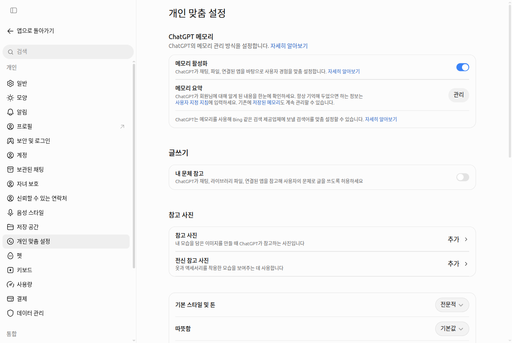

# 11장. 전문가처럼 쓰기 — 초보를 넘어 일에 맞게 부리기

> **한 줄 요약**: 전문가는 새 기능을 더 많이 아는 사람이 아니라, **일을 맡기듯 말하고, 일에 맞는 도구를 고르고, 반복하는 일은 틀로 만들고, 결과를 확인한 뒤에 쓰는** 사람입니다.
> 이 장은 1~10장에서 배운 기능을 **조합하는 법**과, 아직 다루지 않은 예약 작업·데이터 분석·공부 모드를 소개합니다.

화면은 2026년 10월 웹(Plus 요금제) 기준입니다. 무료 요금제나 휴대폰 앱은 메뉴 위치가 조금 다를 수 있습니다.

## 전문가는 무엇이 다른가

[1단계 3장 「같은 도구, 다른 결과」](../00-common/03-why-learn.md#같은-도구-다른-결과)에서 같은 AI도 쓰는 법에 따라 결과가 크게 달라진다고 했습니다. OpenAI가 회사에서 ChatGPT를 쓰는 모습을 조사한 보고서에도 비슷한 말이 나옵니다. 추론·심층 리서치·프로젝트·맞춤 지침 같은 **고급 기능은 효과가 클 만한 곳에서도 덜 쓰인다**는 것입니다.[^adopt] 또 다른 조사에서는 사람들이 **자기 분야가 아닌 일**을 AI에 맡길 때 예시와 배경을 더 많이 붙이고, 결과를 확인해 달라는 부탁도 더 자주 한다고 했습니다.[^ways] 모르는 분야일수록 자료를 붙이고 확인을 부탁하는 것, 이것이 이 장의 출발점입니다. 이 장에서 다루는 요소를 한눈에 보면 이렇습니다.

| 요소 | 한 줄 설명 | 자세히 보기 |
|---|---|---|
| 맡기듯 말하기 | 할 일·대상·목적·모양을 밝히고, 첫 답을 보고 고쳐 간다 | [1단계 4장 「좋은 프롬프트의 5요소」](../00-common/04-prompt-basics.md#좋은-프롬프트의-5요소), [1단계 6장 「고쳐 달라고 잘 말하는 법」](../00-common/06-conversation.md#고쳐-달라고-잘-말하는-법) |
| 도구 고르기 | 검색·심층 리서치·Work·추론 수준 중 일에 맞는 것을 쓴다 | [6장 「심층 리서치 — 보고서를 맡기기」](06-search.md#심층-리서치-—-보고서를-맡기기), [7장 「Chat과 Work의 차이」](07-projects-plugins.md#chat과-work의-차이) |
| 자료 쌓아 두기 | 같은 일의 파일·지침·잘 된 답을 한곳에 모은다 | [7장 「프로젝트 — 대화·파일·지침을 한 폴더에」](07-projects-plugins.md#프로젝트-—-대화·파일·지침을-한-폴더에) |
| 틀 만들기 | 반복하는 요청을 지침·템플릿·스킬로 남긴다 | [1단계 8장 「4. 다시 쓸 틀로 만들기」](../00-common/08-meta-prompting.md#_4-다시-쓸-틀로-만들기) |
| 예약 작업 | 정해진 때에 ChatGPT가 알아서 하게 한다 | [이 장 「정해진 때에 알아서」](#정해진-때에-알아서-—-예약-작업) |
| 데이터 분석 | 표와 숫자를 계산하고 차트로 받는다 | [이 장 「표와 숫자 맡기기」](#표와-숫자-맡기기-—-데이터-분석) |
| 공부 모드 | 답 대신 질문으로 이해를 돕게 한다 | [이 장 「배우는 데 쓰기」](#배우는-데-쓰기-—-공부-모드) |
| 답의 모양 | 말투·표·그림의 양을 내 일에 맞춘다 | [5장 「말투 정하기」](05-memory.md#말투-정하기-—-기본-스타일-및-톤-따뜻함-내-문체-참고) |
| 확인하기 | 결과물 종류마다 볼 곳을 정해 두고 확인한다 | [1단계 9장 「확인하는 네 가지 습관」](../00-common/09-safety.md#확인하는-네-가지-습관) |

<Quiz id="ch111-difference" />

## 일을 맡기는 다섯 줄 — 결과·자료·남길 것·검토 기준·모양

프롬프트를 쓰는 원리는 [1단계 4장 「좋은 프롬프트의 5요소」](../00-common/04-prompt-basics.md#좋은-프롬프트의-5요소)에서 배웠습니다. 일을 맡길 때는 여기에 두 가지를 더합니다. OpenAI는 Work에 일을 맡길 때 원하는 결과와 함께 파일·제약·**검토 기준**(review criteria, 결과가 잘 됐는지 판단할 잣대)을 주라고 하고,[^work] 문서나 표를 고칠 때는 수식·레이아웃·말투·순서·표 구조처럼 **바꾸면 안 되는 것**을 말하라고 합니다.[^docs]

다섯 줄은 **결과**(무엇을, 누구를 위해, 왜), **자료**(붙인 파일), **남길 것**(바꾸면 안 되는 것), **검토 기준**, **모양**(형식과 길이 — [1단계 7장 「1. 마크다운으로 정리하기」](../00-common/07-structured-prompts.md#_1-마크다운으로-정리하기))입니다.
```
결과: 팀장님께 올릴 이번 달 지출 요약을 만들어 줘. 다음 주 예산 회의에서 쓸 거야.
자료: 첨부한 지출 내역 파일을 써 줘.
남길 것: 항목 이름과 순서는 바꾸지 마.
검토 기준: 마지막에 합계가 원본 파일과 같은지 대조해서 알려 줘.
모양: 항목별 표 한 개와 세 줄 요약.
```

**쪼갤까, 모을까?** OpenAI 도움말은 복잡한 일을 작은 요청으로 나누라고 하고([1단계 5장 「3. 단계 나누기」](../00-common/05-prompt-patterns.md#_3-단계-나누기-—-프롬프트-체이닝)),[^prompt] Academy 자료는 관련된 맥락과 지시를 한 요청에 모아도 된다고 하면서, 너무 많은 정보는 오히려 답을 흐릴 수 있다고 덧붙입니다.[^aprompt] 이 가이드는 이렇게 고르기를 권합니다. **중간 결과를 보고 방향을 정해야 하는 일은 나누고, 목표가 하나로 분명한 일은 다섯 줄로 모아서** 맡깁니다. 어느 쪽이든 자료는 일에 꼭 필요한 것만 붙입니다.

<Quiz id="ch111-five-lines" />

## 일에 맞는 도구 고르기

같은 질문도 어떤 기능으로 묻느냐에 따라 결과가 달라집니다. OpenAI는 "빠른 사실은 검색, 깊이와 꼼꼼함이 필요하면 심층 리서치"를 쓰라고 합니다.[^deep]

| 하려는 일 | 쓸 기능 | 자세히 보기 |
|---|---|---|
| 오늘 날씨·영업시간 같은 빠른 사실 | 웹 검색 | [6장 「웹 검색」](06-search.md#웹-검색-—-chatgpt가-인터넷을-찾아보게-하기) |
| 여러 자료를 비교한 긴 보고서 | 심층 리서치 | [6장 「심층 리서치」](06-search.md#심층-리서치-—-보고서를-맡기기) |
| 문서·표·발표 자료 같은 완성 파일 | Work(유료 요금제) | [7장 「Chat과 Work의 차이」](07-projects-plugins.md#chat과-work의-차이) |
| 어려운 계산·여러 조건이 얽힌 계획 | 추론 수준 올리기 | [2장 「추론 수준과 생각하기」](02-screen-tour.md#추론-수준과-생각하기-—-얼마나-깊이-생각할까) |
| 표·숫자 분석과 차트 | 파일 올리고 데이터 분석 | [이 장 아래](#표와-숫자-맡기기-—-데이터-분석) |
| 새로운 것 배우기 | 공부 모드 | [이 장 아래](#배우는-데-쓰기-—-공부-모드) |

어떤 기능이 되는지 궁금할 때는 "너 이거 할 수 있어?"라고 묻기보다 **바로 시켜 보는** 편이 낫습니다. ChatGPT는 자기 시스템이 지금 어떻게 돌아가는지 볼 수 없어서, 물어보면 틀리게 답할 수 있기 때문입니다.[^ask]
```
첨부한 영수증 사진 다섯 장에서 날짜·가게 이름·금액을 뽑아 표로 만들어 줘.
```

<Quiz id="ch111-tools" />

## 자료를 쌓아 두고 쓰기

[7장 「프로젝트」](07-projects-plugins.md#프로젝트-—-대화·파일·지침을-한-폴더에)에서 대화·파일·지침을 한 폴더에 묶는 법을 배웠습니다. 도움말은 프로젝트를 **주간 조사나 글 초안 같은 반복 작업**에 다시 쓰라고 권합니다.[^projects] 전문가는 여기서 한 걸음 더 나아가, 잘 나온 답도 다음에 쓸 자료로 쌓아 둡니다.
- **잘 된 답을 자료로 저장**: 프로젝트 대화에서 답 아래 메시지 메뉴 → 「프로젝트에 저장」 또는 「프로젝트 소스에 추가」를 고르면 그 답이 프로젝트의 「소스」에 들어갑니다. 메뉴 이름은 화면에 따라 다를 수 있습니다.[^projects]
- **다른 서비스의 자료 연결**: 개인 프로젝트의 소스 영역에서 「Add sources」를 눌러 Slack 채널이나 Google Drive 파일·폴더 링크를 넣을 수 있습니다.[^projects] 전에 올린 파일은 [4장 「라이브러리」](04-files-images.md#라이브러리-—-올린-파일을-모아-두는-곳)에서 다시 불러옵니다.

<!-- 스크린샷 필요: 프로젝트 대화에서 답의 메시지 메뉴를 펼쳐 「프로젝트 소스에 추가」가 보이는 화면 -->

프로젝트 지침에 "쌓인 자료를 먼저 보라"고 적어 두면 좋습니다.
```
이 프로젝트는 매주 우리 동네 문화 행사를 조사하는 곳이야. 새 조사를 하기 전에 「소스」에 저장된 지난 조사 결과를 먼저 보고,
지난주와 겹치는 행사는 빼고 새로 생긴 것만 표로 정리해 줘.
```

<Quiz id="ch111-sources" />

## 반복하는 일은 틀로 — 지침·템플릿·스킬

같은 일을 자주 한다면 틀을 만들어 둡니다. [1단계 8장 「4. 다시 쓸 틀로 만들기」](../00-common/08-meta-prompting.md#_4-다시-쓸-틀로-만들기)의 틀을 [7장처럼 프로젝트 지침에 넣는 것](07-projects-plugins.md#다시-쓸-틀을-프로젝트에-넣기)이 첫 단계이고, 그다음이 템플릿과 스킬입니다.[^docs][^skills]

| 이름 | 무엇인가 | 쓸 수 있는 곳 |
|---|---|---|
| 참조 파일 | 이번 한 번만 보여 주는 예시 파일 | 모든 대화 |
| 템플릿(template) | 예시 파일 + 다시 쓸 지침. 만든 사람 혼자 쓴다 | 웹의 Work(유료 요금제) |
| 스킬(skill) | 지침·예시를 담아 둔, 다시 쓰고 나눌 수 있는 작업 방식 | 도움말 기준 Business·Enterprise·Edu 등 회사·학교 요금제 |
| 플러그인(plugin) | 스킬과 앱 연결을 묶은 꾸러미 | [7장 「플러그인」](07-projects-plugins.md#플러그인-—-다른-서비스와-작업-방식을-더하기) |

**템플릿 만들기**(웹의 Work): 입력창에 `@Template-Creator` 를 입력하고, 참고할 파일 한 개(Word·Excel·PowerPoint 파일 또는 구글 문서 링크)를 붙인 뒤 남길 것·바꿀 것·매번 넣을 정보를 설명합니다. 만들어지면 「설치」를 누릅니다.[^docs] 쓸 때는 입력창에 `@Documents`·`@Spreadsheets`·`@Presentations` 중 하나를 입력해 템플릿 갤러리를 열고 「Use template」을 고릅니다. 고르기만 해서는 작업이 시작되지 않으니, 이어서 이번 내용을 적어 보내야 합니다.[^docs]
```
@Template-Creator 첨부한 주간 보고 파일로 템플릿을 만들어 줘.
남길 것: 제목 줄, 표의 세 칸(완료 / 진행 중 / 다음 주 계획), 글꼴과 색.
바꿀 것: 표 안의 내용과 날짜.
매번 넣을 정보: 그 주의 업무 메모.
```

**스킬**은 옆 메뉴 「플러그인」 → 「스킬」 탭 → 「만들기」에서 「채팅으로 만들기」 등으로 만듭니다.[^skills] 다만 도움말은 스킬을 **Business·Enterprise·Healthcare·Edu 요금제**에서 쓸 수 있다고 적고 있습니다. 개인 요금제 화면에도 「스킬」 탭이 보일 수 있지만, 쓸 수 있는지는 내 화면에서 직접 확인하세요. 남이 만든 스킬 파일을 올릴 때는 만든 곳을 믿을 수 있는지 먼저 봅니다. 자동 검사가 있어도 내 확인을 대신하지 않습니다.[^skills]

<Quiz id="ch111-templates" />

## 정해진 때에 알아서 — 예약 작업

**예약 작업**(scheduled tasks)은 ChatGPT가 정해 둔 때에 알아서 일을 하게 하는 기능입니다. 한 번만 또는 반복해서 실행하고, 무언가가 바뀌는지 지켜보다 알려 줄 수도 있습니다.[^tasks] 만드는 법은 간단합니다. 대화에서 그냥 부탁하면 됩니다.
```
매주 월요일 아침 8시에, 이번 주 서울 날씨 예보를 요일별 한 줄로 정리해서 알려 줘.
```

- **관리**: 옆 메뉴 「예약」에서 작업을 보고, 고치고, 일시 중지하고, 지웁니다. 도움말은 이 메뉴를 「예약됨」이라고 부르지만 실제 화면 이름은 「예약」입니다.[^tasks] 설정 → 「알림」 → 「작업 관리」나 대화의 •••(더보기) → 「예약 작업 보기」로도 열립니다.[^tasks]
- **알림 받기**: 설정 → 「알림」에서 푸시·이메일을 고릅니다. 휴대폰 푸시를 받으려면 휴대폰 앱에서 작업을 만듭니다.[^tasks]

<!-- 스크린샷 필요: 옆 메뉴 「예약」을 연 작업 목록 화면과, 작업 하나를 열어 일정·일시 중지가 보이는 패널 -->

동시에 켜 둘 수 있는 작업은 Free·Go 3개, Plus 5개, Business·Edu 10개, Pro·Enterprise 15개이고, 이 숫자는 바뀔 수 있습니다(확인일 2026-10-24). Free는 하루 한 번까지만 실행되고 시간도 아침·오후·밤처럼 넓게만 정해집니다. 위 예시처럼 정확한 시각을 정하거나 매시간 실행하려면 유료 요금제가 필요합니다.[^tasks] 새 메일이 오면 반응하는 식의 **앱 이벤트 작업**은 Work에서 만들고, Free·Go에서는 쓸 수 없습니다.[^tasks]

조심할 점도 있습니다.[^tasks]
- **프로젝트 안에서 만든 작업은 그 프로젝트의 파일을 읽지 못합니다.** 파일 내용이 필요하면 지시문에 직접 적습니다.
- 음성 대화·맞춤형 GPT·[잠긴 대화](03-chats.md#남이-못-열게-—-잠긴-대화)에서는 예약 작업을 만들 수 없습니다.
- 작업을 **공유 링크**로 나누면 받는 사람에게 지시문이 그대로 보입니다. 건강·금융 정보나 비밀번호를 넣지 마세요.

<Quiz id="ch111-scheduled" />

## 표와 숫자 맡기기 — 데이터 분석

**데이터 분석**(data analysis)은 따로 켜는 메뉴가 없습니다. [4장 「사진·파일 올리기」](04-files-images.md#사진·파일-올리기)처럼 파일을 올리고 알고 싶은 것을 말하면, ChatGPT가 요약·표·차트를 만들고 필요하면 Python(파이썬, 계산용 프로그래밍 언어)으로 직접 계산합니다.[^data] 잘 받으려면 **파일을 먼저 정리**합니다. 첫 줄에 알아보기 쉬운 열 이름을 두고, 한 줄에 한 건만 적습니다. 한 시트에 표를 여러 개 두거나 중간에 빈 줄을 넣지 않습니다.[^data] 예를 들어 「날짜 / 품목 / 수량 / 금액」 네 열에 판매 한 건씩 적은 표가 좋습니다.

처음에는 데이터에 문제가 없는지부터 보게 하는 것이 좋습니다. OpenAI도 분석을 이 질문으로 시작하라고 권합니다.[^data] 그다음에는 **방법을 지정**합니다. 첫 시도의 계산 방법이나 차트가 내 뜻과 다를 수 있기 때문입니다.[^data]
```
이 데이터에 흔한 문제(빈 값, 튀는 값, 중복, 날짜·숫자 형식 오류)가 있는지 먼저 확인해 줘.
문제가 없으면 「금액」 열을 품목별로 더해서 큰 순서로 표를 만들고, 막대 차트로 보여 줘.
계산에 쓴 방법과 가정도 한 줄씩 적어 줘.
```

- 막대·선·원·산점도 차트는 「대화형 차트로 전환」을 눌러 직접 만져 볼 수 있습니다. 결과 표를 펼쳐 필요한 칸만 골라 다시 물을 수 있고, 표는 CSV(엑셀에서 열리는 쉼표 구분 파일)로 내려받습니다([1단계 7장 「3. 엑셀로 옮길 때는 표로 받기」](../00-common/07-structured-prompts.md#_3-엑셀로-옮길-때는-표로-받기)도 참고).[^data]
- **한계**: 분석용 Python은 인터넷에 나가지 못합니다. 스캔한 PDF나 사진 속 표의 숫자는 정확하지 않을 수 있고, 큰 파일은 일부만 볼 수 있으니 시트나 범위를 정해 줍니다.[^data]

<!-- 스크린샷 필요: 파일을 올려 분석한 답에서 표와 차트, 「대화형 차트로 전환」 버튼이 보이는 화면 -->

<Quiz id="ch111-data" />

## 배우는 데 쓰기 — 공부 모드

**공부 모드**(study mode)는 답을 바로 주는 대신 질문을 던지고, 단계별로 설명하고, 이해했는지 확인해 가며 가르치는 방식입니다. **모든 요금제**에서 웹·iOS·Android로 쓸 수 있습니다.[^study]
- **켜기(웹)**: 입력창에 `@study` 를 입력하거나, + 버튼을 누르고 `study` 로 검색해 「공부」를 고릅니다. `chatgpt.com/studymode` 로 바로 가도 됩니다.[^study]
- **안 되는 곳**: [임시 채팅](03-chats.md#기록-남기지-않기-—-임시-채팅), 맞춤형 GPT, 프로젝트에서는 켤 수 없습니다. 일반 대화에서 켭니다.[^study]

<!-- 스크린샷 필요: 입력창에 @study 를 입력해 「공부」가 제안 목록에 뜬 화면 -->

첫 메시지에 **내 수준, 과목과 정확한 주제, 하려는 것, 이미 아는 것, 시험 날짜·형식, 자료**를 넣으면 더 잘 도와준다고 도움말은 말합니다.[^study]
```
20분 동안 이 주제를 복습하려고 해. 주제는 중학교 2학년 과학의 「전기 회로」야.
옴의 법칙은 들어 봤지만 직렬과 병렬이 헷갈려. 다음 주 화요일에 객관식 시험이 있어.
가장 중요한 개념부터 짧게 알려 주고, 한 번에 한 문제씩 내서 내 답을 확인해 줘.
```

공부 모드도 틀릴 수 있고, 가끔 답을 바로 알려 주기도 합니다. 그럴 때는 "힌트만 줘", "한 문제씩 내 줘"라고 다시 부탁합니다. 숙제·시험·건강·법률·돈 문제처럼 중요한 내용은 따로 확인하라고 도움말은 강조합니다.[^study] 공부 모드에서 퀴즈나 플래시카드(앞면 질문·뒷면 답인 암기 카드) 형식의 복습 자료를 만들어 달라고 할 수도 있습니다.[^study] 플래시카드 기능으로 만든 카드는 라이브러리에 자동 저장되며, 원래 노트와 대조해 보라고 도움말은 권합니다.[^study] 공부 모드 없이 쓸 수 있는 설명 요청 프롬프트는 [프롬프트 모음 「공부·설명 듣기」](../00-common/prompt-library.md#공부·설명-듣기)에 있습니다.

<Quiz id="ch111-study" />

## 답의 모양을 내 일에 맞추기

[5장 「말투 정하기」](05-memory.md#말투-정하기-—-기본-스타일-및-톤-따뜻함-내-문체-참고)에서 기본 스타일과 「따뜻함」을 봤습니다. 일에 맞게 더 다듬는 방법은 넷입니다. 만든 이미지를 고치는 법은 [4장 「이미지 만들기」](04-files-images.md#이미지-만들기)에 있습니다.



- **특성**(characteristics): 따뜻함·열정·머리글과 목록·이모지를 "더(+)" 또는 "덜(–)" 쪽으로 조금씩 조절합니다. 설정 → 「개인 맞춤 설정」에서 바꾸며, 이 채팅과 앞으로의 새 채팅에 적용됩니다.[^char] 2026-10-23 화면에서는 「따뜻함」만 확인했으니, 다른 항목은 내 화면에서 찾아보세요.
- **표·그림 줄이기**: 최신 모델은 답에 표·버튼·차트를 섞어 보여 주기도 합니다. 너무 많으면 웹 설정의 개인 맞춤 설정에서 「Layout and Visuals」를 「Simple」로 바꿉니다(도움말의 영어 표기이고 한국어 화면 이름은 확인하지 못했습니다). 그래도 일부는 나올 수 있습니다.[^ui]
- **지침으로 고정**: "답은 짧게", "선택지를 비교할 때는 표로"처럼 늘 원하는 모양은 [5장 「사용자 지정 지침」](05-memory.md#사용자-지정-지침-—-늘-지켜-줬으면-하는-것)에 적어 둡니다.[^ui]
- **답 안에서 바로 고치기**: 메일·문자 같은 초안은 **글쓰기 블록**(writing block, 답 속에서 바로 고칠 수 있는 글 상자)으로 나올 때가 있습니다. 그 자리에서 고치거나 일부만 골라 고쳐 달라고 할 수 있고, 고친 내용은 대화에 저장되어 다음 질문에 쓰입니다.[^blocks]
```
방금 쓴 메일 초안에서 두 번째 문단만 더 짧고 정중하게 고쳐 줘. 나머지는 그대로 둬.
```

<Quiz id="ch111-shape" />

## 믿기 전에 확인하기

OpenAI 도움말 여러 문서에 "쓰기 전에 확인하라"는 문장이 있습니다. 원리는 [1단계 9장 「확인하는 네 가지 습관」](../00-common/09-safety.md#확인하는-네-가지-습관)에서 배웠으니, 여기서는 **결과물마다 어디를 볼지**만 정리합니다.

| 결과물 | 확인할 곳 |
|---|---|
| 데이터 분석 | 계산에 쓴 방법·코드·가정. 방법이 중요하면 보여 달라고 하거나 바꿔 달라고 한다[^data] |
| 심층 리서치 보고서 | 인용과 출처 링크를 직접 열어 본다([6장 「출처 확인하는 습관」](06-search.md#출처-확인하는-습관))[^deep] |
| Work가 만든 파일 | 내용·레이아웃·수식·차트를 공유하기 전에 본다[^docs] |
| Work가 웹사이트에서 한 일 | 결과와 출처를 확인하고, 중요한 행동은 승인 화면에서 직접 누른다[^work] |

**링크도 조심합니다.** ChatGPT가 만든 링크는 제3자가 거짓 정보나 나쁜 지시를 끼워 넣었을 수 있습니다.[^links] 숨은 지시의 원리는 [1단계 9장 「4. 숨은 지시」](../00-common/09-safety.md#_4-숨은-지시-—-프롬프트-인젝션)에 있습니다. 내가 모르는 분야일수록 마지막에 이렇게 덧붙입니다.
```
방금 답에서 내가 따로 확인해야 할 부분을 표시하고, 확인할 곳(공식 기관이나 원문)을 알려 줘.
```

<Quiz id="ch111-verify" />

## 더 배우려면 — OpenAI Academy

**OpenAI Academy**는 OpenAI가 만든 **무료 온라인 강좌**입니다. ChatGPT 계정이 있으면 누구나 듣고, 내 속도로 진행합니다.[^academy] 강좌는 영어로 되어 있다고 생각하고 시작하세요(한국어 제공 여부는 확인하지 못했습니다).
일에 쓰는 법을 다루는 강좌로 **AI Foundations**(60–75분, AI 기초·분명한 프롬프트·결과 검토), **Applied AI Foundations**(75–90분, 일을 단계로 나누고 검토 지점이 있는 반복 작업 만들기), **Agents and Workflows**(75–90분, Work에 일을 맡기고 사람이 결과를 점검하기)가 있습니다. 시간은 바뀔 수 있습니다(확인일 2026-10-24). 시험에서 80% 이상 받으면 **배지**를 주지만, 도움말은 이것이 자격증이 아니라고 밝힙니다.[^academy] 이 가이드의 [인증 시험](../00-common/certificate.md)도 같은 성격의 학습 배지입니다.

<Quiz id="ch111-academy" />

## 직접 해 보기

1. 날짜·품목·수량·금액 표를 메모장에 10줄쯤 지어내 CSV로 저장하고, ChatGPT에 올려 "흔한 문제가 있는지 먼저 확인해 줘"라고 보낸다. 그다음 품목별 합계를 막대 차트로 받고, 계산 방법과 가정을 보여 달라고 해서 합계가 내가 직접 더한 값과 같은지 대조한다.
2. 「다섯 줄」 틀로 이번 주 할 일 정리를 부탁해 본다. 검토 기준 줄을 빼고 한 번, 넣고 한 번 보내 차이를 비교한다.
3. 예약 작업을 하나 만들어 본다("내일 아침에 물 마시라고 알려 줘"). 옆 메뉴 「예약」에서 보이는지 확인하고, 다 봤으면 지운다.
4. `@study` 로 공부 모드를 켜고, 요즘 궁금했던 주제 하나를 20분 복습 프롬프트로 배워 본다.

## 정리

- 전문가는 일을 맡기듯 말한다. 결과·자료·남길 것·검토 기준·모양 다섯 줄을 적고, 결과물마다 정해 둔 곳을 확인한 뒤에 쓴다.
- 빠른 사실은 검색, 깊은 조사는 심층 리서치, 완성 파일은 Work, 어려운 생각은 추론 수준. 기능이 되는지는 물어보지 말고 시켜 본다.
- 잘 된 답은 「프로젝트 소스에 추가」로 쌓고, 반복하는 일은 지침 → 템플릿(Work) → 스킬(도움말 기준 회사·학교 요금제)로 틀을 만든다.
- 예약 작업은 대화에서 부탁해 만들고 옆 메뉴 「예약」에서 관리한다. 프로젝트 안 작업은 프로젝트 파일을 못 읽는다.
- 데이터 분석은 정리된 파일을 올리고 먼저 데이터 문제를 확인한 뒤 방법을 지정한다. 공부 모드는 `@study` 로 켜고 모든 요금제에서 쓴다(프로젝트·임시 채팅 제외).

## 용어 정리

| 용어 | 읽는 법 | 한 줄 뜻 |
|---|---|---|
| Review criteria | 리뷰 크라이티리어 (검토 기준) | 결과가 잘 됐는지 판단할 잣대 |
| Scheduled tasks | 스케줄드 태스크 (예약 작업) | 정해 둔 때에 ChatGPT가 알아서 실행하는 작업 |
| Data analysis | 데이터 애널리시스 (데이터 분석) | 올린 파일의 표와 숫자를 계산해 요약·차트로 보여 주는 기능 |
| Template | 템플릿 | 예시 파일과 다시 쓸 지침을 묶은 틀 |
| Study mode | 스터디 모드 (공부 모드) | 답 대신 질문과 단계별 설명으로 가르치는 방식 |
| Characteristics | 캐릭터리스틱스 (특성) | 따뜻함·이모지 등 답의 분위기를 더·덜 조절하는 설정 |
| Writing block | 라이팅 블록 (글쓰기 블록) | 답 속에서 바로 고칠 수 있는 초안 글 상자 |
| OpenAI Academy | 오픈에이아이 아카데미 | OpenAI가 만든 무료 온라인 AI 강좌 |

<ChapterDone :chapter="111" />

다음 장: 2단계를 마쳤습니다. [AI 지식 레벨 시험](../00-common/level-test.md)으로 실력을 확인해 보세요.

[^adopt]: OpenAI, 「ChatGPT Usage and Adoption Patterns at Work」. "Advanced features remain underused, even where they could deliver broad impact." https://openai.com/business/guides-and-resources/chatgpt-usage-and-adoption-patterns-at-work (확인일 2026-10-24)
[^ways]: OpenAI, 「How workers are unlocking new ways of working」. 자기 직업 밖의 일에서 예시·배경을 더 붙이고 확인을 더 부탁한다는 분석. https://openai.com/index/unlocking-new-ways-of-working (확인일 2026-10-24)
[^work]: OpenAI 도움말, 「ChatGPT Work and Codex」 "Describe the outcome you want. Add any files, constraints, and review criteria ChatGPT should use." https://help.openai.com/en/articles/20001275 · 「Using cloud browser in ChatGPT」 "Check the result and its sources before relying on it." https://help.openai.com/en/articles/20001280 (확인일 2026-10-24)
[^docs]: OpenAI 도움말, 「Creating and editing documents, spreadsheets, and presentations with ChatGPT Work」. 템플릿·`@Template-Creator`, "Say what must stay unchanged…" https://help.openai.com/en/articles/20001278 (확인일 2026-10-24)
[^prompt]: OpenAI 도움말, 「How do I create a good prompt for an AI model?」. https://help.openai.com/en/articles/4936848 (확인일 2026-10-24)
[^aprompt]: OpenAI Academy, 「Prompting」. https://academy.openai.com/public/clubs/work-users-ynjqu/resources/prompting (확인일 2026-10-24)
[^deep]: OpenAI 도움말, 「Deep research in ChatGPT」. "Use search for quick facts, and use deep research for depth and thoroughness." https://help.openai.com/en/articles/10500283 (확인일 2026-10-24)
[^ask]: OpenAI 도움말, 「How to Ask ChatGPT About Its Features」. https://help.openai.com/en/articles/12548278 (확인일 2026-10-24)
[^projects]: OpenAI 도움말, 「Projects in ChatGPT」. https://help.openai.com/en/articles/10169521 (확인일 2026-10-24)
[^skills]: OpenAI 도움말, 「Skills in ChatGPT」. "Skills are available to eligible ChatGPT Business, Enterprise, Healthcare, and Edu users" https://help.openai.com/en/articles/20001066 (확인일 2026-10-24)
[^tasks]: OpenAI 도움말, 「Scheduled tasks in ChatGPT」. 요금제별 작업 수, 프로젝트 안 작업의 파일 접근 제한, 공유 주의. https://help.openai.com/en/articles/10291617 (확인일 2026-10-24)
[^data]: OpenAI 도움말, 「Data analysis with ChatGPT」 https://help.openai.com/en/articles/8437071 · 「Extracting Insights with ChatGPT Data Analysis」 "Check this data for common issues." https://help.openai.com/en/articles/9213685 (확인일 2026-10-24)
[^study]: OpenAI 도움말, 「Using study mode in ChatGPT」 https://help.openai.com/en/articles/11780217 · 「Flashcards in ChatGPT」 "Flashcards are automatically saved in your library." https://help.openai.com/en/articles/20001533 (확인일 2026-10-24)
[^char]: OpenAI 도움말, 「Characteristics in ChatGPT」. https://help.openai.com/en/articles/20001038 (확인일 2026-10-24)
[^ui]: OpenAI 도움말, 「Intelligent UI in ChatGPT」. "Select Personalization → Layout and Visuals → Simple." https://help.openai.com/en/articles/20001598 (확인일 2026-10-24)
[^blocks]: OpenAI 도움말, 「Working with writing blocks and code blocks in ChatGPT」. https://help.openai.com/en/articles/20001246 (확인일 2026-10-24)
[^links]: OpenAI 도움말, 「ChatGPT generated links」. https://help.openai.com/en/articles/10984597 (확인일 2026-10-24)
[^academy]: OpenAI 도움말, 「OpenAI Academy courses」. "These badges and certificates of completion are not certifications" https://help.openai.com/en/articles/20001270 (확인일 2026-10-24)
