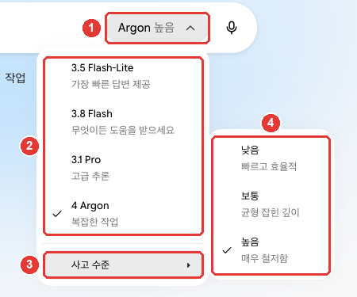

# 2장. 화면 둘러보기 — 어디에 무엇이 있나

> **한 줄 요약**: Gemini 화면은 **왼쪽 옆 메뉴**(지난 대화), **가운데 입력창**(질문하는 곳과 「+」),
> **입력창 오른쪽 모델 버튼**(모델·사고 수준), **왼쪽 아래 「설정」** 네 곳만 알면 됩니다. 처음에는 입력창만 써도 충분합니다.

화면은 2026년 10월 웹 기준이고, 그림은 유료 요금제(Google AI Pro) 한국어 화면입니다. 무료 계정에서는 일부 메뉴가 안 보이거나 자물쇠가 붙어 있을 수 있습니다. 내 화면과 이름이 다르면 비슷한 이름의 버튼을 찾아보세요.

## 첫 화면 한눈에

로그인하면 가운데에 「무엇을 도와드릴까요?」라는 인사와 입력창이 보입니다.[^screen]


이름·대화 제목·노트북 제목은 예시로 바꾼 화면입니다(Google AI Pro). **빨간 번호는 아래 표의 번호와 같은 곳입니다.**

화면은 다섯 곳으로 나눠 보면 쉽습니다.

| 번호 | 곳 | 위치 | 하는 일 |
|---|---|---|---|
| ① | 옆 메뉴 | 왼쪽 | 새 채팅, 지난 대화, 노트북 |
| ② | 입력창 | 가운데 | 질문 쓰기, 「+」로 파일·도구 |
| ③ | 모델 버튼 | 입력창 오른쪽 | 모델과 사고 수준 고르기 |
| ④ | 「임시 채팅」 | 오른쪽 위 | 기록이 남지 않는 대화 |
| ⑤ | 「설정」 | 왼쪽 아래 | 사용량, 구독, 테마, 개인정보 |

출처: Gemini 웹 화면에서 직접 확인[^screen]

입력창 아래 「채팅」·「작업」 전환은 보통 대화와 **일을 통째로 맡기는 작업**을 고르는 곳입니다. 작업은 8장에서 다루니, 지금은 「채팅」에 두면 됩니다.[^screen][^models]

처음부터 다 알 필요는 없습니다. 입력창에 질문을 쓰고 보내기만 해도 됩니다. 나머지는 필요할 때 이 장을 다시 펼쳐 보세요.

<Quiz id="ch302-home" />

## 옆 메뉴 — 새 채팅과 지난 대화

왼쪽 옆 메뉴에는 위에서부터 이런 것이 있습니다.[^screen]

- **「채팅 검색」**(돋보기): 지난 대화를 낱말로 찾습니다.
- **「새 채팅」**: 새 대화를 엽니다. 주제가 바뀌면 여기를 누르세요([1장](01-getting-started.md)).[^start]
- **「라이브러리」·「이미지」**: 올리거나 만든 파일과 그림을 모아 봅니다(4장, 준비 중).
- **「예약됨」**: 정해 둔 시간에 저절로 하는 일을 모아 봅니다.
- **「맞춤설정」**: 스킬과 연결된 앱을 추가합니다.
- **「노트북」**: 자료와 대화를 주제별로 묶어 둡니다. 「새 노트북」·「모든 노트북」이 있습니다.
- **「전체」**: 지금까지 나눈 대화 목록입니다. 맨 위가 가장 최근 대화입니다.

맨 아래에는 내 계정 이름과 요금제(예: 「Pro」), 그리고 톱니바퀴 「설정」이 있습니다.[^screen]

옆 메뉴는 왼쪽 위 「사이드바 닫기」(네모 아이콘)로 접었다 펼 수 있습니다.[^screen]

다른 사람에게 화면을 보여 줄 때는 옆 메뉴를 접어 두세요. 대화 목록의 제목만으로도 내가 무엇을 물었는지 드러날 수 있습니다.

<Quiz id="ch302-sidebar" />

## 입력창과 + 메뉴

입력창 「Gemini에게 물어보기」에 질문을 쓰고 보내면 됩니다.[^screen][^start]
입력창 왼쪽 「+」(「업로드 및 도구」)를 누르면 파일과 도구가 나옵니다.[^screen]


**빨간 번호는 아래 표의 번호와 같은 곳입니다.** ④는 ③ 「도구 더보기」에 마우스를 올리면 펼쳐집니다.[^screen]

| 번호 | 메뉴 | 하는 일 |
|---|---|---|
| ① | 「파일 업로드」·「Drive에서 파일 추가」 | 내 파일을 함께 보내기 |
| ② | 「이미지 만들기」·「동영상 만들기」·「음악 만들기」 | 그림·영상·음악 만들기 |
| ③ | 「도구 더보기」 | 나머지 도구 펼치기 |
| ④ | 「Canvas」 | 문서·앱을 옆 화면에서 함께 고치기 |
| ④ | 「Deep Research」 | 여러 자료를 찾아 긴 보고서 받기 |
| ④ | 「가이드 학습」 | 공부하듯 단계별로 배우기 |

출처: Gemini 웹 화면에서 직접 확인[^screen]

메뉴가 많아 보이지만, 처음에는 「파일 업로드」 하나만 알아도 됩니다. 나머지는 4장부터 하나씩 다룹니다.

파일은 한 번에 **10개까지** 올릴 수 있습니다. 동영상은 하나에 2GB, 그 밖의 파일은 하나에 100MB까지입니다.[^files]

입력창 오른쪽 마이크(「음성기록」)를 누르면 말로 입력할 수 있습니다.[^screen]

### 보낸 질문 고치기

보낸 질문을 고치고 싶으면 내 질문 옆의 「텍스트 수정」(연필)을 누르세요. 고친 뒤 「업데이트」를 누르면 Gemini가 답을 새로 만듭니다.[^start]
질문에 빠진 조건을 나중에 알았을 때 쓰면 좋습니다. 새로 묻는 것보다 대화가 깔끔하게 남습니다.

예를 들어 아래처럼 보냈다가 "회사 동료에게"라는 조건을 빠뜨렸다면, 질문을 고쳐 다시 받아 보세요.

```
다음 주 화요일 회의를 목요일로 옮기자는 짧은 메시지를 써 줘.
```

<Quiz id="ch302-plus" />

## 모델 버튼 — 모델과 사고 수준

입력창 오른쪽의 모델 버튼(예: 「Argon 높음」)을 누르면 **모델**과 **사고 수준**을 고를 수 있습니다.[^screen]
모델은 답을 만드는 AI의 종류이고, 사고 수준은 답하기 전에 얼마나 오래 따져 볼지입니다.



Google AI Pro 화면입니다. ① 모델 버튼을 누르면 ② 모델 목록이 열리고, ③ 「사고 수준」에 마우스를 올리면 ④ 세 단계가 펼쳐집니다. 체크 표시가 지금 고른 것입니다.[^screen]

### 모델 고르기

| 모델 | 화면 설명 | 이럴 때 |
|---|---|---|
| Flash-Lite | 가장 빠른 답변 제공 | 짧고 쉬운 질문 |
| Flash | 무엇이든 도움을 받으세요 | 평소 대부분의 일 |
| Pro | 고급 추론 | 복잡한 질문, 어려운 계산 |
| Argon | 복잡한 작업 | 아주 어렵고 긴 일(Pro·Ultra) |

출처: Gemini 웹 화면과 Google 도움말[^screen][^models]

모델 이름 앞의 숫자(예: 3.8 Flash)는 판 번호입니다. 자주 바뀌니 숫자보다 **역할**로 기억하세요.[^models]

**무료 계정은 모델을 직접 고를 수 없습니다.** Gemini가 질문에 맞는 모델을 저절로 고르거나, Flash-Lite로 답합니다.[^models]
유료 요금제(Google AI 요금제)가 있어야 직접 바꿀 수 있습니다. 자물쇠가 붙은 모델은 요금제를 올려야 쓸 수 있다는 뜻입니다.[^models]

### 사고 수준 — 얼마나 따져 볼까

「사고 수준 ▸」에는 세 단계가 있습니다.[^screen][^models]

| 사고 수준 | 화면 설명 | 이럴 때 |
|---|---|---|
| 낮음 | 빠르고 효율적 | 간단한 질문 |
| 보통 | 균형 잡힌 깊이 | 조금 따져 볼 일 |
| 높음 | 매우 철저함 | 여러 단계가 필요한 어려운 일 |

출처: Gemini 웹 화면과 Google 도움말[^screen][^models]

고르지 않으면 기본은 「낮음」입니다.[^models] 도움말 한국어판에는 「중간」이라고 적힌 곳도 있지만 화면 이름은 「보통」입니다.[^screen]

### 언제 올릴까

**좋은 모델과 높은 사고 수준일수록 사용량을 더 씁니다.**[^models] 그러니 늘 가장 높게 둘 필요는 없습니다.
평소에는 그대로 두고, 답이 얕거나 틀렸을 때만 한 단계 올려 보세요. 오래 생각하게 한다고 늘 나아지는 것도 아닙니다([1단계 5장](../00-common/05-prompt-patterns.md)).

알아 둘 점이 두 가지 있습니다.[^models]

- **한 번 고른 모델은 그 대화에 계속 남습니다.** 나중에 그 대화로 돌아와도 같은 모델과 사고 수준을 씁니다.
- **어느 모델이 답했는지 보려면** 답 아래 「더보기」(점 세 개)를 누르고 「응답 세부정보 보기」를 고르세요.

유료 요금제에서 한도에 닿으면 대화는 Flash-Lite로 이어집니다.[^models] 답이 갑자기 짧아졌다면 「응답 세부정보 보기」로 확인해 보세요.

어려운 일을 맡기기 전에 이렇게 물어보면, 사고 수준을 올릴 만한 일인지 가늠할 수 있습니다.

```
지금부터 맡길 일은 우리 팀 3개월 예산표에서 줄일 수 있는 항목을 찾는 거야.
이 일이 여러 단계로 따져 봐야 하는 일인지, 간단히 답할 수 있는 일인지 먼저 알려 줘.
여러 단계라면 어떤 순서로 따져 볼지 단계만 적어 줘.
```

<Quiz id="ch302-model" />

## 임시 채팅 — 기록이 남지 않는 대화

오른쪽 위 「임시 채팅」을 누르면 **기록이 남지 않는 대화**를 시작합니다.[^screen][^start]
임시 채팅은 옆 메뉴의 대화 목록과 「Gemini 앱 활동」(내 대화 기록)에 남지 않습니다.[^start]


임시 채팅을 켜면 ② 안내문이 뜨고, 오른쪽 위 아이콘이 ① 닫기(×)로 바뀝니다. ×를 누르면 보통 대화로 돌아갑니다.[^screen]

임시 채팅은 이럴 때 쓰세요.

- 대화 목록에 남기고 싶지 않은 질문을 할 때
- 지난 대화나 내 맞춤 설정의 영향 없이 처음부터 답을 받아 보고 싶을 때

대신 못 하는 것이 있습니다.[^start]

- **임시 채팅을 나가면 그 대화를 다시 볼 수 없습니다.** 필요한 답은 나가기 전에 복사해 두세요.
- Gmail·Drive 같은 **연결된 앱**을 쓸 수 없습니다.
- 내 정보에 맞춘 **맞춤 답변**을 받을 수 없고, 답에 **의견**(좋아요·싫어요)을 남길 수 없습니다.
- **개인 Google 계정**에서만 됩니다. 회사·학교 계정에서는 안 됩니다.

**임시 채팅도 72시간은 계정에 보관됩니다.** 화면 안내문은 "안전을 위해"라고 설명합니다. 대신 Google의 AI 모델 학습에는 쓰이지 않습니다.[^screen][^privacy]
그러니 임시 채팅이라도 비밀번호나 주민등록번호 같은 정보는 넣지 마세요([1단계 9장](../00-common/09-safety.md)). 자세한 개인정보 설정은 9장에서 다룹니다.

<Quiz id="ch302-temp" />

## 설정 화면 — 계정·환경설정·개인정보

왼쪽 아래 톱니바퀴 「설정」을 누르면 메뉴가 세 묶음으로 열립니다.[^screen]


이름·대화 제목은 예시로 바꾼 화면입니다. 표의 ①②③은 그림의 번호와 같은 묶음입니다.[^screen]

| 묶음 | 메뉴 | 하는 일 |
|---|---|---|
| ① 계정 | 「사용량 한도」·「구독 관리」 | 쓴 양 보기, 요금제 관리([1장](01-getting-started.md)) |
| ② 환경설정 | 「개인 인텔리전스」·「스킬」 | 내 정보에 맞춘 답, 스킬 관리 |
| ② 환경설정 | 「테마」·「작업 설정」 | 밝은·어두운 화면, 일 맡기기 설정 |
| ③ 데이터 및 개인 정보 보호 | 「Gemini로 메모리 가져오기」 | 다른 AI의 기억 옮겨 오기 |
| ③ 데이터 및 개인 정보 보호 | 「내 공개 링크」·「활동」 | 공유한 링크 관리, 대화 기록 설정 |
| ③ 데이터 및 개인 정보 보호 | 「의견 보내기」·「도움말」·「위치」 | 문제 알리기, 도움말, 위치 확인 |

출처: Gemini 웹 화면에서 직접 확인[^screen]

처음에 한 번 볼 만한 것은 두 가지입니다.

- **「테마」**: 기본은 내 기기의 밝기 설정을 따릅니다. 여기서 어두운 화면으로 바꿀 수 있고, 같은 브라우저에 저장됩니다.[^theme]
- **「활동」**: 누르면 새 탭에 「Gemini 앱 활동」이 열립니다. 대화 기록이 어떻게 저장되는지 정하는 곳입니다. 9장에서 자세히 다룹니다.[^screen]

**화면 언어는 따로 고르는 메뉴가 없습니다.** 웹에서는 브라우저나 기기의 언어를 따릅니다.[^language]
화면 언어와 상관없이, 한국어로 물으면 한국어로 답합니다.[^language]

<Quiz id="ch302-settings" />

## 직접 해 보기

1. 첫 화면에서 옆 메뉴·입력창·모델 버튼·「임시 채팅」·「설정」 다섯 곳을 찾아 눌러 본다.
2. 짧은 질문을 하나 보낸 뒤, 「텍스트 수정」으로 조건을 하나 더해 다시 받아 본다.
3. 답 아래 「더보기」 → 「응답 세부정보 보기」로 어느 모델이 답했는지 확인한다.
4. 「임시 채팅」을 켜고 질문한 뒤 나와서, 대화 목록에 남지 않았는지 확인한다.
5. 「설정」 → 「테마」에서 어두운 화면으로 바꿔 보고 다시 되돌린다.

**이어지는 과제** ([독서 모임 준비하기](../00-common/practice-kit.md)): 1장에서 받은 준비 목록을 이어서 "이 목록을 날짜순으로 다시 정리해 줘."라고 물어본다. 답이 마음에 안 들면 질문을 「텍스트 수정」으로 고쳐 다시 받아 본다.

## 정리

- 화면은 옆 메뉴·입력창·모델 버튼·「임시 채팅」·「설정」 다섯 곳으로 나뉜다.
- 옆 메뉴에서 새 채팅을 열고, 「채팅 검색」과 「전체」 목록으로 지난 대화를 찾는다.
- 입력창 「+」에 파일 올리기와 만들기 도구가 모여 있다. 파일은 한 번에 10개까지다.
- 모델은 Flash-Lite·Flash·Pro·Argon, 사고 수준은 낮음·보통·높음이다. 높을수록 사용량을 더 쓴다. 무료 계정은 직접 고르지 못한다.
- 임시 채팅은 대화 목록에 남지 않지만 72시간은 계정에 보관된다. 나가면 다시 볼 수 없다.
- 「설정」은 계정·환경설정·데이터 및 개인 정보 보호 세 묶음이다. 화면 언어는 브라우저 언어를 따른다.

## 용어 정리

| 용어 | 읽는 법 | 한 줄 뜻 |
|---|---|---|
| Sidebar | 사이드바 (옆 메뉴) | 화면 왼쪽에 대화 목록과 메뉴가 모인 곳 |
| Model | 모델 | 답을 만드는 AI의 종류. Flash·Pro 등 |
| Thinking Level | 싱킹 레벨 (사고 수준) | 답하기 전에 얼마나 오래 따져 볼지 |
| Temporary Chat | 템퍼러리 챗 (임시 채팅) | 대화 목록과 활동 기록에 남지 않는 대화 |
| Gemini Apps Activity | 제미나이 앱스 액티비티 (Gemini 앱 활동) | 내 Gemini 대화 기록을 모아 관리하는 곳 |

<ChapterDone :chapter="302" />

다음 장: 3장. 대화 관리 (준비 중)

[^screen]: Gemini 웹 화면(Google AI Pro, 한국어)에서 직접 확인. 첫 화면 「무엇을 도와드릴까요?」, 입력창 「Gemini에게 물어보기」, 「업로드 및 도구」(+), 모델 버튼과 「음성기록」, 오른쪽 위 「앱 설치」와 「임시 채팅」 아이콘, 입력창 아래 「채팅」「작업」 전환. 임시 채팅 안내 "임시 채팅은 최근 채팅에 표시되지 않으며, Google AI를 개선하는 데 사용되지 않습니다. 안전을 위해 72시간 동안 저장됩니다." 옆 메뉴 「채팅 검색」「사이드바 닫기」「새 채팅」「라이브러리」「이미지」「예약됨」「맞춤설정」「노트북」「전체」, 맨 아래 계정 이름·요금제 표시와 「설정」. + 메뉴 「파일 업로드」「Drive에서 파일 추가」「업로드 더보기」「이미지 만들기」「동영상 만들기」「음악 만들기」「도구 더보기」, 「도구 더보기」 아래 「Canvas」「Deep Research」「가이드 학습」「개인 인텔리전스(Labs)」(2026-10-30에는 이 도구들이 + 메뉴 첫 단에 있었다). 모델 메뉴 「3.5 Flash-Lite — 가장 빠른 답변 제공」「3.8 Flash — 무엇이든 도움을 받으세요」「3.1 Pro — 고급 추론」「4 Argon — 복잡한 작업」, 사고 수준 「낮음 — 빠르고 효율적」「보통 — 균형 잡힌 깊이」「높음 — 매우 철저함」. 설정 메뉴 「계정」(「사용량 한도」「구독 관리」), 「환경설정」(「개인 인텔리전스」「스킬」「테마」「작업 설정」), 「데이터 및 개인 정보 보호」(「Gemini로 메모리 가져오기」「내 공개 링크」「의견 보내기」「도움말」「위치」「활동」). 「활동」은 새 탭 「Gemini 앱 활동」으로 열린다. (확인일 2026-10-30, 그림과 + 메뉴·임시 채팅은 2026-10-31)
[^start]: Google 도움말, 「Use Gemini Apps」. "In the text box at the bottom, enter your question or prompt." / "To start a new chat, at the top left, click New chat" / "You can start a temporary chat that won’t appear in your Gemini Apps Activity or your recent chats." / "A personal Google Account. This feature is not available for users signed in to a work or school Google Account." / "When you leave the temporary chat, you’ll no longer have access to that chat, and it won’t appear in your recent chats." / "Use Connected Apps and other integrated services that require the Keep Activity setting to be turned on." / "Get personalized responses." / "If you want to revise your prompt, you can edit it, and Gemini will regenerate the response." https://support.google.com/gemini/answer/13275745 (확인일 2026-10-30)
[^files]: Google 도움말, 「Upload & analyze files in Gemini Apps」. "Up to 10 files (subject to availability) can be uploaded in the same prompt. When uploading a folder, each file inside will count towards this limit." / "Each video can be up to 2 GB. All other supported file types can be up to 100 MB." https://support.google.com/gemini/answer/14903178 (확인일 2026-10-30)
[^models]: Google 도움말, 「About Gemini models」. "Gemini Flash-Lite: A fast, cost-efficient model built for quick answers to everyday questions and lightweight tasks." / "Gemini Pro: An advanced reasoning model designed for complex prompts, sophisticated coding, and in-depth problem-solving." / "Gemini Argon: Top-tier intelligence, dynamic deep reasoning, and the highest performance for complex workflows." / "Auto or Flash-Lite*" / "If you have a Google AI plan you can manually switch models in both Chat Mode and Task Mode." / "Higher-tier models marked with a lock icon require an eligible plan upgrade" / "Low: Provides fast, concise answers for straightforward queries." / "High: Allows the model to carefully process and reason through complex, multistep prompts." / "If you don’t select a thinking level, it will default to Low." / "More advanced models and higher thinking levels require more of your usage." / "If you have a Google AI plan and reach your usage limit, your chat will continue with Flash-Lite." / "Gemini will continue to use that model and thinking level during the current conversation including if you later return to that same conversation." / "From the menu, select See response details ." / "Access to specific Gemini models, thinking levels, and task features varies depending on your plan and your remaining available usage." 도움말에는 기본이 자동 모델 선택이라고 되어 있지만, 이 가이드가 확인한 Pro 계정의 모델 메뉴에는 「자동」 항목이 없었다. https://support.google.com/gemini/answer/18648722 (확인일 2026-10-30)
[^privacy]: Google 도움말, 「Gemini Apps Privacy Hub」. "Temporary chats and chats you have when Keep Activity is off are retained with your account for 72 hours and used to:" / "Temporary chats are not used to train Google’s AI models." https://support.google.com/gemini/answer/13594961 (확인일 2026-10-30)
[^theme]: Google 도움말, 「Use Dark theme in Gemini Apps」. "By default, the color scheme for the Gemini app matches the color scheme of the device you’re on." https://support.google.com/gemini/answer/13542227 (확인일 2026-10-30)
[^language]: Google 도움말, 「Change Gemini's language」. "The Gemini web app uses the language set in your browser or device language settings." / "Regardless of this setting, Gemini Apps can understand and reply in any supported language when you type your prompt or speak in Gemini Live." https://support.google.com/gemini/answer/15984485 (확인일 2026-10-30)
