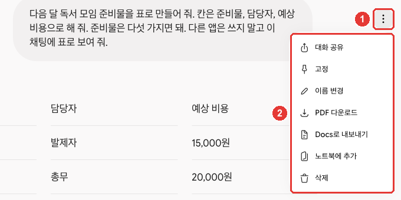
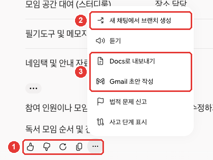
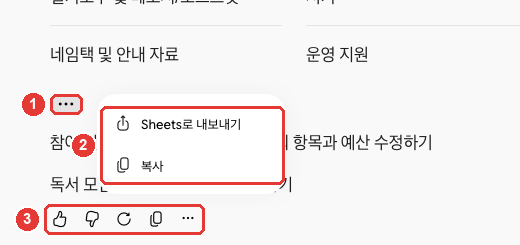

# 3장. 대화 관리 — 찾기·정리·공유·내보내기

> **한 줄 요약**: 지난 대화는 옆 메뉴에서 **찾고, 고정하고, 이름을 바꾸고, 지울 수 있습니다.**
> 다른 사람에게 보여 줄 때는 **공유 링크**를, 문서나 메일로 옮길 때는 **내보내기**를 씁니다. 공유 링크는 링크를 가진 누구나 읽을 수 있다는 점만 꼭 기억하세요.

화면은 2026년 10월 웹 기준이고, 그림은 유료 요금제(Google AI Pro) 한국어 화면입니다. 휴대폰 앱은 메뉴 위치가 조금 다를 수 있습니다.

## 지난 대화 찾기

지난 대화는 왼쪽 옆 메뉴의 대화 목록에 모입니다([2장](02-screen-tour.md)).[^recent]
대화가 많아지면 목록을 내려 가며 찾기 어렵습니다. 그럴 때는 옆 메뉴 위쪽 「채팅 검색」(돋보기)을 누르고 찾는 낱말을 넣은 뒤 Enter를 누르세요.[^recent][^screen]

예를 들어 지난주에 김장 재료를 물어봤다면 "김장"으로 찾아보세요. 검색 칸은 화면 위쪽에 따로 열립니다.[^screen]

**개인 계정은 「활동 기록 보관」이 켜져 있어야 대화 찾기·고정·이름 변경·삭제를 쓸 수 있습니다.**[^recent]
「활동 기록 보관」은 내 대화를 계정에 남겨 두는 설정입니다. 만 18세 이상이면 처음부터 켜져 있습니다. 「설정」 → 「활동」을 누르면 열리는 「Gemini 앱 활동」 페이지에 있습니다. 끄는 법과 끌 때 달라지는 점은 9장에서 다룹니다.[^activity]

회사·학교 계정은 관리자가 기록을 관리합니다. 이때는 내가 대화를 지울 수 없습니다.[^recent]

<Quiz id="ch303-find" />

## 고정·이름 바꾸기·지우기

자주 여는 대화는 **고정**해 두세요. 대화 목록에서 그 대화에 마우스를 올리면 오른쪽에 점 세 개(⋮)가 나타납니다. 누르면 대화 메뉴가 열립니다.[^recent][^screen]

![옆 메뉴 대화 목록에서 「[연습] 독서 모임 준비물」 대화 오른쪽 점 세 개(①)를 누르면 열리는 메뉴(②) — 「대화 공유」「고정」「이름 변경」「노트북에 추가」「삭제」. 다른 대화 제목은 예시로 바꾼 화면이다](assets/shot-08-chat-menu-marked.png)

연습용으로 만든 대화로 찍었고, 다른 대화 제목은 예시로 바꾼 화면입니다. ① 점 세 개를 누르면 ② 메뉴가 열립니다.[^screen]

| 메뉴 | 하는 일 |
|---|---|
| 「고정」 | 대화를 목록 맨 위에 붙여 둔다(고정한 뒤에는 「고정 해제」) |
| 「이름 변경」 | 대화 제목을 바꾼다 |
| 「삭제」 | 대화를 지운다 |
| 「대화 공유」 | 공개 링크를 만든다(아래 「대화 공유하기」) |
| 「노트북에 추가」 | 대화를 노트북에 모은다(노트북은 6장) |

출처: Google 도움말과 실제 화면[^recent][^screen]

대화를 열어 둔 상태라면 오른쪽 위 점 세 개 버튼(화면 읽기 이름 「대화 작업 메뉴 열기」)에서도 같은 일을 할 수 있습니다.[^screen]



이 메뉴(②)에는 옆 메뉴에 없는 「PDF 다운로드」와 「Docs로 내보내기」도 있습니다.[^screen]

"11월 독서 모임 안내문"처럼 **날짜나 일 이름이 들어간 제목**으로 바꿔 두면 목록에서 알아보기 쉬워집니다.

**지우기 전에 알아 둘 점이 두 가지 있습니다.**[^recent]

- **대화를 지우면 「Gemini 앱 활동」에서도 함께 지워집니다.** 내 대화 기록에서도 사라집니다.
- **그 대화에서 만든 것도 함께 지워집니다.** Canvas로 만든 문서나 앱 같은 결과물이 같이 사라집니다(Canvas는 [4장](04-files-create.md)).

그러니 그 대화에서 만든 문서를 계속 쓸 거라면, 지우기 전에 [내보내기](#다른-앱으로-내보내기)로 옮겨 두세요.

<Quiz id="ch303-manage" />

## 대화를 갈라서 이어 가기 — 분기

긴 대화 중간에서 **다른 방향으로 한번 가 보고 싶을 때**가 있습니다. 예를 들어 여행 일정을 짜다가 "비가 오면 어떻게 할까?"를 따로 물어보고 싶은 경우입니다.

그럴 때는 그 지점의 답 아래 「옵션 더보기」(점 세 개)를 누르고 「새 채팅에서 브랜치 생성」을 고르세요.[^screen][^recent] 그 지점에서 갈라져 나온 **새 대화**가 열립니다. 원래 대화는 그대로 남아서 나중에 돌아와 계속할 수 있습니다.[^recent]



① 답 아래 도구 줄의 맨 오른쪽 점 세 개를 누르면 메뉴가 열립니다. ②가 분기, ③은 아래 「다른 앱으로 내보내기」에서 씁니다.[^screen]

분기하면 원래 대화가 곁가지 질문으로 어지러워지지 않습니다. [1단계 6장](../00-common/06-conversation.md)에서 배운 "주제가 바뀌면 새 대화"를, 앞 내용을 잃지 않고 하는 방법입니다.

**둘은 따로 지워집니다.** 갈라 나온 대화를 지워도 원래 대화는 남고, 원래 대화를 지워도 갈라 나온 대화는 남습니다.[^recent]

<Quiz id="ch303-branch" />

## 대화 공유하기 — 공개 링크

대화를 다른 사람에게 보여 주려면 **공개 링크**를 만듭니다. 대화 메뉴(옆 메뉴의 점 세 개, 또는 오른쪽 위 점 세 개)에서 「대화 공유」를 고르세요. 위의 대화 메뉴 그림에 있습니다.[^screen] 링크(g.co/gemini/share/…)가 만들어집니다.[^share]

**링크를 가진 사람은 누구나 그 대화를 읽을 수 있습니다.** 내가 직접 보내지 않은 사람도 링크만 있으면 읽고, 다시 퍼뜨릴 수 있습니다.[^share]
그러니 공유하기 전에 대화 전체를 한 번 훑어보세요. 링크는 **대화 전체**를 보여 줍니다. 올린 사진은 받는 사람이 내려받을 수도 있습니다.[^share]

알아 둘 점은 이렇습니다.[^share]

- **내 이름은 붙지 않습니다.** 링크 주소와 공유 페이지에 내 이름이나 계정이 표시되지 않습니다.
- **링크를 만든 순간 그대로 보입니다.** 그 뒤에 대화를 고치거나 이어 써도 공유 페이지는 바뀌지 않습니다. 고친 내용을 보여 주려면 링크를 새로 만드세요.
- **만든 결과물도 함께 보입니다.** Canvas 문서, 이미지, 동영상도 공유 페이지에 들어갑니다.
- **받은 사람이 이어서 대화할 수 있습니다.** 링크를 연 사람이 「이 채팅 계속하기」로 대화를 이어 갈 수 있습니다. 단, Gem으로 만든 대화와 만 18세 미만은 안 됩니다. 또 **내가 Google AI 유료 요금제로 만든 대화라면 받는 사람도 유료 요금제여야** 이어 갈 수 있습니다.

### 공유한 링크 지우기

공유를 거두고 싶으면 「설정」 → 「내 공개 링크」로 가서 그 링크를 지우세요. 「모든 링크 삭제」로 한 번에 지울 수도 있습니다.[^share][^screen]

링크를 지워도 남는 것이 있습니다.[^share]

- **다른 곳에 올린 글은 그대로입니다.** 카페나 메신저에 링크를 붙여 둔 글은 그곳에서 따로 지워야 합니다.
- **내 대화는 지워지지 않습니다.** 링크만 사라지고, 대화는 내 목록에 그대로 있습니다.

반대로 **대화를 지우면 그 대화의 링크도 함께 사라집니다.** 링크는 대화가 내 기록에 남아 있는 동안만 열립니다.[^share]

공유하기 전에 이렇게 물어보면 빠뜨린 개인정보를 찾는 데 도움이 됩니다. 단, AI가 다 찾아 준다고 믿지 말고 마지막에는 직접 읽어 보세요([1단계 9장](../00-common/09-safety.md)).

```
이 대화를 다른 사람에게 공유하려고 해. 지금까지 대화에 이름, 전화번호, 주소, 회사 이름처럼
다른 사람이 보면 곤란한 정보가 있는지 찾아서 목록으로 알려 줘.
```

<Quiz id="ch303-share" />

## 다른 앱으로 내보내기

답을 문서나 메일로 옮기고 싶을 때는 **내보내기**를 쓰세요. 직접 복사해 붙여 넣지 않아도 새 문서나 메일 초안이 바로 생깁니다.
답 아래 「옵션 더보기」(점 세 개)를 누르면 「Docs로 내보내기」와 「Gmail 초안 작성」이 있습니다(위 그림의 ③).[^screen][^export]

| 메뉴 | 있는 곳 | 결과 |
|---|---|---|
| 「Docs로 내보내기」 | 답 아래 점 세 개 | Google Drive에 새 문서가 생긴다 |
| 「Gmail 초안 작성」 | 답 아래 점 세 개 | Gmail에 새 메일 초안이 생긴다 |
| 「Sheets로 내보내기」 | 표 아래 점 세 개 | 답 속 표가 Google 스프레드시트로 간다 |

출처: Google 도움말과 실제 화면[^export][^screen]

「Sheets로 내보내기」는 표 바로 아래 작은 점 세 개(…)를 누르면 나옵니다. 표가 있는 답에서만 보이고, 그림이 들어간 표는 내보낼 수 없습니다.[^export][^screen]



① 표 아래 점 세 개와 ③ 답 아래 점 세 개는 다른 메뉴입니다. 표만 옮기려면 ①을 누르세요.[^screen]
「Gmail 초안 작성」은 Gmail 계정이 있어야 합니다. 메일이 바로 보내지는 것이 아니라 **초안**으로 저장되니, 받는 사람과 내용을 확인하고 직접 보내세요.[^export]

예를 들어 아래처럼 받은 표를 「Sheets로 내보내기」로 옮기면 바로 정렬하고 고칠 수 있습니다.

```
다음 달 독서 모임 준비물을 표로 만들어 줘. 칸은 준비물, 담당자, 예상 비용으로 해 줘.
다른 앱은 쓰지 말고 이 채팅에 표로 보여 줘.
```

둘째 줄을 붙인 이유가 있습니다. 이 가이드가 첫 줄만 보냈을 때 Gemini는 대화 안에 표를 보여 주지 않았습니다. 대신 Google Sheets에 연결하려다 멈췄습니다.[^screen] 표를 먼저 대화 안에서 확인하고 싶다면 둘째 줄처럼 분명히 말해 주세요.

내보낸 문서와 메일은 그 서비스(Docs·Gmail)의 약관과 정책을 따릅니다.[^export]

<Quiz id="ch303-export" />

## 답 다시 받기와 확인하기

답이 마음에 들지 않으면 **다시 받아 보세요.** 답 아래 「다시 실행」(둥근 화살표)을 누르면 같은 질문에 새 답을 만듭니다.[^screen][^regen] 가장 최근 답에서만 할 수 있습니다.[^regen]
다시 받은 뒤에는 답 아래 화살표로 앞뒤 답을 오가며 비교할 수 있습니다.[^regen]

**무엇이 마음에 안 드는지 알면 고쳐 달라고 말해 보세요.** 대화를 이어 가며 길이, 말의 쉬운 정도, 말투를 바꿔 달라고 할 수 있습니다.[^regen] 질문은 괜찮은데 답이 우연히 별로였다면 「다시 실행」이 맞습니다([1단계 6장](../00-common/06-conversation.md)).

| 아쉬운 요청 | 나은 요청 |
|---|---|
| (「다시 실행」만 계속 누르기) | "세 줄로 줄여 줘" |
| (「다시 실행」만 계속 누르기) | "초등학생도 알아듣게 쉬운 말로 바꿔 줘" |
| (「다시 실행」만 계속 누르기) | "말투를 더 정중하게 바꿔 줘" |

무엇을 바꿀지 말하면 원하는 쪽으로 가까워지기 쉽습니다. 「다시 실행」만 누르면 무엇이 달라질지 고를 수 없습니다.

### 출처 확인하기

답 아래나 문장 사이에 「출처」 버튼이 보이면 눌러 보세요. 오른쪽에 관련 링크가 열립니다.[^sources]
링크는 웹사이트일 수도 있고, 내가 올린 파일이나 연결해 둔 Gmail·Docs일 수도 있습니다.[^sources]
**모든 답에 출처가 붙지는 않습니다.** 「출처」 버튼이 없으면 그 답에는 링크가 없다는 뜻입니다.[^sources]

Google도 Gemini가 틀릴 수 있다고 분명히 말합니다.[^accuracy]

- **의료·법률·돈 문제의 전문가 조언으로 믿지 마세요.**
- **사람에 관한 답은 특히 다시 확인하세요.** 틀린 내용이 나올 수 있습니다.
- **Gemini가 자기 자신에 대해 하는 설명도 틀릴 수 있습니다.** 예를 들어 "너는 어떻게 학습했어?"나 "출처를 어떻게 다는 거야?"에 대한 답이 실제와 다를 수 있습니다. 기능이 궁금하면 이 가이드나 공식 도움말을 보세요.

틀린 답을 보면 답 아래 「대답이 마음에 들지 않아요」(엄지 아래)를 누르고 무엇이 틀렸는지 적어 주세요.[^accuracy] 다만 의견을 보내면 그 대화가 함께 Google로 갑니다([1장](01-getting-started.md#안-될-때-먼저-해-볼-것)).

<Quiz id="ch303-regen" />

## 직접 해 보기

1. 새 채팅에서 짧은 질문을 하나 보내고, 옆 메뉴에서 그 대화의 이름을 "연습 — 오늘 날짜"로 바꾼다.
2. 그 대화를 고정했다가 고정을 푼다.
3. 「채팅 검색」에서 "연습"으로 찾아 그 대화가 나오는지 확인한다.
4. 답을 하나 「Docs로 내보내기」로 옮기고, Google Drive에 새 문서가 생겼는지 본다.
5. 공유 링크를 하나 만든 뒤 「설정」 → 「내 공개 링크」에서 지운다.

**이어지는 과제** ([독서 모임 준비하기](../00-common/practice-kit.md)): 2장에서 정리한 준비 목록을 표로 만들어 달라고 한 뒤 「Sheets로 내보내기」로 옮긴다. 대화 이름은 "독서 모임 준비"로 바꿔 둔다.

## 정리

- 지난 대화는 옆 메뉴 목록과 「채팅 검색」으로 찾는다. 개인 계정은 「활동 기록 보관」이 켜져 있어야 찾기·고정·이름 변경·삭제를 쓴다.
- 대화의 점 세 개 메뉴에서 고정·이름 변경·삭제·대화 공유를 한다. 지우면 그 대화에서 만든 Canvas 결과물도 함께 지워진다.
- 답 아래 점 세 개의 「새 채팅에서 브랜치 생성」으로 대화 중간에서 갈라 나가도 원래 대화는 그대로 남는다.
- 공유 링크는 링크를 가진 누구나 읽는다. 만든 순간의 내용만 보인다. 「설정」 → 「내 공개 링크」에서 지운다.
- 답 아래 점 세 개에서 Docs·Gmail 초안으로, 표 아래 점 세 개에서 Sheets로 옮긴다. Gmail은 초안으로만 저장된다.
- 「다시 실행」은 가장 최근 답에서만 된다. 무엇을 바꿀지 말해 고쳐 달라는 편이 빠를 때가 많다.
- 「출처」로 근거를 확인하고, 의료·법률·돈 문제와 사람에 관한 답은 다시 확인한다.

## 용어 정리

| 용어 | 읽는 법 | 한 줄 뜻 |
|---|---|---|
| Pin | 핀 (고정) | 대화를 목록 맨 위에 붙여 두기 |
| Branch | 브랜치 (분기) | 대화 중간에서 갈라 나온 새 대화. 화면 이름 「새 채팅에서 브랜치 생성」 |
| Public Link | 퍼블릭 링크 (공개 링크) | 링크를 가진 누구나 대화를 읽을 수 있는 주소 |
| Export | 익스포트 (내보내기) | 답을 Docs·Gmail·Sheets 같은 다른 앱으로 옮기기 |
| Regenerate | 리제너레이트 (재생성) | 같은 질문에 답을 새로 만들기. 화면 이름 「다시 실행」 |
| Source | 소스 (출처) | 답의 근거가 된 웹페이지·파일 링크 |
| Keep Activity | 킵 액티비티 (활동 기록 보관) | 내 Gemini 대화를 계정에 남겨 두는 설정 |

<ChapterDone :chapter="303" />

다음 장: [4장. 파일과 만들기](04-files-create.md)

[^screen]: Gemini 웹 화면(Google AI Pro, 한국어)에서 연습용 대화로 직접 확인. 옆 메뉴 「채팅 검색」(검색 칸이 화면 위쪽에 열림), 「설정」 메뉴의 「내 공개 링크」. 옆 메뉴 대화의 점 세 개 메뉴 「대화 공유」「고정」「이름 변경」「노트북에 추가」「삭제」. 대화 화면 오른쪽 위 「대화 작업 메뉴 열기」 메뉴 「대화 공유」「고정」「이름 변경」「PDF 다운로드」「Docs로 내보내기」「노트북에 추가」「삭제」. 답 아래 도구 줄 「대답이 마음에 들어요」「대답이 마음에 들지 않아요」「다시 실행」「복사」「옵션 더보기」, 「옵션 더보기」 메뉴 「새 채팅에서 브랜치 생성」「듣기」「Docs로 내보내기」「Gmail 초안 작성」「법적 문제 신고」「사고 단계 표시」. 표 아래 「옵션 더보기」 메뉴 「Sheets로 내보내기」「복사」. 도움말의 「새 채팅에서 분기」「재생성」「공유 및 내보내기」, 답 아래 「공유」는 이 화면에서 보지 못했고 위 이름으로 바뀌어 있었다. "표로 만들어 줘"만 보냈을 때는 「Connecting to Google Sheets」 표시에서 답이 멈췄다. (확인일 2026-10-31)
[^recent]: Google 도움말, 「Find & manage your recent chats in Gemini Apps」(한국어판 「Gemini 앱에서 최근 채팅 확인 및 관리하기」). "You can pin, rename, and delete your chats so the important ones are easy to find." / "If you're using Gemini Apps with a personal account, the features below are only available if you have Keep Activity turned on." / "If you’re using Gemini Apps with a work or school account, your Gemini Apps Activity is controlled by your Google Workspace administrator and you can’t delete chats." / "In the text box, enter what you want to search." / "Click Pin. You can find your pinned chat at the top of the “Recent” section." / "On the side panel, hover over the chat you want to rename." / "You can create a new chat that branches off from a specific point in a conversation, then return to the main conversation to continue it." / "Tip: Deleting a branched chat doesn’t delete the original chat. Deleting the original chat doesn’t delete a branched chat." / "Important: When you delete a chat from your pinned and recent chats, it's also deleted from Gemini Apps Activity." / "If you delete a chat in pinned and recent chats, it also deletes any content created in that chat (like Canvas docs and apps) and the related activity from Gemini Apps Activity." 한국어 화면 이름 「더보기」「고정」「고정 해제」「이름 변경」「삭제」「새 채팅에서 분기」. https://support.google.com/gemini/answer/13666746 (확인일 2026-10-31)
[^activity]: Google 도움말, 「Manage & delete your activity in Gemini Apps」. "If you’re 18 or over, Keep Activity is on by default." 화면 이름 「활동 기록 보관」은 「설정」 → 「활동」으로 열리는 「Gemini 앱 활동」 페이지에서 확인(2026-10-30, `docs/reports/2026-10-30_Gemini-공식-자료.md` 「실제 화면에서 직접 확인」). https://support.google.com/gemini/answer/13278892 (확인일 2026-10-31)
[^share]: Google 도움말, 「Share your chats from Gemini Apps」(한국어판 「Gemini 앱의 채팅 공유하기」). "Anyone with the link can read the chat, even if you didn’t share the link with them directly." / "To share the link: The g.co/gemini/share link is auto-copied." / "If you upload an image to a chat and then share the chat, the image is available and downloadable from the shared chat." / "We don’t add your name or account to the URL address or the shared chat page." / "If you edit or continue the chat after you create a public link, the content on the shared chat page won’t change." / "The shared chat will include any AI-generated artifacts from the conversation, including Canvas documents, images, and videos." / "Continue the chat with Gemini Apps on their own (except for a chat that was created with Gems or for users under the age of 18)." / "If the chat was created by a user with a Google AI subscription, you can continue it only if you have a Google AI subscription." / "anyone with the link can read the chat, reshare it with others" / "It doesn’t delete the chat from your Gemini Apps activity." / "Tip: To delete all your public links, click Delete all links." / "It doesn't delete any posts with the link that you've made on third-party sites. To delete the post, delete it from the third party site." / "Your links are publicly available for as long as the associated chat is saved in your Gemini Apps Activity." 한국어 화면 이름 「공유」「대화 공유」「이 채팅 계속하기」「내 공개 링크」「모든 링크 삭제」. https://support.google.com/gemini/answer/13743730 (확인일 2026-10-31)
[^export]: Google 도움말, 「Export responses from Gemini Apps」(한국어판 「Gemini 앱 대답 내보내기」). "You can export responses from Gemini Apps to Google Workspace apps like Gmail and Google Docs. You can also export code to developer tools like Google Colab and Replit." / "If you export content or code from Gemini Apps, the terms and policies of the service you export to will apply to that content." / "Below the response, click Share & export   Export to Docs. This saves a new doc in Google Drive." / "Below the response, click Share & export   Draft in Gmail. This creates a new draft email in Gmail." / "Important: This feature is only available if you have a Gmail account." / "Important: This feature is only available for responses that have a table. Tables with images can’t be exported to Sheets." 한국어 화면 이름 「공유 및 내보내기」「Docs로 내보내기」「Gmail 초안 작성」「Sheets로 내보내기」. https://support.google.com/gemini/answer/14184041 (확인일 2026-10-31)
[^regen]: Google 도움말, 「Regenerate or modify responses from Gemini Apps」(한국어판 「Gemini 앱에서 대답 재생성 또는 수정하기」). "Important: You can regenerate only the most recent response in a chat." / "To switch between response versions: Below the response, click the arrows to switch between versions." / "For example, you can adjust the length, simplify the language, and change the tone of a response." / "You can continue to chat with Gemini to modify a response. For example, you can ask Gemini to simplify the language or provide more details about your topic." 한국어 화면 이름 「재생성」. https://support.google.com/gemini/answer/14262426 (확인일 2026-10-31)
[^sources]: Google 도움말, 「View related sources from Gemini Apps」(한국어판 「Gemini 앱의 관련 출처 보기」). "When sources are available, you can find the Sources button at the bottom of the response or in-line throughout the response. On the right, a side panel will open with the relevant links." / "These links may include content that is related to parts of Gemini’s response, including public websites, files you have uploaded, or documents or emails from Google Workspace if you’ve connected to Workspace." / "Not all responses include related links or sources." 버튼 이름 「출처」는 도움말 한국어판 이름이다. 이 가이드의 연습 대화에는 출처가 붙지 않아 화면에서는 확인하지 못했다. https://support.google.com/gemini/answer/14143489 (확인일 2026-10-31)
[^accuracy]: Google 도움말, 「Learn about responses from Gemini Apps」(한국어판 「Gemini 앱의 대답에 관해 자세히 알아보기」). "Don’t rely on responses from Gemini Apps as medical, legal, financial or other professional advice." / "Gemini Apps may provide inaccurate or inappropriate responses about people, so double-check its responses." / "One example is that Gemini can misrepresent how it works, including in response to prompts asking how it was trained or how it carries out various functions (like citing sources, or providing fresh information)." / "If you see a hallucination or something that isn’t accurate, please click the thumbs down button and provide your feedback." 엄지 아래 버튼의 한국어 이름 「대답이 마음에 들지 않아요」는 「Send feedback or report a problem with Gemini Apps」(13275746) 한국어판. https://support.google.com/gemini/answer/16279220 (확인일 2026-10-31)
