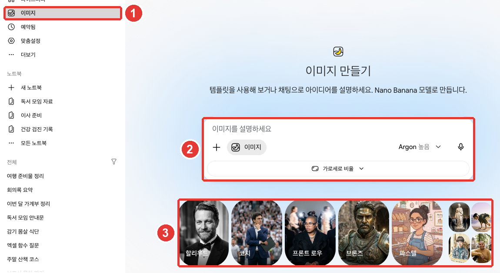

# 4장. 파일과 만들기 — 파일 올리기, Canvas, 이미지·영상·음악

> **한 줄 요약**: 입력창 「+」로 **파일을 올려** 요약·분석을 받고, **Canvas**에서 문서와 앱을 함께 고치고,
> **이미지·동영상·음악**을 만들 수 있습니다. Gemini로 만든 미디어에는 AI가 만들었다는 표시가 들어갑니다. 남이 공유한 앱에는 비밀번호를 넣지 마세요.

화면은 2026년 10월 웹 기준이고, 그림은 유료 요금제(Google AI Pro) 한국어 화면입니다. 이 장의 기능 중 동영상 만들기처럼 **유료 요금제가 있어야 하는 것**에는 「유료」라고 적었습니다.

## 파일 올리기

문서, 표 파일, 사진, 동영상 같은 파일을 올리면 그 내용으로 답을 받을 수 있습니다. 요약을 받거나, 궁금한 점을 묻거나, 분석을 맡길 수 있습니다.[^files]
입력창 「+」를 누르고 「파일 업로드」를 고르세요. Google Drive에 있는 파일은 「Drive에서 파일 추가」로 가져옵니다([2장](02-screen-tour.md#입력창과-메뉴)).[^files][^screen]

한 번에 올릴 수 있는 양에는 한도가 있습니다.[^files]

| 항목 | 한도 |
|---|---|
| 한 번에 올리는 파일 수 | 10개까지(상황에 따라 다름, 폴더 안 파일도 하나씩 센다) |
| 동영상 하나 | 2GB까지 |
| 그 밖의 파일 하나 | 100MB까지 |
| 동영상 길이 합계 | 5분(Pro·Ultra는 1시간) |
| 오디오 길이 합계 | 10분(Pro·Ultra는 3시간) |

출처: Google 도움말[^files]

Drive 파일을 가져오려면 「활동 기록 보관」이 켜져 있고 Google Workspace(Gmail·Drive 같은 Google 앱 묶음)가 Gemini에 연결돼 있어야 합니다([3장](03-chats.md#지난-대화-찾기)).[^files] 연결은 [7장](07-skills-apps.md#연결된-앱-—-gmail·drive·캘린더를-gemini에서)에서 다룹니다.

**표 파일을 올리면 차트도 만들 수 있습니다.** 웹에서 표 파일을 올린 뒤 차트를 만들어 달라고 해 보세요. 만든 차트는 확대해 보고 원하는 모양으로 고칠 수 있습니다.[^files]

```
올린 가계부 파일로 이번 달 지출을 항목별 막대 차트로 그려 줘.
가장 많이 쓴 항목 세 개는 따로 한 줄씩 짚어 줘.
```

알아 둘 점이 세 가지 있습니다.[^files]

- **큰 파일은 일부를 놓칠 수 있습니다.** 더 나은 결과를 원하면 내용이 적은 작은 파일로 나눠 올리세요. 한 번에 읽는 양은 [1장](01-getting-started.md#요금제마다-무엇이-다른가)의 요금제 표를 보세요.
- **파일 분석에는 시간 단위 한도가 따로 있습니다.** 많이 올리다 한도에 닿으면 시간이 지나 다시 풀릴 때까지 기다리세요.
- **올린 파일은 Gemini 앱 저장공간을 씁니다.** 이 공간은 Drive 용량과 따로 셉니다. 「파일을 업로드하려면 데이터를 삭제하세요」가 뜨면 공간이 찬 것입니다. 「설정」 → 「활동」에서 지난 활동을 지우면 비워집니다. 동영상·사진이 든 대화가 공간을 더 씁니다.

파일을 올리기 전에는 그 파일에 다른 사람의 개인정보가 없는지 한 번 보세요([1단계 9장](../00-common/09-safety.md)).

<Quiz id="ch304-upload" />

## Canvas — 문서와 앱을 함께 고치기

**Canvas**(캔버스)는 문서나 앱을 따로 창에 띄워 놓고 Gemini와 함께 고치는 기능입니다. 문서, 앱, 슬라이드, 코드를 만들 수 있습니다.[^canvas]
입력창 「+」 → 「도구 더보기」 → 「Canvas」를 누르고 만들고 싶은 것을 적어 보내세요([2장](02-screen-tour.md#입력창과-메뉴)).[^canvas][^screen]


연습으로 만든 안내문입니다. 이 가이드가 확인한 화면에서는 문서 창이 **대화 안에** 열렸습니다. ③의 「전체 화면」을 누르면 크게 볼 수 있습니다.[^screen]

| 번호 | 버튼 | 하는 일 |
|---|---|---|
| ① | 「변경사항이 저장됨」·「이전 버전」·「다음 버전」 아이콘 | 저장 상태 보기, 앞뒤 버전 오가기 |
| ② | 「내보내기」 | Docs 등 밖으로 옮기기 |
| ③ | 「공유」·「전체 화면」·「닫기」 아이콘 | 링크 만들기, 크게 보기, 닫기 |
| ④ | 문서 본문 | 직접 고치거나, 골라서 Gemini에게 고쳐 달라기 |

아이콘 이름은 마우스를 올리면 뜨는 이름입니다. 출처: Gemini 웹 화면에서 직접 확인[^screen]

처음 열면 "아무 곳이나 클릭하여 직접 입력하고 수정하거나, 텍스트를 선택하여 Gemini에게 변경을 요청하세요."라는 안내가 뜹니다.[^screen] ④ 본문을 직접 고쳐도 되고, 고칠 부분을 골라 Gemini에게 맡겨도 됩니다.

슬라이드처럼 **특정 형식**이 필요하면 질문에 그렇게 적으세요.[^canvas] 예를 들어 이렇게 요청할 수 있습니다.

```
다음 달 독서 모임 안내문을 만들어 줘. 날짜, 장소, 읽을 책, 준비물을 넣고
한 장짜리 문서로 써 줘.
```

Canvas에서 할 수 있는 일은 이렇습니다.[^canvas]

- **바꾼 내용은 저절로 저장됩니다.** 이전 버전·다음 버전 버튼으로 앞서 저장된 모습을 다시 볼 수 있습니다.
- **일부만 고칠 수 있습니다.** 고칠 부분을 마우스로 끌어 고른 뒤 무엇을 바꿀지 적으세요.
- **문서는 길이와 말투를 바로 바꿀 수 있습니다.** 「길이 변경」·「어조 변경」을 누르면 됩니다.
- **다른 형식으로 바꿀 수 있습니다.** 만든 문서로 슬라이드, 퀴즈, 인포그래픽(정보를 그림으로 정리한 한 장 자료), 웹페이지, 오디오 오버뷰(문서를 대화 형식 음성으로 들려주는 것) 등을 만들 수 있습니다. 지금은 만 18세 미만은 이 기능을 쓸 수 없습니다.
- **밖으로 옮길 수 있습니다.** Docs로 내보내거나, 슬라이드는 Google Slides나 PDF로 내보낼 수 있습니다.

앱을 만들면 Canvas 오른쪽 위에서 코드를 직접 보고 고치거나, 「콘솔 표시」로 오류를 볼 수 있습니다.[^canvas] 앱에 글·그림 만들기 같은 AI 기능을 넣으려면 로그인한 만 18세 이상이어야 합니다.[^canvas]

**Canvas로 만든 것은 그 대화와 함께 지워집니다**([3장](03-chats.md#고정·이름-바꾸기·지우기)). 오래 쓸 문서는 Docs로 내보내 두세요.

<Quiz id="ch304-canvas" />

## Canvas 앱을 공유할 때와 받을 때

Canvas로 만든 앱도 공유 링크를 만들 수 있습니다. 이때는 대화를 공유할 때보다 조심해야 합니다.

**여러 사람이 데이터를 나누는 앱은, 링크를 가진 누구나 그 앱의 데이터를 보고 고칠 수 있습니다.**[^canvas][^canvas-safety]
저장 기능이 있는 앱을 만들면 Gemini가 데이터베이스(자료를 저장해 두는 곳)를 함께 만듭니다. 여러 사람이 데이터를 나누는 앱은 공개 데이터베이스에 저장되어, 링크가 있는 누구나 보고 고칠 수 있습니다.[^canvas-safety]
예를 들어 모임 회원 연락처를 모으는 앱을 만들어 링크를 퍼뜨리면, 링크를 받은 누구나 그 연락처를 볼 수 있습니다. 개인정보를 모으는 앱은 공유하지 마세요.

**남이 보낸 앱은 낯선 메일처럼 의심하세요.** 앱에 넣은 정보는 앱을 만든 사람이 볼 수 있고, 링크를 가진 다른 사람에게도 보일 수 있습니다. Google은 이렇게 안내합니다.[^canvas-safety]

- **비밀번호나 결제 정보를 묻는 앱은 아주 조심하세요.**
- **카메라·마이크 권한을 달라는 앱**도 조심하세요.
- **믿을 수 없는 곳에서 온 앱은 내려받지 마세요.**
- 위험해 보이는 앱은 페이지 아래 링크로 신고할 수 있습니다.

공유받은 Canvas 링크는 웹(gemini.google.com)에서만 열리고, 휴대폰 앱에서는 열리지 않습니다.[^canvas]

<Quiz id="ch304-canvas-safety" />

## 이미지 만들기

글로 설명하면 Gemini가 그림을 만들어 줍니다. 그림을 만드는 모델은 **Nano Banana**(나노 바나나)입니다.[^image]
입력창 「+」 → 「이미지 만들기」를 누르거나, 옆 메뉴 「이미지」에서 템플릿(미리 준비된 틀)을 고르거나 바로 설명을 적으세요.[^image][^screen]



① 옆 메뉴 「이미지」를 누르면 ② 입력창에 그림을 설명하거나, ③ 템플릿을 골라 시작할 수 있습니다. 입력창 아래 「가로세로 비율」로 그림의 모양(가로·세로 길이 비율)을 고릅니다.[^screen]

**잘 그려 달라는 요령**은 이렇습니다.[^image]

- "그려 줘", "만들어 줘"처럼 무엇을 할지로 시작하세요.
- 화풍(사진처럼, 수채화, 만화 등)과 무엇이 어디서 무엇을 하는지를 자세히 적으세요.

| 아쉬운 요청 | 나은 요청 |
|---|---|
| "고양이 그림" | "창가에서 졸고 있는 주황색 고양이를 수채화 느낌으로 그려 줘. 오후 햇살이 비치는 장면으로." |

나은 요청은 화풍·주인공·장소·분위기를 다 알려 줘서 다시 그려 달라고 할 일이 줄어듭니다.

만든 그림은 **대화로 고칠 수 있습니다.** 옆 메뉴 「라이브러리」에서 그림을 열고 아래 「채팅」을 눌러 바꿀 점을 적으세요. 내 사진을 올려 고치거나, 여러 장을 합쳐 새 그림을 만들 수도 있습니다.[^image]

요금제에 따라 달라지는 점도 있습니다.[^image]

- **내려받는 크기**: Google AI 요금제가 있으면 2K, 없으면 1K 해상도입니다.
- **더 정밀한 모델(유료)**: 유료 요금제에서는 **Nano Banana Pro**로 그림을 다시 만들 수 있습니다. 모델을 Pro로 두었을 때 씁니다. 다만 그날 쓸 수 있는 Nano Banana 2 그림 한도를 다 쓰면 Pro로 다시 만들 수 없습니다.

그림을 **만들기만** 하려면 만 13세(나라마다 기준 나이가 다를 수 있음) 이상, **고치기까지** 하려면 만 18세 이상이어야 합니다.[^image] 약관을 어긴 것으로 보이는 그림은 지워질 수 있습니다.[^image]

<Quiz id="ch304-image" />

## 동영상·음악 만들기

### 동영상 만들기 (유료)

**Gemini Omni**(제미나이 옴니)로 대화하듯 동영상을 만들고 고칩니다. 글, 그림, 영상을 섞어 설명할 수 있습니다.[^video]
개인 계정은 **Google AI 요금제가 있어야** 씁니다.[^video] 입력창 「+」 → 「동영상 만들기」를 누르고 원하는 영상을 적으세요.[^video][^screen]

- **참고 자료를 올릴 수 있습니다.** 동영상 1개와 사진 5장까지 올릴 수 있습니다.[^video]
- **만드는 데 몇 분 걸립니다.** 만드는 동안 그 대화는 쓸 수 없으니, 새 채팅을 열어 다른 일을 하다 돌아오세요.[^video]
- **대화로 고칩니다.** 물건을 지우거나 바꾸고, 카메라 각도나 장면을 바꿔 달라고 하면 됩니다.[^video]
- **가로 화면이 기본입니다.** 참고 사진이나 영상을 올리면 그 비율을 따릅니다.[^video]
- 다 만든 영상은 YouTube에 올리거나 내려받을 수 있습니다.[^video]

**올리는 사진은 내가 쓸 권리가 있는 것만** 쓰세요. 약관이나 다른 사람의 권리를 어기면 계정이 해지될 수 있습니다.[^video]

### 음악 만들기

**Lyria**(리리아)로 곡을 설명하면 음악과 가사를 만들어 줍니다.[^music] 입력창 「+」 → 「음악 만들기」를 누르세요.[^music][^screen]

- **만 18세 이상**이고 「활동 기록 보관」이 켜져 있어야 합니다.[^music]
- 길이는 **짧게(약 1분)** 또는 **전체(약 2~3분)** 중에 고르고, 노래가 들어갈지와 장르도 고를 수 있습니다.[^music]
- **전체 길이 곡을 만들려면 모델을 Pro로** 바꿔야 합니다([2장](02-screen-tour.md#모델-버튼-—-모델과-사고-수준)).[^music]
- 곡은 표지 그림이 붙은 동영상(MP4)이나 소리만(MP3)으로 내려받을 수 있습니다.[^music]
- 만들 수 있는 곡 수에 한도가 있습니다. 넘으면 알림이 옵니다.[^music]

음악도 "써 줘", "작곡해 줘"로 시작하고 장르와 악기를 적으면 좋습니다.[^music]

```
독서 모임 시작할 때 틀 잔잔한 곡을 작곡해 줘. 어쿠스틱 기타와 피아노로,
가사 없이 짧게 만들어 줘.
```

이미지·음악·영상 만들기는 **사용량을 많이 씁니다.** 영상이 가장 많이 씁니다([1장](01-getting-started.md#사용-한도-—-5시간·주간·읽는-양)).

<Quiz id="ch304-media" />

## AI가 만든 것인지 확인하기 — 워터마크

Gemini로 만들거나 고친 이미지·영상·음악에는 **AI가 만들었다는 표시**가 들어갑니다.[^watermark][^music]

| 표시 | 보이나 | 하는 일 |
|---|---|---|
| SynthID(신스아이디) 워터마크 | 안 보임 | Google AI로 만든 것인지 알아보는 숨은 표시 |
| Content Credentials(콘텐츠 크리덴셜) | 안 보임 | 어디서 어떻게 만들어졌는지 남기는 기록 |
| 보이는 워터마크 | 보임 | 그림·영상에 겹쳐 보이는 표시 |

출처: Google 도움말[^watermark][^verify]

**한국에서는 AI Ultra가 아니면 보이는 워터마크를 끌 수 없습니다.** 워터마크를 끄고 켜는 「미디어 워터마크」 설정이 있지만, 한국에서는 **AI Ultra 구독자에게만** 보입니다.[^watermark] 그래서 무료·Plus·Pro로 만든 그림과 영상, 음악의 영상 화면에는 보이는 워터마크가 붙습니다. 이 설정은 보이는 워터마크만 바꾸고, 숨은 표시(SynthID·Content Credentials)는 그대로 남습니다.[^watermark]

### 받은 그림이 AI로 만든 것인지 물어보기

받은 그림·영상·소리가 AI로 만든 것인지 궁금하면 Gemini에 올리고 물어보세요.[^verify]

```
이 사진이 AI로 만든 거야?
```

알아 둘 점이 있습니다.[^verify]

- **Google AI로 만든 것만 알아봅니다.** 숨은 표시가 없다고 나와도, 다른 회사 AI로 만들었을 수 있습니다.
- **스크린샷은 그림만 꼭 맞게 잘라서** 올리세요. 여러 그림을 한 장에 모아 올리면 정확도가 떨어집니다.
- **파일은 한 번에 하나**, 100MB 아래여야 합니다. 영상은 90초보다 짧아야 합니다.
- **확인 횟수에 한도가 있습니다.** 24시간 동안 그림 약 10번, 영상 10번, 소리 10번입니다.
- **Content Credentials는 "AI가 만들었다"고 단정해 주지 않습니다.** 출처와 이력을 보여 줄 뿐이고, 판단은 내가 합니다.

도구만 믿지 말고 직접도 살펴보세요. 글자가 깨졌는지, 손이나 치아 같은 작은 부분이 이상한지, 그림자가 맞는지 보세요. Google 이미지 검색으로 원본을 찾아보는 것도 방법입니다.[^verify]

<Quiz id="ch304-verify" />

## 직접 해 보기

1. 집에 있는 표 파일(가계부 등)을 올리고 "항목별로 막대 차트를 그려 줘"라고 해 본다. 개인정보가 없는 파일로 한다.
2. 「Canvas」로 한 장짜리 안내문을 만들고, 한 문단만 끌어 골라 "더 짧게"라고 고쳐 본다.
3. 「이미지 만들기」로 수채화 느낌의 그림을 하나 만들고, 「라이브러리」에서 열어 색을 바꿔 달라고 한다.
4. 방금 만든 그림을 새 채팅에 올리고 "이 그림이 AI로 만든 거야?"라고 물어본다.

**이어지는 과제** ([독서 모임 준비하기](../00-common/practice-kit.md)): 과제의 예시 회의록 파일을 올려 요약을 받은 뒤, 「Canvas」로 안내문 초안을 만든다. 안내문은 Docs로 내보내 둔다.

## 정리

- 입력창 「+」 → 「파일 업로드」로 한 번에 10개까지 올린다. 동영상 2GB, 그 밖의 파일 100MB까지다.
- 큰 파일은 일부를 놓칠 수 있다. 올린 파일은 Drive와 따로 세는 Gemini 앱 저장공간을 쓴다.
- Canvas는 문서·앱·슬라이드를 따로 창에 띄워 함께 고친다. 일부만 골라 고치고, 버전으로 되돌려 볼 수 있다.
- 여러 사람이 데이터를 나누는 Canvas 앱은 링크를 받은 누구나 데이터를 보고 고칠 수 있다. 남이 보낸 앱에는 비밀번호·결제 정보를 넣지 않는다.
- 이미지는 Nano Banana로 만들고 대화로 고친다. 만들기는 만 13세, 고치기까지는 만 18세 이상이다.
- 동영상(Gemini Omni)은 유료 요금제가 있어야 한다. 음악(Lyria)의 전체 길이 곡은 모델을 Pro로 바꿔야 한다.
- Gemini로 만든 미디어에는 숨은 표시(SynthID)가 들어간다. 한국에서 보이는 워터마크를 끌 수 있는 것은 AI Ultra뿐이다.

## 용어 정리

| 용어 | 읽는 법 | 한 줄 뜻 |
|---|---|---|
| Upload | 업로드 | 내 기기의 파일을 서비스에 올리기 |
| Canvas | 캔버스 | 문서·앱을 따로 창에 띄워 Gemini와 함께 고치는 기능 |
| Infographic | 인포그래픽 | 정보를 그림과 도표로 정리한 한 장 자료 |
| Nano Banana | 나노 바나나 | Gemini의 그림 만들기 모델 |
| Gemini Omni | 제미나이 옴니 | Gemini의 동영상 만들기 모델 |
| Lyria | 리리아 | Gemini의 음악 만들기 모델 |
| Watermark | 워터마크 | 누가·무엇으로 만들었는지 알리는 표시 |
| SynthID | 신스아이디 | Google AI로 만든 미디어에 숨겨 넣는 표시 |

<ChapterDone :chapter="304" />

다음 장: [5장. 기억과 맞춤 설정](05-memory.md)

[^screen]: Gemini 웹 화면(Google AI Pro, 한국어)에서 연습용 대화로 직접 확인(대화는 찍은 뒤 삭제). Canvas 문서 창이 대화 안에 열리고 위쪽 버튼은 「변경사항이 저장됨」「이전 버전」「다음 버전」「내보내기」「공유」「전체 화면」「닫기」, 처음 열 때 안내 "직접 또는 Gemini로 수정 — 아무 곳이나 클릭하여 직접 입력하고 수정하거나, 텍스트를 선택하여 Gemini에게 변경을 요청하세요." Canvas 항목은 켜고 끄는 메뉴 항목이고, 켜면 입력창에 「Canvas」 표시가 붙는다. 「이미지」 화면 "템플릿을 사용해 보거나 채팅으로 아이디어를 설명하세요. Nano Banana 모델로 만듭니다.", 입력창 「이미지를 설명하세요」, 「가로세로 비율」, 처음 열 때 안내 창 "Nano Banana 2 사용". 입력창 「+」(「업로드 및 도구」) 메뉴 「파일 업로드」「Drive에서 파일 추가」「업로드 더보기」「이미지 만들기」「동영상 만들기」「음악 만들기」「도구 더보기」 → 「Canvas」. 옆 메뉴 「이미지」「라이브러리」. 「설정」 메뉴에 「미디어 워터마크」는 보이지 않았다(Pro 계정). (확인일 2026-10-31)
[^files]: Google 도움말, 「Upload & analyze files in Gemini Apps」(한국어판 「Gemini 앱에서 파일 업로드하고 분석하기」). "You can upload documents, spreadsheets, notebooks, photos, videos, and more to Gemini Apps to get answers, summaries, and insights about your content." / "To add files from your Drive, you need to have Keep Activity on and connect Google Workspace to Gemini Apps." / "Up to 10 files (subject to availability) can be uploaded in the same prompt. When uploading a folder, each file inside will count towards this limit." / "Each video can be up to 2 GB. All other supported file types can be up to 100 MB." / "Total video length can be up to 5 minutes. Upgrade to Google AI Pro or Google AI Ultra to extend total upload length to 1 hour." / "Total audio length can be up to 10 minutes. Upgrade to Google AI Pro or Google AI Ultra to extend total upload length to 3 hours." / "You can ask the Gemini web app to create a chart based on your uploaded spreadsheet(s), zoom in to explore the chart, and customize the chart for your needs." / "This limit is independent from your Google Drive or Google Workspace storage limit." / "Important: Chats or Gems with uploaded files such as videos, photos, or files from Google Drive or NotebookLM take up more storage space in Gemini Apps." / "There are rolling limits for how much you can upload and analyze files in a period of time. After some time, the limit will reset, and you will be able to upload and analyze files again." / "For better results, upload smaller files with less content, or upgrade to Google AI Pro or Google AI Ultra for a larger 1 million token context window." 한국어 화면 이름 「파일을 업로드하려면 데이터를 삭제하세요」「활동」. https://support.google.com/gemini/answer/14903178 (확인일 2026-10-31)
[^canvas]: Google 도움말, 「Create docs, apps & more with Canvas」(한국어판 「Canvas로 문서, 앱 등 만들기」). "You can collaborate with Gemini in Canvas to create or edit a doc, app, slides, or code. You can also turn your creation into an Audio Overview, quiz, or other format." / "Tip: To have Gemini use a specific format or document type, like a slide deck, include this instruction in your prompt." / "You can use the prompt text box to ask Gemini to make updates to your app or directly edit the code. Changes in Canvas are auto-saved." / "To view your saved versions, at the top, click Previous Version  or Next Version ." / "To open text in a new Google Doc: Click Export to Docs." / "To find errors and logs from the preview, at the top right of the Canvas panel, click Show console ." / "Use the cursor to select the section that you want to edit." / "Important: To add AI to your app, you must be signed in to Gemini Apps and be 18 or over." / "To adjust the tone of text: Click Change tone  and select how casual or formal you want it to be." / "To generate an infographic, click Infographic ." / "Create something based on a Canvas doc Important: For now, this feature isn’t available to users under 18." / "To open slides in Google Slides: Click Export to Slides. You can also choose to export slides as a PDF." / "Anyone with that public link can view and edit data associated with the app." / "Shared links only open in gemini.google.com. You can’t open shared Canvas content in the Gemini mobile app." 한국어 화면 이름 「이전 버전」「다음 버전」「콘솔 표시」「길이 변경」「어조 변경」「Docs로 내보내기」. https://support.google.com/gemini/answer/16047321 (확인일 2026-10-31)
[^canvas-safety]: Google 도움말, 「Canvas safety & security in Gemini Apps」(한국어판 「Gemini 앱의 Canvas 안전 및 보안」). "When you create an app with Canvas that requires persistent data storage, Gemini Apps creates a firestore database instance for you." / "Anyone with the public link to a multi-user app can view and edit all data associated with the app." / "Any info that you share with the app is visible to the app creator and may be visible to anyone else with the public link." / "Use caution if the app requests access to your device’s camera and microphone." / "If the app will share data between users, the data is in a public database and can be seen or edited by anyone with a public link to the app." / "Be extremely wary of any app that asks you for sensitive info like passwords or payment details." / "Do not download apps created or shared by untrustworthy sources." / "If you get a public link to a Canvas app that you feel is unsafe, you can report unsafe apps through the link at the bottom of the page." https://support.google.com/gemini/answer/16419134 (확인일 2026-10-31)
[^image]: Google 도움말, 「Generate & edit images with Gemini Apps」(한국어판 「Gemini 앱으로 이미지 생성 및 수정하기」). "For paid subscribers, Nano Banana Pro is also available to regenerate images." / "To generate and edit images, you must be 18 or over" / "To generate images, you must be 13 (or the applicable age in your country) or over." / "Download images at at 2K resolution with a Google AI plan or at 1K without an AI plan." / "Nano Banana Pro: Available with a Google AI Plan, this option is available when you have the Gemini model set to Pro and want  to redo an image when additional detail is needed." / "Choose a template or enter your prompt to generate an image with Nano Banana 2." / "On the top left, click Open Sidebar   Library ." / "Upload multiple images and ask Gemini to create a new image based on your uploaded images." / "If you reach your daily quota of Nano Banana 2 images, you can’t redo any additional images with Nano Banana Pro." / "Start your prompt with words like draw, generate, and create." / "Gemini Apps may remove images for prompts when our systems detect a possible violation of Google's Terms of Service, including the Prohibited Use Policy." 한국어 화면 이름 「이미지」「라이브러리」「채팅」. https://support.google.com/gemini/answer/14286560 (확인일 2026-10-31)
[^video]: Google 도움말, 「Generate videos with Gemini Apps」(한국어판 「Gemini 앱으로 동영상 생성하기」). "Gemini Omni makes creating and editing videos as easy as having a conversation." / "Blend text, images, and video to bring your ideas to life" / "You must have rights to any images that you upload." / "To use this feature with a personal account, you must have a Google AI plan." / "For text prompts, the default is Landscape. If you upload a reference image or video, the aspect ratio will match your uploaded content." / "In the text box, enter a prompt of the video you want to generate." / "You can upload one video and up to 5 images." / "While your video is being generated, you can’t interact with the same chat. You can start a new chat and come back to view your video later." / "Changing camera angles." / "Click Share on YouTube  or  Download video ." / "The violation of the Prohibited Use Policy or the rights of others could result in the termination of your account." 한국어 화면 이름 「동영상 만들기」. https://support.google.com/gemini/answer/16126339 (확인일 2026-10-31)
[^music]: Google 도움말, 「Generate music with Gemini Apps」(한국어판 「Gemini 앱으로 음악 생성하기」). "Describe the track you have in mind, Gemini Apps will create music and lyrics." / "Be 18 years of age or older." / "Have Keep Activity on." / "Choose whether your track has vocals or not." / "Select a genre for your track." / "Important: To create a full track, switch the model to “Pro”" / "At the bottom of the text box, tap Upload & tools   Create music ." / "Define the length of your track by choosing between short (about 1 minute) or full (about 2-3 minutes)." / "Each generated track will have an embedded digital watermark to help identify it as AI-generated." / "There are limits for how many tracks you can create with Lyria. You’ll get a notification when you’ve exceeded the limit." / "Start your prompt with words like write, compose, or create." 한국어 화면 이름 「음악 만들기」. https://support.google.com/gemini/answer/16901237 (확인일 2026-10-31)
[^watermark]: Google 도움말, 「Manage watermark settings in Gemini Apps」(한국어판 「Gemini 앱에서 워터마크 설정 관리하기」). "This setting controls visible watermarks across all visual media you create with Gemini, including images, videos, and music." / "If you are in India, South Korea, or Vietnam, you'll only see this setting if you have an AI Ultra subscription." / "Otherwise you'll automatically see visible watermarks applied to all visual media you create with Gemini Apps." / "Music: The watermark will appear on the video or visual player that is created with your music track." / "This setting only controls the visible watermark. It doesn’t affect SynthID watermarks or Content Credentials for media you create with Gemini Apps." / "SynthID: All AI-generated media created or edited with Gemini Apps includes an invisible SynthID watermark." 한국어 화면 이름 「미디어 워터마크」. https://support.google.com/gemini/answer/17405358 (확인일 2026-10-31)
[^verify]: Google 도움말, 「Verify AI-generated images, videos, and audio」(한국어판 「AI 생성 이미지, 동영상, 오디오 확인하기」). "You can only choose a single image, video, or audio file to verify at a time, and it should have a file size of 100 MB or less." / "Content Credentials: A technology that acts like a digital passport, documenting the digital content's origin and history, and is used for both AI and non-AI content." / "Videos need to be less than 90 seconds each, and audio files need to be less than 1 hour each" / "If you're taking a screenshot of an image to verify, make sure to crop tight around the image to get maximum accuracy, and don’t upload a collage of multiple distinct images." / "While other companies have started to adopt SynthID watermarks, Gemini can currently only recognize content created by Google AI tools." / "If a SynthID watermark isn’t detected, it means the image or video wasn’t created or edited by Google AI, but it could have been created by other AI systems." / "Tell you if an image, video, or audio file is definitely AI-generated, but you can use the origin and history information with the content itself to make informed decisions." / "There’s a usage quota of approximately 10 image checks, 10 video checks (up to 5 minutes total), and 10 audio checks (up to 3 hours total) within any 24-hour rolling window." / "Reverse image search: Use reverse image search tools (e.g., Google Images) to find original sources or similar images." https://support.google.com/gemini/answer/16722517 (확인일 2026-10-31)
