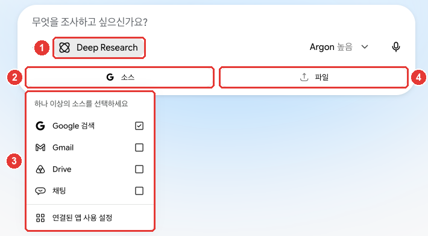
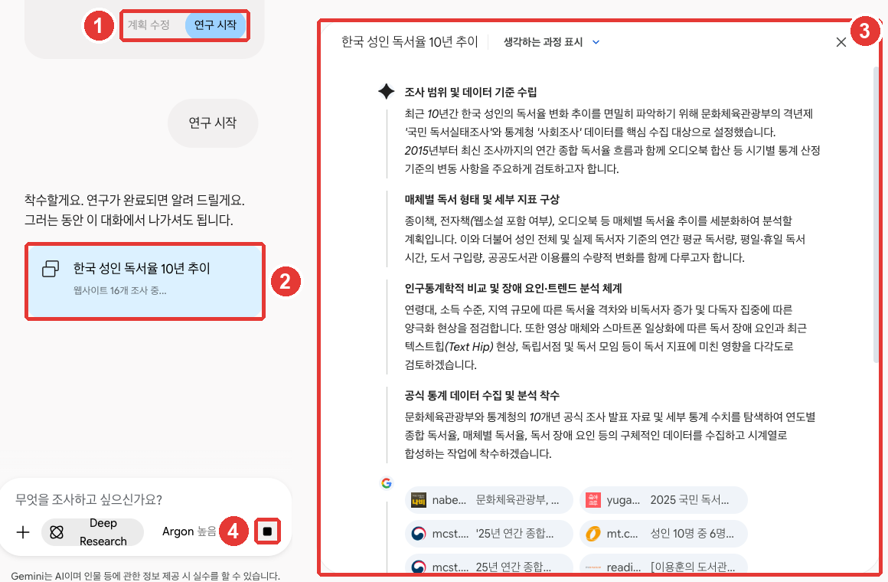

# 6장. 검색과 Deep Research — 근거 확인, 긴 조사 보고서, 노트북, 공부 도우미

> **한 줄 요약**: 여러 자료를 찾아 정리한 **긴 보고서**가 필요하면 **Deep Research**를 쓰세요. 계획을 먼저 보여 주니 확인하고 시작하면 됩니다.
> 한 주제의 자료와 대화를 오래 모아 두려면 **노트북**을, 공부할 때는 **가이드 학습·퀴즈·플래시카드**를 쓰세요. 어떤 답이든 근거는 직접 확인합니다.

화면은 2026년 10월 웹 기준이고, 그림은 유료 요금제(Google AI Pro) 한국어 화면입니다.

## 답의 근거 확인하기

Gemini의 답은 틀릴 수 있습니다. Google도 **늘 답을 따져 보고, 내장 도구나 Google 검색으로 사실을 다시 확인하라**고 안내합니다.[^learn]
답 아래나 문장 사이에 「출처」가 보이면 눌러서 원문을 열어 보세요. 출처가 없는 답도 있습니다([3장](03-chats.md#출처-확인하기)).

확인할 때는 이렇게 스스로 물어보세요.

- 출처 링크가 정말 그 내용을 말하고 있나?
- 숫자와 날짜가 원문과 같은가?
- 출처가 공식 기관이나 믿을 만한 곳인가?

**구체적으로 물을수록 답이 쓸모 있어집니다.**[^learn] 예를 들어 이렇게 비교해 보세요.

| 아쉬운 질문 | 나은 질문 |
|---|---|
| "독서율 알려 줘" | "최근 10년 동안 한국 성인의 연간 독서율이 어떻게 바뀌었는지, 공식 통계 출처와 함께 알려 줘" |

나은 질문은 기간·대상·출처 조건을 다 적어서, 답을 확인하기도 쉽습니다([1단계 9장](../00-common/09-safety.md)).

<Quiz id="ch306-check" />

## Deep Research — 긴 조사 보고서 받기

**Deep Research**(딥 리서치)는 여러 번 검색하고 따져 본 뒤 **종합 보고서**를 만들어 주는 기능입니다. 기본으로 Google 검색을 출처로 씁니다.[^deep]
만 18세 이상이고 로그인하면 **모든 사용자가 쓸 수 있습니다.** Google AI Pro·Ultra는 더 높은 품질의 모델로 보고서를 만들 수 있습니다.[^deep]

### 시작하기

입력창 「+」 → 「도구 더보기」 → 「Deep Research」를 누르세요([2장](02-screen-tour.md#입력창과-메뉴)).[^deep][^screen]



**빨간 번호는 아래 목록의 번호와 같은 곳입니다.**[^screen]

- ① 「Deep Research」가 켜졌다는 표시입니다. 입력창 안내가 "무엇을 조사하고 싶으신가요?"로 바뀝니다.
- ② 「소스」를 누르면 ③ 어디서 찾을지 고를 수 있습니다. 「Google 검색」이 처음부터 체크돼 있습니다.
- ③ Gmail·Drive를 출처로 쓰려면 Google Workspace가 Gemini에 연결돼 있어야 합니다(7장).[^deep] 「Google 검색」 체크를 빼면 **고른 출처에서만** 찾습니다.[^deep]
- ④ 「파일」로 내 파일을 함께 넣을 수 있습니다.[^deep]

조사할 주제를 적어 보내면 Gemini가 먼저 **조사 계획**을 보여 줍니다.[^deep]

### 계획 확인하고 시작하기



**빨간 번호는 아래 목록의 번호와 같은 곳입니다.**[^screen]

- ① **「계획 수정」**으로 계획을 고치고, **「연구 시작」**을 누르면 조사가 시작됩니다.[^deep][^screen]
- ② 조사가 시작되면 "착수할게요. 연구가 완료되면 알려 드릴게요. 그러는 동안 이 대화에서 나가셔도 됩니다."라는 답과 함께 진행 카드가 뜹니다.[^screen]
- ③ 오른쪽 패널에서 어떤 단계로 조사하는지, 어떤 웹사이트를 보는지 볼 수 있습니다.[^screen]
- ④ 멈추고 싶으면 이 버튼을 누릅니다. 「조사를 취소하시겠어요?」가 뜨면 「예, 취소합니다」를 누르세요.[^screen]

**계획을 고치고 싶다면 계획이 나오자마자 「계획 수정」을 누르세요.** 이 가이드가 해 봤을 때, 「연구 시작」을 누르기 전에 조사가 시작된 적이 있습니다. 도움말에는 「연구 시작」을 눌러야 시작된다고만 적혀 있어, 왜 그랬는지는 확인하지 못했습니다.[^screen]

보고서는 **보통 5~10분** 걸리고, 복잡하면 더 걸립니다. 기다리는 동안 대화를 떠나도 됩니다. 다 되면 알려 줍니다.[^deep]

### 알아 둘 점

- **사용량을 많이 씁니다**([1장](01-getting-started.md#사용-한도-—-5시간·주간·읽는-양)). 하루에 할 수 있는 조사 수와 동시에 돌릴 수 있는 조사 수에도 한도가 있습니다. 한도가 가까우면 남은 횟수를 알려 줍니다.[^deep]
- **지난 보고서는 대화 목록에서 찾습니다.** 「활동 기록 보관」이 켜져 있어야 나중에 찾을 수 있습니다.[^deep]
- **보고서는 Docs로 내보낼 수 있습니다.**[^deep] 오디오 오버뷰(대화 형식 음성)로 바꿀 수도 있습니다.[^deep]

보고서도 Gemini가 만든 글입니다. 중요한 숫자는 보고서의 출처 링크를 열어 직접 확인하세요.

```
최근 10년 동안 한국 성인의 연간 독서율이 어떻게 바뀌었는지 조사해 줘.
공식 통계(문화체육관광부 국민 독서실태조사 등)를 우선으로 쓰고,
연도별 수치는 표로, 출처는 수치마다 붙여 줘.
```

### Deep Think는?

**Deep Think**(딥 싱크)는 더 오래 생각하는 기능이었지만 **Gemini 4 Argon으로 바뀌는 중**입니다. 게다가 Google AI Ultra 구독자만 썼습니다.[^deepthink] 어려운 문제는 [2장](02-screen-tour.md#모델-버튼-—-모델과-사고-수준)의 모델 버튼에서 Argon과 사고 수준 「높음」을 고르면 됩니다(Pro·Ultra).

<Quiz id="ch306-deep" />

## 노트북 — 자료와 대화를 주제별로 모으기

**노트북**은 한 주제의 자료(소스), 지침, 대화를 한곳에 모아 두는 공간입니다. 그 안에서 대화하면 넣어 둔 자료와 지침, 지난 이야기를 기억하며 이어 갑니다.[^notebook]
예를 들어 "독서 모임" 노트북에 회칙, 지난 회의록, 모임 일정표를 넣어 두면, 매번 자료를 다시 올리지 않아도 됩니다.

옆 메뉴 「노트북」 아래 「새 노트북」을 누르고 이름을 지은 뒤 질문하세요. 자료는 「소스 추가」로 넣습니다([2장](02-screen-tour.md#옆-메뉴-—-새-채팅과-지난-대화)).[^notebook][^screen]

| 넣을 수 있는 자료 | 예 |
|---|---|
| 내 기기의 파일 | PDF, 문서, 표 파일, 이미지, 오디오, 텍스트 |
| Google Drive 파일 | Drive에 올려 둔 문서·표 |
| 웹사이트 주소 | 기사나 안내 페이지 |
| 복사한 글 | 메모, 메일 본문 |

출처: Google 도움말[^notebook]

알아 둘 점이 있습니다.[^notebook]

- **노트북 하나에 자료를 최대 600개까지** 넣을 수 있습니다(요금제에 따라 다름).
- 노트북 안에서도 **웹 검색과 Gemini 도구**를 쓸 수 있습니다.
- 노트북 이름 바꾸기·지침 넣기·고정은 「모든 노트북」에서 노트북의 「더보기」로 합니다.
- **노트북을 지우면 그 안의 자료와 대화도 함께 지워집니다.**
- 「활동 기록 보관」이 꺼져 있어도 대화는 되지만, 대화 자동 저장, 지난 대화 기억, **Drive 파일을 자료로 넣기** 같은 일부 기능은 쓸 수 없습니다.
- 점차 열리는 기능이라 아직 안 보일 수 있습니다.

대화 메뉴의 「노트북에 추가」로 지난 대화를 노트북에 넣을 수도 있습니다([3장](03-chats.md#고정·이름-바꾸기·지우기)).[^screen]

<Quiz id="ch306-notebook" />

## 공부 도우미 — 가이드 학습·퀴즈·플래시카드

공부할 때는 Gemini를 **과외 선생님**처럼 쓸 수 있습니다. 입력창 「+」 → 「도구 더보기」 → **「가이드 학습」**을 누르세요.[^tutor][^screen] 그림이나 도표로 설명해 달라고 할 수도 있습니다.[^tutor]

시험 준비에는 **퀴즈, 플래시카드(앞에 질문·뒤에 답이 있는 낱말 카드), 학습 가이드**를 만들어 달라고 하세요.[^study] 만들 것을 먼저 말하고, 그다음 자료나 주제를 적는 것이 요령입니다.[^study]

```
퀴즈를 만들어 줘. 주제는 조선 후기 실학이고, 객관식 10문제로 해 줘.
```

```
플래시카드를 만들어 줘. 앞면은 영어 단어, 뒷면은 뜻과 예문으로. 단어는 아래 목록을 써 줘.
(단어 목록 붙여 넣기)
```

- 퀴즈를 풀 때는 「힌트」를 보거나, 다 푼 뒤 「더 많은 질문 생성」으로 문제를 더 받을 수 있습니다. 다 풀면 **강점과 더 공부할 부분**을 알려 줍니다.[^study]
- 플래시카드는 섞기(「셔플 모드」)와 읽어 주기를 쓸 수 있습니다.[^study]
- 연습 시험(모의고사)은 SAT 같은 일부 해외 시험만 지원합니다. 한국 시험은 목록에 없습니다.[^study]

**학교 과제에 쓸 때는 학교의 AI 사용 규칙을 먼저 확인하세요.**[^learn] Gemini의 제안은 출발점으로 삼고, 내 생각과 말을 더해 마무리하세요.[^learn]

<Quiz id="ch306-study" />

## 직접 해 보기

1. "최근 10년 동안 한국의 1인 가구 비율 변화"처럼 궁금한 주제로 Deep Research를 켜고, 계획이 나오면 「계획 수정」으로 "공식 통계만 써 줘"라고 고친 뒤 「연구 시작」을 누른다.
2. 보고서의 숫자 하나를 골라 출처 링크를 열고, 원문과 같은지 확인한다.
3. 「새 노트북」으로 "독서 모임" 노트북을 만들고 연습용 안내문을 「소스 추가」로 넣은 뒤, "다음 모임 안내문을 이 형식으로 써 줘"라고 해 본다.
4. 「가이드 학습」을 켜고 요즘 궁금한 개념 하나를 단계별로 배워 본다.

**이어지는 과제** ([독서 모임 준비하기](../00-common/practice-kit.md)): 과제의 예시 파일들(회의록·메모·장부)을 "독서 모임" 노트북에 소스로 넣고, "다음 모임 준비물과 남은 회비를 정리해 줘"라고 물어본다. 받은 숫자가 장부와 맞는지 직접 확인한다.

## 정리

- Gemini의 답은 틀릴 수 있다. 「출처」를 열고, 내장 도구나 Google 검색으로 다시 확인한다. 구체적으로 물을수록 확인하기 쉽다.
- Deep Research는 모든 사용자가 쓸 수 있다(만 18세 이상). 「소스」에서 Google 검색·Gmail·Drive 등을 고르고, 계획이 나오면 「계획 수정」 또는 「연구 시작」을 누른다.
- 보고서는 보통 5~10분 걸리고 사용량을 많이 쓴다. 하루 조사 수에 한도가 있다. Docs로 내보낼 수 있다.
- Deep Think는 Gemini 4 Argon으로 바뀌는 중이다.
- 노트북은 자료(최대 600개)·지침·대화를 주제별로 모은다. 노트북을 지우면 안의 자료와 대화도 지워진다.
- 「가이드 학습」, 퀴즈, 플래시카드로 공부를 돕게 한다. 학교 과제는 학교 규칙을 먼저 본다.

## 용어 정리

| 용어 | 읽는 법 | 한 줄 뜻 |
|---|---|---|
| Deep Research | 딥 리서치 | 여러 번 검색하고 따져 종합 보고서를 만드는 기능 |
| Source | 소스 (출처·자료) | 답이나 조사의 근거가 되는 웹페이지·파일 |
| Research plan | 리서치 플랜 (조사 계획) | Deep Research가 조사 전에 보여 주는 단계 목록 |
| Deep Think | 딥 싱크 | 오래 생각하던 기능. Gemini 4 Argon으로 바뀌는 중 |
| Notebook | 노트북 | 한 주제의 자료·지침·대화를 모아 두는 공간 |
| Guided Learning | 가이디드 러닝 (가이드 학습) | Gemini를 과외 선생님처럼 쓰는 학습 도구 |
| Flashcard | 플래시카드 | 앞에 질문, 뒤에 답이 있는 낱말 카드 |

<ChapterDone :chapter="306" />

다음 장: 7장. 스킬과 연결된 앱 (준비 중)

[^screen]: Gemini 웹 화면(Google AI Pro, 한국어)에서 연습용 대화로 직접 확인(대화는 찍은 뒤 삭제). 「Deep Research」를 켜면 입력창 안내 "무엇을 조사하고 싶으신가요?", 「소스」(Google 검색 선택됨)와 「파일」 버튼. 「소스」 메뉴 "하나 이상의 소스를 선택하세요" — 「Google 검색」「Gmail」「Drive」「채팅」「연결된 앱 사용 설정」. 계획 아래 버튼 「계획 수정」「연구 시작」(도움말 한국어판은 「계획서 수정」「조사 시작」). 조사 시작 후 답 "착수할게요. 연구가 완료되면 알려 드릴게요. 그러는 동안 이 대화에서 나가셔도 됩니다.", 진행 카드 "웹사이트 16개 조사 중...", 오른쪽 패널 「생각하는 과정 표시」. 멈춤 버튼을 누르면 「조사를 취소하시겠어요?」 — 「아니요」「예, 취소합니다」. 이 가이드는 「연구 시작」을 누르는 동작 없이 계획을 기다리던 중 조사가 시작되어, 진행 화면을 찍은 뒤 취소했다. 「도구 더보기」의 「가이드 학습」, 옆 메뉴 「노트북」의 「새 노트북」「모든 노트북」, 대화 메뉴의 「노트북에 추가」. (확인일 2026-10-31)
[^learn]: Google 도움말, 「Learn in creative ways with generative AI」(한국어판 「생성형 AI를 활용해 창의적으로 학습하기」). "Important: Make sure to check and follow your school’s policy on using Generative AI." / "Use its suggestions as a starting point, then add your own unique voice and ideas to create something truly original." / "Always evaluate responses: While generative AI is a powerful tool, it can make mistakes." / "It’s important to always fact-check information using built-in tools or by double-checking with Google Search." / "Be specific: The more specific your questions, the more helpful the AI's answers will be." https://support.google.com/gemini/answer/15216790 (확인일 2026-10-31)
[^deep]: Google 도움말, 「Use Deep Research in Gemini Apps」(한국어판 「Gemini 앱에서 Deep Research 사용하기」). "By default, Gemini includes Google Search as a source for your research." / "You can also upload files and add NotebookLM notebooks." / "Be 18 or over." / "Google AI Pro and Google AI Ultra users can generate reports using Pro for even higher quality. All users can use Thinking for their reports." / "In Gemini Apps, there are limits for:" / "Number of research requests you can run at the same time" / "If you’re close to your limit, Gemini Apps notifies you how many research requests are left for the day." / "To update the research plan before you create a report, click Edit plan." / "Click Start research." / "Google Search is included as a source by default. To limit your research to other selected sources, deselect Google Search." / "It usually takes about 5-10 minutes to generate the report since Gemini analyzes many sources. For more complex reports, it may take longer." / "Important: You can only find past research reports if your Keep Activity setting is on." / "To export the report, click Export to Docs ." / "Other Google services, like Gmail and Drive, are only available if the Google Workspace app is connected to Gemini Apps." / "On the right in the Canvas panel, click Create  Audio Overview ." 한국어판에 "Gemini가 주제에 맞는 조사 계획서를 작성합니다." https://support.google.com/gemini/answer/15719111 (확인일 2026-10-31)
[^deepthink]: Google 도움말, 「Use Deep Think in Gemini Apps」(한국어판 「Gemini 앱에서 Deep Think 사용하기」). "Important: Deep Think is being replaced by Gemini 4 Argon." / "Be a Google AI Ultra subscriber or have a Google AI Ultra for Business license." https://support.google.com/gemini/answer/16345172 (확인일 2026-10-31)
[^notebook]: Google 도움말, 「Organize your projects with notebooks in Gemini Apps」(한국어판 「Gemini 앱의 노트북으로 프로젝트 정리하기」). "Notebooks provide a continuous chat experience that remembers your sources, instructions, and ongoing discussions." / "We’re gradually making this feature available, so it might not be available to you just yet." / "Some features in notebooks require Keep Activity turned on. When Keep Activity is off, you can still chat with your notebook, but the following features aren’t available" / "Give your new notebook a name. This name helps you organize your notebooks and also helps you find them" / "Based on your Google AI Plan, you can add up to 600 sources." / "Files from your device: PDFs, documents, spreadsheets, images, audio, text files, files, and .md files." / "Files from Google Drive." / "Websites/URLs" / "Copied text" / "Auto-saving chats. Gemini cannot save new chats in your notebook." / "Google Drive. You cannot add files from Google Drive as sources." (활동 기록 보관이 꺼졌을 때 안 되는 목록) / "Pin or unpin a notebook" / "Your chats in Gemini apps notebooks can include web searches and use of any Gemini tools." / "Important: If you delete a notebook, any sources or chats that you added to that notebook will also be deleted." / "You can create detailed instructions for Gemini Apps, like how to format responses or the tone you want it to use." 한국어 화면 이름 「새 노트북」「소스 추가」「모든 노트북」「이름 바꾸기」「노트북 설정」「고정」. https://support.google.com/gemini/answer/16972047 (확인일 2026-10-31)
[^tutor]: Google 도움말, 「Use learning tools in Gemini Apps」(한국어판 「Gemini 앱에서 학습 도구 사용하기」). "You can use Gemini Apps as a tutor with guided learning, visual aids, and educational resources." / "Gemini Apps may include images in responses to help explain a topic or concept. You can also ask Gemini to provide a diagram or image in your prompt." https://support.google.com/gemini/answer/16448384 (확인일 2026-10-31)
[^study]: Google 도움말, 「Create quizzes, flashcards, practice tests & more in Gemini Apps」(한국어판 「Gemini 앱에서 퀴즈, 플래시카드, 연습 시험 등 만들기」). "You can use Gemini Apps to create, use, and share study materials like flashcards, quizzes, and study guides to help prepare for exams." / "Tip: Start your prompt telling Gemini what to create followed by the materials or topic you want to study." / "Supported tests include SAT, JEE Main, and NEET UG." / "Once you finish a quiz, wait a moment for Gemini to share strengths and focus areas." / "To get a hint, click Hint." / "To generate more questions, when you complete the quiz, click More questions." / "To have Gemini play audio of the text, click Text to speech ." / "To shuffle the flashcards, click Shuffle mode . This will shuffle all of the flashcards in the deck." 한국어 화면 이름 「힌트」「더 많은 질문 생성」「셔플 모드」「텍스트 음성 변환」. https://support.google.com/gemini/answer/16275879 (확인일 2026-10-31)
