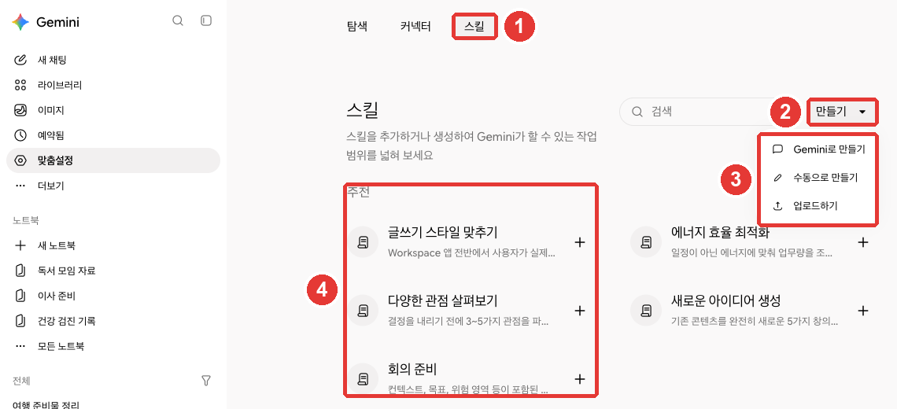
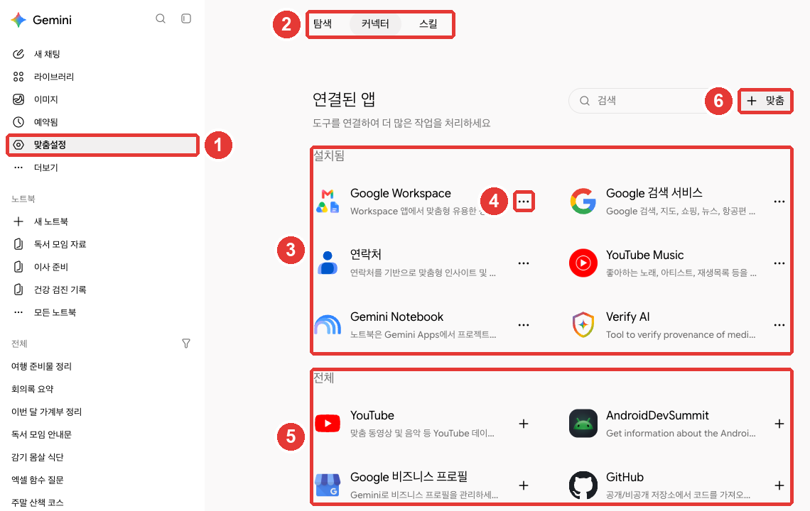

# 7장. 스킬과 연결된 앱 — 자주 하는 부탁 저장하기, Google 앱 이어 쓰기

> **한 줄 요약**: 매번 길게 쓰는 부탁은 **스킬**로 저장해 두고 `/`로 불러 쓰세요. 지금 쓰는 **Gems는 2026년 11월 17일부터 스킬로 바뀝니다.**
> Gmail·Drive·캘린더 내용을 물어보려면 **연결된 앱**을 켜세요. 연결하기 전에 어떤 정보가 Gemini로 가는지 먼저 알아 두세요.

화면은 2026년 10월 웹 기준이고, 그림은 유료 요금제(Google AI Pro) 한국어 화면입니다.

## 스킬 — 자주 하는 부탁을 저장해 두기

**스킬**(Skill)은 한 번 만들어 두면 어느 채팅에서나 다시 쓰는 **저장된 지침**입니다.[^skills][^transition]
예를 들어 "회의록을 받으면 결정 사항·할 일·담당자 순서로 정리해 줘"라는 부탁을 매주 쓴다면, 스킬로 저장해 두고 이름만 불러 쓰면 됩니다.

스킬에는 이런 점이 있습니다.[^transition]

- **불러 쓰기 쉽습니다.** 채팅 입력창에 `/`를 치고 스킬 이름을 고릅니다. 곧 `@`로 바뀐다고 하니, 화면에 보이는 쪽을 쓰세요.
- **알아서 쓰기도 합니다.** 지금 질문에 맞는 스킬이 있으면 Gemini가 알아보고 적용합니다.
- **겹쳐 쓸 수 있습니다.** 한 채팅에서 스킬 여러 개를 함께 쓸 수 있습니다.

쓰려면 **만 18세 이상**이고 로그인해야 하며, 「활동 기록 보관」이 켜져 있어야 합니다.[^skills] **유료 요금제는 없어도 됩니다.**[^skills] 웹, 휴대폰 앱, Mac 앱에서 씁니다.[^skills]

### 스킬 화면 열기

옆 메뉴 「맞춤설정」 → 위쪽 「스킬」 탭으로 갑니다. 「맞춤설정」이 안 보이면 「더보기」를 먼저 누르세요.[^skills][^screen] 설정 메뉴의 「스킬」로도 갈 수 있습니다([2장](02-screen-tour.md#설정-화면-—-계정·환경설정·개인정보)).



**빨간 번호는 아래 목록의 번호와 같은 곳입니다.**[^screen]

- ① 「스킬」 탭입니다. 안내문은 "스킬을 추가하거나 생성하여 Gemini가 할 수 있는 작업 범위를 넓혀 보세요"입니다.
- ② 「만들기」를 누르면 ③ 만드는 방법 세 가지가 나옵니다.
  - **「Gemini로 만들기」**: 무엇을 원하는지 대화로 설명하면 Gemini가 함께 만들어 줍니다. 처음이라면 이것이 가장 쉽습니다.
  - **「수동으로 만들기」**: 빈 양식에 이름·설명·지침을 직접 씁니다.
  - **「업로드하기」**: 스킬 파일(`SKILL.md`)이나 그 파일이 든 폴더를 올립니다. 다른 서비스에서 만든 스킬을 가져올 때 씁니다(웹과 Mac 앱에서만).[^transition]
- ④ Google이 미리 만든 **추천 스킬**입니다. 「+」를 눌러 추가한 뒤 내게 맞게 고쳐 써도 됩니다.[^skills]

채팅에서 "이런 지침으로 스킬을 만들어 줘"라고 말해도 만들어집니다. 다만 **켜기·끄기·지우기는 「맞춤설정」 → 「스킬」에서만** 할 수 있습니다.[^skills]

### 스킬 관리하기

스킬 화면에서 스킬을 고른 뒤 「더보기」를 누르면 됩니다.[^skills]

| 하고 싶은 일 | 메뉴 |
|---|---|
| 잠시 쓰지 않기 | 「비활성화」 |
| 대화하며 고치기 | 「Gemini로 수정」 |
| 내 컴퓨터에 저장 | 「다운로드」(.zip 파일) |
| 지우기 | 「삭제」 — 되돌릴 수 없음 |

출처: Google 도움말[^skills]

꺼 둔 스킬을 쓰라고 하면 Gemini가 다시 켤지 물어봅니다.[^skills] 스킬은 몇 개든 만들 수 있지만, **동시에 켜 둘 수 있는 것은 100개까지**입니다.[^transition]

스킬이 모든 기능과 함께 되는 것은 아닙니다. Gmail·Drive 같은 연결된 앱과는 함께 쓰지만, **Canvas·Deep Research·동영상·음악 만들기·가이드 학습과는 아직 함께 쓸 수 없습니다.**[^transition]

<Quiz id="ch307-skill" />

## 좋은 스킬 쓰는 법

스킬은 긴 설명서가 아니라 **짧은 요약 쪽지**처럼 쓰세요.[^write] Gemini는 먼저 **스킬의 이름과 설명만 보고** 지금 질문에 맞는지 판단합니다. 맞을 때만 지침 전체를 읽습니다.[^write]
그래서 이름과 설명이 흐릿하면, 필요한 순간에 스킬이 쓰이지 않습니다.

### 만들 만한 일, 만들지 않을 일

| 스킬로 만들면 좋은 일 | 만들지 않아도 되는 일 |
|---|---|
| 같은 긴 부탁을 자꾸 다시 쓴다 | 한 번만 할 일 |
| 답의 형식을 매번 고친다 | Gemini가 이미 잘하는 일 |
| 여러 앱을 오가는 일을 손으로 잇는다 | 규칙이 자주 바뀌는 일 |

출처: Google 도움말[^write]

### 이름·설명·지침 쓰기

- **이름은 하는 일(동사)로 시작합니다.** 무엇인지보다 **무엇을 하는지**가 드러나게 씁니다.[^write] 이름은 영어 소문자와 하이픈(-)으로만 씁니다(예: `summarize-meeting-notes`).[^skills]
- **설명은 1~2문장으로, 언제 쓰는지까지 적습니다.** 1,024자를 넘을 수 없습니다.[^write]
- **지침은 한 건이 아니라 한 종류의 일에 통하게** 씁니다. "이번 주 회의록 정리"가 아니라 "회의록 정리"에 맞게 쓰는 식입니다.[^write]
- **결과 모양을 예로 보여 주고, 정보가 빠졌을 때 어떻게 할지 적어 두세요.** 그러면 Gemini가 없는 내용을 지어내거나 건너뛰는 일이 줄어듭니다.[^write]

아쉬운 예와 나은 예를 비교해 보세요.

| | 아쉬운 예 | 나은 예 |
|---|---|---|
| 이름 | `meeting-helper` | `summarize-meeting-notes` |
| 설명 | 회의를 도와줍니다 | 회의록을 받으면 결정 사항·할 일·담당자로 정리한다. 회의록이나 회의 메모를 붙여 넣었을 때 쓴다 |

나은 예는 이름만 봐도 하는 일이 보이고, 설명에 **언제 쓰는지**가 들어 있습니다.

「수동으로 만들기」의 지침 칸에는 이렇게 써 볼 수 있습니다.

```
회의록을 받으면 아래 순서로 정리해.
1. 결정된 것 (한 줄씩)
2. 할 일 (할 일 - 담당자 - 마감일)
3. 다음 회의 때 다시 볼 것
담당자나 마감일이 회의록에 없으면 지어내지 말고 "확인 필요"라고 적어.
```

처음부터 완벽할 필요는 없습니다. 몇 번 써 보고 「Gemini로 수정」으로 다듬으면 됩니다.

<Quiz id="ch307-write" />

## Gems는 스킬로 바뀝니다

**Gems**(젬스)는 이름·지침·참고 파일을 넣어 만드는 **나만의 Gemini**였습니다. 옆 메뉴 「더보기」 → 「Gems」에 있습니다.[^gems][^screen]
이 Gems가 **스킬로 바뀝니다.** 개인 Google 계정(만 18세 이상)의 일정은 이렇습니다.[^transition]

| 날짜 | 일어나는 일 |
|---|---|
| 2026년 11월 17일 | Gems가 **읽기 전용**이 됨. 볼 수는 있지만 쓰기·고치기·새로 만들기는 안 됨 |
| 2026년 12월 17일 | Gems가 Gemini에서 **사라짐** |

출처: Google 도움말[^transition]

- 만 18세 미만 개인 계정은 나중에 바뀌고, 일정은 따로 알린다고 합니다. 회사 계정은 2027년 3월, 학교 계정은 2027년 6월입니다.[^transition]
- **Gems가 사라질 때 스킬로 자동으로 다시 만들어 줍니다.**[^transition] 그래도 직접 옮겨 두면 마음이 놓입니다.
- 실험 기능이던 **Google Labs의 Gem(미니 앱)과 Opal도 같은 11월에 사라집니다.**[^transition]

### 자동으로 옮길 때 빠지는 것

자동 전환에서 일부 파일은 빠집니다.[^transition]

- 파일 크기 합계가 **100MB**를 넘으면 큰 파일부터 빠집니다.
- 스킬이 지원하지 않는 파일(예전 Office 파일 .doc·.xls·.ppt, 오디오·동영상, .zip 같은 압축 파일 등)은 넘어가지 않습니다.

그러니 아끼는 Gem이 있다면 **12월 17일 전에 「지식」에 넣은 파일을 내려받아 두세요.**[^transition]

### 직접 옮기는 순서

1. Gem을 열고 「지식」에 있는 파일을 하나씩 열어 내려받습니다.[^transition]
2. 「맞춤설정」 → 「스킬」 → 「만들기」 → 「수동으로 만들기」에 Gem의 이름·설명·지침을 복사해 붙여 넣습니다.[^transition][^screen]
3. 파일까지 옮기려면, 방금 만든 스킬을 「다운로드」해 나온 `SKILL.md`를 Gem 파일들과 같은 폴더에 넣고, 그 폴더를 「업로드하기」로 올립니다.[^transition]

Gems와 달리 스킬에는 **"이 스킬로 나눈 대화" 목록 페이지가 없습니다.** 스킬을 쓴 대화도 옆 메뉴의 일반 대화 목록에 섞여 보입니다.[^transition] Gems의 공유, Drive 파일·노트북 넣기 기능은 "앞으로 몇 주 안에" 스킬에도 들어온다고 합니다.[^transition]

<Quiz id="ch307-gems" />

## 연결된 앱 — Gmail·Drive·캘린더를 Gemini에서

**연결된 앱**(Connected Apps)을 켜면 Gemini가 내 Gmail·Drive·캘린더 같은 앱의 내용을 찾아 답합니다. 허락하면 그 앱 안의 내용을 고치거나 관리하는 일도 돕습니다.[^apps]
예를 들어 "지난달 받은 메일 중 독서 모임 장소를 알려 준 메일 찾아 줘"처럼 물을 수 있습니다.

### 연결된 앱 화면

옆 메뉴 「맞춤설정」 → 「커넥터」 탭에서 봅니다.[^apps][^screen]



**빨간 번호는 아래 목록의 번호와 같은 곳입니다.**[^screen]

- ① 옆 메뉴 「맞춤설정」을 누르고 ② 「커넥터」 탭을 고릅니다. 제목은 「연결된 앱」입니다.
- ③ **「설치됨」**은 이미 연결된 앱입니다. 이 가이드의 계정에서는 Google Workspace·Google 검색 서비스·연락처·YouTube Music·Gemini Notebook·Verify AI가 보였습니다.
- ④ 점 세 개를 누르면 「지금 사용」과 「연결 해제」가 나옵니다.
- ⑤ **「전체」**는 더 연결할 수 있는 앱입니다. 「+」로 연결합니다.
- ⑥ 「+ 맞춤」은 다른 회사의 서버를 직접 연결하는 메뉴로 보입니다. 도움말은 이 기능(맞춤 앱)을 **만 18세 이상, 미국에 있는 사용자**만 쓴다고 합니다.[^custom] 초보 단계에서는 쓰지 않아도 됩니다.

앱 이름을 누르면 상세 화면이 열립니다. 무엇을 할 수 있고 무엇을 못 하는지, 예시 질문이 나옵니다.[^apps] 「Google Workspace」 하나를 연결하면 **Gmail·Google Calendar·Docs·Drive·Keep·Tasks**를 함께 쓰게 됩니다.[^workspace][^screen]

**보이는 앱은 사람마다 다릅니다.** 기기, 나라, Gemini 앱 종류에 따라 목록이 달라집니다.[^apps]

### 먼저 확인할 두 가지 설정

- **「활동 기록 보관」이 켜져 있어야 합니다.** 꺼져 있으면 웹에서는 연결된 앱을 쓸 수 없습니다.[^apps] 이 설정은 [9장](09-privacy.md)에서 자세히 다룹니다.
- **Gmail 설정의 「다른 Google 제품의 스마트 기능」이 켜져 있어야** Workspace가 연결됩니다. 연결이 안 되면 이것부터 확인하고, 켠 뒤 Gemini를 새로고침해 다시 연결하세요.[^workspace]

### 잘 묻는 요령

- **새 대화마다 어느 앱에서 찾을지 말해 주세요.** "메일에서", "Drive에서", "캘린더에서"처럼요. 같은 대화의 다음 질문에서는 다시 말하지 않아도 됩니다.[^workspace]
- 입력창에 `@`를 치고 앱을 고르면 그 앱을 쓰라고 정확히 지정할 수 있습니다.[^apps]
- **문서나 메일 주소(URL)를 붙여 넣지 마세요.** 대신 내용 속 낱말과 앱 이름을 적습니다.[^workspace]

| 아쉬운 질문 | 나은 질문 |
|---|---|
| "이 문서 요약해 줘 (주소 붙여 넣기)" | "Drive에서 '독서 모임 회칙' 문서를 찾아서 회비 규정만 요약해 줘" |

나은 질문은 앱 이름과 찾을 낱말이 다 들어 있어서, Gemini가 엉뚱한 파일을 고를 일이 줄어듭니다.

**답은 꼭 확인하세요.** 더 최근 메일이 있는데 오래된 메일을 근거로 답하는 등, 틀리거나 낡은 답이 나올 수 있습니다. 답 뒤에 붙는 출처를 눌러 원래 메일·파일을 열어 보세요.[^workspace]

### 못 하는 일도 있습니다

Workspace를 연결해도 이런 일은 못 합니다.[^workspace]

- Docs·Gmail의 **댓글과 이미지** 읽기
- Drive 안의 **사진과 동영상** 읽기
- Drive **폴더 만들기, 파일 옮기기**
- Drive나 Gmail의 **항목 수 세기, 저장 공간 알려 주기**

### 연결하지 않아도 쓰는 공개 정보

Google 검색, YouTube, Google 지도, 항공편·호텔의 **공개 정보**는 따로 연결하지 않아도 Gemini가 씁니다. 내 개인 정보는 허락 없이 열어 보지 않습니다.[^apps]

- **YouTube**: 주제에 맞는 영상을 찾고 내용을 물어볼 수 있습니다. 재생목록에 저장하거나 댓글을 다는 일은 못 합니다.[^youtube]
- **지도**: 장소를 찾고, 이동 수단별 길 안내를 받습니다.[^maps]
- **항공편·호텔**: 조건에 맞는 항공편과 호텔을 찾아 줍니다. **예약은 해 주지 않습니다.**[^flights]

검색 공개 정보는 「활동 기록 보관」이 꺼져 있어도 쓰지만, 지도·YouTube·항공편·호텔은 켜져 있어야 합니다.[^apps]

도움말에는 Dropbox 같은 다른 회사 앱도 나오지만, 상당수가 **미국에 있는 사용자 전용**입니다.[^dropbox] 화면 목록에 없는 앱은 지금 내 계정에서 쓸 수 없다고 보면 됩니다.

<Quiz id="ch307-apps" />

## 연결하기 전에 알아 둘 개인정보

연결은 편리하지만, **내 메일과 파일 내용 일부가 Gemini로 갑니다.** 연결하기 전에 아래를 알아 두세요.[^connected]

- **민감한 내용이 섞일 수 있습니다.** 연결된 앱의 데이터에는 건강·종교처럼 민감한 내용이나 기밀이 들어 있을 수 있습니다. 앞으로 그 앱에 새로 생기는 데이터도 Gemini가 볼 수 있습니다.
- **사람이 일부를 볼 수 있습니다.** 연결된 앱 데이터 중 일부는 사람 검토자(교육받은 외부 업체 직원 포함)가 봅니다. 그래서 **검토자가 보면 곤란한 기밀이 든 앱은 연결하지 말라**고 Google이 직접 안내합니다.
- **학습에 대한 설명은 이렇습니다.** Gmail 받은편지함이나 Drive 자체로 AI 모델을 직접 학습시키지는 않습니다. 하지만 답을 만들 때 쓴 **요약·발췌·추론**으로는 학습합니다. 메일이나 파일이 짧으면 그 요약이 원문 그대로일 수도 있습니다.
- **연결을 끊어도 대화 기록은 남습니다.** 앱 연결을 끊거나 그 앱의 데이터를 지워도 「Gemini 앱 활동」의 기록은 지워지지 않습니다. 기록은 따로 지워야 합니다([9장](09-privacy.md)).

회사 메일이나 남의 정보가 많은 Drive는 **처음부터 연결하지 않는 것**이 가장 쉬운 방법입니다. 필요한 파일만 그때그때 올려도 됩니다([4장](04-files-create.md#파일-올리기)).

<Quiz id="ch307-privacy" />

## 직접 해 보기

1. 「맞춤설정」 → 「스킬」에서 「다양한 관점 살펴보기」 같은 추천 스킬을 하나 추가하고, 채팅에서 `/`를 쳐서 불러 써 본다.
2. 「수동으로 만들기」로 이 장의 회의록 정리 스킬을 만들고, 연습용 회의 메모를 붙여 넣어 결과를 확인한다. 담당자를 일부러 빼고 "확인 필요"라고 나오는지 본다.
3. Gems를 쓰고 있었다면 「지식」 파일을 내려받아 두고, 가장 아끼는 Gem 하나를 스킬로 직접 옮겨 본다.
4. 「커넥터」 탭에서 내 계정에 연결된 앱을 확인하고, 필요 없는 앱은 점 세 개 → 「연결 해제」로 끊는다.

**이어지는 과제** ([독서 모임 준비하기](../00-common/practice-kit.md)): 과제의 회의록 예시로 2번 스킬을 시험해 본다. 정리된 할 일과 담당자가 회의록과 맞는지 직접 대조한다.

## 정리

- 스킬은 저장해 두고 `/`(곧 `@`)로 불러 쓰는 지침이다. 만 18세 이상·로그인·「활동 기록 보관」이 필요하고, 유료 요금제는 없어도 된다.
- 「맞춤설정」 → 「스킬」 → 「만들기」에서 「Gemini로 만들기」·「수동으로 만들기」·「업로드하기」로 만든다. 켜고 끄고 지우는 것은 이 화면에서만 한다.
- 좋은 스킬은 짧고, 이름이 하는 일로 시작하며, 설명에 언제 쓰는지 적혀 있다.
- Gems는 2026년 11월 17일 읽기 전용, 12월 17일에 사라지고 스킬로 자동 전환된다. 아끼는 Gem의 파일은 미리 내려받는다.
- 연결된 앱은 「맞춤설정」 → 「커넥터」에서 관리한다. 새 대화마다 어느 앱에서 찾을지 말하고, 답은 출처로 확인한다.
- 연결된 앱 데이터 일부는 사람이 볼 수 있다. 기밀이 든 앱은 연결하지 않는다. 연결을 끊어도 대화 기록은 따로 지워야 한다.

## 용어 정리

| 용어 | 읽는 법 | 한 줄 뜻 |
|---|---|---|
| Skill | 스킬 | 저장해 두고 어느 채팅에서나 다시 쓰는 지침 |
| SKILL.md | 스킬 엠디 | 스킬의 이름·설명·지침이 든 파일 |
| Gem | 젬 | 지침·파일을 넣어 만든 나만의 Gemini. 스킬로 바뀌는 중 |
| Connected Apps | 커넥티드 앱스 (연결된 앱) | Gmail·Drive 같은 앱을 Gemini와 이어 쓰는 기능 |
| Connector | 커넥터 | 연결된 앱을 관리하는 탭 이름 |
| Google Workspace | 구글 워크스페이스 | Gmail·Docs·Drive·캘린더 등 Google 업무 앱 묶음 |
| Human reviewer | 휴먼 리뷰어 (사람 검토자) | 서비스 개선을 위해 대화 일부를 읽는 사람 |

<ChapterDone :chapter="307" />

다음 장: [8장. 일 맡기기](08-tasks.md)

[^screen]: Gemini 웹 화면(Google AI Pro, 한국어)에서 직접 확인. 옆 메뉴 「새 채팅」「라이브러리」「이미지」「예약됨」「맞춤설정」「더보기」(펼치면 「동영상」「Gems」). 「맞춤설정」 위쪽 탭 「탐색」「커넥터」「스킬」. 「스킬」 탭 안내 "스킬을 추가하거나 생성하여 Gemini가 할 수 있는 작업 범위를 넓혀 보세요", 「만들기」 메뉴 「Gemini로 만들기」「수동으로 만들기」「업로드하기」, 「추천」 스킬 「글쓰기 스타일 맞추기」「에너지 효율 최적화」「다양한 관점 살펴보기」「새로운 아이디어 생성」「회의 준비」. 「커넥터」 탭 제목 「연결된 앱」, 안내 "도구를 연결하여 더 많은 작업을 처리하세요", 「검색」 칸과 「+ 맞춤」 버튼, 「설치됨」 Google Workspace·Google 검색 서비스·연락처·YouTube Music·Gemini Notebook·Verify AI, 「전체」 YouTube·AndroidDevSummit·Google 비즈니스 프로필·GitHub. 설치된 앱의 점 세 개 메뉴 「지금 사용」「연결 해제」. 「Google Workspace」 상세 화면의 앱 목록 Gmail·Google Calendar·Google Docs·Google Drive·Google Keep·Google Tasks. 도움말의 Gems 지식 파일 칸 이름은 한국어판 「지식」. (확인일 2026-10-31)
[^skills]: Google 도움말, 「Create & manage skills for Gemini Apps」(한국어판 「Gemini 앱에서 스킬 만들기 및 관리하기」). "Be 18 or over." / "Have Keep Activity on." / "Important: For now, skills are only available in the Gemini mobile app, the Gemini app on Mac, and the Gemini web app at gemini.google.com." / "Tip: Skills are available without a Google AI subscription and can be used in your chats." / "If you don’t find “Customize,” first click More ." / "On the Skills page, you can create a skill with help from Gemini, build one from a prefilled or blank template, or upload a skill file or a folder with a SKILL.md file and optional supported reference files." / "Tip: You can’t activate, deactivate, or delete a skill from a chat or task thread." / "Naming convention: The skill name inside SKILL.md must use all lowercase with words separated by a hyphen (such as my-new-skill)." / "If a skill is off and you ask Gemini to use it, Gemini will ask you if you want to turn it back on." / "Important: If you delete a skill, it can’t be undone." / "Click More   Download . This downloads your skill in a .zip file." 한국어 화면 이름 「비활성화」「Gemini로 수정」「다운로드」「삭제」. https://support.google.com/gemini/answer/17094296 (확인일 2026-10-31)
[^transition]: Google 도움말, 「About the transition from Gems to skills」(한국어판 「Gems에서 스킬로의 전환에 관한 정보」). "Skills are reusable custom instructions that can help you automate tasks and save time in Gemini." / "Easy access: Use a skill by typing / (soon to be @) followed by the skill's name directly in any Gemini chat." / "Automatic use: Gemini automatically recognizes when a skill is relevant to your current prompt and applies it for you." / "Stackable: Combine multiple skills in a single chat to handle more complex tasks." / "You can create as many skills as you want, but only 100 can be active at a time." / "For now, the option to upload files to create skills is only available in the Gemini app on Mac and in the Gemini web app at gemini.google.com." / "Skills work with some but not all features. You can use them with Connected Apps like Workspace apps, but they do not yet work with features like Canvas and Deep Research." / "November 17, 2026: Gems transition to skills and become read only. You can still access your Gems, but can’t use or edit them, or create new ones." / "December 17, 2026: Gems are removed from Gemini Apps. You’ll no longer be able to access your Gems." / "If you’re under 18 and signed in to a personal Google account, your Gems will transition to skills at a later date. We’ll share more details soon." / "March 2027: Workspace business, enterprise, and non-profit accounts." / "June 2027: Workspace education accounts." / "As part of this change, Opal, our experiment for building mini apps, as well as Gems by Google Labs, will also go away at the same time in November." / "When we remove Gems, we’ll automatically recreate your Gems as skills." / "Skills have a 100 MB total size limit for files. If your Gem is larger than this when we transition it to a skill, we automatically remove the largest files first until it’s under the limit." / "Some file types are not supported in skills. When we transition your Gems to skills, these unsupported file types will not be included:" / "If the Gem has files under “Knowledge,” download your files." / "Copy and paste the name, description, and instructions from your Gem to your skill." / "On your computer, open the .zip file and move the SKILL.md file into the folder with your Gem files." / "Unlike Gems, skills don’t have a dedicated page that lists your recent chats with that skill." / "In the coming weeks, skills will have the features you loved in Gems, including the ability to share them with others and add files from Google Drive and notebooks from Gemini Notebook." https://support.google.com/gemini/answer/18560919 (확인일 2026-10-31)
[^write]: Google 도움말, 「Write effective skills for Gemini Apps」(한국어판 「Gemini 앱을 위한 효과적인 스킬 작성하기」). "Keep your skills short and focused. Instead of long paragraphs of general explanation, focus on:" / "Check if a skill is relevant. Gemini only checks the skill’s name and description to determine if a skill is relevant for your task." / "Repeat prompts: You give Gemini the same instructions over and over, especially for complex tasks with long prompts." / "A one-off job: You only need to do it once and won't repeat it." / "Start with an action statement, or verb. Focus on what the skill does, not what it is." / "Keep the description focused. Make it as clear as possible and within the 1024 character limit." / "Instead of giving instructions that only apply to a specific task, give instructions that teach Gemini how to handle a type of task." / "Tell Gemini exactly what to do if a piece of information is missing. This prevents Gemini from making up or skipping important details." https://support.google.com/gemini/answer/17102773 (확인일 2026-10-31)
[^gems]: Google 도움말, 「Use Gems in Gemini Apps」(한국어판 「Gemini 앱에서 Gems 사용하기」). "Enter a name and instructions for your Gem." https://support.google.com/gemini/answer/15146780 (확인일 2026-10-31)
[^apps]: Google 도움말, 「Use & manage Connected Apps in Gemini」(한국어판 「Gemini에서 연결된 앱 사용 및 관리하기」). "With your permission, Gemini can also help you take actions, like editing and managing your content in other apps." / "When Keep Activity is off, Connected Apps won’t be available on gemini.google.com, iOS devices, or smart watches." / "To specify an app for Gemini to use, enter @ and select the app." / "At the top, click Connectors." / "On the app’s details page, you can find a connected app’s full description, supported and unsupported actions, and example prompts." / "The apps in Connected Apps settings vary by Gemini app, device, country, and more." / "Gemini won’t access your personal information or content in these services without your permission." / "Gemini can always use public information from Google Search, even if Keep Activity is off or you’re signed out." https://support.google.com/gemini/answer/13695044 (확인일 2026-10-31)
[^workspace]: Google 도움말, 「Connect the Google Workspace app to Gemini Apps」(한국어판 「Google Workspace 앱을 Gemini 앱에 연결하기」). "For Gemini Apps to connect with Google Workspace, Smart features in other Google products must be turned on in your Gmail settings." / "Tip: Don’t paste the URL of a document or email in your prompt." / "For every new conversation, ask the Gemini app to get or add something from your personal Google Workspace explicitly." / "Gemini Apps can hallucinate responses or provide outdated information, like from an older email when there’s a more recent one." / "Access comments or images in Docs or Gmail" / "Access pictures and videos in your Drive" / "Manage content in your Drive, like create folders or move content between folders" / "Count items in your Drive or Gmail or tell you how much Drive or Gmail storage you have" https://support.google.com/gemini/answer/15229592 (확인일 2026-10-31)
[^youtube]: Google 도움말, 「Find & ask about YouTube content in Gemini Apps」(한국어판 「Gemini 앱에서 YouTube 콘텐츠를 찾고 질문하기」). "Gemini uses public information from YouTube to help you:" / "Take actions that impact your YouTube experience, like saving a video to a playlist or adding a comment on a video." https://support.google.com/gemini/answer/16622858 (확인일 2026-10-31)
[^maps]: Google 도움말, 「Find places & get directions in Gemini Apps」(한국어판 「Gemini 앱에서 장소 및 경로 찾기」). "Get directions based on mode of transport and help you avoid things like tolls" https://support.google.com/gemini/answer/16622866 (확인일 2026-10-31)
[^flights]: Google 도움말, 「Search for flights & hotels in Gemini Apps」(한국어판 「Gemini 앱에서 항공편 및 호텔 검색하기」). "Gemini uses public information from Google Flights and Google Hotels to help you:" / "Book a flight or hotel for you" (못 하는 일 목록) https://support.google.com/gemini/answer/16622256 (확인일 2026-10-31)
[^dropbox]: Google 도움말, 「Manage files & folders in your Dropbox in Gemini Apps」. "Be 18 or over and in the US." https://support.google.com/gemini/answer/17211088 (확인일 2026-10-31)
[^custom]: Google 도움말, 「Connect & manage custom apps for Gemini Apps」. "Be 18 or over and in the US." / "Google does not control, monitor, or secure third-party MCP servers. You’re responsible for supervising the MCP server." https://support.google.com/gemini/answer/17209137 (확인일 2026-10-31)
[^connected]: Google 도움말, 「About personalization with Connected Apps」(한국어판 「연결된 앱을 통한 개인화에 관한 안내」). "Data shared may relate to topics you find sensitive, like race, religion, and health, or confidential info." / "Keep in mind that if new data is added to these apps in the future, Gemini will have access to that data." / "Gemini does not train generative AI models directly on your Gmail inbox, Drive, Contacts, Calendar or other Workspace apps, on your Google Wallet and payments services, or on imagery or audio from your Google Photos library." / "To make our responses relevant, helpful, and high quality, we train our generative AI models off of these summaries, excerpts, generated media, and inferences." / "In some cases, for example, where the email or file is brief or particularly relevant to respond to the prompt, the summary may just be the email or file." / "When connected to Gemini, a subset of Connected Apps data processed by Gemini is reviewed by human reviewers (including trained service providers) to debug our services, help keep them safe, and improve them." / "Important: Please don't connect your apps to Gemini Apps if they contain confidential information that you wouldn’t want a reviewer to see." / "Disconnecting an app or deleting data in a connected app doesn’t delete any data from Gemini Apps Activity." https://support.google.com/gemini/answer/16836988 (확인일 2026-10-31)
