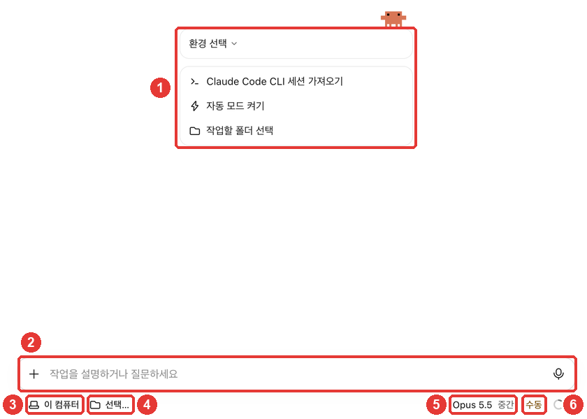

# 2장. 데스크톱 앱 설치와 첫 세션 — 설치·로그인, Code 탭, 폴더 고르기, 첫 일 맡기기

> **한 줄 요약**: Claude 데스크톱 앱을 설치하고 **Code** 탭을 엽니다. 입력창 아래 줄에서 **폴더를 고르고**, 할 일을 평소 말로 적어 보내면 Claude가 그 폴더에서 일합니다.
> 이 장에서는 뒤죽박죽 회의 메모 하나를 **내가 정한 형식의 회의록**으로 정리시켜 봅니다. 3단계 내내 키워 갈 「내 방식대로 정리해 주는 도구」의 첫걸음입니다.

이 장은 2026년 10월 31일에 확인한 Claude Code 공식 문서와 macOS 데스크톱 앱(한국어 화면, 유료 계정)을 바탕으로 썼습니다. 화면의 이름은 자주 바뀝니다. 내 화면과 다르면 화면에 보이는 이름을 따르세요.

## 설치하고 로그인하기

Claude Code는 **Claude 데스크톱 앱 안에 들어 있습니다.** 앱만 설치하면 되고, 다른 프로그램(Node.js나 터미널용 Claude Code)은 따로 설치하지 않아도 됩니다.[^quickstart]

1. 공식 문서의 설치 페이지에서 내 컴퓨터에 맞는 파일을 받습니다.[^quickstart]
   - **macOS**: 하나의 파일로 인텔·애플 실리콘 맥 모두에 설치됩니다.
   - **Windows**: 보통의 PC(x64)용 설치 파일이 있고, ARM64 PC용은 따로 있습니다.
   - **Linux**: 베타(시험판)이며 Ubuntu·Debian에서 apt로 설치합니다.
2. 받은 파일을 실행해 설치합니다.
3. 앱을 열고 **Anthropic 계정**으로 로그인합니다.[^quickstart] claude.ai에서 쓰던 계정 그대로입니다.

2단계에서 Claude 앱을 이미 설치했다면 이 단계는 건너뛰어도 됩니다. 앱이 오래됐다면 메뉴 막대의 **Claude → 업데이트 확인…** 으로 최신판을 받아 두세요.

<Quiz id="ch402-install" />

## Code 탭 열기

Claude Code는 앱 옆 메뉴 맨 위의 **Code** 탭에 있습니다.[^quickstart] 탭이 아이콘으로만 보이면 마우스를 올려 이름을 확인하세요.[^quickstart] macOS에서는 메뉴 막대의 **이동 → Code** 로도 갈 수 있습니다.

Code를 눌렀을 때 안내가 뜨면 이렇게 합니다.[^quickstart]

- **유료 요금제로 바꾸라는 안내**: Claude Code는 유료 구독이 있어야 씁니다([1장](01-what-is.md#무엇이-필요한가-—-요금제)). 구독한 뒤 다시 엽니다.
- **온라인으로 로그인하라는 안내**: 로그인을 마치고 앱을 다시 시작합니다.
- **403 오류**: 공식 문서의 인증 문제 해결 안내를 봅니다.

Code 탭에서 새 세션을 열면 이런 화면이 나옵니다.



일할 때 가장 많이 보는 곳은 **입력창 아래 줄**입니다. 공식 문서도 첫 메시지를 보내기 전에 이 줄에서 환경·폴더·권한 모드·모델을 고르라고 안내합니다.[^desktop-start]

| 번호 | 화면 이름 | 하는 일 |
|---|---|---|
| ③ | 이 컴퓨터 | 어디서 일할지(환경). 내 컴퓨터에서 하려면 그대로 둠 |
| ④ | 선택… | 어느 폴더에서 일할지 |
| ⑤ | Opus 5.5 · 중간 | 어떤 모델이, 얼마나 깊이 생각할지 |
| ⑥ | 수동 | Claude가 무엇을 묻지 않고 해도 되는지(권한 모드) |

출처: 화면 이름은 이 가이드의 화면 확인(2026-10-31), 역할은 공식 문서[^desktop-start]

③의 환경은 처음에는 **이 컴퓨터** 그대로 두면 됩니다. 공식 문서의 「Local」(내 컴퓨터)이 이 항목입니다.[^quickstart] 클라우드에서 일하는 방법은 8장에서 다룹니다.

모델(⑤)은 나중에도 바꿀 수 있습니다.[^quickstart] 처음에는 화면에 골라져 있는 것을 그대로 써도 됩니다.

::: details 입력창 위에 「환경 선택」이 있고 아래 줄에 환경이 없다면
예전 화면 배치입니다. 공식 문서는 새 세션의 입력창 아래에 환경이 보이지 않으면 예전 배치(earlier layout)라고 안내합니다.[^quickstart] 예전 배치에서는 환경과 폴더를 **입력창 위**에서, 권한 모드와 모델을 **아래 줄**에서 고릅니다.[^desktop-layout] 하는 일은 같습니다.
:::

<Quiz id="ch402-screen" />

## 연습 폴더 준비하고 고르기

Claude Code는 **내가 고른 폴더 안에서** 일합니다. 그래서 처음에는 망가져도 괜찮은 **연습용 폴더**를 따로 만드는 것이 좋습니다. 공식 문서도 처음에는 잘 아는 작은 프로젝트로 시작하라고 권합니다.[^quickstart]

**연습 재료**: 작은 카페 「모퉁이 카페」 직원 서연의 한 주 메모입니다(모두 지어낸 내용). 이 장에서는 회의 메모 하나만 쓰고, 나머지는 뒤 장에서 씁니다.

| 파일 | 내용 |
|---|---|
| [회의-2026-10-27-주간회의.txt](/practice/notes/inbox/회의-2026-10-27-주간회의.txt) | 뒤죽박죽 주간회의 메모 |
| [공부-2026-10-28-프롬프트-강의.txt](/practice/notes/inbox/공부-2026-10-28-프롬프트-강의.txt) | 강의 들으며 적은 필기 |
| [회고-2026-10-29.txt](/practice/notes/inbox/회고-2026-10-29.txt) · [10-30](/practice/notes/inbox/회고-2026-10-30.txt) · [10-31](/practice/notes/inbox/회고-2026-10-31.txt) | 하루 회고 3일치 |

1. 내 컴퓨터에 새 폴더 **정리도구** 를 만들고, 그 안에 **inbox** 폴더를 만듭니다.
2. 위 파일 5개를 내려받아 **inbox** 에 넣습니다.
3. Code 탭 입력창 아래 줄의 **선택…**(④)을 누릅니다.


4. 메뉴가 열리면 맨 아래 **폴더 열기…**(③)를 누릅니다. 공식 문서의 「Open folder…」가 이 항목입니다.[^quickstart]
5. 파일 고르는 창에서 **정리도구** 폴더를 고르고 **열기**를 누릅니다.

메뉴 위쪽에는 **최근에 연 폴더**가 나옵니다. 한 번 연 폴더는 다음부터 ②의 검색칸에 이름을 넣어 바로 고를 수 있습니다. 처음 여는 폴더는 그림처럼 「일치하는 항목 없음」이 나오니 **폴더 열기…**로 엽니다.

폴더를 고르면 ④ 자리에 폴더 이름이 보입니다.


**작업 폴더 = Claude가 손댈 수 있는 범위**라고 생각하면 됩니다. 그래서 내 문서 전체가 든 큰 폴더보다, 이번 일에 필요한 파일만 든 작은 폴더를 고르는 편이 안심됩니다.

<Quiz id="ch402-folder" />

## 첫 일 맡기기

이제 할 일을 적어 보냅니다. 공식 문서의 순서도 같습니다. 원하는 일을 입력하고 **Enter**를 누르면, Claude가 폴더의 파일을 읽고 고치고 명령을 실행합니다.[^desktop-start]

아쉬운 요청과 나은 요청을 나란히 보겠습니다.

```
회의 메모 정리해 줘.
```

```
inbox 폴더의 회의 메모를 읽고 회의록으로 정리해 줘. 결정한 것 / 할 일(담당·기한) / 다음에 논의할 것 세 부분으로 나누고, notes 폴더에 새 파일로 저장해 줘. 원본 메모는 고치지 마.
```

두 번째 요청에는 **무엇을 읽을지, 어떤 형식으로 정리할지, 어디에 저장할지, 무엇은 건드리지 말지**가 다 들어 있습니다. 형식을 정해 주면 결과가 매번 비슷하게 나오고, 맞는지 확인하기도 쉽습니다. 1단계에서 배운 "형식 정해 주기"를 폴더 일에 그대로 쓰는 것입니다([1단계 4장](../00-common/04-prompt-basics.md)).


보내고 나면 Claude가 무엇을 하는지가 화면에 한 줄씩 나옵니다. "메모를 읽는다 → 회의록을 쓴다 → 원본이 그대로인지 본다"처럼 할 일 목록을 만들어 하나씩 체크해 가기도 합니다.

**일하는 중에도 끼어들 수 있습니다.** 멈춤 버튼을 누르면 바로 멈추고, 고칠 점을 적어 **Enter**를 누르면 하던 일을 멈추지 않고 전달됩니다.[^desktop-start] 예를 들어 "할 일은 표로 만들어 줘"라고 덧붙이면 다음 단계부터 반영합니다.

### 허락을 묻는 경우

권한 모드가 **수동**(공식 문서의 Manual)이면, Claude는 파일을 고치거나 명령을 실행하기 **전에 먼저 묻습니다.** 무엇이 바뀔지 보여 주고, 바꿀 때마다 허락하거나 거절할 수 있습니다.[^desktop-modes] 처음에는 수동으로 두고 무엇을 하려는지 하나씩 보는 편이 안심됩니다. 권한 모드는 [4장](04-permissions-undo.md)에서 자세히 다룹니다.

::: details 수동인데 허락을 묻지 않고 바로 파일을 만들었다면
터미널에서 Claude Code를 써 본 적이 있다면, 그때 정해 둔 설정이 앱에도 적용됐을 수 있습니다. **데스크톱 앱은 터미널용 Claude Code와 같은 설정 파일을 읽습니다.**[^desktop-modes] 예를 들어 "파일 쓰기는 묻지 말 것" 같은 허용 규칙을 넣어 두었다면, 수동이어도 그 일은 묻지 않고 합니다. 이 가이드의 캡처 화면도 그런 설정이 있는 컴퓨터에서 찍어서 허락 창이 나오지 않았습니다.
:::

<Quiz id="ch402-first" />

## 결과 확인하기

일이 끝나면 Claude가 무엇을 했는지 정리해 보여 줍니다.


**Claude가 "다 했다"고 해도 직접 확인합니다.** 원본 메모를 옆에 펴 놓고 이렇게 물어보세요.

- 할 일마다 **담당과 기한**이 있나? 메모와 맞나?
- 숫자(가격·날짜)가 메모와 같나?
- 메모에 **없는 내용**을 지어내지 않았나?
- 원본 메모는 그대로인가?

이 가이드에서 실제로 나온 회의록을 메모와 맞춰 보니 이랬습니다.

| 메모에 적힌 것 | 회의록 |
|---|---|
| 커피+쿠키 세트 5,500원, 2주 해 보기 / 할인 보류 | 그대로 옮김 |
| 준호 금요일까지 원가 / 서연 수요일까지 문구 / 서연 오늘 전구 | 10/31(금) · 10/29(수) · 10/27(월) 당일로 날짜를 붙여 줌 |
| 신메뉴는 원가 보고 결정 | "메모에 언제 결정할지는 적혀 있지 않음"이라고 따로 밝힘 |
| 다음 회의 11/3 월 오전 10시 | 그대로 옮김 |

출처: 이 가이드의 실습 결과(2026-10-31). 결과 파일: [2장-회의록-2026-10-27-주간회의.txt](/practice/notes/results/2장-회의록-2026-10-27-주간회의.txt) (마크다운 형식 그대로)

**같은 요청이어도 결과는 매번 조금씩 다릅니다.** 표 모양이나 말투가 이 가이드와 달라도 괜찮습니다. 위의 확인 질문에 모두 "예"라고 답할 수 있으면 잘된 것입니다.

만들어진 파일은 내 컴퓨터의 **정리도구/notes** 폴더에 있습니다. Finder나 파일 탐색기로 열어 보세요. 앱 안에서 파일과 바뀐 내용을 보는 방법은 [3장](03-screen-tour.md)에서 다룹니다.

<Quiz id="ch402-check" />

## 직접 해 보기

1. **정리도구** 폴더를 만들고 연습 재료 5개를 **inbox** 에 넣는다.
2. Code 탭에서 새 세션을 열고, 폴더를 **정리도구** 로 고른다.
3. 위의 "나은 요청"을 그대로 보내고, 만들어진 회의록을 확인 질문 4개로 점검한다.
4. 마음에 안 드는 점이 있으면 한 줄로 고쳐 달라고 해 본다(예: "할 일 표에 '상태' 칸을 넣어 줘").

**이어지는 과제**: 내가 실제로 쓴 회의 메모나 수업 필기가 있다면 개인 정보를 지운 뒤 **inbox** 에 하나 넣고 같은 요청을 보내 본다. 형식(결정·할 일·다음 논의)은 내 일에 맞게 바꿔도 된다. [3장](03-screen-tour.md)부터는 이 폴더를 계속 씁니다.

## 정리

- Claude Code는 Claude 데스크톱 앱의 **Code** 탭에 들어 있다. 앱만 설치하고 Anthropic 계정으로 로그인하면 된다.
- 입력창 아래 줄에서 환경(이 컴퓨터)·폴더·모델·권한 모드를 고른다.
- 처음에는 연습용 작은 폴더를 고른다. 작업 폴더가 Claude가 손댈 수 있는 범위다.
- 요청에는 읽을 것·형식·저장할 곳·건드리지 말 것을 적는다.
- "다 했다"는 말을 믿지 말고 원본과 맞춰 확인한다. 결과는 매번 조금씩 다르다.

## 용어 정리

| 용어 | 읽는 법 | 한 줄 뜻 |
|---|---|---|
| Session | 세션 | 폴더 하나를 열고 Claude와 나누는 작업 대화 하나 |
| Environment | 인바이런먼트 (환경) | Claude가 일하는 곳. 내 컴퓨터(이 컴퓨터)·클라우드 등 |
| Local | 로컬 | 내 컴퓨터. 화면에서는 「이 컴퓨터」 |
| Permission mode | 퍼미션 모드 (권한 모드) | Claude가 묻지 않고 해도 되는 일의 범위 |
| Manual | 매뉴얼 (수동) | 파일을 고치거나 명령을 실행하기 전에 매번 묻는 모드 |

<ChapterDone :chapter="402" />

다음 장: [3장. 화면 둘러보기](03-screen-tour.md)

[^quickstart]: Claude Code 공식 문서, 「Get started with the desktop app」. "Universal build for Intel and Apple Silicon" / "apt or .deb for Ubuntu and Debian" / "For Windows ARM64, download the ARM64 installer. On Linux, install with apt" / "sign in with your Anthropic account." / "Click the Code tab at the top of the sidebar. If the tabs show only icons, hover over one to see its name." / "Prompt to upgrade: you need to subscribe to a paid plan first" / "Prompt to sign in online: complete the sign-in and restart the app" / "The desktop app includes Claude Code, so you don't need to install Node.js or the CLI to use the Code tab." / "click the first control, the environment selector, and select the top entry in the Local group. Then click the project folder control beside the environment selector, select Open folder…, and choose your project's directory." / "If a new session shows no environment under your prompt box, you have the earlier layout." / "Start with a small project you know well." / "You can change the model later from the model picker." https://code.claude.com/docs/en/desktop-quickstart (확인일 2026-10-31)
[^desktop-start]: Claude Code 공식 문서, 「Desktop application」. "Before you send your first message, choose the environment, project folder, permission mode, and model in the row under the prompt box" / "Type what you want Claude to do and press Enter to send. Claude reads your project files, makes changes, and runs commands based on your permission mode." / "click the stop button to interrupt immediately, or type a correction and press Enter to send it without stopping the running action." https://code.claude.com/docs/en/desktop (확인일 2026-10-31)
[^desktop-layout]: Claude Code 공식 문서, 「Desktop application」. "In the earlier layout, choose the environment and any project folder or repository above the prompt box, and the permission mode and model in the row under it." https://code.claude.com/docs/en/desktop (확인일 2026-10-31)
[^desktop-modes]: Claude Code 공식 문서, 「Desktop application」. "Claude asks before editing files or running commands. You see a diff and can accept or reject each change." / "The desktop app reads the same settings files as the CLI." https://code.claude.com/docs/en/desktop (확인일 2026-10-31)
