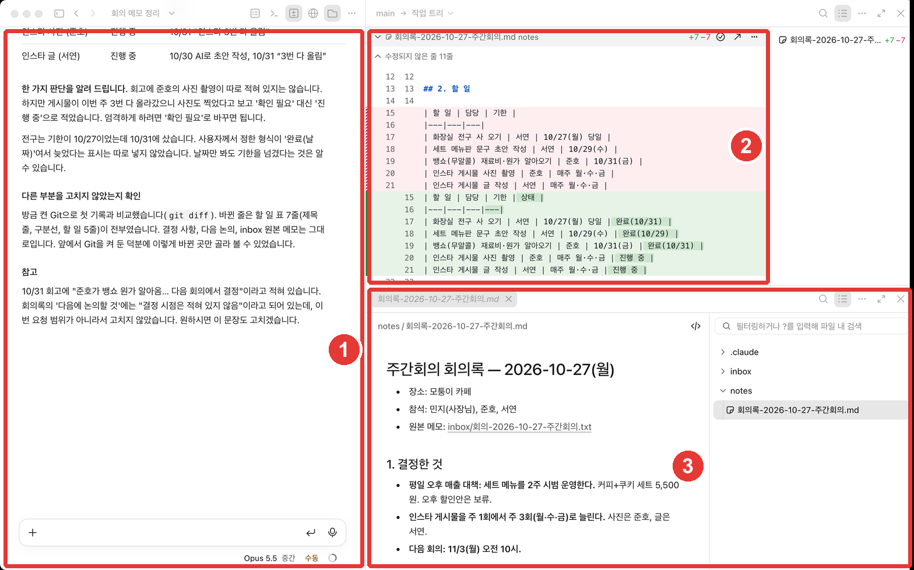
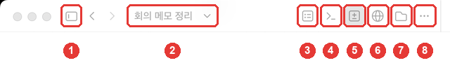
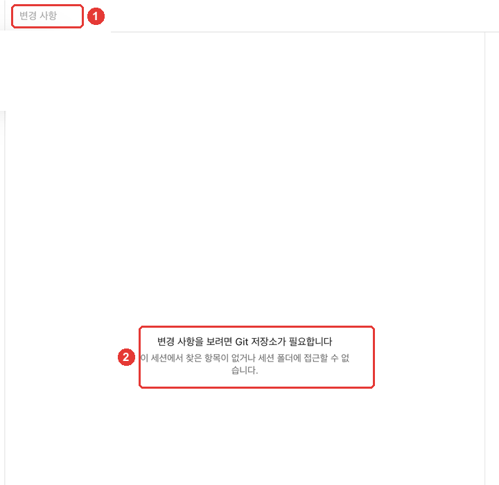
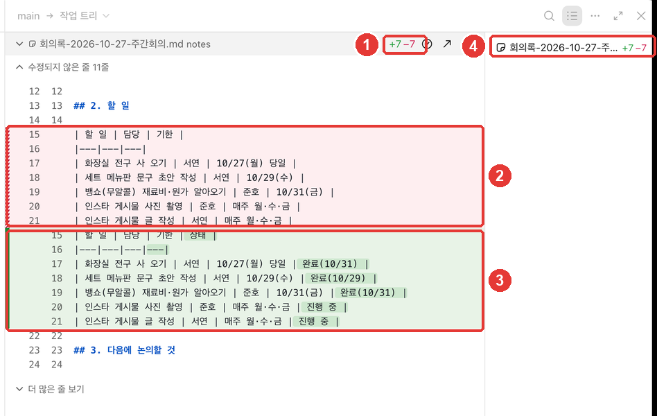
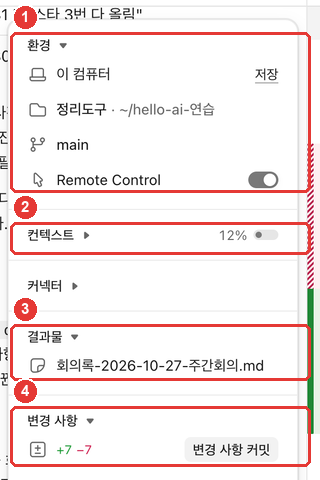
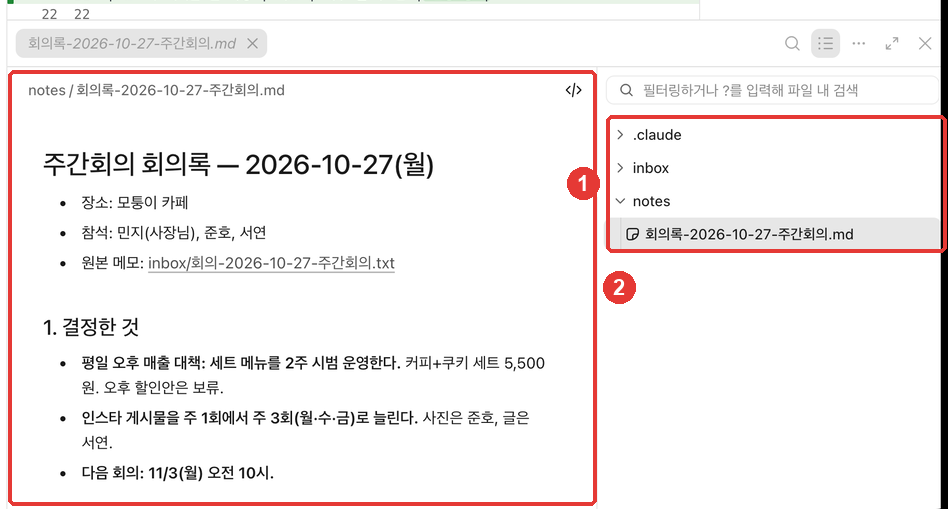

# 3장. 화면 둘러보기 — 제목 줄, 바뀐 내용, 파일, 세션 정보

> **한 줄 요약**: Code 탭은 **대화 칸 옆에 여러 칸(창)을 열어** 쓰는 화면입니다. 세션 제목 줄의 버튼으로 **바뀐 내용·파일·터미널·브라우저** 칸을 열고, 세션 정보 칸에서 무엇이 바뀌었는지 숫자로 봅니다.
> 바뀐 내용을 보려면 폴더에 **변경 기록(Git)** 이 켜져 있어야 합니다. 이 장에서 Claude에게 켜 달라고 해 봅니다.

이 장은 2026년 10월 31일에 확인한 Claude Code 공식 문서와 macOS 데스크톱 앱(한국어 화면, 유료 계정)을 바탕으로 썼습니다. 2장에서 만든 **정리도구** 폴더와 회의록을 그대로 씁니다.

## 한눈에 보는 배치

일을 몇 번 맡기고 나면 화면이 이렇게 됩니다.



| 번호 | 칸 | 무엇을 보나 |
|---|---|---|
| ① | 대화 | 내가 보낸 요청과 Claude의 설명 |
| ② | 바뀐 내용(변경 사항) | 파일에서 어느 줄이 지워지고 생겼는지 |
| ③ | 파일 | 폴더 안의 파일을 열어 읽기 |

Code 탭은 대화·바뀐 내용·브라우저·터미널·파일 같은 **칸을 원하는 대로 배치해 쓰는 화면**입니다.[^arrange] 칸 머리를 끌어서 옮기고, 칸 가장자리를 끌어서 크기를 바꿉니다.[^arrange] 처음부터 다 열 필요는 없습니다. 필요할 때 하나씩 열면 됩니다.

<Quiz id="ch403-layout" />

## 세션 제목 줄의 버튼

대화 칸 맨 위 줄에 버튼이 모여 있습니다.



| 번호 | 하는 일 |
|---|---|
| ① | 옆 메뉴(세션 목록)를 열고 닫기 |
| ② | 세션 제목. 눌러서 이름을 바꿀 수 있음 |
| ③ | 세션 정보 칸 열고 닫기 |
| ④ | 터미널 칸 |
| ⑤ | 변경 사항(바뀐 내용) 칸 |
| ⑥ | 브라우저 칸 |
| ⑦ | 파일 칸 |
| ⑧ | 버튼이 없는 다른 칸 열기 |

출처: 버튼 이름은 이 가이드의 화면 확인(메뉴 막대 「보기」 메뉴, 2026-10-31), 역할은 공식 문서[^arrange][^sessions]

버튼이 아이콘뿐이라 헷갈리면 **마우스를 올려 이름을 확인**하세요.[^arrange] 창이 좁으면 자리가 모자란 버튼은 ⑧ 메뉴 안으로 들어갑니다.[^arrange]

세션 제목(②)은 앱이 첫 요청을 보고 자동으로 붙여 줍니다. 이 가이드에서는 「회의 메모 정리」가 붙었습니다. 제목을 누르면 이름을 바꿀 수 있습니다.[^sessions]

① 옆 메뉴에는 지금까지 연 세션 목록이 있습니다. 세션마다 대화와 바뀐 내용이 따로 저장됩니다.[^sessions] 여러 세션을 나란히 쓰는 법은 8장에서 다룹니다.

<Quiz id="ch403-titlebar" />

## 바뀐 내용 보기 — 변경 기록(Git)이 필요하다

2장에서 만든 폴더로 ⑤ 변경 사항 버튼을 누르면 이런 안내가 나옵니다.



**Git**(깃)은 파일이 언제 어떻게 바뀌었는지 기록해 두는 도구입니다. 변경 사항 칸은 이 기록과 지금 파일을 비교해서 보여 줍니다. 그래서 기록이 없는 보통 폴더에서는 보여 줄 것이 없습니다.

Git 명령을 몰라도 됩니다. **Claude에게 켜 달라고 하면 됩니다.**

```
바뀐 내용을 보려면 Git 저장소가 필요하대. 이 폴더에 변경 기록(Git)을 켜고, 지금 있는 파일을 첫 기록으로 남겨 줘. 무엇을 했는지 쉽게 설명해 줘.
```

이 가이드에서는 Claude가 폴더에 Git을 켜고, 메모 5개와 회의록을 **첫 기록**으로 남겼습니다. 그러자 변경 사항 칸에 「표시할 변경 사항이 없습니다」가 나왔습니다. 첫 기록 뒤로 아직 바뀐 것이 없다는 뜻입니다.

이제 회의록을 조금 고치게 해 봅니다. 회고 메모를 근거로 할 일마다 진행 상태를 붙이는 요청입니다.

```
회의록의 할 일 표에 '상태' 칸을 추가해 줘. inbox의 회고 메모 3개를 보고 끝난 일은 '완료(날짜)', 아직이면 '진행 중'으로 적어 줘. 회고에 없는 일은 '확인 필요'로 적고, 다른 부분은 고치지 마.
```



**빨간 줄은 지워진 줄, 초록 줄은 새로 생긴 줄입니다.** `+7 −7`은 7줄이 생기고 7줄이 지워졌다는 뜻입니다. 표의 한 줄 끝에 칸이 붙으면, Git은 그 줄을 "지우고 새로 쓴 것"으로 셉니다. 그래서 할 일 표 7줄이 빨강과 초록으로 한 번씩 나옵니다.

이 칸 덕분에 **"다른 부분은 고치지 마"를 지켰는지 눈으로 확인**할 수 있습니다. 표 말고 다른 줄이 빨강·초록으로 나오지 않았으면 지킨 것입니다.

::: tip Claude가 스스로 판단한 부분을 확인하세요
이 가이드의 실습에서 Claude는 "회고에 준호의 사진 촬영이 따로 적혀 있지 않지만 게시물이 3번 다 올라갔으니 '진행 중'으로 적었다. 엄격하게 하려면 '확인 필요'로 바꾸면 된다"고 먼저 밝혔습니다. 이런 설명이 보이면 그 판단이 내 기준에 맞는지 한 번 더 봅니다. 기준과 다르면 한 줄로 고쳐 달라고 하면 됩니다.
:::

::: warning Git 기록에 남는 이름
Git은 기록마다 **이 컴퓨터의 Git 설정에 적힌 이름과 이메일**을 함께 남깁니다. 회사 컴퓨터라면 회사 계정이 들어갈 수 있습니다. 기록 화면을 다른 사람에게 보여 주거나 폴더를 올리기 전에 확인하세요. 컴퓨터에 Git이 없으면 공식 사이트(git-scm.com)에서 설치합니다.[^git]
:::

변경 사항 칸은 단축키 **Cmd+Shift+D** 로도 열고 닫습니다.[^keys]

<Quiz id="ch403-changes" />

## 세션 정보 칸

③ 버튼을 누르면 대화 옆에 **세션 정보 칸**이 열립니다. 이 세션이 어디서 돌고, 무엇을 바꿨고, 맥락을 얼마나 썼는지를 카드로 보여 줍니다.[^rail]



| 번호 | 카드 | 무엇을 보나 |
|---|---|---|
| ① | 환경 | 어디서(이 컴퓨터), 어느 폴더에서 일하는지 |
| ② | 컨텍스트 | 이 세션이 기억할 수 있는 양 중 얼마나 썼는지 |
| ③ | 결과물 | 이 세션에서 만든 파일 |
| ④ | 변경 사항 | 바뀐 줄 수. 숫자를 누르면 바뀐 내용 칸이 열림 |

출처: 카드 이름은 이 가이드의 화면 확인(2026-10-31), 역할은 공식 문서[^rail][^diff]

**컨텍스트**(Context)는 1단계에서 배운 "AI가 한 번에 볼 수 있는 양"입니다([1단계 1장](../00-common/01-what-is-llm.md#_3-한-번에-볼-수-있는-양에-한계가-있다-—-컨텍스트-윈도우)). 다 차면 Claude가 그동안의 대화를 **자동으로 요약하고 이어서 일합니다.**[^context] 오래 이어 온 세션이 앞의 지시를 잊은 것 같으면 이 숫자를 보세요. 새 일은 새 세션에서 시작하는 편이 깔끔합니다.

④의 「변경 사항 커밋」은 바뀐 내용을 Git에 새 기록으로 남기는 버튼입니다. 기록과 되돌리기는 4장에서 다룹니다.

<Quiz id="ch403-rail" />

## 파일 칸 — 만든 파일 열어 보기

⑦ 파일 버튼을 누르면 폴더 목록과 함께 파일 칸이 열립니다. 목록에서 파일을 누르면 내용이 보입니다.



- 대화에 나온 **파일 경로를 눌러도** 그 파일이 열립니다.[^files]
- 이 컴퓨터에서 하는 세션이면 **파일 칸에서 직접 고칠 수도 있습니다.** 고친 내용은 자동으로 저장됩니다.[^files]
- 목록에 `.claude` 폴더가 보일 수 있습니다. Claude Code가 이 폴더용 설정을 두는 곳이며, 6장에서 다룹니다.

Claude가 만든 파일은 **Finder나 탐색기 없이 앱 안에서 바로 확인**할 수 있습니다. 2장에서 원본 메모와 맞춰 보던 일을 이제 화면 하나에서 할 수 있습니다.

<Quiz id="ch403-files" />

## 터미널·브라우저 칸과 단축키

남은 두 칸은 간단히만 알아 둡니다.

- **터미널**(④): 명령어를 직접 쳐서 실행하는 칸입니다. Claude와 같은 폴더에서 열립니다.[^terminal] 이 단계에서는 쓰지 않아도 됩니다. 터미널은 10장에서 다룹니다.
- **브라우저**(⑥): 앱 안에서 웹 페이지를 여는 칸입니다.[^arrange]

자주 쓰는 단축키(macOS)입니다.[^keys]

| 단축키 | 하는 일 |
|---|---|
| Cmd+Shift+D | 변경 사항 칸 열고 닫기 |
| Ctrl+\` | 터미널 칸 열고 닫기 |
| Cmd+Shift+B | 브라우저 칸 열고 닫기 |
| Cmd+\\ | 지금 쓰는 칸 닫기 |
| Esc | Claude의 응답 멈추기 |
| Cmd+Shift+M | 권한 모드 메뉴 열기 |

출처: Claude Code 공식 문서[^keys]

## 직접 해 보기

1. 2장의 세션(또는 정리도구 폴더로 연 새 세션)에서 ⑤ 변경 사항 버튼을 눌러 본다. Git이 필요하다는 안내가 나오면 위 요청으로 Claude에게 켜 달라고 한다.
2. 회의록에 '상태' 칸을 넣는 요청을 보내고, 변경 사항 칸에서 **표 말고 다른 줄이 바뀌지 않았는지** 확인한다.
3. ③ 세션 정보 칸을 열어 컨텍스트 숫자와 바뀐 줄 수를 본다.
4. ⑦ 파일 칸에서 회의록을 열고, 상태 칸이 회고 메모와 맞는지 확인한다(전구·문구·원가는 완료, 인스타는 진행 중).

**이어지는 과제**: 이 가이드의 결과([3장-회의록-상태칸.txt](/practice/notes/results/3장-회의록-상태칸.txt))와 내 결과를 비교해 본다. 표 모양이 달라도 상태 값이 회고와 맞으면 잘된 것이다.

## 정리

- Code 탭은 대화 옆에 바뀐 내용·파일·터미널·브라우저 칸을 열어 쓴다. 세션 제목 줄의 버튼으로 연다.
- 바뀐 내용을 보려면 폴더에 Git(변경 기록)이 있어야 한다. Claude에게 켜 달라고 하면 된다.
- 빨간 줄은 지운 줄, 초록 줄은 새 줄이다. "다른 부분은 고치지 마"를 지켰는지 여기서 확인한다.
- 세션 정보 칸에서 환경·컨텍스트·결과물·바뀐 줄 수를 본다. 컨텍스트가 차면 자동으로 요약하고 이어 간다.
- 파일 칸에서 만든 파일을 바로 열어 확인하고 고칠 수 있다.

## 용어 정리

| 용어 | 읽는 법 | 한 줄 뜻 |
|---|---|---|
| Pane | 페인 (칸) | Code 탭 안에 여는 창 하나. 대화·바뀐 내용·파일 등 |
| Diff | 디프 (바뀐 내용) | 고치기 전과 후를 줄 단위로 비교한 것 |
| Git | 깃 | 파일이 언제 어떻게 바뀌었는지 기록해 두는 도구 |
| Commit | 커밋 | Git에 지금 상태를 기록으로 하나 남기는 일 |
| Context | 컨텍스트 | 한 세션에서 Claude가 한 번에 기억할 수 있는 양 |
| Session rail | 세션 레일 (세션 정보 칸) | 환경·컨텍스트·결과물·바뀐 줄 수를 보여 주는 칸 |

<ChapterDone :chapter="403" />

다음 장: 4장 「허락과 되돌리기」는 준비 중입니다. 그동안 [3단계 목차](./)에서 앞으로 배울 내용을 볼 수 있습니다.

[^arrange]: Claude Code 공식 문서, 「Desktop application」. "The Code tab is built around panes you can arrange in any layout: chat, diff, browser, terminal, file, plan, tasks, and subagent" / "Drag a pane by its header to reposition it, or drag a pane edge to resize it." / "To open another pane, click its icon button in the session's title bar. Hover to see each button's name, such as Terminal, Changes for the diff view, Browser, and Files." / "When the window is narrow: buttons that don't fit move into the menu" https://code.claude.com/docs/en/desktop (확인일 2026-10-31)
[^sessions]: Claude Code 공식 문서, 「Desktop application」. "Each session is an independent conversation with its own context and changes." / "To rename a session, open it and click the session title in the title bar." https://code.claude.com/docs/en/desktop (확인일 2026-10-31)
[^rail]: Claude Code 공식 문서, 「Desktop application」. "The session details panel is a set of cards beside the chat that show where the session runs, what it changed, what it's running, and its context usage." https://code.claude.com/docs/en/desktop (확인일 2026-10-31)
[^diff]: Claude Code 공식 문서, 「Desktop application」. "To open the diff view, click the line counts, such as +12 -1, in the Changes card of the session details panel." https://code.claude.com/docs/en/desktop (확인일 2026-10-31)
[^context]: Claude Code 공식 문서, 「Desktop application」. "When context fills up, Claude automatically summarizes the conversation and continues working." https://code.claude.com/docs/en/desktop (확인일 2026-10-31)
[^files]: Claude Code 공식 문서, 「Desktop application」. "To open a file Claude mentions, click its path in the chat." / "Local sessions: you can edit files inside the session's working directory" / "By default, your edits in the file pane save on their own" https://code.claude.com/docs/en/desktop (확인일 2026-10-31)
[^terminal]: Claude Code 공식 문서, 「Desktop application」. "The terminal opens in your session's working directory and shares the same environment as Claude" https://code.claude.com/docs/en/desktop (확인일 2026-10-31)
[^keys]: Claude Code 공식 문서, 「Desktop application」 단축키 표. "Toggle diff pane" / "Toggle Browser pane" / "Toggle terminal pane" / "Close focused pane" / "Stop Claude's response" / "Open permission mode menu" https://code.claude.com/docs/en/desktop (확인일 2026-10-31)
[^git]: Claude Code 공식 문서, 「Desktop application」 문제 해결. "install Git" — 공식 문서는 Git이 필요한 기능(worktree)에서 Git 설치를 안내한다. 변경 사항 칸이 Git 저장소를 요구한다는 것은 이 가이드의 화면 확인(2026-10-31). https://code.claude.com/docs/en/desktop (확인일 2026-10-31)
