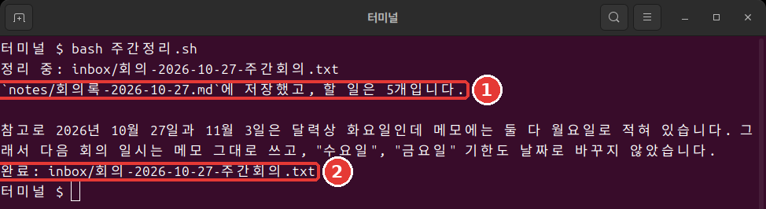

# 10장. 한 줄 실행과 자동화

<Badge type="tip" text="필수" /> 이 단계를 따라가려면 꼭 읽으세요.

> **한 줄 요약**: `claude -p`는 한 번 답하고 끝납니다. 쓰기는 미리 허락하고, 성공은 종료 코드로 판단합니다. 이 셋을 묶으면 명령 한 줄로 돌아가는 주간 정리가 됩니다.

이 장의 출력은 2026년 11월 6일 리눅스에서 Claude Code 2.1.318로 실행한 결과입니다. 어렵게 느껴져도 괜찮습니다. 한 조각씩 보면 앞 장에서 만든 것을 이어 붙이는 일입니다.

## claude -p와 대화형의 차이

`-p`(또는 `--print`)를 붙이면 대화 없이 한 번 답하고 끝납니다.[^headless] `/exit`로 나와 터미널에서 연습 폴더로 이동한 뒤 칩니다.

```bash
claude -p "inbox 폴더에 파일이 몇 개 있는지 한 줄로만 답해 줘."
```

`inbox 폴더에는 파일이 1개 있습니다.`라고 답하고 바로 셸로 돌아왔습니다.

대화형 `claude`는 내가 나갈 때까지 이어지고 자동(auto) 모드로 시작합니다. `claude -p`는 답을 내면 끝나고 수동(Manual) 모드로 시작합니다.[^headless] 같은 일을 사람 없이 돌릴 때만 `-p`가 필요합니다. 나머지는 대화형으로 충분합니다.

<Quiz id="ch810-print" />

## 왜 쓰기가 막히나

이번에는 파일을 만들어 달라고 해 봅니다. 4장의 파일을 덮어쓰지 않게 이름을 `회의록-한줄.md`로 정합니다.

```bash
claude -p "inbox의 회의 메모를 읽고 회의록-한줄.md 파일로 정리해서 저장해 줘."
```

파일이 생기지 않습니다. 답은 `파일 쓰기 권한이 승인되지 않았고`라고 알려 줍니다. 고장이 아닙니다. `-p`는 수동 모드로 시작하는데 물어볼 사람이 없습니다. 그래서 승인이 필요한 호출은 거부됩니다.[^headless] 필요한 도구를 미리 허락해 주면 됩니다.[^headless]

```bash
claude -p "inbox의 회의 메모를 읽고 회의록-한줄.md 파일로 정리해서 저장해 줘. 답은 한 줄로." --allowedTools "Read,Write"
```

`--allowedTools`는 묻지 않고 써도 되는 도구를 미리 정하는 옵션입니다. `Read`는 파일 읽기, `Write`는 파일 쓰기입니다. 쉼표로 이어 쓰고 따옴표로 묶습니다.

이번에는 파일이 생겼습니다. `ls`에 없으면 `ls notes`도 보세요. 8장의 규칙 때문에 그쪽에 저장될 수 있습니다.

허락은 뭐가 필요할지 몰라서 넓게 주는 것보다, 이 일에 필요한 `Read,Write`만 주는 편이 낫습니다. 좁게 허락하면 Claude가 잘못 판단해도 할 수 있는 일이 그만큼 적습니다.

<Quiz id="ch810-allow" />

## 파이프로 내용 넘기기

**파이프**(Pipe, `|`)는 앞 명령의 출력을 뒤 명령의 입력으로 넘기는 기호입니다. 물이 관을 타고 흐르는 모습을 떠올리면 됩니다. `claude -p`도 파이프로 내용을 받습니다.[^headless]

```bash
cat inbox/회의-2026-10-27-주간회의.txt | claude -p "이 메모에서 할 일만 세 줄로 뽑아 줘."
```

```text
- 서연: 화장실 전구 오늘(10/27) 사기
- 서연: 세트 메뉴판 문구 초안 수요일까지 작성
- 준호: 뱅쇼 원가 금요일까지 알아오기
```

**Windows에서는** 파이프로 넘긴 한글이 깨질 수 있습니다. 답이 엉뚱하면 파이프 대신 파일 이름 앞에 `@`를 붙여 넘기세요. `파일이름`은 실제 메모 이름으로 바꿉니다. 이 명령은 리눅스에서 실행해 확인했고 Windows에서는 해 보지 않았습니다.

```bash
claude -p "@inbox/파일이름 에서 할 일만 세 줄로 뽑아 줘."
```

**믿을 수 없는 내용은 곧바로 파이프로 넘기지 마세요.**[^security] 웹에서 받은 글이나 모르는 사람의 메일이 그렇습니다. 글 속에 [7장](07-permissions-undo.md)에서 본 프롬프트 인젝션이 숨어 있을 수 있습니다.[^security] 프롬프트 인젝션은 글 속에 AI에게 하는 지시를 몰래 섞어 엉뚱한 일을 시키는 수법입니다.

연습 메모 [회의-2026-10-29-임시회의.txt](/practice/notes/inbox/회의-2026-10-29-임시회의.txt)에 그런 문장의 예가 있습니다. 지금은 링크를 눌러 브라우저에서 읽어만 보세요. 아직 `inbox` 폴더에는 넣지 않습니다. 뒤에서 만들 스크립트가 `inbox`의 메모를 모두 처리하기 때문입니다. 이 메모는 [13장](13-cost-safety-trouble.md)에서 안전하게 다루는 법을 배울 때 넣습니다.

<Quiz id="ch810-pipe" />

## 출력을 저장하고 모양 바꾸기

답을 파일로 받고 싶으면 맨 뒤에 `> 할일.txt`를 붙입니다.[^headless] 화면에는 나오지 않고 파일에 들어갑니다. 같은 이름의 파일이 있으면 덮어쓰니 조심하세요.

이 장의 실습에는 아래 JSON 출력이 필요 없습니다. 이런 것이 있다는 것만 알아 두세요.

다른 프로그램이 답을 읽어야 한다면 [8장](08-memory-settings.md)에서 본 JSON 형식으로 받습니다.[^headless] `claude -p "1+1은? 숫자만." --output-format json`처럼 씁니다. 한 줄이 길게 나옵니다. 답은 `result` 칸에 있습니다.

`total_cost_usd` 칸에는 달러 금액이 있습니다. 놀라지 않아도 됩니다. 프로그램이 계산한 추정치라서 실제 청구액과 다를 수 있습니다.[^headless] 구독 사용자에게 세션 비용 수치는 청구 기준으로 의미가 없습니다.[^costs]

<Quiz id="ch810-output" />

## 횟수 제한과 종료 코드

사람이 없을 때 Claude가 너무 오래 돌면 곤란합니다. `--max-turns`로 턴(Claude가 일을 이어 가는 한 차례)의 횟수에 상한을 둡니다. 기본은 무제한입니다.[^max-turns] 일부러 1로 줄여 봅니다.

```bash
claude -p "inbox 폴더의 메모를 모두 읽고 세 줄로 요약해 줘." --allowedTools "Read" --max-turns 1
echo $?
```

```text
Error: Reached max turns (1)
1
```

맨 아래의 `1`이 **종료 코드**(Exit code)입니다. 성공하면 0, 실패하면 0이 아닌 값입니다.[^headless] 사람은 글자를 읽고, 스크립트는 이 숫자를 읽습니다. `echo $?`는 바로 앞 명령의 종료 코드를 보여 줍니다. PowerShell에서는 `$LASTEXITCODE`를 칩니다.

<Quiz id="ch810-exit" />

## 주간정리.sh 만들기

이제 조각을 합칩니다. **스크립트**(Script)는 명령을 파일에 적어 한 번에 돌리는 것입니다. [8장](08-memory-settings.md)의 `CLAUDE.md`와 `notes` 폴더, [9장](09-skills-extensions.md)의 스킬이 있어야 합니다. `/exit`로 나와 터미널에서 연습 폴더로 이동합니다. 맥과 리눅스는 아래를 통째로 붙여 넣습니다(파일로 보기: [10장-주간정리.sh.txt](/practice/cli/results/10장-주간정리.sh.txt)).

```bash
cat > 주간정리.sh <<'EOF'
#!/bin/bash
# inbox 의 회의 메모를 하나씩 회의록으로 정리한다.
for memo in inbox/회의-*.txt; do
  echo "정리 중: $memo"
  if claude -p "/meeting-notes $memo" --allowedTools "Read,Write" --max-turns 10; then
    echo "완료: $memo"
  else
    echo "실패: $memo"
  fi
done
EOF
```

붙여 넣은 뒤 아직 실행되지 않았으면 Enter를 한 번 더 누르세요. 아무것도 안 나오면 성공입니다. `ls`로 `주간정리.sh`가 생겼는지 보세요.

맨 윗줄 `#!/bin/bash`는 이 파일을 bash(셸의 한 종류)로 읽으라는 표시입니다. `#`로 시작하는 다음 줄은 사람이 읽는 설명입니다. `for` 줄은 이름이 `회의-`로 시작하는 메모를 하나씩 `memo`에 담습니다. 여기서 `memo`는 **변수**(Variable)입니다. 값을 잠시 담아 두는 이름표라고 보면 됩니다. 이름 앞에 `$`를 붙여 `$memo`라고 쓰면 그 안에 든 값을 꺼내 씁니다. 첫 번째 차례라면 `$memo`가 `inbox/회의-2026-10-27-주간회의.txt`로 바뀝니다.

`if` 줄은 9장의 스킬을 부르고, 종료 코드가 0이면 `완료`, 아니면 `실패`를 찍습니다.

변수 이름은 `memo`처럼 영어로 씁니다. bash는 한글 변수 이름을 받지 않습니다. 파일 이름은 한글이어도 됩니다.

실행은 한 줄입니다.

```bash
bash 주간정리.sh
```



```text
정리 중: inbox/회의-2026-10-27-주간회의.txt
`notes/회의록-2026-10-27.md`에 저장했고 할 일은 5개입니다.

참고로 메모에는 10/27과 11/3이 월요일로 적혀 있지만 2026년 달력으로는 둘 다 화요일이라, 요일과 날짜는 메모 그대로 두었습니다.
완료: inbox/회의-2026-10-27-주간회의.txt
```

사람이 아무것도 누르지 않았는데 회의록이 생겼습니다([결과 보기](/practice/cli/results/10장-회의록-스크립트로.txt)). 내 결과와 문장은 달라도 세 절과 표가 있으면 됩니다.

**Windows에서는** 이 스크립트가 PowerShell에서 그대로 돌지 않습니다. bash용이기 때문입니다. 아래 PowerShell용을 쓰세요. 맥과 리눅스는 이 부분을 건너뛰면 됩니다.

같은 일을 PowerShell로 쓰면 아래와 같습니다. 돌릴 때마다 이 상자를 창에 붙여 넣습니다. 실행해 보지 않은 예시입니다. WSL을 쓴다면 WSL 터미널 안에서 위 스크립트를 돌립니다.[^wsl]

```powershell
foreach ($file in Get-ChildItem inbox/회의-*.txt) {
  $memo = "inbox/$($file.Name)"
  Write-Output "정리 중: $memo"
  claude -p "/meeting-notes $memo" --allowedTools "Read,Write" --max-turns 10
  if ($LASTEXITCODE -eq 0) { Write-Output "완료: $memo" } else { Write-Output "실패: $memo" }
}
```

<Quiz id="ch810-script" />

## 구독 계정에서 알아 둘 것

구독 계정이라면 두 가지만 기억하세요.

- 스크립트를 돌리기 전과 후에 사용량을 한 번씩 봅니다. 세션 안에서 `/usage`를 치면 사용량 막대가 나옵니다.[^costs]
- 다른 글에서 `--bare`라는 옵션을 권해도 붙이지 마세요.

`-p` 실행이 구독 한도에서 어떻게 깎이는지는 이 가이드가 확인한 공식 문서에 나와 있지 않습니다. 그래서 짐작하지 말고 `/usage`로 직접 보는 편이 확실합니다.

`--bare`를 붙이면 안 되는 까닭은 이렇습니다. 공식 문서는 스크립트에 `--bare`를 권하지만, `--bare`는 구독 로그인 정보를 읽지 않습니다. `CLAUDE.md`와 스킬도 불러오지 않습니다.[^bare] 우리 스크립트는 셋 다 필요합니다.

거꾸로 `--bare` 없이 `-p`를 쓰면 그 폴더의 설정을 불러옵니다. 한 번도 신뢰하지 않은 폴더의 훅과 MCP 서버도 그렇습니다.[^bare] 그러니 내용을 아는 내 폴더에서만 돌리세요.

<Quiz id="ch810-subscription" />

## 자리를 비우기 전 점검

맡겨 두고 자리를 비우기 전에 세 가지를 확인하세요.[^unattended] 우리 스크립트에 대 보면 이렇습니다.

- 끝이 어떤 모습인가? 메모마다 회의록 파일 하나가 `notes`에 생기면 끝이다.
- 자기 일을 확인할 수 있나? 종료 코드로 `완료`와 `실패`를 가른다.
- 건드려야 할 것만 건드리나? `Read,Write`만 허락했지만 폴더를 제한한 것은 아니다. 그래서 연습 폴더에서만 돌린다. 횟수는 `--max-turns 10`으로 묶었다.

스크립트는 `inbox`의 회의 메모를 전부 처리합니다. 그래서 새 메모를 넣고 돌립니다. 읽어 보지 않은 메모는 넣지 마세요. 그리고 종료 코드 0은 정상으로 끝났다는 뜻일 뿐입니다. 회의록 내용까지 맞다는 뜻은 아닙니다. 처음 몇 주는 결과를 직접 읽어 보세요.

<Quiz id="ch810-unattended" />

## 직접 해 보기

1. 터미널에서 읽기 질문을 `claude -p`로 보내고, 쓰기 요청을 허락 없이 보내 봅니다. `ls`로 파일이 안 생긴 것을 봅니다.
2. `--allowedTools "Read,Write"`를 붙여 다시 보냅니다.
3. 파이프로 할 일을 뽑아 저장합니다. Windows에서 답이 엉뚱하면 앞의 `@` 방법을 씁니다.

   ```bash
   cat inbox/회의-2026-10-27-주간회의.txt | claude -p "이 메모에서 할 일만 세 줄로 뽑아 줘." > 할일.txt
   ```

4. `--max-turns 1`로 실패시키고 종료 코드를 봅니다.
5. `주간정리.sh`를 만들어 `bash 주간정리.sh`로 돌립니다. Windows는 위의 PowerShell 코드 상자를 붙여 넣습니다.

스스로 물어보세요. 사람 없이 돌아갔나? 결과가 메모와 맞나? 다음 주에 메모가 늘어도 같은 명령이면 되나?

## 정리

- `claude -p`는 수동 모드로 시작하고 물어볼 사람이 없다. 쓰기는 `--allowedTools`로 미리 허락한다.
- 믿을 수 없는 내용은 파이프로 넘기지 않는다. JSON의 비용은 추정치다.
- `--max-turns`로 횟수를 묶고 종료 코드로 성공을 판단한다.
- bash 변수 이름은 영어로 쓴다. bash 스크립트는 PowerShell에서 그대로 돌지 않는다.
- 구독 계정에서는 `--bare`를 쓰지 않고, 사용량은 `/usage`로 직접 본다.

## 용어 정리

| 용어 | 읽는 법 | 한 줄 뜻 |
|---|---|---|
| Pipe | 파이프 | 앞 명령의 출력을 뒤로 넘기는 기호 |
| Exit code | 엑시트 코드 | 끝날 때 남기는 숫자(0이 성공) |
| Script | 스크립트 | 명령을 적어 한 번에 돌리는 파일 |

<ChapterDone :chapter="810" />

다음 장: [11장. 훅과 화면 맞춤](11-hooks-statusline.md)

[^headless]: Claude Code 공식 문서, 「Run Claude Code programmatically」. "Add the `-p` (or `--print`) flag to any `claude` command to run it non-interactively." / "With Claude Code v2.1.302 or later, `claude -p` runs start in Manual mode when nothing sets a permission mode." / "In a Manual mode `claude -p` run, a call that needs approval is denied unless something approves it" / "Use `--allowedTools` to let Claude use certain tools without prompting." / "Non-interactive mode reads stdin, so you can pipe data in and redirect the response out like any other command-line tool." / "`json`: structured JSON with result, session ID, and metadata" / "Both figures are client-side estimates and can differ from your actual bill." / "Claude Code exits with code 0 on success and a non-zero code when the run fails, so your scripts can branch on the exit status." https://code.claude.com/docs/en/headless (확인일 2026-11-06)
[^security]: Claude Code 공식 문서, 「Security」. "Avoid piping untrusted content directly to Claude" / "Prompt injection is a technique where an attacker attempts to override or manipulate an AI assistant's instructions by inserting malicious text." https://code.claude.com/docs/en/security (확인일 2026-11-06)
[^costs]: Claude Code 공식 문서, 「Manage costs effectively」. "Claude Pro, Max, and Ultra subscribers have usage included in their subscription, so the session cost figure isn't relevant for billing purposes." / "Subscribers see plan usage bars, activity stats, and a usage breakdown on the same screen." https://code.claude.com/docs/en/costs (확인일 2026-11-06)
[^max-turns]: Claude Code 공식 문서, 「CLI reference」. "Limit the number of agentic turns (print mode only). No limit by default." https://code.claude.com/docs/en/cli-reference (확인일 2026-11-06)
[^wsl]: Claude Code 공식 문서, 「Advanced setup」. "You install and launch `claude` inside the WSL terminal, not from PowerShell or CMD." https://code.claude.com/docs/en/setup (확인일 2026-11-06)
[^bare]: Claude Code 공식 문서, 「Run Claude Code programmatically」. "`--bare` is the recommended mode for scripted and SDK calls, and will become the default for `-p` in a future release." / "In bare mode, Claude Code never reads OAuth credentials or the system keychain." / "Add `--bare` to reduce startup time by skipping auto-discovery of hooks, skills, custom commands, subagents, installed plugins, MCP servers, auto memory, and CLAUDE.md." / "Without `--bare`, a `-p` session runs the hooks in a project's `.claude/settings.json` and connects the servers in its `.mcp.json`, even in a folder you've never trusted." https://code.claude.com/docs/en/headless (확인일 2026-11-06)
[^unattended]: Claude Code 공식 문서, 「Best practices for Claude Code」. "Before a run goes unattended, make sure it knows what done looks like, can check its own work, and can only touch what it should." https://code.claude.com/docs/en/best-practices (확인일 2026-11-06)
