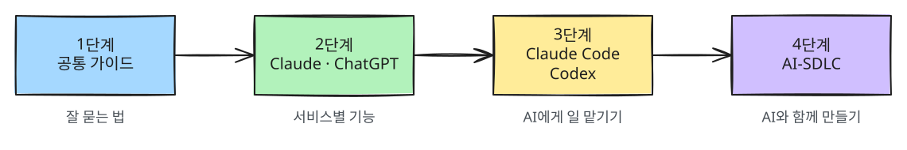

## 내 학습 현황

<MyProgress />

## 학습 로드맵

앞 단계가 다음 단계의 바탕이 되므로 번호 순서대로 읽는 것을 권합니다. 지금은 1단계를 채우는 중입니다.

| 단계 | 가이드 | 내용 |
|---|---|---|
| 1 | [공통 가이드](/guide/00-common/) | 어떤 LLM에서든 통하는 공통 원리와 사용법 |
| 2 | [ChatGPT](/guide/11-chatgpt/) · [Claude](/guide/10-claude/) · [Gemini](/guide/12-gemini/) | 서비스별 기능과 활용법 |
| 3 | [Claude Code](/guide/20-claude-code/) (작성 중) · Codex · Antigravity (준비 중) | 내 컴퓨터에서 일하는 코딩 AI 도구 |
| 4 | AI-SDLC (준비 중) | AI와 함께 기획부터 배포까지 — 소프트웨어 개발 전 과정(SDLC) |
