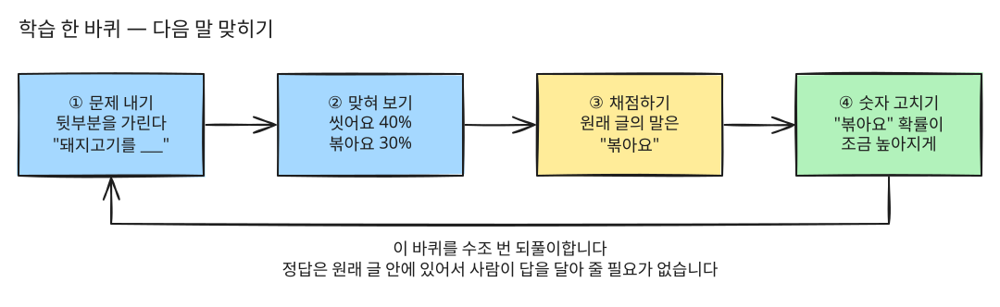
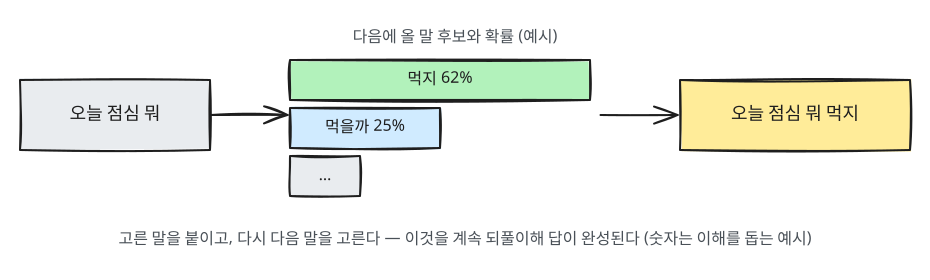
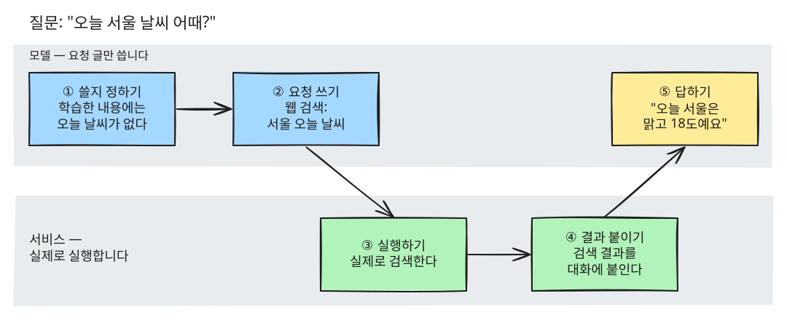
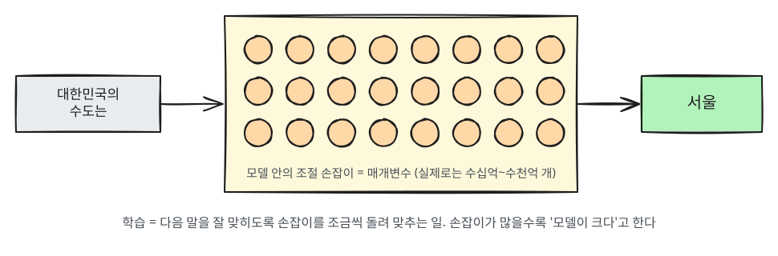
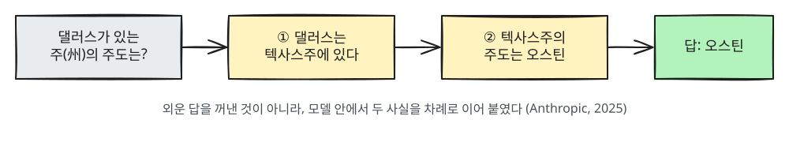
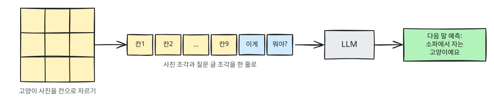

# 第1章 LLMとは何か

> **一言まとめ**: LLMは、膨大な量の文章を読み、「次に続く言葉」を当てる練習をしたプログラムです。
> そのため、とても自然な言葉で話しますが、常に事実を言っているとは限りません。

## LLMという名前

LLMは **Large Language Model** の略で、日本語では**大規模言語モデル**と呼びます。

- **Large（大規模）**: インターネットの文章、本、論文など、人が一生かかっても読み切れないほどの文章で学習したという意味です。「学習」とは何かは、すぐ下で説明します。
- **Language（言語）**: 「文章」を扱うのが本来の仕事だという意味です。ただし最近のモデルは、文書・写真・音声・動画も一緒に扱えます（下の「文字だけを読むわけではありません」を参照）。
- **Model（モデル）**: 学習によって作られたプログラムという意味です。

ChatGPT、Claude、Geminiはすべて、このLLMを会話しやすいように包んだ**サービス**です。
エンジン（LLM）の上に、車体（チャット画面）を乗せたものだと考えるとわかりやすいでしょう。

迷惑メールの振り分けや動画のおすすめもAIです。しかし、こうしたAIはすでにあるものを選んだり分けたりします。一方、LLMは新しい文章を**作り出します**。
そのため、LLMのようなAIを**生成AI**（generative AI）と呼びます。[^academy-genai]

<Quiz id="ch1-name" />

## 学習したとはどういう意味でしょうか？

LLMの話では「学習した」という言葉がよく出てきます。人が本を読んで暗記する姿を思い浮かべがちですが、少し違います。
**LLMの学習とは、「次の言葉を当てる」問題をものすごい数こなして、間違えるたびにモデルの中の数字を少しずつ直していく作業です。**

### 穴埋め問題を何度も解きます

1つの問題は、次のように進みます。

1. **問題を出す**: 集めておいた文章から一文を取り出し、後半を隠します。例：「キムチチゲを作るときは、まず豚肉を___」
2. **当ててみる**: モデルが次に続く言葉の候補と確率を出します。例：「洗います」40%、「炒めます」30%
3. **採点する**: 元の文章に実際にあった言葉と比べます。元の文章には「炒めます」がありました。
4. **直す**: 次は「炒めます」の確率がもう少し高くなるように、モデルの中の数字をごくわずか直します。



このサイクルを何兆回も繰り返します。正解は元の文章の中にすでにあるため、人が問題ごとに答えをつける必要がありません。だからこそ、これほど多くの文章で学習できるのです。
この段階を**事前学習**（pre-training）と呼びます。[^academy-pretrain] 直していく「数字」が、下の「モデルの大きさ」で扱うパラメータです。
問題集を解いて解答集と答え合わせをするのに似ています。ただし、間違えた問題を別に書き留めておくわけではありません。代わりに、次に似た問題をうまく当てられるよう、感覚を少しずつ変えていきます。

事前学習を終えたモデルは、まだ会話相手ではなく「文章の続きを書く機械」に近い状態です。会話相手として整える訓練がもう1回あります（下の「『助けてくれる会話相手』になるよう別に訓練を受けました」を参照）。

### では、全部暗記しているのですか？

ほとんどは暗記していません。モデルの中には、読んだ文章がファイルのように保存されているわけではありません。残るのは無数の数字です。その数字に「どんな言葉の後ろにどんな言葉が来やすいか」といったパターンが溶け込んでいます。
大きさを比べてみると見当がつきます。Llama 3.1 405Bというモデルはパラメータが4,050億個ありますが、学習のときに読んだ文章のかけらは15兆個を超えます（下の「モデルの大きさ」を参照）。読んだかけらのほうが、数字より37倍以上も多いのです。
料理本を100冊読んだ人を思い浮かべてみてください。レシピを全部暗記していなくても、「鍋料理はたいてい具材を炒めてから水を入れる」という流れはわかります。

しかし、**よく見た文章はそのまま丸暗記してしまうこともあります。**

- 2020年、研究チームがGPT-2というモデルから、学習データの中の文章数百個を原文のまま引き出しました。その中には、インターネットに公開されていた名前・電話番号・メールアドレスもありました。[^extract]
- 2022年の後続研究では、3つの場合に暗記した文章をより多く出すと報告されました。モデルが大きいほど、同じ文章が学習データに何度も入っているほど、そして前半を長く見せるほどです。[^memorization]

そこで知っておきたい点があります。AIは「どこで読んだか」を調べることができません。図書館のように原文を取り出して確認するのではなく、パターンから言葉を作っているからです。
出典を聞くと、実在しない論文のタイトルをもっともらしく作り出してしまうことがあるのも、このためです（下の「ハルシネーション」を参照）。

### 会話しながら学んでいるわけではありません

学習が終わると、数字は固定されます。会話の中であなたが教えたことによって、数字が変わることはありません。**その会話の中だけで参考資料として使われます。**
そのため、新しい会話を開くと、前の会話の内容を知らないのが基本です。

「前に話したことを覚えていましたよ？」と感じることがあるかもしれません。それはサービスの**メモリ**（memory）機能です。サービスが覚えておく内容を会話履歴とは別に書き留めておき、新しい会話で取り出して参考にさせています。[^memory] モデルの数字が変わったわけではありません。
運営会社があなたの会話を**次に出るモデル**の学習データとして使うことはあります。これも、今会話しているモデルがその場で変わるわけではありません。使わせるかどうかは設定で選べます（[第9章](09-safety.md)）。

新しい会話を開いて、こう聞いてみてください。

```
私が前の会話であなたに何と言ったか覚えていますか？
覚えているなら、どんな方法で覚えているのかも説明してください。
```

メモリ機能がオフになっていれば、わからないと答えるはずです。オンになっていれば、保存された内容を見て答えられます。結果はサービスと設定によって異なります。

<Quiz id="ch1-training" />

## どうやって答えを作るのですか？

LLMがしていることの核心は、意外とシンプルです。**これまでの文章を見て、次に続くもっともらしい言葉を1つずつ繋ぎ合わせています。**

スマートフォンのキーボードの予測変換を思い浮かべてみてください。「今日の昼ごはん何」まで打つと「食べよう」などが候補に出ます。
LLMも同じことをしています。ただし、ずっと長い文脈を見て、はるかに巨大な規模で行います。



たとえば、こう尋ねたとします。

```
韓国の首都は？
```

LLMは「韓国の首都は」の次に続く言葉として「ソウル」を繋げます。学習の中で何度も目にした言葉だからです。
その次には「です」をつけます。このようにして答えを完成させます。

仕組みはこれほどシンプルです。ところが、途方もない量の文章と出会ったことで、翻訳や要約、文章作成、コード作成のように「考えているように見える」仕事までこなせるようになりました。

### 確率を決める材料は2つあります

「もっともらしい言葉」は何を見て決めるのでしょうか？ 2つのものを合わせて見ます。

1. **学習で身につけたパターン**: モデルの中の数字に込められたものです。「韓国の首都は」の後ろに「ソウル」が来るというのは、ここから出てきます。
2. **今の会話に入っているすべての文章**: あなたの質問、前後のやり取り、アップロードしたファイル、サービスがあらかじめ入れておいた案内文まで含みます。これを**コンテキスト**（context、文脈）と呼びます。

同じ言葉でも、コンテキストが変われば次の言葉の確率が変わります。

| 前の文章 | 次に続きやすい言葉 |
|---|---|
| 「おなかが痛くて」 | 「病院に行った」 |
| 「船に乗って」 | 「島に行った」 |

だからこそプロンプトが大切です。あなたが書いた文章がそのままコンテキストになり、コンテキストが確率を変えます。
あなたの状況や望む答えの形を書くほど、あなたが望む方向の言葉が「もっともらしい言葉」になります（[第4章](04-prompt-basics.md)）。

実際に確かめてみましょう。

```
「今日の昼ごはん何」の次に続く言葉の候補を5つ書いてください。
次に、前に「ダイエット中なんだけど」をつけると候補がどう変わるかも見せてください。
```

AIが書いてくれる候補は、説明のための例です。実際に内部で計算した確率をそのまま見せているわけではありません。それでも、前のほんの数言が次の言葉をどれほど変えるかは実感できるはずです。

### あなたの質問はこうして読まれます

「おなかが痛いから病院に行くべきかな？」と聞いたとしましょう。モデルの中では、おおよそ次のようなことが起きています。

1. **かけらに切り分けます。** 文章を**トークン**（token）という小さなかけらに切り分けます。1つの単語が1つのかけらになることもあれば、複数のかけらに分かれることもあります。
2. **かけらごとに数字のまとまりに変えます。** 意味が似ている言葉は、似た数字のまとまりになるよう学習されています。地図で近い町同士の座標が似ているのと同じです。「子犬」と「犬」は近く、「冷蔵庫」は遠くにあります。これを**埋め込み**（embedding、エンベディング）と呼びます。[^word2vec]
3. **かけら同士でお互いを調べます。** かけら1つ1つが文の中の他のかけらを見渡し、自分の意味を決めるのにどのかけらが重要かを調べます。たとえば韓国語の「배（ペ）」には「おなか」と「船」の両方の意味がありますが、「痛い」と「病院」を見ることで、体のおなかという意味に固めます。これを**アテンション**（attention、注意機構）と呼びます。[第2章](02-why-it-matters.md)に出てくるトランスフォーマーが、まさにこの方式を使っています。[^attention]
4. **何度も繰り返したあと、次の言葉を選びます。** 2〜3番の計算を何層にもわたって繰り返します。最後に次のかけらの候補ごとに確率を出し、1つを選んで繋げます。そして、今繋げたかけらまで入れて、もう一度計算します。

こうしてみると、「理解する」というのは、あなたの質問のかけら同士がお互いを調べて意味を絞り込んでいく計算です。これを人間の理解と同じと言えるかどうかは、下の「でも、本当に考えているのでしょうか？」で扱います。

### あなたの質問だけが入るわけではありません

チャット画面にはあなたの質問だけが見えています。しかし、モデルが受け取る文章はもっと長いです。サービスがあなたの質問を包み込んで送っているからです。理解しやすいように描いてみると、おおよそこのような形になります。実際の形はサービスごとに異なります。

```
[サービスの案内文] あなたは親切なアシスタントです。今日の日付は2026年10月30日です。…
[これまでの会話] …
[アップロードしたファイル] …
[ユーザー] おなかが痛いから病院に行くべきかな？
[AI] ← モデルはここから続きを書きます
```

一番前の案内文を**システムプロンプト**（system prompt）と呼びます。たとえばClaudeのWeb版とアプリは、会話を始めるたびに今日の日付のような最新情報や答え方のルールをシステムプロンプトとして入れます。そして、その内容を公開しています。[^system-prompts]
モデルはこの長い文章全体をコンテキストとして見て、「[AI]」の次に続く言葉を書き足していきます。会話が長くなれば、この文章も長くなります。そのため、一度に見ることができる文章の量（下の「コンテキストウィンドウ」）が重要になってきます。

<Quiz id="ch1-next-word" />

## 検索してツールを使うAI

最近のAIはWeb検索で今日のニュースも探してくれます。学習が終わったあとの出来事は知らないはずなのに（下の「知識カットオフ」）、どうして可能なのでしょうか？
**モデルが直接インターネットに入っているわけではありません。** モデルは「これを検索して」という依頼文を書きます。するとサービスが代わりに検索して、結果を会話に貼り付けます。モデルはその結果を読んで次の言葉を続けます。

### ツールを使う順番

「今日のソウルの天気はどう？」と聞いたとしましょう。

1. **使うか決める**: モデルは質問と一緒に、使えるツールの一覧を受け取ります。一覧にはツールごとの名前と役割が書かれています。今日の天気のように、学習した内容や会話の中に答えがない質問であれば、モデルはツールを使うことに決めます。[^tool-use]
2. **依頼を書く**: 答えの代わりに、決まった形の依頼を書きます。例：`Web検索: ソウル 今日の天気`
3. **実行する**: サービスがその依頼を受け取り、実際に検索します。モデルは自分では何も実行できません。依頼文を書くだけです。[^tool-contract]
4. **結果を貼り付ける**: 検索結果が会話に貼り付けられます。これでコンテキストの中に今日の天気が入りました。
5. **答える**: モデルは増えたコンテキストを見て、次の言葉を書き続けます。「今日のソウルは晴れで、日中の最高気温は18度です」といった答えが出てきます。情報が足りなければ、2〜4番を何度も繰り返すこともあります。



この仕組みを**ツール呼び出し**（tool calling）または**関数呼び出し**（function calling）と呼びます。ChatGPTを作ったOpenAIとClaudeを作ったAnthropicのどちらも、開発者向けドキュメントに同じ手順を記載しています。[^tool-use][^openai-tools]
机の上だけで仕事をする人を思い浮かべてみてください。外に直接出ることはできないので、メモに「今日の天気を調べてきてください」と書いて使い走りの人に渡します。使い走りの人が調べてきたメモを読んで、返事を書きます。モデルがその人で、サービスが使い走りです。

検索はモデルを再学習させているわけではありません。**今回の会話に資料を貼り付けているだけ**です。そのため、新しい会話ではその検索結果を知りません。先ほど見たメモリ機能も同じ仕組みです。書き留めておいた内容を取り出して、会話に貼り付けています。

### 検索以外にもいろいろなツールがあります

- **Webページを読む**: リンクを渡すと、そのページを取得して読みます。
- **計算・コード実行**: 複雑な計算を「次の言葉選び」で当て推量するのではなく、実際の計算プログラムを動かして行います。
- **ファイル作成**: Excel・Word・PowerPointのようなファイルを作ってくれます。
- **アプリ連携**: あなたのメール・カレンダー・ドライブを連携しておけば、その中を探してくれます。

どんなツールが使えるかは、サービスや料金プランによって異なります。サービスごとの使い方は、ステップ2の[ChatGPTガイド](/guide/11-chatgpt/README.md)と[Claudeガイド](/guide/10-claude/README.md)で扱います。

### 検索したからといってすべて正しいとは限りません

- **検索結果そのものが間違っていたり、古かったりすることがあります。**
- **モデルが結果を読み違えたり、結果にない言葉を付け足したりすることがあります。** そのため、答えについている出典リンクを直接開いて確認してください。[^cite-check]
- **Webページの中に、AIへこっそり出す指示が隠されていることがあります。** これをプロンプトインジェクションと呼び、[第9章](09-safety.md)で扱います。
- **検索するかどうかはモデルが決めます。** そのため、検索せずに学習した内容だけで答えることもあります。確実に検索させたいときは、「Webで検索して」と書いてください。[^search-ask]

Web検索ができるサービスで、このように聞いてみてください。

```
Webで検索してください。韓国国立中央博物館の今週の観覧時間を教えて、
参考にしたページのアドレスも一緒に書いてください。
```

答えを受け取ったあと、自分で確かめてみてください。検索したという表示はあるか？ 出典リンクを開いてみて、同じ内容が書かれているか？

<Quiz id="ch1-tools" />

## モデルの大きさ — パラメータ（媒介変数）

AIモデルのيم後ろに「8B」「70B」といった数字がついているのを見たことがあるかもしれません。この数字は**モデルがどれくらい大きいか**を表しています。
大きさを測る単位が**パラメータ**（parameter、媒介変数）です。

### パラメータとは — モデルの中の調整つまみ

LLMの中には、ものすごくたくさんの数字が入っています。この数字たちが「次にどんな言葉が来るか」を計算します。この数字1つ1つがパラメータです。
**学習**とは、次の言葉をうまく当てられるように、この数字たちを少しずつ直していく作業です。ラジオの周波数つまみを回して、聞きたい放送に合わせるのに似ています。
学習が終わると、つまみの値は固定されます。そうして完成したのが、私たちが使っているモデルです。



### 数字の読み方

「B」は英語の billion（ビリオン）の頭文字で、**10億**を意味します。

| 表記 | 読み方 | 例 |
|---|---|---|
| 8B | パラメータ80億個 | Metaが2024年に公開したLlama 3.1の最小モデル[^llama] |
| 70B | 700億個 | Llama 3.1の中間モデル、2022年の研究モデルChinchilla[^chinchilla] |
| 175B | 1,750億個 | 2020年のOpenAIのGPT-3[^gpt3] |
| 405B | 4,050億個 | Llama 3.1の最大モデル[^llama] |

一般的に、つまみが多いほど複雑なパターンを収めることができます。そのため、大きいモデルのほうが難しい仕事をうまくこなす傾向があります。
その代わり、計算が多くなります。その分**遅くなり、動かすコストも余計にかかります。**

### 大きさと「どれだけたくさん読んだか」は別の話です

モデルの実力を決めるのは大きさだけではありません。2つを分けて考えてみてください。

- **パラメータ数**はモデルの大きさです。頭（器）の大きさに例えられます。たとえばLlama 3.1 405Bは4,050億個です。
- **学習データ量**は学習のときに読んだ文章の量です。トークン（文章のかけら）の数で数えます。読んだ本の量に例えられます。たとえばLlama 3.1 405Bは15兆個を超えるトークンを読みました。[^llama]

器だけ大きくて読んだ量が少なければ、実力は十分に発揮されません。2022年に出たChinchilla（チンチラ）研究がこれを示しました。
パラメータが700億個と小さい代わりに**文章を約4倍多く読ませた**モデルが、2,800億個のGopherや1,750億個のGPT-3よりもまんべんなく良い成績を出したのです。
研究チームは、**モデルの大きさと学習データ量を同じ割合で一緒に増やすべきだ**と結論づけました。[^chinchilla]

学習したあとにどう整えたかも重要です。下の「もっと詳しく」に人間のフィードバックによる訓練の研究が出てきます。この研究では、訓練を受けた13億個のモデルの答えが、1,750億個のGPT-3の答えよりも良いと評価されました。[^instructgpt]

### だから数字だけを見て選ぶことはしません

- **最近の商用サービスは大きさをあまり明かしません。** たとえばOpenAIは2023年のGPT-4技術報告書で、競争状況と安全上の問題を理由に、モデルの大きさを含む構造を公開しないと明らかにしました。[^gpt4] 他のサービスのモデルも大きさを公式発表しないケースが多いです。そのため、インターネットで出回っている数字は推測かもしれません。
- **大きさを公開しているモデル**は、主に誰でもダウンロードして使えるように公開されたモデル（例：Llama）です。こうしたモデルを自分のパソコンで動かす話は、ステップ3で扱います。
- サービスの中で「速いモデル」と「より賢いモデル」を選べるなら、たいていは大きさと速度、コストの違いです。**簡単な仕事は速いモデルに、難しい仕事は大きいモデルに**頼んでみてください。そして結果を比べてみましょう。これが一番確実な方法です。

<Quiz id="ch1-parameters" />

## でも、本当に考えているのでしょうか？

使ってみると、AIがこちらの意図を汲み取って考えて答えているように感じられます。その感覚はあながち間違いではありません。
「次の言葉を選ぶ」というのは答えを出力する方式です。**その言葉を選ぶための計算の中では、思考に近いことが実際に起きています。**
ただし、人間の思考と同じものなのかどうかはまだ研究中です。

> **短い答え**
> 1. 思考に近い計算を**実際にしています。**
> 2. しかし、**いつもそうとは限りません。** 近道をして適当に答えることもあります。
> 3. そして、自分がどうやって答えたのかを**自分自身で正確に説明することはできません。**

### 次の言葉をうまく当てるには内容を知る必要があります

推理小説の最後の一文「つまり犯人はまさに___だった」の空欄を当てるには、本全体の手がかりを追わなければなりません。
LLMは膨大な量の文章でこうした穴埋め問題を練習し、その結果、うまく当てるのに必要なものを内部に身につけました。
事実同士の関係、文章の論理、書き手の意図といったものです。

Claudeを作った会社Anthropicが、2025年にモデルの中を直接覗き見た研究があります。[^tracing]
「ダラスがある州の州都は？」という質問をしたところ、モデルの中で2つの段階が順番に起きました。

1. 「ダラスはアメリカのテキサス州にある」を思い浮かべ、
2. 「テキサス州の州都（日本の県庁所在地のような場所）はオースティン」を繋ぎ合わせました。



丸暗記した答えを取り出したのではなく、**2つの事実を繋ぎ合わせて**答えを作ったのです。
詩を書くときは、行を書き始める前に、その行の最後に来る単語を先に決めておくこともありました。そしてその単語に向かって文を書いていきました。**先を見通していた**のです。

### 「確率的」とは「でたらめ」という意味ではありません

- **AIがよく知っている事実**は、確率が片方に大きく偏ります。「韓国の首都は」の次には「ソウル」が圧倒的なので、ほぼ毎回同じ答えが出ます。
- **正解がいくつもある質問**では、確率が複数の候補に広がります。「お店の名前をつけて」は、聞き直すたびに違う答えが出ます。
- **AIがよく知らない質問**でも、確率が広がります。そのため、聞くたびに違う答え、時には違う嘘が出てきます。

> **注意**: 毎回同じ答えが出るからといって、正しい答えだとは限りません。よくある誤解をたくさん読んでいた場合、間違った答えのほうに確率が偏り、毎回同じように間違えることもあります。

### 「助けてくれる会話相手」になるよう別に訓練を受けました

文章を読んだだけのモデルは、質問に答えるというより文章の続きを書くほうに近い状態です。今使っているサービスのモデルは、そこにもう1つ訓練を受けています。
**人間が良い答えと悪い答えを選んで教える訓練**です。これをRLHF（Reinforcement Learning from Human Feedback、人間のフィードバックによる強化学習）と呼びます。
こちらの意図を察して、整理して答える態度は、この訓練から生まれています。

最近は**推論モデル**（reasoning model）もよく使われます。答える前に自分で段階を踏んで考えるモデルです。
考える過程を文章として長く書き出してから答えます。問題を分け、検算し、修正します。[第5章](05-prompt-patterns.md)で使い方を改めて扱います。

### 人は言葉が巧みな相手に心があると感じます

1966年に登場したELIZA（イライザ）という対話プログラムは、ユーザーの言葉を質問にして返すルールがいくつかあるだけでした。[^eliza]
「最近気分が落ち込んでいて」と言うと、「なぜ落ち込んでいると感じるのですか？」と返すといった具合です。それでも多くの人が、このプログラムは自分を理解してくれていると感じました。
この現象を**イライザ効果**（ELIZA effect）と呼びます。今のLLMは比べものにならないほど言葉が上手です。そのため、この感覚がずっと強く働きます。

### では、どう受け止めればいいのでしょうか

先ほどのAnthropicの研究には、こんな結果もあります。AIに36+59を計算させました。内部では2つの計算が同時に動いていました。
1つは「だいたい90くらい」と大まかに見積もる計算で、もう1つは下一桁を正確に当てる計算です。
ところが、どうやって解いたのかと聞くと、学校で習う「一の位から繰り上がり」のやり方で解いたと答えました。
**AIが自分の考えを説明する言葉と、実際に内部で起きたことが食い違う場合がある**という意味です。

- 思考に近い計算をしています。ですから、複雑な仕事も十分に任せることができます。
- しかし、説明や思考の過程がもっともらしいからといって、その内容が正しいという保証はありません。重要な内容は自分で確認してください。
- よくある問題を少し変えた問題、無関係な情報が混ざった問題、初めて見る種類の問題ほど、より入念に確認してください。

::: details もっと詳しく — 研究者たちはAIの中身をどうやって覗き見たのでしょうか？（クリックして展開）

**読む前に**: ここで紹介する研究の多くは、AI企業が自ら公開した研究報告書です。学会や学術誌の審査（査読）を通る前に先行公開された論文（プレプリント、preprint）もあります。
そのため、「確定した事実」というよりは**「これまでのところ、このように観察されている」**として読んでください。この分野は数ヶ月の間にも新しい結果が出てきます。

**すり替え実験。** AIの中では「テキサス」のような概念も数字のまとまりとして保存されます。研究者たちはこの数字のまとまりを「カリフォルニア」の数字のまとまりにすり替えて入れました。そして答えがどうなるかを見ました。
答えがオースティンから、カリフォルニア州の州都であるサクラメントに変わりました。その数字のまとまりが答えを作るのに実際に使われていたという証拠です。
このようにモデルの内部を覗き見る研究分野を**解釈可能性**（interpretability）研究と呼びます。

**いつも順序立てて考えているわけではありません。**
- 同じ研究の詳しい報告書には、モデルの中で**本当の2段階推論と近道（ショートカット）が一緒に**動いていると書かれています。
  研究チーム自身も、試した質問のうち**約4分の1**でしか中身を納得いく形で説明できなかったと明かしています。[^biology]
- Anthropicが2026年7月に後続の研究報告書を公開しました。ダラスの質問における「テキサス」のように、質問文には表れていない中間段階をすり替えてみました。
  そして結論がそれに合わせて変わる割合を測りました。モデルによって**54〜70%**だったそうです。[^workspace] 公開されてから数ヶ月しか経っていない結果なので、他の研究者による検証はまだ進行中です。

**人間による訓練の効果。** OpenAIの2022年の研究では、人間のフィードバック訓練（RLHF）を受けたモデルが、人々からより良い答えだと評価されました。大きさが100倍もあるモデルと比べての結果です。[^instructgpt]
2025年には学術誌Natureに推論モデルに関する研究が掲載されました。人間が解き方の例を見せなくても、**正解を出せば報酬を与える訓練だけで**推論モデルの能力が芽生えるという内容です。[^r1]

**画面に見える「思考」がすべてではありません。**
- Anthropicは問題に正解のヒントをこっそり混ぜました。そして、ヒントを使って答えを決めたモデルが、思考過程の文章でその事実を明かすかどうかを見ました。
  ヒントに言及した割合は、平均**25%**（Claude 3.7 Sonnet）と**39%**（DeepSeek R1）でした。[^faithful] 残りはヒントを使ったのに言いませんでした。
- モデルが自分の中身に気づく能力も弱いです。研究チームがモデルの中に特定の概念をこっそり入れ、「何か変な考えが浮かばないか」と尋ねました。
  最も成績が良かったモデルでも**約20%**しか気づきませんでした。研究チームは「自分の中身を振り返ることは失敗するのが普通だ」と結論づけました。[^introspection]

**見慣れない問題の前では弱くなります。**
- Appleの研究チームは文章題の算数問題で実験しました。**数字だけを変えたり、もっともらしいけれど無関係な一文を挟み込んだりしただけでも**成績が落ちました。
  無関係な一文ひとつで、成績が**最大65%**落ちました。[^gsm] 見慣れた問題の形に頼って解いている部分があるという意味です。
- 2025年6月、Appleの別の研究（「思考の錯覚」）は、パズルをだんだん難しくすると推論モデルの正確さがある瞬間に崩れると報告しました。[^illusion]
  代表的なパズルは**ハノイの塔**です。大きさの違う円盤を別の柱に移すパズルです。「大きい円盤を小さい円盤の上に乗せてはいけない」というルールを守らなければなりません。円盤が1つ増えるごとに、動かす回数が約2倍に増えます。
  すぐに反論論文が出ました。答えが長すぎてAIが一度に書ける文章の長さ（出力上限）を超えてしまったか、そもそも解けない問題が混ざっていたという指摘です。
  これを再実験した論文は、双方の主張が一部ずつ正しいと見ました。円盤8個程度で確かに行き詰まりました。しかし、解ける問題だけを出せば、非常に大きな問題も解けたそうです。[^rethinking]
  3本の論文はいずれも審査前に先行公開された論文であり、この議論はまだ続いています。

:::

<Quiz id="ch1-thinking" />

## 文字だけを読むわけではありません — 文書・写真・音声・動画

「LLMは文章で学習した」という話は、最初にLLMが登場したときの基準です。今のChatGPT・Claude・Geminiは、写真をアップロードすると何が写っているかを説明します。
レシートの写真から金額も読み取ります。サービスによっては、PDFの報告書の表を読み、録音した言葉を書き起こし、動画の内容を要約したりもします。
このように**複数の種類の情報を一緒に扱うモデル**を**マルチモーダル**（multimodal）モデルと呼びます。「モーダル」とは情報の種類（文字・写真・音声など）を意味します。

### 写真も文章のようにかけらに切り分けて読みます

先ほど見たように、LLMは文章をトークンという小さなかけらに切り分けて扱います。
写真も同じ方法で扱います。写真を碁盤の目のように小さなマス目に切り分け、マス目1つを単語1つのように扱います。
この考え方を初めて広く知らせた2020年の論文のタイトルは「画像は16×16個の単語に値する」です。[^vit]



その次に、**写真と説明がペアになったデータ**で学習します。

| 写真 | 一緒にある文章 |
|---|---|
| ソファの上の猫の写真 | 「ソファで昼寝をする灰色の猫」 |
| レシートの写真 | レシートに書かれた店名と金額 |
| グラフの画像 | グラフを説明する記事の文 |

こうしたペアを無数に見ることで、「こういう形のマス目は『猫』という言葉と一緒に出てくる」という繋がりを身につけます。
写真をアップロードして「これは何？」と聞くと、こうなります。モデルは写真のかけらと質問文を一列に繋げて受け取ります。そして**次に続く言葉を予測**して答えます。
仕組みが変わったのではなく、受け取れる材料が増えたのです。絵本を思い浮かべてみてください。絵の横に「猫」と書かれた絵本を何度も見た子どもは、
初めて見る猫の写真を見ても「猫」と言います。それと似ています。

### 文書・音声・動画も結局はかけらに変えます

形は違っても、やり方は同じです。まずかけら（トークン）に変えて、文章のかけらと一列に繋げて次の言葉を予測します。

- **文書（PDF）**: ページごとに文字を抜き出して読み、同じページを写真としても見ます。そのため、文字だけでなく表やグラフも読むことができます。[^pdf]
  ただし、サービスや文書の種類によっては文字だけを読むこともあります。たとえばClaudeは、101ページを超えるPDFや、WordのようにPDFではない文書からは文字だけを抜き出します。中に入っている図は読めません。[^claude-files]
- **音声**: 音声をごく短い時間単位で切り分け、かけらに変えます。たとえばGeminiは、音声1秒を32個のかけらで表します。1分なら1,920個です。
  そのため、言葉を書き起こすだけでなく、鳥の鳴き声やサイレンのように言葉ではない音も聞き分けます。[^gemini-audio]
- **動画**: 動画から場面を1秒に1枚ずつ写真として抜き出し、写真のかけらに変えます。音声は別に音声のかけらに変えます（Geminiの初期設定基準）。
  そのため、一瞬で通り過ぎる場面は見落とすことがあります。[^gemini-video]

文書・音声・動画は、文字よりもかけらをはるかに多く消費します。そのため、長い動画や分厚い文書は、一度に見ることができる量（下の「コンテキストウィンドウ」）をすぐに埋めてしまいます。
資料がとても長い場合は、必要な部分だけを切り出してアップロードするのもよい方法です。

### 絵・音楽・動画を「作る」AIは仕組みが違います

理解することと作り出すことは、別の技術である場合が多いです。絵や動画を作るAIは、主に**拡散モデル**（diffusion model）を使います。[^ddpm]

1. **学ぶとき**: きれいな写真にノイズ（テレビ画面の「ザーッ」という砂嵐のような模様）を少しずつ混ぜて完全に壊し、そのノイズを**1段階ずつ取り除く方法**を練習します。
2. **作るとき**: ノイズだけの画面から始めて、「海辺を走る子犬」といった文章を道しるべにしてノイズを少しずつ取り除いていきます。すると、文章に合った絵が浮かび上がります。

濃い霧が晴れて風景が見えてくるのに似ています。ただし、その風景はもともとそこにあったものではありません。あなたが渡した文章に合わせて新しく描かれたものです。
動画はずっと難しくなります。この作業を複数の場面にわたって前後が繋がるように行わなければならないからです。
音楽も、音とその音を説明する文章をペアにして学ぶ点は同じです。音を細かく切り分けて「次の音のかけら」を予測する方式もあります。LLMが次の言葉を予測するのと同じ考え方です。

> チャット画面は1つでも、裏では複数の技術が一緒に動いていることがあります。サービスごとに構造が異なり頻繁に変わるため、サービス別の機能はステップ2のガイドで扱います。

### 写真を扱うときも弱点は同じです

- **作り話の答え（下の「ハルシネーション」）が同じように出ます。** 写真にない物をあると言ったり、ぼやけた文字をもっともらしく作って読んだりすることがあります。
- **物の数を数えること、とても小さな文字を読むこと、正確な位置や長さを測ること**をよく間違えます。
- 「写真の中で**確実に見えるものと推測したものを分けて**教えて」と頼むと役立ちます。

<Quiz id="ch1-multimodal" />

## 得意なこと

| 得意な仕事 | 例 |
|---|---|
| 文章を書いて整える | 取引先に送るお詫びメールの下書きを書く |
| 長い文章を要約する | 30ページの約款から自分に不利な条項だけ抜き出す |
| 説明する | 「金利が上がるとどうして家の値段が下がるの？」を中学生向けに |
| アイデアを出す | 子どもの誕生日パーティーのテーマ10個 |
| 形式を変える | 会議のメモを表に、表を報告書の文章に |

<Quiz id="ch1-good-at" />

## 苦手なこと、そして注意点

### 1. もっともらしい嘘をつく — 「ハルシネーション」

LLMは「事実かどうか」ではなく「もっともらしいかどうか」を基準に言葉を繋ぎ合わせます。
そのため、知らない内容でも自信満々に作り出してしまうことがあります。これを**ハルシネーション（hallucination、幻覚）**と呼びます。

たとえば「○○○教授が2019年に書いた論文のタイトルを教えて」と聞いたとしましょう。
実際には存在しない論文のタイトルを、本物のように作り出してしまうことがあります。
**数字、日付、引用、法律、医療に関する情報は、必ず元の出典で裏付けを取ってください。**

### 2. 学習した時点より後の出来事は知らない — 「知識カットオフ」

LLMは特定の時点までの文章で学習します。その時点を**知識カットオフ（knowledge cutoff）**と呼びます。
それ以降のニュースや価格の変動は知りません。最近のサービスはWeb検索機能をつけてこの弱点を補っています（前の「検索してツールを使うAI」を参照）。
しかし、検索をせずに答えた場合は、古い情報かもしれません。

時点だけの問題ではありません。**たくさん読んだテーマと少ししか読んでいないテーマの差**も大きいです。
広く知られている概念は上手に説明します。しかし、珍しいテーマ、狭い業界の専門用語、特定の地域だけに当てはまる規則、意見が分かれるテーマには弱いです。[^academy-knowledge]
しかも、どちらの場合でも同じように自信たっぷりの口調で答えることがあります。

ですから、「AIはこれを知っているかな？」と考えるより、こう自問してみてください。このテーマはAIが読んだ文章にたくさん出てきただろうか？ 私たちの地域や業界だけに当てはまる内容だろうか？
あまり出てこなかったと思えるなら、資料を直接貼り付けるか、検索をさせてください。

### 3. 一度に見ることができる量に限界がある — 「コンテキストウィンドウ」

LLMが1回の会話で記憶し参考にできる文章の量を**コンテキストウィンドウ（context window）**と呼びます。
会話がとても長くなると、前半の内容を見落とし始めることがあります。
そのため、話題が変わったら新しい会話を始めるのがおすすめです。
あふれた部分は**知らせないまま静かに抜け落ちることがあります。**[^academy-memory] とても長い資料を入れたときは、最後のほうの内容を尋ねて、全部読めているか確認してみてください。

### 4. あなたの状況を知らない

LLMはあなたが誰なのか、どんな会社に勤めているのか、何のために聞いているのかを知りません。
教えなければ、「平均的な誰か」に向けた当たり障りのない答えを返します。
**この弱点を埋める技術こそが、[第4章](04-prompt-basics.md)で学ぶプロンプトです。**

### 5. あなたの言葉に調子を合わせやすい — 迎合

先ほど見たように、今のサービスのモデルは文章をひと通り読んだあと、人間が良い答えを選んで教える訓練をさらに受けています。
このように読み終えたモデルを会話相手として整える段階を**ファインチューニング**（fine-tuning、微調整）と呼びます。RLHFはその方法の1つです。
この訓練は癖も残します。[^academy-character]

代表的なのが、**こちらの言葉に相槌を打つ方向に偏る癖**です。これを**迎合**（sycophancy、シコファンシー、おべっか）と呼びます。
「この計画、完璧だよね？」と聞くと、問題があっても良いと言ってしまうことがあります。

率直な意見が必要なときは、反対してもいいと先に伝えてみてください。

```
以下は私が立てたお店の宣伝計画です。私は悪くないと思っていますが、
間違っていると思えたら率直に反対してください。弱点を3つ指摘してください。

[計画を貼り付ける]
```

反対してもいいと先に言ったときに弱点をより率直に指摘してくれるか、言わなかったときの答えと比べて実際に確かめてみてください。
反対してもいいと言ったときと言わなかったときの答えを、一度比べてみましょう。

同じ訓練から生まれる癖が他にもいくつかあります。

- **長く話す癖**: 一文で済む答えも長くなりがちです。「一文で答えて」のように長さを決めてみてください。
- **用心しすぎる癖**: 危険ではない質問にも、注意するようにという言葉を付け加えることがあります。
- **口調と正確さが噛み合わない癖**: 自信満々に言うからといって正しい答えとは限りません（[第9章](09-safety.md#_1-もっともらしい嘘-—-ハルシネーションを確認する)）。

フィードバックを受け取るときは、自分に問いかけてみてください。この褒め言葉には根拠があるか？ 自分が聞きたい言葉だけを聞いていないか？

<Quiz id="ch1-limits" />

## 動画でもっと見る

文章より動く絵のほうがわかりやすければ、以下の動画を見てみてください。上で読んだ「次の言葉を当てる」仕組みが実際にどう動くのかを映像で見せてくれます。

**韓国語の動画**

**[LLMの説明（要約版）](https://www.youtube.com/watch?v=HnvitMTkXro)** · 3Blue1Brown 韓国語 · 初めて見る方に一番最初におすすめします。半分だけ残った台本を1単語ずつ書き継いでいく例えで次の言葉の予測を説明し、学習（ダイヤル合わせ）や人間のフィードバック訓練（RLHF）、トランスフォーマーまで図解で見せてくれます（公式韓国語吹き替え、8分）

<YouTube id="HnvitMTkXro" title="LLMの説明（要約版）" />

**[ChatGPTの言語征服の秘密（ナム・セドン VoyagerX代表）](https://www.youtube.com/watch?v=-VmyOfPrB0c)** · TTimesTV · ChatGPTが上手に話せるようになった仕組みを韓国語の対談で聞きたい方向け

<YouTube id="-VmyOfPrB0c" title="ChatGPTの言語征服の秘密（ナム・セドン VoyagerX代表）" />

**[ChatGPTが引き起こした生成AI時代！概念、技術、そしてプラットフォーム総整理](https://www.youtube.com/watch?v=ndHo5SBojbc)** · サムスンSDS · 生成AIの概念と技術を講演で一度に整理したい方向け（社内イベント講演）

<YouTube id="ndHo5SBojbc" title="ChatGPTが引き起こした生成AI時代！概念、技術、そしてプラットフォーム総整理" />

> TTimesTVとサムスンSDSの動画は数年前に公開されたものなので、サービスの画面や機能は今と異なる場合があります。仕組みの説明は今でもそのまま通用します。

**英語の動画**

> 以下の動画はすべて**英語**です。YouTube動画の設定（歯車アイコン）→ 字幕 → **自動翻訳 → 日本語（または韓国語）**を選ぶと、翻訳された字幕で見ることができます。動画はこのページの中でそのまま再生されます。

トランスフォーマーをもっと知りたい方は、[第2章「動画でもっと見る」](02-why-it-matters.md#動画でもっと見る)に解説動画があります。

**[[1hr Talk] Intro to Large Language Models](https://www.youtube.com/watch?v=zjkBMFhNj_g)** · Andrej Karpathy · 1時間ほどかけて全体像を見たい方向け

<YouTube id="zjkBMFhNj_g" title="[1hr Talk] Intro to Large Language Models" />

**[Deep Dive into LLMs like ChatGPT](https://www.youtube.com/watch?v=7xTGNNLPyMI)** · Andrej Karpathy · 学習の過程まで深く知りたい方向け（長編講義）

<YouTube id="7xTGNNLPyMI" title="Deep Dive into LLMs like ChatGPT" />

## 自分でやってみよう

どのLLMサービスでもいいので開いて、以下の2つの質問を順番に入力してみてください。

```
LLMとは何か、小学生に説明するように3文で教えてください。
```

```
今してくれた説明を、大学の情報工学科の学生に話すように説明し直してください。
```

同じ内容なのに**誰に説明するのかを変えるだけで**、答えがガラリと変わるのがわかります。

写真をアップロードできるサービスなら、机の上や冷蔵庫の中のように物がいくつも見える写真を1枚アップロードして、こう聞いてみてください。

```
この写真に見える物をすべて書き出し、それぞれ何個あるか数えてください。
確実に見えるものと推測したものは分けて表示してください。
```

AIが数えた個数と、自分で数えた個数を比べてみてください。個数は合っているか？ 写真にない物を書いていないか？ どこで間違えるかがわかれば、写真を任せるときに何を確認すべきかが見えてきます。

## まとめ

- LLMは「次に続く言葉」を当てる方式で文章を作るプログラムです。
- 学習とは、次の言葉を当てる問題を無数に解きながらモデルの中の数字を少しずつ直す作業です。読んだ文章のほとんどは原文ではなくパターンとして残りますが、よく見た文章はそのまま丸暗記することもあります。会話している最中には学習しません。
- 次の言葉の確率は、学習したパターンと今の会話のコンテキスト（あなたの質問・前の会話・ファイル・システムプロンプト）が合わさって決まります。そのため、プロンプトによって答えが変わります。
- Web検索のようなツールは、モデルが依頼文を書き、サービスが実行して結果を会話に貼り付ける方式で使います。検索した答えも出典を確認しましょう。
- モデルの大きさはパラメータ（調整つまみ）の数で測ります。しかし実力は大きさだけでなく、読んだ文章の量や学習後の調整にも左右されます。
- 言葉を選ぶ計算の中で、事実を組み合わせたり先を見通したりといった思考に近いことが起きています。ただし常にそうとは限らず、AIの自己説明や思考の文章が実際の過程と異なることもあります。
- 数字だけを変えたり無関係な情報が混ざったりした見慣れない問題では、より簡単に間違えます。
- 最近のモデルは文書・写真・音声・動画もかけらに変えて一緒に扱います（マルチモーダル）。絵や動画を作るAIは主に拡散モデルという別の方式を使います。
- 文章作成・要約・説明は得意ですが、間違ったことを自信満々に言うことがあります。写真を扱うときも同じです。
- あなたの状況を教えるほど答えが良くなります。
- こちらの言葉に調子を合わせやすいです。率直な意見が必要なら、反対してもいいと先に伝えましょう。

## 用語集

| 用語 | 読み方 | 一言での意味 |
|---|---|---|
| LLM (Large Language Model) | エルエルエム（大規模言語モデル） | 膨大な量の文章で「次の言葉を当てること」を学んだプログラム |
| Generative AI | ジェネレーティブAI（生成AI） | 選んだり分けたりする代わりに、新しい文章や絵を作り出すAI |
| Pre-training | プリトレーニング（事前学習） | 膨大な量の文章で次の言葉当てを繰り返しながらモデルの中の数字を合わせる最初の学習段階 |
| Memory | メモリ | サービスが覚えておく内容を別に書き留めておき、新しい会話で取り出して使わせる機能。モデルが新しく学習するわけではない |
| Token | トークン | モデルが文章や写真を切り分けて扱う小さなかけら |
| Context | コンテキスト（文脈） | 今の会話に入っているすべての文章。あなたの質問・前の会話・ファイル・システムプロンプト |
| Embedding | エンベディング（埋め込み） | かけらを意味が込められた数字のまとまりに変えたもの。意味が似ていれば数字も似ている |
| Attention | アテンション（注意機構） | かけら同士でお互いを調べ、どのかけらが重要かを計算する仕組み |
| System Prompt | システムプロンプト | サービスがあなたの質問の前にあらかじめ入れておく案内文 |
| Tool Calling | ツールコーリング（ツール呼び出し） | モデルが依頼文を書くとサービスが検索などのツールを実行して結果を返す仕組み。関数呼び出し（function calling）とも呼ぶ |
| Parameter | パラメータ（媒介変数） | モデルの中で計算を決める数字、つまり調整つまみ。その個数がモデルの大きさ |
| B (Billion) | ビリオン | 10億。「70B」はパラメータ700億個 |
| Training Data | トレーニングデータ（学習データ） | 学習するときに読ませた文章。量はトークン数で数える |
| Interpretability | インタープリタビリティ（解釈可能性） | モデルの内部計算を覗き見て説明する研究分野 |
| Reasoning Model | リーズニングモデル（推論モデル） | 答える前に考える過程を文章に書き出しながら段階を踏むモデル |
| Introspection | イントロスペクション（内省） | モデルが自分の内部状態に気づいて話す能力 |
| RLHF | アールエルエイチエフ（人間のフィードバックによる強化学習） | 人間が選んだ良い答えの方向へモデルを整える訓練 |
| Fine-tuning | ファインチューニング（微調整） | 読み終えたモデルを会話相手として整える段階。RLHFはその方法の1つ |
| Sycophancy | シコファンシー（迎合） | こちらの言葉に相槌を打つ方向に偏る癖 |
| ELIZA Effect | イライザ効果 | 言葉を自然に話すプログラムに心があると感じる現象 |
| Multimodal | マルチモーダル | 文字・写真・音声のように複数の種類の情報を一緒に扱うこと |
| Diffusion Model | ディフュージョンモデル（拡散モデル） | ノイズを少しずつ取り除きながら絵や動画を作る方式 |
| Hallucination | ハルシネーション（幻覚） | 事実ではない内容をもっともらしく作り出すこと |
| Knowledge Cutoff | ナレッジカットオフ（知識カットオフ） | モデルが学習したデータの最後の時点 |
| Context Window | コンテキストウィンドウ | 1回の会話でモデルが参考にできる文章の量 |

<ChapterDone :chapter="1" />

次の章：[第2章 なぜこれほど話題なのか](02-why-it-matters.md)

---

[^tracing]: Anthropic, 「Tracing the thoughts of a large language model」, 2025-03-27. ダラス→テキサス→オースティンの推論、韻をあらかじめ決める詩の作成、36+59の計算と自己説明の違いを扱っている。 https://www.anthropic.com/research/tracing-thoughts-language-model (確認日 2026-10-21)
[^biology]: Lindsey ほか(Anthropic), 「On the Biology of a Large Language Model」, 2025-03-27. "the model performs genuine two-step reasoning internally, which coexists alongside 'shortcut' reasoning" / "satisfying insight for about a quarter of the prompts we've tried". https://transformer-circuits.pub/2025/attribution-graphs/biology.html (確認日 2026-10-21)
[^workspace]: Gurnee ほか(Anthropic), 「Verbalizable Representations Form a Global Workspace in Language Models」, 2026-07-06. 2段階の事実質問50個で中間の概念をすり替えた実験: "succeeds in 54% of trials on Haiku 4.5, 70% on Sonnet 4.5, and 70% on Opus 4.5". https://transformer-circuits.pub/2026/workspace/index.html (確認日 2026-10-21)
[^r1]: DeepSeek-AI, 「DeepSeek-R1: Incentivizing Reasoning Capability in LLMs via Reinforcement Learning」, Nature 645, 633–638 (2025). "the reasoning abilities of LLMs can be incentivized through pure reinforcement learning". https://arxiv.org/abs/2501.12948 (確認日 2026-10-21)
[^faithful]: Anthropic, 「Reasoning models don't always say what they think」, 2025-04-03. "On average across all the different hint types, Claude 3.7 Sonnet mentioned the hint 25% of the time, and DeepSeek R1 mentioned it 39% of the time." https://www.anthropic.com/research/reasoning-models-dont-say-think (確認日 2026-10-21)
[^introspection]: Jack Lindsey(Anthropic), 「Emergent Introspective Awareness in Large Language Models」, 2025-10-29. 最も成績が良かったClaude Opus 4.1が約20%成功、 "failures of introspection remain the norm". https://transformer-circuits.pub/2025/introspection/index.html (確認日 2026-10-21)
[^gsm]: Mirzadeh ほか(Apple), 「GSM-Symbolic: Understanding the Limitations of Mathematical Reasoning in Large Language Models」, 2024-10-07. "Adding a single clause that seems relevant to the question causes significant performance drops (up to 65%)". https://arxiv.org/abs/2410.05229 (確認日 2026-10-21)
[^illusion]: Shojaee ほか(Apple), 「The Illusion of Thinking」, 2025-06-07. https://arxiv.org/abs/2506.06941 / 反論: A. Lawsen, 「Comment on The Illusion of Thinking」, 2025-06-10. https://arxiv.org/abs/2506.09250 (確認日 2026-10-21)
[^rethinking]: Dellibarda Varela ほか, 「Rethinking the Illusion of Thinking」, 2025-07-01. "LRMs still stumble when complexity rises moderately (around 8 disks)" / 解ける問題だけを出せば "over 100 agent pairs" 規模も解決。 https://arxiv.org/abs/2507.01231 (確認日 2026-10-21)
[^gpt3]: Brown ほか(OpenAI), 「Language Models are Few-Shot Learners」, 2020. "an autoregressive language model with 175 billion parameters". https://arxiv.org/abs/2005.14165 (確認日 2026-10-21)
[^chinchilla]: Hoffmann ほか, 「Training Compute-Optimal Large Language Models」, 2022-03-29 arXiv公開. "the model size and the number of training tokens should be scaled equally" / 70B Chinchillaが "uniformly and significantly outperforms Gopher (280B), GPT-3 (175B)". https://arxiv.org/abs/2203.15556 (確認日 2026-10-21)
[^llama]: Meta, 「Introducing Llama 3.1」, 2024-07-23. 8B・70B・405Bモデル、 "training Llama 3.1 405B on over 15 trillion tokens". https://ai.meta.com/blog/meta-llama-3-1/ (確認日 2026-10-21)
[^gpt4]: OpenAI, 「GPT-4 Technical Report」, 2023. "this report contains no further details about the architecture (including model size), hardware, training compute, dataset construction, training method, or similar." https://arxiv.org/abs/2303.08774 (確認日 2026-10-21)
[^instructgpt]: Ouyang ほか, 「Training language models to follow instructions with human feedback」, 2022. 人間のフィードバックで調整した13億パラメータモデルの答えが、1,750億パラメータのGPT-3の答えよりも好まれた。 https://arxiv.org/abs/2203.02155 (確認日 2026-10-21)
[^eliza]: Joseph Weizenbaum, 「ELIZA — a computer program for the study of natural language communication between man and machine」, Communications of the ACM 9(1), 1966年1月. https://doi.org/10.1145/365153.365168 (書誌情報確認日 2026-10-21)
[^vit]: Dosovitskiy ほか, 「An Image is Worth 16x16 Words: Transformers for Image Recognition at Scale」, 2020. 写真を小さなマス目に切り分けて文章のように処理する方法。 https://arxiv.org/abs/2010.11929 (確認日 2026-10-21)
[^academy-genai]: Claude Academy 「AI capabilities and limitations」 講義 「What We Mean by AI」. "Most AI in the world (spam filters, recommendations, fraud detection) isn't generative." / "Generative AI produces new content rather than classifying existing content." https://academy.claude.com/courses/ai-capabilities-and-limitations/what-we-mean-by-ai (確認日 2026-10-26)
[^academy-knowledge]: Claude Academy 「AI capabilities and limitations」 講義 「Knowledge」. "Limitation zone: rare, post-cutoff, niche, local, or contested topics." / "Pay attention to whether the AI signals uncertainty differently between the two, or whether both answers come with the same confident tone." https://academy.claude.com/courses/ai-capabilities-and-limitations/knowledge (確認日 2026-10-26)
[^academy-memory]: Claude Academy 「AI capabilities and limitations」 講義 「Working Memory」. "Silent truncation is the failure mode, and you won't always be warned." https://academy.claude.com/courses/ai-capabilities-and-limitations/working-memory (確認日 2026-10-26)
[^academy-character]: Claude Academy 「AI capabilities and limitations」 講義 「How AI Gets Its Character」. "Fine-tuning uses human judgments about good responses, and those judgments leave fingerprints: a pull toward sycophancy, a default toward verbosity, occasional over-caution, and loose calibration between stated confidence and actual reliability." / "I want you to genuinely disagree with me if you think I'm wrong." https://academy.claude.com/courses/ai-capabilities-and-limitations/how-ai-gets-its-character (確認日 2026-10-26)
[^academy-pretrain]: Claude Academy 「AI capabilities and limitations」 講義 「How AI Gets Its Character」. "Pretraining produces a document completer by predicting \"what comes next\" across vast amounts of data." https://academy.claude.com/courses/ai-capabilities-and-limitations/how-ai-gets-its-character (確認日 2026-10-30)
[^extract]: Carlini ほか, 「Extracting Training Data from Large Language Models」, 2020-12-14 arXiv公開(USENIX Security 2021). "we are able to extract hundreds of verbatim text sequences from the model's training data. These extracted examples include (public) personally identifiable information (names, phone numbers, and email addresses)". https://arxiv.org/abs/2012.07805 (確認日 2026-10-30)
[^memorization]: Carlini ほか, 「Quantifying Memorization Across Neural Language Models」, 2022-02-15 arXiv公開. "Memorization significantly grows as we increase (1) the capacity of a model, (2) the number of times an example has been duplicated, and (3) the number of tokens of context used to prompt the model." https://arxiv.org/abs/2202.07646 (確認日 2026-10-30)
[^memory]: OpenAI ヘルプ 「Memory FAQ」. "Saved memories are stored separately from chat history." https://help.openai.com/en/articles/8590148 (確認日 2026-10-23, `docs/reports/2026-10-23_ChatGPT-공식-자료.md`). Claude 開発者向けドキュメントのメモリツールも "Store and retrieve information across conversations in files you control" と説明している。 https://platform.claude.com/docs/en/agents-and-tools/tool-use/overview (確認日 2026-10-30)
[^word2vec]: Mikolov ほか, 「Efficient Estimation of Word Representations in Vector Space」, 2013. 単語を数字のまとまり（ベクトル）で表し "The quality of these representations is measured in a word similarity task." https://arxiv.org/abs/1301.3781 (確認日 2026-10-30)
[^attention]: Vaswani ほか(Google), 「Attention Is All You Need」, 2017. トランスフォーマー構造を初めて提案した論文。 https://arxiv.org/abs/1706.03762 (確認日 2026-10-30)
[^system-prompts]: Anthropic 「System prompts」. "Claude's web interface (claude.ai) and mobile apps use a system prompt to provide up-to-date information, such as the current date, to Claude at the start of every conversation." https://platform.claude.com/docs/en/release-notes/system-prompts/overview (確認日 2026-10-30)
[^tool-use]: Anthropic 「Tool use with Claude」. "Claude determines when to call a tool based on the user's request and the tool's description." / "It calls a tool when the request maps to that tool's described capability and the answer isn't already in context." https://platform.claude.com/docs/en/agents-and-tools/tool-use/overview (確認日 2026-10-30)
[^tool-contract]: Anthropic 「How tool use works」. "The model never runs anything on its own. It emits a structured request, your code (or Anthropic's servers) runs the operation, and the result flows back into the conversation." https://platform.claude.com/docs/en/agents-and-tools/tool-use/how-tool-use-works (確認日 2026-10-30)
[^openai-tools]: OpenAI 「Function calling」. モデルが "may decide that it needs data or functionality provided by a tool"、アプリが "Execute code on the application side with input from the tool call"、続いて "Make a second request to the model with the tool output"。 https://developers.openai.com/api/docs/guides/function-calling (確認日 2026-10-30)
[^cite-check]: Claude ヘルプ 8525154. "When working with web search results, users should review Claude's cited sources." https://support.claude.com/en/articles/8525154 (確認日 2026-10-26, `docs/reports/2026-10-26_Claude-공식-자료.md` E126)
[^search-ask]: Claude ヘルプ 10684626. "If you want to ensure that Claude uses web search, include \"Search the web\" or \"Use web search\" in your prompt to Claude." https://support.claude.com/en/articles/10684626 (確認日 2026-10-26, 同じレポート D10)
[^pdf]: Anthropic 「PDF support」. "The system converts each page of the document into an image." / "The text from each page is extracted and provided alongside each page's image." https://platform.claude.com/docs/en/build-with-claude/pdf-support (確認日 2026-10-30)
[^claude-files]: Claude ヘルプ 8241126. "For PDFs from 101 to 1000 pages, Claude processes text only and doesn't analyze visual elements." / PDFではない文書は "Claude extracts text only from these files." https://support.claude.com/en/articles/8241126 (確認日 2026-10-26, 同じレポート F10・F12)
[^gemini-audio]: Google 「Audio understanding」(Gemini API). "32 tokens per second of audio (1 minute = 1,920 tokens)" / "Gemini understands non-speech sounds (birdsong, sirens, etc.)". https://ai.google.dev/gemini-api/docs/audio (確認日 2026-10-30)
[^gemini-video]: Google 「Video understanding」(Gemini API). "the model samples the video at a rate of 1 frame per second (FPS)" / "fast action sequences might lose detail due to the 1 FPS sampling rate." https://ai.google.dev/gemini-api/docs/video-understanding (確認日 2026-10-30)
[^ddpm]: Ho ほか, 「Denoising Diffusion Probabilistic Models」, 2020. ノイズを段階的に取り除きながら絵を作る拡散モデルの代表的な論文。 https://arxiv.org/abs/2006.11239 (確認日 2026-10-21)
