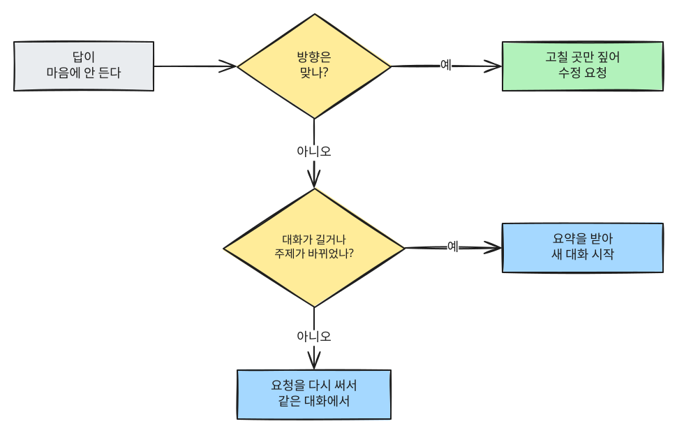

# 第6章 会話を続けながら仕上げる

> **一言まとめ**: AIの最初の答えは完成品ではなく、下書きです。同じ会話の中で直しながら仕上げましょう。
> 会話がこんがらがってきたら、要約を持って新しい会話に移ります。

## AIは会話をどこまで覚えているか

### 同じ会話の中では覚えている

1つの会話画面の中でやりとりした内容は、AIがいっしょに読んで答えます。だから「さっき書いた文章の2つ目の段落だけ短くして」と言えば、
どの文章のことか通じます。

正確に言うと、AIは記憶を「保存」しているわけではありません。**答えるたびに、その会話全体を最初から読み直している**というほうが近いです。
[第1章](01-what-is-llm.md)で見た**コンテキストウィンドウ**（一度に読める文章の量）を思い出してください。会話がその中に収まっている間だけ、前の内容を参考にできます。

このように何度もやりとりする会話を**マルチターン**（multi-turn）会話と呼びます。**ターン**（turn）は、自分が1回話してAIが1回答える、ひとやりとりのことです。

### 新しい会話では基本的に知らない

新しい会話画面を開くと、AIは前の会話を知らない状態で始まります。昨日じっくり説明した自分の事情も、もう一度伝える必要があります。

サービスによっては、前の会話の一部を覚えておく**メモリ**（memory）機能があります。
動作や設定方法はサービスごとに違うので、ステップ2（サービス別ガイド）で扱います。
この章では「新しい会話は最初から」と考えて使ってみてください。

<Quiz id="ch6-memory" />

## 上手に直してもらう言い方

答えが気に入らないとき、いちばんよくある失敗はこう言ってしまうことです。

```
いまいち。書き直して。
```

AIは何がいまいちなのかわかりません。そのため、最初と同じくらいのレベルの別の文章を出してきます。直してもらうときは、3つのことを入れてみましょう。

| 要素 | 問い | 例 |
|---|---|---|
| **どこを** | どの部分が問題か？ | 「3つ目の文」「結論の部分」「全体の口調」 |
| **どのように** | どう変えたいか？ | 「もっと短く」「数字を入れて」「堅苦しくなく」 |
| **何はそのまま** | 守ってほしいことは？ | 「最初の段落はよいのでそのままにして」 |

3つを入れると、こうなります。「いまいち」と違って、直す場所と守る場所がはっきりしています。

```
全体の流れはいいよ。3つ目の段落が長すぎるから、2文に短くして。
最後の文の「ありがとうございます」はそのままにして、ほかの口調は今のまま保ってね。
```

### すぐ使える修正の言い方

| こんなとき | こう言ってみましょう |
|---|---|
| 長すぎる | 「要点だけ残して半分の長さに短くして」 |
| 堅苦しすぎる | 「仲のいい先輩が後輩に話すような感じに変えて」 |
| ありきたりすぎる | 「誰でも言いそうなことは省いて、この状況にだけ当てはまる内容に変えて」 |
| よくわからない | 「この部分を中学生にもわかるように、例を挙げてもう一度説明して」 |
| 根拠が知りたい | 「そう考えた理由を3つ教えて」 |
| 最初の指示を忘れた | 「最初に言った条件（5文以内、丁寧語）をもう一度守って」 |

### 指示は守ったのに役に立たないとき — 目的を伝える

「もっと短くして」と言ったら、本当に短くなりました。ところが大事な内容まで一緒に消えてしまいました。
AIが言葉の文字は守ったのに、意味を取り違えた場合です。

こんなときは、同じことをもっと強く繰り返してもなかなか直りません。代わりに、**何のためにそうするのか**を付け足してみましょう。[^academy-goal]

**いまいちな例**

```
もっと短くして。本当に短く。
```

**よりよい例**

```
もっと短くして。忙しい部長が最後まで読んで、
2つ目の段落の調査結果を覚えてくれるようにするのが目的なんだ。
```

違いは最後の行です。目的がわかれば、AIは何を残して何を省くかを選べます。

「3行で」「表で」は形で、「チームにこの日程を信じてもらう」は目的です（[第4章「良いプロンプトの5要素」](04-prompt-basics.md#良いプロンプトの5つの要素)）。
依頼を送る前に、自分に問いかけてみましょう。形だけ伝えていないか、目的も伝えたか？

<Quiz id="ch6-fix" />

## 再生成、質問の修正、続けて依頼 — いつ何を使うか

ほとんどのサービスには、答えをもらい直す方法が3つあります。ボタンの名前や位置はサービスごとに違うので、ステップ2で画面といっしょにお見せします。

| 方法 | すること | こんなとき |
|---|---|---|
| **続けて依頼** | 今の答えをもとに直してほしいと伝える | 方向は合っていて、一部だけ直せばいいとき |
| **再生成** | 同じ質問で別の答えをもう1つもらう | 質問は問題ないのに、たまたま答えがいまいちだったとき |
| **自分の質問を直す** | 送った質問を編集して送り直す | 最初の質問に足りない情報があったとき |

同じ質問で再生成を押すと、どうして違う答えが出るのでしょうか？ [第1章](01-what-is-llm.md)で見たように、AIは「次に来る言葉」を選ぶとき、
いちばんそれらしい候補の中から**確率的に**選びます。だから同じ質問でも、毎回少しずつ違う答えになります。

### 押し直す前に — 何が問題だったかを見極める

答えがおかしいと、つい再生成から押しがちです。その前に、どんな種類の失敗なのかをまず見極めてみましょう。失敗の種類がわかれば、合った直し方にすぐ進めます。[^academy-diagnose]

- **名前・数字・出典がそれらしいのに怪しい** → 元の資料で確認しましょう（[第9章](09-safety.md#確認する4つの習慣)）。
- **長い会話で最初の条件を忘れた** → 条件をもう一度伝えるか、引き継ぎメモを持って新しい会話に移りましょう（下の[「いつ新しい会話を始めるか」](#いつ新しい会話を始めるか)）。
- **計算が間違っていた** → 計算をコードで実行できるサービスなら、そうしてほしいと頼みましょう。
- **自分の考えに無条件で賛成する** → 反対してもいいと伝えましょう（[第1章](01-what-is-llm.md#_5-あなたの言葉に調子を合わせやすい-—-迎合)）。

上の表のとおり、再生成は、質問は問題ないのに答えがたまたまいまいちだったときに使う方法です。原因が別にあるなら、押し直すより先にその原因を直しましょう。

<Quiz id="ch6-regenerate" />

## いつ新しい会話を始めるか

1つの会話を長く続けると、かえって答えが悪くなることがあります。前に話した内容が、ずっと影響し続けるからです。
たとえば同じ会話でお店のPR文をしばらく作ったあとに履歴書を頼むと、履歴書にPR文のような口調が混じることがあります。



こんなサインが見えたら、新しい会話を始めましょう。

- **話題が変わった** — 旅行の計画を立てていたのに、会社の報告書に移るとき
- **最初の指示を忘れ始める** — 最初に決めた口調や分量を何度も破るとき
- **同じ間違いを繰り返す** — 直してと頼んでも、似たミスが出続けるとき
- **会話がとても長くなった** — スクロールをかなり戻さないと最初が見えないとき

<Quiz id="ch6-new-chat" />

## 新しい会話への移り方 — 要約の引き継ぎ

新しい会話を始めても、これまでに決めたことを捨てる必要はありません。元の会話から**要約をもらって、新しい会話に貼り付けましょう。**
会社で担当者が変わるときの引き継ぎメモと同じです。

**元の会話で**

```
この会話を新しい会話で続けようと思うよ。下の項目で引き継ぎメモを書いて。
- 目標: 何を作っているか
- 決まったこと: ここまでに決めた内容と条件
- 私の好み: 私がいいと言ったもの、嫌だと言ったもの
- 残りの作業: 次にやること
```

**新しい会話で**

```
下は前の会話でまとめた引き継ぎメモだよ。この内容をもとに、「残りの作業」の1つ目から続けてやって。

---
[引き継ぎメモを貼り付け]
---
```

メモは[第5章](05-prompt-patterns.md)の**区切り記号**（`---`）で囲みましょう。そうすればAIが、メモの内容と自分の依頼を取り違えません。

<Quiz id="ch6-handoff" />

## うまくいったプロンプトは保存しておく

何度も直してよい結果が出た依頼は、捨てずにメモ帳に集めておきましょう。次に似たことがあったら、空欄だけ変えてまた使えます。

```
[週報まとめ用]
下は今週の私の業務メモだよ。部長に報告する週報にまとめて。
「完了 / 進行中 / 来週の予定」の3列の表にして、項目ごとに1行で書いて。

---
[今週のメモ]
---
```

このように空欄を残して使い回す依頼を**プロンプトテンプレート**（prompt template）と呼びます。
サービスによっては、こうした指示を保存しておいて毎回自動で適用する機能もあります。これもステップ2で扱います。

<Quiz id="ch6-template" />

## やってみよう

1. 新しい会話で「来週金曜日のチームの飲み会の場所をおすすめして」とだけ頼む。
2. 出てきた答えに**修正の3要素**（どこを、どのように、何はそのまま）を入れて、2回直してもらう。
3. 引き継ぎメモをもらって**新しい会話**に貼り付け、「この条件で予約の問い合わせメッセージを書いて」と続ける。

新しい会話の答えを見て、自分に問いかけてみましょう。先に決めた人数、予算、地域といった条件はそのまま守られているか？

## まとめ

- 同じ会話の中では前の内容をいっしょに読むが、新しい会話は最初から始まる。
- 修正の依頼では「どこを、どのように、何はそのまま」を伝える。
- 話題が変わったり、最初の指示を忘れ始めたりしたら、引き継ぎメモをもらって新しい会話に移る。
- うまくいった依頼はテンプレートとして保存して使い回す。

## 用語まとめ
| 用語 | 読み方 | 一言でいうと |
|---|---|---|
| Multi-turn | マルチターン | 何度もやりとりする会話 |
| Turn | ターン | 1回聞いて1回答える、ひとやりとり |
| Context Window | コンテキストウィンドウ | AIが一度に読める文章の量（[第1章](01-what-is-llm.md)） |
| Memory | メモリ | 前の会話の一部を覚えておくサービスの機能 |
| Regenerate | リジェネレート（再生成） | 同じ質問で別の答えをもらうこと |
| Prompt Template | プロンプトテンプレート | 空欄だけ変えて使い回す依頼のひな形 |

<ChapterDone :chapter="6" />

次の章: [第7章 構造化プロンプト — マークダウン・XMLタグ](07-structured-prompts.md)

---

[^academy-goal]: Claude Academy 「AI capabilities and limitations」講座「Steerability」。"When an instruction is followed literally but uselessly, restate the goal." / "Repeating the instruction with more force won't close the gap." / "Make this shorter. My goal is to keep the executive's attention through the key finding on page two." https://academy.claude.com/courses/ai-capabilities-and-limitations/steerability (確認日 2026-10-26)
[^academy-diagnose]: Claude Academy 「AI capabilities and limitations」講座「When Properties Collide」。"Naming the properties at play points you straight to the fix: verify specifics, re-supply context, offload to code execution, or invite pushback." https://academy.claude.com/courses/ai-capabilities-and-limitations/when-properties-collide (確認日 2026-10-26)
