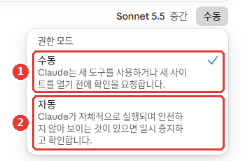
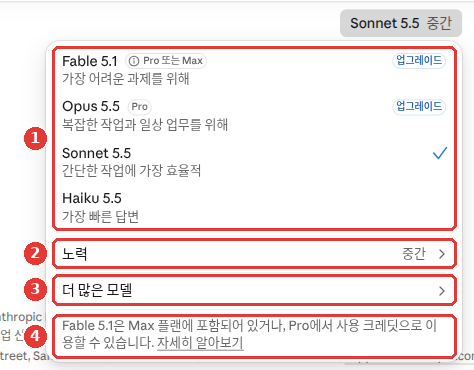
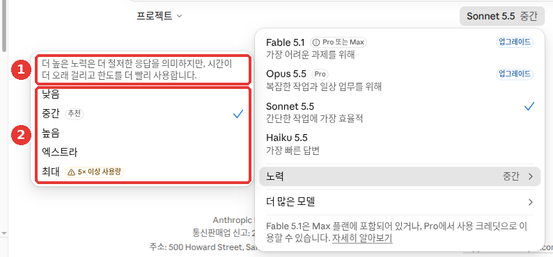
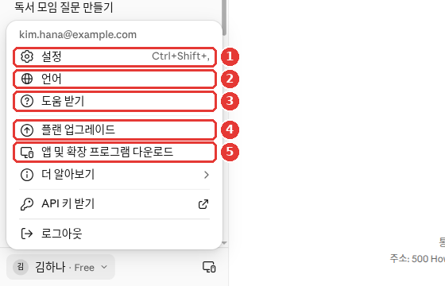
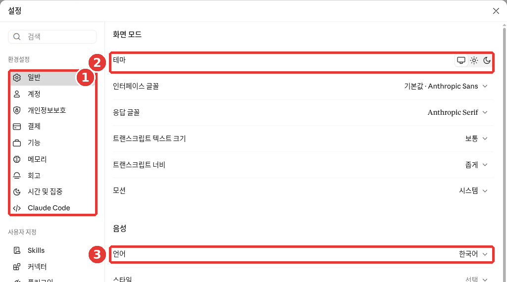

# 第2章 画面を見てみよう — どこに何があるか

> **一言まとめ**: Claudeの画面は、**左のサイドメニュー**（過去のやり取り）、**中央の入力欄**（質問する場所と「+」）、
> **入力欄の下のモデルメニュー**（モデル・労力）、**左下の自分の名前**（設定）の4か所だけ知っていれば大丈夫です。最初は入力欄だけ使えれば十分です。

画面は2026年10月のWeb版を基準にしており、画像は無料プランの韓国語画面です。現在Claudeは新しい画面を順次公開しているため、お使いの画面によって異なる場合があります。自分の画面と名前が違うときは、似た名前のボタンを探してみてください。

## 新しいClaudeの画面と以前の画面

Claudeは現在、**画面を新しくしている途中**です。新しい画面では、ふだんの会話と仕事を丸ごと任せる**Cowork**（コワーク、[第8章](08-cowork.md)）が**1つのやり取りにまとまります。**始める前にモードを選ぶ必要がありません。[^new]

このガイドは**新しい画面**を基準に説明します。このガイドの画像を撮影したアカウントは新しい画面です。下の最初の画面の画像とご自身の画面を見比べてみてください。


名前や会話のタイトルは例として変えた画面です（無料プラン）。**赤い番号は、下の「サイドメニュー」節の表の番号と同じ場所です。**

- ③ 入力欄の周りのどこにも「Chat」「Cowork」の選択がありません。[^screen]
- Web検索をオン・オフするスイッチもありません。[^screen]
- ② 過去のやり取りは「最近の項目（최근 항목）」（Recents）という1つの一覧にまとまっています。[^screen]

ご自身の画面が画像と大きく異なる場合は、下のボックスを開いてみてください。

::: details 以前の画面を使っている場合（クリックして開く）

以前の画面では、ふだんの会話（Chat）とCoworkが分かれていました。新しい画面は、Pro・MaxプランからWeb・パソコンアプリ・スマホアプリへと順番に公開されています。[^new] 同じプランでも、切り替わる時期は人によって異なります。

Pro・Maxプランの方は入力欄を見てください。「Chat」と「Cowork」の選択が見えていれば、まだ以前の画面です。[^new] 無料プランはこの方法では見分けられません。入力欄にこの選択がないからといって、新しい画面だとは限りません。

特別な操作は必要ありません。順番が来れば自然に切り替わります。一度新しい画面に切り替わると、以前の画面に戻すことはできません。[^new]

| 変わる点 | 以前の画面 | 新しい画面 |
|---|---|---|
| 入力欄のモード | 「Chat」・「Cowork」から選ぶ | 選ばない |
| Web検索 | オン・オフのスイッチがある | スイッチはなく、必要に応じて自動で調べる |
| 会話の一覧 | — | 短い質問も長い作業も「Recents」の1か所にまとまる |

出典: Anthropic ヘルプ[^new]

<!-- 스크린샷 필요: 옛 화면 입력창의 「Chat」「Cowork」 선택 (웹, 옛 화면이 남은 Pro·Max 계정) -->

このガイドは新しい画面を基準に説明し、以前の画面と異なる点は、このように折りたたみボックスや脚注で案内します。

:::

<Quiz id="ch202-new-screen" />

## サイドメニュー — 過去のやり取りへ行く道

画面の左側には**サイドメニュー**（サイドバー）があります。過去のやり取りの一覧と、いろいろなメニューがここに集まっています。
上の最初の画面の画像の番号を1つずつ見ていくと、次のようになります。[^screen]

| 番号 | 場所 | 名前 | 役割 |
|---|---|---|---|
| ① | サイドメニューの上 | 「新規作成（새로 만들기）」「検索（검색）」「プロジェクト（프로젝트）」「アーティファクト（아티팩트）」「カスタマイズ（사용자 지정）」 | 新しい会話、会話の検索、各種機能 |
| ② | サイドメニュー | 「ピン留め（고정됨）」「最近の項目（최근 항목）」 | 過去のやり取りの一覧（[第3章](03-chats.md)） |
| ③ | 中央 | 入力欄「今日はどのようなお手伝いをしましょうか？（오늘 어떤 도움을 드릴까요?）」 | 質問を書く場所 |
| ④ | 入力欄の左下 | 「+」 | ファイル・コネクタなどの追加 |
| ⑤ | 入力欄の下の左側 | 「プロジェクト（프로젝트）」 | プロジェクトを選ぶ（[第7章](07-projects-tools.md)） |
| ⑥ | 入力欄の下の右側 | 「Sonnet 5.5 中（Sonnet 5.5 중간）」 | モデル・労力メニュー |
| ⑦ | ⑥の隣 | 「手動（수동）」 | 権限モード |
| ⑧ | 入力欄の右 | マイク・音波の記号 | 音声入力、音声モード（[第10章](10-voice-mobile.md)） |
| ⑨ | 右上 | おばけの形 | シークレットモード（[第3章](03-chats.md)） |
| ⑩ | 左下 | 「キム・ハナ · Free（김하나 · Free）」 | アカウントメニュー（設定・言語・「ヘルプ（도움 받기）」） |

一番上の中央には「無料プラン · アップグレード（무료 플랜 · 업그레이드）」が見えます。あいさつ文は「こんにちは！（안녕하세요!）」や「キム・ハナさん、こんにちは（김하나님, 좋은 오후예요）」のようにその時々で変わります。[^screen]

過去のやり取りは、①「検索」や②の一覧から探してみてください。[^screen][^chats]

::: details ヘルプと名前が違うとき（クリックして開く）
ヘルプでは、過去のやり取り全体を「Chats and tasks」（チャットとタスク）から見ると案内されています。[^chats] このガイドの画面にはそのメニューが見当たりませんでした。[^screen] 画面によって異なる場合があります。
:::

日本語や韓国語の画面・ヘルプにも、英語のまま書かれたメニューがあります（例：「Skills」）。[^new][^screen] 画面に英語が見えても慌てなくて大丈夫です。

サイドメニューは**完全に消すことはできません。**開いたり閉じたりするだけです。[^appearance] 画面が狭く感じるときは閉じておき、過去のやり取りを探すときに開きましょう。

<Quiz id="ch202-sidebar" />

## 入力欄と + メニュー

中央の入力欄に質問を書いて送信ボタンを押すと、会話が始まります。
入力欄の左下にある**「+」ボタン**を押すか、入力欄に**「/」**を打つと、さらに多くの機能やコマンドが出てきます。[^start]


無料プランの画面です。**赤い番号は、下の一覧の番号と同じ場所です。**[^screen]

- ①「ファイルをアップロードまたは追加（파일 업로드 또는 추가）」: パソコンの書類や写真をアップロードします。ファイルを入力欄にドラッグ＆ドロップしても構いません（[第4章](04-files-artifacts.md)）。[^upload]
- ②「Skills」・③「コネクタを追加（커넥터 추가）」・④「デザインシステム（디자인 시스템）」・⑤「プラグインを追加（플러그인 추가）」: Claudeに機能を付け足すメニューです。スキル・コネクタ・プラグインは[第7章](07-projects-tools.md)で扱います。
- ⑥「メモリ（메모리）」: チェックマークがついていればオンの状態です（[第5章](05-memory.md)）。

最初は①の1つだけ知っていれば十分です。

時間をかけて調べてレポートを受け取る**「Research」（リサーチ）**も「+」メニューにあります。入力欄に `/deep-research` と打っても使えます（[第6章](06-search.md)）。[^new] リサーチは有料プランからの機能なので、上の無料アカウントのメニューには表示されませんでした。[^pricing][^screen]

入力欄の下の⑦「手動（수동）」は**権限モード**です。Claudeがどこまで自動で動くかを決めます。無料アカウントにも表示されます。[^screen]



- ①「手動」: 「Claudeは新しいツールを使用したり、新しいサイトを開いたりする前に確認を求めます。」無料アカウントの初期設定です。[^screen]
- ②「自動」: 「Claudeが自律的に実行され、安全でないと思われるものがあれば一時停止して確認します。」[^screen]

Pro・Maxの初期設定は「自動」（Auto）です。[^new] 最初は「手動」にしておくほうが安心です。新しいツールを使ったり新しいサイトを開いたりする前に、まず尋ねてくれるからです。メッセージの送信のように影響が大きい仕事を任せるときは、そばで見守るようにしましょう。詳しい説明は[第8章](08-cowork.md#確認の方式を選ぶ-—-権限モード)にあります。[^new]

メニューをすべて覚える必要はありません。何ができるのかわからないときは、Claudeに直接聞いてみましょう。

```
今この画面であなたに頼めることを5つだけ教えて。それぞれどうやってお願いすればいいか、例文も1つずつ添えてね。
```

<Quiz id="ch202-plus" />

## モデルメニュー — モデル・労力・思考を選ぶ

Webとパソコンアプリでは、**入力欄の下**に今使っているモデルの名前と労力が表示されます（最初の画面の画像の⑥「Sonnet 5.5 中（Sonnet 5.5 중간）」）。スマホアプリでは画面の上部に表示されます。[^start][^screen]
この名前を押すと**モデルメニュー**が開きます。ヘルプでは、ここで3つのことを決めると案内されています。[^model]

| 決めること | 意味 |
|---|---|
| **モデル** | どのClaudeと会話するか |
| **労力**（Effort） | 1つの回答にどれくらい力を注ぐか |
| **思考**（Thinking） | 答える前にじっくり考える段階を踏むか |



無料プランの画面です。**赤い番号は、下の一覧の番号と同じ場所です。**[^screen]

- ① モデル一覧: 無料アカウントはSonnet 5.5とHaiku 5.5だけ選べます。Fable 5.1とOpus 5.5の隣には「アップグレード（업그레이드）」がついています。
- ②「労力（노력）」: 1つの回答にどれくらい力を注ぐかを決めます（下の「労力」を参照）。
- ③「その他のモデル（더 많은 모델）」: 一覧にないモデルを表示します。
- ④ 案内: 「Fable 5.1はMaxプランに含まれているか、Proで使用クレジットとして利用できます。」

この無料アカウントのメニューには、**思考のスイッチは別に見当たりませんでした。**②「労力」だけがありました。[^screen] 思考のスイッチは、プランやモデルによって表示される場合があります。

会話の途中でもいつでも変えられます。変更した設定は**次の回答から**反映されます。[^model]

### モデルを選ぶ

Claudeには、大きさや得意分野が違うモデルがいくつもあります。モデル名を押せば切り替えられますし、一覧にないモデルは「その他のモデル」（More models）にあります。[^model]

モデルの名前はよく変わります。2026年だけでも新しいモデルが何度も登場しました。[^rn] そのため、このガイドではモデルを**役割**で呼びます。2026年10月26日時点の名前と、プランごとに使えるかどうかは次のとおりです。

| 役割 | 名前（シリーズ） | Free | Pro | Max |
|---|---|---|---|---|
| 最も性能が高いモデル | Fable | なし | 使用クレジットのみ | 週間上限の50%まで |
| 大きいモデル | Opus | なし | あり | あり |
| 速いモデル | Sonnet | あり | あり | あり |
| 最も小さくて速いモデル | Haiku | あり | あり | あり |

出典: Anthropic 料金ページ・ヘルプ[^pricing][^fable][^rn]

**使用クレジット**（Usage credits）とは、プランの上限とは別に、使った分だけ料金を払う利用枠のことです。Proでは最も性能が高いモデルがプランの上限に含まれていないため、最初からこのクレジットでのみ使います。[^fable]
Maxの「50%まで」は、上限が増えるという意味ではありません。ほかのモデルと**同じ週間上限を分け合い**、そのうちの半分までを最も性能が高いモデルに使えるという意味です。[^fable]

モデルは一覧からなくなることもあります。Anthropicはこれまで、ほとんどのモデルを登場から約1年後に終了してきました。[^persona] 新しいモデルに変わって話し方に違和感があるときは、気に入っていた過去のやり取りを見せながら、次のように頼んでみてください。[^persona]

```
私が気に入っていた過去のやり取りをいくつか見て、これからあなたに伝える指示文を自分で書いてみて。
話し方や回答の長さ、形式についての私の好みが伝わるようにまとめてね。
```

### 労力 — どれくらい力を注ぐか

**労力**（Effort）が高いほど、回答が丁寧になります。その代わり時間がかかり、利用上限にも早く達します。[^model]



無料プランの画面です（Sonnet 5.5）。①の案内文は次のとおりです。「より高い労力はより徹底した回答を意味しますが、時間が長くかかり、上限をより早く消費します。」[^screen]
②の段階は5つあります。

| 労力 | 向いている仕事 |
|---|---|
| 「低（낮음）」・「中（중간）」 | 日常的な作業 |
| 「高（높음）」 | 品質と速さのバランス |
| 「エクストラ（엑스트라）」 | 時間のかかるコーディング、複数の段階を自動で進める作業 |
| 「最大（최대）」 | 最も深い分析が必要な仕事 |

出典: Anthropic ヘルプ[^model]、段階の名前は画面[^screen]

「最大」の隣には「5×以上の使用量（5× 이상 사용량）」という警告がついています。使用量が5倍以上かかる場合があるという印なので、どうしても必要なときだけ選びましょう。[^screen]

モデルごとに推奨される労力には印がついています。この画面では「中」の隣の「おすすめ（추천）」です。[^model][^screen] ふだんはそのままにしておけば大丈夫です。

::: details ヘルプと名前が違うとき（クリックして開く）
- ヘルプでは、モデルメニューの場所を「送信ボタンの隣」と呼んでいます。[^model]
- ヘルプでは、「エクストラ」を「非常に高い」（Extra high）と呼んでおり、一部のモデルにのみあるとしています。[^model]
- 画面の「おすすめ」表示を、ヘルプでは「デフォルト（기본값）」と呼んでいます。[^model]
:::

### 思考 — 答える前にじっくり考えるか

**思考**（Thinking）をオンにすると、Claudeが答える前に問題を細かく分け、方法を計画し、いくつかの筋道を検討します。[^model] これを**拡張思考**（extended thinking）とも呼びます。[^start]
ヘルプで案内されているオン・オフの切り替え方は次のとおりです。モデル名を押し、「労力」の上にマウスを乗せたあと、「思考（사고）」（Thinking、または「拡張（확장）」）のスイッチをオンまたはオフにします。[^model]
このスイッチは、プランやモデルによって表示される場合があります。このガイドの無料アカウントのメニューには表示されませんでした。[^screen] スイッチがない場合は、この節は読むだけにしておいてください。
思考と労力は**別々に決める設定**です。どの組み合わせでも使えます。[^model] 最新のモデルの中には、思考をオフにできないものもあります。[^model]

思考をオンにすると、回答しているあいだ時間が経過する「思考（사고）」表示が見えます。回答の上の「思考」欄を押すと、Claudeがどのように考えたのか要約を見ることができます。[^model]
この要約を読めば、Claudeがどのような筋道で結論に至ったのかを確認できます。
まれに思考が途中で途切れ、残りは表示できないという案内が出ることがあります。そのようなときは、質問の切り口を変えてみてください。[^model]

### いつ上げるか

**日常的な作業は初期設定のままで十分です。**[^model] 数学の計算、長い文書の分析、いくつもの段階を踏む問題なら、労力を上げるか思考をオンにしてみてください。[^model]
どの設定を選ぶにしても、**問題を具体的に書くこと**が一番大切です（[ステップ1 第4章](../00-common/04-prompt-basics.md#良いプロンプトの5つの要素)）。[^model]

同じ質問を、労力だけ変えて聞いてみましょう。素早い回答と力を注いだ回答の違いをすぐに実感できます。

```
月給300万ウォンの会社員が3年以内に2,000万ウォンを貯めるには毎月いくら貯金すればいいか、
積立定期の利息を考えた場合と考えない場合に分けて、計算の過程を見せて。
```

::: details 返ってくる回答は大体こんな感じ（例 — クリックして開く）
このガイドが作成した例です。実際の回答はサービスやその時々によって異なります。

> **1. 利息を考えない場合**
> - 3年は36か月です。
> - 2,000万ウォン ÷ 36か月 = 約55万5,556ウォン
> - 月給300万ウォンの約18.5%です。
>
> **2. 積立定期の利息を考えた場合**
> - 年利を○%と仮定して計算します。
> - 最初の月に入れたお金には36か月分、2か月目のお金には35か月分…最後の月のお金には1か月分の利息がつきます。
> - 元本の合計（毎月入れるお金 × 36）と利息の合計（○○ウォン）を足して2,000万ウォンになる金額を求めます。
> - 毎月約○○万ウォンで済みます。利息がつく分、1番より少し少なくなります。
>
> 実際の金利は商品ごとに異なるため、申し込む商品の金利でもう一度計算してみてください。

**うまく回答が返ってきたか確認してみましょう**: 2つの場合に分けてくれたか？ 計算の過程が1行ずつ見えるか？ 金利を何%と仮定したか書いてあるか？ 1番は電卓で一度自分で割ってみましょう。

:::

<Quiz id="ch202-model-menu" />

## 会話の途中でモデルが切り替わったという通知

ときどき**「モデルが切り替わりました」という通知**が出ることがあります。最も性能が高いモデルをはじめとするいくつかのモデルは、質問に対して自動で安全チェックを行います。ごく限られた危険な分野だと判断すると、別のモデルに引き継いで回答させます。[^switch]
このように引き継ぐことを**フォールバック**（fallback、代わりに引き受けるモデルへ回すこと）といいます。攻撃用のハッキング技術や、ウイルス・毒性といった生物学的な危険分野などがその対象です。[^switch] ほとんどの質問は影響を受けません。

モデルが切り替わると、次のようになります。[^switch]

- **通知が出て、回答には答えたモデルの名前がつきます。**自動切り替えは初期設定でオンになっています。
- **その会話が終わるまで、切り替わったモデルのままになります。**元のモデルに手動で戻すことはできます。ただし、問題となった内容が会話に残っていると、また切り替わることがあります。前のメッセージを直してから送り直してみてください。
- **自分が入力していない内容のせいで切り替わることもあります。**チェックでは、メモリ、連携したアプリ、Web検索の結果、アップロードしたファイルまで一緒に確認されます。

自動切り替えが嫌な場合は、設定 →「機能（기능）」（Capabilities）で「メッセージがフラグ付けされたらモデルを切り替える（메시지가 플래그 지정되면 모델 전환）」（Switch models when a message is flagged）をオフにしてください。[^screen] オフにすると、モデルが切り替わる代わりに会話が一時停止し、自分で選ぶようになります。[^switch]
問題のない質問なのに誤って引っかかったと思われる場合は、「フィードバックを送信（피드백 보내기）」（Send feedback）から知らせてください。[^switch]

<Quiz id="ch202-fallback" />

## 設定画面 — 言語と画面の見た目

左下の自分の名前（最初の画面の画像の⑩）を押すと、アカウントメニューが開きます。[^signup][^screen]



名前とメールアドレスは例として変えた画面です（無料プラン）。**赤い番号は、下の一覧の番号と同じ場所です。**[^screen]

- ①「設定（설정）」: 設定画面を開きます。
- ②「言語（언어）」: 画面の言語を変えます。
- ③「ヘルプ（도움 받기）」: カスタマーサポートに問い合わせます（[第1章](01-getting-started.md#うまくいかないときにまず試すこと)）。[^support]
- ④「プランをアップグレード（플랜 업그레이드）」: 有料プランに切り替えます（[第1章](01-getting-started.md#有料に切り替える前に知っておくこと)）。
- ⑤「アプリと拡張機能をダウンロード（앱 및 확장 프로그램 다운로드）」: パソコンアプリやスマホアプリなどを入手します。

①「設定」を押すと設定画面が開きます。左側にメニューが縦に並んでいます。



無料プランの画面です。**赤い番号は、下の本文の番号と同じ場所です。**[^screen]

① 左メニューのうち、最初は下のいくつかだけ知っていれば大丈夫です。[^screen]

| 設定メニュー | ここで行うこと | 詳細 |
|---|---|---|
| 「一般（일반）」 | テーマ（ライト・ダーク）、フォント、音声の言語 | この章 |
| 「アカウント（계정）」 | 自分の名前、「Claudeへの指示（Claude 지침）」、ログイン中の端末 | [第3章](03-chats.md)、[第5章](05-memory.md) |
| 「プライバシー（개인정보보호）」 | 共有した会話、データのエクスポート | [第3章](03-chats.md)、[第9章](09-privacy.md) |
| 「請求（결제）」 | プランの変更、解約、領収書 | [第1章](01-getting-started.md#有料に切り替える前に知っておくこと) |
| 「機能（기능）」 | モデルの自動切り替え | この章 |
| 「メモリ（메모리）」 | Claudeが記憶している内容 | [第5章](05-memory.md) |
| 「時間と集中（시간 및 집중）」 | 休憩のリマインダー、おやすみ時間 | [第5章](05-memory.md#休憩の通知と通知なしの時間) |

出典: 画面[^screen]、Anthropic ヘルプ[^cancel][^switch][^sessions][^share]

すべての会話に適用する指示は、「アカウント」の中の「Claudeへの指示（Claude 지침）」に書きます。[^screen]
有料プランには、残りの利用枠を確認する「使用量（사용량）」（Usage）画面もあります（[第1章](01-getting-started.md#利用上限-—-5時間・週間・長さ)）。[^best] この無料アカウントの設定メニューには表示されませんでした。[^screen]

**画面の言語を変える**: アカウントメニューの②「言語」から選びます。[^lang][^screen] Webとパソコンアプリは、日本語や韓国語を含む11の言語で使えます。[^lang]
画面の言語に関係なく、Claudeは**あなたが使った言語で答えます。**画面が英語でも、日本語で尋ねれば日本語で答えます。[^lang]
音声モードで使う言語は別に決めます。設定 →「一般」→「音声」の③「言語」から選びます（[第10章](10-voice-mobile.md)）。[^screen]

**暗い画面（ダークモード）を使う**: 設定 →「一般」→「画面モード」の②「テーマ」で、システム・ライト・ダークのアイコンの中から1つを押します。[^screen] システムを選ぶと、パソコンやスマホの設定に合わせます。[^appearance]
文字が読みにくいときは、同じ場所にある「インターフェースフォント（인터페이스 글꼴）」や「応答フォント（응답 글꼴）」を変えてみてください。[^screen] ヘルプでは、フォントとして「ディスレクシア対応（난독증 친화적）」も選べると案内されています。画面によって異なる場合があります。[^appearance]

::: details ヘルプと名前が違うとき（クリックして開く）
設定メニューの名前は、画面によって異なる場合があります。

- ヘルプでは、すべての会話に適用する指示が新しい設定画面の「Your Claude」にあると案内されています。[^new] このアカウントには「Your Claude」が見当たらず、「アカウント」の中の「Claudeへの指示」がその場所でした。[^screen]
- 音声の言語について、ヘルプでは設定 →「機能」→ 音声 →「話し言葉（음성 언어）」と案内されています。[^lang]
:::

<Quiz id="ch202-settings" />

## やってみよう

1. 最初の画面の画像と自分の画面を見比べてみる。大きく違う場合は「以前の画面を使っている場合」のボックスを開いて読む。
2. 入力欄の「+」ボタンを押してメニューの項目を1つずつ読んでみて（押さなくても大丈夫です）、閉じる。
3. 入力欄の下のモデル名を押して、今のモデルと、労力で「おすすめ」がついている段階がどれかを確認する。
4. 上の貯金計算の質問を、労力「低」で1回、「高」で1回送って回答を見比べる。思考スイッチが見える場合は「思考」欄を押して要約も読んでみる。
5. 設定 →「一般」の「テーマ」をダークに変えてみて、気に入ったほうに戻す。

## まとめ

- 新しいClaudeの画面では、チャットとCoworkが1つのやり取りにまとまっており、モードを選ばない。このガイドは新しい画面が基準である（以前の画面の案内は折りたたみボックスに記載）。
- サイドメニューには過去のやり取りがあり、左下の自分の名前には設定・言語・「ヘルプ」・「プランをアップグレード」がある。サイドメニューは消すことができず、開閉のみできる。
- 入力欄の「+」や「/」でファイルのアップロードやリサーチなどの機能を開く。入力欄の下の「手動」・「自動」は権限モードである。
- 入力欄の下のモデルメニューでモデル・労力を決める（思考スイッチはプラン・モデルによって表示される）。無料プランはSonnet・Haikuのみ選べる。日常的な作業はおすすめの値のままで十分である。
- 危険な分野と判断された質問は、別のモデルが代わりに答えることがある。通知とモデルのラベルでわかり、設定 →「機能」からオフにできる。
- 画面の言語はアカウントメニューの「言語」、暗い画面やフォントは設定 →「一般」で変える。設定メニューの名前は画面によって異なる場合がある。

## 用語集

| 用語 | 読み方 | 一言での意味 |
|---|---|---|
| Cowork | コワーク | 複数段階の仕事を丸ごと任せる機能（[第8章](08-cowork.md)） |
| Sidebar | サイドバー（サイドメニュー） | 画面の左側に縦に並んだメニュー |
| Recents | リセンツ | 最近の会話と作業の一覧 |
| Effort | エフォート（労力） | 1つの回答にどれくらい力を注ぐかを決める設定 |
| Extended Thinking | エクステンデッド・シンキング（拡張思考） | 答える前にじっくり考える段階を踏むこと |
| Usage Credits | ユーセージ・クレジット（使用クレジット） | プランの上限とは別に、使った分だけ料金を払う利用枠 |
| Fallback | フォールバック | 安全チェックに引っかかった質問を、別のモデルが代わりに引き受けて答えること |
| Dyslexic Friendly | ディスレクシック・フレンドリー（ディスレクシア対応） | 文字が読みにくい人のためのフォント |

<ChapterDone :chapter="202" />

次の章: [第3章 会話の管理](03-chats.md)

[^screen]: Claude Web画面（無料プラン、韓国語）で直接確認。入力欄「今日はどのようなお手伝いをしましょうか？（오늘 어떤 도움을 드릴까요?）」の周りに「Chat」「Cowork」の選択とWeb検索スイッチなし、サイドメニュー「ピン留め（고정됨）」「最近の項目（최근 항목）」、「+」メニュー「ファイルをアップロードまたは追加（파일 업로드 또는 추가）」「Skills」「コネクタを追加（커넥터 추가）」「デザインシステム（디자인 시스템）」「プラグインを追加（플러그인 추가）」「メモリ（메모리）」、「権限モード（권한 모드）」「手動（수동）」・「自動（자동）」、モデルメニュー（無料はSonnet 5.5・Haiku 5.5のみ選択、思考スイッチなし）、労力「低（낮음）」「中（중간）」（おすすめ）「高（높음）」「エクストラ（엑스트라）」「最大（최대）」、アカウントメニュー、設定 →「一般（일반）」の「テーマ（테마）」・「音声（음성）」→「言語（언어）」、設定 →「アカウント（계정）」の「Claudeへの指示（Claude 지침）」、設定 →「機能（기능）」の「メッセージがフラグ付けされたらモデルを切り替える（메시지가 플래그 지정되면 모델 전환）」。(確認日 2026-10-26)
[^new]: Anthropic ヘルプ、「Claude Cowork and chat are one Claude」。"With the new Claude experience, you ask for all of it in the same conversation, with no mode to choose." / "The new Claude experience is rolling out gradually, starting with Pro and Max plans on web, desktop, and mobile." / "If you're on a Pro or Max plan and your message box still shows "Chat" and "Cowork" options, you don't have it yet." / "One conversation list: Your quick questions and longer tasks live together in Recents." / "Web search: There's no web search toggle. Claude searches the web when it helps." / "Research: Type /deep-research, or click the “+” button below the chat input, then choose “Research.”" / "Auto (default on Pro, Max, and Team plans): Claude keeps working without stopping to ask about each step, and automated safety checks run before it takes an action." / "For work with real consequences, like sending messages or changing important files, stay close and review what Claude does." / "Instructions for Claude: Set preferences that apply to every conversation in Settings > Your Claude (or Settings > Account in the older Settings layout)." https://support.claude.com/en/articles/16761823 (確認日 2026-10-26)
[^chats]: Anthropic ヘルプ、「Delete or rename a conversation」。"Find the conversation in the left sidebar, or click "Chats and tasks" to see your full chat history." https://support.claude.com/en/articles/8230524 (確認日 2026-10-26)
[^support]: Anthropic ヘルプ、「How to get support」。"Click your initials or name in the lower left corner and select “Get help” from the menu." https://support.claude.com/en/articles/9015913 (確認日 2026-10-26)
[^appearance]: Anthropic ヘルプ、「Customizing your appearance settings」。"Select from Light, Match System, and Dark under Color mode." / "Select from Default, Match System, and Dyslexic Friendly." / "It's not currently possible to completely disable the sidebar." https://support.claude.com/en/articles/8887527 (確認日 2026-10-26)
[^start]: Anthropic ヘルプ、「Get started with Claude」。"You can click the "+" button in the lower left or type "/" to view additional options and commands" / "displayed either below your text input (on web and desktop) or at the top of your screen (on mobile)." / "You can also choose how much effort Claude puts into each response and whether it uses extended thinking." https://support.claude.com/en/articles/8114491 (確認日 2026-10-26)
[^upload]: Anthropic ヘルプ、「Upload files to Claude」。"Click the \"+\" button in the lower left corner of the chat box" https://support.claude.com/en/articles/8241126 (確認日 2026-10-26)
[^model]: Anthropic ヘルプ、「Change the model, effort, and thinking settings」。"The model menu next to the send button controls three settings: which Claude model you're chatting with, how much effort it puts into each response, and whether it uses thinking." / "The selected model and effort level appear next to the send button." / "Click "More models" to view additional options." / "You can change the model, effort level, or thinking setting at any point in a conversation. Changes apply starting with Claude's next response." / "Higher effort means more thorough responses, but they take longer and use more tokens, so you'll reach your usage limits faster." / "Each model has a recommended effort level, marked as "Default" in the menu:" / "Extra high (xhigh) is designed for long-running coding and agentic tasks" / "Thinking lets Claude spend more time breaking down problems, planning solutions, and exploring different approaches before responding." / "Thinking and effort are separate settings, and you can use any combination of the two." / "Switch the "Thinking" (or “Extended”) toggle on or off." / "Click the "Thinking" section to view Claude's thought process summary and problem-solving approach." / "Occasionally, you may notice that Claude's thinking stops before it's complete, with a message stating that the rest of Claude's thought process is not available." / "For everyday tasks, the defaults work well." / "Whichever settings you choose, be specific about your problem or question." 思考をオフにできないモデルの一覧は、英語版と韓国語版で少し異なる。 https://support.claude.com/en/articles/8664678 (確認日 2026-10-26)
[^rn]: Anthropic ヘルプ、「Release notes」（2026年の項目）。"We just launched Claude Haiku 5.5, the cheapest, fastest, and most capable small model we’ve released" / "Sonnet 5.5 is a faster, lower-cost complement to Claude Opus 5.5." / "It performs at the level of Claude Fable 5.1 on most work and costs 40% less to run than Opus 5." / "We just launched Claude Fable 5.1 and Claude Mythos 5.1, the world’s most advanced models for coding and knowledge work." https://support.claude.com/en/articles/12138966 (確認日 2026-10-26)
[^pricing]: Anthropic 料金ページ。モデル比較表のFable行 " No Usage credits 50% of weekly limits* 50% of weekly limits* "（列 = Free/Pro/Max 5x/Max 20x）、Opus行はFreeなし、Sonnet・Haiku行はFreeあり。Research行はFreeなし、Proからあり。 https://claude.com/pricing (確認日 2026-10-26)
[^fable]: Anthropic ヘルプ、「Claude Fable models on your plan」。"On Pro plans, standard seats on Team plans, and standard seats on seat-based Enterprise plans, Fable models run on pay-as-you-go usage credits from the start, since they aren’t included in your plan's usage limits." / "No. You can use up to 50% of your weekly limit on Fable models, but your use of other models draws from the same usage limits and you can never use more than your weekly limit." https://support.claude.com/en/articles/15424964 (確認日 2026-10-26)
[^persona]: Anthropic ヘルプ、「Adapt to new model personas after deprecations」。"historically Anthropic has deprecated most models around a year after their initial release." / "you can ask Claude to review some of the conversations you’ve most appreciated and to craft instructions for itself based on those." https://support.claude.com/en/articles/12738598 (確認日 2026-10-26)
[^switch]: Anthropic ヘルプ、会話中にモデルが切り替わった理由を説明するドキュメント（ドキュメントのタイトルに現在のモデル名が入っているため、このガイドには記載しない）。"Offensive cybersecurity techniques, such as building exploits, malware, or attack tooling." / "so a block can be triggered by content you didn't type." / "You’ll see a notice explaining that the model switched, and the response will be labeled with the model that answered." / "Editing your previous message before retrying often helps." / "With automatic model switching off, a blocked request pauses the conversation instead of switching models." / "Use "Send feedback" to report it." https://support.claude.com/en/articles/15363606 (確認日 2026-10-26)
[^signup]: Anthropic ヘルプ、「How do I sign up for the Pro plan?」。"Navigate to Settings > Billing and click the “Upgrade plan” button." 設定は左下の名前の頭文字（または名前）→「設定（설정）」から開く。 https://support.claude.com/en/articles/8325609 (確認日 2026-10-26)
[^cancel]: Anthropic ヘルプ、「Cancel your Pro or Max subscription」。"Navigate to Settings > Billing and click the “Cancel” button." https://support.claude.com/en/articles/8325617 (確認日 2026-10-26)
[^best]: Anthropic ヘルプ、「Usage limit best practices」。"you can navigate to Settings > Usage to view progress bars showing how much of your five-hour session and weekly usage limits you’ve consumed." https://support.claude.com/en/articles/9797557 (確認日 2026-10-26)
[^lang]: Anthropic ヘルプ、「How to use Claude in your preferred language」。"Claude is available in multiple languages on web and desktop applications." / "Go to the "Language" section." / "Claude will converse with you in the language you use." / "go to Settings > Capabilities, then find Voice > Spoken language and choose a language." https://support.claude.com/en/articles/10769299 (確認日 2026-10-26)
[^sessions]: Anthropic ヘルプ、「Managing your active sessions」。"Scroll to the Active sessions section (called Where you're logged in in the updated Settings layout)." https://support.claude.com/en/articles/13124001 (確認日 2026-10-26)
[^share]: Anthropic ヘルプ、「Share a chat with specific people」。"You can also review everything you've shared from Settings > Privacy under Shared chats." https://support.claude.com/en/articles/16762496 (確認日 2026-10-26)
