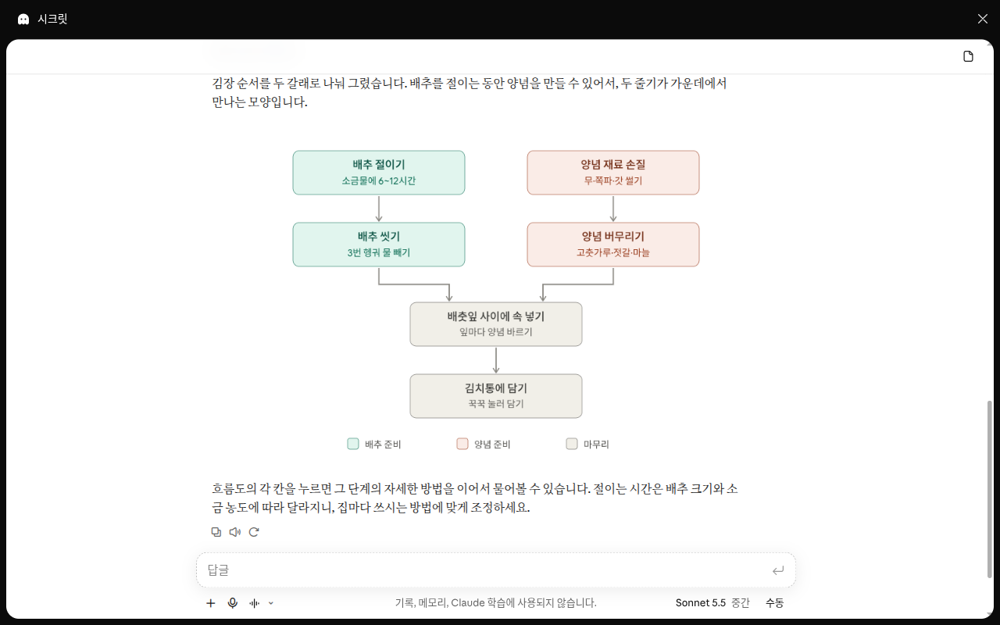

# 第4章 ファイルとアーティファクト — 見せる、作ってもらう

> **一言まとめ**: 言葉で説明しにくい資料は**ファイルとしてアップロード**して見せましょう。必要な文書・表・発表資料は、**ファイルとして作ってもらう**ことができます。
> 人に見せられる成果物は、会話の横に**アーティファクト**として開き、直したり共有したりできます。ただし、Claudeは写真やイラストは作りません。

画面は2026年10月のWeb版を基準にしています。新しいClaudeの画面と新しい設定画面が順次配信されているため、お使いの画面によって表示が異なる場合があります。スマホアプリは、使える機能が少し異なります。

## ファイルをアップロードする

入力欄の左下にある「+」ボタンを押し、①「ファイルのアップロードまたは追加（파일 업로드 또는 추가）」を選びます。キーボードではCtrl+Uです。[^screen] ファイルを入力欄にドラッグ＆ドロップしてもかまいません。写真はコピーして、そのまま貼り付けることもできます。[^upload]


無料プランの画面です。**ファイルをアップロードするときは、①だけ使えば大丈夫です。**[^screen][^upload-name] ⑥「メモリ（메모리）」は[3章](03-chats.md)と[5章](05-memory.md)で見ていきます。

アップロードできるものは次のとおりです。[^upload]

| 種類 | 形式 |
|---|---|
| 写真 | JPEG、PNG、GIF、WebP |
| 文書 | PDF、Word（DOCX）、テキスト（TXT）、RTF、ODT、EPUB、HTML |
| 表 | Excel（XLSX）、CSV |
| その他 | JSON |

Excelファイル（XLSX）は、設定で「コードの実行とファイル作成（코드 실행 및 파일 생성）」がオンになっていないとアップロードできません。この設定は次の節で見ます。[^upload]

ファイルをアップロードして「見て」と言うだけではなく、何がほしいのかを一緒に書いてみましょう。ずっと役に立つ答えが返ってきます（[ステップ1 第4章](../00-common/04-prompt-basics.md#良いプロンプトの5つの要素)）。

```
添付したPDFは、うちのマンションの管理費の請求書です。
先月より大きく上がった項目を3つ探して表で見せて、なぜ上がったと考えられるかを1行ずつ書いてください。
確実でない内容には「推測」と書いてください。
```

::: details 返ってくる答えはだいたいこんな感じ（例 — クリックして開く）
このガイドが作った例です。実際の答えは、サービスやそのときによって変わります。

> 先月より大きく上がった項目は次の3つです。
>
> | 項目 | 先月 | 今月 | 上がった理由 |
> |---|---|---|---|
> | 暖房費 | ○○円 | ○○円 | 寒くなって暖房を多く使った可能性があります（推測） |
> | 電気代 | ○○円 | ○○円 | 共用部分の電気使用が増えた可能性があります（推測） |
> | 修繕維持費 | ○○円 | ○○円 | （請求書のお知らせに書かれた理由） |

**うまくいったか確認しましょう**: 大きく上がった3項目が表で届いたか？ 表の金額は自分の請求書と同じか？ 理由が1行ずつ書かれていて、請求書に根拠のない理由には「推測」がついているか？

:::

知っておきたい点です。[^upload]

- **1つの会話に20個までアップロードできます。**
- **PDFは1,000ページまでです。** 100ページ以下なら、図やグラフまで読みます。101ページ目からは文字だけを読みます。図が大事なPDFなら、必要なページだけ切り出してアップロードしてみましょう。
- **PDF以外の文書は文字だけを読みます。** Wordファイルの中に入れた図は読めません。図が大事なら、PDFに変換してアップロードしましょう。
- **写真は縦横1,000ピクセル以上がおすすめです。**
- **PDFのページ数は、画面のページ番号で伝えましょう。** 文書に印刷されている番号ではなく、PDFビューアに表示される番号です。

大きなファイルがアップロードできないときは、分けてアップロードしてみましょう。

::: details ファイル1つは何MBまでアップロードできますか？（クリックして開く）
ファイル1つのサイズ上限は、文書によって書かれ方が違います。ファイルのアップロードに関するヘルプでは、1ファイルあたり500MBと書かれています。[^upload] ファイル作成機能のヘルプでは、アップロードもダウンロードも1ファイルあたり30MBと書かれています。[^create]
:::

> 身分証、契約書、診療記録のような個人情報を含むファイルは、アップロードする前に隠すか、取り除きましょう。原則は[ステップ1 第9章](../00-common/09-safety.md#_2-個人情報と秘密-—-入れる前に一度考える)で扱いました。

<Quiz id="ch204-upload" />

## ファイルを作ってもらう — Excel・Word・PowerPoint・PDF

Claudeは、答えを文章だけで返すのではなく、**ファイルにして**渡すこともできます。ダウンロードすることも、Google Driveにそのまま保存することもできます。[^create]

| 作れるファイル | 例 |
|---|---|
| Excel（.xlsx） | 家計簿、スケジュール表 |
| Word（.docx） | お知らせ、報告書 |
| PowerPoint（.pptx） | 発表資料 |
| PDF | 印刷用の文書 |
| PNG画像 | 数字から描いたグラフ |

無料プランを含むすべてのプランで使えます。Web・デスクトップ・スマホアプリのどれでも使えます。[^create] 数式が生きている表ファイル（スプレッドシート）や、PowerPointで開ける発表資料も作れます。[^new]

**まず、設定がオンになっているか確認しましょう。** 個人向けプラン（Free・Pro・Max）は、最初からオンになっています。[^create] オフになっている場合は、「設定 > 機能（설정 > 기능）」（Capabilities）で④「コードの実行とファイル作成（코드 실행 및 파일 생성）」をオンにしてください。[^create][^create-name]


無料プランの画面です。**赤い番号は、下の表の番号と同じ場所です。**[^screen]

| 番号 | 名前 | 働き |
|---|---|---|
| ① | 「メッセージがフラグ付けされたらモデルを切り替え（메시지가 플래그 지정되면 모델 전환）」 | 安全装置が働いたとき、別のモデルで続ける |
| ② | 「アーティファクト（아티팩트）」 | 会話の横の画面に成果物を作る |
| ③ | 「チャット内の視覚化（채팅 내 시각화）」 | 会話の中にグラフ・図を描く |
| ④ | 「コードの実行とファイル作成（코드 실행 및 파일 생성）」 | 文書・表・発表資料・PDFを作る |

②「アーティファクト」の下には、「コードの実行とファイル作成に必要」と書かれています。④の下には「Skillsの使用に必要です」と書かれています。[^screen] ファイルを作ってもらうには、④がオンになっているかどうかだけ確認すれば大丈夫です。

頼むときは、ほしい構成と内容、書式を具体的に書きましょう。[^create]

```
月ごとの生活費を記録するExcelの表を作ってください。
項目は食費、交通費、通信費、その他にして、いちばん下に項目別の合計と月の合計が自動で計算されるようにしてください。
```

すでにあるファイルをアップロードして、直してもらうこともできます。

```
添付したWordファイルは、町内の読書会のお知らせです。
日付を11月14日土曜日の午後2時に変えて、持ち物リストをいちばん下に追加し、Wordファイルとして作り直してください。
```

知っておきたい点です。

- **ファイル作成は、ふつうの会話より使用量を多く使います。**[^create] 使用上限は[1章](01-getting-started.md)で見ました。短い質問は文章で受け取り、どうしてもファイルが必要なときにファイルで受け取りましょう。
- **受け取った数字は確認しましょう。** Claudeは計算をしますが、複雑な計算や重要な計算は、別の計算ソフトや手計算でもう一度確認してください。[^math] 合計をいくつかだけでも、自分で足してみましょう。
- **アップロードしたファイルやウェブサイトに、隠れた指示が入っていることがあります。** この機能を使っている間はClaudeの動きを見守り、見当違いの資料を使い始めたら止めましょう。[^create] 隠れた指示は[ステップ1 第9章](../00-common/09-safety.md#_4-隠れた指示-—-プロンプトインジェクション)で扱いました。

<Quiz id="ch204-create" />

## アーティファクト — 会話の横に開く成果物

**アーティファクト**（artifact、作り出された成果物）は、人に見せられる成果物です。文書、発表資料、デザイン、小さなツールなどがあります。会話の横の画面に開き、直したり、あとでまた開いたり、ほかの人と共有したりできます。[^artifacts]
無料プランを含むすべてのプランで使えます。前の節の「コードの実行とファイル作成」がオンになっている必要があります。[^artifacts]

前の節のファイル作成と混同しやすいところです。違いは、受け取り方です。[^academy-artifacts]

| | アーティファクト | ファイル作成 |
|---|---|---|
| 開く場所 | Claudeの中、会話の横の画面 | ダウンロードして、ほかのアプリで |
| 共有のしかた | リンクで共有 | ファイルを送って |

Claudeの中で直し続けたい成果物や、リンクで共有したい成果物は、アーティファクトで受け取りましょう。WordやExcelのファイルそのものが必要なら、ファイル作成を使いましょう。アーティファクトも、あとでWordやPDFなどのファイルにエクスポートできます（下の「ファイルとしてエクスポートする」）。[^artifacts]


*下のお知らせのプロンプトで作った画面です。右の画面の上のほうに、ダウンロードボタンと「Fill」「Fit」（表示サイズ）ボタンがあります。カードの「自分のみ（나만）」は、まだ自分だけが見られるという意味です。会話とアーティファクトは、撮影したあとに削除しました。*[^screen-design]

作り方は3つあります。[^artifacts]

- 会話の中で、そのまま頼みます。
- 入力欄の「出力（출력）」（Output）を押して、テンプレート（文書・発表資料などのひな形）を選びます。
- サイドメニューの「アーティファクト（아티팩트）」タブで、テンプレートを選びます。


無料プランの画面です。無料アカウントでも、②「新しいものを作る」に「文書」「スライド」「デザイン」が表示されます。3つとも「新規（신규）」の表示がついています。[^screen] このカードが、3つ目の方法のテンプレートです。①のタブでは、自分が作ったものと、人が共有してくれたものを分けて見られます。[^screen]

```
町内の読書会のメンバーに送る、1枚のお知らせを作ってください。
会の日付は11月14日土曜日の午後2時、場所は区立図書館2階のセミナー室、今回の本は『星の王子さま』です。
読む人は60代以上が多いので、文字は大きく、文は短く書いてください。
```

アーティファクトで受け取りたいときは、**内容ではなく成果物を**頼みましょう。[^academy-artifacts]

- 物足りない例: 「3Q（第3四半期）の実績をまとめて。」
- よりよい例: 「3Qの実績を、部長たちが見る1ページの文書にして。」

違いはひとつです。よりよい例は、何を作るのか名前を言っています。どうしてもアーティファクトで受け取りたいときは、「アーティファクトとして作って」と付け加えましょう。[^academy-artifacts]

**誰が使うのかも伝えましょう。** 上のお知らせの例で「読む人は60代以上が多い」と書いたのがそれです。「新入社員が見るフローチャート」と「技術チームが見るフローチャート」は、違うものになります。[^academy-artifacts]

**会話を十分にしたあとで作るとよいです。** Claudeがすでに問題を理解しているとき、成果物がいちばんよくできます。[^academy-artifacts] 一緒に分析を終えたあとで、発表資料を頼んでみましょう。

作ったアーティファクトは、すべてサイドメニューの「アーティファクト」タブに保存されます。どの会話からでも、また探し出せます。[^artifacts]

**直したい部分だけを指定して直す。** 文書アーティファクトで、変えたい文字をマウスで選び、「Claudeで編集（Claude로 편집）」（Edit with Claude）を押します。そのあと、してほしいことを書けば大丈夫です。[^artifacts] どの部分かを言葉で説明しなくてもかまいません。

**別の方向でやり直してみる。** 前に送ったメッセージを直して送り直すと、会話の別の枝ができます。その枝にも別のアーティファクトができるので、前に作ったものは失われません。[^artifacts]

**ファイルとしてエクスポートする。** 「エクスポート（내보내기）」（Export）を押すと、ほかのアプリで開けるファイルとして受け取れます。[^artifacts]

| 作ったもの | エクスポートできる形式 |
|---|---|
| 文書 | Word、PDF、Markdown、Googleドキュメント |
| 発表資料 | PowerPoint、PDF、Googleスライド |
| アニメーション（Team・Enterprise限定のベータ） | MP4動画 |

知っておきたい点です。[^artifacts]

- **エラーが出たら、「Claudeで修正を試す（Claude로 수정 시도）」を押してみましょう。** ただし、必ず直るとは限りません。
- **スマホアプリでは、依頼して、見て、直すことができます。** 共有設定は、Webまたはデスクトップアプリで変えます。
- **2026年9月16日より前に作ったものは「レガシーアーティファクト（레거시 아티팩트）」です。** 使い続けることはできますが、その方式で新しく作ることはできません。

<Quiz id="ch204-artifacts" />

## アーティファクトを共有する

アーティファクトは、**最初は自分だけが見られます。** 自分が共有するまでは、誰にも見えません。[^share]

1. アーティファクトを開いて、「共有（공유）」を押します。
2. 誰が見られるかを選びます。Pro・Maxプランでは、「自分のみ（본인만）」と「リンクを知っている全員（링크가 있는 누구나）」から選びます。
3. リンクをコピーして送ります。

<!-- 스크린샷 필요: 아티팩트 「공유」 창 — 「본인만」「링크가 있는 누구나」와 권한 선택 (웹) -->

権限は3段階です。アーティファクトの種類によっては、一部しか選べません。[^share]

| 権限 | できること |
|---|---|
| 「閲覧可（볼 수 있음）」 | 開いて見る、コメントを読む |
| 「コメント可（댓글 작성자）」 | 上に加えて、コメントをつける、ファイルを受け取る |
| 「編集可（편집 가능）」 | 上に加えて、直す |

知っておきたい点です。[^share]

- **開く人もClaudeアカウントが必要です。** アカウントがないと、リンクがあっても開けません。会話の公開リンク（3章）とは違う点です。
- **共有をやめたいときは、**「共有」で「自分のみ」に変えましょう（Pro・Max）。
- **人から送られてきたアーティファクトは、知らない人から届いたファイルのように扱いましょう。**

::: details 無料プランの場合（クリックして開く）
無料プランで「リンクを知っている全員」として共有できるかどうかは、文書によって書かれ方が違います。自分の画面の「共有」ウィンドウに表示される選択肢に従ってください。
:::

<Quiz id="ch204-share" />

## 目で見る答え — カード・聞き返し・図表

Claudeは、質問によって、答えを文章ではなく**目で見る形**で返すこともあります。とくにオンにするものはありません。Claudeが自分で判断するので、いつもどおり聞いてみましょう。[^visual]

**天気・料理カード。** 天気やレシピをたずねると、カードの形で答えることがあります。ウェブ検索がオンになっている必要があります。[^visual] 新しい画面にはウェブ検索のスイッチがなく、Claudeが必要なときに自分で検索します。[^new][^old-search] 料理カードでは、何人分か、また単位を変えられます。[^visual] 天気カードはWeb・デスクトップだけに表示され、スマホでは文章で出ます。[^visual]

**選んで答える。** Claudeが聞き返すとき、選択式、複数選択、順位づけなどの選択肢を表示することがあります。押して答えてもいいし、そのまま文章で答えてもかまいません。[^visual]

**図表とグラフ。** 説明を図で見たいときは、そう頼みましょう。フローチャート、グラフ、押して見られる図を、会話の中に描いてくれます。この機能を**カスタムビジュアル**（Custom visuals）といいます。ベータ（正式版の前の試験版）で、Webとデスクトップアプリで使えます。[^custom] 「設定 > 機能」には、③「チャット内の視覚化」のスイッチもあります。説明は「Claudeが会話中にその場でインタラクティブな視覚化、グラフ、ダイアグラムを生成できるようにします」（画面の韓国語の説明を訳したもの）です。[^screen]

```
キムジャン（白菜キムチの漬け込み）の手順を、白菜の塩漬けからキムチ容器に詰めるまで、ステップごとのフローチャートで描いてください。
```



*上のプロンプトをシークレットチャットで送った画面です。図にマウスを乗せても、「画像としてコピー（이미지로 복사）」「アーティファクトとして保存（아티팩트로 저장）」のメニューは表示されませんでした。*[^screen-design]

カスタムビジュアルは、ホワイトボードに描いた絵のような、**別に保存されない一時的な図**です。ヘルプでは、残しておく方法として下の3つのメニューが案内されています。上の画面ではこのメニューが表示されなかったので、自分の画面にあるかどうか、先に確認してみましょう。[^custom][^screen-design]

- 「画像としてコピー」: 画像としてコピーして、メモや発表資料に貼り付けます。
- 「ダウンロード（다운로드）」: .svgや.htmlのファイルとして受け取ります。
- 「アーティファクトとして保存」: アーティファクトに変えて、直し続けます。

カスタムビジュアルは、スマホアプリ（iPhone・Android）では表示されません。[^custom]

<Quiz id="ch204-visuals" />

## 写真・イラストは作らない

Claudeは、絵を描くAI（画像生成ツール）がするような方法で、**写真やイラストを作ることはありません。**[^images] 「海辺で笑う子犬の絵」を頼んでも、絵を描くAIが作るような絵は期待しにくいです。

そのかわり、できることがあります。

- **図表とグラフ**は作ります。前の節のカスタムビジュアルです。[^images] 数字のグラフは、PNG画像ファイルとして受け取ることもできます。[^create]
- **アップロードした写真を見て説明すること**はできます。レシートの写真を表に整理する、といったことです。[^images]

物足りない例とよりよい例を比べてみましょう。

- **物足りない例**: 「うちのお店の宣伝用に、かわいい猫の絵を描いて。」
- **よりよい例**: 「うちのお店の過去6か月の売上を、棒グラフで描いて。」

違いはひとつです。前者は絵を描くAIが受け持つイラストで、後者はClaudeが作れるグラフです。写真やイラストがどうしても必要なら、絵を作るほかのサービスを使いましょう。たとえばChatGPTは絵を作ります（[ChatGPT 4章](../11-chatgpt/04-files-images.md)）。

<Quiz id="ch204-images" />

## Claude Docs — 一緒に書く文書

**Claude Docs**は、Claudeと、そしてほかの人と一緒に直していく文書です。Claudeが目の前で下書きを書きます。書く前に気になる点を先にたずね、なぜそう書いたのかをコメントで残します。[^docs]
無料プランを含むすべてのプランで使え、最初からオンになっています。[^docs] 作った文書は「アーティファクト」タブに保存されます。

始め方は次のとおりです。[^docs]

- 会話の中で、文書を作ってほしいと頼みます。
- メッセージの先頭に`/docs`を書きます。
- 入力欄の「出力」→「文書」を選びます。

よい依頼には、**何に使う文書か、誰が読むか、何を扱うか**が入っています。[^docs]

- **物足りない例**: 「家族旅行の計画の文書を書いて。」
- **よりよい例**: 次のように、用途・読み手・内容を入れます。

```
/docs 12月の家族の済州島旅行の計画の文書を作ってください。
用途: 家族のグループチャットに投稿して、意見を集めたいです。
読む人: 両親と兄弟の家族、全部で8人。
扱う内容: 2泊3日の日程、宿の候補2つ、予想費用、それぞれが準備するもの。
```

違いは3つです。よりよい例には、何に使うか、誰が読むか、何を入れるかが入っています。よい依頼に入れる3つのことです。[^docs]

知っておきたい点です。[^docs]

- **直してほしいときは、コメントで`@Claude`と呼びましょう。** 直したあとで理由を説明してくれます。
- **「エクスポート」で、Word、PDF、Markdown、Googleドキュメントとして受け取れます。**
- **文書の中のグラフは、自動では変わりません。** 数字が変わったら、もう一度呼び出してほしいと頼みましょう。
- **削除すると元に戻せません。** ゴミ箱がありません。消す前に、エクスポートで受け取っておきましょう。

<Quiz id="ch204-docs" />

## Googleドキュメント・スプレッドシート・スライドの中で使う

すでにGoogleドキュメントやスプレッドシートで仕事をしているなら、そのファイルの中にClaudeを呼んで使うこともできます。**Claude for Google Workspace**という拡張機能（エクステンション）です。Googleドキュメント・スプレッドシート・スライドに、Claudeのパネル（サイドバー）が加わります。ベータで、Pro以上の有料プランで使えます。[^gws]

1. Google Workspace Marketplace（Googleのアプリストア）からClaudeをインストールします。一度インストールすれば、ドキュメント・スプレッドシート・スライドのどれでも使えます。
2. ファイルを開いて、「拡張機能 > Claude > Claudeを開く（확장 프로그램 > Claude > Claude 열기）」を押します。

<!-- 스크린샷 필요: Google 시트 오른쪽에 Claude 사이드바가 열린 화면 (예시 시트) -->

```
このシートのB列の金額をすべて足して、いちばん下のセルに合計を入れてください。ほかのセルには触らないでください。
```

知っておきたい点です。[^gws]

- **いま開いているそのファイルだけを読みます。**
- **最初は、直す前にたずねます。** 初期設定のモードが「編集前に確認（편집 전에 묻기）」です。「すべての編集を承認（모든 편집 수락）」に変えることもできますが、最初は1つずつ確認してみましょう。
- **直した内容は、自分の名前で変更履歴に残ります。** 気に入らなければ、「ファイル > 変更履歴」で以前のバージョンに戻せば大丈夫です。
- **ファイルの共有や権限の変更はできません。** 頼んでも行いません。
- **Word・Excel・PowerPointのファイルでは使えません。** 先にGoogle形式に変えましょう。
- **作業中は、Claudeのパネルを閉じないでください。** 閉じると、していた作業が止まります。1つの作業は6分までなので、大きな仕事は分けて頼みましょう。
- **Chrome、Edge、Safariで使えます。** Firefoxでは使えません。

<Quiz id="ch204-google" />

## 動画でもっと見る

会社が自分で作った紹介動画です。画面や機能の名前は、この章の説明と異なる場合があります。

> 下の動画は**英語**です。YouTube動画の設定（歯車）→字幕→**自動翻訳→日本語**を選ぶと、日本語の字幕で見られます。動画はこのページの中でそのまま再生されます。

**[Meet Claude Slides, Claude Design and Claude Docs](https://www.youtube.com/watch?v=To5nrYqvR44)** · Claude · 発表資料・宣伝用の画像・1ページの文書を会話の中で作る様子を見たい方 （2026年9月、2分）

<YouTube id="To5nrYqvR44" title="Meet Claude Slides, Claude Design and Claude Docs" />

## 実際にやってみよう

1. 家にあるレシートを撮って、「+」→「ファイルのアップロードまたは追加」でアップロードし、「書かれている内容を表に整理して」と頼む（名前・カード番号は隠す）。
2. 上の生活費のExcelの表を作ってもらって、ダウンロードする。表に数字をいくつか入れて、合計が正しく変わるか確認する。
3. 読書会のお知らせをアーティファクトで作り、日付を変えてもらう。文書アーティファクトとして開いたら、日付の部分を選んで「Claudeで編集」を押してみる。
4. 「キムジャンの手順をフローチャートで描いて」と送り、フローチャートが会話の中に描かれるか見る。図に「アーティファクトとして保存」のメニューが表示されたら、押してみる。

**続きの課題**（[読書会の準備](../00-common/practice-kit.md)）: サンプルファイルのminutes-last-meeting.txtをアップロードして、「決めたこと・やること・まだ決まっていないことを表に分けて。やることには担当と期限を書いて、期限がないものは『期限未定』と書いて」と送ります。3番のお知らせは、memo-next-month.txtの内容で作ってみましょう。

## まとめ

- 「+」→「ファイルのアップロードまたは追加」で、写真・文書・表をアップロードする。1つの会話に20個、PDFは1,000ページまで。
- PDFは100ページまで図も読み、それ以降は文字だけを読む。PDF以外の文書は文字だけを読む。
- Excel・Word・PowerPoint・PDFのファイルを作って受け取れる。「コードの実行とファイル作成」がオンになっている必要があり、使用量を多く使う。
- アーティファクトは、会話の横に開く成果物。「アーティファクト」タブに集まり、「Claudeで編集」で直し、「エクスポート」でファイルとして受け取る。
- アーティファクトは、最初は自分だけが見られる。共有された人もClaudeアカウントがないと開けない。
- カスタムビジュアルは、保存されない一時的な図。残すには、コピー・ダウンロード・アーティファクトとして保存を使う。
- Claudeは写真・イラストは作らない。図表とグラフは作る。
- Claude Docsは、用途・読み手・内容を入れて頼む。削除すると元に戻せない。
- Googleドキュメントの中でも使える（Pro以上のベータ）。直した内容は変更履歴で元に戻せる。

## 用語まとめ

| 用語 | 読み方 | 一言でいうと |
|---|---|---|
| Upload | アップロード | 自分の機器のファイルをサービスに送ること |
| Artifact | アーティファクト | 会話の横に開く、人に見せられる成果物 |
| Template | テンプレート | 文書・発表資料を始めるためのひな形 |
| Export | エクスポート（書き出し） | ほかのアプリで開けるファイルとして受け取ること |
| Custom visuals | カスタムビジュアル（独自の視覚化） | 会話の中に描いてくれる図表・グラフ |
| Beta | ベータ | 正式に出す前に試している機能 |
| Claude Docs | クロード・ドックス | Claudeや人と一緒に直す文書 |
| Extension | エクステンション（拡張機能） | ほかのプログラムに機能を足す小さなプログラム |
| Version history | バージョン・ヒストリー（変更履歴） | ファイルが変わってきた過程を残した記録 |

<ChapterDone :chapter="204" />

次の章: [5章 記憶とカスタマイズ](05-memory.md)

[^screen]: Claude Web画面（無料プラン、韓国語）で直接確認。"파일 업로드 또는 추가" / "코드 실행 및 파일 생성" / "코드 실행 및 파일 생성에 필요" / "Skills 사용에 필요합니다" / "채팅 내 시각화" / "새로운 무언가 만들기" （確認日 2026-10-26）
[^upload]: Anthropic ヘルプ、「Upload files to Claude」. "Claude can work with the following document types:" / "Note: You must enable code execution and file creation in your account to upload XLSX files." / "Claude supports the following image formats:" / "Click the "+" button in the lower left corner of the chat box" / "You can also copy images and paste them from your clipboard into Claude." / "File size: 500MB per file" / "Number of files: Up to 20 files per chat" / "You can't upload PDFs over 1000 pages." / "For PDFs from 101 to 1000 pages, Claude processes text only and doesn't analyze visual elements." / "Claude extracts text only from these files. If they contain embedded images, Claude won't be able to read or interpret them." / "For images: Use images that are 1000x1000 pixels or larger." / "use the PDF page numbers as shown in your PDF viewer, not the page numbers printed on the document itself." https://support.claude.com/en/articles/8241126 （確認日 2026-10-26）
[^create]: Anthropic ヘルプ、「Create and edit files with Claude」. "Code execution and file creation is available to all Claude users (Free, Pro, Max, Team, and Enterprise) on the web, Claude Desktop, and Claude Mobile." / "Code execution and file creation is enabled by default" / "Be specific in your requests—describe the structure, content, and formatting you want." / "Enable file creation from Settings > Capabilities by toggling Code execution and file creation (called Create and edit files in the updated Settings layout) on." / "You can download the files Claude creates or save them directly to Google Drive." / "Claude can create data visualizations in image files like PNG." / "The maximum file size is 30MB per file for both uploads and downloads." / "Note that creating files will use more of your limit compared to normal chats with Claude." / "we recommend you monitor Claude while using the feature and stop it if you see it using or accessing data unexpectedly." https://support.claude.com/en/articles/12111783 （確認日 2026-10-26）
[^new]: Anthropic ヘルプ、「Claude Cowork and chat are one Claude」. "Claude can create documents, spreadsheets with working formulas, and presentations you can open in PowerPoint." / "Web search: There's no web search toggle. Claude searches the web when it helps." https://support.claude.com/en/articles/16761823 （確認日 2026-10-26）
[^math]: Anthropic ヘルプ、「How does Claude handle mathematical equations and calculations?」. "complex or mission-critical calculations should be verified using specialized mathematical software or manual methods." https://support.claude.com/en/articles/10366421 （確認日 2026-10-26）
[^artifacts]: Anthropic ヘルプ、「What are artifacts and how do I use them?」. "It opens beside your conversation, and you can edit it, come back to it, and share it with others." / "Artifacts are available on Free, Pro, Max, Team, and Enterprise plans" / "Important: Artifacts require Cloud code execution and file creation (called Create and edit files in the updated Settings layout) to be turned on in Settings > Capabilities (Free, Pro, Max)" / "Ask for one in any chat, select "Output" in the message box and choose a template, or pick one in the Artifacts tab." / "Everything you make is saved to the Artifacts tab in your Claude sidebar, so you can find it again from any conversation." / "highlight the text you want changed, click "Edit with Claude," and type your request." / "Edit an earlier message to create a different version of the chat, with its own artifacts" / "Docs export to Word, PDF, Markdown, and Google Docs." / "Export the result as an MP4 video. Available on Team and Enterprise plans." / "Claude will attempt to fix the error, but success isn't guaranteed." / "To change sharing settings, use Claude on the web or Claude Desktop." / "Note: Legacy artifacts are artifacts made in a chat before September 16, 2026." https://support.claude.com/en/articles/17153992 （確認日 2026-10-26）
[^share]: Anthropic ヘルプ、「Share artifacts」. "Artifacts start private to you. Nothing is shared until you share it." / "Open the artifact and click "Share."" / "Pro and Max plans: "Only you" or "Anyone with the link."" / "Everything in Commenter, plus make changes." / "Everyone needs a Claude account. People without one can't open a shared artifact, even with the link." / "choose "Only you" (Pro and Max) or "Only people invited" (Team and Enterprise)." / "Treat someone else's artifact the way you'd treat a file from an unknown sender." https://support.claude.com/en/articles/9547008 （確認日 2026-10-26）
[^visual]: Anthropic ヘルプ、「Visual and interactive content」. "Data display widgets (weather and recipes) require web search to be enabled." / "On mobile (iOS and Android), Claude provides weather information as text in the conversation." / "change the number of servings or the units of measurement, or click “Get cooking” to launch a step-by-step interface" / "Claude may present interactive options you can click or tap — like multiple choice questions, multi-select options, or a ranking interface." / "Claude decides when a visual response is appropriate based on your question. Just ask naturally." https://support.claude.com/en/articles/13641943 （確認日 2026-10-26）
[^custom]: Anthropic ヘルプ、「Custom visuals in chat and Cowork」. "Note: Custom visuals are currently in beta and available to all Claude users on web and desktop, in both chat and Cowork." / "Custom visuals are ephemeral by default." / "Download — save the visual as an .svg or .html file." / "They don’t render on Claude for iOS or Claude for Android." https://support.claude.com/en/articles/13979539 （確認日 2026-10-26）
[^images]: Anthropic ヘルプ、「Can Claude produce images?」. "Claude doesn’t generate photos or illustrations the way image-generation tools do." / "These are generated using HTML and SVG—so you can interact with them, ask follow-up questions, and have Claude adjust them as you go." / "Claude can also view and analyze images you upload." https://support.claude.com/en/articles/9002504 （確認日 2026-10-26）
[^docs]: Anthropic ヘルプ、「Get started with Claude Docs」. "Claude drafts it in front of you, asks clarifying questions up front, and leaves comments explaining its choices." / "Claude Docs is available on Free, Pro, Max, Team, and Enterprise plans, and it's on by default." / "You can also start your request with /docs, or by selecting “Output” then “Docs” from the message box." / "A good request says what the doc is for, who will read it, and what it should cover." / "To ask Claude for an edit, mention @Claude in a comment." / "To export a doc, click "Export" and choose a format:" / "Charts and diagrams don't update on their own" / "Deleting a doc is permanent. There's no trash" https://support.claude.com/en/articles/16923645 （確認日 2026-10-26）
[^gws]: Anthropic ヘルプ、「Use Claude in Google Docs, Sheets, and Slides」. "Claude for Google Workspace is available in beta for Pro, Max, Team, and Enterprise plans." / "One install covers Docs, Sheets, and Slides." / "Open a Google Docs, Sheets, or Slides file and go to Extensions > Claude > “Open Claude"" / "Claude reads the file you have open, and only that file" / "Ask before edits (default)" / "Google records them under your name, so they appear in File, Version history like any edit you make yourself." / "Claude cannot share the file, give anyone access, or change who owns it." / "Google doesn’t support extensions in Word, Excel, or PowerPoint files" / "Keep the sidebar open while Claude is working. Closing it stops the current task." / "A single long operation can run for up to six minutes before Google stops it." / "Use Chrome, Edge, or Safari. Firefox is not supported in this beta" https://support.claude.com/en/articles/16951679 （確認日 2026-10-26）
[^academy-artifacts]: Claude Academy「Claude 101」講座「Creating with artifacts」。 "The practical difference: an artifact opens and updates right in Claude and is shared by link, while file creation hands you a file to download and open in other apps." / "If you want to ensure Claude creates an artifact, just say so: "Create this as an artifact."" / "Ask for the deliverable, not just the content." / "Describe the end user." / "The best artifacts come at the end of a conversation, when Claude already understands the problem." https://academy.claude.com/courses/claude-101/creating-with-artifacts （確認日 2026-10-26）
[^upload-name]: ヘルプには、①のメニュー名が「ファイルまたは写真を追加」（Add files or photos）と書かれています。画面によって異なる場合があります。
[^create-name]: ヘルプには、新しい設定画面では名前が「ファイルの作成と編集」（Create and edit files）と書かれています。画面によって異なる場合があります。
[^old-search]: 古い画面なら、ウェブ検索のスイッチをオンにしておいてください（[6章](06-search.md)）。
[^screen-design]: このセクションのお知らせのプロンプトとキムジャンのフローチャートのプロンプトを送って、直接確認。シークレットチャットでは、「Claude Docs는 시크릿 모드 대화에서는 만들 수 없어서(문서가 계정에 남기 때문입니다)」（Claude Docsはシークレットモードの会話では作れません（文書がアカウントに残るためです））と言って、お知らせを会話に文章で書いてくれた。通常の会話では「Claude Design · 나만」アーティファクトが右の画面に開いた。最初のプロンプトの「11月15日土曜日」は実際には日曜日だとClaudeが指摘したため、このガイドの例の日付を11月14日土曜日に直した。フローチャートはシークレットチャットでも描かれた（確認日 2026-10-28、Web、無料（Free）プラン）

