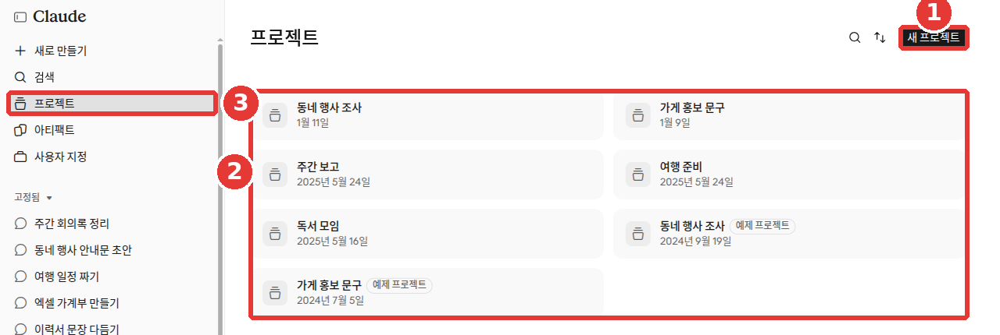
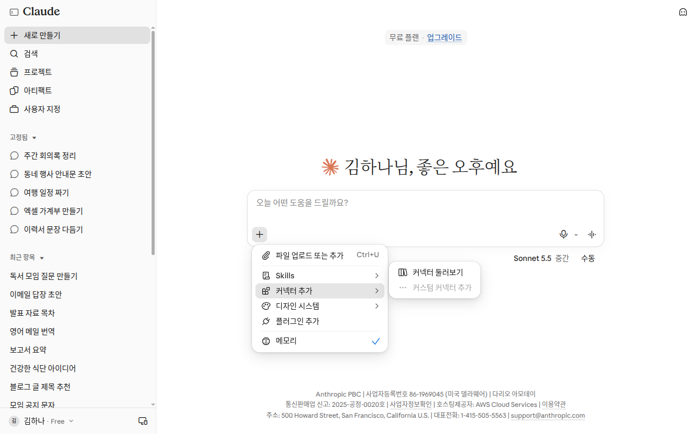
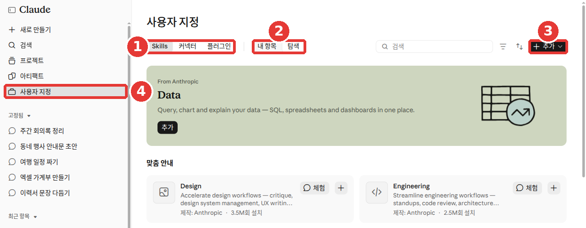

# 第7章 プロジェクト・コネクタ・スキル — 資料とツールをClaudeにつなぐ

> **一言まとめ**: 同じ仕事で使う資料や指示は**プロジェクト**にまとめておきましょう。メールやカレンダーなどの別アプリは**コネクタ**でつなぎ、
> 毎回同じやり方で行う作業は**スキル**として登録しておきます。この3つを業務ごとにまとめたセットが**プラグイン**です。

画面は2026年10月のWeb版を基準にしています。チャットとCoworkを統合した新しい画面が順次配布されているため、メニューの位置や名前は画面によって異なる場合があります。
この章の画像は無料プランのWeb画面です。メニュー名は画像に表示されている名前を使います。ヘルプに出てくる別の名前は脚注にまとめました。

この章で使うのは、左メニューの2か所です。「プロジェクト（프로젝트）」と「カスタマイズ（사용자 지정）」（Customize）です。[^screen] 下の図ではそれぞれ③・④で示しています。

## プロジェクト — 資料と指示をひとつに

**プロジェクト**（project）は、ひとつの仕事のための作業スペースです。プロジェクトごとに会話履歴と**ナレッジ**（knowledge、参考資料を入れておく場所）が分かれています。[^projects]
たとえば「会社の週報」プロジェクトに報告書のフォーマットファイルを入れておきましょう。その中で開く会話は、毎回そのフォーマットを知った状態で始まります。

プロジェクトは無料プランでも作成できます。無料プランでは5個までです。[^projects-how][^projects-limit]

### 作り方と中身の入れ方

1. 左メニュー③「プロジェクト」（claude.ai/projects）を開きます。右上①「新しいプロジェクト（새 프로젝트）」を押します。[^screen][^projects-how][^new-project-name]
2. 名前と説明を書きます。名前と説明は**Claudeには読めません。** 仕事に必要な内容は、ナレッジや指示に入れてください。[^projects-how]
3. プロジェクト画面右側の**プロジェクトナレッジ**の「+」から、ファイルや文章をアップロードします。ここに入れたものは、そのプロジェクトのすべての会話で使われます。[^projects-how]
4. 「プロジェクトの指示を設定（프로젝트 지침 설정）」にこのプロジェクトで守るルールを書き、「指示を保存（지침 저장）」を押します。[^projects-how]
5. すでにある会話は、会話名の横の矢印 →「プロジェクトに追加（프로젝트에 추가）」で移動できます。[^projects-how]

今回の会話だけで見る資料は、プロジェクトナレッジには入れず、その会話に直接アップロードしてください。ナレッジが散らかりません。[^academy-projects]



プロジェクト名と会話のタイトルは例に置き換えた画面です（無料プラン）。**赤い番号は下の一覧の番号と同じ場所です。**

- ①「新しいプロジェクト（새 프로젝트）」 — 新しいプロジェクトを作ります
- ②プロジェクト一覧 — 作成したプロジェクトが日付とともに並びます
- ③左メニュー「プロジェクト（프로젝트）」 — この画面を開く場所です

一覧には「サンプルプロジェクト（예제 프로젝트）」という表示がついたものもあります。[^screen] 自分が作っていないプロジェクトが見えても驚かないでください。

<!-- スクリーンショット必要: プロジェクト画面。右側の「プロジェクトナレッジ（프로젝트 지식）」欄と「+」、「プロジェクトの指示を設定（프로젝트 지침 설정）」ボタン -->

[第5章](05-memory.md)の指示はすべての会話に適用されます。プロジェクトの指示は**そのプロジェクト内の会話だけに**適用されます。[^personal][^project-instr-free]

### 同じプロジェクトでも会話の内容はそのまま共有されない

同じプロジェクトの中であっても、**会話の内容が次の会話にまるごと引き継がれるわけではありません。** 別の会話でも知っておいてほしい内容は、プロジェクトナレッジに入れてください。[^projects-how]
たとえば昨日の会話で決めた「表は3列で」というルールは、メモリがオンになっていれば今日の新しい会話でも覚えているかもしれません。しかし、必ず守ってほしいルールなら指示やナレッジに書いておきましょう。そうすればすべての会話に伝わります。

メモリはプロジェクトごとに分かれています。プロジェクトの中では、そのプロジェクトのメモリと、プロジェクト外の会話のメモリを合わせて使います。他のプロジェクトのメモリは使いません。[^projects-how]
プロジェクトを完全に切り離したい場合は、プロジェクト画面のメモリ設定で「アカウントのメモリを使用（계정 메모리 사용）」をオフにしてください。[^projects-how] メモリ自体については[第5章](05-memory.md)で扱います。

### 資料が増えたら — RAG

有料プランでは、ナレッジが増えて上限に近づくと、自動的に**RAG**（Retrieval Augmented Generation、資料全体ではなく必要な部分だけを探して読む方式）に切り替わります。すると入れられる量が最大10倍まで増えます。自分でオン・オフを切り替える必要はありません。[^rag]
資料が多いときは、次のようにしてみてください。ファイル名をわかりやすくつけ、質問するときに文書名を具体的に指定します。そうするとClaudeがどこを探せばいいか絞り込めます。[^rag]

```
「2026年第3四半期売上報告書」ファイルから、地域別の売上だけを表にまとめて。
```

### 整理するときのコツ

- **ひとつの仕事から始めましょう。** すべての仕事を詰め込んだひとつのプロジェクトより、「週報」のようにテーマを絞ったプロジェクトから始めてください。資料は使いながら足していけば大丈夫です。[^academy-projects]
- **古い資料はときどき入れ替えましょう。** プロジェクトナレッジに古い資料が残っていると、回答も古い内容になることがあります。ときどきナレッジの一覧を見直して更新してください。[^academy-projects]
- **スター（星印）**をつけると、左メニューからすぐに見つけられます。[^projects-how]
- 終わったプロジェクトは**アーカイブ（保管）**できます。アーカイブしたプロジェクトはすぐには削除できません。「アーカイブを解除（보관 해제）」してから削除してください。[^projects-how]
- プロジェクトを他の人と共有する機能は、Team・Enterprise（法人向けプラン）にのみあります。[^projects]

> **新バージョンのプロジェクト（ベータ）**: 1つのプロジェクトを1つの会話として使う新しい方式が、一部のユーザーから順次配布されています。移行しても指示・ファイル・会話履歴はそのまま引き継がれます。[^projects] まだ一部の人にしか公開されていない機能のため、この章では現在のプロジェクトを基準に説明します。

### 繰り返し使うテンプレートを指示に入れる

[ステップ1 第8章](../00-common/08-meta-prompting.md#_4-使い回すひな形にする)で、うまくいった依頼文を空欄だけ変えて使い回せる**テンプレート（型）**にしました。そのテンプレートをプロジェクトの指示に入れてみましょう。会話のたびにテンプレートを貼り付ける手間が省けます。

```
このプロジェクトの会話では、私が送る業務メモを週報にまとめて。
- 「完了 / 進行中 / 来週の予定」の3列の表にすること
- 各項目は1行で書くこと
- メモにない内容は勝手に作らず、[要確認]と表示すること
```

::: details 返ってくる回答のだいたいのイメージ（例 — クリックして開く）
このガイドが作成した例です。実際の回答はサービスやその時々によって異なります。

たとえば今週のメモが「見積書を2社に送付。ホームページの写真を差し替え中。来週は取引先とミーティング」なら、このような回答が返ってきます。

> | 完了 | 進行中 | 来週の予定 |
> |---|---|---|
> | 見積書を2社に送付 | ホームページの写真を差し替え | 取引先とミーティング（日付 [要確認]） |

**うまく返ってきたか確認してみましょう**: 3列の表になっているか？各項目は1行か？メモにない内容が紛れ込んでいないか？メモになかった日付などの空欄に `[要確認]` がついているか？

:::

これで、プロジェクト内の新しい会話には今週のメモを貼り付けるだけで済みます。

<Quiz id="ch207-projects" />

## コネクタ — 他のアプリとつなぐ

**コネクタ**（connector）は、Claudeを普段使っているアプリやサービスとつなぐ機能です。接続すると、Claudeがその中の資料を取り出したり、そのサービスの中で作業したりできるようになります。[^connectors]
たとえばGoogleカレンダーを接続すれば、「来週の空いている時間を教えて」と聞けます。予定をコピーして貼り付ける必要はありません。

コネクタは無料プランを含むすべてのユーザーが、Web・デスクトップ・スマートフォンで利用できます。[^connectors]

### つなぎ方

1. 入力欄の左下にある「+」を押し、③「コネクタを追加（커넥터 추가）」を選びます。[^screen][^connector-name] 左メニューの「カスタマイズ」→「コネクタ（커넥터）」タブからでも操作できます。[^screen]
2. 使いたいサービスを選び、「接続（연결）」または「インストール（설치）」を押します。そのサービスにログインして権限を許可します。[^connectors]
3. 会話ごとに「+」→「コネクタ」から、今回の会話で使うサービスのオン・オフを切り替えます。[^connectors]

接続したら、簡単なお願いをして確認してみましょう。[^academy-connect]

```
私のGoogleカレンダーにアクセスできる？来週の月曜日の予定だけ見せて。
```

予定が表示されれば、正しく接続されています。


無料プランの画面です。この章で使うのは下の3つです。

- ②「Skills」 — スキル一覧を開きます
- ③「コネクタを追加（커넥터 추가）」 — 他のアプリを接続します
- ⑤「プラグインを追加（플러그인 추가）」 — プラグインを追加します

⑥「メモリ（메모리）」は[第5章](05-memory.md#_1つのチャットだけメモリをオフにする)で扱います。



*まだ接続したコネクタがない無料アカウントの画面です。そのため、サービスごとのオン・オフスイッチの代わりに「コネクタを探す（커넥터 둘러보기）」だけが表示されています。「カスタムコネクタを追加（커스텀 커넥터 추가）」は薄く表示されていて押せませんでした。*[^screen-connectors]

スマートフォンでのコネクタのインストールはまだベータ版です。Webやデスクトップで接続しておけば、次にスマートフォンアプリにログインしたときにそのまま使えます。[^connectors]

### つなぐ前に知っておくこと

- **信頼できるサービスだけを、必要な分だけ接続してください。** 接続すると、Claudeがあなたのアカウント権限の範囲内で資料を読んだり変更したりできるためです。[^connectors] 接続する前に自分に問いかけてみてください。信頼できるサービスか？この仕事に本当に必要か？
- **もともと見られないものは接続しても見られません。** そのサービス上で自分が開けないファイルは、コネクタを使っても開けません。[^connectors]
- **接続の解除と権限の確認**は、「カスタマイズ」→「コネクタ」で行います。[^connectors]
- **接続したアプリの資料でモデルを学習することはありません。** また、接続したアプリがあなたの他の会話を見ることもできません。[^suggest] 学習設定の全体については[第9章](09-privacy.md)で扱います。

### 代表例 — Google・Microsoft 365

**Gmail・Googleカレンダー・Googleドライブ**のコネクタは、Webとデスクトップのすべてのユーザーが利用できます。[^google]
- メールの送信や返信、ドライブのファイル共有・移動・ゴミ箱への移動といった操作は、基本的に**毎回実行する前に確認を求められます。**[^google]
- Googleドキュメントとして受け取りたい場合は、名前をはっきり伝えてください。ただ「文書」と言うと、ダウンロード用のファイルが作られます。[^google]
- Gmailの添付ファイルの中身は読めません。ドライブの文書は文字だけを読み取り、画像は処理しません。[^google]
- コネクタで取り込んだ資料は、その会話と一緒に保管されます。会話を削除すると一緒に消えます。[^google]

惜しい例と良い例を比べてみましょう。

```
会議の内容を文書にまとめて。
```

```
このメモでGoogleドキュメントを作って。タイトルは「10月チーム議事録」にして。
```

2つ目のように「Googleドキュメント」と言わないと、ドライブにGoogleドキュメントが作られません。

**Microsoft 365**コネクタは、無料を含むすべてのプランで利用できます。ただし、**法人アカウントのみ**接続できます。@outlook.comのような個人アカウントは使えません。[^m365] 事前に会社の管理者の同意も必要です。[^m365]

### 会話の中に画面が表示されるコネクタ

**インタラクティブコネクタ**（interactive connector、対話型コネクタ）は、会話の中にそのアプリの画面を表示します。たとえばプロジェクトの状況を聞くと、Asanaのタスクボードが会話の中に開きます。そこで直接タスクにチェックを入れることができます。[^interactive] コネクタ一覧で「インタラクティブ（대화형）」という表示がついているものがこのコネクタです。[^interactive]

接続しておいたアプリは、名前を言わなくてもClaudeが適切なタイミングで自分から取り出して使うこともあります。[^suggest]
- 合うアプリが2つ以上ある場合、Claudeが勝手に1つを選ぶことはありません。あなたが選びます。[^suggest]
- アプリの提案に広告や有料枠はありません。[^suggest]
- あなたの代わりに予約や購入をする前には、必ず先に確認を求めます。[^suggest]

> **カスタムコネクタ**（custom connector）は、Anthropicが検証していないサービスを直接URLでつなぐ機能です。無料プランでは1個までです。信頼できるところだけを接続してください。[^connectors] ほとんどの場合は一覧にあるコネクタで十分です。

<Quiz id="ch207-connectors" />

## ツールの権限 — 何をどこまで使わせるか

ひとつのコネクタには、複数の**ツール**（tool、「メールを読む」「メールを送る」のようにコネクタができるひとつひとつの動作）が入っています。

### 使わないツールはオフにする

会話内の「検索とツール（검색 및 도구）」メニューから、特定のツールだけをオフにできます。[^interactive]
たとえばメールを読んで整理させるだけなら、「送信」ツールはオフにしておきましょう。間違ってメールが送られてしまう心配がなくなります（このガイドの提案）。

カスタムコネクタが許可を求めるときに「常に許可（항상 허용）」が表示されたら注意してください。目を離して任せても大丈夫なくらい信頼できるツールにだけ押してください。[^custom]

### コネクタが多いとき — 「ツールアクセス」

コネクタはひとつひとつが会話のスペースを占有します。そのため、たくさんオンにしておくほど実際に作業できるスペースが減ってしまいます。[^tools]
「+」→「コネクタ」→「ツールアクセス（도구 액세스）」で、読み込む方式を選べます。[^tools]

| 選択肢 | こんなときに |
|---|---|
| 「自動（デフォルト）（자동(기본값)）」 | ほとんどの場合。Claudeが自動で選びます |
| 「常に利用可能（항상 사용 가능）」 | いつも使うコネクタが10個未満のとき |
| 「必要なとき（필요할 때）」 | コネクタが10個以上あるか、会話が長くなるとき |

「常に利用可能」は最初からスペースを多く使います。「必要なとき」は合うコネクタを探すために1ステップ余計にかかることがあります。[^tools] この選択は**その会話だけに**適用されます。[^tools]

### リサーチを使うとき

[第6章](06-search.md)のリサーチ機能は、オンになっているコネクタのツールを**毎回確認せずに**使います。[^research] リサーチを始める前に、使うコネクタだけをオンにしておきましょう。読ませるものをあらかじめ絞っておけば、関係のない資料が混ざりません（このガイドの提案）。

<Quiz id="ch207-tool-access" />

## スキル — 仕事のやり方を覚えさせる

**スキル**（skill）は、特定の仕事を毎回同じやり方でこなせるようにする指示と資料のセットです。[^skills]
たとえば「会社の報告書はこの順番とこのフォントで」というルールをスキルとして入れておけば、報告書を作るたびにそのやり方に従ってくれます。

スキルはFree・Pro・Max・Team・Enterpriseのすべてで使えます。ただし、**ファイル作成機能がオンになっている必要**があります。設定 →「機能（기능）」で「コード実行とファイル作成（코드 실행 및 파일 생성）」をオンにしてください。[^create-name][^skills][^skills-use]

### 基本スキルとマイスキル

- Anthropicがあらかじめ用意している**基本スキル**（Excel・Word・PowerPoint・PDFの作成）は、指定しなくても自動的に使われます。[^skills-use] [第4章](04-files-artifacts.md)でファイルを作るときに使われているのがこれです。
- スキルのオン・オフを切り替える場所は、左メニューの「カスタマイズ」→「Skills」タブです。[^screen] オフにしたスキルはClaudeが使いません。[^skills-use]
- 簡単なスキルなら、プログラミングなしで文章だけで作れます。[^skills] 作ったスキルフォルダはZIPにまとめてアップロードします。ヘルプには「+ スキルを作成（+ 스킬 만들기）」→「スキルをアップロード（스킬 업로드）」と記載されています。[^skills-use] この章の画面では、「カスタマイズ」の右上に「+ 追加（+ 추가）」ボタンがあります。[^screen]
- スキル一覧からインストールしたスキルは、中身を書き換えることはできません。[^directory]

スキルが使われていないと感じたら、名前を指定してお願いしてみてください。[^skills-use]

```
私の「会社報告書フォーマット」スキルを使って、このメモから発表資料を作って。
```

自分が作ったスキルがなかなか使われない場合は、スキルの**説明**（description）を直してみてください。Claudeはこの説明を見て、いつそのスキルを使うかを判断します。[^skills-make] 説明には、どんなときに使うスキルなのかを具体的に書いてください。[^skills-make] 普段お願いするときに使う言葉を入れておくのもおすすめです。「議事録の整理」「会議内容の要約」のようにです（このガイドの提案）。説明は200文字まで書けます。[^skills-make]

### マイスキルを作る — 言葉でお願いする

ある仕事をするたびに同じ説明を繰り返しているなら、その説明こそ最初のスキルにぴったりです。[^academy-layers] たとえば「議事録は決定事項・やること・担当者の順番で」と毎回言っているような場合です。

スキルファイルを一人で書く必要はありません。新しい会話を開いて、Claudeに一緒に作ろうと話しかけてみてください。[^academy-skills]

```
議事録を整理するスキルを作りたい。何が必要かひとつずつ質問して。
```

するとClaudeがいくつか質問してきます。このスキルは何をするものか、どんな結果になれば良いか、いつ使うのかといったことです。できるだけ具体的に答えてください。良い例やフォーマットファイルがあれば一緒にアップロードしましょう。実際の例を見せると、Claudeはあなたが求める結果をより正確に理解します。[^academy-skills]

作ったスキルの保存方法は画面によって異なる場合があります。保存する方法が見当たらないときは、ClaudeにスキルフォルダをZIPにまとめてもらうよう頼んでください。そのファイルを上の「スキルをアップロード」からアップロードすれば大丈夫です。[^skills-use] 直したいところが出てきたら、Claudeに言葉でお願いしましょう。会話の横に開いたスキルファイルで直したい文字を選択し、「Claudeで編集（Claude로 편집）」（Edit with Claude）を押しても構いません。[^skills-make]

### 指示・プロジェクト・コネクタと何が違うのか

| 機能 | いつ使われるか |
|---|---|
| 指示 | すべての会話で常に |
| プロジェクト | そのプロジェクト内で常に |
| スキル | 関連する仕事をするときだけ |
| コネクタ | 他のアプリにつながる必要があるとき |

指示はすべての会話に広く適用され、スキルは関連するときだけ読み込まれます。[^skills] プロジェクトは常に敷かれている背景知識です。[^skills] コネクタがツールに**手が届くようにする**ものなら、スキルはそのツールを**上手に使う方法**を教えるものです。[^skills]
必要なときだけ読み込まれるため、スキルをいくつ入れておいても会話のスペースをあまり圧迫しません。[^skills]

一言でまとめると、プロジェクトは**知っておくべき資料**を持ち、スキルは**仕事の順番**を持ちます。[^academy-skills] この2つは一緒に使えます。顧客資料はプロジェクトに置き、相談準備の手順はスキルにしておく、といった具合です。

### 注意する点

- **信頼できる提供元のスキルだけをインストールしてください。** スキルの最大のリスクは、隠された指示でClaudeを操る**プロンプトインジェクション**と、資料を外部に持ち出す**データ流出**です。[^skills-use] プロンプトインジェクションについては[ステップ1 第9章](../00-common/09-safety.md#_4-隠れた指示-—-プロンプトインジェクション)で学びました。
- **画面録画からスキルを作る方法**もあります。自分の作業を録画すると、Claudeがそれをもとにスキルを作ります。Pro・Max・TeamのMacアプリ版Coworkでのみ利用でき、録画時間は10分前後までです。[^skills-make] 録画中はパスワードや機密性の高い画面を映さないでください。

<Quiz id="ch207-skills" />

## プラグイン — 業務別のパッケージ

**プラグイン**（plugin）は、スキル・コネクタ・**サブエージェント**（sub-agent、大きな仕事の一部を別々に引き受けてこなす補助のClaude）をひとつのパッケージにまとめたものです。[^plugins]
営業・財務・法務・マーケティング・人事のように、業務別のプラグインが用意されています。[^plugins] ひとつずつ探してつなぐ代わりに、自分の仕事に合ったセットを一度に入れるイメージです。

この章の3つの機能を例えるなら、次のようになります（このガイドの例え）。コネクタは他のアプリに届く**手**、スキルは仕事の**コツ**、プラグインはその2つをまとめた**業務セット**です。

プラグインは**有料プラン**（Pro・Max・Team・Enterprise）でのみ利用できます。[^plugins]

### 入れ方と使い方

1. 左メニュー④「カスタマイズ（사용자 지정）」（Customize）を開きます。[^screen] スキル・コネクタ・プラグインをこの一覧からまとめて探せます。[^directory]
2. ①「プラグイン（플러그인）」タブ → ②「探索（탐색）」でプラグインを選び、「追加（추가）」を押します。[^screen][^discover-name]
3. 会話やCoworkで `/` を入力するか「+」を押すと、プラグインに入っているスキルが表示されます。選んで使いましょう。[^plugins]

入手したプラグインには、一般的な仕事の進め方が入っています。あなたの職場のフォーマットや手順とは違うかもしれません。[^academy-plugins] 追加したプラグインを見る画面の右上にある「カスタマイズ（커스터마이징）」（Customize）を押すと、そのプラグインを手直しするCoworkの作業画面が開きます。「始める（시작하기）」（Let's go）を押して、Claudeと一緒に直していけば大丈夫です。[^plugins] メニュー名は画面によって異なる場合があります。実際に使っている例を見せながらお願いしてみてください。

```
うちのチームが先月送った見積書を3つアップロードしたよ。このプラグインの見積書スキルが、このフォーマットと文体に従うように直して。
```

自分の仕事に合わせて手直しするほど、プラグインはさらに頼りになるようになります。[^academy-plugins]



無料プランの画面です。**赤い番号は下の一覧の番号と同じ場所です。**

- ①「Skills」・「コネクタ（커넥터）」・「プラグイン（플러그인）」 — 何を見るか選ぶタブです
- ②「マイアイテム（내 항목）」・「探索（탐색）」 — すでに入れたものと、新しく探すものです
- ③「+ 追加（+ 추가）」 — 新しい項目を足すボタンです
- ④左メニュー「カスタマイズ（사용자 지정）」 — この画面を開く場所です

「探索」にはAnthropicが作成したスキルやプラグインがあり、「体験（체험）」ボタンも見えます。[^screen]
無料プランの画面にも「プラグイン」タブや「+」メニューの「プラグインを追加」が表示されます。[^screen] ただし、ヘルプではプラグインは有料プラン向けの機能として案内されています。[^plugins]

- 追加したプラグインはアカウントに保存されます。Webチャット、デスクトップアプリのChat、Coworkで使えます。[^plugins]
- 一部の機能（サブエージェントなど）はチャットでは動かず、灰色で表示されます。[第8章](08-cowork.md)のCoworkで動きます。[^plugins]
- **信頼できる提供元のプラグインだけをインストールしてください。** プラグインによっては、あなたのパソコン上で他のプログラムと同じ権限で動く部分が含まれているためです。[^plugins]

<Quiz id="ch207-plugins" />

## 動画でもっと見る

公式が作成した紹介動画です。画面や機能名はこの章の説明と異なる場合があります。

> 下の動画はすべて**英語**です。YouTube動画の設定（歯車アイコン）→ 字幕 → **自動翻訳 → 日本語**を選ぶと、日本語字幕で見ることができます。動画はこのページ内でそのまま再生されます。

**[Projects are now a conversation with Claude](https://www.youtube.com/watch?v=5qt_aGyAsKk)** · Claude · プロジェクトが変わった様子を見たい方（2026年9月、1分）

<YouTube id="5qt_aGyAsKk" title="Projects are now a conversation with Claude" />

**[Creating custom Skills with Claude](https://www.youtube.com/watch?v=kS1MJFZWMq4)** · Anthropic · Claudeが質問しながらスキルを作ってくれる例を見たい方（2025年10月、1分）

<YouTube id="kS1MJFZWMq4" title="Creating custom Skills with Claude" />

1本目の動画では、プロジェクトを「ひとつの会話」として紹介しています。自分の画面が動画と違う場合は、この章の説明に従ってください。

## やってみよう

1. 「新しいプロジェクト」で「週報」プロジェクトを作り、上のテンプレートをプロジェクトの指示に入れます。指示欄がない場合は、テンプレートを文章として書いてプロジェクトナレッジにアップロードします。
2. プロジェクトの中で新しい会話を開き、今週やったことを適当に5行書いて送ります。表が指示どおりに出てくるか確認します。
3. プロジェクトの中で新しい会話をもうひとつ開き、最初のメッセージを送る前に「+」→「メモリ」（Memory）をオフにします（[第5章](05-memory.md#_1つのチャットだけメモリをオフにする)）。そのあと「さっきの会話で何て言ったっけ？」と聞いてみます。メモリをオフにした会話は、前の会話の内容を知らないことを確認します。
4. 「カスタマイズ」→「コネクタ」タブ →「探索」を開き、どんなサービスがあるか見てみます。ひとつ接続したら、そのコネクタのツールのうち使わないものを「検索とツール」でオフにしてみます。
5. 「カスタマイズ」→「Skills」タブ →「マイアイテム」で、基本スキルがオンになっているか確認します。

**発展課題**（[読書会の準備をする](../00-common/practice-kit.md)）: アップロードする前に `members.csv` を開き、名前や連絡先などの個人情報が入っていないか確認します。次に「読書会」プロジェクトを作って「プロジェクトナレッジ」にサンプルファイル4つ（`memo-next-month.txt`、`minutes-last-meeting.txt`、`members.csv`、`fees.csv`）をアップロードし、第5章の1行の指示をプロジェクトの指示に入れます。プロジェクト内の新しい会話で「11月の案内文の下書きを書いて」とだけ送り、メモと議事録の内容が盛り込まれるか確認します。

## まとめ

- プロジェクトは会話・ナレッジ・指示をまとめる作業スペースです。無料プランでは5個まで作れます（ヘルプ基準）。
- プロジェクトの名前と説明はClaudeには読めません。同じプロジェクトでも会話の内容がまるごと引き継がれるわけではないため、共通して知っておくべきことはナレッジや指示に入れます。
- 有料プランでは資料が増えると自動的にRAGに切り替わります。ファイル名はわかりやすくつけましょう。
- コネクタは他のアプリとの接続機能です。信頼できるサービスだけを接続し、もともと見られないものは接続しても見られません。
- 使わないツールは「検索とツール」でオフにし、コネクタが多いときは「ツールアクセス」を「必要なとき」に変えます。
- スキルは仕事のやり方をまとめたセットです。関連するときだけ読み込まれ、信頼できる提供元のものだけをインストールします。
- プラグインはスキル・コネクタ・サブエージェントをまとめた業務セットで、有料プラン専用です。

## 用語まとめ
| 用語 | 読み方 | 一言でいうと |
|---|---|---|
| Project | プロジェクト | 会話履歴とナレッジを別々に持つ作業スペース |
| Project knowledge | プロジェクトナレッジ | プロジェクトのすべての会話が共通で使う参考資料 |
| RAG | ラグ | 資料全体ではなく必要な部分だけを探して読む方式 |
| Connector | コネクタ | Claudeを他のアプリやサービスとつなぐ機能 |
| Tool | ツール | コネクタができるひとつひとつの動作 |
| Tool access | ツールアクセス | コネクタを会話にいつ読み込むかを決める設定 |
| Skill | スキル | 特定の仕事を同じやり方でこなせるようにする指示のセット |
| Plugin | プラグイン | スキル・コネクタ・サブエージェントをまとめた業務別のパッケージ |
| Sub-agent | サブエージェント | 大きな仕事の一部を別々に引き受ける補助のClaude |
| Prompt injection | プロンプトインジェクション | 資料の中に隠した指示でAIをだます攻撃 |

<ChapterDone :chapter="207" />

次の章: [第8章 Cowork — 仕事をまるごと任せる](08-cowork.md)

[^screen]: Claude Web画面（無料プラン、韓国語）で直接確認。左メニュー「프로젝트」・「사용자 지정」 / 「프로젝트」画面の「새 프로젝트」と「예제 프로젝트」表示 / 「+」メニューの「Skills」・「커넥터 추가」・「플러그인 추가」 / 「사용자 지정」画面の「Skills」・「커넥터」・「플러그인」タブ、「내 항목」・「탐색」、「+ 추가」、「체험」（確認日 2026-10-26）
[^projects]: Anthropic ヘルプ、「What are projects?」。"Projects allow you to create self-contained workspaces with their own chat histories and knowledge bases." / "For users on Team and Enterprise plans, projects can be shared with other members of your organization" / "Nothing is lost or deleted in the move." https://support.claude.com/en/articles/9517075 （確認日 2026-10-26）
[^projects-how]: Anthropic ヘルプ、「How can I create and manage projects?」。"Free users can create a maximum of five projects." / "Click "+ New Project" in the upper right corner." / "Give your project a name and description (note that Claude will not have access to these details)." / "Anything you upload to this space will be used across all of your chats within that project." / "Claude will use these instructions for all the chats within the project." / "Note: Context is not shared across chats within a project unless the information is added into the project knowledge base." / "While working in a project, Claude uses the project's memory alongside your memory from chats outside of projects, but not memory from other projects." / "There is no way to delete archived projects at this time (you must unarchive it first)." https://support.claude.com/en/articles/9519177 （確認日 2026-10-26）
[^personal]: Anthropic ヘルプ、「Understanding Claude's personalization features」。"These instructions only apply to chats within that project." https://support.claude.com/en/articles/10185728 （確認日 2026-10-26）
[^rag]: Anthropic ヘルプ、「Retrieval augmented generation (RAG) for projects」。"RAG for projects is available on paid plans (Pro, Max, Team, and Enterprise)." / "When your project knowledge approaches the context window limit, Claude will automatically enable RAG mode to expand your project's capacity by up to 10x while maintaining quality responses." / "When asking questions, you can reference specific documents by name to help Claude focus its search." https://support.claude.com/en/articles/11473015 （確認日 2026-10-26）
[^connectors]: Anthropic ヘルプ、「Use connectors to extend Claude's capabilities」。"Connectors let Claude access your apps and services, retrieve your data, and take actions within connected services." / "Web connectors are available for all users on Claude, Cowork, Claude Desktop, and Claude Mobile (iOS and Android)." / "If someone can't access a specific file, channel, or record in the source system, the connector can't reach it from Claude either." / "Only connect services you trust and need for your workflows." / "Installing connectors on mobile is currently in beta—Claude Desktop and web remain the primary path for custom connectors." / "Free users are limited to one custom connector." https://support.claude.com/en/articles/11176164 （確認日 2026-10-26）
[^suggest]: Anthropic ヘルプ、「How Claude suggests connected apps」。"Your data from that app isn’t used to train Claude’s models, and the connected app can’t see your other conversations." / "Claude doesn’t silently default to one over the other; you choose which app to use, and Claude proceeds from there." / "There are no sponsored rankings, no paid placements, and no advertising." / "Before Claude books, buys, or reserves something on your behalf, it checks with you first." https://support.claude.com/en/articles/14730684 （確認日 2026-10-26）
[^google]: Anthropic ヘルプ、「Use Google Workspace connectors」。"By default, Claude asks for your approval before each of these actions." / "Asking for a generic "doc" or "deck" without naming Google creates a local file instead." / "Attachment content is not directly accessible through Gmail (metadata only)." / "This data is retained with its associated chat, so you can delete any retrieved data by deleting the chat." https://support.claude.com/en/articles/10166901 （確認日 2026-10-26）
[^m365]: Anthropic ヘルプ、「Connect to Microsoft 365」。"The Microsoft 365 connector is available on all Claude plans: Free, Pro, Max, Team, and Enterprise." / "Personal Microsoft accounts (such as @outlook.com, @hotmail.com, or @live.com) can't be used." / "In every tenant, a Microsoft Entra Global Administrator also needs to grant a one-time consent." https://support.claude.com/en/articles/15183774 （確認日 2026-10-26）
[^interactive]: Anthropic ヘルプ、「Use interactive connectors in Claude」。"You can check off tasks, update statuses, and keep chatting with Claude—all in one place." / "Individual users: You can disable specific connector tools via the "Search and tools" menu in your conversation." https://support.claude.com/en/articles/13454812 （確認日 2026-10-26）
[^custom]: Anthropic ヘルプ、「Get started with custom connectors using remote MCP」。"only click "Allow always" when using a server and tool that you trust to run unsupervised." https://support.claude.com/en/articles/11175166 （確認日 2026-10-26）
[^tools]: Anthropic ヘルプ、「Manage Claude’s tool access」。"Each connector takes up space in a conversation." / "Best for: Fewer than 10 connectors you use constantly." / "Trade-off: Claude may take an extra step to find the right connector before using it." / "Your selection only applies to that conversation. You can change it at any time." https://support.claude.com/en/articles/13730515 （確認日 2026-10-26）
[^research]: Anthropic ヘルプ、「Use research on Claude」。"During research, Claude can use tools from your connectors automatically, without asking for approval each time." https://support.claude.com/en/articles/11088861 （確認日 2026-10-26）
[^skills]: Anthropic ヘルプ、「What are skills?」。"Skills are available for users on Free, Pro, Max, Team, and Enterprise plans. This feature requires code execution to be enabled." / "Anyone can create skills by writing instructions in Markdown—no coding required for simple skills" / "Custom instructions apply broadly to all your conversations. Skills are task-specific and only load when relevant" / "Projects provide static background knowledge that's always loaded when you start chats within them." / "MCP connections give Claude access to tools, while skills teach Claude how to use those tools effectively." / "Claude determines which skills are relevant and loads the information it needs to complete that task, helping to prevent context window overload." https://support.claude.com/en/articles/12512176 （確認日 2026-10-26）
[^skills-use]: Anthropic ヘルプ、「Use skills in Claude」。"Navigate to Settings > Capabilities and ensure that Code execution and file creation (called Create and edit files in the updated Settings layout) is enabled." / "You don't need to explicitly invoke them—Claude determines when each skill is needed based on your request." / "Toggle any skill on or off using the switch next to it. Disabled skills won't be available to Claude." / "Upload a ZIP file containing your skill folder." / "Try being more explicit in your request (e.g., "Use my brand guidelines skill to create a presentation")." / "The most significant risks are prompt injection, which allows Claude to be manipulated to execute unintended actions, and data exfiltration" https://support.claude.com/en/articles/12512180 （確認日 2026-10-26）
[^skills-make]: Anthropic ヘルプ、「How to create custom skills」。"Recording a skill is available on Pro, Max, and Team plans, in Cowork in Claude for Mac." / "A recording can run for about 10 minutes." / "This is critical—Claude uses this to determine when to invoke your skill (200 characters maximum)." / "Write clear descriptions: Claude uses descriptions to decide when to invoke your skill. Be specific about when it applies." / "Iterate on the description if Claude isn't using it when expected." / "When you're iterating on a skill with Claude in chat, you can edit the skill files directly where they open beside the conversation. Highlight the text you want changed, click "Edit with Claude," and type your request." https://support.claude.com/en/articles/12512198 （確認日 2026-10-26）
[^directory]: Anthropic ヘルプ、「Browse skills, connectors, and plugins in one directory」。"Our unified directory brings skills, connectors, and plugins together in one place" / "Skills you install from the directory are view-only." https://support.claude.com/en/articles/14328846 （確認日 2026-10-26）
[^plugins]: Anthropic ヘルプ、「Use plugins in Claude」。"Plugins are available to all paid plans (Pro, Max, Team, Enterprise)." / "Each plugin bundles skills, connectors, and sub-agents into a single package" / "Claude includes a growing library of plugins for common knowledge work—including sales, finance, legal, marketing, HR, engineering, design, operations, data analysis, and more." / "Select the plugin you want, then click "Add."" / "Type "/" or click the "+" button to see the available skills from your plugins, in chat and in Cowork." / "You can add and use plugins in chat on the web, the Chat tab in Claude Desktop, and Claude Cowork." / "Hooks and sub-agents run in Cowork and Claude Code, not in chat, so they appear grayed out in chat." / "Only install plugins from sources you trust." / "This opens a new Cowork task with a prompt asking Claude to customize the plugin you chose." / "Click “Let's go” to start working with Claude to adjust the plugin's Skills and connectors to match how you work." 韓国語版ヘルプでは「커스터마이징」→「시작하기」と記載。 https://support.claude.com/en/articles/13837440 （確認日 2026-10-26）
[^academy-projects]: Claude Academy「Claude 101」講座「Introduction to projects」。"Simply upload it during the conversation and it stays separate from your project knowledge. It's a perfect way to share context or examples without cluttering the knowledge base." / "Begin with a specific use case rather than trying to create one project for everything. You can always add more content as you go." / "Outdated documents can lead to outdated responses. Review and update your project knowledge periodically." https://academy.claude.com/courses/claude-101/introduction-to-projects （確認日 2026-10-26）
[^academy-connect]: Claude Academy「Claude 101」講座「Connecting your tools」。"Return to Claude and try a simple request, like "Can you access my [tool name]?"" https://academy.claude.com/courses/claude-101/connecting-your-tools （確認日 2026-10-26）
[^academy-layers]: Claude Academy「Introduction to Claude Cowork」講座「Get better results faster」。"If you find you're explaining the same workflows to Claude multiple times, those will be the right opportunities for your first skills." https://academy.claude.com/courses/introduction-to-claude-cowork/research-analysis-at-scale （確認日 2026-10-26）
[^academy-skills]: Claude Academy「Claude 101」講座「Working with skills」。"The easiest way to create a custom Skill is through conversation with Claude itself." / "Claude will interview you about your workflow, asking things like: What should this skill do? What makes good output for this type of work? Can you give examples of when you'd use this skill?" / "Templates, style guides, brand assets, or examples of work you're proud of all help Claude understand exactly what you're looking for." / "projects store knowledge, skills perform tasks" https://academy.claude.com/courses/claude-101/working-with-skills （確認日 2026-10-26）
[^academy-plugins]: Claude Academy「Introduction to Claude Cowork」講座「Plugins: Encode your team's expertise」。"A plugin from the marketplace is a strong default, not a final answer." / "The more you shape it to your team's actual work, the more leverage it produces." https://academy.claude.com/courses/introduction-to-claude-cowork/plugins-cowork-as-a-specialist （確認日 2026-10-26）
[^projects-limit]: 料金ページの説明とは異なる場合があるため、ご自身の画面で確認してください。
[^new-project-name]: ヘルプには「+ 新しいプロジェクト（+ 새 프로젝트）」と出てきます。
[^project-instr-free]: 無料プランでプロジェクトの指示が使えるかどうかは、ドキュメントによって記載が異なります。
[^connector-name]: ヘルプには「コネクタ（커넥터）」→「コネクタを管理（커넥터 관리）」と出ており、`/` を入力してもよいとされています。
[^create-name]: 新しい設定画面では名前が「ファイルの作成と編集（파일 생성 및 편집）」になっています。
[^discover-name]: ヘルプには「発見（발견）」タブとして出てきます。
[^screen-connectors]: 入力欄「+」→「커넥터 추가」サブメニューを直接確認。項目は「커넥터 둘러보기」「커스텀 커넥터 추가」（薄く表示）（確認日 2026-10-28、Web、無料（Free）プラン）
