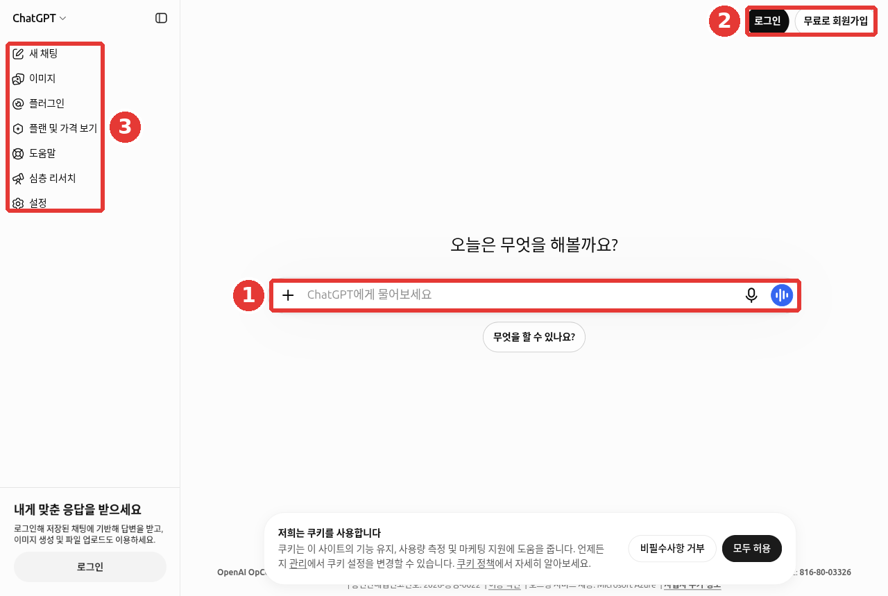
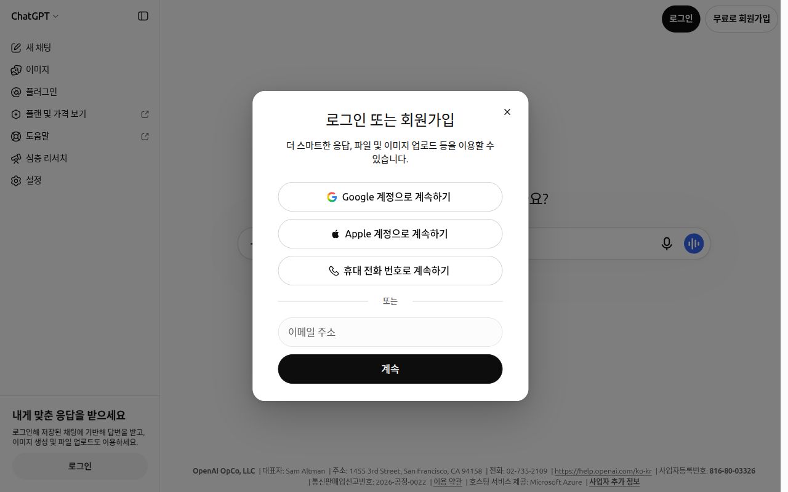

# 第1章 はじめに — 使ってみる、登録する、料金プランを選ぶ

> **一言まとめ**: ChatGPTは、登録しなくてもすぐに使ってみられます。会話を残したりファイルをアップロードしたりするには、無料で登録しましょう。
> 無料では足りなくなったときにだけ、有料プランを考えれば大丈夫です。

画面は2026年10月のWeb版（Plusプラン）を基準にしています。無料プランやスマホアプリは、メニューの位置が少し違うことがあります。

## ログインなしで先に使ってみる

ChatGPTのアドレス（chatgpt.com）に入ってみましょう。登録しなくても、真ん中の入力欄「ChatGPTに質問しましょう（ChatGPT에게 물어보세요）」に、すぐ質問できます。
韓国は、ChatGPTを使える**対応国**（サービスを公式に提供している国）に入っています。[^countries]



①真ん中の入力欄にそのまま質問し、②右上の「ログイン（로그인）」「無料で新規登録（무료로 회원가입）」でアカウントに入ります。③左のサイドメニューには、「新しいチャット（새 채팅）」「プランと料金を見る（플랜 및 가격 보기）」のようなメニューがあります。

ログインせずに使うときは、2つの制限があります。[^home]

- **会話は一度に1つだけ**できます。
- **記録が保存されません。** ウィンドウを閉じると、やり取りした会話をもう探せません。

ログインなしで先に使ってみて、どんな感じかを確かめましょう。使い続けるつもりなら、登録したほうがよいです。初めてなら、こう聞いてみましょう。

```
あなたはどんなことを手伝えますか？ 会社員がすぐに使える例を5つだけ挙げてください。
```

::: details もらえる答えはだいたいこんな感じ（例 — 押して開く）
このガイドが作った例です。実際の答えは、サービスやそのときによって違います。

> 会社員がすぐに使えるものを5つ選んでみました。
>
> 1. **メールの推敲**: 書いたメールを貼り付けると、より丁寧に直します。
> 2. **議事録の要約**: 長いメモを、5行の要約とやることリストに整理します。
> 3. **報告書の骨組みづくり**: 要点を教えてもらえれば、目次から作ります。
> 4. **Excelの関数の質問**: やりたい計算を伝えると、使う関数を教えます。
> 5. **アイデア出し**: イベント名や発表の順番を、いくつかの案にして出します。
>
> やってみたいものがあれば、教えてください。

**うまくもらえたか確認してみましょう**: ちょうど5つになっているか？ それぞれ、自分の仕事ですぐに試せそうか？ 気に入ったものがあれば、その番号でそのまま続けてお願いしてみましょう。

:::

<Quiz id="ch101-logged-out" />

## 登録してログインする

初めてなら、右上の「無料で新規登録（무료로 회원가입）」（上の図の②）を押してください。すでにアカウントがあれば、「ログイン（로그인）」を押します。
入る方法は2つあります。[^login]

| 方法 | 説明 |
|---|---|
| メールアドレスとパスワード | 自分のメールアドレスでアカウントを作る |
| **ソーシャルログイン**（他の会社のアカウントで代わりにログインする方法） | Google・Microsoft・Appleのアカウントで入る |



*2026-10-28のWeb画面です。このウィンドウでは、Microsoftのボタンのかわりに「携帯電話番号で続ける（휴대 전화 번호로 계속하기）」が表示されていました。*[^screen-signup]

知っておきたい点が4つあります。

1. **メールアドレスが同じなら、一つのアカウントです。** 最初にメールで登録していても、同じアドレスのGoogleアカウントでログインすれば、同じアカウントに入れます。[^login]
2. **Appleの「メールを隠す」に気をつけてください。** Appleで登録するときに、本物のアドレスを隠す偽のアドレスを選んだなら、あとで同じApple IDでしか元のアカウントに入れません。本物のメールでログインすると、**別の新しいアカウント**が開きます。[^login]
3. **個人用は、個人のメールで作ってください。** 会社のメールで作ると、退職するときにアカウントに入れなくなることがあります。[^home]
4. **アカウントは自動では統合されません。** 別のメールで入って新しいアカウントができると、会話の記録とサブスクリプションも別々になります。「サブスクリプションに入ったのに無料と表示される」「会話が消えた」と思ったら、まず登録したときのアカウントで入ったかどうかを確認しましょう。決済の領収書を受け取るメールが、アカウントのメールと違うこともあります。[^cantlogin]

<Quiz id="ch101-login" />

## 料金プランをひと目で

ChatGPTには、無料から会社向けまで、いくつもの**料金プラン**（払う金額によって使える機能と量が変わる利用方法）があります。[^pricing]

| プラン | 対象 | 韓国での料金（月） |
|---|---|---|
| Free（無料） | 初めて使う人、たまに使う人 | ₩0 |
| Go | 無料では上限がよく足りなくなる人 | ₩13,000 |
| Plus | 毎日使い、深く考えた答えが必要な人 | ₩29,000 |
| Pro | とてもたくさん使う人（3段階に分かれる） | ₩159,000から |
| Business · Enterprise · Edu | 会社・機関・学校の単位で使うところ | 別途 |

価格は、OpenAIの料金ページを韓国から開いたときに出た値で、**よく変わります。** 決済する前に、[料金ページ](https://openai.com/chatgpt/pricing)で自分で確認してください。[^pricing]
Businessは、以前「Team」と呼ばれていた会社向けのプランが、2025年8月29日に名前を変えたものです。[^business]

### プランごとに何が違うか

数字よりも**「何が変わるのか」**を知っておくと、選びやすくなります。

| 変わるもの | 無料（Free） | 有料 |
|---|---|---|
| **文章の会話** | ふだんの文章の会話は、回数の制限がない[^free] | 機能ごとの上限がより余裕がある |
| **広告** | FreeとGoでは、答えの下に広告が出ることがある | Plus以上は広告がない |
| **考える深さを選ぶ** | 「考える（생각하기）」をオンにして、より深く考えさせる | Plus以上は「推論レベル（추론 수준）」を選ぶ（[第2章](02-screen-tour.md)） |
| **ファイルのアップロード** | 1日3個まで（[第4章](04-files-images.md)） | はるかにたくさんアップロードできる |
| **Work**（長い作業を任せるモード） | Webやスマホでは使えない | 使える（[第7章](07-projects-plugins.md)） |

無料の「回数制限なし」は、ふだんの文章の会話にだけ当てはまります。悪用を防ぐしくみはあります。ファイル・画像・音声のような機能には、別の上限があります。[^free]

広告が心配なら、公式の案内を見てください。[^ads] 広告は**ChatGPTの答えの内容に影響を与えない**そうです。広告主は、自分の会話を見られません。
**一時チャット**（記録に残らない会話、[第3章](03-chats.md)）には、広告が出ません。広告は、2026年2月にアメリカで試験を始め、一部の国に広げているところです。
韓国でも出るのかどうかは、公式の案内では確認できませんでした。

<Quiz id="ch101-plans" />

## 有料に変える前に知っておくこと

最初から有料で始める必要はありません。**無料で始めて、上限によく引っかかるようになったら上げる**のが、いちばん無難です。決済の前に、次の内容は必ず知っておいてください。

- **月払いだけです。** Go・Plus・Proには、1年分を一度に払う年払いがありません。[^go]
- **アプリを消しても、サブスクリプションは続きます。** スマホからChatGPTアプリを削除しても、決済は止まりません。使うのをやめるなら、サブスクリプションを自分で解約する必要があります。[^pro]
- **解約は、サブスクリプションを始めた場所で行います。** Webで決済したならWebで、App StoreやGoogle Playで決済したならそのストアで解約してください。ChatGPTのスマホアプリの中では解約できません。次の決済日の**少なくとも24時間前**までに解約しないと、来月の料金が引き落とされます。[^promo]
- **無料体験は、終わると自動で決済されます。** 友達の招待やイベントでもらった無料体験・割引期間が終わると、登録してある決済手段で有料のサブスクリプションが続きます。使い続けるつもりがなければ、期間が終わる前に解約してください。割引コードは一度しか使えず、複数を重ねて使うことはできません。[^trial]
- **決済したのに無料と表示されたら、もう一度決済しないでください。** まず、先に決済したそのアカウントでログインしたかを確認しましょう。スマホアプリなら、設定で購入の復元（Restore purchases）を押します。このメニューの韓国語での画面名は確認できませんでした。[^plus]
- **Goは、レガシーモデルを使えません。** レガシーモデル（昔の世代のAIモデル）はGoに含まれず、音声会話も無料と同じ上限です。[^go]

**クレジット**（Credit、料金プランとは別に、あらかじめ買っておく追加の使用量）というものもあります。設定 →「使用量（사용량）」画面には、「使用上限に達してもWorkとCodexを使い続けるには、クレジットを購入するか自動チャージをオンにしてください（사용 한도에 도달해도 Work와 Codex를 계속 사용하려면 크레딧을 구매하거나 자동 충전을 켜세요）」という案内があります。[^screen-usage]
クレジットを買っても、料金プランは変わりません。**買った日から12か月**たつと、なくなります。決済エラーや不正利用のような例外でなければ、原則として**返金されません。**「自動チャージ（자동 충전）」をオンにしておくと、残高が決めておいた基準より下がったときに、登録した標準の決済手段で自動的に決済されます。[^credits]
ふつうの会話だけをするなら、クレジットは必要ありません。

どのプランが合うのかわからないなら、ChatGPTに自分の使い方を伝えて聞いてみましょう。ただし、料金と条件はAIの答えではなく、料金ページで確認してください（[ステップ1 第9章](../00-common/09-safety.md)）。

```
私は1日にChatGPTを3〜4回、おもに会社のメールの推敲と議事録の要約に使っています。
ときどきPDFファイルをアップロードして要約もします。無料で使ってみて、どんなときに有料が必要になるのか、
自分で判断できる基準を3つ教えてください。
```

<Quiz id="ch101-subscribe" />

## スマホ・PCアプリ

ChatGPTは、Webブラウザのほかに、スマホアプリやパソコンアプリでも使えます。デバイスごとに新しくアカウントを作る必要はありません。**同じアカウントでログイン**して使えば大丈夫です。別のデバイスでやり取りした会話が見えるかどうかは、下の「実際にやってみよう」の4番で確かめてみてください。

- **スマホアプリ**: 上のドロップダウン（押して開くリスト）で、ChatまたはWorkを選びます。[^work]
- **パソコンアプリ**: 新しいアプリ一つで、Chat・Work・Codexを一緒に使います。以前のアプリは、「ChatGPT Classic」という名前で残っていることがあります。[^desktop] Macアプリは、macOS 14以上が必要です。[^macos]
- **カカオトーク**: 韓国では、カカオトークの中でもChatGPTを使えます（下の説明）。[^kakao]

スマホアプリは、2026年3月にサイドメニューが簡単になりました。画像のような機能は、チャット一覧の上の横長のバーに移されました。
その後、また変わったかもしれません。このガイドのWeb画面と位置が違うときは、似た名前のボタンを探してみてください。[^rn]

アプリをダウンロードするときは、アプリストアで「ChatGPT」を検索してから、**開発元の名前**を確認してください。iPhone（App Store）では「OpenAI OpCo, LLC」、Android（Google Play）では「OpenAI」と表示されているはずです。名前が似た別のアプリが多いからです。[^appfaq]

**カカオトークのChatGPT**は、カカオとOpenAIが一緒に作ったサービスです。**韓国でのみ**使えます。別にインストールするアプリはありません。カカオトークの「チャット（채팅）」タブのいちばん上にある「ChatGPT」を押すと始まります。韓国の電話番号で登録した最新のカカオトークで表示されます。[^kakaofaq]

- すでにChatGPTのアカウントがあれば、連携してください。カカオトークでやり取りした会話の記録を、ChatGPTでも見られます。アカウントがなければ、カカオのアカウントで登録できます。カカオトークで登録したアカウントは、ChatGPTアプリでもそのまま使えます。
- OpenAIの立場では、**第三者サービス**（他の会社が運営に一緒にかかわるサービス）です。そのため、OpenAIとカカオの規約・プライバシーの案内を**両方とも**読んでください。[^kakaofaq]

<!-- スクリーンショットが必要: スマホアプリの最初の画面（Chat/Workのドロップダウンと横長のバー）、AndroidまたはiOS -->

<Quiz id="ch101-apps" />

## うまくいかないときに最初にやること

答えが止まったり、エラーの文言が出たり、「人間かどうかの確認」のパズルが何度も出たりすることがあります。そんなときは、次の順番で試してみてください。OpenAIヘルプのエラー解決の案内を、初心者向けにまとめたものです。[^errors]

1. **故障かどうかを先に見てください。** status.openai.com（OpenAIのサービス状態ページ）に障害が載っていれば、待てば大丈夫です。人が集中する時間帯は、もともと遅くなることもあります。[^slow]
2. **30〜60秒待ってみてください。** 答えが遅れて終わることがあります。それでも止まっていて、会話がとても長いなら、**新しいチャット**でもう一度聞いてみてください。
3. **シークレットウィンドウ**（incognito、閲覧履歴や拡張機能なしで開くブラウザのウィンドウ）で開いてみてください。別のブラウザに替えてみてもかまいません。
4. **VPN**（インターネットのアドレスを変えてくれるプログラム）をしばらくオフにしてみてください。「人間かどうかを確認する」パズル（**キャプチャ**、CAPTCHA）がときどき出るのは正常です。毎回出るなら、VPNやブラウザの拡張機能が原因かもしれません。[^captcha]
5. **会社のWi-Fiでだけうまくいかないなら**、スマホのデータ通信に替えてみてください。そのときうまくいくなら、会社のネットワークの問題です。情報システム担当に聞いてみましょう。[^network]
6. **上限に達したという案内**や、再び使える時刻が表示されたら、その時刻まで待ってください。別の機能を選んでもかまいません。[^feature]

アプリを消してもう一度入れ直しても、**使用上限はリセットされません。**[^mobile] それでもだめなら、help.openai.comのカスタマーサポートに問い合わせてください。エラーの文言をそのまま書いて送れば大丈夫です。画面をキャプチャして送るときは、パスワードやその他の個人情報が見えないようにしてください。

<Quiz id="ch101-trouble" />

## 実際にやってみよう

1. ログインしていない状態でchatgpt.comに入り、「あなたはどんなことを手伝えますか？」と聞いてみる。
2. ブラウザを完全に閉じてからもう一度開いて、今の会話が残っているかを確認する（ログイン前の会話は、同じブラウザで今アクセスしている間だけ見られます）。[^home]
3. 個人のメールで登録して同じ質問をもう一度し、左のサイドメニューの「最近（최근）」に会話ができたかを見る。
4. スマホにアプリをインストールして同じアカウントでログインし、パソコンでやり取りした会話が見えるかを確認する。

**続きの課題**（[読書会の準備](../00-common/practice-kit.md)）: ログインしたまま、「私は近所の読書会の幹事です。来月の集まりを準備するときにやることを、リストにしてください。」と聞いてみる。もらったリストは、課題を終えたあとで、自分が実際にやったことと比べてみる。

## まとめ

- ログインなしでも使えるが、会話は一度に一つで、記録は残らない。
- 登録は、メールまたはGoogle・Microsoft・Appleのアカウントで行う。メールアドレスが同じなら、同じアカウント。
- プランは、広告の有無、考える深さの選択、ファイルの上限、Workが使えるかどうかが違う。価格は料金ページで確認する。
- アプリを消してもサブスクリプションは続く。使うのをやめるなら、サブスクリプションを始めた場所（Web・App Store・Google Play）で、決済日の24時間前までに解約する。無料体験も、終わると自動で決済される。
- アプリは、開発元の名前（App Storeは「OpenAI OpCo, LLC」、Google Playは「OpenAI」）を確認してダウンロードする。カカオトークのChatGPTは、韓国でのみ使える。
- うまくいかないときは、サービスの状態 → 待つ・新しいチャット → シークレットウィンドウ → VPNをオフ → 別のネットワーク、の順に試す。

## 用語まとめ
| 用語 | 読み方 | 一言でいうと |
|---|---|---|
| Supported Country | サポーテッド・カントリー（対応国） | サービスを公式に提供している国 |
| Social Login | ソーシャル・ログイン | GoogleやAppleなど他の会社のアカウントで代わりにログインする方法 |
| Plan | プラン（料金プラン） | 払う金額によって機能や使用量が変わる利用方法 |
| Subscription | サブスクリプション（購読） | 毎月自動で決済される利用契約 |
| Legacy Model | レガシー・モデル | 新しいモデルが出たあとも残してある、昔の世代のAIモデル |
| Temporary Chat | テンポラリー・チャット（一時チャット） | 記録に残らない会話（[第3章](03-chats.md)） |
| Credit | クレジット | プランの上限を使い切ったあと、Workなどの機能をさらに使うために別に買っておく使用量 |
| CAPTCHA | キャプチャ | 人間かどうかを確認するために出す簡単なパズル |
| Incognito Window | インコグニト・ウィンドウ（シークレットウィンドウ） | 閲覧履歴や拡張機能なしで開くブラウザのウィンドウ |
| VPN | ブイピーエヌ | インターネットのアドレスを変えて、別の場所から接続しているように見せるプログラム |

<ChapterDone :chapter="101" />

次の章: [第2章 画面を見てみよう](02-screen-tour.md)

[^countries]: OpenAIヘルプ「ChatGPT Supported Countries」。一覧に "South Korea" を含む。 https://help.openai.com/en/articles/7947663 （確認日 2026-10-23）
[^home]: OpenAIヘルプ「The ChatGPT home page」。"ChatGPT can be used without an account in supported countries" / "only have one conversation at a time" / "Chats will remain accessible only for the current session on the same browser." / "For personal use, we recommend an account with an email address you personally own". https://help.openai.com/en/articles/9125172 （確認日 2026-10-23）
[^login]: OpenAIヘルプ「Changing your account sign-in method」。"log in using a social login method (Google, Microsoft, or Apple) as long as the email address matches" / "using your personal email… will open a different account". https://help.openai.com/en/articles/4936824 （確認日 2026-10-23）
[^pricing]: OpenAI「플랜 및 가격」（韓国から閲覧）。"₩13,000 /월", "₩29,000 /월", "From ₩159,000 /월". アクセスした国によって表示通貨が変わる。 https://openai.com/chatgpt/pricing （確認日 2026-10-23）
[^business]: OpenAIヘルプ「ChatGPT Business overview」。"ChatGPT Team was renamed to ChatGPT Business on August 29, 2025." https://help.openai.com/en/articles/8792828 （確認日 2026-10-23）
[^ads]: OpenAIヘルプ「Ads in ChatGPT」。"Ads may appear for users on the Free and Go plans." / "Ads do not influence ChatGPT's answers." / "Temporary Chats will not show ads." / "Ad testing started in the United States on February 9, 2026." https://help.openai.com/en/articles/20001047 （確認日 2026-10-23）
[^go]: OpenAIヘルプ「What is ChatGPT Go?」。"we do not support annual billing… for ChatGPT Go, Plus, or Pro" / "Access to legacy models is not included" / "Voice mode is included with the same usage limits as the Free tier." https://help.openai.com/en/articles/11989085 （確認日 2026-10-23）
[^pro]: OpenAIヘルプ「About ChatGPT Pro tiers」。"Uninstalling the ChatGPT app does not cancel your subscription." https://help.openai.com/en/articles/9793128 （確認日 2026-10-23）
[^work]: OpenAIヘルプ「ChatGPT Work and Codex」。"On mobile: Select Chat or Work from the dropdown." https://help.openai.com/en/articles/20001275 （確認日 2026-10-23）
[^desktop]: OpenAIヘルプ「Moving to the new ChatGPT desktop app」。"ChatGPT Classic: The previous ChatGPT desktop app." https://help.openai.com/en/articles/20001276 （確認日 2026-10-23）
[^kakao]: OpenAIヘルプ「ChatGPT release notes」2026-07-13の項目。"ChatGPT is also available on Kakao in South Korea". https://help.openai.com/en/articles/6825453 （確認日 2026-10-23）
[^rn]: OpenAIヘルプ「ChatGPT release notes」2026-03-26の項目。"now appear in a horizontal bar above your chats and projects". https://help.openai.com/en/articles/6825453 （確認日 2026-10-23）
[^cantlogin]: OpenAIヘルプ「Why can't I log in to ChatGPT?」。"OpenAI doesn't automatically merge accounts" / "This may be different from the email address where you receive invoices or receipts." https://help.openai.com/en/articles/7426629 （確認日 2026-10-24）
[^free]: OpenAIヘルプ「ChatGPT Free Tier FAQ」。"Free users have unlimited everyday text chats, subject to abuse-prevention safeguards." https://help.openai.com/en/articles/9275245 （確認日 2026-10-24）
[^promo]: OpenAIヘルプ「ChatGPT Plus promotions and referrals」。"you must cancel from the same platform where you started the subscription" / "You can’t cancel through the ChatGPT mobile app." / "Cancel at least 24 hours before your renewal date to avoid an unwanted charge." https://help.openai.com/en/articles/10492689 （確認日 2026-10-24）
[^trial]: OpenAIヘルプ「ChatGPT Promotional Subscriptions/Free Trial Invites FAQ」。"ChatGPT will automatically renew as a paid subscription at the end of the initial free trial or promotional subscription period" / "Referral or promo codes are single‑use and cannot be stacked." https://help.openai.com/en/articles/8381046 （確認日 2026-10-24）
[^plus]: OpenAIヘルプ「What is ChatGPT Plus?」。"On the iOS or Android app, go to Settings > Restore purchases to sync your subscription." 韓国語のメニュー名は画面で確認できなかった。 https://help.openai.com/en/articles/6950777 （確認日 2026-10-24）
[^screen-usage]: ChatGPT Web設定 →「사용량」画面（Plusプラン、韓国語）で直接確認。「크레딧」「자동 충전」の項目（確認日 2026-10-24）
[^credits]: OpenAIヘルプ「Credits (Personal plans)」。"Credits are valid for 12 months from purchase." / "Credits are non-refundable unless required by law or contract, or an approved exception applies." / "Unused credits may qualify for a refund for a verified billing error, confirmed unauthorized activity" / "you can turn it on from Settings > Usage". https://help.openai.com/en/articles/12642688 （確認日 2026-10-24）
[^macos]: OpenAIヘルプ「Downloading the ChatGPT macOS app」。"The ChatGPT macOS app requires macOS 14". https://help.openai.com/en/articles/9275200 （確認日 2026-10-24）
[^appfaq]: OpenAIヘルプ「ChatGPT iOS and Android app FAQ」。"Check that the developer is OpenAI OpCo, LLC." / "Check that the publisher is OpenAI." https://help.openai.com/en/articles/8142208 （確認日 2026-10-24）
[^kakaofaq]: OpenAIヘルプ「ChatGPT for Kakao: Overview and Kakao Tools」。"ChatGPT for Kakao is only available in Korea." / "There is no separate app to install." / "the latest version of the KakaoTalk Korea app if it’s registered with a Korean phone number" / "ChatGPT for Kakao is a third-party service" / "Review both sets of terms and privacy notices". https://help.openai.com/en/articles/12677933 （確認日 2026-10-24）
[^errors]: OpenAIヘルプ「Troubleshooting ChatGPT Error Messages」。"Check status.openai.com for known outages" / "Wait 30–60 seconds to see if the response completes" / "Start a new chat if the conversation is long or has many turns" / "Use an incognito or private browsing window" / "Disable VPNs or proxy connections". https://help.openai.com/en/articles/7996703 （確認日 2026-10-24）
[^slow]: OpenAIヘルプ「Why is my ChatGPT taking so long to respond?」。"ChatGPT users during peak hours may notice a pattern of slowness at specific times of the day." https://help.openai.com/en/articles/9047779 （確認日 2026-10-24）
[^captcha]: OpenAIヘルプ「CAPTCHAs in ChatGPT」。"While encountering CAPTCHAs occasionally is normal, you shouldn't constantly encounter them." https://help.openai.com/en/articles/8184038 （確認日 2026-10-24）
[^network]: OpenAIヘルプ「Network recommendations for ChatGPT errors on web and apps」。"Company WiFi network vs Cellular hotspot". https://help.openai.com/en/articles/9247338 （確認日 2026-10-24）
[^feature]: OpenAIヘルプ「Troubleshooting model feature access」。"If it says you reached a limit or shows a reset time, wait until that time and try again, or choose another available option." https://help.openai.com/en/articles/10258669 （確認日 2026-10-24）
[^mobile]: OpenAIヘルプ「Troubleshooting the ChatGPT mobile app」。"Reinstalling doesn't reset usage limits, change workspace permissions, or remove account restrictions." https://help.openai.com/en/articles/7910461 （確認日 2026-10-24）
[^screen-signup]: ログインしていない新しいブラウザウィンドウで直接確認。ボタンは「Google 계정으로 계속하기」「Apple 계정으로 계속하기」「휴대 전화 번호로 계속하기」、その下の「이메일 주소」欄と「계속」（確認日 2026-10-28、Webのログイン前の画面）
