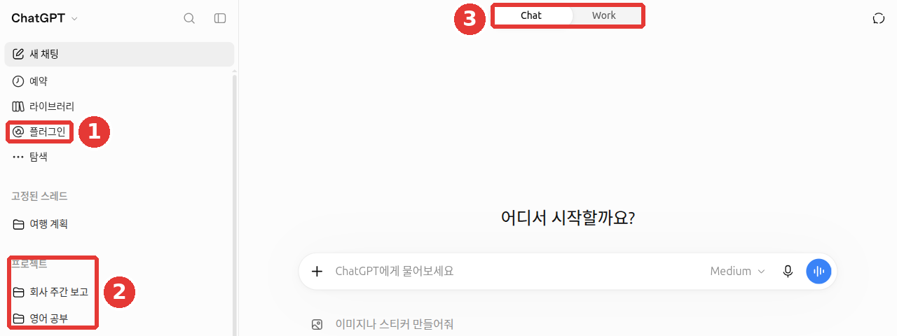
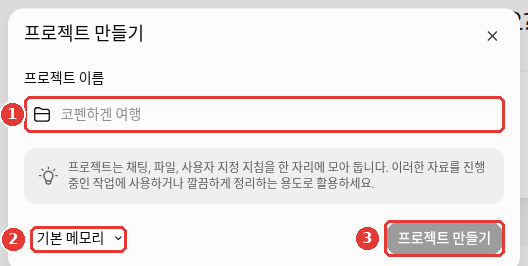
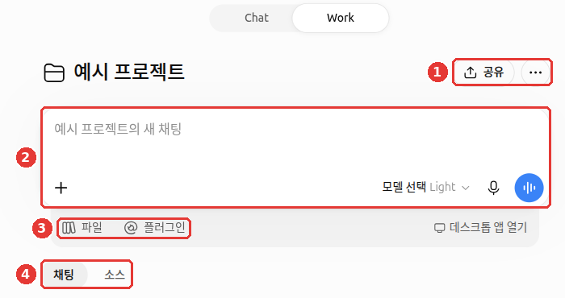
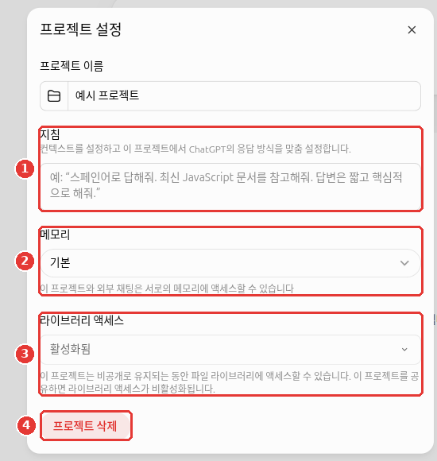
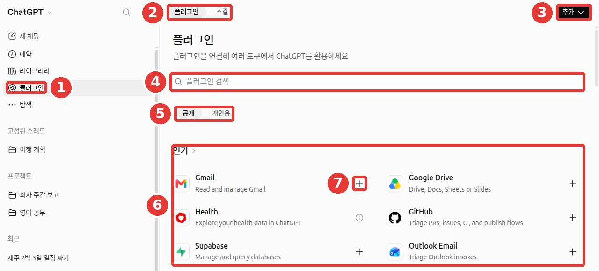
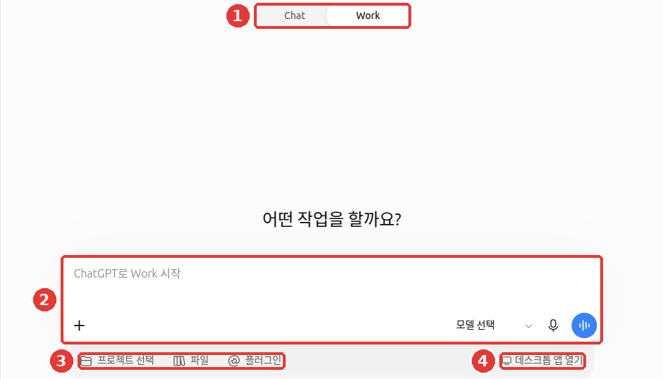

# 第7章 プロジェクト・プラグイン・Work — よくやる作業をまとめておく

> **一言まとめ**: 同じ作業に使う会話・ファイル・指示は**プロジェクト**にまとめます。他のサービスとつなげたり、決まった作業のやり方を加えたりしたいときは
> **プラグイン**を使います。長い作業を任せて完成した成果物を受け取りたいときは、上部を**Work**に切り替えます。

画面は2026年10月のWeb版（Plusプラン）を基準にしています。無料プランやスマホアプリでは、メニューの位置が少し異なる場合があります。



会話のタイトルとアカウント名は、例として変更した画面です。この章で扱う場所は、①横のメニューの「プラグイン」、②「プロジェクト」の欄、③上部の「Chat」/「Work」切り替えです。

## プロジェクト — 会話・ファイル・指示を1つのフォルダーに

**プロジェクト**（project）は、1つの作業に関連する会話、参考ファイル、指示を1か所にまとめておくフォルダーです。
たとえば、「会社の週報」プロジェクトに、報告書の様式ファイルと「表は3列で」のような指示を入れておきます。すると、その中で開く会話は、毎回そのファイルと指示を知った状態で始まります。会話のたびに同じ説明を繰り返さなくてすみます。

### 作り方と中身の入れ方

1. 横のメニューの「プロジェクト」欄のタイトルにマウスを乗せると表示される**＋ボタン（「新しいプロジェクトを追加（새 프로젝트 추가）」）**を押し、「プロジェクトを作成（프로젝트 만들기）」ウィンドウで名前を決めます。[^projects]
2. プロジェクト画面の右上の •••（「プロジェクトアクション（프로젝트 액션）」） → 「プロジェクト設定（프로젝트 설정）」で、このプロジェクトだけで守る**指示**を書きます。参考ファイルは「ファイル（파일）」からアップロードします。
3. すでにある会話は「プロジェクトに移動（프로젝트로 이동）」で入れ、「プロジェクトから削除（프로젝트에서 제거）」で外します。[^projects]



「プロジェクトを作成」ウィンドウ: ①プロジェクト名を書き、必要なら②「基本メモリ（기본 메모리）」を変更して、③「プロジェクトを作成」を押します。

作成すると、プロジェクト画面が開きます。②入力欄（「例のプロジェクトの新しいチャット（예시 프로젝트의 새 채팅）」）の下に、③「ファイル」「プラグイン」ボタンがあり、その下の④「チャット（채팅）」「ソース（소스）」タブに、このプロジェクトの会話と資料が集まります。指示は、①右上の •••から開きます。



••• → 「プロジェクト設定」ウィンドウでは、①指示、②メモリ、③ライブラリへのアクセスを決め、④「プロジェクトを削除（프로젝트 삭제）」でプロジェクトを削除します。



*会話のタイトルとアカウント名は例として変更した画面で、モデル名の場所は消してあります。「例のプロジェクト」はキャプチャのあとで削除しました。*

> **プロジェクトを削除すると**、確認画面に「이 프로젝트와 프로젝트에 포함된 모든 채팅이 Chat과 Work에서 영구적으로 삭제됩니다」（このプロジェクトと、プロジェクトに含まれるすべてのチャットが、ChatとWorkから完全に削除されます）と表示されます。ライブラリに保存されたファイルは削除されません。残しておきたい会話は、削除する前に別の場所へ移してください（2026-10-23にWeb画面で確認）。

### プロジェクトの指示が優先される

[第5章](05-memory.md)のカスタム指示は、すべての会話に適用されます。**プロジェクトの指示は、そのプロジェクトの中だけ**に適用され、カスタム指示より**優先**されます。[^projects]
たとえば、ふだんは丁寧語で答えるようにしておき、「英語の勉強」プロジェクトでだけ「英語だけで答えて」と決めておくことができます。

### プランごとの上限

プロジェクトは、数の制限なく作れます。入れられるファイルの数はプランによって異なり、一度にアップロードできるファイルは10個までです。[^projects]

| プラン | プロジェクトあたりのファイル | 共有するときに一緒に使える人 |
|---|---|---|
| Free | 5個 | 5人 |
| Go・Plus | 25個 | 10人 |
| Pro | 40個 | 100人 |

Business・Enterprise・Eduも、プロジェクトあたりのファイルは40個です。[^projects]
プロジェクトを他の人と**共有**すると、メモリが自動で「プロジェクト専用メモリ」に切り替わります。一度切り替わると、「基本メモリ」には戻せません。[^projects]
また、プロジェクトに入れたPDFは、図や表が抜けた状態で読み込まれることがあります。図が重要なPDFは、チャットに直接添付してください（[第4章](04-files-images.md)）。[^files]

<Quiz id="ch107-projects" />

## 使い回す型をプロジェクトに入れる

[ステップ1 第8章](../00-common/08-meta-prompting.md)では、うまくいった依頼を、空欄だけ変えて使い回せる**型**にする方法を学びました。
プロジェクトは、その型を入れておくのに向いた場所です。型をプロジェクトの指示に入れてみましょう。会話のたびに型を貼り付ける必要がなくなります。

```
このプロジェクトの会話では、私が送る業務メモを週報にまとめてください。
- 「完了 / 進行中 / 来週の計画」の3列の表にすること
- 項目ごとに1行で書くこと
- メモにない内容は作り話をせず、[要確認]と表示すること
```

こうしておけば、プロジェクト内の新しい会話では、今週のメモを貼り付けるだけですみます。

<Quiz id="ch107-template" />

## プラグイン — 他のサービスや作業のやり方を加える

**プラグイン**（plugin）は、ChatGPTに機能を加えるひとまとまりのパッケージです。プラグインは、**スキル**（skill、決まった作業のやり方を書いた指示）、連携したアプリ、アプリのテンプレート、拡張機能でできています。[^plugins]
2026-07-09に、以前の「アプリディレクトリ」が**プラグインディレクトリ**に変わりました。以前に連携しておいたアプリは、そのまま維持されます。[^rn]

- 横のメニューの「プラグイン」からプラグインディレクトリを開いて探してみましょう。ディレクトリは、すべてのプランで見られます。[^plugins]
- 気に入ったプラグインがあれば、「プラグインをインストール（플러그인 설치）」を押します。他のサービスのアカウントが必要なときは、「接続（연결）」を押します。[^plugins]



*会話のタイトルとアカウント名は例として変更した画面です。* ①横のメニューの「プラグイン」を押すと、②「プラグイン」「スキル」タブ、③「追加」ボタン、④「プラグインを検索」欄、⑤「公開」「個人用」の区分、⑥人気の一覧が表示されます。接続は、項目の右側の⑦＋ボタンで行います。

使い方は4つあります。[^plugins]

| 方法 | 例 |
|---|---|
| ふつうに質問する | 関係があれば、ChatGPTが自分でプラグインを使う |
| `@` の後に名前を書く | `@PDF この契約書から日付だけ抜き出して` |
| ＋ボタンで名前を入力する | ＋メニューの下にあるプラグイン一覧から選ぶ |
| 入力欄の「Plugins」を押す | インストールしたプラグインから選ぶ |

他のサービス（メール・ストレージなど）を接続すると、ChatGPTがその中身を読めるようになります。接続する前に、どんな情報をやり取りするかを確認してください（[第8章](08-privacy.md)）。

FreeやGoプランでも、ディレクトリ（プラグインの一覧画面）とおすすめは見られます。ただし、プラグインの**拡張機能**（extension、プラグインに入っている追加の実行機能）は使えません。[^troubleshoot]

<Quiz id="ch107-plugins" />

## 連携したアプリの権限を決める

GmailやGoogle Driveのようなアプリを接続すると、ChatGPTはその中を**読むだけ**にもできます。メールを送ったり、ファイルを編集したりする**変更**まで行わせることもできます。どこまでを確認なしで行ってよいかは、設定 → 「プラグイン」の「デフォルトの権限（기본 권한）」で決めます。[^permissions][^screen-plugin]

画面には、次の選択肢があります。

- 「常に確認（항상 묻기）」: 読むときも、変更するときも、先に確認します。
- 「読み取り専用ツールを許可（읽기 전용 도구 허용）」: 読むことは確認なしで行い、変更する前には確認します。
- 「リスクの低いツールを許可（위험도가 낮은 도구 허용）」: リスクの低い作業は自分で行い、繊細な作業は拒否されることがあります。個人アカウントで設定を変えていなければ、ふつうはこれが初期値です。会社のポリシーがあれば、そちらが優先されます。[^health]

ヘルプには、確認なしですべて行う「すべて許可」（Allow all actions）も登場します。ヘルプ自身が、この選択肢は**「リスクが高まる」**と書いています。[^permissions] 2026年10月24日のこのガイドの画面には、上の3つだけが表示されていました。最初は「常に確認」か「読み取り専用ツールを許可」にしておき、慣れてから広げることをおすすめします（このガイドの提案です）。

- **承認カード**（approval、変更する前に許可を求めるボックス）**を読んでから押しましょう。** メールの送信やファイルの削除のような変更の前には、ChatGPTが「してもいいですか？」と尋ねるボックスが表示されます。押す前に、自分に問いかけてみてください。どのアプリか？ どのアカウントか？ 何をしようとしているか？[^permissions]
- **資料があるアカウントで接続しましょう。** 個人のGoogleアカウントを接続しても、会社のアカウントにしかないファイルは見えません。接続しても、そのアカウントがもともと開ける範囲を超えては見られません。[^accounts]
- **接続したのに使われないときは**、新しいチャットで `@アプリ名` と具体的に指示してみましょう。「接続済み」と表示されていても、いまの会話や端末では使えない場合があるからです。[^troubleshoot]
- **接続を切っても残るものがあります。** 設定 → 「プラグイン」でアプリを選んで接続を切ると、今後そのアプリを読めなくなるだけです。すでに会話・ファイル・メモリに入った内容は削除されません（[第5章](05-memory.md#記憶を削除する方法)）。学習を許可するスイッチもそのままです。[^accounts]
- アプリの権限は、学習の許可のようなデータ設定とは**別々に**動きます。そのため、権限を絞っても学習設定は変わりません（[第8章](08-privacy.md#学習に使われないようにする)）。[^permissions]

<Quiz id="ch107-permissions" />

## ChatとWorkの違い

2026-07-09に**ChatGPT Work**が登場し、画面の上部が「Chat」/「Work」に分かれました。[^rn][^work]

| | Chat | Work |
|---|---|---|
| 役割 | 質問と回答で会話する | 複数の手順を踏む長い作業を引き受け、最後までやってくれる |
| 成果物 | 回答の文章 | 文書・表・発表資料・レポート・Sites（簡単なウェブサイト）のような完成品 |
| 例 | 「議事録を3行で要約して」 | 「今四半期の売上ファイルで、発表資料を10枚作って」 |

- WebとスマホのWorkは、**FreeとGoを除く有料プラン**で使えます。FreeとGoは、デスクトップアプリでのみ、限定的に使えます。[^rn][^pricing]
- Workでは、作業を**予約**しておけます。1回だけ実行したり、繰り返しの予定で実行したり、ある条件が生じたときに実行させたりできます。予約は、横のメニューの「予約（예약）」で管理します。[^work][^screen]
- プロジェクトの中でWorkを使うには、＋ボタン → 「プロジェクトでWorkを開始（프로젝트에서 Work 시작）」を選びます。[^screen]
- **Chatで考えて、Workで作りましょう。** 同じプロジェクトの中では、ChatとWorkが同じ資料を一緒に使います。そのため、Chatで質問しながら構成を整え、作る準備ができたらWorkに移っても、最初から説明し直す必要はありません。[^academy-content]
- Sitesは、2026-07-09に公開ベータとして登場し、FreeとGoでは使えません。[^rn]
- パソコンのアプリ（macOS・Windows）には、**アプリ内ブラウザー**があります。WorkやCodexの会話で、ChatGPTがこのブラウザーでウェブサイトを直接開いて作業できます。ログインが必要なときは、**パスワードはそのブラウザーの画面にだけ入力し、チャット欄には絶対に書かないでください。** ウェブサイトに書かれている文章は、信頼できない内容として扱いましょう。[^browser] ウェブサイトに隠された指示が、ChatGPTに自分の情報を渡すよう求めても、それは自分の許可ではありません。[^sitetools]



①上部を「Work」に切り替えると、②「ChatGPTでWorkを開始」の入力欄と、③「プロジェクトを選択」「ファイル」「プラグイン」、④「デスクトップアプリを開く」ボタンが表示されます。

*会話のタイトルとアカウント名は例として変更した画面で、モデル名の場所は消してあります。実際の画面では、この下に「Workにできることを見てみましょう（Work가 할 수 있는 일을 살펴보세요）」というおすすめカードが表示されますが、アカウントごとに内容が違うため、切り取りました。*

<Quiz id="ch107-work" />

## 終わる機能 — カスタムGPTとエージェントモード

以前の案内書や動画で見かけた機能のうち、2つが終了した、または終了する予定です。

**カスタムGPT**（custom GPTs、指示とファイルを入れて作った自分だけのChatGPT）は、**2026-12-11に終了する予定**です。その後は、プラグインに移行します。承認されたEnterpriseは、2027-02-11まで猶予されます。終了しても、GPTとやり取りした会話の履歴は残ります。[^gpts]
個人プラン（Free・Go・Plus・Pro）では、**すでに新しいGPTを作ったり公開したりできません。** 作成ボタンがなくても、エラーではありません。
また、GPTは、自分のメモリ・カスタム指示・過去の会話を使いません。外部のサービスにつながったGPTなら、自分が書いた内容の一部がその会社に渡ることがあります。OpenAIは、その会社が情報をどう扱うかを監視していません。ですから、信頼できるところが作ったGPTだけを使いましょう。[^gpt-help]

自分で作ったGPTがあるなら、終了する前に次のように準備しましょう。

1. GPTを作るときに書いた**指示の文章をコピー**してメモ帳に保存し、入れておいた**参考ファイル**も自分のパソコンに別途保管しておきます。
2. 公式の移行方法は、ヘルプ「Custom GPT retirement and migration FAQ」[^gpts]で確認します。
3. 自分1人で使っていたGPTなら、保存した指示とファイルで**プロジェクト**を1つ作っても、似た使い方ができます（このガイドの提案です）。

<!-- スクリーンショットが必要: カスタムGPTの編集画面で、指示とファイルが見える部分 -->

**エージェントモード**（agent mode、ChatGPTが複数の手順の作業を自分で処理していた以前の機能）は、**もう使えません。** その役目は、Workが引き継ぎました。[^agent]
ヘルプの下のほうに古い使い方が残っていても、そのとおりにはやらないでください。

このほかに、動画や資料で見かけるOpenAIのサービスのうち、終了したものがあと2つあります。

- **Sora**（動画を作るアプリ）: WebとアプリのSoraは、2026-04-26に終了しました。[^sora]
- **ChatGPT Atlas**（ChatGPTが入ったウェブブラウザー）: 終了し、もう更新されません。アプリを削除しても、**ChatGPTの購読は解約されません。**[^atlas]

<Quiz id="ch107-retired" />

## 動画でもっと見る

会社が自分で作った紹介動画です。画面や機能名は、この章の説明と異なる場合があります。

> 下の動画は**英語**です。YouTube動画の設定（歯車） → 字幕 → **自動翻訳 → 日本語**を選ぶと、日本語の字幕で見られます。動画は、このページの中でそのまま再生されます。

**[Get started with ChatGPT Work](https://www.youtube.com/watch?v=GphgJjaKKhw)** · OpenAI · Workに仕事を任せる第一歩を見たい人向け（2026年7月、6分）

<YouTube id="GphgJjaKKhw" title="Get started with ChatGPT Work" />

## 実際にやってみよう

1. 「新しいプロジェクト」で「週報」プロジェクトを作り、上の型をプロジェクトの指示に入れる。
2. プロジェクトの中で新しい会話を開き、今週やったことを適当に5行書いて送る。表が指示どおりに出るかを見る。
3. 横のメニューの「プラグイン」を開いてどんなプラグインがあるか見て回り、1つ選んで `@` の後に名前を書いて呼び出してみる。
4. 有料プランなら、上部を「Work」に切り替えて、2番の報告を1枚の文書にしてほしいと頼んでみる。

**続きの課題**（[読書会の準備](../00-common/practice-kit.md)）: アップロードする前に、members.csvを開いて、名前・連絡先のような個人情報がないかを見る。そのあと「読書会」プロジェクトを作って、例のファイル4つ（memo-next-month.txt、minutes-last-meeting.txt、members.csv、fees.csv）をアップロードし、第5章の指示1行をプロジェクトの指示に入れる。プロジェクト内の新しい会話で「11月のお知らせの下書きを書いて」とだけ送り、メモと議事録の内容が入っているかを見る。

## まとめ

- プロジェクトは、会話・ファイル・指示をまとめるフォルダーだ。プロジェクトの指示は、その中ではカスタム指示より優先される。
- プロジェクトあたりのファイルは、Freeが5個、Go・Plusが25個、Proが40個。共有すると、メモリが「プロジェクト専用メモリ」に固定される。
- 使い回す型は、プロジェクトの指示に入れておくと便利だ。
- プラグインは、横のメニューの「プラグイン」で探し、質問・`@`・＋ボタン・「Plugins」で使う。
- Chatは会話、Workは長い作業と完成した成果物。WebとスマホのWorkは、FreeとGoを除く有料プランで使える。
- 連携したアプリのデフォルトの権限は、設定 → 「プラグイン」で選ぶ。承認カードは、アプリ・アカウント・することを読んでから押し、接続を切っても、すでに入った内容は残る。
- カスタムGPTは2026-12-11に終了する予定なので、指示とファイルを先に保存しておく。個人プランは、すでに新しいGPTを作れない。エージェントモード・Sora・Atlasは、すでに終了した。

## 用語まとめ

| 用語 | 読み方 | 一言でいうと |
|---|---|---|
| Project | プロジェクト | 1つの作業の会話・ファイル・指示をまとめておくフォルダー |
| Plugin | プラグイン | ChatGPTに機能や他のサービスとの連携を加えるパッケージ |
| Skill | スキル | 決まった作業のやり方を書いておいた指示。プラグインの一部 |
| Plugin Directory | プラグインディレクトリ | プラグインを探してインストールする一覧画面 |
| ChatGPT Work | チャットジーピーティー ワーク | 複数の手順の長い作業を引き受けて、完成した成果物を作る機能 |
| Custom GPTs | カスタムジーピーティーズ（カスタムGPT） | 指示とファイルで作った自分だけのChatGPT。2026-12-11に終了予定 |
| Agent Mode | エージェントモード | 複数の手順の作業を自分で処理していた以前の機能。いまはWorkが代わりをする |
| Approval | アプルーバル（承認カード） | アプリで何かを変更する前に、ChatGPTが許可を求めるボックス |
| Permission | パーミッション（権限） | 連携したアプリで、ChatGPTが確認なしで行ってよい作業の範囲 |

<ChapterDone :chapter="107" />

次の章: [第8章 プライバシーとデータ管理](08-privacy.md)

[^projects]: OpenAIヘルプ「Projects in ChatGPT」。https://help.openai.com/en/articles/10169521 (確認日 2026-10-23)
[^files]: OpenAIヘルプ「Uploading files and audio to ChatGPT」。https://help.openai.com/en/articles/8555545 (確認日 2026-10-23)
[^plugins]: OpenAIヘルプ「Plugins in ChatGPT」。https://help.openai.com/en/articles/20001256 (確認日 2026-10-23)
[^work]: OpenAIヘルプ「ChatGPT Work and Codex」。https://help.openai.com/en/articles/20001275 (確認日 2026-10-23)
[^rn]: OpenAIヘルプ「ChatGPT release notes」の2026-07-09の項目。https://help.openai.com/en/articles/6825453 (確認日 2026-10-23)
[^pricing]: OpenAI「プランと料金」（플랜 및 가격）。https://openai.com/chatgpt/pricing (確認日 2026-10-23)
[^gpts]: OpenAIヘルプ「Custom GPT retirement and migration FAQ」。https://help.openai.com/en/articles/20001519 (確認日 2026-10-23)
[^agent]: OpenAIヘルプ「ChatGPT agent」。"ChatGPT agent is no longer available. Use ChatGPT Work" https://help.openai.com/en/articles/11752874 (確認日 2026-10-23)
[^screen]: ChatGPTのWeb画面（Plusプラン、韓国語）で直接確認。横のメニューと、入力欄の＋メニュー (確認日 2026-10-23)
[^screen-plugin]: ChatGPTのWeb設定 → 「プラグイン」 → 「デフォルトの権限」の一覧（Plusプラン、韓国語）で直接確認。「항상 묻기 — 읽거나 변경하기 전에 묻기」「읽기 전용 도구 허용 — 묻지 않고 읽되, 변경 전에는 확인하기」「위험도가 낮은 도구 허용 — 위험도가 낮은 도구를 자동으로 승인하되, 민감한 도구는 거부될 수 있습니다」 (確認日 2026-10-24)
[^permissions]: OpenAIヘルプ「Managing app permissions in ChatGPT」。"Always ask: ChatGPT asks before reading app information or making changes." / "Allow read actions: ChatGPT can read without asking but asks before making changes." / "This option carries elevated risk." / "Review the app, account, and proposed action before approving a request." / "App permissions are separate from Memory, personalization, data retention, and model-training controls." https://help.openai.com/en/articles/20001495 (確認日 2026-10-24)
[^health]: OpenAIヘルプ「Health in ChatGPT」（米国限定機能のドキュメント内のプラグイン設定の説明）。"If you make no changes to your Plugins settings, the default permission setting is “Allow low-risk actions”." https://help.openai.com/en/articles/20001036 (確認日 2026-10-24)
[^accounts]: OpenAIヘルプ「Connecting and managing app accounts in ChatGPT」。"Connecting a personal account does not provide access to files, channels, or records available only to your work account." / "Disconnecting an app does not automatically delete existing or archived conversations, saved files, your Memory summary, or other saved memories." https://help.openai.com/en/articles/20001494 (確認日 2026-10-24)
[^troubleshoot]: OpenAIヘルプ「Troubleshooting plugins and apps in ChatGPT」。"plugin extensions are not available to these plans." / "An app can appear as Connected without being available in the current chat, model, or ChatGPT surface." https://help.openai.com/en/articles/20001497 (確認日 2026-10-24)
[^browser]: OpenAIヘルプ「Using the built-in browser in the ChatGPT desktop app」。"Enter credentials only in the browser, never in the chat." / "Treat website content as untrusted." https://help.openai.com/en/articles/20001277 (確認日 2026-10-24)
[^sitetools]: OpenAIヘルプ「Using site tools in the ChatGPT desktop app」。"Instructions from a website or site tool cannot authorize ChatGPT to share information or take sensitive actions on your behalf." https://help.openai.com/en/articles/20001423 (確認日 2026-10-24)
[^gpt-help]: OpenAIヘルプ「GPTs in ChatGPT」。"New GPT creation and publishing are not available on personal ChatGPT accounts, including Free, Go, Plus, and Pro." / "GPTs do not use saved memory, custom instructions, or previous conversations." / "OpenAI does not audit or control how those services use or store your data." https://help.openai.com/en/articles/8554407 (確認日 2026-10-24)
[^sora]: OpenAIヘルプ「What to know about the Sora discontinuation」。"The Sora web and app experiences were discontinued on April 26, 2026." https://help.openai.com/en/articles/20001152 (確認日 2026-10-24)
[^atlas]: OpenAIヘルプ「ChatGPT Atlas retirement」。"ChatGPT Atlas has been retired and no longer receives updates." / "To cancel a subscription, follow Canceling your ChatGPT subscription for the platform that billed you." https://help.openai.com/en/articles/20001371 (確認日 2026-10-24)
[^academy-content]: OpenAI Academy「Agents and Workflows」講座の本文3.1（ログイン・登録が必要）。"when you work inside a project, both Chat and ChatGPT Work can share the same context." / "Use Chat when you want to think through the material, ask questions, or shape your ideas. Then, when you are ready to create or update something, you can switch to ChatGPT Work and use the same project context to build the output." (確認日 2026-10-26)
