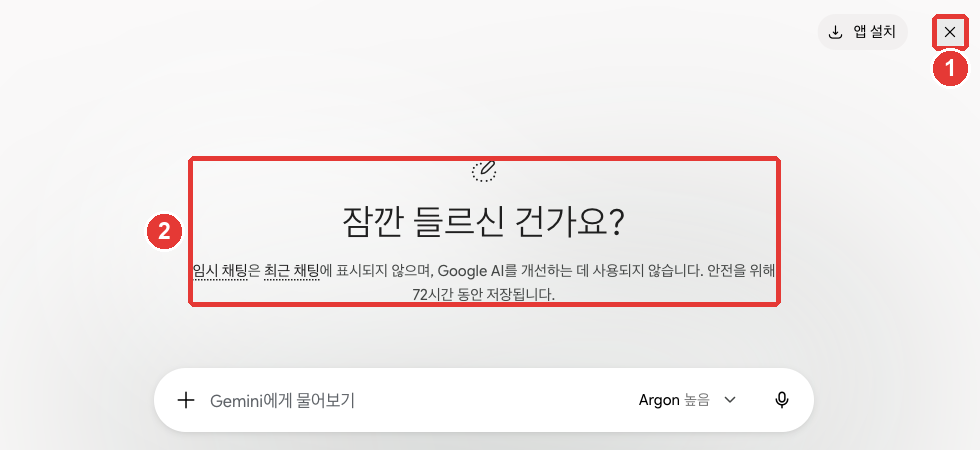

# 第2章 画面を見てみよう — どこに何があるか

> **一言まとめ**: Geminiの画面は、**左のサイドメニュー**（過去の会話）、**真ん中の入力欄**（質問する場所と「+」）、
> **入力欄の右のモデルボタン**（モデルと思考レベル）、**左下の「設定（설정）」**の4か所だけ知っていれば大丈夫です。最初は入力欄だけ使えば十分です。

画面は2026年10月のWeb版を基準にしていて、図は有料プラン（Google AI Pro）の韓国語画面です。無料アカウントでは、一部のメニューが表示されなかったり、鍵のマークがついていたりすることがあります。自分の画面と名前が違うときは、似た名前のボタンを探してみてください。

## 最初の画面をひと目で

ログインすると、真ん中に「何をお手伝いしましょうか？（무엇을 도와드릴까요?）」というあいさつと入力欄が表示されます。[^screen]


名前・会話のタイトル・ノートブックのタイトルは、例として変更した画面です（Google AI Pro）。**赤い番号は、下の表の番号と同じ場所です。**

画面は5か所に分けて見るとわかりやすくなります。

| 番号 | 場所 | 位置 | はたらき |
|---|---|---|---|
| ① | サイドメニュー | 左 | 新しいチャット、過去の会話、ノートブック |
| ② | 入力欄 | 真ん中 | 質問を書く、「+」でファイル・ツール |
| ③ | モデルボタン | 入力欄の右 | モデルと思考レベルを選ぶ |
| ④ | 「一時チャット（임시 채팅）」 | 右上 | 記録が残らない会話 |
| ⑤ | 「設定（설정）」 | 左下 | 使用量、サブスクリプション、テーマ、プライバシー |

出典: Gemini Web画面で直接確認[^screen]

入力欄の下にある「チャット（채팅）」・「タスク（작업）」の切り替えは、通常の会話と、**仕事をまるごと任せるタスク**を選ぶ場所です。タスクは[第8章](08-tasks.md)で扱うので、今は「チャット（채팅）」のままで大丈夫です。[^screen][^models]

最初から全部を知る必要はありません。入力欄に質問を書いて送るだけでかまいません。残りは、必要になったときにこの章をもう一度開いてください。

<Quiz id="ch302-home" />

## サイドメニュー — 新しいチャットと過去の会話

左のサイドメニューには、上から次のものがあります。[^screen]

- **「チャットを検索（채팅 검색）」**（虫眼鏡）: 過去の会話を言葉で探します。
- **「新しいチャット（새 채팅）」**: 新しい会話を開きます。話題が変わったら、ここを押してください（[第1章](01-getting-started.md)）。[^start]
- **「ライブラリ（라이브러리）」・「画像（이미지）」**: アップロードしたり作ったりしたファイルや画像をまとめて見ます（[第4章](04-files-create.md)）。
- **「予約済み（예약됨）」**: 決めておいた時間に自動で行う作業をまとめて見ます。
- **「カスタマイズ（맞춤설정）」**: スキルや連携するアプリを追加します。
- **「ノートブック（노트북）」**: 資料と会話をテーマごとにまとめておきます。「新しいノートブック（새 노트북）」・「すべてのノートブック（모든 노트북）」があります。
- **「すべて（전체）」**: これまでにやり取りした会話の一覧です。いちばん上が最新の会話です。

いちばん下には、自分のアカウント名とプラン（例:「Pro」）、そして歯車の「設定（설정）」があります。[^screen]

サイドメニューは、左上の「サイドバーを閉じる（사이드바 닫기）」（四角いアイコン）で折りたたんだり開いたりできます。[^screen]

ほかの人に画面を見せるときは、サイドメニューを折りたたんでおきましょう。会話一覧のタイトルだけでも、自分が何を聞いたのかが見えてしまうことがあります。

<Quiz id="ch302-sidebar" />

## 入力欄と+メニュー

入力欄「Geminiに聞く（Gemini에게 물어보기）」に質問を書いて送ります。[^screen][^start]
入力欄の左にある「+」（「アップロードとツール（업로드 및 도구）」）を押すと、ファイルとツールが出てきます。[^screen]


**赤い番号は、下の表の番号と同じ場所です。** ④は、③「その他のツール（도구 더보기）」にマウスを乗せると開きます。[^screen]

| 番号 | メニュー | はたらき |
|---|---|---|
| ① | 「ファイルをアップロード（파일 업로드）」・「Driveからファイルを追加（Drive에서 파일 추가）」 | 自分のファイルを一緒に送る |
| ② | 「画像を作成（이미지 만들기）」・「動画を作成（동영상 만들기）」・「音楽を作成（음악 만들기）」 | 画像・動画・音楽を作る |
| ③ | 「その他のツール（도구 더보기）」 | 残りのツールを開く |
| ④ | 「Canvas」 | 文書・アプリを横の画面で一緒に直す |
| ④ | 「Deep Research」 | 複数の資料を探して長いレポートを受け取る |
| ④ | 「ガイド付き学習（가이드 학습）」 | 勉強するように段階を追って学ぶ |

出典: Gemini Web画面で直接確認[^screen]

メニューが多く見えますが、最初は「ファイルをアップロード（파일 업로드）」ひとつだけ知っていれば大丈夫です。残りは第4章から一つずつ扱います。

ファイルは、一度に**10個まで**アップロードできます。動画は1本につき2GB、それ以外のファイルは1つにつき100MBまでです。[^files]

入力欄の右にあるマイク（「音声入力（음성기록）」）を押すと、声で入力できます。[^screen]

### 送った質問を直す

送った質問を直したいときは、自分の質問の横にある「テキストを編集（텍스트 수정）」（鉛筆）を押します。直したあとに「更新（업데이트）」を押すと、Geminiが答えを作り直します。[^start]
質問に抜けていた条件に、あとから気づいたときに便利です。同じ質問を最初から書き直さなくてもすみます。

たとえば、次のように送ったあとで「会社の同僚に」という条件が抜けていたことに気づいたら、質問を直して答えをもらい直してみましょう。

```
来週火曜日の会議を木曜日に移そうという短いメッセージを書いてください。
```

<Quiz id="ch302-plus" />

## モデルボタン — モデルと思考レベル

入力欄の右にあるモデルボタン（例:「Argon 高（Argon 높음）」）を押すと、**モデル**と**思考レベル**を選べます。[^screen]
モデルは答えを作るAIの種類で、思考レベルは答える前にどれくらい時間をかけて考えるかです。


Google AI Proの画面です。①モデルボタンを押すと②モデル一覧が開き、③「思考レベル（사고 수준）」にマウスを乗せると④3段階が開きます。チェックマークが、今選んでいるものです。[^screen]

### モデルを選ぶ

| モデル | 画面の説明 | こんなとき |
|---|---|---|
| Flash-Lite | 最速の回答を提供 | 短くて簡単な質問 |
| Flash | なんでもお手伝いします | ふだんのほとんどの仕事 |
| Pro | 高度な推論 | 複雑な質問、難しいコーディング |
| Argon | 複雑な作業 | とても難しくて複雑な仕事 |

出典: Gemini Web画面とGoogleヘルプ[^screen][^models]

モデル名の前の数字（例: 3.8 Flash）はバージョン番号です。よく変わるので、数字よりも**役割**で覚えてください。[^models]

**無料アカウントでは、モデルを自分で選べません。** Geminiが質問に合ったモデルを自動で選ぶか、Flash-Liteで答えます。[^models]
自分で切り替えるには、有料プラン（Google AIプラン）が必要です。鍵のマークがついたモデルは、プランを上げないと使えないという意味です。[^models]

### 思考レベル — どれくらい考えるか

「思考レベル ▸（사고 수준 ▸）」には3つの段階があります。[^screen][^models]

| 思考レベル | 画面の説明 | こんなとき |
|---|---|---|
| 低（낮음） | 速くて効率的 | 簡単な質問 |
| 中（보통） | バランスのとれた深さ | 少し考えてほしい仕事 |
| 高（높음） | とても徹底的 | 複数の段階が必要な難しい仕事 |

出典: Gemini Web画面とGoogleヘルプ[^screen][^models]

選ばないときの初期設定は「低（낮음）」です。[^models] ヘルプの韓国語版には「중간」と書かれている箇所もありますが、画面での名前は「中（보통）」です。[^screen]

### いつ上げるか

**良いモデルや高い思考レベルほど、使用量を多く使います。**[^models] ですから、いつも最高にしておく必要はありません。
ふだんは初期設定（「低（낮음）」）か軽い設定で使い、答えが浅かったり間違っていたりしたときだけ、一段階上げてみましょう。図の「Argon 高（Argon 높음）」は、このガイドが画面を見せるために選んだ設定です。ArgonはProまたはUltraプランでのみ表示されます（[第1章](01-getting-started.md)）。長く考えさせれば必ず良くなる、というわけでもありません（[ステップ1 第5章](../00-common/05-prompt-patterns.md)）。

知っておきたい点が2つあります。[^models]

- **一度選んだモデルは、その会話の中でずっと残ります。** あとでその会話に戻ってきても、同じモデルと思考レベルを使います。
- **どのモデルが答えたかを見るには**、答えの下の「もっと見る（더보기）」（点が3つ）を押して「回答の詳細を見る（응답 세부정보 보기）」を選びます。

有料プランで上限に達すると、会話はFlash-Liteで続きます。[^models] 答えが急に短くなったときは、「回答の詳細を見る（응답 세부정보 보기）」で確認してみましょう。

難しい仕事を任せる前に次のように聞くと、思考レベルを上げるほどの仕事かどうかを見きわめられます。

```
これから任せる仕事は、うちのチームの3か月分の予算表から減らせる項目を探すことです。
この仕事は、いくつもの段階に分けて考える必要がありますか。それとも、簡単に答えられますか。先に教えてください。
複数の段階が必要なら、どんな順番で考えるか、段階だけ書いてください。
```

<Quiz id="ch302-model" />

## 一時チャット — 記録が残らない会話

右上の「一時チャット（임시 채팅）」を押すと、**記録が残らない会話**が始まります。[^screen][^start]
一時チャットは、サイドメニューの会話一覧にも「Geminiアプリのアクティビティ（Gemini 앱 활동）」（自分の会話記録）にも残りません。[^start]



一時チャットをオンにすると②案内文が表示され、右上のアイコンが①閉じる（×）に変わります。×を押すと、通常の会話に戻ります。[^screen]

一時チャットは、次のようなときに使います。

- 会話一覧に残したくない質問をするとき
- 過去の会話や自分のカスタマイズの影響を受けずに、まっさらな状態から答えをもらいたいとき

そのかわり、できないことがあります。[^start]

- **一時チャットを出ると、その会話は二度と見られません。** 必要な答えは、出る前にコピーしておきましょう。
- GmailやDriveなどの**連携アプリ**は使えません。
- 自分の情報に合わせた**パーソナライズされた回答**は受け取れず、回答に**評価**（いいね・よくない）を残すこともできません。
- **個人のGoogleアカウント**でのみ使えます。会社・学校のアカウントでは使えません。

**一時チャットも、72時間はアカウントに保管されます。** 画面の案内文は「安全のため」と説明しています。そのかわり、GoogleのAIモデルの学習には使われません。[^screen][^privacy]
ですから、一時チャットであってもパスワードやマイナンバーのような情報は入れないでください（[ステップ1 第9章](../00-common/09-safety.md)）。プライバシー設定の詳細は[第9章](09-privacy.md)で扱います。

<Quiz id="ch302-temp" />

## 設定画面 — アカウント・環境設定・プライバシー

左下の歯車「設定（설정）」を押すと、メニューが3つのグループに分かれて開きます。[^screen]


名前・会話のタイトルは、例として変更した画面です。表の①②③は、図の番号と同じグループです。[^screen]

| グループ | メニュー | はたらき |
|---|---|---|
| ① アカウント | 「使用量の上限（사용량 한도）」・「サブスクリプションの管理（구독 관리）」 | 使った量を見る、プランを管理する（[第1章](01-getting-started.md)） |
| ② 環境設定 | 「パーソナルインテリジェンス（개인 인텔리전스）」・「スキル（스킬）」 | 自分の情報に合わせた答え、スキルの管理 |
| ② 環境設定 | 「テーマ（테마）」・「タスク設定（작업 설정）」 | 明るい・暗い画面、仕事を任せる設定 |
| ③ データとプライバシー | 「Geminiでメモリをインポート（Gemini로 메모리 가져오기）」 | 他のAIの記憶を移す |
| ③ データとプライバシー | 「自分の公開リンク（내 공개 링크）」・「アクティビティ（활동）」 | 共有したリンクの管理、会話記録の設定 |
| ③ データとプライバシー | 「フィードバックを送信（의견 보내기）」・「ヘルプ（도움말）」・「位置情報（위치）」 | 問題を知らせる、ヘルプ、位置情報の確認 |

出典: Gemini Web画面で直接確認[^screen]

最初に一度見ておくとよいのは、次の2つです。

- **「テーマ（테마）」**: 初期設定は、自分のデバイスの明るさの設定に従います。ここで暗い画面に変えられ、同じブラウザに保存されます。[^theme]
- **「アクティビティ（활동）」**: 押すと、新しいタブに「Geminiアプリのアクティビティ（Gemini 앱 활동）」が開きます。会話記録をどう保存するかを決める場所です。[第9章](09-privacy.md#「アクティビティを保存」のオンとオフ)で詳しく扱います。[^screen]

**画面の言語を個別に選ぶメニューはありません。** Webでは、ブラウザやデバイスの言語に従います。[^language]
画面の言語に関係なく、日本語で聞けば日本語で答えます。[^language]

<Quiz id="ch302-settings" />

## 実際にやってみよう

1. 最初の画面で、サイドメニュー・入力欄・モデルボタン・「一時チャット（임시 채팅）」・「設定（설정）」の5か所を探して押してみる。
2. 短い質問を一つ送ったあと、「テキストを編集（텍스트 수정）」で条件を一つ足して、答えをもらい直す。
3. 答えの下の「もっと見る（더보기）」→「回答の詳細を見る（응답 세부정보 보기）」で、どのモデルが答えたかを確認する。
4. 「一時チャット（임시 채팅）」をオンにして質問し、出たあとで、会話一覧に残っていないか確認する。
5. 「設定（설정）」→「テーマ（테마）」で暗い画面に変えてみて、もとに戻す。

**続きの課題**（[読書会の準備](../00-common/practice-kit.md)）: 第1章で受け取った準備リストの続きとして、「このリストを日付順に整理し直してください。」と聞いてみる。答えが気に入らなければ、質問を「テキストを編集（텍스트 수정）」で直して、もう一度答えをもらう。

## まとめ

- 画面は、サイドメニュー・入力欄・モデルボタン・「一時チャット（임시 채팅）」・「設定（설정）」の5か所に分かれている。
- サイドメニューで新しいチャットを開き、「チャットを検索（채팅 검색）」と「すべて（전체）」の一覧で過去の会話を探す。
- 入力欄の「+」に、ファイルのアップロードと作成ツールが集まっている。ファイルは一度に10個まで。
- モデルはFlash-Lite・Flash・Pro・Argon、思考レベルは低・中・高。高いほど使用量を多く使う。無料アカウントは自分で選べない。
- 一時チャットは会話一覧に残らないが、72時間はアカウントに保管される。出ると二度と見られない。
- 「設定（설정）」は、アカウント・環境設定・データとプライバシーの3グループ。画面の言語はブラウザの言語に従う。

## 用語のまとめ

| 用語 | 読み方 | 一言でいうと |
|---|---|---|
| Sidebar | サイドバー（サイドメニュー） | 画面の左に会話一覧とメニューが集まっている場所 |
| Model | モデル | 答えを作るAIの種類。FlashやProなど |
| Thinking Level | シンキング・レベル（思考レベル） | 答える前にどれくらい時間をかけて考えるか |
| Temporary Chat | テンポラリー・チャット（一時チャット） | 会話一覧にもアクティビティ記録にも残らない会話 |
| Gemini Apps Activity | ジェミニ・アップス・アクティビティ（Geminiアプリのアクティビティ） | 自分のGeminiの会話記録をまとめて管理する場所 |

<ChapterDone :chapter="302" />

次の章: [第3章 会話の管理](03-chats.md)

[^screen]: Gemini Web画面（Google AI Pro、韓国語）で直接確認。最初の画面「무엇을 도와드릴까요?」、入力欄「Gemini에게 물어보기」、「업로드 및 도구」(+)、モデルボタンと「음성기록」、右上の「앱 설치」と「임시 채팅」アイコン、入力欄の下の「채팅」「작업」切り替え。一時チャットの案内 "임시 채팅은 최근 채팅에 표시되지 않으며, Google AI를 개선하는 데 사용되지 않습니다. 안전을 위해 72시간 동안 저장됩니다." サイドメニュー「채팅 검색」「사이드바 닫기」「새 채팅」「라이브러리」「이미지」「예약됨」「맞춤설정」「노트북」「전체」、いちばん下のアカウント名・プラン表示と「설정」。+メニュー「파일 업로드」「Drive에서 파일 추가」「업로드 더보기」「이미지 만들기」「동영상 만들기」「음악 만들기」「도구 더보기」、「도구 더보기」の下の「Canvas」「Deep Research」「가이드 학습」「개인 인텔리전스(Labs)」（2026-10-30にはこれらのツールが+メニューの最初の段にあった）。モデルメニュー「3.5 Flash-Lite — 가장 빠른 답변 제공」「3.8 Flash — 무엇이든 도움을 받으세요」「3.1 Pro — 고급 추론」「4 Argon — 복잡한 작업」、思考レベル「낮음 — 빠르고 효율적」「보통 — 균형 잡힌 깊이」「높음 — 매우 철저함」。設定メニュー「계정」（「사용량 한도」「구독 관리」）、「환경설정」（「개인 인텔리전스」「스킬」「테마」「작업 설정」）、「데이터 및 개인 정보 보호」（「Gemini로 메모리 가져오기」「내 공개 링크」「의견 보내기」「도움말」「위치」「활동」）。「활동」は新しいタブ「Gemini 앱 활동」で開く。ヘルプ韓国語版の画面名: 「텍스트 수정」「업데이트」(13275745)、「응답 세부정보 보기」(18648722)。（確認日 2026-10-30、図と+メニュー・一時チャットは2026-10-31）
[^start]: Googleヘルプ「Use Gemini Apps」。"In the text box at the bottom, enter your question or prompt." / "To start a new chat, at the top left, click New chat" / "You can start a temporary chat that won’t appear in your Gemini Apps Activity or your recent chats." / "A personal Google Account. This feature is not available for users signed in to a work or school Google Account." / "When you leave the temporary chat, you’ll no longer have access to that chat, and it won’t appear in your recent chats." / "Use Connected Apps and other integrated services that require the Keep Activity setting to be turned on." / "Get personalized responses." / "If you want to revise your prompt, you can edit it, and Gemini will regenerate the response." https://support.google.com/gemini/answer/13275745 （確認日 2026-10-30）
[^files]: Googleヘルプ「Upload & analyze files in Gemini Apps」。"Up to 10 files (subject to availability) can be uploaded in the same prompt. When uploading a folder, each file inside will count towards this limit." / "Each video can be up to 2 GB. All other supported file types can be up to 100 MB." https://support.google.com/gemini/answer/14903178 （確認日 2026-10-30）
[^models]: Googleヘルプ「About Gemini models」。"Gemini Flash-Lite: A fast, cost-efficient model built for quick answers to everyday questions and lightweight tasks." / "Gemini Pro: An advanced reasoning model designed for complex prompts, sophisticated coding, and in-depth problem-solving." / "Gemini Argon: Top-tier intelligence, dynamic deep reasoning, and the highest performance for complex workflows." / "Auto or Flash-Lite*" / "If you have a Google AI plan you can manually switch models in both Chat Mode and Task Mode." / "Higher-tier models marked with a lock icon require an eligible plan upgrade" / "Low: Provides fast, concise answers for straightforward queries." / "High: Allows the model to carefully process and reason through complex, multistep prompts." / "If you don’t select a thinking level, it will default to Low." / "More advanced models and higher thinking levels require more of your usage." / "If you have a Google AI plan and reach your usage limit, your chat will continue with Flash-Lite." / "Gemini will continue to use that model and thinking level during the current conversation including if you later return to that same conversation." / "From the menu, select See response details ." / "Access to specific Gemini models, thinking levels, and task features varies depending on your plan and your remaining available usage." ヘルプには初期設定が自動モデル選択と書かれているが、このガイドが確認したProアカウントのモデルメニューには「自動」の項目がなかった。https://support.google.com/gemini/answer/18648722 （確認日 2026-10-30）
[^privacy]: Googleヘルプ「Gemini Apps Privacy Hub」。"Temporary chats and chats you have when Keep Activity is off are retained with your account for 72 hours and used to:" / "Temporary chats are not used to train Google’s AI models." https://support.google.com/gemini/answer/13594961 （確認日 2026-10-30）
[^theme]: Googleヘルプ「Use Dark theme in Gemini Apps」。"By default, the color scheme for the Gemini app matches the color scheme of the device you’re on." https://support.google.com/gemini/answer/13542227 （確認日 2026-10-30）
[^language]: Googleヘルプ「Change Gemini's language」。"The Gemini web app uses the language set in your browser or device language settings." / "Regardless of this setting, Gemini Apps can understand and reply in any supported language when you type your prompt or speak in Gemini Live." https://support.google.com/gemini/answer/15984485 （確認日 2026-10-30）
