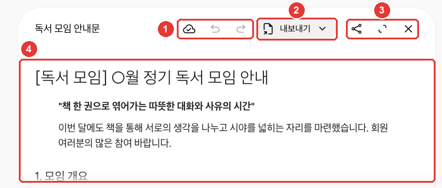

# 第4章 ファイルと作成 — ファイルのアップロード、Canvas、画像・動画・音楽

> **一言まとめ**: 入力欄の「+」から**ファイルをアップロード**して要約や分析をもらい、**Canvas**で文書とアプリを一緒に直し、
> **画像・動画・音楽**を作れます。Geminiで作ったメディアには、AIが作ったという表示が入ります。他の人が共有したアプリには、パスワードを入れないでください。

画面は2026年10月のWeb版を基準にしていて、図は有料プラン（Google AI Pro）の韓国語画面です。この章の機能のうち、動画の作成のように**有料プランが必要なもの**には「有料」と書きました。

## ファイルのアップロード

文書、表ファイル、写真、動画などのファイルをアップロードすると、その内容をもとに答えをもらえます。要約をもらったり、気になる点を聞いたり、分析を任せたりできます。[^files]
入力欄の「+」を押して「ファイルをアップロード（파일 업로드）」を選びます。Google Driveにあるファイルは、「Driveからファイルを追加（Drive에서 파일 추가）」で取り込みます（[第2章](02-screen-tour.md#入力欄と-メニュー)）。[^files][^screen]

一度にアップロードできる量には上限があります。[^files]

| 項目 | 上限 |
|---|---|
| 一度にアップロードするファイル数 | 10個まで（状況により異なる。フォルダの中のファイルも1つずつ数える） |
| 動画1本 | 2GBまで |
| それ以外のファイル1つ | 100MBまで |
| 動画の長さの合計 | 5分（Pro・Ultraは1時間） |
| 音声の長さの合計 | 10分（Pro・Ultraは3時間） |

出典: Googleヘルプ[^files]

Driveのファイルを取り込むには、「アクティビティの保存（활동 기록 보관）」がオンになっていて、Google Workspace（GmailやDriveなどのGoogleアプリのまとまり）がGeminiに連携されている必要があります（[第3章](03-chats.md#過去の会話を探す)）。[^files] 連携は[第7章](07-skills-apps.md#連携アプリ-—-gmail・drive・カレンダーをgeminiで)で扱います。

**表ファイルをアップロードすると、グラフも作れます。** Webで表ファイルをアップロードしたあと、グラフを作ってほしいと頼んでみましょう。作ったグラフは拡大して見たり、好きな形に直したりできます。[^files]

```
アップロードした家計簿ファイルで、今月の支出を項目別の棒グラフにしてください。
いちばん多く使った項目を3つ、別に一行ずつ指摘してください。
```

知っておきたい点が3つあります。[^files]

- **大きなファイルは、一部を読み落とすことがあります。** より良い結果がほしいときは、内容の少ない小さなファイルに分けてアップロードしてください。一度に読める量は、[第1章](01-getting-started.md#プランごとに何が違うか)のプランの表を見てください。
- **ファイル分析には、時間単位の上限が別にあります。** たくさんアップロードして上限に達したら、時間がたって解除されるまで待ちましょう。
- **アップロードしたファイルは、Geminiアプリのストレージを使います。** この容量は、Driveの容量とは別に数えます。「ファイルをアップロードするにはデータを削除してください（파일을 업로드하려면 데이터를 삭제하세요）」と表示されたら、容量がいっぱいです。「設定（설정）」→「アクティビティ（활동）」で過去のアクティビティを消すと空きます。動画や写真が入った会話は、容量をより多く使います。

ファイルをアップロードする前に、そのファイルに他の人の個人情報が入っていないか、一度見ておきましょう（[ステップ1 第9章](../00-common/09-safety.md)）。

<Quiz id="ch304-upload" />

## Canvas — 文書とアプリを一緒に直す

**Canvas**（キャンバス）は、文書やアプリを別のウィンドウに表示して、Geminiと一緒に直す機能です。文書、アプリ、スライド、コードを作れます。[^canvas]
入力欄の「+」→「その他のツール（도구 더보기）」→「Canvas」を押して、作りたいものを書いて送ります（[第2章](02-screen-tour.md#入力欄と-メニュー)）。[^canvas][^screen]



練習で作ったお知らせです。このガイドが確認した画面では、文書ウィンドウが**会話の中に**開きました。③の「全画面（전체 화면）」を押すと、大きく見られます。[^screen]

| 番号 | ボタン | はたらき |
|---|---|---|
| ① | 「変更が保存されました（변경사항이 저장됨）」・「前のバージョン（이전 버전）」・「次のバージョン（다음 버전）」アイコン | 保存状態を見る、前後のバージョンを行き来する |
| ② | 「エクスポート（내보내기）」 | Docsなど外に移す |
| ③ | 「共有（공유）」・「全画面（전체 화면）」・「閉じる（닫기）」アイコン | リンクを作る、大きく見る、閉じる |
| ④ | 文書の本文 | 直接直す、または選んでGeminiに直してもらう |

アイコン名は、マウスを乗せると出る名前です。出典: Gemini Web画面で直接確認[^screen]

最初に開くと、「どこでもクリックして直接入力・修正するか、テキストを選択してGeminiに変更を頼んでください。（아무 곳이나 클릭하여 직접 입력하고 수정하거나, 텍스트를 선택하여 Gemini에게 변경을 요청하세요.）」という案内が出ます。[^screen] ④本文を直接直してもかまいませんし、直したい部分を選んでGeminiに任せてもかまいません。

スライドのように**特定の形式**が必要なときは、質問にそう書きましょう。[^canvas] たとえば、次のように頼めます。

```
来月の読書会のお知らせを作ってください。日付、場所、読む本、持ち物を入れて、
1枚の文書として書いてください。
```

Canvasでできることは次のとおりです。[^canvas]

- **変更した内容は自動で保存されます。** 前のバージョン・次のバージョンのボタンで、以前に保存された状態をもう一度見られます。
- **一部だけ直せます。** 直したい部分をマウスでドラッグして選んでから、何を変えるかを書いてください。
- **文書は、長さと口調をすぐに変えられます。** 「長さを変更（길이 변경）」・「トーンを変更（어조 변경）」を押します。
- **別の形式に変えられます。** 作った文書から、スライド、クイズ、インフォグラフィック（情報を絵で整理した1枚の資料）、ウェブページ、音声概要（文書を会話形式の音声で聞かせるもの）などを作れます。今のところ、18歳未満はこの機能を使えません。
- **外に移せます。** Docsにエクスポートしたり、スライドをGoogleスライドやPDFにエクスポートしたりできます。

アプリを作ると、Canvasの右上でコードを直接見て直したり、「コンソールを表示（콘솔 표시）」でエラーを見たりできます。[^canvas] アプリに文章や絵の作成のようなAI機能を入れるには、ログインした18歳以上である必要があります。[^canvas]

**Canvasで作ったものは、その会話と一緒に削除されます**（[第3章](03-chats.md#固定・名前の変更・削除)）。長く使う文書は、Docsにエクスポートしておきましょう。

<Quiz id="ch304-canvas" />

## Canvasアプリを共有するときと受け取るとき

Canvasで作ったアプリも、共有リンクを作れます。このときは、会話を共有するときよりも注意が必要です。

**複数の人がデータを共有するアプリは、リンクを持っている人なら誰でもそのアプリのデータを見て、直せます。**[^canvas][^canvas-safety]
保存機能のあるアプリを作ると、Geminiがデータベース（データを保存しておく場所）も一緒に作ります。複数の人がデータを共有するアプリは公開データベースに保存されるので、リンクを持っている人なら誰でも見て、直せます。[^canvas-safety]
たとえば、サークルのメンバーの連絡先を集めるアプリを作ってリンクを広めると、リンクを受け取った人なら誰でもその連絡先を見られます。個人情報を集めるアプリは、共有しないでください。

**他の人から送られてきたアプリは、見知らぬ人からのメールのように疑ってください。** アプリに入れた情報は、アプリを作った人が見られますし、リンクを持っている他の人にも見える可能性があります。Googleは次のように案内しています。[^canvas-safety]

- **パスワードや決済情報を聞いてくるアプリには、十分に気をつけてください。**
- **カメラ・マイクの権限を求めるアプリ**にも気をつけてください。
- **信頼できない場所から来たアプリは、ダウンロードしないでください。**
- 危険に見えるアプリは、ページの下にあるリンクから報告できます。

共有されたCanvasのリンクはWeb（gemini.google.com）でのみ開け、スマホアプリでは開けません。[^canvas]

<Quiz id="ch304-canvas-safety" />

## 画像の作成

文章で説明すると、Geminiが絵を作ってくれます。絵を作るモデルは**Nano Banana**（ナノバナナ）です。[^image]
入力欄の「+」→「画像を作成（이미지 만들기）」を押すか、サイドメニューの「画像（이미지）」でテンプレート（あらかじめ用意された型）を選ぶか、そのまま説明を書きます。[^image][^screen]


①サイドメニューの「画像（이미지）」を押すと、②入力欄に絵を説明したり、③テンプレートを選んだりして始められます。入力欄の下の「アスペクト比（가로세로 비율）」で、絵の形（横と縦の長さの比率）を選びます。[^screen]

**上手に描いてもらうコツ**は次のとおりです。[^image]

- 「描いて」「作って」のように、何をするかから書き始めましょう。
- 画風（写真のように、水彩画、マンガなど）と、何がどこで何をしているかを詳しく書きましょう。

| 物足りない依頼 | より良い依頼 |
|---|---|
| 「猫の絵」 | 「窓辺でうとうとしているオレンジ色の猫を、水彩画のような雰囲気で描いてください。午後の日差しが差し込む場面で。」 |

より良い依頼は、画風・主役・場所・雰囲気をすべて伝えているので、描き直してもらう手間が減ります。

作った絵は、**会話で直せます。** サイドメニューの「ライブラリ（라이브러리）」で絵を開き、下の「チャット（채팅）」を押して、変えたい点を書きます。自分の写真をアップロードして直したり、複数の画像を合わせて新しい絵を作ったりもできます。[^image]

プランによって変わる点もあります。[^image]

- **ダウンロードするサイズ**: Google AIプランがあれば2K、なければ1Kの解像度です。
- **より精密なモデル（有料）**: 有料プランでは、**Nano Banana Pro**で絵を作り直せます。モデルをProにしているときに使えます。ただし、その日に使えるNano Banana 2の画像の上限を使い切ると、Proで作り直せません。

絵を**作るだけ**なら13歳以上（国によって基準の年齢が異なることがあります）、**直すところまで**するなら18歳以上である必要があります。[^image] 規約に違反したと思われる絵は、削除されることがあります。[^image]

<Quiz id="ch304-image" />

## 動画・音楽の作成

### 動画の作成（有料）

**Gemini Omni**（ジェミニ・オムニ）で、会話するように動画を作って直します。文章、絵、映像を混ぜて説明できます。[^video]
個人アカウントでは、**Google AIプランが必要**です。[^video] 入力欄の「+」→「動画を作成（동영상 만들기）」を押して、ほしい映像を書きます。[^video][^screen]

- **参考資料をアップロードできます。** 動画1本と写真5枚までアップロードできます。[^video]
- **作るのに数分かかります。** 作っている間はその会話を使えないので、新しいチャットを開いて別のことをしてから戻ってきましょう。[^video]
- **会話で直します。** 物を消したり変えたり、カメラの角度や場面を変えてほしいと頼めます。[^video]
- **横画面が初期設定です。** 参考にする写真や映像をアップロードすると、その比率に従います。[^video]
- 完成した映像は、YouTubeに投稿したり、ダウンロードしたりできます。[^video]

**アップロードする写真は、自分に使う権利があるものだけ**にしてください。規約や他の人の権利に違反すると、アカウントが停止されることがあります。[^video]

### 音楽の作成

**Lyria**（リリア）に曲を説明すると、音楽と歌詞を作ってくれます。[^music] 入力欄の「+」→「音楽を作成（음악 만들기）」を押します。[^music][^screen]

- **18歳以上**で、「アクティビティの保存（활동 기록 보관）」がオンになっている必要があります。[^music]
- 長さは**短め（約1分）**か**フル（約2〜3分）**から選び、歌が入るかどうかとジャンルも選べます。[^music]
- **フルの長さの曲を作るには、モデルをProに**切り替える必要があります（[第2章](02-screen-tour.md#モデルボタン-—-モデルと思考レベル)）。[^music]
- 曲は、ジャケット画像がついた動画（MP4）か、音だけ（MP3）でダウンロードできます。[^music]
- 作れる曲の数には上限があります。超えると通知が届きます。[^music]

音楽も「書いて」「作曲して」で書き始め、ジャンルと楽器を書くとよいです。[^music]

```
読書会の始まりに流す、穏やかな曲を作曲してください。アコースティックギターとピアノで、
歌詞なしで短く作ってください。
```

画像・音楽・動画の作成は、**使用量を多く使います。** 動画がいちばん多く使います（[第1章](01-getting-started.md#利用上限-—-5時間・週間・読む量)）。

<Quiz id="ch304-media" />

## AIが作ったものか確認する — ウォーターマーク

Geminiで作ったり直したりした画像・動画・音楽には、**AIが作ったという表示**が入ります。[^watermark][^music]

| 表示 | 見えるか | はたらき |
|---|---|---|
| SynthID（シンスID）ウォーターマーク | 見えない | Google AIで作ったものかどうかを調べるための隠れた表示 |
| Content Credentials（コンテンツ・クレデンシャル） | 見えない | どこでどう作られたかを残す記録 |
| 見えるウォーターマーク | 見える | 絵や映像に重ねて表示される印 |

出典: Googleヘルプ[^watermark][^verify]

**韓国では、AI Ultraでなければ、見えるウォーターマークをオフにできません。** ウォーターマークをオン・オフする「メディアのウォーターマーク（미디어 워터마크）」設定がありますが、韓国では**AI Ultraの購読者にだけ**表示されます。[^watermark] そのため、無料・Plus・Proで作った絵と動画、音楽の動画画面には、見えるウォーターマークがつきます。この設定が変えるのは見えるウォーターマークだけで、隠れた表示（SynthID・Content Credentials）はそのまま残ります。[^watermark]

### 受け取った絵がAIで作られたものか聞いてみる

受け取った絵・動画・音声がAIで作られたものか気になったら、Geminiにアップロードして聞いてみましょう。[^verify]

```
この写真はAIで作ったものですか？
```

知っておきたい点があります。[^verify]

- **Google AIで作られたものだけを見分けます。** 隠れた表示がないという結果が出ても、他の会社のAIで作った可能性があります。
- **スクリーンショットは、絵の部分だけをぴったり切り取って**アップロードしてください。複数の絵を1枚にまとめてアップロードすると、精度が下がります。
- **ファイルは一度に1つ**で、100MB未満である必要があります。動画は90秒未満でなければなりません。
- **確認の回数には上限があります。** 24時間で、画像は約10回、動画は10回、音声は10回です。
- **Content Credentialsは、「AIが作った」と断定してくれません。** 出どころと履歴を示すだけで、判断は自分でします。

ツールだけを信じず、自分でも見てみましょう。文字が崩れていないか、手や歯のような細かい部分が不自然でないか、影が合っているかを見ます。Google画像検索で元の画像を探してみるのも方法です。[^verify]

<Quiz id="ch304-verify" />

## 実際にやってみよう

1. 家にある表ファイル（家計簿など）をアップロードして、「項目別に棒グラフを描いてください」と頼んでみる。個人情報が入っていないファイルで行う。
2. 「Canvas」で1枚のお知らせを作り、1段落だけドラッグして選んで「もっと短く」と直してみる。
3. 「画像を作成（이미지 만들기）」で水彩画のような絵を一つ作り、「ライブラリ（라이브러리）」で開いて色を変えてほしいと頼む。
4. 今作った絵を新しいチャットにアップロードして、「この絵はAIで作ったものですか？」と聞いてみる。

**続きの課題**（[読書会の準備](../00-common/practice-kit.md)）: 課題のサンプル議事録ファイルをアップロードして要約をもらったあと、「Canvas」でお知らせの下書きを作る。お知らせはDocsにエクスポートしておく。

## まとめ

- 入力欄の「+」→「ファイルをアップロード（파일 업로드）」で、一度に10個までアップロードする。動画は2GB、それ以外のファイルは100MBまで。
- 大きなファイルは一部を読み落とすことがある。アップロードしたファイルは、Driveとは別に数えるGeminiアプリのストレージを使う。
- Canvasは、文書・アプリ・スライドを別のウィンドウに表示して一緒に直す。一部だけ選んで直し、バージョンで戻して見られる。
- 複数の人がデータを共有するCanvasアプリは、リンクを受け取った人なら誰でもデータを見て、直せる。他の人から送られてきたアプリには、パスワード・決済情報を入れない。
- 画像はNano Bananaで作り、会話で直す。作るのは13歳以上、直すところまでは18歳以上。
- 動画（Gemini Omni）は、有料プランが必要。音楽（Lyria）のフルの長さの曲は、モデルをProに切り替える必要がある。
- Geminiで作ったメディアには、隠れた表示（SynthID）が入る。韓国で見えるウォーターマークをオフにできるのは、AI Ultraだけ。

## 用語まとめ
| 用語 | 読み方 | 一言でいうと |
|---|---|---|
| Upload | アップロード | 自分のデバイスのファイルをサービスに送ること |
| Canvas | キャンバス | 文書・アプリを別のウィンドウに表示して、Geminiと一緒に直す機能 |
| Infographic | インフォグラフィック | 情報を絵や図表で整理した1枚の資料 |
| Nano Banana | ナノバナナ | Geminiの画像作成モデル |
| Gemini Omni | ジェミニ・オムニ | Geminiの動画作成モデル |
| Lyria | リリア | Geminiの音楽作成モデル |
| Watermark | ウォーターマーク | 誰が・何で作ったかを知らせる表示 |
| SynthID | シンスID | Google AIで作ったメディアに隠して入れる表示 |

<ChapterDone :chapter="304" />

次の章: [第5章 記憶とカスタマイズ](05-memory.md)

[^screen]: Gemini Web画面（Google AI Pro、韓国語）で練習用の会話を使って直接確認（会話は撮影後に削除）。Canvasの文書ウィンドウが会話の中に開き、上のボタンは「변경사항이 저장됨」「이전 버전」「다음 버전」「내보내기」「공유」「전체 화면」「닫기」、最初に開いたときの案内 "직접 또는 Gemini로 수정 — 아무 곳이나 클릭하여 직접 입력하고 수정하거나, 텍스트를 선택하여 Gemini에게 변경을 요청하세요." Canvasの項目はオン・オフを切り替えるメニュー項目で、オンにすると入力欄に「Canvas」の表示がつく。「이미지」画面 "템플릿을 사용해 보거나 채팅으로 아이디어를 설명하세요. Nano Banana 모델로 만듭니다."、入力欄「이미지를 설명하세요」、「가로세로 비율」、最初に開いたときの案内ウィンドウ "Nano Banana 2 사용"。入力欄の「+」（「업로드 및 도구」）メニュー「파일 업로드」「Drive에서 파일 추가」「업로드 더보기」「이미지 만들기」「동영상 만들기」「음악 만들기」「도구 더보기」→「Canvas」。サイドメニュー「이미지」「라이브러리」。「설정」メニューに「미디어 워터마크」は表示されなかった（Proアカウント）。（確認日 2026-10-31）
[^files]: Googleヘルプ「Upload & analyze files in Gemini Apps」（韓国語版「Gemini 앱에서 파일 업로드하고 분석하기」）。"You can upload documents, spreadsheets, notebooks, photos, videos, and more to Gemini Apps to get answers, summaries, and insights about your content." / "To add files from your Drive, you need to have Keep Activity on and connect Google Workspace to Gemini Apps." / "Up to 10 files (subject to availability) can be uploaded in the same prompt. When uploading a folder, each file inside will count towards this limit." / "Each video can be up to 2 GB. All other supported file types can be up to 100 MB." / "Total video length can be up to 5 minutes. Upgrade to Google AI Pro or Google AI Ultra to extend total upload length to 1 hour." / "Total audio length can be up to 10 minutes. Upgrade to Google AI Pro or Google AI Ultra to extend total upload length to 3 hours." / "You can ask the Gemini web app to create a chart based on your uploaded spreadsheet(s), zoom in to explore the chart, and customize the chart for your needs." / "This limit is independent from your Google Drive or Google Workspace storage limit." / "Important: Chats or Gems with uploaded files such as videos, photos, or files from Google Drive or NotebookLM take up more storage space in Gemini Apps." / "There are rolling limits for how much you can upload and analyze files in a period of time. After some time, the limit will reset, and you will be able to upload and analyze files again." / "For better results, upload smaller files with less content, or upgrade to Google AI Pro or Google AI Ultra for a larger 1 million token context window." 韓国語画面の名前「파일을 업로드하려면 데이터를 삭제하세요」「활동」。https://support.google.com/gemini/answer/14903178 （確認日 2026-10-31）
[^canvas]: Googleヘルプ「Create docs, apps & more with Canvas」（韓国語版「Canvas로 문서, 앱 등 만들기」）。"You can collaborate with Gemini in Canvas to create or edit a doc, app, slides, or code. You can also turn your creation into an Audio Overview, quiz, or other format." / "Tip: To have Gemini use a specific format or document type, like a slide deck, include this instruction in your prompt." / "You can use the prompt text box to ask Gemini to make updates to your app or directly edit the code. Changes in Canvas are auto-saved." / "To view your saved versions, at the top, click Previous Version  or Next Version ." / "To open text in a new Google Doc: Click Export to Docs." / "To find errors and logs from the preview, at the top right of the Canvas panel, click Show console ." / "Use the cursor to select the section that you want to edit." / "Important: To add AI to your app, you must be signed in to Gemini Apps and be 18 or over." / "To adjust the tone of text: Click Change tone  and select how casual or formal you want it to be." / "To generate an infographic, click Infographic ." / "Create something based on a Canvas doc Important: For now, this feature isn’t available to users under 18." / "To open slides in Google Slides: Click Export to Slides. You can also choose to export slides as a PDF." / "Anyone with that public link can view and edit data associated with the app." / "Shared links only open in gemini.google.com. You can’t open shared Canvas content in the Gemini mobile app." 韓国語画面の名前「이전 버전」「다음 버전」「콘솔 표시」「길이 변경」「어조 변경」「Docs로 내보내기」。https://support.google.com/gemini/answer/16047321 （確認日 2026-10-31）
[^canvas-safety]: Googleヘルプ「Canvas safety & security in Gemini Apps」（韓国語版「Gemini 앱의 Canvas 안전 및 보안」）。"When you create an app with Canvas that requires persistent data storage, Gemini Apps creates a firestore database instance for you." / "Anyone with the public link to a multi-user app can view and edit all data associated with the app." / "Any info that you share with the app is visible to the app creator and may be visible to anyone else with the public link." / "Use caution if the app requests access to your device’s camera and microphone." / "If the app will share data between users, the data is in a public database and can be seen or edited by anyone with a public link to the app." / "Be extremely wary of any app that asks you for sensitive info like passwords or payment details." / "Do not download apps created or shared by untrustworthy sources." / "If you get a public link to a Canvas app that you feel is unsafe, you can report unsafe apps through the link at the bottom of the page." https://support.google.com/gemini/answer/16419134 （確認日 2026-10-31）
[^image]: Googleヘルプ「Generate & edit images with Gemini Apps」（韓国語版「Gemini 앱으로 이미지 생성 및 수정하기」）。"For paid subscribers, Nano Banana Pro is also available to regenerate images." / "To generate and edit images, you must be 18 or over" / "To generate images, you must be 13 (or the applicable age in your country) or over." / "Download images at at 2K resolution with a Google AI plan or at 1K without an AI plan." / "Nano Banana Pro: Available with a Google AI Plan, this option is available when you have the Gemini model set to Pro and want  to redo an image when additional detail is needed." / "Choose a template or enter your prompt to generate an image with Nano Banana 2." / "On the top left, click Open Sidebar   Library ." / "Upload multiple images and ask Gemini to create a new image based on your uploaded images." / "If you reach your daily quota of Nano Banana 2 images, you can’t redo any additional images with Nano Banana Pro." / "Start your prompt with words like draw, generate, and create." / "Gemini Apps may remove images for prompts when our systems detect a possible violation of Google's Terms of Service, including the Prohibited Use Policy." 韓国語画面の名前「이미지」「라이브러리」「채팅」。https://support.google.com/gemini/answer/14286560 （確認日 2026-10-31）
[^video]: Googleヘルプ「Generate videos with Gemini Apps」（韓国語版「Gemini 앱으로 동영상 생성하기」）。"Gemini Omni makes creating and editing videos as easy as having a conversation." / "Blend text, images, and video to bring your ideas to life" / "You must have rights to any images that you upload." / "To use this feature with a personal account, you must have a Google AI plan." / "For text prompts, the default is Landscape. If you upload a reference image or video, the aspect ratio will match your uploaded content." / "In the text box, enter a prompt of the video you want to generate." / "You can upload one video and up to 5 images." / "While your video is being generated, you can’t interact with the same chat. You can start a new chat and come back to view your video later." / "Changing camera angles." / "Click Share on YouTube  or  Download video ." / "The violation of the Prohibited Use Policy or the rights of others could result in the termination of your account." 韓国語画面の名前「동영상 만들기」。https://support.google.com/gemini/answer/16126339 （確認日 2026-10-31）
[^music]: Googleヘルプ「Generate music with Gemini Apps」（韓国語版「Gemini 앱으로 음악 생성하기」）。"Describe the track you have in mind, Gemini Apps will create music and lyrics." / "Be 18 years of age or older." / "Have Keep Activity on." / "Choose whether your track has vocals or not." / "Select a genre for your track." / "Important: To create a full track, switch the model to “Pro”" / "At the bottom of the text box, tap Upload & tools   Create music ." / "Define the length of your track by choosing between short (about 1 minute) or full (about 2-3 minutes)." / "Each generated track will have an embedded digital watermark to help identify it as AI-generated." / "There are limits for how many tracks you can create with Lyria. You’ll get a notification when you’ve exceeded the limit." / "Start your prompt with words like write, compose, or create." 韓国語画面の名前「음악 만들기」。https://support.google.com/gemini/answer/16901237 （確認日 2026-10-31）
[^watermark]: Googleヘルプ「Manage watermark settings in Gemini Apps」（韓国語版「Gemini 앱에서 워터마크 설정 관리하기」）。"This setting controls visible watermarks across all visual media you create with Gemini, including images, videos, and music." / "If you are in India, South Korea, or Vietnam, you'll only see this setting if you have an AI Ultra subscription." / "Otherwise you'll automatically see visible watermarks applied to all visual media you create with Gemini Apps." / "Music: The watermark will appear on the video or visual player that is created with your music track." / "This setting only controls the visible watermark. It doesn’t affect SynthID watermarks or Content Credentials for media you create with Gemini Apps." / "SynthID: All AI-generated media created or edited with Gemini Apps includes an invisible SynthID watermark." 韓国語画面の名前「미디어 워터마크」。https://support.google.com/gemini/answer/17405358 （確認日 2026-10-31）
[^verify]: Googleヘルプ「Verify AI-generated images, videos, and audio」（韓国語版「AI 생성 이미지, 동영상, 오디오 확인하기」）。"You can only choose a single image, video, or audio file to verify at a time, and it should have a file size of 100 MB or less." / "Content Credentials: A technology that acts like a digital passport, documenting the digital content's origin and history, and is used for both AI and non-AI content." / "Videos need to be less than 90 seconds each, and audio files need to be less than 1 hour each" / "If you're taking a screenshot of an image to verify, make sure to crop tight around the image to get maximum accuracy, and don’t upload a collage of multiple distinct images." / "While other companies have started to adopt SynthID watermarks, Gemini can currently only recognize content created by Google AI tools." / "If a SynthID watermark isn’t detected, it means the image or video wasn’t created or edited by Google AI, but it could have been created by other AI systems." / "Tell you if an image, video, or audio file is definitely AI-generated, but you can use the origin and history information with the content itself to make informed decisions." / "There’s a usage quota of approximately 10 image checks, 10 video checks (up to 5 minutes total), and 10 audio checks (up to 3 hours total) within any 24-hour rolling window." / "Reverse image search: Use reverse image search tools (e.g., Google Images) to find original sources or similar images." https://support.google.com/gemini/answer/16722517 （確認日 2026-10-31）
