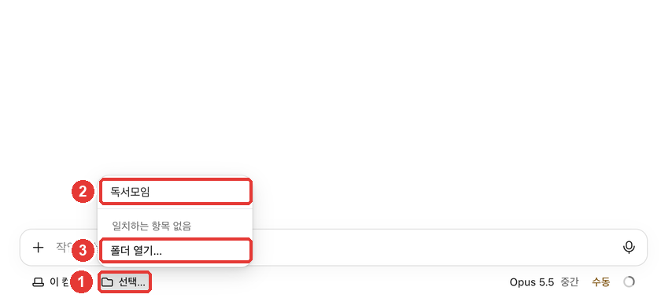
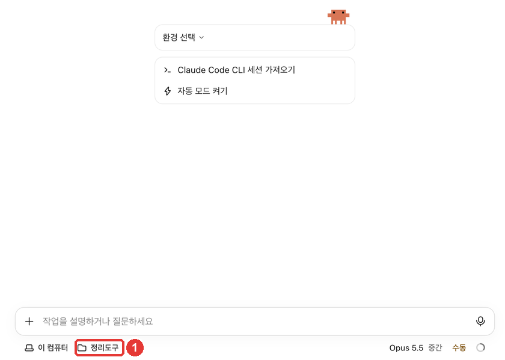
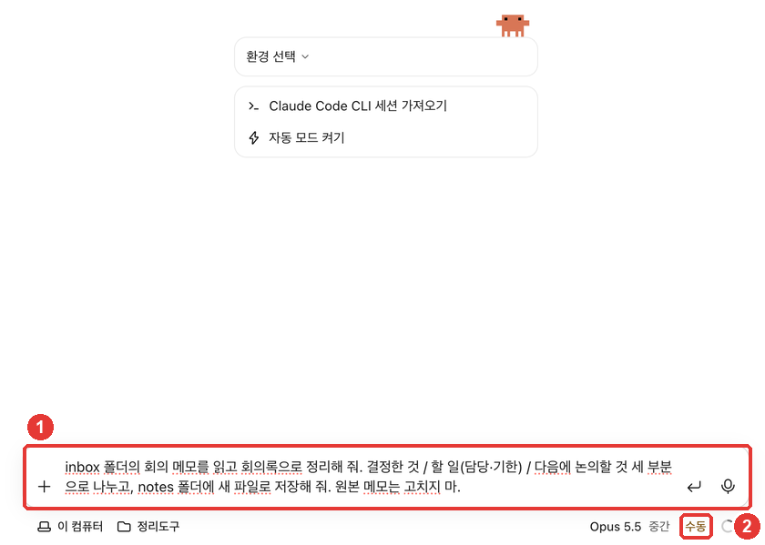
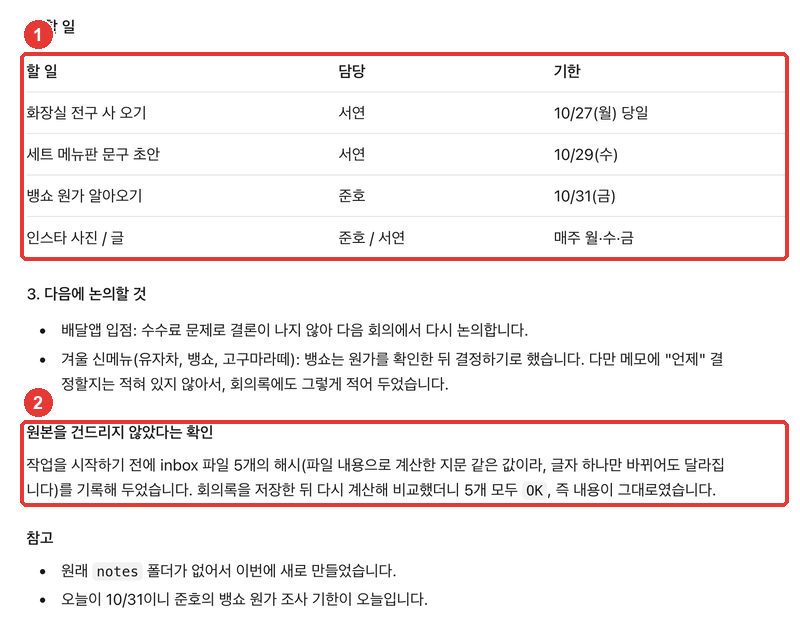

# 2章. デスクトップアプリのインストールと最初のセッション — インストール・ログイン、Codeタブ、フォルダ選び、最初の仕事の頼み方

> **一言まとめ**: Claudeデスクトップアプリをインストールして **Code** タブを開きます。入力欄の下の行で **フォルダを選び**、やってほしいことをふだんの言葉で書いて送ると、Claudeがそのフォルダの中で作業します。
> この章では、ごちゃごちゃした会議メモを **自分で決めた形式の議事録** に整理してもらいます。ステップ3を通して育てていく「自分のやり方で整理してくれるツール」の第一歩です。

この章は、2026年10月31日に確認したClaude Codeの公式ドキュメントと、macOSデスクトップアプリ（韓国語の画面、有料アカウント）をもとに書きました。画面の名前はよく変わります。自分の画面と違うときは、画面に表示されている名前に合わせて読み替えてください。

## インストールしてログインする

Claude Codeは **Claudeデスクトップアプリの中に入っています。** アプリだけをインストールすれば大丈夫です。ほかのプログラム（開発用の実行ツールであるNode.jsや、ターミナル用のClaude Code）を別にインストールする必要はありません。[^quickstart]

1. 公式ドキュメントのインストールページから、自分のパソコンに合ったファイルをダウンロードします。[^quickstart]
   - **macOS**: 1つのファイルで、IntelのMacにもApple siliconのMacにもインストールできます。
   - **Windows**: ふつうのPC（x64）向けのインストーラーがあり、ARM64のPC向けは別にあります。
   - **Linux**: ベータ版（試験版）で、UbuntuとDebianではapt（Linuxのプログラムインストールツール）でインストールします。
2. ダウンロードしたファイルを実行してインストールします。
3. アプリを開いて **Anthropicアカウント** でログインします。[^quickstart] 個人のサブスクリプション（Pro・Max・Ultra）なら、claude.aiで使っているアカウントでログインします。[^auth]

ステップ2でClaudeアプリをすでにインストールしているなら、この手順は飛ばしてかまいません。アプリが古いときは最新版をダウンロードしておきましょう。macOSはメニューバーの **Claude → 업데이트 확인…**（アップデートを確認…）、Windowsは **Help → Check for Updates…** です。[^update]

<Quiz id="ch402-install" />

## Codeタブを開く

Claude Codeは、アプリの横メニューの一番上にある **Code** タブにあります。[^quickstart] タブがアイコンだけに見えるときは、マウスを重ねて名前を確認してください。[^quickstart] macOSでは、メニューバーの **이동 → Code**（移動 → Code）からも開けます。

Codeを押したときに案内が出たら、次のようにします。[^quickstart]

- **有料プランに切り替えるよう求める案内**: Claude Codeは有料サブスクリプションがないと使えません（[第1章](01-what-is.md#何が必要か-—-料金プラン)）。購読してから、もう一度開きます。
- **オンラインでログインするよう求める案内**: ログインを済ませて、アプリを再起動します。
- **403エラー**（アクセスが拒否されたというエラー）: 公式ドキュメントの認証トラブルの案内を見ます。

Codeタブで新しいセッションを開くと、こんな画面が出ます。


作業中にいちばんよく見る場所は **入力欄の下の行** です。公式ドキュメントも、最初のメッセージを送る前にこの行で環境・フォルダ・権限モード・モデルを選ぶよう案内しています。[^desktop-start]

| 番号 | 画面の名前 | 役割 |
|---|---|---|
| ① | スタート案内カード | 新しいセッションでだけ表示。今は使わなくてよい |
| ② | 入力欄 | やってほしいことを書いて送る場所 |
| ③ | 이 컴퓨터（このパソコン） | どこで作業するか（環境）。自分のパソコンでするならそのまま |
| ④ | 선택…（選択…） | どのフォルダで作業するか |
| ⑤ | Opus 5.5 · 중간（中） | どのモデルが、どのくらい深く考えるか |
| ⑥ | 수동（手動） | Claudeが何を、聞かずにしてよいか（権限モード） |

出典: 画面の名前はこのガイドの画面確認（2026-10-31）、役割は公式ドキュメント[^desktop-start]

③の環境は、最初は **이 컴퓨터（このパソコン）** のままで大丈夫です。公式ドキュメントの「Local」（自分のパソコン）がこの項目です。[^quickstart] クラウドで作業する方法は8章で扱います。

モデル（⑤）はあとから変えられます。[^quickstart] 最初は、画面で選ばれているものをそのまま使ってかまいません。

::: details 入力欄の上に「환경 선택」（環境を選ぶ）があり、下の行に環境がないとき
以前の画面レイアウトです。公式ドキュメントは、新しいセッションの入力欄の下に環境が見えないときは以前のレイアウト（earlier layout）だと案内しています。[^quickstart] 以前のレイアウトでは、環境とフォルダを **入力欄の上** で、権限モードとモデルを **下の行** で選びます。[^desktop-layout] やることは同じです。
:::

<Quiz id="ch402-screen" />

## 練習用フォルダを用意して選ぶ

Claude Codeは **自分が選んだフォルダの中で** 作業します。だから最初は、壊れても困らない **練習用のフォルダ** を別に作るのがおすすめです。公式ドキュメントも、最初はよく知っている小さなプロジェクトから始めるよう勧めています。[^quickstart]

**練習の材料**: 小さなカフェ「街角カフェ」の店員ソヨンの1週間分のメモです（すべて作り話です）。この章では会議メモを1つだけ使い、残りはあとの章で使います。

| ファイル | 内容 |
|---|---|
| [회의-2026-10-27-주간회의.txt](/practice/notes/inbox/회의-2026-10-27-주간회의.txt) | ごちゃごちゃした週次会議のメモ |
| [공부-2026-10-28-프롬프트-강의.txt](/practice/notes/inbox/공부-2026-10-28-프롬프트-강의.txt) | 講座を聞きながら取ったノート |
| [회고-2026-10-29.txt](/practice/notes/inbox/회고-2026-10-29.txt) · [10-30](/practice/notes/inbox/회고-2026-10-30.txt) · [10-31](/practice/notes/inbox/회고-2026-10-31.txt) | 1日の振り返り3日分 |

メモの日付と曜日は話のために作ったもので、**実際の2026年のカレンダーとは合いません。** 結果を確認するときは、**メモに書かれている** 日付・曜日と合っているかを見てください。

1. 自分のパソコンに新しいフォルダ **정리도구**（「整理ツール」の意味） を作り、その中に **inbox** フォルダを作ります。
2. 上のファイル5つをダウンロードして **inbox** に入れます。
3. Codeタブの入力欄の下の行にある **선택…**（選択…）（④）を押します。



4. メニューが開いたら、一番下の **폴더 열기…**（フォルダを開く…）（③）を押します。公式ドキュメントの「Open folder…」がこの項目です。[^quickstart]
5. ファイルを選ぶウィンドウで **정리도구** フォルダを選び、**열기**（開く）を押します。

メニューの上のほうには **最近開いたフォルダ** が出ます。一度開いたフォルダは、次からは②の検索欄に名前を入れてすぐ選べます。初めて開くフォルダは、図のように「일치하는 항목 없음」（一致する項目なし）と出るので、**폴더 열기…**（フォルダを開く…）で開きます。

フォルダを選ぶと、④の場所にフォルダ名が表示されます。



**作業フォルダ ＝ Claudeが手を出せる範囲** と考えてください。だから、自分の文書がすべて入った大きなフォルダよりも、今回の仕事に必要なファイルだけが入った小さなフォルダを選ぶほうが安心です。

<Quiz id="ch402-folder" />

## 最初の仕事を頼む

では、やってほしいことを書いて送りましょう。公式ドキュメントの手順も同じです。やってほしいことを入力して **Enter** を押すと、Claudeがフォルダのファイルを読み、直し、コマンドを実行します。[^desktop-start]

いまいちな頼み方と、よりよい頼み方を並べてみます。

```
会議のメモを整理して。
```

```
inboxフォルダの会議メモを読んで、議事録に整理して。決めたこと / やること（担当・期限） / 次に話し合うこと の3つに分けて、notesフォルダに新しいファイルとして保存して。元のメモは直さないで。
```

2つ目の頼み方には、**何を読むか、どんな形式で整理するか、どこに保存するか、何には手を付けないか**がすべて入っています。形式を決めておくと、毎回似た結果が出るので、合っているかの確認もしやすくなります。ステップ1で学んだ「形式を決める」を、そのままフォルダの仕事に使っているわけです（[ステップ1 第4章](../00-common/04-prompt-basics.md)）。



送ると、Claudeが何をしているかが画面に1行ずつ表示されます。「メモを読む → 議事録を書く → 元のメモがそのままか確かめる」のように、やることリストを作って1つずつチェックしていくこともあります。

**作業の途中でも割り込めます。** 停止ボタンを押すとすぐ止まります。直したい点を書いて **Enter** を押すと、作業を止めずに伝わります。[^desktop-start] たとえば「やることは表にして」と付け足せば、次のステップから反映されます。

### 許可を聞かれる場合

権限モードが **수동**（手動。公式ドキュメントのManual）のとき、Claudeはファイルを直したりコマンドを実行したりする **前に、まず聞いてきます。** 何が変わるのかを見せてくれて、変更のたびに許可するか断るかを選べます。[^desktop-modes] 最初は手動にしておいて、何をしようとしているのかを1つずつ見るほうが安心です。権限モードは[第4章](04-permissions-undo.md)で詳しく扱います。

::: details 手動なのに許可を聞かず、すぐファイルを作ったとき
ターミナルでClaude Codeを使ったことがあるなら、そのとき決めた設定がアプリにも適用されている可能性があります。**デスクトップアプリは、ターミナル用のClaude Codeと同じ設定ファイルを読みます。**[^desktop-modes] たとえば「ファイルの書き込みは聞かない」という許可ルールを入れてあると、手動でもその作業は聞かずに行います。このガイドのキャプチャ画面も、そうした設定のあるパソコンで撮ったため、許可のウィンドウが出ませんでした。
:::

<Quiz id="ch402-first" />

## 結果を確認する

作業が終わると、Claudeが何をしたかをまとめて見せてくれます。



**Claudeが「できました」と言っても、自分で確認します。** 元のメモを横に開いて、次のように問いかけてみましょう。

- やることごとに **担当と期限** があるか？ メモと合っているか？
- 数字（価格・日付）がメモと同じか？
- メモに **ない内容** を作り出していないか？
- 元のメモはそのままか？

このガイドで実際に出てきた議事録をメモと照らし合わせると、こうなりました。

| メモに書かれていたこと | 議事録 |
|---|---|
| コーヒー+クッキーのセット5,500ウォン、2週間試す / 割引は保留 | そのまま書き写した |
| ジュノ 金曜までに原価 / ソヨン 水曜までに文言 / ソヨン 今日 電球 | 10/31(金) · 10/29(水) · 10/27(月) 当日と、日付を付けてくれた |
| 新メニューは原価を見て決める | 「メモにはいつ決めるかが書かれていない」と別に明記した |
| 次の会議は11/3 月曜 午前10時 | そのまま書き写した |

出典: このガイドの実習結果（2026-10-31）。結果ファイル: [2장-회의록-2026-10-27-주간회의.txt](/practice/notes/results/2장-회의록-2026-10-27-주간회의.txt)（マークダウン形式のまま）

**同じ依頼でも、結果は毎回少しずつ違います。** 表の形や言い回しがこのガイドと違っても大丈夫です。上の確認の質問にすべて「はい」と答えられれば、うまくいっています。

できあがったファイルは、自分のパソコンの **정리도구/notes** フォルダ（整理ツール/notes）にあります。Finderやファイルエクスプローラーで開いてみてください。アプリの中でファイルや変更内容を見る方法は[第3章](03-screen-tour.md)で扱います。

<Quiz id="ch402-check" />

## やってみよう

1. **정리도구**（整理ツール）フォルダを作り、練習の材料5つを **inbox** に入れる。
2. Codeタブで新しいセッションを開き、フォルダを **정리도구** に選ぶ。
3. 上の「よりよい頼み方」をそのまま送り、できあがった議事録を確認の質問4つで点検する。
4. 気に入らない点があれば、1行で直してもらう（例:「やることの表に『状態』の列を入れて」）。

**続けての課題**: 自分が実際に書いた会議メモや授業のノートがあれば、個人情報を消してから **inbox** に1つ入れ、同じ依頼を送ってみましょう。形式（決めたこと・やること・次に話し合うこと）は、自分の仕事に合わせて変えてもかまいません。[第3章](03-screen-tour.md)からは、このフォルダをずっと使います。

## まとめ

- Claude Codeは、Claudeデスクトップアプリの **Code** タブに入っている。アプリだけをインストールして、Anthropicアカウントでログインすればよい。
- 入力欄の下の行で、環境（このパソコン）・フォルダ・モデル・権限モードを選ぶ。
- 最初は練習用の小さなフォルダを選ぶ。作業フォルダが、Claudeが手を出せる範囲である。
- 依頼には、読むもの・形式・保存先・手を付けないものを書く。
- 「できました」という言葉を信じず、元のメモと照らして確認する。結果は毎回少しずつ違う。

## 用語まとめ
| 用語 | 読み方 | 一言でいうと |
|---|---|---|
| Session | セッション | フォルダを1つ開いて、Claudeと交わす作業の会話ひとつ |
| Environment | エンバイロメント（環境） | Claudeが作業する場所。自分のパソコン（このパソコン）・クラウドなど |
| Local | ローカル | 自分のパソコン。画面では「이 컴퓨터」（このパソコン） |
| Permission mode | パーミッションモード（権限モード） | Claudeが聞かずにしてよいことの範囲 |
| Manual | マニュアル（手動） | ファイルを直したりコマンドを実行したりする前に、毎回聞くモード |

<ChapterDone :chapter="402" />

次の章: [3章. 画面を見て回る](03-screen-tour.md)

[^quickstart]: Claude Code公式ドキュメント、「Get started with the desktop app」。"Universal build for Intel and Apple Silicon" / "apt or .deb for Ubuntu and Debian" / "For Windows ARM64, download the ARM64 installer. On Linux, install with apt" / "sign in with your Anthropic account." / "Click the Code tab at the top of the sidebar. If the tabs show only icons, hover over one to see its name." / "Prompt to upgrade: you need to subscribe to a paid plan first" / "Prompt to sign in online: complete the sign-in and restart the app" / "The desktop app includes Claude Code, so you don't need to install Node.js or the CLI to use the Code tab." / "click the first control, the environment selector, and select the top entry in the Local group. Then click the project folder control beside the environment selector, select Open folder…, and choose your project's directory." / "If a new session shows no environment under your prompt box, you have the earlier layout." / "Start with a small project you know well." / "You can change the model later from the model picker." https://code.claude.com/docs/en/desktop-quickstart （確認日 2026-10-31）
[^desktop-start]: Claude Code公式ドキュメント、「Desktop application」。"Before you send your first message, choose the environment, project folder, permission mode, and model in the row under the prompt box" / "Type what you want Claude to do and press Enter to send. Claude reads your project files, makes changes, and runs commands based on your permission mode." / "click the stop button to interrupt immediately, or type a correction and press Enter to send it without stopping the running action." https://code.claude.com/docs/en/desktop （確認日 2026-10-31）
[^desktop-layout]: Claude Code公式ドキュメント、「Desktop application」。"In the earlier layout, choose the environment and any project folder or repository above the prompt box, and the permission mode and model in the row under it." https://code.claude.com/docs/en/desktop （確認日 2026-10-31）
[^desktop-modes]: Claude Code公式ドキュメント、「Desktop application」。"Claude asks before editing files or running commands. You see a diff and can accept or reject each change." / "The desktop app reads the same settings files as the CLI." https://code.claude.com/docs/en/desktop （確認日 2026-10-31）
[^auth]: Claude Code公式ドキュメント、「Authentication」。"Claude Pro, Max, or Ultra subscription: log in with your claude.ai account." https://code.claude.com/docs/en/authentication （確認日 2026-10-31）
[^update]: Claude Code公式ドキュメント、「Desktop application」。"Open Claude > Check for Updates… on macOS or Help > Check for Updates… on Windows to update." https://code.claude.com/docs/en/desktop （確認日 2026-10-31）
