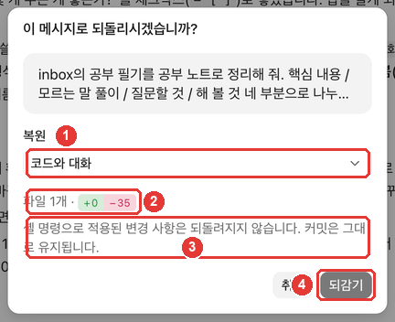

# 第4章 許可と取り消し — 権限モード、巻き戻し、Gitの記録

> **一言まとめ**: **権限モード**で、Claudeが確認なしでできる作業の範囲を決めます。結果が気に入らなければ、**巻き戻し**（`/rewind`）でひとつ前の依頼の状態に戻れます。
> ただし、巻き戻しでも戻せないものがあります。だから大切な状態は、**Gitの記録（コミット）** としてもう一度残しておきます。

この章は、2026年10月31日に確認したClaude Codeの公式ドキュメントと、macOSのデスクトップアプリ（韓国語の画面、有料アカウント）をもとに書きました。第3章までに使ってきた**整理ツール**フォルダ（Gitをオンにした状態）をそのまま使います。

## 権限モードを選ぶ

入力欄の下の行の右側にあるモード名（このガイドの画面では「手動（수동）」）を押すと、権限モードのメニューが開きます。ショートカットは **Cmd+Shift+M** です。[^keys]


| 番号 | 画面の名前 | 公式ドキュメントでの名前 | Claudeが確認なしでやること |
|---|---|---|---|
| ② | 手動（수동） | Manual | なし（編集や実行の前に毎回確認する） |
| ③ | 編集を自動承認（편집 자동 수락） | Accept edits | フォルダ内のファイル作成・編集と、基本的なファイル操作コマンド |
| ④ | プラン（계획） | Plan | 読んで調べるだけ（ファイルは直さず、計画を出す） |
| ① | 自動（자동） | Auto | ほとんど全部（依頼に合っているかを、チェック役が裏で確認する） |
| ⑤ | 権限を無視（권한 무시） | Bypass permissions | ほぼ全部（設定でオンにすると表示される） |

出典: 画面の名前はこのガイドの画面確認（2026-10-31）、動作は公式ドキュメント[^modes]

モードごとに、**便利さと、自分が見守る度合いを引き換えにしています。**[^tradeoff]

**最初は「手動」から始めましょう。** Claudeが何をしようとしているのかを1つずつ見ながら慣れるほうが、安心です。作業が信頼できるようになったら、「編集を自動承認」に進んでもかまいません。作業が大きいときは、まず「プラン」でやり方を提案してもらうのがおすすめです（第5章）。[^plan-tip]

- メニューで選んだモードは、**フォルダごとに記憶されます。** ただし「プラン」だけは、いまのセッションにしか適用されません。[^remember]
- 以前の画面では、モード名がAsk permissions、Auto accept edits、Plan modeでした。[^old-names]

<Quiz id="ch404-modes" />

## 「編集を自動承認」「自動」「権限を無視」に気をつける理由

**編集を自動承認**は、ファイルの編集だけでなく、**ファイルを削除するコマンド**（`rm`）まで確認なしで実行します。ただし、作業フォルダの中だけです。[^accept] 第2章で「小さな練習用フォルダを選びましょう」と言ったのは、このためです。フォルダが小さければ、ミスが広がる範囲も小さくなります。なお、危険な場所をまるごと消すコマンド（例: `rm -rf ~`、ホームフォルダ全体の削除）は、どのモードでも自動では許可されません。[^critical]

**自動**は確認の回数を大きく減らしてくれますが、公式ドキュメントははっきりこう書いています。自動モードは許可の画面を減らすだけで、**安全を保証しません。**[^auto] 大きな方向性を信頼できる作業に使い、デリケートな作業で確認の代わりにするのはやめましょう。[^auto]

**権限を無視**は、メニューで薄く表示され、設定で別にオンにしないと使えません。[^modes] 公式ドキュメントは、このモードを**隔離されたコンテナや仮想マシンの中だけ**で使うよう案内しています。[^modes] 一般のユーザーがオンにする場面はありません。

::: details 「手動」なのに許可の画面が出ないときは
第2章で見たように、ターミナル版のClaude Codeで許可ルールを決めてあると、アプリにもその設定が適用されます。[^same-settings] このガイドのキャプチャ画面もそのようなパソコンで撮ったので、許可の画面が出ませんでした。許可の画面が出る環境では、何が変わるのかが表示され、変更のたびに許可するか断るかを選べます。[^modes]
:::

<Quiz id="ch404-auto" />

## 巻き戻し — ひとつ前の依頼に戻る

Claude Codeは、**依頼を送るたびに、その直前の状態を自動で保存しています。** これを**チェックポイント**（Checkpoint）と呼びます。[^checkpoint] ゲームのセーブポイントのように、結果が気に入らなければその時点に戻れます。

実際にやってみます。新しいセッションで、勉強メモの整理をお願いしました。

```
inboxの勉強メモを勉強ノートにまとめて。要点 / わからない言葉の解説 / 質問すること / やってみることの4つに分けて、notesフォルダに新しいファイルとして保存して。元のメモは直さないで。
```

勉強ノートができました（結果: [4장-공부노트-2026-10-28.txt](/practice/notes/results/4장-공부노트-2026-10-28.txt)）。このノートを、なかったことにしてみましょう。

1. 入力欄に `/rewind` と入力します。「セッションを以前のメッセージに戻す（세션을 이전 메시지로 되돌리기）」という候補が出たら **Enter** を押し、もう一度 **Enter** で実行します。
2. **巻き戻し**の画面に、自分が送った依頼が一覧で表示されます。戻りたい依頼を押します。


3. 確認の画面で、**何を戻すか**を選び、**巻き戻し**を押します。



②の `+0 −35` は、巻き戻すと**35行が消える**という意味です。この実習では、新しく作った勉強ノートの35行です。押す前に、この数字で何が変わるのかを確認しましょう。

①の復元の選択肢は3つあります。


| 画面の名前 | やること |
|---|---|
| コードと会話（코드와 대화） | ファイルも会話も、その時点に戻す |
| 会話のみ（대화만） | 会話だけをその時点に戻し、ファイルは今のまま |
| コードのみ（코드만） | ファイルだけをその時点に戻し、会話は今のまま |

出典: 画面の名前はこのガイドの画面確認（2026-10-31）、動作は公式ドキュメント[^restore]

「コードと会話」で巻き戻すと、勉強ノートのファイルが消え、会話も空になりました。巻き戻した依頼は**入力欄にもう一度入っている**ので、直してから送り直せます。[^restore-prompt]


こんなときに使うと便利です。

- まとめ方が気に入らず、**依頼を直してもう一度**やりたいとき → 「コードと会話」
- ファイルはいいのに、**会話が変な方向に長くなってしまったとき** → 「会話のみ」
- 会話の説明は残したまま、**ファイルだけ元に戻したい**とき → 「コードのみ」

<Quiz id="ch404-rewind" />

## 巻き戻しで戻せないもの

巻き戻しは万能ではありません。確認画面の③の文が、その限界を教えてくれます。

- **コマンド（シェル）で変えたファイル**: Claudeがファイル編集ツールではなく、コマンドを実行してだけ変えたファイルは、追跡されません。[^limits-bash]
- **自分で直接直したファイル、ほかのセッションが直したファイル**: 通常は追跡されません。いまのセッションで直したファイルだけを追跡します。[^limits-external]
- **コミット**: Gitの記録はそのまま残ります（確認画面の文）。
- **古いチェックポイント**: チェックポイントは、1つのセッションにつき最近の100個まで残り、デフォルトでは約30日後に整理されます。[^retention]

公式ドキュメントは、こうした場合に**Gitのようなバージョン管理で戻す**よう案内しています。[^limits-bash] だから、次の節のGitの記録が2つ目の安全網になります。

<Quiz id="ch404-limits" />

## Gitの記録 — 2つ目の安全網

第3章で、フォルダにGitをオンにしました。結果が気に入ったら、その状態を**コミット**（記録ひとつ）として残しておきましょう。そうすれば、巻き戻しで戻れない場合でも、その記録に戻れます。

セッション情報の欄の変更内容カードに、**「変更をコミット（변경 사항 커밋）」** というボタンがあります（第3章）。このガイドで押してみたところ、アプリがClaudeに「いま変わった内容をコミットして」という依頼を代わりに送り、Claudeがコミットを残しました。言葉でお願いしてもかまいません。

```
いま変わった内容をコミットして。記録の名前は、何を変えたかわかるように日本語で書いて。
```

あとでその記録に戻りたいときは、こうお願いします。

```
最後のコミットのあとで変わったファイルが何か、先に見せて。私が確認したら、そのコミットの状態に戻して。
```

**戻す前に、「何が消えるのか」を先に見せてもらいましょう。** コミットのあとにやった作業は、Gitで戻すと消えることがあります。確認をひとつ挟めば、うっかり消してしまうことが減ります。

| | 巻き戻し（チェックポイント） | Gitの記録（コミット） |
|---|---|---|
| いつ保存される？ | 依頼を送るたびに自動で | 自分が（またはClaudeが）残したとき |
| 何を戻す？ | このセッションでClaudeが編集したファイルと会話 | コミットしておいたファイル |
| どのくらい残る？ | 最近の100個、約30日 | 記録を消すまで |

出典: 公式ドキュメント[^checkpoint][^retention]、Gitの列はこのガイドのまとめ

<Quiz id="ch404-git" />

## 自分でやってみよう

1. 入力欄の下の行のモードボタンを押して権限モードのメニューを開き、5つのモードの説明を読んでみる。いまは「手動」のままにしておく。
2. 勉強メモの整理を依頼し、できたノートを元のメモと見比べる（要点5つ、わからない言葉、質問1つ、やってみること1つ）。このガイドでは、Claudeが振り返りメモまで読んで「やってみること: やってみた（10/30）」を埋めていました。頼んでいないファイルを根拠にした部分は、その根拠が合っているかを別に確認する。
3. `/rewind` で、その依頼の前に巻き戻す。確認画面の `+0 −N` の数字を先に確認する。
4. 入力欄に戻ってきた依頼の形式をひとつ変えて（例:「わからない言葉の解説は表で」）、もう一度送る。
5. 気に入った結果が出たら、「変更をコミット」で記録を残す。

**続きの課題**: 第2章の議事録と第4章の勉強ノートを並べて、2つの文書に共通して使いたいルール（日付の書き方、やることの表の形など）を3行で書いておきましょう。第6章で、このルールをCLAUDE.mdに保存します。

## まとめ

- 権限モードには、手動・編集を自動承認・プラン・自動・権限を無視がある。最初は手動から始める。
- 編集を自動承認は、フォルダ内のファイル削除コマンドまで確認しない。自動は安全を保証しない。権限を無視は、隔離された環境でだけ使う。
- 依頼ごとにチェックポイントが保存される。`/rewind` で、コードと会話・会話のみ・コードのみを選んで巻き戻す。
- 巻き戻しは、コマンドだけで変えたファイル、自分で直接直したファイル、コミットを、通常は戻さない。
- よい状態はコミットとして残して、2つ目の安全網にする。戻す前に、何が消えるのかを先に確認する。

## 用語まとめ

| 用語 | 読み方 | 一言でいうと |
|---|---|---|
| Permission mode | パーミッション・モード（権限モード） | Claudeが確認なしでやってよい作業の範囲 |
| Accept edits | アクセプト・エディッツ（編集を自動承認） | フォルダ内のファイル編集と基本的なファイル操作コマンドを、確認しないモード |
| Plan mode | プラン・モード（プラン） | 直さずに調べて、計画だけを出すモード |
| Checkpoint | チェックポイント | 依頼を送るたびに自動で残る保存地点 |
| Rewind | リワインド（巻き戻し） | チェックポイントに戻る機能 |
| Commit | コミット | Gitに、いまの状態を記録として残すこと |

<ChapterDone :chapter="404" />

次の章: [第5章 上手な任せ方](05-delegate-well.md)

[^keys]: Claude Code 公式ドキュメント、「Desktop application」のショートカット表。"Open permission mode menu" https://code.claude.com/docs/en/desktop (確認日 2026-10-31)
[^modes]: Claude Code 公式ドキュメント、「Desktop application」。"Claude asks before editing files or running commands. You see a diff and can accept or reject each change." / "Claude auto-accepts file edits and common filesystem commands like mkdir, touch, and mv, but still asks before running other terminal commands." / "Claude reads files and runs commands to explore, then proposes a plan without editing your source code." / "Claude runs without routine prompts; before actions such as shell commands and network requests run, a background classifier checks that they align with your request." / "On Pro, Max, and Ultra plans, enable "Allow bypass permissions mode" in Settings > Code or Settings > Claude Code." / "Only use this in sandboxed containers or VMs." https://code.claude.com/docs/en/desktop (確認日 2026-10-31)
[^tradeoff]: Claude Code 公式ドキュメント、「Choose a permission mode」。"Each mode makes a different tradeoff between convenience and oversight." https://code.claude.com/docs/en/permission-modes (確認日 2026-10-31)
[^plan-tip]: Claude Code 公式ドキュメント、「Desktop application」。"Start complex tasks in Plan so Claude maps out an approach before making changes." https://code.claude.com/docs/en/desktop (確認日 2026-10-31)
[^remember]: Claude Code 公式ドキュメント、「Desktop application」。"A mode you pick in the selector is remembered per folder and takes precedence over defaultMode for that folder, except Plan, which applies to the current session only." https://code.claude.com/docs/en/desktop (確認日 2026-10-31)
[^old-names]: Claude Code 公式ドキュメント、「Desktop application」。"Earlier versions of the Code tab labeled these modes Ask permissions, Auto accept edits, and Plan mode." https://code.claude.com/docs/en/desktop (確認日 2026-10-31)
[^accept]: Claude Code 公式ドキュメント、「Choose a permission mode」。"acceptEdits mode auto-approves common filesystem Bash commands: mkdir, touch, rm, rmdir, mv, cp, and sed." / "Like file edits, auto-approval applies only to paths inside your working directory or additionalDirectories." https://code.claude.com/docs/en/permission-modes (確認日 2026-10-31)
[^auto]: Claude Code 公式ドキュメント、「Choose a permission mode」。"Auto mode reduces permission prompts but does not guarantee safety. Use it for tasks where you trust the general direction, not as a replacement for review on sensitive operations." https://code.claude.com/docs/en/permission-modes (確認日 2026-10-31)
[^same-settings]: Claude Code 公式ドキュメント、「Desktop application」。"The desktop app reads the same settings files as the CLI." https://code.claude.com/docs/en/desktop (確認日 2026-10-31)
[^checkpoint]: Claude Code 公式ドキュメント、「Checkpointing」。"Claude Code automatically tracks Claude's file edits as you work, allowing you to quickly undo changes and rewind to previous states if anything gets off track." / "Every prompt you send that starts a turn creates a new checkpoint" https://code.claude.com/docs/en/checkpointing (確認日 2026-10-31)
[^restore]: Claude Code 公式ドキュメント、「Checkpointing」。"Restore code and conversation: revert both code and conversation to that point" / "Restore conversation: rewind to that message while keeping current code" / "Restore code: revert file changes while keeping the conversation" https://code.claude.com/docs/en/checkpointing (確認日 2026-10-31)
[^restore-prompt]: Claude Code 公式ドキュメント、「Checkpointing」。"After restoring the conversation or choosing Summarize from here, the original prompt from the selected message is restored into the input field so you can re-send or edit it." https://code.claude.com/docs/en/checkpointing (確認日 2026-10-31)
[^limits-bash]: Claude Code 公式ドキュメント、「Checkpointing」。"A file that only Bash commands changed isn't tracked and stays as it is. To revert it, use version control, such as Git." https://code.claude.com/docs/en/checkpointing (確認日 2026-10-31)
[^limits-external]: Claude Code 公式ドキュメント、「Checkpointing」。"Checkpointing only tracks files that have been edited within the current session. Manual changes you make to files outside of Claude Code and edits from other concurrent sessions are normally not captured" https://code.claude.com/docs/en/checkpointing (確認日 2026-10-31)
[^retention]: Claude Code 公式ドキュメント、「Checkpointing」。"Claude Code keeps file snapshots for the 100 most recent checkpoints in a session." / "by default about 30 days after the session last saved one" https://code.claude.com/docs/en/checkpointing (確認日 2026-10-31)
[^critical]: Claude Code 公式ドキュメント、「Choose a permission mode」。"Claude Code doesn't auto-approve the following in any mode, including bypassPermissions" / "Recognized rm and rmdir critical-path removals, which no allow rule or PreToolUse hook "allow" approves" https://code.claude.com/docs/en/permission-modes (確認日 2026-10-31)
