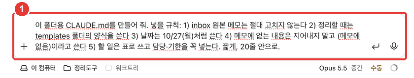
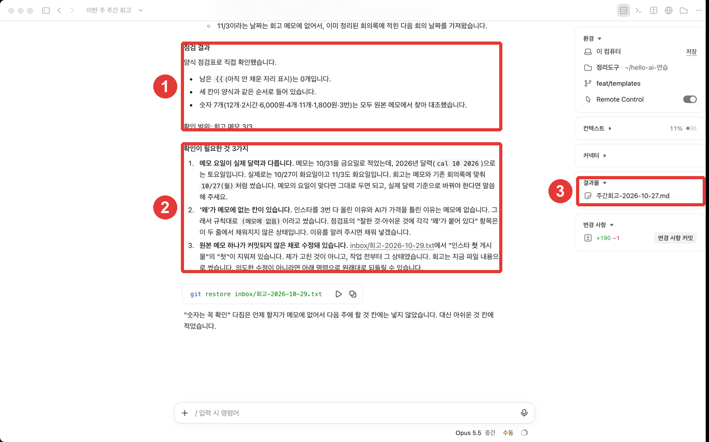

# 第6章 プロジェクトの記憶 — CLAUDE.mdに自分のルールを書いておく

> **一言まとめ**: 毎回言い直すルールは、フォルダの**CLAUDE.md**ファイルに書いておきます。Claudeはセッションを始めるたびに、このファイルを読みます。
> ただし**強制する仕組みではなく、参考にする文脈**です。短く、具体的に書くほど、よく守ります。

この章は、2026年10月31日に確認したClaude Code公式ドキュメントと、macOSデスクトップアプリ（韓国語の画面、有料アカウント）をもとに書きました。第5章で作った様式を「基本ルール」としてまとめておく章です。

## セッションは毎回ゼロから始まる

Claude Codeのセッションは、毎回**空の状態で始まります。** 前のセッションで「日付はこう書いて」と言っても、新しいセッションは知りません。[^fresh] セッションをまたいで記憶をつなぐ仕組みは2つあります。[^two]

| | CLAUDE.md | 自動メモリ |
|---|---|---|
| 誰が書くか | 自分 | Claude |
| 何が入るか | 指示とルール | 自分が直したこと、自分の好み |
| いつ読まれるか | すべてのセッションの開始時 | すべてのセッションの開始時（前半だけ） |

出典: Claude Code公式ドキュメント[^two]

この章では、自分で書く**CLAUDE.md**を扱います。自動メモリは、Claudeが自分の指摘を見て、自分でメモしておくものです。[^two]

<Quiz id="ch406-fresh" />

## 何を書くか

CLAUDE.mdは、**「書かないと毎回説明し直すこと」**を書く場所です。[^when] 次のようなときに書きましょう。

- Claudeが**同じ間違いを2回目**にするとき
- 前のセッションでした**同じ指摘をまたしている**とき
- 新しく来た人にも**同じように伝える必要がある**内容のとき

出典: Claude Code公式ドキュメント[^when]

そして、**確認できるくらい具体的に**書きます。[^concrete]

| 物足りないルール | よりよいルール |
|---|---|
| 日付をきれいに書いて | 日付は10/27（月）のように書く |
| 整理をうまくやって | やることは表で書き、担当と期限を必ず入れる |
| 原本に気をつけて | inboxの原本メモは絶対に直さない |

よりよいルールは、結果を見て「守られたか？」をすぐに確かめられます。

**短く書いてください。** 公式ドキュメントは、ファイル1つを**200行未満**にするよう言っています。長いほど文脈を多く占め、守られにくくなります。[^short] 複数の段階がある手順は、第7章のスキルに移すほうがいいでしょう。[^when]

<Quiz id="ch406-what" />

## 実習 — 自分のルールでCLAUDE.mdを作る

第4章で書いておいた「共通ルール」を、CLAUDE.mdにしてもらいます。



```
このフォルダ用のCLAUDE.mdを作って。入れるルール: 1) inboxの原本メモは絶対に直さない 2) 整理するときはtemplatesフォルダの様式を使う 3) 日付は10/27（月）のように書く 4) メモにない内容は作り上げずに（メモになし）と書く 5) やることは表で書き、担当と期限を必ず入れる。短く、20行以内で。
```

Claudeが、フォルダの一番上に`CLAUDE.md`を作りました（結果: [6장-CLAUDE.md.txt](/practice/notes/results/6장-CLAUDE.md.txt)）。5つのルールが太字で1行ずつ入り、やること表の例が加わりました。

フォルダの一番上の`CLAUDE.md`（または`.claude/CLAUDE.md`）を**プロジェクト指示**と呼びます。このフォルダで作業するすべてのセッションに適用されます。[^where]

<Quiz id="ch406-make" />

## 守られているか試す — 新しいセッションで

CLAUDE.mdは**セッションを始めるときに**読まれます。[^fresh] そのため、試すのは**新しいセッション**で行います。今回は、形式をまったく言わずに、短くお願いするだけにします。


```
inboxの振り返りメモ3件で、今週の週間振り返りを書いて。
```

結果（[6장-주간회고-2026-10-27.txt](/practice/notes/results/6장-주간회고-2026-10-27.txt)）をルールと照らし合わせると、次のとおりでした。

| ルール | 結果 |
|---|---|
| templatesの様式を使う | 第5章のKPT様式（よかったこと・惜しかったこと・来週やること）そのまま |
| 日付は10/27（月）のように | `10/30（木）`、`11/3（月）`の形式 |
| メモになければ（メモになし） | 「なぜ」がない欄2か所に`（メモになし）` |
| 原本は直さない | inboxのメモはそのまま |

出典: このガイドの実習結果（2026-10-31）

数字（インスタ3回、いいね12件、間違えて書いた価格6,000ウォン、セット4個・週11個、ヴァン・ショー（ホットワイン）の原価1,800ウォン）も、すべてメモと同じでした。



①を見ると、Claudeが第5章で作った様式の案内にある**チェックリストで自分で確認**し、確認した範囲（振り返りメモ3/3）まで明かしています。②では、メモの曜日が実際のカレンダーと違うこと（第2章で明かした「作った日付」）、理由がメモにない欄、原本メモの記録されていない修正（キャプチャの前にこのガイドが直しておいた1行で、Claudeがしたことではない）を、先に知らせてくれました。**ルールとチェックリストを書いておけば、結果と一緒に根拠が返ってきます。**

<Quiz id="ch406-test" />

## 強制するルールではない

公式ドキュメントは、CLAUDE.mdが**参考にする文脈であって、強制する設定ではない**とはっきり言っています。[^context] そのため、次のように書きます。

- 必ず守ってほしいことほど、**具体的に、短く**書きます。具体的なほど、一貫して守られます。[^context]
- 互いに**ぶつかるルール**があると、Claudeがどちらかを適当に選ぶことがあります。ときどき読み返して、古いルールを消します。[^conflict]
- 何があっても止めたいこと（例: 原本フォルダを消すこと）は、CLAUDE.mdだけを頼りにせず、第4章の権限モードとGitの記録でも一緒に守ります。

::: details 自分のコンピューター全体に適用されるCLAUDE.mdもある
`~/.claude/CLAUDE.md`（自分のユーザーフォルダ）に書いた指示は、**すべてのフォルダのセッション**に適用されます。[^where] このガイドのキャプチャ用コンピューターにもこうした個人の指示があって、答えの最後に「状態:」の行を加えるなど、画面が少し違います。1つのフォルダだけで使うルールは、そのフォルダのCLAUDE.mdに書いてください。
:::

<Quiz id="ch406-not-enforced" />

## 自分でやってみよう

1. 第4章で書いた共通ルールを、3〜5行に整える。「守られたか？」を確かめられるよう、具体的に書く。
2. 上の依頼のようにCLAUDE.mdを作ってもらい、ファイルペインで内容を確認する。
3. **新しいセッション**を開いて、形式を言わない短い依頼を送る。
4. 結果をルールの表と1つずつ照らし合わせる。守られなかったルールがあれば、もっと具体的に書き直す。

**続きの課題**: 今は「議事録を整理して」「勉強ノートを作って」を毎回言葉で伝えています。第7章では、こうした依頼を`/회의정리`のような**スキル**にして、1行で呼び出します。

## まとめ

- セッションは毎回ゼロから始まる。説明し直すことは、CLAUDE.mdに書く。
- 同じ間違い・同じ指摘が2回目に出たら、書くタイミング。具体的に、200行未満で。
- フォルダの一番上のCLAUDE.mdはそのフォルダのすべてのセッションに、`~/.claude/CLAUDE.md`はすべてのフォルダに適用される。
- 守られているかは、新しいセッションで短い依頼をして試す。
- 強制する仕組みではない。必ず止めたいことは、権限モード・Gitの記録と一緒に守る。

## 用語まとめ
| 用語 | 読み方 | 一言でいうと |
|---|---|---|
| CLAUDE.md | クロード・エムディー | セッションごとに読まれる、自分が書く指示ファイル |
| Auto memory | オートメモリー（自動メモリ） | Claudeが自分の指摘や好みを自分でメモしておくもの |
| Project instructions | プロジェクトインストラクションズ（プロジェクト指示） | そのフォルダのすべてのセッションに適用されるCLAUDE.md |
| Context | コンテキスト（文脈） | 参考にしてと渡す情報。強制するルールとは違う |

<ChapterDone :chapter="406" />

次の章: [第7章 スキル・プラグイン・外部ツール](07-skills-plugins.md)

[^fresh]: Claude Code公式ドキュメント、「How Claude remembers your project」。"Each Claude Code session begins with a fresh context window." / "Claude reads them at the start of every session." https://code.claude.com/docs/en/memory (確認日 2026-10-31)
[^two]: Claude Code公式ドキュメント、「How Claude remembers your project」。"Two mechanisms carry knowledge across sessions" / "Auto memory: notes Claude writes itself based on your corrections and preferences" / "Both are loaded at the start of every conversation." https://code.claude.com/docs/en/memory (確認日 2026-10-31)
[^when]: Claude Code公式ドキュメント、「How Claude remembers your project」。"Treat CLAUDE.md as the place you write down what you'd otherwise re-explain." / "Claude makes the same mistake a second time" / "You type the same correction or clarification into chat that you typed last session" / "A new teammate would need the same context to be productive" / "If an entry is a multi-step procedure or only matters for one part of the codebase, move it to a skill" https://code.claude.com/docs/en/memory (確認日 2026-10-31)
[^concrete]: Claude Code公式ドキュメント、「How Claude remembers your project」。"Write instructions that are concrete enough to verify" https://code.claude.com/docs/en/memory (確認日 2026-10-31)
[^short]: Claude Code公式ドキュメント、「How Claude remembers your project」。"target under 200 lines per CLAUDE.md file. Longer files consume more context and reduce adherence." https://code.claude.com/docs/en/memory (確認日 2026-10-31)
[^where]: Claude Code公式ドキュメント、「How Claude remembers your project」。"Personal preferences for all projects" / "Team-shared instructions for the project" / "A project CLAUDE.md can be stored in either ./CLAUDE.md or ./.claude/CLAUDE.md." https://code.claude.com/docs/en/memory (確認日 2026-10-31)
[^context]: Claude Code公式ドキュメント、「How Claude remembers your project」。"Claude treats them as context, not enforced configuration." / "The more specific and concise your instructions, the more consistently Claude follows them." https://code.claude.com/docs/en/memory (確認日 2026-10-31)
[^conflict]: Claude Code公式ドキュメント、「How Claude remembers your project」。"if two instructions contradict each other, Claude may pick one arbitrarily." https://code.claude.com/docs/en/memory (確認日 2026-10-31)
