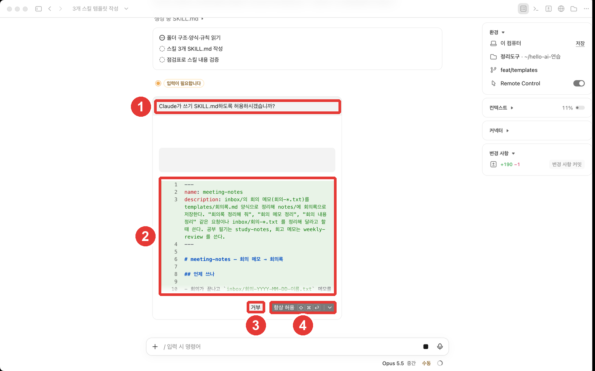

# 第7章 スキル・プラグイン・外部ツール — 整理ツールをワンラインのコマンドに

> **一言まとめ**: 毎回貼り付けている指示・チェックリスト・複数のステップの手順は**スキル**にして、`/名前`の一行で呼び出します。この章で「整理ツール」が完成します。
> 他の人が作った**プラグイン**や、外部サービスの**コネクタ**もつなげられますが、自分の権限でコードが実行されるので、信頼できるものだけをインストールします。

この章は、2026年10月31日に確認したClaude Codeの公式ドキュメントと、macOSデスクトップアプリ（韓国語の画面、有料アカウント）をもとに書きました。第5章のひな形と第6章のCLAUDE.mdをそのまま使います。

## スキルとは

**スキル**（Skill）は、`SKILL.md`ファイルに書いておく指示です。Claudeは関係のある依頼が来るとスキルを自分で使いますし、自分で`/スキル名`と入力して呼び出すこともできます。[^what]

こんなときにスキルを作ります。[^when]

- 同じ指示やチェックリストを**ずっと貼り付けている**とき
- CLAUDE.mdの一部が「事実」ではなく**複数のステップの手順**に育ってきたとき

CLAUDE.mdとの違いは**読み込まれるタイミング**です。CLAUDE.mdはセッションのたびに必ず読み込まれますが、スキルの本文は**使うときだけ**読み込まれます。そのため、長く詳しく書いても、普段の負担はほとんどありません。[^when]

| | CLAUDE.md（第6章） | スキル（第7章） |
|---|---|---|
| 入れるもの | いつも守るルール | ひとつの仕事の手順 |
| 読み込まれるとき | セッションのたび | 使うときだけ |
| 呼び出し方 | 特になし | `/名前`または関連する依頼 |

<Quiz id="ch407-what" />

## 実習 — 整理スキルを3つ作る

整理ツールの3つの仕事を、スキルにします。


```
templatesのひな形とCLAUDE.mdのルールを使うスキルを3つ、このフォルダの.claude/skillsに作って。meeting-notes（会議メモ → 議事録）、study-notes（勉強のメモ → 勉強ノート）、weekly-review（振り返りメモ → 週次の振り返り）。各SKILL.mdには、いつ使うか、読むファイル、使うひな形、保存場所、終わってから確認するチェックリストを入れて。
```

スキルのフォルダ`.claude/skills/<名前>/SKILL.md`をそのフォルダの中に置くと、**そのフォルダのセッションでだけ**使えるプロジェクトスキルになります。[^where] フォルダ名がそのままコマンド名になります（`/meeting-notes`）。[^name] 韓国語のコマンド名が使えるかは公式ドキュメントで確認できなかったので、このガイドでは英語の名前を使いました。

### 今回は許可ウィンドウが出た

スキルのファイルを書こうとした瞬間に、**許可ウィンドウ**が出ました。



第2〜4章では、このパソコンの個人用の許可ルールのせいで、許可ウィンドウが出ませんでした。今回出たのは、`.claude`フォルダが**保護されたパス**だからです。「編集を自動承認」モードでも、保護されたパスへの書き込みは引き続き確認されます。[^protected] スキルや設定のように、Claudeの動作を変えるファイルがこのフォルダにあるので、変更する前に人が確認するようになっています。

②で、**何を書こうとしているのかを先に読めます。** ▾を押すと「一度だけ許可」が出ます。


| ボタン | することの内容 |
|---|---|
| 拒否 | 今回の書き込みを止める |
| 一度だけ許可（⌘↩） | 今回の一回だけ許可する |
| 常に許可（⇧⌘↩） | 同じことを今後は聞かないように許可する |

出典: このガイドの画面確認（2026-10-31）

最初は**「一度だけ許可」**をお勧めします。「常に許可」は便利ですが、同じことを二度と聞かれなくなります（どのくらいの間かは、画面の説明を確認してください）。この実習ではスキルが3つなので許可ウィンドウが3回出て、3回とも「一度だけ許可」を選びました。

作られたスキル（このガイドの結果）: [meeting-notes](/practice/notes/results/7장-스킬-meeting-notes.txt) · [study-notes](/practice/notes/results/7장-스킬-study-notes.txt) · [weekly-review](/practice/notes/results/7장-스킬-weekly-review.txt)

各SKILL.mdの一番上には、`name`（名前）と`description`（いつ使うか）があります。Claudeはdescriptionを見て、スキルをいつ使うかを決めます。[^desc] たとえばweekly-reviewのdescriptionには、「週次の振り返りを書いて」「今週の振り返りを整理」のような依頼に使うと書いてあります。

<Quiz id="ch407-make" />

## 一行で呼び出す

新しいセッションの入力欄で`/`を入力すると、使えるコマンドとスキルの一覧が出ます。名前の一部を続けて入力すると、絞り込まれます。[^slash]


②の**(project)**は、このフォルダのプロジェクトスキルだという印です。Enterで選んで、整理したいファイルを続けて書いて送ります。


```
/study-notes inbox/공부-2026-10-28-프롬프트-강의.txt
```

この一行で、勉強ノートがひな形どおりに作られました（結果: [7장-공부노트-스킬로.txt](/practice/notes/results/7장-공부노트-스킬로.txt)）。ひとこと要約、要点5つ、新しく知った言葉4つ、注意すること、質問することが、ひな形の順番どおりに入りました。第4章で長い依頼を使って作り、巻き戻したあのノートを、今回は**コマンド一行で**作ったのです。

**これで整理ツールが完成しました。**

| メモ | コマンド |
|---|---|
| 会議メモ | `/meeting-notes inbox/회의-….txt` |
| 勉強のメモ | `/study-notes inbox/공부-….txt` |
| 1日の振り返りが複数 | `/weekly-review` |

名前を覚えていなくても大丈夫です。「今週の振り返りを整理して」のように話しかければ、Claudeがdescriptionを見て、合うスキルを選んで使います。[^what]

<Quiz id="ch407-run" />

## プラグインとコネクタ

**プラグイン**（Plugin）は、他の人が作ったスキル・コマンド・ツールをまとめてインストールするものです。**コネクタ**（Connector）は、Gmailやカレンダーのような外部サービスをClaudeにつなぐものです。デスクトップアプリでは、入力欄の横にある**+**ボタンからコネクタとプラグインを追加します。[^plus] コネクタは、MCPサーバー（AIが外部のツールにつながるための標準的な方法）を、画面から簡単に設定できるようにしたものです。[^connectors]

便利ですが、**インストールする前に必ず考えておくこと**があります。プラグインは**自分のパソコンで自分の権限でコードを実行**できます。[^plugin-risk] そして、こうしたコードは、第4章の権限モードが守る範囲の外で動くこともあります。権限のルールはClaudeのツール呼び出しに適用されるもので、プラグインが自分で動かすコードには適用されません。[^plugin-scope]

- 作った人がわかり、信頼できるプラグインだけをインストールします。
- 要らなくなったプラグインは削除します。
- コネクタでつないだサービスの中身（メール・予定）も、Claudeが読む資料になります。第9章の「隠れた指示」もあわせて読んでください。

このガイドの整理ツールは、**自分で作ったスキルだけ**で十分です。プラグインとコネクタは、本当に必要になったときに、ひとつずつ増やしましょう。

<Quiz id="ch407-plugins" />

## やってみましょう

1. 整理スキルを3つ作ってもらい、許可ウィンドウが出たら、②のプレビューを読んでから「一度だけ許可」を選ぶ。
2. 新しいセッションで`/`を入力し、スキル名の一部を入力して、一覧に出るかを見る。
3. `/study-notes`で勉強のメモを整理して、第5章のひな形の順番どおりに出たかを確認する。
4. 名前を使わずに「今週の振り返りを整理して」とだけ送って、Claudeがweekly-reviewスキルを選んで使うかを見る。

**続きの課題**: 今は、金曜日ごとに自分で`/weekly-review`を呼び出しています。第8章では、この仕事を**予約**しておく方法と、複数の整理を同時に動かす方法を見ます。

## まとめ

- スキルは、SKILL.mdに書いた手順。使うときだけ読み込まれ、`/名前`か関連する依頼で使う。
- フォルダの`.claude/skills/<名前>/SKILL.md`は、そのフォルダ専用のスキル。descriptionが「いつ使うか」を決める。
- `.claude`フォルダは保護されたパスなので、書き込む前に許可を聞かれる。最初は「一度だけ許可」。
- 整理ツールの完成: `/meeting-notes`、`/study-notes`、`/weekly-review`。
- プラグインは自分の権限でコードを実行できる。信頼できるものだけを、必要なときだけインストールする。

## 用語の整理

| 用語 | 読み方 | ひとこと説明 |
|---|---|---|
| Skill | スキル | SKILL.mdに書いておき、`/名前`で呼び出す手順 |
| description | ディスクリプション | スキルをいつ使うかを書いた説明。Claudeはこれを見て選ぶ |
| Protected path | プロテクテッド・パス（保護されたパス） | 書き込む前に必ず許可を聞く場所。`.claude`フォルダなど |
| Plugin | プラグイン | スキル・コマンド・ツールをまとめてインストールする拡張 |
| Connector | コネクタ | 外部サービスをClaudeにつなぐもの（MCPサーバーが土台） |
| MCP | エムシーピー | AIが外部のツールやデータにつながるための標準的な方法 |

<ChapterDone :chapter="407" />

次の章: [第8章 複数の仕事を同時に・クラウド・予約](08-parallel-cloud-schedule.md)

[^what]: Claude Code 公式ドキュメント「Extend Claude with skills」。"Create a SKILL.md file with instructions, and Claude adds it to its toolkit. Claude uses skills when relevant, or you can invoke one directly with /skill-name." https://code.claude.com/docs/en/skills (確認日 2026-10-31)
[^when]: Claude Code 公式ドキュメント「Extend Claude with skills」。"Create a skill when you keep pasting the same instructions, checklist, or multi-step procedure into chat, or when a section of CLAUDE.md has grown into a procedure rather than a fact. Unlike CLAUDE.md content, a skill's body loads only when it's used, so long reference material costs almost nothing until you need it." https://code.claude.com/docs/en/skills (確認日 2026-10-31)
[^where]: Claude Code 公式ドキュメント「Extend Claude with skills」。場所の表のProject行: "`.claude/skills/<skill-name>/SKILL.md`" https://code.claude.com/docs/en/skills (確認日 2026-10-31)
[^name]: Claude Code 公式ドキュメント「Extend Claude with skills」。"The directory name, or the frontmatter name when you set one, becomes the command you type, and the description helps Claude decide when to load the skill automatically." https://code.claude.com/docs/en/skills (確認日 2026-10-31)
[^desc]: Claude Code 公式ドキュメント「Extend Claude with skills」。"Only description is recommended so Claude knows when to use the skill." https://code.claude.com/docs/en/skills (確認日 2026-10-31)
[^slash]: Claude Code 公式ドキュメント「Desktop application」。"type / in the prompt box or click the + button and select Slash commands to browse what's available." https://code.claude.com/docs/en/desktop (確認日 2026-10-31)
[^protected]: Claude Code 公式ドキュメント「Choose a permission mode」。acceptEditsの節の"These still prompt:"の下にある"Writes to protected paths" https://code.claude.com/docs/en/permission-modes (確認日 2026-10-31)
[^plus]: Claude Code 公式ドキュメント「Desktop application」。"Click the + button next to the prompt box for file attachments, skills, connectors, and plugins." https://code.claude.com/docs/en/desktop (確認日 2026-10-31)
[^connectors]: Claude Code 公式ドキュメント「Desktop application」。"Connectors are MCP servers with a graphical setup flow." https://code.claude.com/docs/en/desktop (確認日 2026-10-31)
[^plugin-risk]: Claude Code 公式ドキュメント「Plugin security and trust」。"A plugin can carry content that runs code on your machine with your user privileges and content that enters Claude's context as instructions, so review a plugin before you install it." https://code.claude.com/docs/en/plugins/security (確認日 2026-10-31)
[^plugin-scope]: Claude Code 公式ドキュメント「Plugin security and trust」。"Claude Code's permission rules and sandbox cover the tool calls Claude makes, not the code a plugin runs by itself" https://code.claude.com/docs/en/plugins/security (確認日 2026-10-31)
