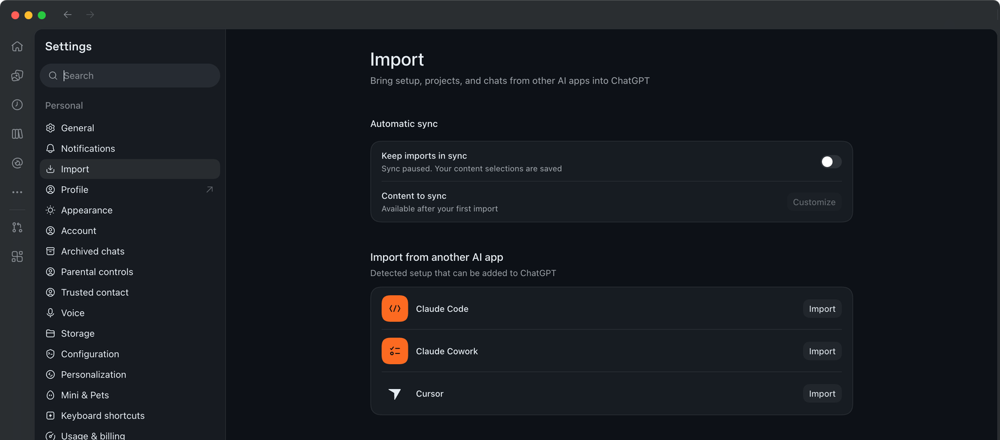

# 第3章 ルールファイルAGENTS.md — CLAUDE.mdをCodexに移す

> **一言まとめ**: Codexは作業を始める前に**`AGENTS.md`**を読みます。Claude Codeの`CLAUDE.md`は、そのままではCodexは読みません。
> 整理ツールフォルダのルールを`AGENTS.md`に移し、新しい会話で**ルールを言わなくても**守るかどうかを試します。

この章は、2026年11月1日に確認したCodex公式ドキュメントと、このガイドが整理ツールフォルダで実際に試した結果をもとに書きました。ルールファイルがなぜ必要かは、[Claude Code 第6章](../20-claude-code/06-claude-md.md)で説明しました。ここでは、Codexで違う点だけを扱います。

## CodexはCLAUDE.mdを読まない

Codexのルールファイルの名前は`AGENTS.md`です。[^agents] 別の名前のファイルをルールとして使うには、設定に別途登録する必要があり、登録していない名前は無視されます。[^ignored] そのため、`CLAUDE.md`はそのままではルールとして読まれません。

第2章の実行記録でも確認できました。Codexはフォルダで`AGENTS.md`を探し、なかったので様式（`templates/`）だけを読みました。`CLAUDE.md`は開いていません。

それでも第2章の議事録は、`（メモになし）`のルールを守っていました。同じルールが**様式の案内文**（`templates/README.md`）にも書かれていたからです。逆に言えば、`CLAUDE.md`**だけ**に書かれたルールは、Codexは知りません。

<Quiz id="ch503-why" />

## CLAUDE.mdをAGENTS.mdに移す

移す作業もCodexに任せます。この章の実行も、第2章と同じCodexをターミナルで動かしたものです。今回は、ルールを1つ**新しく**加えました。あとでこのルールが守られているかを見れば、`AGENTS.md`を読んだかどうかをかなり信頼できる形で推測できます。

```
CLAUDE.mdはClaude Codeが読むルールファイルだよ。同じルールをCodexも読めるように、AGENTS.mdに移して。ルールの内容は変えずに、ルールを1つだけ追加して：「整理したファイルの一番下に『原本と照らし合わせること』の節を置き、数字・名前・日付のうち再確認が必要なものを3つ以内で書く。」CLAUDE.mdはそのままにして。
```

Codexは`CLAUDE.md`の5つのルールをそのまま移し、新しいルールを6番目として加えました。そして「追加したルールを除けば、原本と内容が完全に一致することを検証した」と知らせました。

結果: [AGENTS.md](/practice/notes/results/codex/3장-AGENTS.md.txt)

`CLAUDE.md`を消さなかった理由があります。同じフォルダをClaude Codeでも使い続けられるようにするためです。その代わり、**2つのファイルを一緒に直す**必要があります。片方だけ直すと、2つのツールが別のルールで作業することになります。

<Quiz id="ch503-move" />

## ルールを言わずに試す

新しい会話を開き、ルールの話はせずに、勉強メモの整理だけをお願いします。

```
inbox/공부-2026-10-28-프롬프트-강의.txt を勉強ノートに整理して、notes/ に保存して。
```

結果の一番下に、新しいルールの節ができました。

```
## 原本と照らし合わせること

- 講義の日付: 10/28（水）。原本には10/28と書かれており、年はファイル名の2026年を基準にした。
- 講義の分量: 1時間。
- 講師が紹介したプロンプトの書き方: 5種類。
```

結果: [ルールだけで作った勉強ノート](/practice/notes/results/codex/3장-공부노트-규칙확인.txt)

| いつ作ったファイル | 「原本と照らし合わせること」の節 |
|---|---|
| AGENTS.md前（第2章の議事録） | なし |
| AGENTS.md後（この勉強ノート） | あり |

出典: このガイドの実習結果（2026-11-01、各1回）

新しいルールは`AGENTS.md`にしかなかったので、Codexがそのファイルを読んで従ったと見ることができます。ただし**1回ずつ試した結果**で、前と後のメモの種類（議事録・勉強ノート）も違います。様式のチェックリストにも、「原本のメモと一度照らし合わせた」という似た項目があります。もっと確かめたければ、**同じメモ**を`AGENTS.md`なしで1回、ありで1回動かして比べてみてください。毎回守られる保証はないので、結果を見るたびに確認しましょう。

<Quiz id="ch503-test" />

## AGENTS.mdを読む順番

`AGENTS.md`は2か所に置けます。[^chain]

| 場所 | 適用範囲 | 例 |
|---|---|---|
| `~/.codex/AGENTS.md` | 自分のすべてのフォルダ | 「答えは韓国語で」 |
| プロジェクトフォルダの`AGENTS.md` | そのフォルダだけ | 整理ツールのルール |

出典: Codex公式ドキュメント（一部のみ抜粋）[^chain]

両方あるときは**つなげて**読み、今いるフォルダに近いファイルが後ろに来て、前の指示より優先されます。[^override] 合わせたサイズが標準で32KiBに達すると、その後ろは足されません。[^limit] 韓国語でおよそ1万字強です。ルールは短く保ってください。

ルールを直したのに反映されていないようなら、**新しい会話を始める**か、Codexを再起動してください。Codexは実行を始めるたびに、ルールを新しく読み込みます。[^restart]

`AGENTS.md`がまだないフォルダなら、アプリの入力欄に`/init`と打って、ひな形を作ることもできます。[^init]

<Quiz id="ch503-order" />

## インポート（Import）とメモリ

**インポート**は、ほかのエージェントの設定を一度に移してくれる機能です。アプリでは、Claude Code・Claude Cowork・Cursorから取り込めます。[^import-from] アプリの設定の**Import**メニューから始めます。メニューがなければ、**General**で**Import other agent setup**を探します。[^import-menu]



このガイドの画面（2026-11-01）では、設定の左の一覧に**Import**があり、このコンピューターで見つかったClaude Code・Claude Cowork・Cursorが、それぞれ**Import**ボタンと一緒に表示されていました。このガイドはボタンを押していません。

| Claude Code側 | Codexに来ると |
|---|---|
| ルールファイル（`CLAUDE.md`など） | `AGENTS.md` |
| スキル | スキル |
| スラッシュコマンド（`/名前`） | スキル（`$名前`） |
| `settings.json` | `config.toml` |

出典: Codex公式ドキュメント（一部のみ抜粋）[^import-map]

取り込んでも、元の設定は変わったり消えたりしません。[^import-keep] ただし、取り込んだあとには**スキルの権限制限、フック、引数を使うコマンド**を必ず確認するよう言われています。[^import-review]

このガイドはインポートを**実行しませんでした。** インポートは、1つのフォルダだけでなく、自分のコンピューターの個人設定まで一緒に調べます。[^import-scope] 何が移されるのかを自分の目で見たいなら、この章のように手で移すほうがよいでしょう。

**メモリ**（Memories）は、以前の作業の文脈を次の作業に持っていく機能です。[^memory] 自分のコンピューターのCodexのメモリは、標準ではオフになっています。[^memory-off] 公式ドキュメントはメモリを「思い出しの補助」としてのみ見ていて、必ず守るルールはメモリに任せないように言っています。[^memory-rules] **必ず守るルールは`AGENTS.md`に**書くよう言っています。[^memory-agents]

<Quiz id="ch503-import" />

## 自分でやってみよう

1. 上の依頼で、`CLAUDE.md`を`AGENTS.md`に移させる。新しいルールを1つ一緒に加える。
2. `AGENTS.md`を開いて、元のルールがそのままか、新しいルールが加わったかを見る。
3. **新しい会話**を開いて、ルールの話はせずに勉強メモを整理させる。
4. 結果に新しいルールが守られているかを確認する。

**続きの課題**: 第4章では、Codexが何を自分でやり、何を聞いてくるかを決める権限メニューと、変更内容を元に戻す方法を学びます。

## まとめ

- Codexは`AGENTS.md`を読む。`CLAUDE.md`は、そのままでは読まない。
- 2つのツールを一緒に使うなら、2つのファイルを一緒に直す。
- 新しいルールを入れて、言わないまま試せば、ルールファイルが読まれているかがわかる（今回の実習: 前0 → 後1）。
- 個人のルールは`~/.codex/AGENTS.md`、フォルダのルールはフォルダの`AGENTS.md`。近いほうが優先される。
- インポートは設定を一度に移すが、個人設定まで調べられる。必ず守るルールは、メモリではなく`AGENTS.md`に。

## 用語まとめ
| 用語 | 読み方 | 一言でいうと |
|---|---|---|
| Import | インポート | ほかのエージェントの設定をCodexに移す機能 |
| Memories | メモリーズ | 以前の作業の文脈を次に思い出す機能 |
| `/init` | イニット | `AGENTS.md`のひな形を作るコマンド |

<ChapterDone :chapter="503" />

次の章: [第4章 権限と元に戻す方法](04-permissions-undo.md)

[^agents]: Codex公式ドキュメント、「Custom instructions with AGENTS.md」。"Codex reads `AGENTS.md` files before doing any work." https://learn.chatgpt.com/docs/agent-configuration/agents-md (確認日 2026-11-01)
[^ignored]: Codex公式ドキュメント、「Custom instructions with AGENTS.md」。"Filenames not on this list are ignored for instruction discovery." https://learn.chatgpt.com/docs/agent-configuration/agents-md (確認日 2026-11-01)
[^chain]: Codex公式ドキュメント、「Custom instructions with AGENTS.md」。"In your Codex home directory (defaults to `~/.codex`, unless you set `CODEX_HOME`), Codex reads `AGENTS.override.md` if it exists." / "Starting at the project root (typically the Git root), Codex walks down to your current working directory." https://learn.chatgpt.com/docs/agent-configuration/agents-md (確認日 2026-11-01)
[^override]: Codex公式ドキュメント、「Custom instructions with AGENTS.md」。"Files closer to your current directory override earlier guidance because they appear later in the combined prompt." https://learn.chatgpt.com/docs/agent-configuration/agents-md (確認日 2026-11-01)
[^limit]: Codex公式ドキュメント、「Custom instructions with AGENTS.md」。"Codex skips empty files and stops adding files once the combined size reaches the limit defined by `project_doc_max_bytes` (32 KiB by default)." https://learn.chatgpt.com/docs/agent-configuration/agents-md (確認日 2026-11-01)
[^restart]: Codex公式ドキュメント、「Custom instructions with AGENTS.md」。"If instructions look stale, restart Codex in the target directory." https://learn.chatgpt.com/docs/agent-configuration/agents-md (確認日 2026-11-01)
[^init]: Codex公式ドキュメント、「Slash commands」。"Generate an `AGENTS.md` scaffold for the current project." https://learn.chatgpt.com/docs/reference/slash-commands (確認日 2026-11-01)
[^import-from]: Codex公式ドキュメント、「Import from another agent」。"The desktop app can import from **Claude Code**, **Claude Cowork**, or **Cursor**." https://learn.chatgpt.com/docs/import (確認日 2026-11-01)
[^import-menu]: Codex公式ドキュメント、「Import from another agent」。"If **Import** isn't available as a settings section yet, open **General** and find **Import other agent setup**." https://learn.chatgpt.com/docs/import (確認日 2026-11-01)
[^import-map]: Codex公式ドキュメント、「Import from another agent」。表「What ChatGPT can import」のInstruction files・`settings.json`・Skills・Slash commandsの行。 https://learn.chatgpt.com/docs/import (確認日 2026-11-01)
[^import-scope]: Codex公式ドキュメント、「Import from another agent」。"The import flow checks both your user-level setup and your existing projects." https://learn.chatgpt.com/docs/import (確認日 2026-11-01)
[^import-keep]: Codex公式ドキュメント、「Import from another agent」。"Importing doesn't change or delete your existing agent setup." https://learn.chatgpt.com/docs/import (確認日 2026-11-01)
[^import-review]: Codex公式ドキュメント、「Import from another agent」。"Tool restrictions or permissions in imported skills and agents." / "Hooks whose behavior may differ after import." / "Prompt templates or command-style prompts that depend on arguments, shell interpolation, or file-path placeholders." https://learn.chatgpt.com/docs/import (確認日 2026-11-01)
[^memory]: Codex公式ドキュメント、「Memories」。"Memories let ChatGPT and Codex carry useful context from earlier work into future work." https://learn.chatgpt.com/docs/customization/memories (確認日 2026-11-01)
[^memory-off]: Codex公式ドキュメント、「Memories」。"Local Codex memories are off by default." https://learn.chatgpt.com/docs/customization/memories (確認日 2026-11-01)
[^memory-rules]: Codex公式ドキュメント、「Memories」。"Treat memories as a helpful recall layer, not as the only source for rules that must always apply." https://learn.chatgpt.com/docs/customization/memories (確認日 2026-11-01)
[^memory-agents]: Codex公式ドキュメント、「Memories」。"Keep required team guidance in `AGENTS.md` or checked-in documentation." https://learn.chatgpt.com/docs/customization/memories (確認日 2026-11-01)
