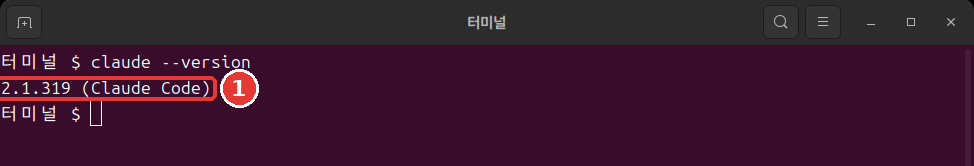

# 第3章 インストールとログイン

<Badge type="tip" text="必須" /> このステップを進めるなら、必ず読んでください。

> **一言まとめ**: 公式ドキュメントのインストールコマンドを貼り付けて、**新しいターミナルウィンドウ**で `claude --version` を実行して確かめます。そのあと練習用フォルダで `claude` を実行し、ブラウザでログインすれば準備は完了です。

インストールは一度だけで済みます。コマンドも1行です。

## 貼り付ける前に — まず出どころを確かめる

インストールのコマンドは、すぐ次の節にあります。貼り付ける前に、1つだけ確かめてください。

インストールのコマンドは、インターネットからダウンロードしたプログラムを、自分のパソコンですぐに実行します。便利ですが、よくないサイトのコマンドを貼り付けると、悪いプログラムが自分の権限で実行されることがあります。

だから、**初めて見るサイトのインストールコマンドは、そのまま貼り付けないでください。** この講座のコマンドも同じです。公式ドキュメント「[Quickstart](https://code.claude.com/docs/en/quickstart)」を開いて、同じコマンドかどうか目で見比べてください。

- **いまひとつの例**: ブログで見つけたインストールコマンドを、すぐにターミナルに貼り付ける。
- **よい例**: 公式ドキュメントを開いて、同じコマンドか確かめてから貼り付ける。

ターミナルに貼り付けるコマンドは、どんなものでもまず出どころを見てください。ほかのプログラムをインストールするときも、同じ習慣があなたを守ってくれます。

<Quiz id="ch803-safe" />

## OSごとのインストールコマンド

ターミナルを開いて、自分のパソコンに合ったコマンドを**1つだけ**貼り付け、Enterを押します。公式ドキュメントのコマンドです。[^install]

Mac・Linux・WSL（Windowsの中でLinuxを使う機能）では、こう入力します。

```bash
curl -fsSL https://claude.ai/install.sh | bash
```

Windows PowerShellでは、こう入力します。

```powershell
irm https://claude.ai/install.ps1 | iex
```

2つのコマンドは同じことをします。前の部分がインストール用のファイルをダウンロードし、`|`（縦棒）のうしろが、ダウンロードした内容を実行します。かけらの意味が全部わからなくても、インストールはできます。

::: details 詳しく（クリックして開く）
- `|` は、前のコマンドの結果をうしろのコマンドに渡す記号です。
- Mac・Linuxでは、`curl` がダウンロードし、`bash` が実行します。
- PowerShellでは、`irm` がダウンロードし、`iex` が実行します。[^irm]
- `-fsSL` は、ダウンロードのしかたを決めるオプション4つをくっつけて書いたものです。意味は[コマンド辞典](command-reference.md)にあります。
:::

ダウンロードのあいだは、進み具合の表示がありません。何も起きていないように見えても、ウィンドウを閉じずに待ってください。終わると、`Claude Code successfully installed!` という文が表示されます。[^progress]

コマンドを違うウィンドウに入れると、エラーになります。壊れたのではなく、ウィンドウの選び間違いです。[^wrong-shell]

- `'irm' is not recognized` と出る: PowerShellではなくCMDにいます。PowerShellを開いて、やり直してください。
- `-fsSL` のせいでエラーになる: Mac・Linux用のコマンドをPowerShellに入れています。PowerShell用のコマンドを使ってください。

エラーは、画面の言語によっては日本語で出ることもあります。意味は同じです。

Windowsでは、管理者権限で実行しなくてかまいません。[^no-admin] たいていは、上の1行で十分です。

::: details 詳しく（クリックして開く）
- **WindowsとGit**: Git（ファイルの変更記録を残すツール）がなくても、そのまま進められます。なければ、Claude Codeが代わりにPowerShellを使います。[^git-win] Gitは第12章でインストールします。
- **ほかのインストール方法**: MacのHomebrewやWindowsのWinGetのような、プログラム管理ツールでもインストールできます。[^brew] 使っているツールがなければ、上の1行を使ってください。
:::

<Quiz id="ch803-install" />

## インストールの確認

インストールが終わったら、**新しいターミナルウィンドウを開いて**、このコマンドを入力します。[^check]

```bash
claude --version
```

このように番号が出れば成功です。番号は違っていてもかまいません。うしろに `(Claude Code)` が付いているか見てください。



```text
2.1.318 (Claude Code)
```

なぜ新しいウィンドウなのでしょうか？　すでに開いていたウィンドウは、前の設定をそのまま使うからです。[^old-path] そのため、インストールを終えたウィンドウではうまくいかず、新しいウィンドウではうまくいく、ということが起こります。

<Quiz id="ch803-check" />

## command not found と出るとき

新しいウィンドウでも、こんな言葉が出ることがあります。Windowsでは `not recognized` という言葉が出ます。画面の言語によっては、日本語で出ることもあります。意味は同じです。

```text
zsh: command not found: claude
bash: claude: command not found
```

インストールはできたのに、ターミナルがプログラムを見つけられない、という意味です。[^path-cause]

ターミナルは、**PATH**（パス）というフォルダの一覧からプログラムを探します。電話帳だと思うとわかりやすいでしょう。プログラムがあっても、一覧に書かれていなければ見つけられません。インストーラーは直し方を教えてくれるだけで、PATHを直接変えることはしません。[^path-what]

プログラムは、Mac・Linuxでは `~/.local/bin/claude`、Windowsでは `%USERPROFILE%\.local\bin\claude.exe` にあります。[^path-where] このフォルダを一覧に足せば解決します。下は公式ドキュメントのコマンドです。**自分のパソコンに合ったものを1つだけ**使ってください。

Macの標準のシェル（ターミナルの中でコマンドを受け取るプログラム）であるZshでは、こう書きます。

```bash
echo 'export PATH="$HOME/.local/bin:$PATH"' >> ~/.zshrc
source ~/.zshrc
```

たいていのLinux（Bash）では、こう書きます。

```bash
echo 'export PATH="$HOME/.local/bin:$PATH"' >> ~/.bashrc
source ~/.bashrc
```

Windows PowerShellでは、こう書きます。

```powershell
$currentPath = [Environment]::GetEnvironmentVariable('PATH', 'User')
[Environment]::SetEnvironmentVariable('PATH', "$currentPath;$env:USERPROFILE\.local\bin", 'User')
```

コマンドのかけらは、こういう意味です。

- **`echo` の行**: 設定をファイルに保存します。`>>` は、ファイルの最後に書き足す記号です。だから、設定ファイルにもとからある内容は消えません。
- **`source` の行**: 保存した設定を、今のウィンドウに反映します。
- **1回だけ入力する**: 2回入力すると、同じ行が2回入ります。
- **Windows**: 2行を入力したあと、ターミナルを起動し直す必要があります。[^path-apply]

そのあと、もう一度 `claude --version` を入力してみてください。番号が出れば解決です。

それでもだめなら、公式ドキュメント「[Troubleshoot installation and login](https://code.claude.com/docs/en/troubleshoot-install)」を見てください。`claude` が実行できるなら、`claude doctor` でインストールの状態を読んでみることができます。セッションを開かずに、診断だけを見せてくれます。[^doctor]

<Quiz id="ch803-path" />

## ログイン

新しいウィンドウで第2章の練習用フォルダに移動してから、`claude` と入力します。Mac・Linuxでは、こう入力します。

```bash
cd ~/hello-ai-연습/터미널
claude
```

Windows PowerShellでは、こう入力します。

```powershell
cd $HOME\hello-ai-연습\터미널
claude
```

初めて実行すると、ログインするよう案内が出ます。個人で契約している人は、claude.aiのアカウントでログインします。[^login] 手順はこうです。[^login-steps]

1. ブラウザが開いたら、ログインします。
2. ブラウザが開かなければ、ターミナルで `c` を押します。ログイン用のアドレスがコピーされるので、ブラウザに貼り付けます。
3. ブラウザにコードが表示されたら、ターミナルの `Paste code here if prompted` のところに貼り付けます。
4. `Login successful` と出たら、Enterを押します。

ログインは一度で済みます。情報が保存されるので、もう一度聞かれることはありません。アカウントを切り替えたいときは、実行中に `/login` と入力します。[^login-once]

ログインの前後に、最初の設定画面がほかにも出ることがあります。フォルダを信頼するかどうかを聞く画面が出ることもあります。この画面は第4章で一緒に見ます。今は `Esc` で抜けてもかまいません。

<Quiz id="ch803-login" />

## アップデートと削除

**アップデート。** 上の1行でインストールしたなら、特にやることはありません。バックグラウンドで自動的にダウンロードされ、次にClaude Codeを起動したときに反映されます。[^auto-update] すぐに上げたいときは、ターミナルで `claude update` と入力します。すでに最新なら、`Claude Code is up to date` と教えてくれます。[^update]

HomebrewやWinGetでインストールしたなら、自動では上がりません。そのツールで、ときどき自分で上げる必要があります。[^manual-update]

**削除。** 削除の方法は今は必要ないので、たたんでおきました。あとで必要になったら開いてください。

::: details 詳しく（クリックして開く）
Mac・Linuxで上の1行でインストールしたなら、この2行で削除します。[^uninstall]

```bash
rm -f ~/.local/bin/claude
rm -rf ~/.local/share/claude
```

`rm` は、ゴミ箱を通さずにすぐ削除するコマンドです。`-r` はフォルダの中まで全部、`-f` は確認せずに削除する、というオプションです。文字をよく確かめてから入力してください。Windowsやほかのインストール方法では、公式ドキュメント「[Advanced setup](https://code.claude.com/docs/en/setup)」のUninstallの節に従ってください。
:::

<Quiz id="ch803-update" />

## やってみよう

1. 公式ドキュメントを開いて、インストールコマンドがこの章と同じか確かめます。
2. 自分のOSのコマンドを貼り付けて、終わるまで待ちます。
3. 新しいウィンドウを開いて、`claude --version` と入力します。`command not found` と出たら、上の節に沿って進めます。
4. 練習用フォルダで `claude` を実行して、ログインします。信頼の画面が出たら、`Esc` で抜けます。入力欄まで入れたら、`/exit` と入力します。

自分に聞いてみてください。`claude --version` は番号を表示するか？　そうなら、次の章で最初の仕事を頼んでみられます。

## まとめ

- インストールコマンドは、公式ドキュメントと同じか確かめてから貼り付ける。
- Mac・Linuxは `curl` の行、WindowsはPowerShellの `irm` の行を使う。進み具合の表示がなくても待つ。
- 確認は、新しいウィンドウで `claude --version` で行う。
- `command not found` と出たら、まず新しいウィンドウを開いてみて、それでもだめならPATHの行を足す。
- ログインは、練習用フォルダで `claude` を実行し、ブラウザで一度だけ行う。
- 標準のインストールなら、自動でアップデートされる。

## 用語まとめ

| 用語 | 読み方 | 一言でいうと |
|---|---|---|
| PATH | パス | ターミナルがプログラムを探すフォルダの一覧 |
| WSL | ダブリューエスエル | Windowsの中でLinuxを使う機能 |
| `curl` | カール | インターネットから内容を取ってくるコマンド |
| `irm` | アイアールエム | PowerShellでインターネットの内容を取ってくるコマンド |
| `rm` | アールエム | ファイルを削除するコマンド |

<ChapterDone :chapter="803" />

次の章: [第4章 最初のセッション](04-first-session.md)

[^install]: このガイドは、すでにインストール・ログインが済んでいるパソコンで実行したので、インストールとログインの手順は実際には試していません。この章のインストール・ログインの手順は、公式ドキュメントの説明です。Claude Code 公式ドキュメント、「Quickstart」。"curl -fsSL https://claude.ai/install.sh | bash" / "irm https://claude.ai/install.ps1 | iex" https://code.claude.com/docs/en/quickstart （確認日 2026-11-06）
[^progress]: Claude Code 公式ドキュメント、「Quickstart」。"The install command shows no progress while it downloads Claude Code." https://code.claude.com/docs/en/quickstart ・「Terminal guide for new users」。"When the installer finishes, you'll see "Claude Code successfully installed!"" https://code.claude.com/docs/en/terminal-guide （確認日 2026-11-06）
[^wrong-shell]: Claude Code 公式ドキュメント、「Quickstart」。"If you see `'irm' is not recognized as an internal or external command`, you're in CMD, not PowerShell." https://code.claude.com/docs/en/quickstart ・「Troubleshoot installation and login」。"you ran the macOS/Linux `curl -fsSL ... | bash` installer in Windows PowerShell, where `curl` is an alias for `Invoke-WebRequest` and rejects the `-fsSL` flags" https://code.claude.com/docs/en/troubleshoot-install （確認日 2026-11-06）
[^no-admin]: Claude Code 公式ドキュメント、「Advanced setup」。"You do not need to run as Administrator." https://code.claude.com/docs/en/setup （確認日 2026-11-06）
[^git-win]: Claude Code 公式ドキュメント、「Quickstart」。"Git for Windows is recommended on native Windows so Claude Code can use the Bash tool." / "If Git for Windows is not installed, Claude Code uses PowerShell as the shell tool instead." https://code.claude.com/docs/en/quickstart （確認日 2026-11-06）
[^brew]: Claude Code 公式ドキュメント、「Quickstart」。"brew install --cask claude-code" / "winget install Anthropic.ClaudeCode" https://code.claude.com/docs/en/quickstart （確認日 2026-11-06）
[^check]: Claude Code 公式ドキュメント、「Quickstart」。"When the installer finishes, open a new terminal window and run `claude --version`." / "The command prints a version number followed by `(Claude Code)`." https://code.claude.com/docs/en/quickstart （確認日 2026-11-06）
[^old-path]: Claude Code 公式ドキュメント、「Troubleshoot installation and login」。"a window that was already open keeps its old PATH, and a terminal inside an editor takes its PATH from the editor." https://code.claude.com/docs/en/troubleshoot-install （確認日 2026-11-06）
[^path-cause]: Claude Code 公式ドキュメント、「Troubleshoot installation and login」。"If installation succeeded but you get a `command not found` or `not recognized` error when running `claude`, the install directory isn't in your PATH." https://code.claude.com/docs/en/troubleshoot-install （確認日 2026-11-06）
[^path-what]: Claude Code 公式ドキュメント、「Troubleshoot installation and login」。"Your shell searches for programs in directories listed in PATH" / "It prints the fix with that note but doesn't change PATH itself." https://code.claude.com/docs/en/troubleshoot-install （確認日 2026-11-06）
[^path-where]: Claude Code 公式ドキュメント、「Troubleshoot installation and login」。"the installer places `claude` at `~/.local/bin/claude` on macOS/Linux or `%USERPROFILE%\.local\bin\claude.exe` on Windows" https://code.claude.com/docs/en/troubleshoot-install （確認日 2026-11-06）
[^path-apply]: Claude Code 公式ドキュメント、「Troubleshoot installation and login」。"The `echo` command saves the setting for every new terminal, and `source` applies it to the window you're in." / "Restart your terminal for the change to take effect." https://code.claude.com/docs/en/troubleshoot-install （確認日 2026-11-06）
[^doctor]: Claude Code 公式ドキュメント、「Advanced setup」。"prints read-only installation and settings diagnostics without starting a session" https://code.claude.com/docs/en/setup （確認日 2026-11-06）
[^login]: Claude Code 公式ドキュメント、「Quickstart」。"Claude Code prompts you to log in on first use." https://code.claude.com/docs/en/quickstart ・「Authentication」。"Claude Pro, Max, or Ultra subscription: log in with your claude.ai account." https://code.claude.com/docs/en/authentication （確認日 2026-11-06）
[^login-steps]: Claude Code 公式ドキュメント、「Authentication」。"If the browser doesn't open automatically, press `c` to copy the login URL to your clipboard, then paste it into your browser." / "If your browser shows a login code instead of redirecting back after you sign in, paste it into the terminal at the `Paste code here if prompted` prompt." / "When login completes, the terminal shows `Login successful` and prompts you to press `Enter` to continue." https://code.claude.com/docs/en/authentication （確認日 2026-11-06）
[^login-once]: Claude Code 公式ドキュメント、「Quickstart」。"Once logged in, your credentials are stored and you won't need to log in again." / "To switch accounts later or re-authenticate, type `/login` inside the running session." https://code.claude.com/docs/en/quickstart （確認日 2026-11-06）
[^auto-update]: Claude Code 公式ドキュメント、「Quickstart」。"Native installations automatically update in the background to keep you on the latest version." https://code.claude.com/docs/en/quickstart ・「Advanced setup」。"Updates download and install in the background, then take effect the next time you start Claude Code." https://code.claude.com/docs/en/setup （確認日 2026-11-06）
[^update]: Claude Code 公式ドキュメント、「CLI reference」。"Update to latest version" https://code.claude.com/docs/en/cli-reference ・「Advanced setup」。"If you're already on the newest version, it reports `Claude Code is up to date (<version>)`." https://code.claude.com/docs/en/setup （確認日 2026-11-06）
[^manual-update]: Claude Code 公式ドキュメント、「Quickstart」。"Homebrew installations do not auto-update." / "Run `winget upgrade Anthropic.ClaudeCode` periodically to get the latest features and security fixes." https://code.claude.com/docs/en/quickstart （確認日 2026-11-06）
[^uninstall]: Claude Code 公式ドキュメント、「Advanced setup」。"rm -f ~/.local/bin/claude" https://code.claude.com/docs/en/setup （確認日 2026-11-06）
[^irm]: Claude Code 公式ドキュメント、「Terminal guide for new users」。"`irm` fetches the file and `iex` runs it." https://code.claude.com/docs/en/terminal-guide （確認日 2026-11-06）
