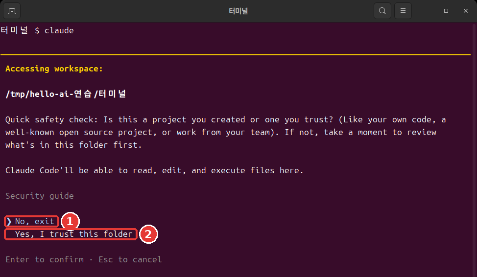
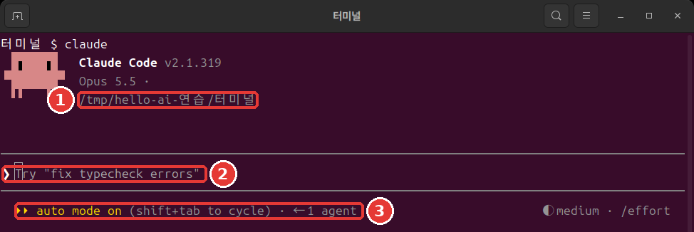
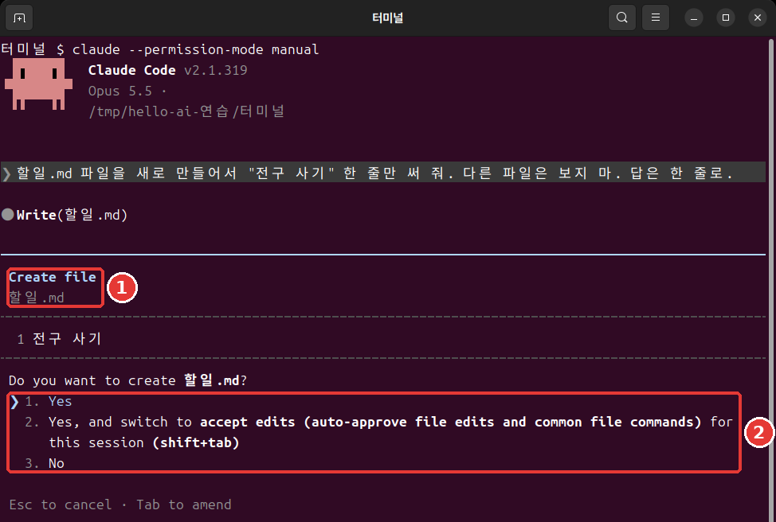

# 第4章 最初のセッション

<Badge type="tip" text="必須" /> このステップを進めるなら、必ず読んでください。

> **一言まとめ**: 作業するフォルダに移動して、`claude` と入力します。信頼の確認画面で `Yes` を選び、言葉で仕事を頼みます。止めるときは `Esc`、終わるときは `/exit` です。

**セッション**（Session）は、Claude Codeを起動してから終了するまでの、ひとまとまりの会話です。第2章で作ったフォルダで、最初のセッションを開いてみます。

## フォルダから始める

まず、作業するフォルダに移動します。そのあと `claude` と入力します。[^start]

Mac・Linuxでは、こう入力します。

```bash
cd ~/hello-ai-연습/터미널
claude
```

Windows PowerShellでは、こう入力します。

```powershell
cd $HOME\hello-ai-연습\터미널
claude
```

**順番が大事です。** `claude` は、今いるフォルダを作業フォルダにして始まります。最初の画面にも、そのフォルダが表示されます。[^header] 仕事と関係のないフォルダで起動すると、そのフォルダのファイルを前にして仕事をすることになります。

- **いまひとつの例**: ターミナルを開いてすぐに `claude` と入力する。
- **よい例**: `cd` でフォルダに入り、`pwd` で確かめてから `claude` と入力する。

<Quiz id="ch804-start" />

## 信頼の確認画面

初めて開くフォルダでは、まずこんな画面が出ます。



実際のターミナルウィンドウを撮った画像です。色やフォントは、自分のターミナルの設定によって違います。下の文字のボックスは、同じ画面を文字に書き起こしたものです。[^screens]

```text
 Accessing workspace:

 ~/hello-ai-연습/터미널

 Quick safety check: Is this a project you created or one you trust? (Like your own code, a
 well-known open source project, or work from your team). If not, take a moment to review what's in
 this folder first.

 Claude Code'll be able to read, edit, and execute files here.

 Security guide

 ❯ No, exit
   Yes, I trust this folder

 Enter to confirm · Esc to cancel
```

意味はこうです。「自分で作ったか、信頼できるフォルダですか？　そうでなければ、まず中に何があるかを確かめてください。Claude Codeは、ここにあるファイルを読み、直し、実行できます。」

**ここでそのままEnterを押すと、プログラムが終了します。** `❯` の印が `No, exit` にあるからです。下矢印キーを1回押して `Yes, I trust this folder` に移動してから、Enterを押してください。ターミナルでは、メニューをクリックして選ぶことはできません。[^arrows]

このフォルダは自分でさっき作ったものなので、信頼してかまいません。人からもらったフォルダなら、まず中を確かめてください。

<Quiz id="ch804-trust" />

## 最初の画面を読む

`Yes` を選ぶと、こんな画面が出ます。



```text
 ▐▛███▛█   Claude Code v2.1.318
▝▜██████▀  Opus 5.5 · Claudeの料金プラン名
 ▝▝   ▝▝   ~/hello-ai-연습/터미널

▎ Auto mode is now Claude Code's default permission mode.
▎ Auto mode lets Claude handle permission prompts automatically. Claude checks each tool call for
▎ risky actions and prompt injection before executing, runs the ones it assesses as lower-risk, and
▎ blocks the rest.
▎ https://code.claude.com/docs/en/permission-modes

────────────────────────────────────────────────────────────
❯ Try "create a util logging.py that..."
────────────────────────────────────────────────────────────
  ⏵⏵ auto mode on (shift+tab to cycle)                ◐ medium · /effort
```

上から読んでみてください。

- **いちばん上の3行**: バージョン、今のモデル、作業フォルダです。[^header] フォルダが思っていた場所か、必ず見てください。
- **Auto modeの案内**: 初めて実行したときに出る英語のお知らせです。今は読まずに進んでかまいません。大事なことは、すぐ下で日本語で説明します。
- **`❯` の行**: 入力欄です。`Try` で始まる文は例です。自分の文を入力すると消えます。
- **いちばん下の行**: 左は今の**権限モード**です。権限モードは、Claudeが聞かずにやってよい仕事の範囲です。[^mode] 右の `medium` は第13章で扱います。

ターミナルの `claude` は、**自動モード**（auto）で始まります。行動を前もってチェックする別のAIが、危なそうなものを止めます。ただし、自動モードは許可の画面を減らしてくれるだけで、安全を保証するものではありません。[^auto]

最初は、Claudeが何をしようとしているのかを自分の目で見るほうが安心です。`Shift + Tab` を1回押して、手動モードに切り替えてみてください。[^shift-tab] いちばん下の行が、こう変わります。

```text
  ⏸ manual mode on · ? for shortcuts                  ◐ medium · /effort
```

手動モードでは、ファイルを直したりコマンドを実行したりする前に、たいてい先に聞いてきます。[^manual] モードについては、第7章で詳しく扱います。

::: details 詳しく（クリックして開く）
- 自動モードが使えないセッションは、手動で始まります。[^auto] 今どのモードかは、いちばん下の行を見て判断してください。
- 最初から `claude --permission-mode manual` で始めてもかまいません。[^manual]
:::

<Quiz id="ch804-screen" />

## 最初の依頼 — 議事録を作る

いよいよ仕事を頼んでみます。同僚に話しかけるように書けば大丈夫です。[^colleague] 入力欄にこの文を入れて、Enterを押してください。

```text
inboxの会議メモを読んで、회의록.md として保存して。答えは1行で。
```

`.md` は、マークダウン（Markdown）のファイルです。メモ帳でも開ける、文字だけのファイルです。

依頼は具体的なほどうまくいきます。

- **いまひとつの例**: `議事録を作って` — 何を読んでどこに置くかを、Claudeが推測しなければなりません。
- **よい例**: 上の文 — 読むもの、保存する場所、答えの長さが全部そろっています。

手動モードなら、Claudeはメモを読み、ファイルの内容を見せてから、こう聞いてきます。



```text
 Do you want to create 회의록.md?
 ❯ 1. Yes
   2. Yes, and switch to accept edits (auto-approve file edits and common file commands) for this
      session (shift+tab)
   3. No

 Esc to cancel · Tab to amend
```

内容にざっと目を通して、`1. Yes` でEnterを押してください。[^yes] 2番は、このセッションではファイルの修正をもう聞かないように切り替える選択で、3番は断る選択です。自動モードのままなら、この画面なしで保存されることがあります。このガイドの画面の記録は、手動モードのものです。

終わると、こんなふうに答えます。

```text
● 회의록.mdに整理しましたが、メモの10/27(月)と11/3(月)は2026年のカレンダーでは火曜日なので、ファイルに要確認と
  記しておきました。
```

曜日の話が出ても驚かないでください。練習用メモの曜日は作り話なので、カレンダーと合いません。Claudeがそのことに気づいたのです。答えの文は、実行するたびに変わることがあります。入力欄に、次の依頼の提案がうっすら表示されることもあります。使わなくてかまいません。

同じメモで作った成果物は、[4장-회의록.txt](/practice/cli/results/4장-회의록.txt)にあります。自分の結果と見比べてみてください。まったく同じである必要はありません。

<Quiz id="ch804-first" />

## 仕事を頼む・止める

セッションは会話です。前の仕事に続けて頼むことができます。今度は、ファイルを直してみます。

```text
회의록.md のいちばん最初の行に「下書き」という1行を入れて。答えは1行で。
```

今度は、変わる行を見せてから聞いてきます。`+` が付いた行が、新しく入る行です。

```text
 1 +下書き
 2  # 街角カフェ 週間会議 議事録
 3
 4  - **日時:** 10/27(月)
```

その下で、`Do you want to make this edit to 회의록.md?` と聞いてきます。変わる行の形は、自分の議事録によって違います。

許可の画面は、読んでから選んでください。自分が頼んだ仕事と合っているかを確かめられる瞬間です。

Claudeがおかしな方向に進んだら、**`Esc`** を押してください。実行中だった仕事が取り消され、Claudeは次の指示を待ちます。いつでも割り込んで、方向を変えられます。[^esc]

1つ覚えておいてください。止めても、**それまでにした仕事は残ります。**[^esc-keep] すでに保存されたファイルが、ひとりでに元に戻ることはありません。元に戻す方法は第7章で学びます。

<Quiz id="ch804-stop" />

## 終わる

入力欄にこう入力して、Enterを押します。[^exit]

```text
/exit
```

ターミナルのプロンプトに戻ってきます。これでClaude Codeの外にいます。ファイルができたか確かめてみてください。

```bash
ls
cat 회의록.md
```

PowerShellでハングルが文字化けしたら、`Get-Content -Encoding UTF8 회의록.md` で見ます。

空の入力欄で `Ctrl + D` を2回押しても終わります。[^ctrl-d] 最初は、文字で入力する `/exit` がいちばん迷いません。終えた会話を続ける方法は、第6章で扱います。

ここで、2つの場所を見分けてみましょう。これから先、コマンドをどこに入力するかは、これで判断します。

- **ターミナル**: カーソルの前の記号が `%`、`$`、`>` です。`cd`、`ls`、`claude` はここに入力します。
- **Claudeの入力欄**: 先頭が `❯` で、上下に線があります。言葉での依頼と、`/` で始まるコマンドはここに入力します。

`/exit` をターミナルに入力すると、エラーになります。反対に、`ls` や `cd` のようなターミナルのコマンドを入力欄に入力すると、コマンドとしては実行されず、Claudeに送る言葉になります。あとの章で「ターミナルで」やるように書かれたコマンドは、入力欄が見えていたら `/exit` で抜けてから入力してください。

<Quiz id="ch804-exit" />

## やってみよう

1. `cd` で練習用フォルダに入り、`pwd` で確かめます。
2. `claude` を起動して、信頼の確認画面で `Yes, I trust this folder` を選びます。
3. 最初の画面で、フォルダと権限モードを読みます。`Shift + Tab` で手動モードに切り替えます。
4. 議事録の依頼を送り、許可の画面を読んでから `1. Yes` を選びます。
5. 「下書き」の行を入れてもらいます。
6. `/exit` で抜けて、`cat` でファイルを見ます。

自分に聞いてみてください。ファイルはできたか？　メモの決定事項とやることが、漏れなく入っているか？　メモにない内容がまぎれ込んでいないか？　AIの結果をメモと照らし合わせる習慣は、ここから始まります。

## まとめ

- `cd` でフォルダに入ってから `claude` を起動する。
- 信頼の確認画面の初期の選択は `No, exit`。下矢印キーで `Yes` を選ぶ。
- 最初の画面で、フォルダと権限モードを読む。ターミナルは自動モードで始まり、`Shift + Tab` で切り替える。
- 依頼には、読むものと保存する場所を書く。許可の画面は、読んでから選ぶ。
- `Esc` は停止。それまでにした仕事は残る。
- `/exit` で終わり、結果はメモと照らし合わせる。
- 記号が `%`、`$`、`>` ならターミナル、`❯` ならClaudeの入力欄。

## 用語まとめ

| 用語 | 読み方 | 一言でいうと |
|---|---|---|
| Session | セッション | Claude Codeを起動してから終了するまでの、ひとまとまりの会話 |
| Permission mode | パーミッションモード | 聞かずにやってよい仕事の範囲（権限モード） |
| Auto mode | オートモード | 別のAIが前もってチェックし、許可の画面を減らすモード |
| Manual mode | マニュアルモード | たいてい先に聞いてくるモード |
| Markdown | マークダウン | 見出しや箇条書きを記号で書く、文字だけのファイル形式 |

<ChapterDone :chapter="804" />

次の章: [第5章 入力のコツとコマンド](05-input-commands.md)

[^screens]: この章とあとの章の画像は、LinuxのターミナルでClaude Code 2.1.319で撮りました。フォルダのパスは練習用の一時フォルダなので自分の画面とは違い、料金プランの名前は隠しました。画面のフォルダのパスと料金プランの名前は、この講座に合わせて書き換えました。文字のボックスは、コピーして使いやすいように別に書き起こしたものです。別の実行から持ってきたところがあるので、パスやファイル名が画像と違うことがあります。
[^start]: Claude Code 公式ドキュメント、「Quickstart」。"Open your terminal in any project directory and start Claude Code:" https://code.claude.com/docs/en/quickstart （確認日 2026-11-06）
[^header]: Claude Code 公式ドキュメント、「Quickstart」。"The Claude Code prompt appears with the version, current model, and working directory shown above it." https://code.claude.com/docs/en/quickstart （確認日 2026-11-06）
[^arrows]: Claude Code 公式ドキュメント、「Terminal guide for new users」。"You can't click on things in the terminal. Use the arrow keys to move around." https://code.claude.com/docs/en/terminal-guide （確認日 2026-11-06）
[^mode]: Claude Code 公式ドキュメント、「Choose a permission mode」。"A permission mode sets which actions Claude can take in a session without asking you first." https://code.claude.com/docs/en/permission-modes （確認日 2026-11-06）
[^auto]: Claude Code 公式ドキュメント、「Choose a permission mode」。"With Claude Code v2.1.283 or later, auto mode is the built-in starting permission mode for interactive terminal and VS Code sessions." / "A separate classifier model reviews actions before they run, blocking anything that escalates beyond your request, targets unrecognized infrastructure, or appears driven by hostile content Claude read." / "Auto mode reduces permission prompts but does not guarantee safety." / "When the flag, a settings file, or the built-in default selects `auto` but auto mode isn't available to the session, Claude Code starts the session in Manual instead." https://code.claude.com/docs/en/permission-modes （確認日 2026-11-06）
[^shift-tab]: Claude Code 公式ドキュメント、「Choose a permission mode」。"From `auto`, the first press switches to `default`, and the cycle then runs `default` → `acceptEdits` → `plan`." https://code.claude.com/docs/en/permission-modes （確認日 2026-11-06）
[^manual]: Claude Code 公式ドキュメント、「Choose a permission mode」。"In Manual mode, Claude Code stops and asks you before most actions that edit files, run shell commands, or reach the network." https://code.claude.com/docs/en/permission-modes ・「Best practices for Claude Code」。"`Shift+Tab` in the session cycles through the permission modes, Manual included, or start with `claude --permission-mode manual` from your shell." https://code.claude.com/docs/en/best-practices （確認日 2026-11-06）
[^colleague]: Claude Code 公式ドキュメント、「Quickstart」。"Talk to Claude like you would a helpful colleague." https://code.claude.com/docs/en/quickstart （確認日 2026-11-06）
[^yes]: Claude Code 公式ドキュメント、「Quickstart」。"If it asks before making the change, select Yes to approve." https://code.claude.com/docs/en/quickstart （確認日 2026-11-06）
[^esc]: Claude Code 公式ドキュメント、「How Claude Code works」。"The running tool call is canceled and Claude waits for your next instruction." / "You can interrupt at any point to steer Claude in a different direction, provide additional context, or ask it to try a different approach." https://code.claude.com/docs/en/how-claude-code-works （確認日 2026-11-06）
[^esc-keep]: Claude Code 公式ドキュメント、「Interactive mode」。"Stop the current response or tool call mid-turn so you can redirect. Claude keeps the work done so far." https://code.claude.com/docs/en/interactive-mode （確認日 2026-11-06）
[^exit]: Claude Code 公式ドキュメント、「Commands」。"Exit the CLI." https://code.claude.com/docs/en/commands （確認日 2026-11-06）
[^ctrl-d]: Claude Code 公式ドキュメント、「Terminal guide for new users」。"Type `exit` or press `Ctrl + D` twice on an empty prompt to leave Claude Code." https://code.claude.com/docs/en/terminal-guide （確認日 2026-11-06）
