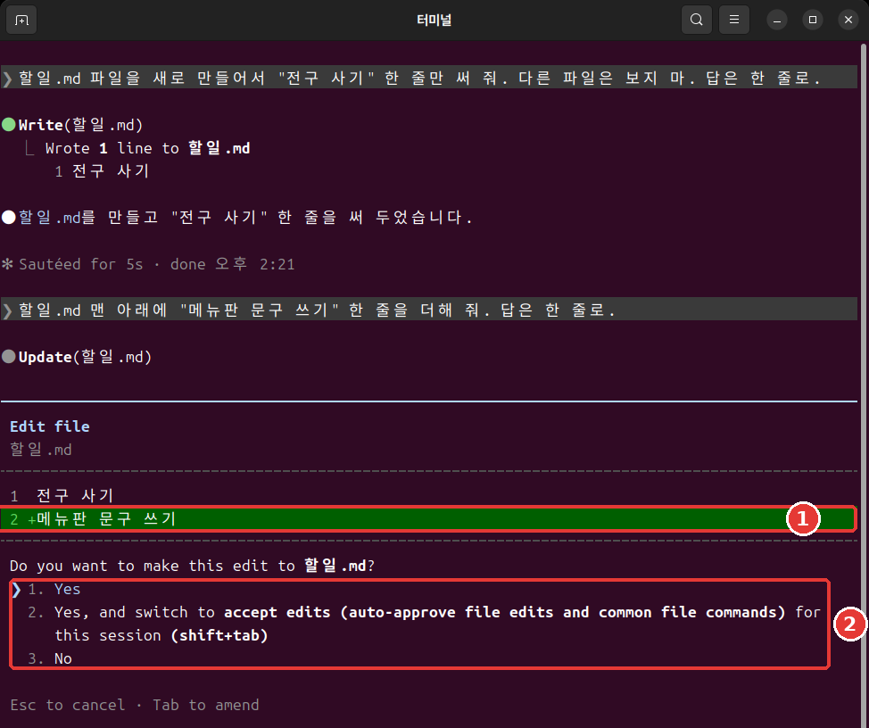
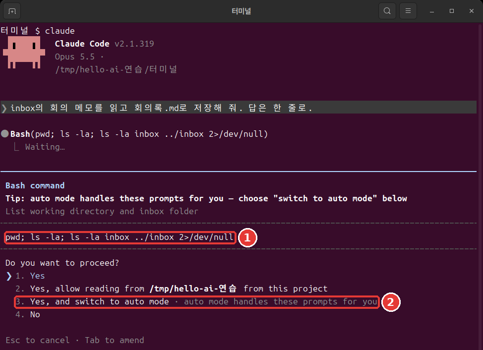
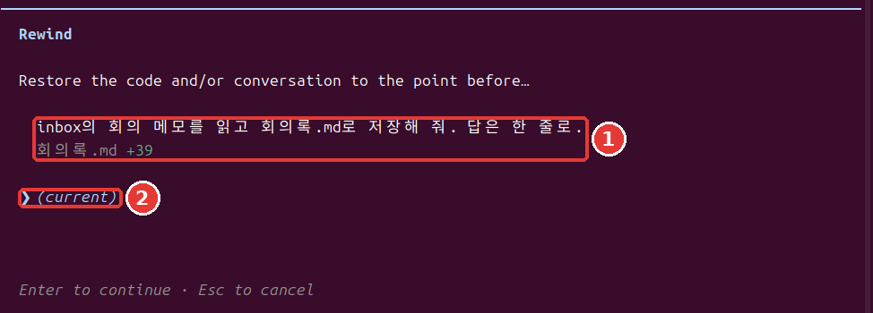
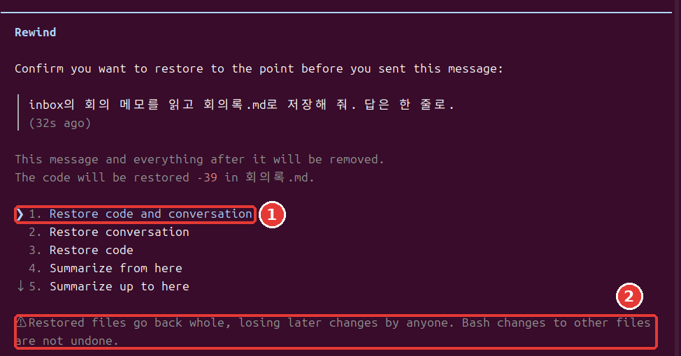

# 第7章 許可と元に戻す操作

<Badge type="tip" text="必須" /> この段階を進めるなら、必ず読んでください。

> **一言まとめ**: Claudeが聞かずにできることは、権限モードとルールが決めます。うまくいかなかったらEscを2回押して巻き戻せますが、元に戻らないこともあります。

全部覚える必要はありません。[^run] まずは許可の画面の読み方から身につければ大丈夫です。

## 4つの権限モード

**権限モード**（Permission mode）は、Claudeが聞かずにしてよいことの範囲です。[^modes] 今のモードは、画面のいちばん下の行に表示されます。Shift+Tabを押すたびに表の順に切り替わり、いちばん下の次は、いちばん上に戻ります。

| わかりやすい名前 | いちばん下の行の文字 | すること |
|---|---|---|
| 自動 | `⏵⏵ auto mode on` | 別のAIが確かめて進める |
| 手動 | `⏸ manual mode on` | ほとんど先に聞く |
| 編集許可 | `⏵⏵ accept edits on` | ファイルの作業は聞かない |
| 計画 | `⏸ plan mode on` | 調査と提案だけする |

- **自動（auto）**: ターミナルで `claude` を起動すると、このモードで始まります。行動を事前に確かめる別のAIが、危なそうなものを止めます。[^auto] 人が代わりに見てくれるわけではありません。自動モードは許可の画面を減らしてくれるだけで、安全を保証するものではありません。[^auto]
- **手動（manual）**: ファイルの変更、シェルのコマンド、ネットワークへのアクセスのほとんどを、先に聞きます。[^modes] 安全ですが、10回くらい続くと、読まずに承認しがちになります。[^practice]
- **編集許可（accept edits）**: 作業フォルダの中でファイルを作ったり直したりすることを、聞きません。[^modes] よくあるファイルのコマンドも、聞かずに承認します。
- **計画（plan）**: 調べて提案するだけで、直しはしません。[^modes] 大きな作業を任せる前に、どう進めるかをまず見たいときに便利です。

::: details 詳しく（クリックして開く）
自動モードで3回続けて止められると、いったん止まって、またあなたに聞くようになります。[^practice]
:::

最初に練習するときは、手動で始めてみてください。Claudeが何をしているのかが、目になじみます。ターミナルでこう入力します。[^practice]

```bash
claude --permission-mode manual
```

<Quiz id="ch807-modes" />

## 許可の画面を読む

手動モードで「inboxの会議メモを読んで、회의록2.md として保存して。答えは1行で。」と頼むと、こんな画面が出ます。許可の画面は、Claudeがしようとしていることを先に見せて、選択肢を出します。[^prompt]

```text
 Do you want to create 회의록2.md?
 ❯ 1. Yes
   2. Yes, and switch to accept edits (auto-approve file edits and common file commands) for this
      session (shift+tab)
   3. No

 Esc to cancel · Tab to amend
```

上下の矢印キーで選んで、Enterを押します。1番は、今回1回だけ許可します。2番は、このセッションを編集許可モードに切り替えます。3番は、しません。Escはキャンセルです。

すでにあるファイルを直すときは、`Do you want to make this edit to 회의록2.md?` と聞いて、変わる行も見せてくれます。先頭に `+` が付いた行が、新しく入る行です。



シェルのコマンドを実行するときは、少し形の違う画面が出ます。実行するコマンドをそのまま見せてくれるので、まず読んでください。自動モードが使えるなら、自動モードに切り替える選択肢も付きます。[^switch-auto]



`Yes, allow reading from` で始まる選択肢は、フォルダを読んでもよいかを聞いています。どのフォルダか、名前を読んでから選んでください。[^symbols]

画面が出たら、こう自分に聞いてみてください。

- 自分が言ったそのファイルか？
- 変わる内容は、自分が頼んだものか？
- 頼んでいないことが混ざっていないか？

いまひとつの習慣は、画面が出たとたんにEnterを押すことです。よい習慣は、ファイル名と変わる行を読んでから選ぶことです。その数秒が、間違った変更を前もって防いでくれます。

シェルのコマンドの許可の画面には、`Yes, and don't ask again` が出ることがあります。これを選ぶと、ルールが設定ファイルに保存され、次のセッションにも引き継がれます。[^local-file] ファイル変更の承認は、セッションが終わるまでしか続きません。[^prompt] 保存されるほうは長く残るので、意味がわかっているときだけ選んでください。

<Quiz id="ch807-prompt" />

## 確認を飛ばすオプションは使わないでください

インターネットの記事で、`--dangerously-skip-permissions` を見かけることがあるかもしれません。権限の確認を飛ばすオプションです。[^skip] 使わないでください。

このオプションは、うっかりミスも、プロンプトインジェクション（5章で見た、文章の中に隠した指示でAIを操る攻撃）も防いでくれません。[^bypass] そのため、自分のパソコンから切り離した練習用の環境でだけ使います。公式ドキュメントは、インターネットにつながっていないコンテナや仮想マシン（自分のパソコンの中に別に作った、隔離されたパソコン）を例に挙げています。[^bypass]

許可の画面がわずらわしいなら、別の道があります。よく使う作業だけを、次の節の許可ルールで開けてあげればよいのです。

<Quiz id="ch807-skip" />

## 許可ルール allow・ask・deny

モードが大きな枠なら、ルールは細かい項目です。ルールは **ツール** ごとに決めます。ツールは、Claudeが使う機能です。たとえば `Read` はファイルを読むこと、`Bash` はシェルのコマンドです。

ルールは3種類です。[^rules]

- **allow**: 聞かずに許可します。
- **ask**: 使うたびに確認します。
- **deny**: 使えないようにふさぎます。

ルールは設定ファイルに書いておきます。次の節で、実際に1つ作ってみます。

ルールはdeny、ask、allowの順に調べ、先に当てはまったものが勝ちます。そのため、広くふさいだdenyに、allowで穴を開けることはできません。[^rules] 拒否ルールは、どのモードでもふさぎます。[^bypass]

形はこうです。ツール名の後ろのかっこの中に、対象を書きます。`Bash(ls *)` は `ls` コマンドだけに当てはまります。`Bash(*)` と書くと、すべてのシェルのコマンドに当てはまります。[^rules] アスタリスクは広く当てはまるので、必要なぶんだけ使ってください。

セッションの中で `/permissions` と入力すると、ルールを見て管理できます。左右の矢印キーで、上のタブを移動します。

```text
  Permissions  Recently blocked   Allow   Ask   Deny   Auto mode   Workspace
```

<Quiz id="ch807-rules" />

## 拒否ルールを使ってみる

秘密のファイルを、Claudeが読めないようにふさいでみます。パスワードや認証キーのようなログイン情報が入ったファイルは、権限ルールでふさいでおくとよいです。[^creds] **本物のパスワードは使わずに**、偽のファイルで練習します。

やることは3つです。偽の秘密ファイルを作り、そのファイルをふさぐ設定ファイルを作り、Claudeに読んでほしいと頼んでみます。

`/exit` で出て、ターミナルで練習用フォルダに移動します。MacとLinuxは、下を丸ごと貼り付けます。Windows PowerShellは、すぐ下の「Windows PowerShellなら」の方法に従ってください。

```bash
mkdir 비밀
echo '偽のパスワード: cafe-1234' > 비밀/암호.txt
mkdir -p .claude
cat > .claude/settings.json <<'EOF'
{
  "permissions": {
    "deny": ["Read(./비밀/**)"]
  }
}
EOF
```

この箱を1行ずつ読んでみます。

- `mkdir 비밀`: `비밀`（秘密）フォルダを作ります。
- `echo '…' > 비밀/암호.txt`: 引用符の中の文字をファイルに保存します。`>` は、出力をファイルに保存する記号です。
- `mkdir -p .claude`: `.claude` フォルダを作ります。すでにあってもエラーになりません。
- `cat > .claude/settings.json <<'EOF'`: 次の行から `EOF` までを、このファイルに保存します。あとの章でも、ファイルを作るときにこの形を使います。
- `{` から `}` まで: 設定ファイルに入る内容です。`"deny"` の欄に、ふさぐ対象を書きました。

貼り付けたあと、まだ実行されていなければ、Enterをもう一度押してください。何も表示されなければ成功です。`ls` で `비밀` フォルダができたか確かめてください。

**Windows PowerShellなら**: `mkdir 비밀`、`mkdir .claude` でフォルダを作ります。`notepad 비밀\암호.txt` でメモ帳を開き、`偽のパスワード: cafe-1234` を入れます。`notepad .claude\settings.json` には、上の箱から `cat` で始まる行と `EOF` の行を除いて、その間だけを入れます。新しいファイルを作るか聞かれたら `はい` を押し、`Ctrl + S` で保存して閉じます。この方法は実行して確かめていません。

`Read(./비밀/**)` は、`비밀` フォルダの中のすべてを読まないで、という意味です。ターミナルで `claude` を起動して、「비밀/암호.txt ファイルを読んで、内容を教えて。」と頼んでみてください。

同じ依頼を1回で終わる実行（[10章](10-headless-automation.md)で学ぶ方式）で送ったところ、Claudeはファイルを読めなかったと答え、内容を見せませんでした。文は実行するたびに変わることがあります。確かめることは1つです。答えに `cafe-1234` が出たか？

この実習が示しているのは、Claudeの読み込みの要求がふさがれた、という事実ひとつだけです。どんな方法でも絶対に読めない、という意味に広げて受け取らないでください。ファイル名を指定せずに読むコマンドには、このルールは適用されません。[^deny-limit] 本物のパスワードは、作業フォルダに置かないのがいちばん安全です。

<Quiz id="ch807-deny" />

## 巻き戻し

Claudeが直したファイルは、自動で追跡されます。依頼を送るたびに、戻れる地点が1つずつできます。[^checkpoint] この地点を **チェックポイント**（Checkpoint）といいます。

入力欄が空のときにEscを2回押すと、`Rewind` メニューが開きます。`/rewind` と入力してもかまいません。**入力欄が空になっている必要があります。** 文字があると、メニューの代わりに文字が消えます。[^checkpoint] 消えた文章は、上矢印キーで呼び戻せます。[^esc-up]

メニューには、あなたが送ったメッセージと、変わったファイルが出ます。上矢印キーでメッセージを選んでEnterを押すと、選択肢が出ます。[^checkpoint]





| 選択肢 | 意味 |
|---|---|
| Restore code and conversation | ファイルと会話の両方を戻す |
| Restore conversation | 会話だけ戻す |
| Restore code | ファイルだけ戻す |
| Summarize from here | ここから後の会話を要約 |
| Summarize up to here | ここより前の会話を要約 |

初めてなら、いちばん上を選んでください。やめるときはEscです。メニューの下には、こんな警告が出ます。

```text
  ⚠ Restored files go back whole, losing later changes by anyone. Bash changes to other files are
  not undone.
```

ファイルは丸ごと戻るので、そのあとに誰が直したとしても、その変更も消えるという意味です。

実習で、ファイルに行をもう1つ入れさせてから、いちばん上の選択肢で戻してみました。ファイルはその前の内容に戻り、送ったメッセージは入力欄にまた入っていました。直して送り直すか、消せば大丈夫です。

Claudeの作業を止めたいときは、Escを **1回** だけ押します。そこまでにした作業は残ります。[^practice]

<Quiz id="ch807-rewind" />

## 元に戻せないもの

「Escを2回押せば全部戻る」と考えると困ります。巻き戻しが扱うのは、**Claudeの編集ツールが直したファイル** だけです。次のものは戻りません。[^limits]

- シェルのコマンドだけで変わったファイル
- サブエージェント（Claudeが作業の一部を切り分けて任せる補助役、[9章](09-skills-extensions.md)）が直したほかのファイル
- 自分で直接直したファイルや、ほかのセッションでの編集（ほとんどの場合）
- メールの送信や外部のデータベースの変更のように、パソコンの外でしたこと[^remote]

こうした変更を戻すには、**Git** のようなバージョン管理を使ってください。[^limits] Gitは、ファイルの状態を記録しておくツールです。ゲームのセーブデータに似ています。[12章](12-parallel-remote.md)で、初めて記録を残してみます。巻き戻しは便利な安全網ですが、唯一の安全網にはしないでください。

<Quiz id="ch807-limits" />

## やってみよう

1. 練習用フォルダで `claude --permission-mode manual` で始め、Shift+Tabを4回押して、モードがひと回りするのを見ます。
2. 회의록2.mdを作ってほしいと頼みます。続けて「회의록2.mdのいちばん最初の行に「下書き」という1行を入れて。答えは1行で。」と頼みます。許可の画面を読んで、1番を選びます。
3. 入力欄が空のときにEscを2回押します。最後の依頼を選んで、`Restore code and conversation` を選びます。「下書き」の行は消えましたか？
4. 入力欄に戻ってきた文章をEsc 2回で消してから、`/exit` で出ます。ターミナルで拒否ルールを作り、`claude` を起動して `비밀/암호.txt` を読んでほしいと頼んでみます。

自分に聞いてみてください。自分のClaudeが許可なしにできることを説明できるか？ 巻き戻しで戻らないことを3つ挙げられるか？

## まとめ

- 権限モードは4つで、Shift+Tabで切り替える。対話形式は自動で始まり、自動は安全を保証しない。
- 許可の画面は、ファイル名と変わる行を読んでから選ぶ。`--dangerously-skip-permissions` は使わない。
- ルールはdeny、ask、allowの順に調べる。拒否ルールはすべてのモードでふさぐ。
- 入力欄が空のときにEscを2回押すと、巻き戻しメニューが開く。
- 巻き戻しは、Claudeの編集ツールが直したファイルだけを戻す。それ以外はGitが必要。

## 用語まとめ

| 用語 | 読み方 | 一言でいうと |
|---|---|---|
| Permission mode | パーミッションモード | 聞かずにしてよいことの範囲 |
| allow / ask / deny | アラウ / アスク / ディナイ | 許可 / 確認 / 拒否のルール |
| Checkpoint | チェックポイント | 戻ることのできる地点 |
| Git | ギット | ファイルの状態を記録しておくツール |

<ChapterDone :chapter="807" />

次の章: [第8章 プロジェクトの記憶と設定](08-memory-settings.md)

[^run]: この章の画面は、2026年11月6日にLinuxでClaude Code 2.1.318を実行した結果です。
[^symbols]: 図のコマンドの中の `;` と `2>/dev/null` の意味は、[コマンド辞典](command-reference.md)にあります。
[^local-file]: 保存されるファイルは `.claude/settings.local.json` です。設定ファイルは[8章](08-memory-settings.md)で扱います。
[^modes]: Claude Code公式ドキュメント、「Choose a permission mode」。"A permission mode sets which actions Claude can take in a session without asking you first." / "In Manual mode, Claude Code stops and asks you before most actions that edit files, run shell commands, or reach the network." / "lets Claude create and edit files in your working directory without prompting" / "Plan mode tells Claude to research and propose changes without making them." https://code.claude.com/docs/en/permission-modes （確認日 2026-11-06）
[^auto]: Claude Code公式ドキュメント、「Choose a permission mode」。"With Claude Code v2.1.283 or later, auto mode is the built-in starting permission mode for interactive terminal and VS Code sessions." / "A separate classifier model reviews actions before they run, blocking anything that escalates beyond your request, targets unrecognized infrastructure, or appears driven by hostile content Claude read." / "Auto mode reduces permission prompts but does not guarantee safety." https://code.claude.com/docs/en/permission-modes （確認日 2026-11-06）
[^practice]: Claude Code公式ドキュメント、「Best practices for Claude Code」。"After three blocks in a row (or twenty in total), auto mode pauses and goes back to asking you." / "Safe, but after the tenth prompt you start approving without reading, and nothing moves while you're away from the keyboard." / "`Shift+Tab` in the session cycles through the permission modes, Manual included, or start with `claude --permission-mode manual` from your shell." / "`Esc` stops Claude mid-action and keeps everything up to that point, so you can redirect without losing work." https://code.claude.com/docs/en/best-practices （確認日 2026-11-06）
[^prompt]: Claude Code公式ドキュメント、「Configure permissions」。"A permission prompt shows what Claude is about to do, followed by your options." / "Claude Code saves the rule to `.claude/settings.local.json` at the root of the git repository" / "A file-modification approval isn't saved to the file: as the table shows, it lasts until the session ends." https://code.claude.com/docs/en/permissions （確認日 2026-11-06）
[^skip]: Claude Code公式ドキュメント、「CLI reference」。"Skip permission prompts." https://code.claude.com/docs/en/cli-reference （確認日 2026-11-06）
[^bypass]: Claude Code公式ドキュメント、「Choose a permission mode」。"Only use this mode in isolated environments like containers, VMs, or dev containers without internet access, where Claude Code cannot damage your host system." / "`bypassPermissions` offers no protection against prompt injection or unintended actions." / "Deny rules block in every mode, including `bypassPermissions`." https://code.claude.com/docs/en/permission-modes （確認日 2026-11-06）
[^rules]: Claude Code公式ドキュメント、「Configure permissions」。"Allow rules let Claude Code use the specified tool without manual approval." / "Ask rules prompt for confirmation whenever Claude Code tries to use the specified tool." / "Deny rules prevent Claude Code from using the specified tool." / "Rules are evaluated in order: deny, then ask, then allow." / "An allow rule can't carve an exception out of a deny rule." / "`Bash(ls *)` matches `ls`" / "`Bash(*)` is equivalent to `Bash` and matches all Bash commands." / "You can view and manage Claude Code's tool permissions with `/permissions`." https://code.claude.com/docs/en/permissions （確認日 2026-11-06）
[^creds]: Claude Code公式ドキュメント、「Explore the .claude directory」。"Use permission rules to deny reads of credential files" https://code.claude.com/docs/en/claude-directory （確認日 2026-11-06）
[^checkpoint]: Claude Code公式ドキュメント、「Checkpointing」。"Claude Code automatically tracks Claude's file edits as you work, allowing you to quickly undo changes and rewind to previous states if anything gets off track." / "Every prompt you send that starts a turn creates a new checkpoint" / "Run `/rewind`, or press `Esc` twice when the prompt input is empty, to open the rewind menu." / "If the prompt input contains text, double `Esc` clears it instead of opening the menu." / "Restore code and conversation: revert both code and conversation to that point" / "Restore conversation: rewind to that message while keeping current code" / "Restore code: revert file changes while keeping the conversation" / "Summarize from here: compress the conversation from this point forward into a summary, freeing context window space" / "Summarize up to here: compress the conversation before this point into a summary, keeping later messages intact" https://code.claude.com/docs/en/checkpointing （確認日 2026-11-06）
[^esc-up]: Claude Code公式ドキュメント、「Interactive mode」。"When the prompt input contains text, double `Esc` clears it and saves the draft to history so `Up` recalls it." https://code.claude.com/docs/en/interactive-mode （確認日 2026-11-06）
[^limits]: Claude Code公式ドキュメント、「Checkpointing」。"A file that only Bash commands changed isn't tracked and stays as it is." / "To revert it, use version control, such as Git." / "The subagent's edits to other files stay, so use version control, such as Git, to revert them." / "Manual changes you make to files outside of Claude Code and edits from other concurrent sessions are normally not captured, unless they happen to modify the same files as the current session." https://code.claude.com/docs/en/checkpointing （確認日 2026-11-06）
[^remote]: Claude Code公式ドキュメント、「How Claude Code works」。"Actions that affect remote systems (databases, APIs, deployments) can't be checkpointed." https://code.claude.com/docs/en/how-claude-code-works （確認日 2026-11-06）
[^deny-limit]: Claude Code公式ドキュメント、「Configure permissions」。"They don't apply to a command that reads files without naming them" https://code.claude.com/docs/en/permissions （確認日 2026-11-06）
[^switch-auto]: Claude Code公式ドキュメント、「Choose a permission mode」。"Claude Code adds **Yes, and switch to auto mode** to a Bash command's permission prompt." https://code.claude.com/docs/en/permission-modes （確認日 2026-11-06）
